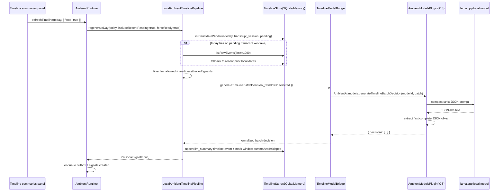

# On-device Timeline Summaries — 端上 LLM 生成 Ambient Timeline 卡片

> 生成日期：2026-05-18（首版）  
> 最近更新：2026-05-18（多模型适配 + prompt hardening 真机回归后修订；同日追加 §12 Cloud LLM Action handoff UI scaffold）  
> 范围：`proactive-ai-frontend` Ambient Timeline pipeline + `capacitor-plugins/ambient-ai` iOS LLM bridge + Ambient Timeline → Cloud LLM Action handoff UI  
> 分支：`feat/ambient-llm`  
> 相关提交：`89499008 feat(ambient): add on-device timeline summaries` + 多轮 hardening 修复；`8585760e refactor(ambient): consolidate timeline → cloud LLM handoff onto existing "Open →" CTA` + 前置 handoff scaffold

---

## 1. Summary

本轮 session 构建了 Ambient Timeline 的端上 LLM summary feature：移动端采集到的 transcript candidate windows 不再只依赖 rule-based 事件，而是可以通过 iOS 本地模型生成 `llm_summary` Timeline 卡片。新链路保留原有 rule-based cards，并通过 `generationSource: "llm_summary"`、`sourceWindowIds`、`idempotencyKey` 等元数据把 LLM summary cards 与 rule cards 明确隔离。

功能入口包括：

- 自动调度：Ambient runtime 在前台按 15 分钟 cadence 尝试刷新 Timeline。
- 手动测试：Control → Ambient → Timeline summaries 面板中的 `Summary now`。
- 端上模型：`AmbientModelsPlugin.generateTimelineBatchDecision()` 调用已下载并 verify 的本地 LLM。

实现过程中还修复了真机调试中的几类 blocker：native plugin JS facade 缺 batch 方法、端上 generation timeout、模型输出 invalid JSON、跨午夜后只看当天导致不触发 LLM、以及手动测试被 readiness/backoff guard 拦截。

## 2. 动机 & 边界

| 问题 | 旧状况 | 新状况 |
|---|---|---|
| Timeline 主要依赖规则事件 | transcript session 只在满足旧单窗口 LLM 条件时触发，且没有稳定调度入口 | 新增 batch decision path，专门为 recent transcript windows 生成 LLM summary cards |
| rule cards 与 LLM cards 难区分 | 事件只看 `generationMethod` 不够表达来源 | 新增 `generationSource: "rule" | "llm_summary"`、`sourceWindowIds`、`llmModelId`、`idempotencyKey` |
| 手动调试困难 | 点 `Summary now` 可能因日期、readiness、backoff 直接返回，Xcode 没有 LLM log | 手动触发默认包含 recent pending，并在 `force` 时启用 `forceReady` 绕过 readiness guard |
| 小模型容易 timeout / 输出非 JSON | native prompt 长、token 多、JSON extractor 脆弱 | 压缩 prompt/batch size，延长 timeout，使用 `/no_think` + JSON anchor + brace-depth JSON extraction |

不在本次完成范围：

- full store-backed lock/lease 与 crash reconciliation。
- batch decision 的 `update` path；当前主要落地 `create` / `skip`。
- 真正的 iOS background execution；当前可靠路径是 foreground interval + resume/manual best-effort。
- 更细粒度 UI 诊断，例如展示每个 pending window 的 readiness reason。

## 3. 架构总览



## 4. 数据模型与契约

### 4.1 Candidate window metadata

`AmbientCandidateWindow` 新增 summary lifecycle 字段：

- `summaryStatus`: `pending | processing | summarized | skipped_low_value`
- `summaryRunId`
- `summaryProcessingExpiresAt`
- `summaryErrorCode`
- `summaryErrorMessage`

SQLite store 在 init 时通过 `ensureColumns` 做向前兼容；legacy rows 读取时默认 `summaryStatus = "pending"`。

### 4.2 Timeline event metadata

LLM summary card 使用以下字段与 rule card 隔离：

- `generationMethod: "local_llm"`
- `generationSource: "llm_summary"`
- `sourceWindowIds: string[]`
- `idempotencyKey: summary:create:<hash(sorted(sourceWindowIds))>`
- `dedupeKey: ambient:timeline:<localDate>:llm_summary:<hash>`
- `llmModelId` / `llmGeneratedAt` / `llmUpdatedAt`（预留/部分路径使用）

Rule-based cards 不会被 LLM update path 修改；当前实现也尚未启用 update decisions。

### 4.3 Native batch decision contract

TypeScript bridge 调用 native batch 方法时传入 compact batch payload，native 期望本地模型返回一个 JSON object：

```json
{
  "decisions": [
    {
      "a": "create",
      "w": ["window_id"],
      "t": "title",
      "s": "summary",
      "i": "medium",
      "occurredAt": "iso"
    }
  ]
}
```

也支持 skip：

```json
{
  "decisions": [
    { "a": "skip", "w": ["window_id"], "r": "reason" }
  ]
}
```

Bridge 会校验 decision 覆盖输入 window，避免模型漏处理或引用未知 window。若 native facade 没有 batch 方法，保留 legacy `generateTimelineEvent()` fallback。

## 5. 运行时行为

### 5.1 自动刷新

`AmbientRuntime` 增加 Timeline summary refresh cadence，按约 15 分钟触发 `refreshTimeline()`。自动路径仍遵守：

- window 必须是 `generationPolicy === "llm_allowed"`
- transcript context 长度、duration、endedAt age 等 readiness guard 必须通过
- retry backoff 未过期时不重复打模型

### 5.2 手动 Summary now

`AmbientTimelineSummaryStatusPanel` 的 `Summary now` 走：

```ts
runtime.refreshTimeline(todayLocalDate(), { force: true })
```

Runtime 会补齐：

```ts
{
  includeRecentPending: true,
  forceReady: true,
  force: true
}
```

含义：

- `includeRecentPending`: 如果今天没有 pending transcript windows，回看最近 2 个有 raw events 的 prior local dates。
- `force`: 绕过 retry backoff，用于手动重试。
- `forceReady`: 绕过 freshness/duration/endedAt readiness guard，仅用于显式手动测试。

这个设计是为了解决真机跨午夜调试时 panel 显示 `waiting`、`pending windows: 1`、`failed attempts: 0` 但 Xcode 没有 LLM log 的问题：之前 pipeline 在 native boundary 前就 return 了。

## 6. 端上模型策略（多模型适配）

### 6.1 当前支持的模型

| Profile id | 体积 | 备注 |
|---|---|---|
| `qwen3-0_6b-q8` | ~640 MB | 体积最小，指令跟随差，易抄示例 / 截断，仅作 fallback |
| `qwen3-1_7b-q4` | ~1.1 GB | **推荐 default**，质量与体积平衡 |
| `gemma-2-2b-q4` | ~1.7 GB | Unsloth 量化，需 Gemma chat template 兼容 |
| `gemma-3-4b-q4` | ~2.6 GB | 质量最佳，对中老旧机型内存压力较大 |

注：之前的 `smollm2-360m-q4` profile 已移除（指令跟随过差，无法稳定输出 JSON）。ASR 端的 `whisper-base` / `whisper-small-q5_1` 保留不变。

### 6.2 模型无关的 chat template 链路

旧链路是 system + user 字符串拼接后整段送 `llama_tokenize`，跨模型时格式不一致（Qwen / Gemma / 通用 chat 各家都有自己的 template）。当前实现：

- 通过 `llama_model_chat_template(model, nil)` 拿模型自带的 Jinja chat template。
- `llama_chat_apply_template()` 两遍调用（probe size → 实际写入）格式化结构化 messages。
- 末尾拼上 assistant prefill `{"decisions":[{`（batch path）或 `{`（single path）。
- 进 `llama_tokenize` 时 `add_special=false`（chat template 已含 BOS）、`parse_special=true`（让 `<start_of_turn>` 等 special tokens 走 special 路径）。

错误路径：模板获取失败 → `LlamaTextGenerationError.chatTemplateUnavailable` → JS 侧拿到 `chat_template_unavailable` errorCode；模板 apply 失败 → `chatTemplateApplyFailed(int)`。

### 6.3 Gemma 系列 system role 兼容

Gemma 2 / Gemma 3 的官方 chat template **不接受 system role**（生成式 Gemma 模型的 Jinja 仅有 user / model 两种 turn）。我们在 Swift 层加 `mergeSystemIntoFirstUserIfNeeded`：

- 探测 template 字符串是否包含 "system" 关键字（lowercase）。
- 不含则把 message 数组里所有 `role=="system"` 的内容合并到下一条 user message 前（双换行分隔）。
- 含则原样下发。

这是社区惯例做法，避免 Gemma chat template 在遇到 system role 时输出畸形 prompt 导致 `llama_decode failed on prompt`。

### 6.4 资源参数与超时

| 参数 | 原值 | 当前值 | 调整原因 |
|---|---|---|---|
| `n_ctx` | 2048 | **4096** | 中文 BPE 膨胀 + system prompt + example + compactContext + chat template tag overhead 接近 2048 上限 |
| `n_batch` | 512 | 512 | 未变 |
| `n_threads` / `n_threads_batch` | 4 | 4 | 未变 |
| `timelineBatchMaxTokens` | 128 | **512** | 128 token 时中文 title+summary 被切在 ISO 时间戳中段；提到 512 留充足余量 |
| `timelineSingleMaxTokens` | 160 | **512** | 同上 |
| `timelineGenerationTimeout` | 90s | **180s** | Metal shader compile + model mmap + 512 token 输出 |
| Simulator `n_gpu_layers` | 0 | 0 | 模拟器走 CPU |
| Device `n_gpu_layers` | 99 | 99 | 真机走 Metal full offload |

### 6.5 诊断观测

Plugin / engine 两层都加了 console 日志，便于在 Xcode console 过滤定位。

| Tag | 触发点 | 内容 |
|---|---|---|
| `[AmbientModels] timeline.batch` | batch 解析成功 | `prefill_len` / `text_len` / `prefill=<<<…>>>` / `text=<<<…>>>` |
| `[AmbientModels] timeline.batch.parse_failure` | JSON 解析失败 | 同上，方便回看模型实际产出 |
| `[AmbientModels] timeline.batch.shape_failure` | JSON ok 但 shape 不对 | 同上 |
| `[AmbientModels] timeline.single*` | single path 对应版本 | 同上 |
| `[LlamaTextGen] prompt_decode_failed` | `llama_decode` 在 prompt 阶段返回非零 | `n_ctx` / `n_batch` / `prompt_tokens` / `chunk=[…)` / 前 220 字符 `prompt_preview` |

## 7. Prompt 与输出 hardening

历史上几次真机翻车记录（按时间倒序）：

1. **evt_57bgl1**（Qwen3 0.6B）抄 one-shot example，title/summary 出现真实代码不存在的 "Alice / Bob / APNs entitlement / TestFlight 84"。
2. **evt_k9xm65 / evt_1pgux44** 出现 `occurred_at = "iso"`、`title = "title"` 这种 placeholder 字面 echo。
3. **evt_za3reo**（Qwen3 0.6B）把 evidence label `"Motion context: Motion stationary for 36m 55s."` 直接当 title，summary 倒是正常的中英混合摘要。
4. Qwen3 0.6B max_tokens 不足导致 JSON 写到一半被切断 → `invalid_json`。
5. Gemma 2 2B 传 system role 导致 `llama_decode failed on prompt`。

针对这些症状，prompt 与 normalize 链路目前有四级防御：

### 7.1 一级：占位符化 one-shot example

旧示例使用具体公司化内容容易被小模型当真。当前 example 改成纯占位符 token：

```
- window_id: <WINDOW_ID_HERE>
- started_at: <STARTED_AT_HERE>
- ended_at: <ENDED_AT_HERE>
- window_type: <WINDOW_TYPE_HERE>
- context: <CONTEXT_HERE>
```

输出示例同理 (`<TITLE_HERE>` / `<SUMMARY_HERE>` / `<LOW_MEDIUM_OR_HIGH>` …)。System prompt 强调 `<...>` 是占位符 token，**禁止 verbatim 输出**。

### 7.2 二级：System prompt 规则集

| 规则 | 目的 |
|---|---|
| Output ONLY the JSON object. No markdown / no thinking / no commentary. | 防 markdown 包裹 |
| `/no_think` 行尾标记 | Qwen3 关掉 `<think>` 内省块 |
| `sourceWindowIds` 必须 verbatim 复制 input 的 `window_id` | 防 hallucinated id |
| title ≤ 30 字符；short topic phrase（NOT a sentence） | 防把整段 transcript 塞 title |
| summary ≤ 100 字符；one sentence | 防 summary 复读整段 |
| title MUST be different from summary | 防偷懒重复 |
| NEVER include labels like "Motion context:" / "Sound context:" in title or summary | 防把 evidence label 当内容（见 evt_za3reo） |
| occurredAt MUST be `started_at` verbatim ISO-8601 | 防输出字面 "iso" |
| `<...>` placeholder tokens 永远不能 verbatim 输出 | 配合 7.1 |
| 输入是中文则中文输出，输入是英文则英文输出（Mirror language） | 防跨语言模板诱导 |

### 7.3 三级：JS 层 echo / shape 检测

`models.ts` 的 `normalizeDecision` (create) 和 `normalizeDraft` (single) 都过 `isPlaceholderEcho()`，命中即返回 null 让 pipeline 视为 `invalid_shape` 重试：

- `PLACEHOLDER_ECHO_TOKENS` 集合：`"title"` / `"summary"` / `"iso"` / `"<TITLE_HERE>"` / `"<SUMMARY_HERE>"` / `"<WINDOW_ID_HERE>"` / …
- `PLACEHOLDER_ANGLE_PATTERN = /^<[^>]{1,80}>$/`：拒绝任何 `<...>` 形式整字段输出
- `EXAMPLE_ECHO_PHRASES` 子串黑名单：`"alice flagged"` / `"bob owns"` / `"apns entitlement"` / `"testflight 84"` / `"push notification regression"` / `"roll back the apns"` —— 历史抄袭短语兜底

`occurredAt` 额外做 `Date.parse` 校验，命中 placeholder 或解析为 NaN 时回退到 `primaryWindow.startedAt`。

### 7.4 四级：Title 兜底重写

即便上述检查全通过，模型仍可能把 evidence label 塞进 title 或写出超长 title（见 evt_za3reo）。`sanitizeLlmTitle()` 在 normalize 末尾兜底：

1. 用 `EVIDENCE_LABEL_PATTERN = /\b(transcript segment|sound context|motion context|location context|place context|visit context)\s*:\s*/gi` 检测是否含 evidence label。
2. 触发任一条件就**改写**（而非 reject）title：
   - 含 evidence label
   - 长度 > 30 字符
   - 等于 summary
   - 为空
3. 改写策略：从 `primaryWindow.compactContext` 派生 —— `stripEvidenceLabels` 去掉所有 label 前缀 → 按 `。．.!?；;\n` 断句取第一句 → 若仍 > 30 字符则截断加省略号 → 兜底字符串 `"Voice note"`。

这样既不丢卡片，title 也保持可读。

### 7.5 五级：JSON 截断恢复

`AmbientModelsPlugin.extractJSONObjectString` 改成 stack-based 扫描，同时跟踪 `{` 和 `[`。遍历完输入栈非空时启动恢复流程：

1. 若末尾 `inString=true`：补一个 `"`
2. 去掉末尾 `,` / 空白字符
3. 若末尾字符是 `:`（key 后未写 value）：放弃返回 nil（无法安全恢复）
4. 按 stack 倒序：每个 `{` 补 `}`，每个 `[` 补 `]`

把模型其实写对了但被 max_tokens 切掉一半的 case 救回来。配合 6.4 max_tokens 提到 512，绝大多数情况已经不触发恢复。

## 8. 关键文件

| 文件 | 作用 |
|---|---|
| `proactive-ai-frontend/src/services/ambient/timeline/pipeline.ts` | pending transcript windows 选择、batch create/skip、recent-date fallback、force/forceReady guard；evidence merge：sound/location/motion/visit 同时段证据合并进 transcript window 的 compactContext |
| `proactive-ai-frontend/src/services/ambient/timeline/models.ts` | TS model bridge、batch payload budget、native batch/fallback 调用；`isPlaceholderEcho` / `EVIDENCE_LABEL_PATTERN` / `stripEvidenceLabels` / `deriveTitleFromContext` / `sanitizeLlmTitle` 全在此 |
| `proactive-ai-frontend/src/services/ambient/timeline/types.ts` | candidate window 与 timeline event metadata 类型 |
| `proactive-ai-frontend/src/services/ambient/timeline/store.ts` | Memory/SQLite store metadata columns 与 legacy defaults |
| `proactive-ai-frontend/src/services/ambient/index.ts` | AmbientRuntime refresh cadence 与 manual refresh options |
| `proactive-ai-frontend/src/components/AmbientTimelineSummaryStatusPanel.tsx` | Control 面板中的 Timeline summaries 状态与 `Summary now` |
| `proactive-ai-frontend/src/components/constellation/AmbientView.tsx` | Timeline 渲染；`TimelineEntry.priority` 与 LLM 事件免 slice cap；NaN sortTs 归一 |
| `capacitor-plugins/ambient-ai/src/facade/*` | JS facade 暴露 `generateTimelineBatchDecision()` |
| `capacitor-plugins/ambient-ai/ios/Sources/AmbientAi/Plugins/AmbientModelsPlugin.swift` | native iOS batch/single LLM generation、占位符化 prompt、stack-based JSON extraction 与截断恢复、诊断日志 |
| `capacitor-plugins/ambient-ai/ios/Sources/AmbientAi/Models/LlamaTextGenerationEngine.swift` | `PromptSource.chat` chat-template 链路、`mergeSystemIntoFirstUserIfNeeded`、`n_ctx=4096`、`prompt_decode_failed` 诊断日志 |
| `capacitor-plugins/ambient-ai/ios/Sources/AmbientAi/Models/ModelManifest.swift` | LLM/ASR profile 清单；移除 smollm2-360m，保留 Qwen3 0.6B/1.7B 与 Gemma 2 2B / Gemma 3 4B |

## 9. 测试与验证

本轮采用 TDD/回归测试推进，新增或更新的关键用例包括：

- batch native payload 与 omitted-window rejection。
- native batch facade 不存在时 fallback 到 legacy single-window path。
- prompt truncation regression。
- SQLite metadata migration/defaults。
- batch `create` 写入 LLM summary metadata。
- `skip` 标记 `summaryStatus = "skipped_low_value"`。
- `force` 绕过 retry backoff。
- `includeRecentPending` 允许跨午夜处理昨天 pending transcript windows。
- `forceReady` 允许手动测试绕过 readiness guards。
- `isPlaceholderEcho` rejects `<TITLE_HERE>` / `"title"` / `"iso"` / 历史 example phrase。
- `sanitizeLlmTitle` rewrites title containing `"Motion context:"` label using compactContext。
- evidence merge：sound/location/motion/visit windows compactContext 合并进 transcript window。

已跑过的验证命令：

```bash
npm --prefix proactive-ai-frontend run type-check
VITE_SUPABASE_URL=http://127.0.0.1:54321 VITE_SUPABASE_PUBLISHABLE_KEY=sb_publishable_dummy npm --prefix proactive-ai-frontend test
VITE_PIN_API_URL=http://$(ipconfig getifaddr en0):8000 npm --prefix proactive-ai-frontend run build:cap
npm --prefix capacitor-plugins/ambient-ai run build
xcodebuild -project proactive-ai-frontend/ios/App/App.xcodeproj -scheme App -destination generic/platform=iOS\ Simulator CODE_SIGNING_ALLOWED=NO build
```

为了遵守本地限制，本轮后续没有运行会改写 Xcode project 的 full `cap sync ios`；web assets 通过把 `dist/` 内容复制到 `proactive-ai-frontend/ios/App/App/public/` 安装到 iOS project，避免触碰 `project.pbxproj`。

## 10. 真机调试结论

### 10.1 为什么显示 waiting 但没有 LLM log

从真机 SQLite dump 看，跨午夜后：

- 当前日期 `2026-05-18` 没有 `transcript_session` candidate windows。
- 前一天 `2026-05-17` 有多个 `transcript_session` pending rows。
- 旧 `Summary now` 使用 `todayLocalDate()`，pipeline 只查今天，因此在调用 native LLM 前直接 return。

修复：`includeRecentPending` 在今天没有 pending transcript windows 时回看最近 prior dates。

### 10.2 为什么 failed attempts 还是 0

`failed attempts` 只有 native LLM 被调用并返回错误后才会增加。如果 readiness/backoff/date filter 在 native boundary 前拦截，attempt_count 不会变。为测试链路是否能打到 native，新增 `forceReady`。

### 10.3 为什么旧 LLM 卡片不在 UI 上

`AmbientView.timelineEntries` 把 LLM 事件 + pending windows + 最近 6 条 raw events 合并后按 `occurredAt DESC` 排序，并截断到前 10。今天 raw events 多时会把昨天/前天的 LLM 卡片挤出可见区。

修复：`TimelineEntry.priority?: boolean`，LLM 事件标 `priority:true`，`visibleTimelineEntries` 永远全收 priority 条目再用剩余 slot 装其他类型。同时把 `occurred_at = "iso"` 这种脏数据产生的 NaN sortTs 归一到 0，保证排序稳定。

### 10.4 为什么 Gemma 2 2B 报 `llama_decode failed on prompt`

两个原因叠加：(a) `n_ctx=2048` 接近上限被截断；(b) Gemma chat template 不接 system role，原 system+user 拼接产生畸形 prompt。修复见 §6.3 / §6.4。

### 10.5 project.pbxproj 约束

用户明确要求不能动 `proactive-ai-frontend/ios/App/App.xcodeproj/project.pbxproj`。本轮多次确认并恢复该文件，最终改动列表不包含它。

## 11. 后续 TODO

1. 增加 panel diagnostics：展示首个 pending transcript window 的 localDate、context length、duration、endedAt age、backoff reason。
2. 实现 store-backed lock/lease，避免多触发并发调用本地模型。
3. 实现 stale `processing` recovery 与 create-card/mark-window 两阶段 crash reconciliation。
4. 支持 `update` decisions，仅更新已有 `generationSource="llm_summary"` cards。
5. 扩展 iOS background best-effort hook，明确系统限制下的调度语义。
6. Timeline UI 给 `llm_summary` 卡片加视觉差异化（标签 / 颜色 / icon），与 raw event 卡片区分。
7. 尝试 GBNF / llguidance grammar 强约束 JSON，作为 prompt-only 之上的硬保证；前置依赖 llama.cpp 升级到能在 iOS 链接的版本。
8. 自动选模型：根据 device 内存 / 是否充电 / 是否插电选 Qwen 0.6B → 1.7B → Gemma 2 → Gemma 3 阶梯。
9. **打通端上 LLM action candidate 生成**（B milestone，配合 §12 UI scaffold）。当前 cloud LLM action handoff UI 已就绪，但 `action` 字段是 mock TIMELINE 上硬编码的；下一步在 batch decision contract 上扩展 `actionCandidates: AmbientTimelineAction[]`（或新增独立 decision type `propose_action`），让 timeline summary 这一跳同时产出 1–N 个可执行建议。Prompt / output normalize / placeholder echo 检查沿用 §7 四级防御策略。

## 12. Cloud LLM Action handoff — Ambient Timeline → CardChat（UI scaffold）

> 相关提交：`8585760e refactor(ambient): consolidate timeline → cloud LLM handoff onto existing "Open →" CTA` + 前置 handoff scaffold。

本节描述 Ambient Timeline 条目跳转到 **cloud LLM action page** 的前端链路。当前实现**完全不依赖端上 LLM**：mock TIMELINE 条目上硬编码 `action` 字段，点击后通过既有 NOW Intent Card 的 Confirm → CardChat → MainChatView SSE runtime 跳到云端聊天页。它是 §11.9 上线之前的 UI scaffold —— 一旦端上模型能产出 action candidates，前端无需再改 UI 链路。

### 12.1 数据模型

`TimelineEntry`（`proactive-ai-frontend/src/components/constellation/AmbientView.tsx`）新增可选字段：

```ts
export interface AmbientTimelineAction {
  label: string;          // 按钮文案 / 动作标题
  goal: string;           // bootstrap prompt — 发给云端 LLM 的具体目标
  goalBasket?: "work" | "health" | "family" | "wealth" | "growth" | "life";
}

export interface TimelineEntry {
  id?: string;
  // ...
  triggeredCard?: string;          // 已有：触发的 NOW 卡片标题
  action?: AmbientTimelineAction;  // 新增：cloud LLM action handoff
  onDismiss?: () => void;
}
```

Mock 数据当前只在两条 entry 上携带 `action`（`t-investor` Sequoia bridge call → "Send recap to Mike"；`t-lunch` lunch with Priya → "Hold June wedding date"），目的是验证视觉与跳转链路。一旦端上 LLM 在 timeline batch decision 里附带 `actionCandidates`，pipeline 写入 timeline event 时把它落到 store，UI 自动 pick up，不需要再改 `AmbientView` / `ConstellationLayout`。

### 12.2 渲染：复用 "TRIGGERED THIS CARD" 粉色块

第一版加了一个独立的黑色 Zap action chip，视觉 review 后确认与既有"触发卡片"粉色块（`TRIGGERED THIS CARD ... Open →`）功能重复（同卡同跳转），遂合并为单一 CTA：

- `entry.triggeredCard` 仍然渲染粉色块（保持原行为，其它非 action 条目如 Focus block / Context shift 不受影响）。
- 当 `entry.action && onAmbientAction` 同时存在时，粉色块右侧的 "Open →" 挂上 onClick → `onAmbientAction(entry)`；否则维持装饰态（无 onClick）。
- 需要触发 action 但原本没有 `triggeredCard` 的条目（如 `t-lunch`）补一个语义占位 `"Calendar — Priya's sister wedding (June)"`，让粉色块能渲染。

### 12.3 ConstellationLayout 桥接 — virtual IntentCard

`handleAmbientAction(entry)` 在 `proactive-ai-frontend/src/components/constellation/ConstellationLayout.tsx` 里把 Ambient entry 包装成**虚拟 IntentCard**，复用 NOW 卡片 Confirm 路径，**零侵入** CardChat / MainChatView / chat-stream backend：

```ts
import AmbientView, {
  LiveFullscreen,
  type TimelineEntry as AmbientTimelineEntry,
} from "./AmbientView";

const handleAmbientAction = useCallback((entry: AmbientTimelineEntry) => {
  const entryId = entry.id ?? `ambient-${Date.now()}`;
  const ambientCardId = `ambient-${entryId}`;
  // 构造 virtual IntentCard；id 前缀 `ambient-` 让 sessionKey 自动解析为
  //   card-thread-ambient-<entryId>
  // 后端 chat-stream 检测到 `card-thread-` 前缀会自动注入 card-mode
  // system prompt，无需任何后端改动。
  setChatTarget({
    card: virtualCard,                  // 不入库，只活在 React state
    bootstrap: composedPromptText,      // Event / Action / Goal 三段模板
  });
  chatEntryView.current = "ambient";    // 用于 back-nav 回 Ambient
}, [setChatTarget]);
```

关键约定：

- `card.id` 前缀 `ambient-` → 后端 `card-thread-` sessionKey 检测逻辑自动注入 card-mode system prompt（无需后端改动）。
- bootstrap 文本固定模板：`Event` / `Action` / `Goal` 三段，确保 LLM 收到结构化上下文。
- `chatEntryView.current = "ambient"` 用于 back-nav 回 Ambient 视图而不是默认 NOW。

### 12.4 影响范围

- **后端**（`pinai-agents` / chat-stream / supabase db schema）：**零改动**。`card-thread-ambient-*` 复用既有 `card-thread-` 前缀检测，没有新表、新字段、新 endpoint。
- **iOS native plugin**（`capacitor-plugins/ambient-ai`）：**零改动**。本节描述的是 cloud LLM 路径，与 §6 / §7 的端上 LLM 完全解耦。
- **既有 NOW Intent Card 体验**：**零回归**。虚拟 card 不入库，只在 React state 里活；NOW feed 的真实卡片流程不变。
- 测试：`npm --prefix proactive-ai-frontend run type-check` 干净；vitest constellation suite 10/10 通过。

### 12.5 与端上 LLM 的对接点（§11.9 前置）

本节实现的是 **cloud** LLM action page，**端上** LLM 产出 action candidates 是独立工程（见 §11.9）。一旦端上 batch decision 支持 `actionCandidates`，整合路径为：

1. **Contract（§4.3 扩展）**：`decisions[].actionCandidates?: AmbientTimelineAction[]`，每条 candidate 沿用 §12.1 的字段（label / goal / goalBasket）。
2. **Native prompt（§7 沿用）**：占位符化 example、`/no_think`、JSON shape 约束、`isPlaceholderEcho` / `EVIDENCE_LABEL_PATTERN` 检查继续生效；`label` 长度上限可比 title 更紧（≤ 24 字符），`goal` 走 summary-级约束（≤ 100 字符 + 完整句子）。
3. **Pipeline（§5 / §8 沿用）**：`models.ts` `normalizeDecision` 把 candidate 数组挂到 `AmbientTimelineEvent.actionCandidates`，store 持久化，`timelineEventToEntry` 把首个 candidate 映射成 `TimelineEntry.action`（保持 §12.2 渲染契约）。多 candidate 的 UI 选择策略（下拉 / 多按钮 / 横向 chip）留给后续设计。
4. **UI（§12.2 / §12.3 沿用）**：粉色块 "Open →" 直接读 `entry.action`，不需要为端上 vs cloud 分支两套渲染。

换句话说，§12 这一版交付的不只是两条 mock 的 CTA，而是端上 action generation 落地时**前端唯一需要适配的边界**已经收敛到 `TimelineEntry.action` 这一个字段。
