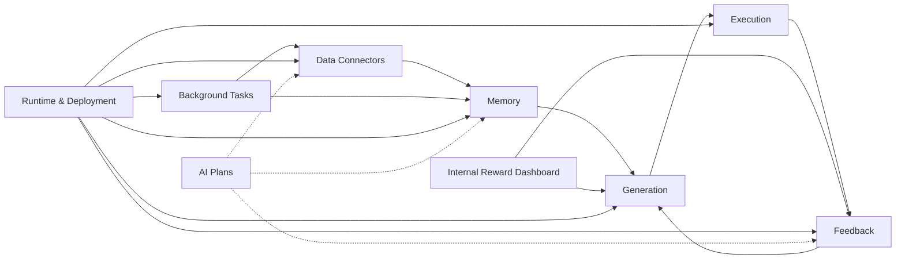

# PIN AI Developer Docs

## Summary

`docs/modules/` is the single entry point for the team's current development facts. Each module maintains exactly one current-facts doc, which answers three questions: how the system works now, where to look first before changing code, and how to verify after the change.

`docs/plans/` holds only AI design plans that are still useful. It is not in the main navigation; plans are referenced progressively only from the `Related AI Plans` section at the bottom of module docs.

## Current-Facts Docs

| Doc | When to read it |
|---|---|
| [Data Connectors](./modules/data-connectors) | Composio, device registry, device ingest, connector.init/sync, toolkit matrix. |
| [Memory](./modules/memory) | `pai_raw_*`, personal/world signals, memory, profile, skill, evolution, pgvector, pinai_sdk. |
| [Generation](./modules/generation) | `POST /api/generate`, generator scheduler kind, 4 subagent pipeline, evaluator, card persistence, auto-generate. |
| [Execution](./modules/execution) | chat-stream, card chat, main_chat / card_execution agent, native tool, Daytona python_exec, browser, Composio side-effect gate. |
| [Feedback](./modules/feedback) | `pai_feedback_events`, card action, chat-feedback, intent state, feeding biases back into the planner. |
| [Internal Reward Dashboard](./modules/internal-reward-dashboard) | Internal card review Vite app, reward ledger, reviewer score, casebook, LangSmith trace artifact. |
| [Dev Pipeline](./modules/dev-pipeline) | Linear intake → plan → delegate to Codex → scope-aware Fly preview (tier A cluster) → teardown; `@deploy`/`@teardown`, latency, cost, gotchas. |
| [Background Tasks](./modules/background-tasks) | `pai_scheduled_tasks` + `pai_scheduled_task_runs`, tick loop, dispatcher kind, lease/heartbeat/retry. |
| [Runtime & Deployment](./modules/runtime-deployment) | Local startup, the three services api/agent-engine/reward-dashboard, trust boundary, Daytona, yoyo migration, LiteLLM, dotenvx, CI/CD, production rules. |

## Maintenance Rules

- `docs/modules/*.mdx` are the current facts; `docs/plans/*.mdx` are referenceable AI design plans.
- The sidebar contains only `index` + `modules/*` + `plans/README` (the AI Plans index page); individual plans are not in the sidebar and are reached via the index page or the `Related AI Plans` section at the bottom of a module doc.
- Plans should preferably be referenced from a module doc's `Related AI Plans`; brainstorm drafts may be listed only in `plans/README` at first.
- When you change a module's core flow, update the corresponding module doc at the same time.
- Docs exist to serve development: prioritize data flow, code entry points, verification commands, and gotchas.
- The Mintlify Dashboard is only for publishing, search, and browsing; `docs/` in Git is the single source of truth.
