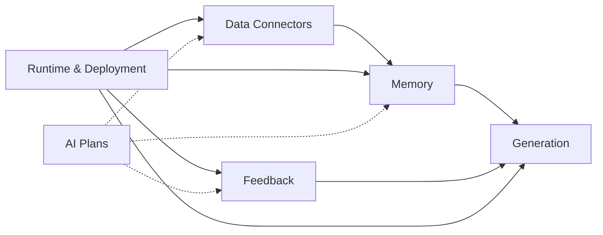

# PIN AI 开发文档

## 结论

`docs/modules/` 是当前团队开发事实的唯一入口。每个模块只维护一篇当前事实文档，回答三件事：系统现在怎么工作、改代码先看哪里、改完怎么验证。

`docs/plans/` 只放仍然有用的 AI 设计计划。它不进主导航，只在模块文档底部通过 `相关 AI Plans` 渐进式引用。

## 当前事实文档

| 文档 | 什么时候看 |
|---|---|
| [Data Connectors](./modules/data-connectors) | Composio、device registry、mobile proxy、mobile ingest、数据源状态。 |
| [Memory](./modules/memory) | raw.db、signals、memory、profile、skill、evolution、CLI。 |
| [Generation](./modules/generation) | `/generate`、pipeline、generator、evaluation、card selection、auto-generate。 |
| [Feedback](./modules/feedback) | feedback events、card action、card chat feedback、intent state、学习回流。 |
| [Runtime & Deployment](./modules/runtime-deployment) | 本地启动、APIs proxy、container、gateway、LiteLLM、dotenvx、CI/CD、生产规则。 |

## 维护规则

- `docs/modules/*.mdx` 是当前事实；`docs/plans/*.mdx` 是可引用的 AI 设计计划。
- 一个 plan 必须被模块文档的 `相关 AI Plans` 引用，否则不要放进 `docs/`；`docs/plans/README.mdx` 只是目录说明页，不算 plan。
- 改模块核心链路时，同步更新对应模块文档。
- 文档要服务开发：优先写数据流、代码入口、验证命令、踩坑。
- Mintlify Dashboard 只做发布、搜索和浏览；Git 里的 `docs/` 是唯一真源。
