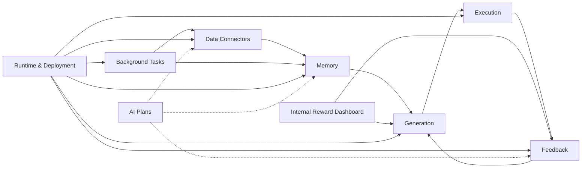

# PIN AI 开发文档

## 结论

`docs/modules/` 是当前团队开发事实的唯一入口。每个模块只维护一篇当前事实文档，回答三件事：系统现在怎么工作、改代码先看哪里、改完怎么验证。

`docs/plans/` 只放仍然有用的 AI 设计计划。它不进主导航，只在模块文档底部通过 `相关 AI Plans` 渐进式引用。

## 当前事实文档

| 文档 | 什么时候看 |
|---|---|
| [Data Connectors](./modules/data-connectors) | Composio、device registry、device ingest、connector.init/sync、toolkit 矩阵。 |
| [Memory](./modules/memory) | `pai_raw_*`、personal/world signals、memory、profile、skill、evolution、pgvector、pinai_sdk。 |
| [Generation](./modules/generation) | `POST /api/generate`、generator scheduler kind、4 subagent pipeline、evaluator、card persistence、auto-generate。 |
| [Execution](./modules/execution) | chat-stream、card chat、main_chat / card_execution agent、native tool、Daytona python_exec、browser、Composio side-effect gate。 |
| [Feedback](./modules/feedback) | `pai_feedback_events`、card action、chat-feedback、intent state、planner 偏置回流。 |
| [Internal Reward Dashboard](./modules/internal-reward-dashboard) | 内部卡片 review Vite app、reward ledger、reviewer score、casebook、LangSmith trace artifact。 |
| [Background Tasks](./modules/background-tasks) | `pai_scheduled_tasks` + `pai_scheduled_task_runs`、tick loop、dispatcher kind、lease/heartbeat/retry。 |
| [Runtime & Deployment](./modules/runtime-deployment) | 本地启动、web/chat 进程、信任边界、Daytona、yoyo migration、LiteLLM、dotenvx、CI/CD、生产规则。 |

## 维护规则

- `docs/modules/*.mdx` 是当前事实；`docs/plans/*.mdx` 是可引用的 AI 设计计划。
- 侧边栏只放 `index` + `modules/*` + `plans/README`(AI Plans 索引页);具体 plan 不进侧边栏,通过索引页或模块文档底部 `相关 AI Plans` 进入。
- plan 推荐被模块文档的 `相关 AI Plans` 引用;brainstorm 草稿可以先只挂在 `plans/README`。
- 改模块核心链路时，同步更新对应模块文档。
- 文档要服务开发：优先写数据流、代码入口、验证命令、踩坑。
- Mintlify Dashboard 只做发布、搜索和浏览；Git 里的 `docs/` 是唯一真源。
