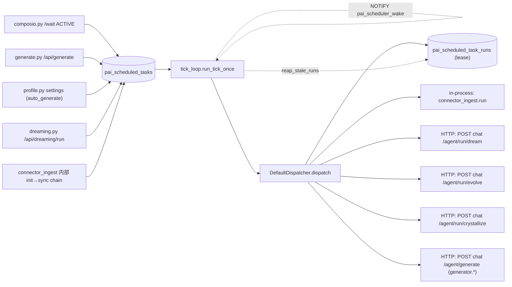
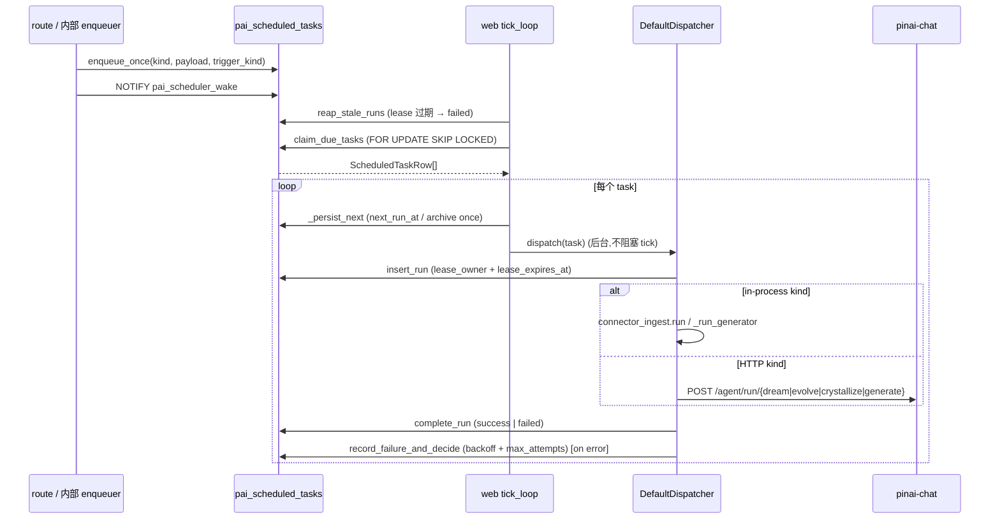

# Background Tasks

## 结论

后台任务系统跑在 **pinai-web 进程**里,基于两张 Postgres 表 + 一个 asyncio tick loop:

`enqueue → pai_scheduled_tasks → tick_loop.claim_due_tasks(SKIP LOCKED) → DefaultDispatcher.dispatch → in-process handler 或 HTTP 调 pinai-chat → 写 pai_scheduled_task_runs → 续 lease / 写结果`

框架本身只管调度(claim、lease、retry、reaper、PG NOTIFY 唤醒),具体业务在各 kind 的 handler 里。多 replica 安全靠 `FOR UPDATE SKIP LOCKED`,不需要单进程 mutex。

目前 dispatcher 路由 9 个 `kind`,分**两类执行模型**:

- **execution kind**(`generator.manual` / `generator.auto` / `connector.init` / `connector.sync` / `connector.evolve` / `auto.dreaming` / `user.prompt`)— 真实执行(跑 LLM 或拉外部数据,可能长跑 / 会崩 / 需重试 / 需 progress),走完整 per-run ledger:`insert_run` → handler → `complete_run`,带 lease / backoff / reaper。`crystallize` 有路由但当前没 producer 入队(见下方"Crystallize 当前不走这套队列"段)。
- **producer kind**(`proactive.tick`)— 纯生产者,只把一条 `source=heartbeat` 消息 enqueue 到 actor mailbox(真正的 proactive agent 执行在 `AgentRunWorker` + `pai_agent_runs`)。走轻量 `_dispatch_producer` 路径:**跳过 per-run ledger**(不写 `pai_scheduled_task_runs`),只翻 task 的 recurring success/failure 状态(给 backoff + `/api/tasks`)。多 replica 去重仍靠 `claim_due_tasks` 的 SKIP LOCKED + `next_run_at` 推进,所以省掉 `insert_run` 的 UNIQUE 也安全。

> 这条 producer/execution 分层是有意的:业界统一调度的 convention 是"统一触发层 + per-task 执行语义"(K8s CronJob / Celery Beat / Airflow 都如此),而不是强迫所有任务共用同一套 run-ledger。proactive 心跳是 per-user 定时任务(该和其它定时任务一样在这套 scheduler 里,统一管理 / 监控),但它是生产者、不需要 run-ledger,所以走 producer 路径而非独立循环。global 的 world_ingest 因为 `pai_scheduled_tasks.user_id NOT NULL` 容不下,才单独跑 asyncio loop。



## 边界

包含:

- `pai_scheduled_tasks` 和 `pai_scheduled_task_runs` schema 与索引。
- `tick_loop.run_tick_once` 的 claim / dispatch / NOTIFY 唤醒。
- `DefaultDispatcher` 按 kind 路由,以及哪些 kind 走 in-process、哪些走 HTTP 到 chat。
- lease + heartbeat + reaper 多 replica 语义。
- retry / backoff / max_attempts / archive 策略。
- 三处常驻 background task:scheduler tick loop、world signals ingest、Daytona sandbox idle GC。

不包含:

- 各 kind 的具体业务(connector 拉数据、generator 出卡、dreaming 沉淀 memory),分别看 [Data Connectors](./data-connectors)、[Generation](./generation)、[Memory](./memory)。
- chat 端 `/agent/run/*` 内部 agent 实现,看 [Execution](./execution)、[Generation](./generation)。
- conversation(actor kernel)聊天链路,看 [Execution](./execution)。

## 核心链路



## 当前设计

### 表结构

`pai_scheduled_tasks`(`021_pai_scheduler.sql` + `031_consolidate_task_queue.sql` + `037` / `038` / `039`):

| 列 | 含义 |
|---|---|
| `(user_id, id)` | 复合 PK,所有任务 user-scoped。 |
| `kind` | open enum(dispatcher 按字符串路由,不在 schema 里 CHECK,加 kind 无需迁移)。当前:`generator.manual` / `generator.auto` / `connector.init` / `connector.sync` / `connector.evolve` / `auto.dreaming` / `crystallize` / `user.prompt`。 |
| `trigger_kind` | `schedule` / `event` / `once`(CHECK)。 |
| `cron_expr`, `interval_seconds`, `timezone` | `schedule` 触发计算输入,timezone 默认 `UTC`。 |
| `event_filter` JSONB | `event` 触发专用,目前没在用。 |
| `status` | `active` / `paused` / `archived`(CHECK)。 |
| `next_run_at` | 下次到点时间;`paused` / 一次性已 fire / `event` 未入队时为 NULL。 |
| `last_run_at`, `last_run_status`, `run_count` | 上次执行的 bookkeeping。 |
| `payload` JSONB | kind 内部用(toolkit、connectedAccountId、output_language 等)。 |
| `attempts`, `max_attempts` | 失败计数(default 3);重试逻辑在 `record_failure_and_decide`。 |
| `last_error`, `progress` JSONB | 重试现场 / 中间进度(`031_consolidate_task_queue.sql` 加上)。 |

热路径索引:`idx_pai_sched_due (next_run_at, status) WHERE status='active' AND next_run_at IS NOT NULL` — claim 时只扫这一小段。

`pai_scheduled_task_runs`:

| 列 | 含义 |
|---|---|
| `(user_id, id)` | run row PK;`id = f"{task.id}.{uuid4()[:8]}"` 每 fire 一行。 |
| `task_id`, `scheduled_for`, `fired_at` | 链回 task + 当前 fire 锚点 + 真正开跑时间。 |
| `UNIQUE (user_id, task_id, scheduled_for)` | 幂等性硬保证:同 task 同 scheduled_for 只能成功 insert 一次,race losers `insert_run` 拿 `False` 直接 exit。 |
| `lease_owner`, `lease_expires_at` | worker 标识(`web-<8 hex>`)+ 到期时间。 |
| `status` | `running` / `success` / `failed`。 |
| `error` | 失败截断到 1000 字符的错误信息。 |

reaper 索引:`idx_pai_schedrun_lease (status, lease_expires_at) WHERE status='running'` — 反 lease 过期扫一小段。

### tick_loop

`pinai-agents/src/pinai_agents/web/scheduler/tick_loop.py`:

| 维度 | 当前事实 |
|---|---|
| tick 频率 | `SCHEDULER_TICK_SECONDS` env,默认 **3 秒**(`config.py` `scheduler_tick_seconds`)。 |
| 唤醒机制 | `_listen_for_wake` LISTEN `pai_scheduler_wake`;每次 enqueue 都 `notify_scheduler_wake(conn)`,~50ms 唤醒一次 tick(`web/db/repositories/scheduled_tasks.py:411`)。 |
| 批量 | `claim_due_tasks(limit=16)`,每 tick 最多 16 个任务,避免一次性 explode。 |
| Claim 原子性 | CTE + `FOR UPDATE SKIP LOCKED` — 多 replica 同时 tick 不会重复领同一 row。 |
| 多 replica | 没单进程 mutex(刻意),并发安全完全靠 SKIP LOCKED + `(task_id, scheduled_for) UNIQUE`。 |
| Reaper | tick 第一步调 `reap_stale_runs`:`status='running' AND lease_expires_at < now()` → `status='failed'`,`error='lease expired (worker crashed)'`。 |
| Dispatcher 调用 | `_safe_dispatch` 包 `asyncio.create_task`,handler 跑慢不会拖 tick;同一 owner 长任务靠 lease 长度兜住。 |
| 起停 | `web/app.py` lifespan;DB pool 未设置(`DATABASE_URL` 缺)时整个 loop 不起,只 log warning。 |

### Dispatcher

`web/scheduler/dispatcher.py:DefaultDispatcher`:

| Kind | 入口 | Lease | 备注 |
|---|---|---|---|
| `generator.manual` | in-process `_run_generator` → HTTP POST `/agent/generate` | **600s** | `/api/generate` 入队;用户可见链路,默认/上限 8 张,超过 10 分钟无结果就失败;手动生成不自动 retry。 |
| `generator.auto` | 同上 | **600s** | 自动循环生成,由前端 settings 调 profile route 写 `interval_seconds`(默认从 migration `038_auto_generate_default_on.sql`),每批最多 8 张。 |
| `connector.init` | in-process `connector_ingest.run` | 60s | 拉一批 Composio 数据写 `pai_raw_*` + `pai_personal_signals` + 一次 `connector.evolve` once-shot。 |
| `connector.sync` | 同上 | 60s | 增量拉取,用 cursor;成功才前推 cursor + 入 evolve。`connector.init` 跑完会保证一行 sync schedule(`cron */30 * * * *`)。 |
| `connector.evolve` | HTTP POST `/agent/run/evolve` | **600s**(long-running) | chat 端 DeepAgents 把刚拉的 raw / signal 沉淀成 memory / skill。 |
| `auto.dreaming` | HTTP POST `/agent/run/dream`(`_dispatch_dream` wrap) | **600s** | 包 `pai_evolution_runs` 行的 lifecycle,web 进程持有 run row 的生死;chat 进程跑 LLM。 |
| `crystallize` | HTTP POST `/agent/run/crystallize` | 60s | dispatcher 路由已就位,但**当前没有 producer 入队** — `dispatcher.py` 顶部注释明说 "crystallize → not scheduled (chat worker fires inline)"。今天 crystallize 走 chat 端 inline 调用,不走这套队列。 |
| `user.prompt` | HTTP POST `/agent/run/dream`(复用 dream entry) | **600s** | 后续的 synthetic-prompt 通道,目前 placeholder。 |
| `proactive.tick` | **producer** `_dispatch_producer` → in-process build heartbeat → enqueue actor mailbox + notify worker | —(无 per-run ledger) | per-user 心跳;interval 由 `pai_user_settings.proactive_interval_seconds`(60/300/1800)经 profile route 同步进 task。**不写 `pai_scheduled_task_runs`**,真实执行在 worker(`pai_agent_runs`)。详见 [Execution](./execution) proactive 段。 |

`_GENERATOR_KINDS = {generator.manual, generator.auto}` 走 `_GENERATOR_LEASE_SECONDS=600`;web→chat `/agent/generate` read timeout 和 chat route 内部 timeout 也都是 600s。`_LONG_RUNNING_KINDS = {auto.dreaming, connector.evolve, user.prompt}` 走 `_LONG_LEASE_SECONDS=600`,跟普通 60s 区分,防止 LLM 中段被 reaper 误判 crash。generator 虽然也是 LLM 链路,但产品上是即时生成,所以 10 分钟是硬失败边界。`_PRODUCER_KINDS = {proactive.tick}` 完全不走 lease / ledger —— `_dispatch_producer` 只跑 handler + `record_recurring_success` / `record_failure_and_decide`,per-run 账本由 worker 的 `pai_agent_runs` 持有(见上表 proactive.tick 行)。

dispatcher 调用 chat 走 EdDSA 每 run JWT(`web/auth/agent_jwt.py`),凭证不跨 run 复用。chat 验签 + check `pai_jti_revocations` 黑名单(`chat/auth/run_jwt.py`)。

未知 kind 不抛,只 `logger.warning`,方便加新 kind 时灰度。

### 入队点

| 入口 | kind | 触发 |
|---|---|---|
| `POST /api/generate`(`web/routes/ui/generate.py`) | `generator.manual` | 前端手动 generate。一个用户同时只能有一个 active generator,duplicate 直接返回既有 taskId。 |
| Profile settings `auto_generate=true`(`web/routes/ui/profile.py`)| `generator.auto` | `_sync_auto_generate_schedule` upsert,`interval_seconds = auto_generate_interval_minutes * 60`,关掉切 `status='archived'`。 |
| Profile settings `auto_dreaming=true`(`web/routes/ui/profile.py`)| `auto.dreaming` | `_sync_auto_dreaming_schedule` upsert,每天用户 profile timezone 的 06:00 触发,关掉切 `status='archived'`。 |
| `POST /api/composio/wait`(`web/routes/ui/composio.py`)| `connector.init` | OAuth ACTIVE 回调,`enqueue_once` 幂等。 |
| `connector_ingest._ensure_sync_schedule`(`web/services/connector_ingest.py`)| `connector.sync` | init 跑成功后立即 INSERT ON CONFLICT DO NOTHING,cron `*/30 * * * *`。 |
| `connector_ingest._enqueue_evolve` | `connector.evolve` | init / 非空 sync 之后入一次 once-shot。 |
| `POST /api/dreaming/run`(`web/routes/ui/dreaming.py`)| `auto.dreaming` | 手动触发;auto-dreaming 设置走的也是同一个 kind,只是用 `trigger_kind='schedule'`。 |
| `POST /api/tasks/*`(`web/routes/ui/tasks.py`)| `user.prompt` | 给 agent 投递 synthetic prompt,目前接入面少。 |
| (无 producer) | `crystallize` | dispatcher 已注册路由,但**没有路由 / service 入队**;`grep -r 'kind=.crystallize.' pinai-agents/src/` 返回空。chat 端 inline 触发 crystallize,详见 [Execution](./execution)。 |

所有入队走 `web/db/repositories/scheduled_tasks.py:enqueue_once`,内部 INSERT ON CONFLICT 按 `(user_id, id)` 幂等,并在事务里跟一次 `notify_scheduler_wake` 唤醒。

### Retry 与 archive

`record_failure_and_decide`(repository):

| `attempts + 1` | backoff |
|---|---|
| 1 | 30s |
| 2 | 2min |
| ≥3 | 10min |

判断:
- `attempts + 1 < max_attempts` → `status='active'`,`next_run_at = NOW() + backoff`,`attempts += 1`。
- once 任务达到 `max_attempts` → `status='archived'`,`next_run_at=NULL`。
- recurring 任务达到 `max_attempts` → 仍保持 `status='active'`,保留下一次 schedule 时间;临时模型限流、超时、connector 抖动不应永久关闭用户的自动任务。

`once` 任务在 `_persist_next` 阶段就 archive(`next_run_at=NULL`);失败的 once 任务靠 `record_failure_and_decide` 把 `status` 翻回 `active` 才能继续重试,直到 `max_attempts` 用完后再 archive。recurring 任务失败只记录 `attempts/last_error`,成功后 `record_recurring_success` 清零。

cron / interval 任务只有外部显式关掉时才会 archive(例如用户关闭开关);一旦被 archive 就是终止信号,需要外部重新 INSERT(或把 status 改回 `active`)才会再跑。

### Lease + heartbeat

- claim 时 dispatcher 起 `lease_expires_at = NOW() + lease_seconds`(per-kind 决定)。
- 长任务可调 `heartbeat_run(user_id, run_id, lease_owner, lease_seconds)` 续约;目前 chat 端的 run loop 不主动续,统一靠 dispatcher 设的 kind-specific lease 兜住(generator 600s,其它长任务 600s)。
- reaper 每 tick 跑一次,`status='running' AND lease_expires_at < NOW()` → `failed`。
- handler 写完结果通过 `complete_run` 翻 `success` / `failed`;race 输的 dispatcher(`insert_run` 返回 False)直接 return,不写 result。

### 长任务的 evolution_run lifecycle

`auto.dreaming` 比较特殊:dispatcher 直接拿 `run_id` 写 `pai_evolution_runs` 行,chat 端只跑 agent 不动这张表。理由(`dispatcher.py:_dispatch_dream` docstring):

- web 跟 DB 同进程,避免 HTTP roundtrip + JWT TTL 风险。
- chat 容器 OOM 时,外层 try/except 仍然能把 `pai_evolution_runs.status` 从 `running` 翻 `failed`,不留 ghost row。
- `run_id` 在 `pai_scheduled_task_runs` 和 `pai_evolution_runs` 上是同一个,LangSmith trace + UI 都能 JOIN。

### 其他常驻 background task(不在 pai_scheduled_tasks 上)

| 任务 | 频率 | 入口 | 备注 |
|---|---|---|---|
| World signals ingest | 30 分钟 / 次(`INGEST_INTERVAL_SEC = 30 * 60`) | `web/services/world_ingest.py:loop`,`app.py` lifespan 起 | 全局,不 per-user;靠 `pai_world_signals.UNIQUE(normalized_url)` 做多 replica 幂等。 |
| Daytona sandbox idle GC | 5 分钟 / 次(`_SANDBOX_GC_INTERVAL_SEC = 5 * 60`) | `chat/app.py:_sandbox_gc_loop` | chat 进程内部,清 LRU 缓存里跟云端不一致的项。 |
| LangGraph checkpointer | 持续连接 | `chat/runtime/checkpoint.py` | Postgres pool,跟主 pool 共享。 |

这三个跟 `pai_scheduled_tasks` 完全独立,改 scheduler 时不要碰它们。

## 开发入口

| 改动 | 先看 |
|---|---|
| Tick loop / claim / 唤醒 | `pinai-agents/src/pinai_agents/web/scheduler/tick_loop.py` |
| Dispatcher 路由表 / 长 lease 列表 | `web/scheduler/dispatcher.py`(`_handle_kind`、`_GENERATOR_KINDS`、`_LONG_RUNNING_KINDS`)|
| 加新 kind | 1)dispatcher 路由分支;2)入队点(routes/service);3)如果 HTTP 调 chat,加 `chat/routes/run.py` 对应 handler。 |
| cron 计算 | `web/scheduler/cron.py:next_fire` |
| 入队 / claim / 完成 / 重试 SQL | `web/db/repositories/scheduled_tasks.py`(`enqueue_once`、`claim_due_tasks`、`insert_run`、`complete_run`、`heartbeat_run`、`reap_stale_runs`、`record_failure_and_decide`)|
| 配置默认值 | `pinai-agents/src/pinai_agents/config.py`(`scheduler_tick_seconds=3`、`scheduler_lease_seconds=60`) |
| Composio init/sync handler | `web/services/connector_ingest.py`(`run`、`_ensure_sync_schedule`、`_enqueue_evolve`)|
| auto-generate schedule sync | `web/routes/ui/profile.py:_sync_auto_generate_schedule` |
| auto-dreaming schedule sync | `web/routes/ui/profile.py:_sync_auto_dreaming_schedule` |
| auto.dreaming run row 包装 | `web/scheduler/dispatcher.py:_dispatch_dream` |
| chat 端 long-running handler | `pinai-agents/src/pinai_agents/chat/routes/run.py`(dream / evolve / crystallize) |
| 前端任务状态 polling | `proactive-ai-frontend/src/hooks/useInitTask.ts`、`useActiveAgentRuns.ts`、`useGenerationStatus.ts` |
| Schema 迁移 | `pinai-agents/db/migrations/021_pai_scheduler.sql`、`031_consolidate_task_queue.sql`、`039_split_generator_kinds.sql` |

## 验证方式

```bash
cd pinai-agents && uv run pytest tests/web/scheduler              # 全 scheduler 套件
cd pinai-agents && uv run pytest tests/web/scheduler/test_tick_loop.py
cd pinai-agents && uv run pytest tests/web/scheduler/test_claim.py     # SKIP LOCKED 多 replica
cd pinai-agents && uv run pytest tests/web/scheduler/test_cron.py      # next_fire 算法
cd pinai-agents && uv run pytest tests/web/scheduler/test_retry.py     # backoff + archive
cd pinai-agents && uv run pytest tests/web/services/test_connector_ingest.py
cd pinai-agents && uv run pytest tests/web/services/test_world_ingest.py
cd pinai-agents && uv run pytest tests/web/test_composio_service.py
cd pinai-agents && uv run ruff check .
```

手工验证(SQL,连本地 compose Postgres `54322:5432`):

```sql
-- 看队列
SELECT user_id, id, kind, status, next_run_at, attempts, last_run_status
FROM pai_scheduled_tasks ORDER BY updated_at DESC LIMIT 20;

-- 正在跑的 lease
SELECT user_id, task_id, lease_owner, lease_expires_at, status
FROM pai_scheduled_task_runs WHERE status = 'running' ORDER BY fired_at DESC;

-- 单 task 历史
SELECT * FROM pai_scheduled_task_runs WHERE task_id = '<id>' ORDER BY fired_at DESC;
```

容器日志:

```bash
make logs-pinai-web | grep -E "scheduler|dispatch|claim|reap|run_id"
make logs-pinai-chat | grep -E "run/dream|run/evolve|run/crystallize|run/generate"
```

## 踩坑

- `enqueue_once` 是按 `(user_id, id)` 幂等,不是按 `(user_id, kind, payload)`。同一个 user 不同 task id 但相同语义会重复入队,自己上层去重。
- `claim_due_tasks` 用 SKIP LOCKED,事务里抛错会让 row 短暂被锁,但下次 tick 还能领;不要在 claim 后的 dispatch 里手开新事务而忘记 commit。
- handler 跑完但 lease 已过期是已知 race:`complete_run` 仍会写 status,但 reaper 已经先一步把它标 `failed`;靠业务上的 idempotency key 兜底(connector 用 raw 表 dedupe_key;generator 写 `pai_pipeline_runs` 时 INSERT ON CONFLICT)。
- 长 lease 不是免死金牌:chat 真挂掉时 reaper 还是会在 lease 过期后翻成 `failed`;handler 自己长跑要主动 `heartbeat_run` 续约。
- once 任务在 `_persist_next` 就 archive(`status='archived'`、`next_run_at=NULL`);失败重试靠 `record_failure_and_decide` 把 status 翻回 `active`。直接对着这张行的 status 做判断要注意已经 fire 过一次。
- 加新 kind **不**用改 schema(开 enum),但加新 kind 后必须同时改 dispatcher 路由分支,否则 `unknown task.kind` 只 warning 不报错,任务就一直 `success`-但-啥都没做。
- `_LONG_RUNNING_KINDS` 改动要跟 chat 端 handler 的真实跑时一起 review;调短会让 reaper 误杀,调长会让真挂的 worker 占着 lease 不放。
- `NOTIFY pai_scheduler_wake` 是 best-effort 提速,不要依赖它做正确性保证 — tick interval 默认 3s 已经够低,LISTEN/NOTIFY 只是把 50ms 唤醒延迟省下来。
- world ingest 和 sandbox GC 跟 scheduler 完全独立,改 scheduler 别误碰它们的 lifespan 注册。
- LangGraph checkpointer 不走这套调度;chat thread state 是它自己管的 schema(`langgraph.*`)。

## 相关模块

- [Data Connectors](./data-connectors):`connector.init` / `connector.sync` / `connector.evolve` 的业务侧。
- [Generation](./generation):`generator.manual` / `generator.auto` 的业务侧 + 前端轮询。
- [Memory](./memory):`auto.dreaming` / `connector.evolve` / `crystallize` 写入的 memory / signals / evolution_runs。
- [Execution](./execution):conversation 聊天跑在 agent_core mailbox/worker 上,跟这套 background_tasks 队列是两套独立机制。
- [Runtime & Deployment](./runtime-deployment):scheduler 的 lifespan 起停、tunable 默认值、信任边界。
