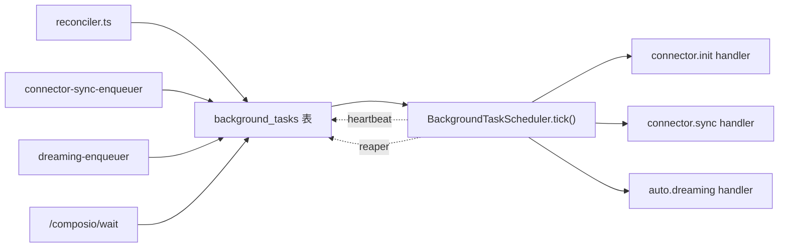
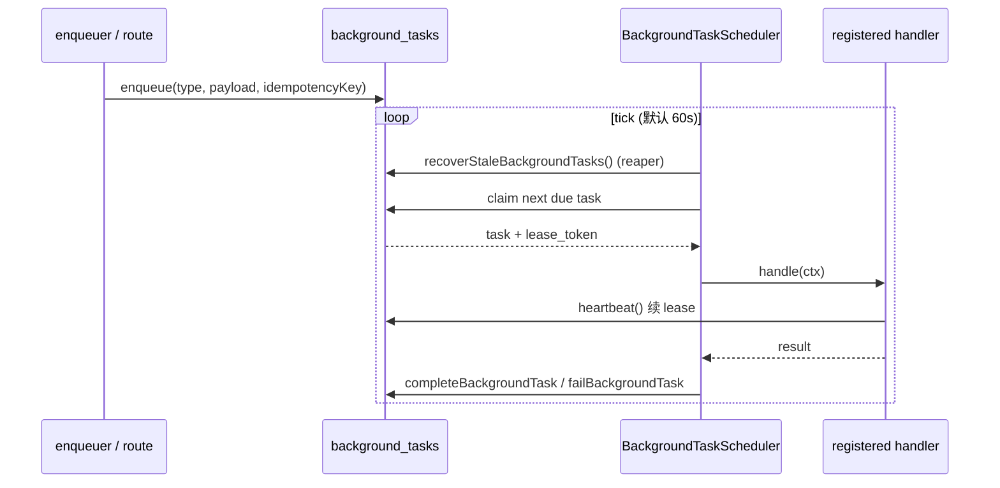

# Background Tasks

## 结论

后台任务系统是用户容器内的单进程 claim-based 队列:

`enqueuer -> background_tasks 队列 -> scheduler tick claim -> handler 跑 -> heartbeat 续 lease -> reaper 回收过期`

服务于三类长跑任务:**connector init / connector sync / auto-dreaming**。框架本身只管调度(claim、lease、retry、reaper),具体业务逻辑在各 handler 里。整套系统由 `BACKGROUND_AUTO_LOOP_TASKS_ENABLED='1'` 门禁启停,Phase A 默认关闭。



## 边界

包含:

- `BackgroundTaskScheduler` 的 tick / claim / lease / heartbeat / reaper 机制。
- `background_tasks` 与 `task_attempts` 表 schema 和 retry policy。
- 三个常驻 enqueuer(reconciler、connector-sync、dreaming)的触发逻辑。
- handler 注册和 dispatch 框架。

不包含:

- `connector.init` / `connector.sync` 的具体业务(Composio 拉取、raw 写入、signal 生成),看 [Data Connectors](./data-connectors)。
- `auto.dreaming` 怎么跑梦境、怎么 evolve memory,看 [Memory](./memory)。
- `connector.evolve` 是 init/sync handler 内部调用的子流程,不是独立 handler,看 [Memory](./memory) 的 evolution 节。
- 同步的 chat / tool 调用,看 [Execution](./execution)。

## 核心链路



## 当前设计

### 调度器

| 维度 | 当前事实 |
|---|---|
| tick 频率 | 默认 60s,`BACKGROUND_TASK_TICK_MS` 可调。 |
| 并发 | 单进程 in-memory mutex(`tickInFlight`),tick 不重入。多 worker 暂未支持(刻意不加 SQL lock)。 |
| Claim | 选状态 `queued`、`run_after <= now`、type 在已注册集合里、按 `priority` 排序的最高任务。 |
| Lease | 默认 60s(`BACKGROUND_TASK_LEASE_MS`);handler 通过 `ctx.heartbeat()` 续期,可指定 `leaseDurationMs` 单次拉长(如 auto-dreaming 显式 600s)。 |
| Reaper | 每 tick 第一步 `recoverStaleBackgroundTasks()`:`lease_expires_at < now` 的任务回到 queued 或终态 `lost`,按 retry 策略走。 |
| 启动门禁 | `BACKGROUND_AUTO_LOOP_TASKS_ENABLED='1'` 才 start;Phase A 默认关。 |
| 启动位置 | `index.ts` plugin.register():注册 handler、起 scheduler、起 reconciler、起 enqueuer 定时器。 |

### Handler

| Type | Payload | 干什么 | 下游 |
|---|---|---|---|
| `connector.init` | `{ toolkit, connectedAccountId, limit?, reason? }` | 从 Composio 拉 toolkit 最近 N 项,写 raw.db,生成 personal_signals,开 evolution_run。 | data-connectors / raw-db / memory |
| `connector.sync` | `{ toolkit, connectedAccountId, limit?, reason? }` | 增量同步,用 `connector_sync_cursors.last_synced_at` 算 since,默认每 12h 拉一次。 | data-connectors / signals |
| `auto.dreaming` | `{}` | 包 `runDreaming({ trigger: 'auto' })`,handler 期间 heartbeat 把 lease 顶到 10 分钟。 | memory / dreaming |

`connector.evolve` 不在这张表 — 它是 `connector.init` / `connector.sync` 内部调用的子流程(LLM 从 raw 提取记忆),不走主队列。

### Enqueuer

| Enqueuer | 触发条件 | 调用方 | 默认间隔 |
|---|---|---|---|
| `reconciler` | 扫 Composio ACTIVE 账户,为未入队的 (toolkit, connectedAccountId) 入 `connector.init`。 | `index.ts` setInterval | `CONNECTOR_INIT_RECONCILER_INTERVAL_MS` = 600s |
| `connector-sync-enqueuer` | 扫 ACTIVE 账户,`last_synced_at` 超过 `CONNECTOR_SYNC_INTERVAL_MS`(默认 12h)就入队。 | `index.ts` setInterval | `CONNECTOR_SYNC_ENQUEUER_INTERVAL_MS` = 300s |
| `dreaming-enqueuer` | setting on + 已过本地 06:00 + 今天无成功 dreaming + 队列里没排队 → 入 `auto.dreaming`。 | `index.ts` setInterval | `DREAMING_ENQUEUER_INTERVAL_MS` = 60s |
| OAuth 完成手动入队 | `/composio/wait` 用户 OAuth 完成后直接入 `connector.init`。 | `routes/composio.ts` | 即时 |

幂等性靠 `idempotency_key`:`connector.init` 用 `connector.init:{toolkit}:{accountId}:v1`,重复 enqueue 返回既有行,不会重复跑。

### 数据库 Schema

`background_tasks`(关键字段):

| 列 | 含义 |
|---|---|
| `type` | handler 类型(`connector.init` / `connector.sync` / `auto.dreaming`)。 |
| `status` | `queued` / `running` / `succeeded` / `failed` / `timed_out` / `cancelled` / `lost` / `skipped`。 |
| `priority`, `run_after` | 排序与延迟执行。 |
| `idempotency_key` | UNIQUE,用来去重。 |
| `payload_json`, `progress_json`, `result_json` | handler 输入 / 中间状态 / 输出。 |
| `attempts`, `max_attempts` | 重试计数;默认 max 3。 |
| `lease_owner`, `lease_token`, `lease_expires_at`, `heartbeat_at` | 当前 lease 持有者与到期时间。 |
| `last_error_code`, `last_error_message` | 最近一次失败原因。 |

`task_attempts`:每次 claim 一行,审计每次 attempt 的 worker_id、lease_token、status、started/finished、error 详情、logs。

`connector_sync_cursors`:`(toolkit, connectedAccountId)` 唯一,记录 `last_synced_at`,供 connector-sync 拿 since 边界。

Schema 内联在 `db.ts` 的 `ensureDb()` 里,用 `CREATE TABLE IF NOT EXISTS`,**不**走 `apis/db/migrations/`(那是 APIs 的 Postgres,不是用户容器的 SQLite)。

### Retry 策略

`defaultBackoffForAttempt(n)`:

| 已失败次数 | 下次 backoff |
|---|---|
| 1 | 30s |
| 2 | 2min |
| ≥3 | 10min |

失败后若 `attempts < max_attempts`:回到 `queued`、`run_after = now + backoff`、计数 +1。否则终态 `failed`。

Lease 过期由 reaper 处理:`lease_expires_at < now` → 按 willRetry 走重试,否则标 `lost`。

`ctx.heartbeat()` 返回 `false` 表示 lease 已被 reaper 抢走,handler **必须停止写入**并尽快返回(再写下去结果会被丢)。

## 开发入口

| 改动 | 先看 |
|---|---|
| 调度器内核 | `pinai-openclaw/plugins/proactive-ai/tasks/scheduler.ts` |
| Reconciler(补丢漏 init) | `pinai-openclaw/plugins/proactive-ai/tasks/reconciler.ts` |
| Sync enqueuer | `pinai-openclaw/plugins/proactive-ai/tasks/connector-sync-enqueuer.ts` |
| Dreaming enqueuer | `pinai-openclaw/plugins/proactive-ai/tasks/dreaming-enqueuer.ts` |
| init handler | `pinai-openclaw/plugins/proactive-ai/tasks/handlers/connector-init.ts` |
| sync handler | `pinai-openclaw/plugins/proactive-ai/tasks/handlers/connector-sync.ts` |
| auto-dreaming handler | `pinai-openclaw/plugins/proactive-ai/tasks/handlers/auto-dreaming.ts` |
| connector evolve(子流程) | `pinai-openclaw/plugins/proactive-ai/tasks/handlers/connector-evolve.ts` |
| 队列 / lease DB helper | `pinai-openclaw/plugins/proactive-ai/db.ts`(`enqueueBackgroundTask`、`claimBackgroundTask`、`heartbeatBackgroundTask`、`completeBackgroundTask`、`failBackgroundTask`、`recoverStaleBackgroundTasks`) |
| 启动 / 注册 | `pinai-openclaw/plugins/proactive-ai/index.ts` |

## 验证方式

```bash
npx tsx --test pinai-openclaw/plugins/proactive-ai/tasks/scheduler.test.ts
npx tsx --test pinai-openclaw/plugins/proactive-ai/tasks/reconciler.test.ts
npx tsx --test pinai-openclaw/plugins/proactive-ai/tasks/connector-sync-enqueuer.test.ts
npx tsx --test pinai-openclaw/plugins/proactive-ai/tasks/dreaming-enqueuer.test.ts
npx tsx --test pinai-openclaw/plugins/proactive-ai/tasks/handlers/connector-init.test.ts
npx tsx --test pinai-openclaw/plugins/proactive-ai/tasks/handlers/connector-sync.test.ts
npx tsx --test pinai-openclaw/plugins/proactive-ai/tasks/handlers/connector-evolve.test.ts
npx tsx --test pinai-openclaw/plugins/proactive-ai/tasks/handlers/auto-dreaming.test.ts
npx tsx --test pinai-openclaw/plugins/proactive-ai/db.background-tasks.test.ts
npm run type-check
```

手工验证(进 user 容器 SQLite):

- 入队后看队列:`SELECT id, type, status, run_after, attempts FROM background_tasks ORDER BY created_at DESC LIMIT 10;`
- 跑中观察 lease:`SELECT type, status, lease_owner, lease_expires_at, heartbeat_at FROM background_tasks WHERE status='running';`
- 失败重试链:`SELECT * FROM task_attempts WHERE task_id=? ORDER BY attempt_no;`
- 跟踪 sync 游标:`SELECT * FROM connector_sync_cursors;`
- 容器日志:`grep -E '\[bg-task-scheduler\]|\[reconciler\]|\[connector-sync\]|\[auto-dreaming\]'`。

## 踩坑

- 单进程假设是刻意的(Phase A);如果以后跑多 worker 必须加 SQL row lock,现在没有。
- handler 跑成功但 lease 已被 reaper 抢走是已知 race:reaper 下次会重新 claim,业务侧靠 `idempotency_key` 兜底,**不要**在 handler 里假设独占性写入。
- `auto.dreaming` 默认 60s lease 不够,handler 自己 heartbeat 续到 10min;改 dreaming 业务时别忘记保留 heartbeat 调用。
- `BACKGROUND_AUTO_LOOP_TASKS_ENABLED` 默认关,本地起 plugin 不会自动跑后台任务;调试时显式 export `BACKGROUND_AUTO_LOOP_TASKS_ENABLED=1`。
- reconciler 失败只 `failed=true` 不抛异常,定时器继续转;别指望它能把错误冒泡。
- schema 走 `CREATE TABLE IF NOT EXISTS` 不走 migration:加列要写在 `db.ts` 的 `ensureDb()` 里,旧容器升级后冷启动会自动 ALTER。
- `connector.evolve` 是 init/sync 内联的子流程,不是独立任务;别误改成 handler,会破坏入队链路。
- status 枚举里 `lost` 和 `skipped` 是终态:`lost` = lease 失而没机会重试;`skipped` = enqueuer 主动决定不入(如 dreaming-enqueuer 当天已跑过)。

## 相关模块

- [Data Connectors](./data-connectors):`connector.init` / `connector.sync` handler 的业务侧。
- [Memory](./memory):`auto.dreaming` 和 `connector.evolve` 写入的 memory / personal_signals / evolution_runs。
- [Execution](./execution):同步链路的工具调用走 chat SSE,不进这个队列。
- [Generation](./generation):scheduler 触发的 evolution 子流程会复用 unified-generator agent。
