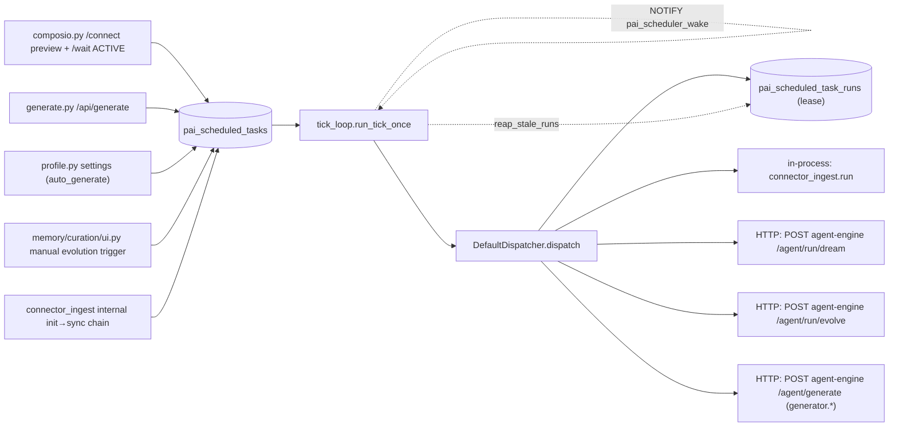
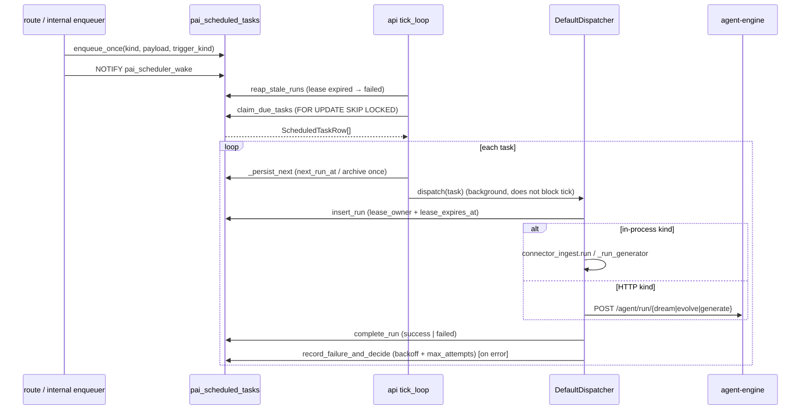

# Background Tasks

## Summary

The background task system runs in the **api process**, built on two Postgres tables + one asyncio tick loop:

`enqueue → pai_scheduled_tasks → tick_loop.claim_due_tasks(SKIP LOCKED) → DefaultDispatcher.dispatch → in-process handler or HTTP call to agent-engine → write pai_scheduled_task_runs → renew lease / write result`

The framework itself only handles scheduling (claim, lease, retry, reaper, PG NOTIFY wakeup); the actual business logic lives in each kind's handler. Multi-replica safety comes from `FOR UPDATE SKIP LOCKED`; no single-process mutex is needed.

The dispatcher currently routes 11 `kind`s, split into **two execution models**:

- **execution kind** (`generator.manual` / `generator.auto` / `generator.chat` / `generator.scheduled` / `connector.preview` / `connector.init` / `connector.sync` / `connector.evolve` / `auto.dreaming` / `user.prompt` / `reminder.card`) — real execution (runs an LLM, pulls external data, or writes a card directly; may run long / may crash / needs retries / needs progress), goes through the full per-run ledger: `insert_run` → handler → `complete_run`, with lease / backoff / reaper.
- ~~producer kind (`proactive.tick`)~~ — retired with the card generation refactor (#228): the proactive heartbeat / standalone tick no longer exists; "proactiveness" is handled by `generator.scheduled` (scheduled generation created by the user/agent), see [Generation](./generation).

> This producer/execution split is intentional: the industry convention for unified scheduling is "unified trigger layer + per-task execution semantics" (K8s CronJob / Celery Beat / Airflow all work this way), rather than forcing every task to share the same run-ledger. The proactive heartbeat is a per-user scheduled task (it belongs in this scheduler like other scheduled tasks, managed / monitored uniformly), but it is a producer and doesn't need a run-ledger, so it takes the producer path instead of a separate loop. The global world_ingest runs its own asyncio loop only because `pai_scheduled_tasks.user_id NOT NULL` can't accommodate it.



## Boundaries

Includes:

- `pai_scheduled_tasks` and `pai_scheduled_task_runs` schema and indexes.
- claim / dispatch / NOTIFY wakeup in `tick_loop.run_tick_once`.
- `DefaultDispatcher` routing by kind, and which kinds run in-process vs. over HTTP to agent-engine.
- lease + heartbeat + reaper multi-replica semantics.
- retry / backoff / max_attempts / archive policy.
- Four long-lived background tasks: scheduler tick loop, world signals ingest, budget reconcile loop, Daytona sandbox idle GC.

Excludes:

- The business logic of each kind (connector data pulls, generator card output, dreaming consolidating memory); see [Data Connectors](./data-connectors), [Generation](./generation), [Memory](./memory) respectively.
- The internal agent implementations behind agent-engine `/agent/run/*`; see [Execution](./execution), [Generation](./generation).
- The conversation (actor kernel) chat path; see [Execution](./execution).

## Core Flow



## Current Design

### Table Schema

`pai_scheduled_tasks` (`021_pai_scheduler.sql` + `031_consolidate_task_queue.sql` + `037` / `038` / `039`):

| Column | Meaning |
|---|---|
| `(user_id, id)` | Composite PK; all tasks are user-scoped. |
| `kind` | open enum (the dispatcher routes by string; there is no CHECK in the schema, so adding a kind needs no migration). Current: `generator.manual` / `generator.auto` / `generator.chat` / `generator.scheduled` / `connector.preview` / `connector.init` / `connector.sync` / `connector.evolve` / `auto.dreaming` / `user.prompt` / `reminder.card`. |
| `trigger_kind` | `schedule` / `event` / `once` (CHECK). |
| `cron_expr`, `interval_seconds`, `timezone` | Inputs for computing `schedule` triggers; timezone defaults to `UTC`. |
| `event_filter` JSONB | For `event` triggers only; not currently used. |
| `status` | `active` / `paused` / `archived` (CHECK). |
| `next_run_at` | Next due time; NULL when `paused` / a one-off that has already fired / an `event` not yet enqueued. |
| `last_run_at`, `last_run_status`, `run_count` | Bookkeeping for the last run. |
| `payload` JSONB | Used internally by the kind (toolkit, connectedAccountId, output_language, etc.). |
| `attempts`, `max_attempts` | Failure count (default 3); retry logic is in `record_failure_and_decide`. |
| `last_error`, `progress` JSONB | Retry context / intermediate progress (added in `031_consolidate_task_queue.sql`). |

Hot-path index: `idx_pai_sched_due (next_run_at, status) WHERE status='active' AND next_run_at IS NOT NULL` — claim only scans this small range.

`pai_scheduled_task_runs`:

| Column | Meaning |
|---|---|
| `(user_id, id)` | Run row PK; `id = f"{task.id}.{uuid4()[:8]}"`, one row per fire. |
| `task_id`, `scheduled_for`, `fired_at` | Links back to the task + the current fire anchor + the actual start time. |
| `UNIQUE (user_id, task_id, scheduled_for)` | Hard idempotency guarantee: the same task with the same scheduled_for can only be inserted successfully once; race losers get `False` from `insert_run` and exit immediately. |
| `lease_owner`, `lease_expires_at` | Worker id (`web-<8 hex>`) + expiry time. |
| `status` | `running` / `success` / `failed`. |
| `error` | Error message on failure, truncated to 1000 characters. |

Reaper index: `idx_pai_schedrun_lease (status, lease_expires_at) WHERE status='running'` — the scan for expired leases only covers a small range.

### tick_loop

`backend/services/api/src/pinai_api/orchestration/tick_loop.py`:

| Dimension | Current facts |
|---|---|
| tick frequency | `SCHEDULER_TICK_SECONDS` env, default **3 seconds** (`config.py` `scheduler_tick_seconds`). |
| Wakeup mechanism | `_listen_for_wake` LISTENs on `pai_scheduler_wake`; every enqueue calls `notify_scheduler_wake(conn)`, waking a tick within ~50ms (`pinai_api/platform/db/repositories/scheduled_tasks.py`). |
| Batching | `claim_due_tasks(batch=16)`, at most 16 tasks per tick, to avoid exploding all at once. |
| Claim atomicity | CTE + `FOR UPDATE SKIP LOCKED` — multiple replicas ticking at the same time won't claim the same row twice. |
| Multi-replica | No single-process mutex (deliberate); concurrency safety relies entirely on SKIP LOCKED + `(task_id, scheduled_for) UNIQUE`. |
| Reaper | The first step of each tick calls `reap_stale_runs`: `status='running' AND lease_expires_at < now()` → `status='failed'`, `error='lease expired (worker crashed)'`. |
| Dispatcher invocation | `_safe_dispatch` wraps `asyncio.create_task`, so a slow handler doesn't hold up the tick; long tasks of the same owner are covered by the lease length. |
| Start/stop | `pinai_api/app.py` lifespan; when the DB pool isn't set up (`DATABASE_URL` missing), the whole loop doesn't start and only logs a warning. |

### Dispatcher

`pinai_api/orchestration/dispatcher.py:DefaultDispatcher`:

| Kind | Entry | Lease | Notes |
|---|---|---|---|
| `generator.manual` | in-process `_run_generator` → HTTP POST `/agent/generate` | **720s** | Enqueued by `/api/generate`; user-visible path, default/max 8 cards, fails if there's no result after 10 minutes; manual generation does not auto-retry. |
| `generator.auto` | Same as above | **720s** | Automatic periodic generation; the frontend settings call the profile route to write `interval_seconds` (default comes from migration `038_auto_generate_default_on.sql`), at most 8 cards per batch. |
| `generator.chat` | Same as above | **720s** | Enqueued by the Main Chat agent's `generate_card` tool via `POST /api/agent/generate`; not deduplicated by focus, but at most 3 in-flight per user. |
| `generator.scheduled` | Same as above | **720s** | User-created scheduled generation (`/api/scheduled-generators`); the payload's `confirmed_brief` / `parsed_intent` are injected into the generator request. once + generate (event briefing, e.g. a meeting-prep card) payloads also carry `fallback_reminder`: when retries are exhausted (the once task is archived), the dispatcher falls back to `fire_reminder` to write a plain reminder card + an ungated `notify_reminder` push, so that at least a basic reminder shows up on time. |
| `connector.preview` | in-process `connector_ingest.run` | **600s** | Standalone fast feedback for onboarding: waits for Composio ACTIVE in the background, pulls up to 50 items from the summary source, writes raw and generates the summary cache; also makes sure the full `connector.init` is enqueued. |
| `connector.init` | in-process `connector_ingest.run` | 60s | Pulls a batch of Composio data into generic `pai_raw` → `project_unprojected` projects it into L1 `pai_events` (pending) + one `connector.evolve` once-shot. |
| `connector.sync` | Same as above | 60s | Incremental pull using a cursor; only advances the cursor + enqueues evolve on success. When `connector.init` finishes it ensures one sync schedule row (`cron */30 * * * *`). |
| `connector.evolve` | HTTP POST `/agent/run/evolve` (`run_evolve(on_event)`) | **600s** (long-running) | **per-user singleton task (id=`"evolve"`)**: all connector triggers are merged (union of `connectors`/`rawSources`); sync has a ~2min debounce, init/manual run immediately. The agent-engine evolve agent curates pending events (stamps `curated_at`) + distills the L2 portrait. |
| `auto.dreaming` | HTTP POST `/agent/run/dream` (wrapped by `_dispatch_dream`) | **600s** | periodic evolve (legacy kind name): agent-engine first runs `rollup_semantic` (firehose→episode) and then evolve; the api side wraps the `pai_evolution_runs` lifecycle (it can still flip to failed on OOM). |
| `user.prompt` | HTTP POST `/agent/run/dream` (reuses the dream entry) | **600s** | Future synthetic-prompt channel; currently a placeholder. |
| `reminder.card` | in-process `services/reminder_cards.fire_reminder` (writes card + push, zero LLM) | 60s | User-created reminders; three trigger types once/interval/cron, `payload.reminder` carries the text. The card is stamped at creation with `cardKind:"reminder"` + `scheduleTaskId:<task.id>`: the frontend drawer uses this to render Dismiss/Chat/Done (no Approve; Done completes directly without burning LLM), and the card chat agent follows the `<reminder_cards>` prompt branch to modify this task with the `scheduled_generator_*` tools; for old cards (no cardKind) the frontend falls back to the `card-rem-` id prefix (`packages/core/src/domain/reminder-card.ts`). |

`_GENERATOR_KINDS = {generator.manual, generator.auto, generator.chat, generator.scheduled}` have lease = `max(60, generate timeout 600s + 120s margin)` = **720s** (no separate constant); the api→agent-engine `/agent/generate` read timeout and the agent-engine route's internal timeout are both 600s. After the generator persists, the dispatcher also uses `dispatch_card_bootstrap` to push the bootstrap turns of the first N cards into the actor kernel mailbox (card-execution pre-run, best-effort). `_LONG_RUNNING_KINDS = {auto.dreaming, connector.preview, connector.evolve, user.prompt}` use `_LONG_LEASE_SECONDS=600`, distinct from the normal 60s, so the reaper doesn't mistake an LLM mid-run or a Composio ACTIVE wait for a crash. Although generator is also an LLM path, product-wise it is instant generation, so 10 minutes is the hard failure boundary.

The dispatcher calls agent-engine with a per-run EdDSA JWT (`pinai_api/platform/auth/agent_jwt.py`); credentials are not reused across runs. agent-engine verifies the signature + checks the `pai_jti_revocations` denylist (`agent_engine/auth/run_jwt.py`).

Unknown kinds don't raise, only `logger.warning`, which makes gradual rollout of new kinds easier.

**`pai_agent_runs` mirror**: agent-type kinds (`auto.dreaming` / `connector.evolve` / `generator.*` / `user.prompt`) are mirrored synchronously by the dispatcher via `_AGENT_RUN_KIND` + `start_run`/`finish_run` into the unified agent-run ledger (`pai_agent_runs`, the data source for the frontend `/api/agent-runs/active` status surface), alongside `pai_scheduled_task_runs`.

### Enqueue Points

| Entry | kind | Trigger |
|---|---|---|
| `POST /api/generate` (`domains/generation/generate_ui.py`) | `generator.manual` | Manual generate from the frontend. A user can only have one active generator at a time; a duplicate returns the existing taskId directly. |
| `POST /api/agent/generate` (`domains/generation/generate_agent.py`)| `generator.chat` | The Main Chat agent's `generate_card` tool triggers instant generation; at most 3 active per user. |
| `POST /api/scheduled-generators[/once]` (`domains/generation/scheduled_generators_ui.py`)| `generator.scheduled` / `reminder.card` | Main Chat tool or frontend; once is created directly, recurring goes through preview+confirm. **The time zone always follows the phone**: the server overrides the time zone passed in by the agent with settings.timezone (maintained by the `X-Pin-Client-Timezone` header the frontend sends with every request — created if there is no profile, updated on drift; see `domains/user_model/settings_ui.py`); when the device time zone changes, `retime_user_cron_tasks` in `orchestration/retime.py` reschedules the "every day at X o'clock" of periodic tasks to the new time zone (once tasks stay fixed). Cross-time-zone requests like "remind me on Shanghai time" are not supported (a deliberate design trade-off). |
| Settings `auto_generate=true` (`domains/user_model/settings_ui.py`)| `generator.auto` | `_sync_auto_generate_schedule` upsert, `interval_seconds = auto_generate_interval_minutes * 60`; turning it off switches to `status='archived'`. |
| Settings `auto_dreaming=true` (`domains/user_model/settings_ui.py`)| `auto.dreaming` | `_ensure_auto_dreaming_schedule` upsert, triggers **every 4 hours** (on-the-hour boundaries in the user's time zone, cron `0 */4 * * *`); turning it off switches to `status='archived'`. |
| `POST /api/composio/connect` (`domains/connector/apps/composio_ui.py`)| `connector.preview` | Enqueued immediately after the OAuth link is created, without waiting for the user to finish OAuth; the handler waits for ACTIVE in the background itself. |
| `POST /api/composio/wait` (`domains/connector/apps/composio_ui.py`)| `connector.init` | OAuth ACTIVE compatibility callback. If a `connector.preview` for the same account already owns the follow-up init, this only returns ACTIVE; only for old connections / no preview does it `enqueue_once`. |
| `connector_ingest._ensure_sync_schedule` (`domains/connector/apps/connector_ingest.py`)| `connector.sync` | Right after init succeeds, INSERT ON CONFLICT DO NOTHING, cron `*/30 * * * *`. |
| `connector_ingest.enqueue_user_evolve` | `connector.evolve` | init (immediate) / non-empty sync (debounce ~2min) are folded into the per-user singleton task; custom-MCP manual refresh takes the same path. |
| `POST /api/evolution/run` (`domains/memory/curation/ui.py`)| `auto.dreaming` | Manual trigger; settings-driven periodic runs use the same kind, just with `trigger_kind='schedule'`. |
| — (no enqueue point yet) | `user.prompt` | dispatcher routing keeps a placeholder; `domains/generation/tasks.py` only has a GET query surface, and the synthetic prompt channel isn't wired to a producer yet. |

All enqueues go through `pinai_api/platform/db/repositories/scheduled_tasks.py:enqueue_once`, which internally does INSERT ON CONFLICT idempotently on `(user_id, id)` and issues one `notify_scheduler_wake` in the same transaction as a wakeup.

### Retry and archive

`record_failure_and_decide` (repository):

| `attempts + 1` | backoff |
|---|---|
| 1 | 30s |
| 2 | 2min |
| ≥3 | 10min |

Decision:
- `attempts + 1 < max_attempts` → `status='active'`, `next_run_at = NOW() + backoff`, `attempts += 1`.
- once task reaches `max_attempts` → `status='archived'`, `next_run_at=NULL`.
- recurring task reaches `max_attempts` → stays `status='active'`, keeping the next scheduled time; transient model rate limits, timeouts, and connector flakiness shouldn't permanently disable the user's automatic tasks.

`once` tasks are archived already in the `_persist_next` phase (`next_run_at=NULL`); a failed once task can only keep retrying once `record_failure_and_decide` flips `status` back to `active`, and it is archived again after `max_attempts` is used up. A failed recurring task only records `attempts/last_error`; on success `record_recurring_success` resets it to zero.

cron / interval tasks are archived only when explicitly turned off from outside (e.g. the user turns off the toggle); once archived it is a termination signal, and the task only runs again after an external re-INSERT (or changing status back to `active`).

### Lease + heartbeat

- On claim, the dispatcher sets `lease_expires_at = NOW() + lease_seconds` (decided per kind).
- Long tasks can call `heartbeat_run(user_id, run_id, lease_owner, lease_seconds)` to renew; currently the agent-engine run loop doesn't renew on its own and relies on the kind-specific lease set by the dispatcher (generator 600s, other long tasks 600s).
- The reaper runs once per tick: `status='running' AND lease_expires_at < NOW()` → `failed`.
- When the handler finishes writing its result, it flips to `success` / `failed` via `complete_run`; a dispatcher that lost the race (`insert_run` returns False) returns directly without writing a result.

### evolution_run lifecycle for long tasks

`auto.dreaming` is special: the dispatcher writes the `pai_evolution_runs` row directly using `run_id`, and the agent-engine side only runs the agent without touching this table. Reasons (`dispatcher.py:_dispatch_dream` docstring):

- api writes the DB in its own process, avoiding an HTTP roundtrip + JWT TTL risk.
- When the agent-engine container OOMs, the outer try/except can still flip `pai_evolution_runs.status` from `running` to `failed`, leaving no ghost row.
- `run_id` is the same on `pai_scheduled_task_runs` and `pai_evolution_runs`, so LangSmith traces + the UI can JOIN on it.

### Other long-lived background tasks (not on pai_scheduled_tasks)

| Task | Frequency | Entry | Notes |
|---|---|---|---|
| World signals ingest | Every 30 minutes (`INGEST_INTERVAL_SEC = 30 * 60`) | `domains/connector/world/world_ingest.py:loop`, started in the `pinai_api/app.py` lifespan | Global, not per-user; multi-replica idempotency via `pai_world_signals.UNIQUE(normalized_url)`. |
| Budget reconcile loop | Periodic tick | `domains/billing/budget_reconcile.py`, started in the `pinai_api/app.py` lifespan | Unified free/paid budget window reconciliation (`SKIP LOCKED`, multi-replica safe); see the Billing section of [Runtime & Deployment](./runtime-deployment). |
| Daytona sandbox idle GC | Every 5 minutes (`_SANDBOX_GC_INTERVAL_SEC = 5 * 60`) | `agent_engine/app.py:_sandbox_gc_loop` | Inside the agent-engine process; clears entries in the LRU cache that are out of sync with the cloud. |
| LangGraph checkpointer | Persistent connection | `agent_engine/harness/checkpoint.py` | Postgres pool, shared with the main pool. |

These three are completely independent of `pai_scheduled_tasks`; don't touch them when changing the scheduler.

## Development Entry Points

| Change | Look at first |
|---|---|
| Tick loop / claim / wakeup | `backend/services/api/src/pinai_api/orchestration/tick_loop.py` |
| Dispatcher routing table / long lease list | `pinai_api/orchestration/dispatcher.py` (`_handle_kind`, `_GENERATOR_KINDS`, `_LONG_RUNNING_KINDS`)|
| Add a new kind | 1) dispatcher routing branch; 2) enqueue point (routes/service); 3) if it calls agent-engine over HTTP, add the corresponding handler in `agent_engine/transport/routes/run.py`. |
| cron computation | `pinai_api/orchestration/cron.py:next_fire` |
| Enqueue / claim / complete / retry SQL | `pinai_api/platform/db/repositories/scheduled_tasks.py` (`enqueue_once`, `claim_due_tasks`, `insert_run`, `complete_run`, `heartbeat_run`, `reap_stale_runs`, `record_failure_and_decide`)|
| Config defaults | `backend/services/api/src/pinai_api/config.py` (`scheduler_tick_seconds=3`, `scheduler_lease_seconds=60`) |
| Composio preview/init/sync handler | `domains/connector/apps/connector_ingest.py` (`run`, `_run_preview`, `_ensure_sync_schedule`, `_enqueue_evolve`)|
| auto-generate schedule sync | `domains/user_model/settings_ui.py:_sync_auto_generate_schedule` |
| auto-dreaming schedule sync | `domains/user_model/settings_ui.py:_sync_auto_dreaming_schedule` |
| auto.dreaming run row wrapper | `pinai_api/orchestration/dispatcher.py:_dispatch_dream` |
| agent-engine long-running handler | `backend/services/agent-engine/src/agent_engine/transport/routes/run.py` (dream / evolve) |
| Frontend task status polling | `packages/state/src/queries/` (`pipeline.ts` usePipeline, `agent-runs.ts` useActiveAgentRuns, etc.) |
| Schema migrations | `backend/db/migrations/021_pai_scheduler.sql`, `031_consolidate_task_queue.sql`, `039_split_generator_kinds.sql` |

## How to Verify

```bash
cd backend && uv run pytest tests/web/orchestration              # full scheduler suite
cd backend && uv run pytest tests/web/orchestration/test_tick_loop.py
cd backend && uv run pytest tests/web/orchestration/test_claim.py     # SKIP LOCKED multi-replica
cd backend && uv run pytest tests/web/orchestration/test_cron.py      # next_fire algorithm
cd backend && uv run pytest tests/web/orchestration/test_retry.py     # backoff + archive
cd backend && uv run pytest tests/web/services/test_connector_ingest.py
cd backend && uv run pytest tests/web/services/test_world_ingest.py
cd backend && uv run pytest tests/web/test_composio_service.py
cd backend && uv run ruff check .
```

Manual verification (SQL, connecting to the local compose Postgres `54322:5432`):

```sql
-- view the queue
SELECT user_id, id, kind, status, next_run_at, attempts, last_run_status
FROM pai_scheduled_tasks ORDER BY updated_at DESC LIMIT 20;

-- leases currently running
SELECT user_id, task_id, lease_owner, lease_expires_at, status
FROM pai_scheduled_task_runs WHERE status = 'running' ORDER BY fired_at DESC;

-- history of a single task
SELECT * FROM pai_scheduled_task_runs WHERE task_id = '<id>' ORDER BY fired_at DESC;
```

Container logs:

```bash
make logs-api | grep -E "scheduler|dispatch|claim|reap|run_id"
make logs-agent-engine | grep -E "run/dream|run/evolve|run/generate"
```

## Gotchas

- `enqueue_once` is idempotent on `(user_id, id)`, not on `(user_id, kind, payload)`. Tasks for the same user with different task ids but the same semantics will be enqueued twice; dedupe at the upper layer yourself.
- `claim_due_tasks` uses SKIP LOCKED; an exception in the transaction leaves the row briefly locked, but the next tick can still claim it; don't manually open a new transaction in the post-claim dispatch and forget to commit.
- A handler finishing after its lease has expired is a known race: `complete_run` still writes the status, but the reaper has already marked it `failed` first; this is covered by business-level idempotency keys (connectors use the raw table dedupe_key; generator uses INSERT ON CONFLICT when writing `pai_pipeline_runs`).
- A long lease is not a free pass: when agent-engine really dies, the reaper still flips it to `failed` after the lease expires; a handler that runs long on its own must actively call `heartbeat_run` to renew.
- once tasks are archived in `_persist_next` (`status='archived'`, `next_run_at=NULL`); failed retries rely on `record_failure_and_decide` flipping status back to `active`. When checking this row's status directly, keep in mind it has already fired once.
- Adding a new kind does **not** require a schema change (open enum), but after adding one you must also update the dispatcher routing branch; otherwise `unknown task.kind` only warns without erroring, and the task stays `success`-but-did-nothing forever.
- Changes to `_LONG_RUNNING_KINDS` must be reviewed together with the real run time of the agent-engine handler; too short and the reaper kills runs by mistake, too long and a truly dead worker keeps holding the lease.
- `NOTIFY pai_scheduler_wake` is a best-effort speedup; don't rely on it for correctness — the default 3s tick interval is already low enough, and LISTEN/NOTIFY only brings the wakeup latency down to 50ms.
- world ingest and sandbox GC are completely independent of the scheduler; when changing the scheduler, don't accidentally touch their lifespan registration.
- The LangGraph checkpointer doesn't use this scheduling; chat thread state is a schema it manages itself (`langgraph.*`).

## Related Modules

- [Data Connectors](./data-connectors): the business side of `connector.init` / `connector.sync` / `connector.evolve`.
- [Generation](./generation): the business side of `generator.manual` / `generator.auto` + frontend polling.
- [Memory](./memory): two triggers into evolve, `auto.dreaming` (periodic, every 4h) / `connector.evolve` (on_event, per-user coalesce), curating `pai_events` + distilling the L2 portrait + `pai_evolution_runs`.
- [Execution](./execution): conversation chat runs on the agent_core mailbox/worker, a separate mechanism from this background_tasks queue.
- [Runtime & Deployment](./runtime-deployment): scheduler lifespan start/stop, tunable defaults, trust boundary.
