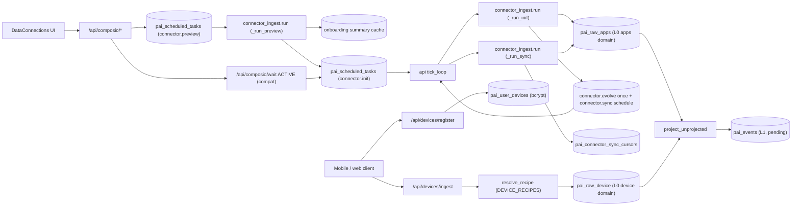
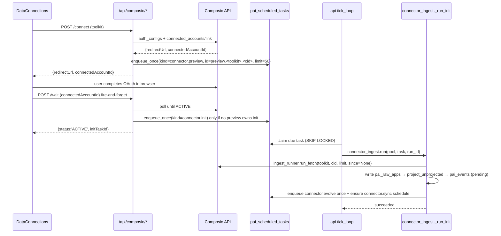
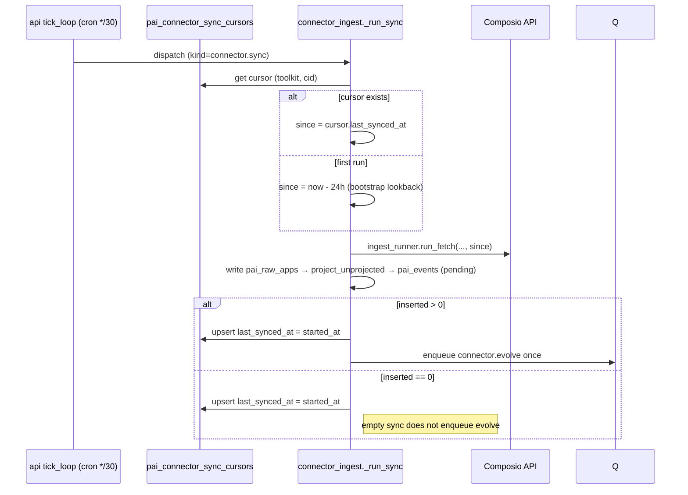
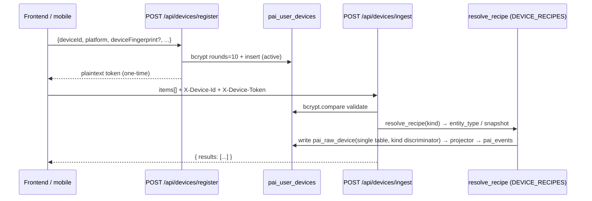

# Data Connectors

## Summary

Data Connectors owns "how data sources get connected in", not the downstream memory distillation. Two main paths:

- **Composio**: the user connects a SaaS account via OAuth in the frontend → `/api/composio/connect` immediately enqueues `connector.preview` (fast onboarding feedback; in the background it waits for ACTIVE, then fetches at most 50 items and builds the summary cache) → after preview finishes it enqueues `connector.init` → the scheduler dispatches it to the in-process handler `domains/connector/apps/connector_ingest.py` → the handler pulls a batch of data from Composio and writes it to the **L0 apps domain table `pai_raw_apps`** (split by domain in `119`; all toolkits go through the generic upserter, `_resolve_upserter` always returns `generic_ingest.upsert_generic`; the typed `pai_raw_<toolkit>` tables were all deleted in `118`) → calls `project_unprojected` to project the new raw rows into L1 `pai_events` (`pending`) → at the same time enqueues one once-shot `connector.evolve` (LLM curates events + distills the portrait) and one recurring `connector.sync` row (high-frequency toolkits use cron `*/30 * * * *`, the rest follow the recipe interval). `connector.sync` uses `pai_connector_sync_cursors.last_synced_at` as the since lower bound for incremental fetches.
- **Device / mobile**: the user registers a device in the frontend and gets a one-time token (stored bcrypt-hashed in `pai_user_devices`), then uses `POST /api/devices/ingest` (authenticated with `X-Device-Id` + `X-Device-Token`). Where data lands is decided by `domains/connector/device/device_ingest/recipes.py:DEVICE_RECIPES` (recipe-ified in P2; the typed-era `DEVICE_INGEST_POLICIES`/typed tables are deleted): every kind writes to the single table `pai_raw_device` (discriminated by `kind` + `platform`; `123`, before `124`, added the platform column), and is projected via `project_unprojected` into L1 `pai_events` (location/visit/motion→movement, session_summary→utterance; transcript_window is rolled into episodes by rollup_semantic; state-type apps/contacts are not projected).



## Boundaries

In scope:

- Composio API key status, connect, disconnect, reconnect, the `/composio/connect` onboarding preview enqueue, the `/composio/wait` ACTIVE enqueue.
- The fetch data → write raw / signal → enqueue evolve / sync schedule chain of the three handlers `connector.preview` / `connector.init` / `connector.sync`.
- Cursor advance semantics of `pai_connector_sync_cursors`.
- The recipe mechanism of `domains/connector/apps/ingest_runner.py` + `db/ingest_recipes/*.yaml`.
- The matrix of toolkits that can actually ingest today.
- `pai_user_devices` registration, token rotation, revocation, bcrypt verification.
- The DEVICE_RECIPES landing targets (entity_type / snapshot) in `domains/connector/device/device_ingest/recipes.py` and the `sync_mode=full|incremental` behavior.
- The frontend (RN) `apps/mobile/src/components/connect/DataConnections.tsx` / `DeviceConnections.tsx` and `apps/mobile/src/lib/devices.ts`.

Out of scope:

- How the evolve agent turns `pai_evolution_runs.refs_consumed` into memory / skill: see [Memory](./memory).
- Card generation and the feedback return path: see [Generation](./generation) / [Feedback](./feedback).
- The scheduler framework itself and the `pai_scheduled_tasks` schema: see [Background Tasks](./background-tasks).
- Containers / deployment / dotenvx: see [Runtime & Deployment](./runtime-deployment).

## Current connection sources

| Source | Current role | Code entry point | Where data lands |
|---|---|---|---|
| Composio (`/api/composio/*`) | OAuth, ACTIVE status, label display, enqueue connector.preview / connector.init | `domains/connector/apps/composio_ui.py`, `domains/connector/apps/composio_service.py`, `useComposio.ts` | Status comes from the Composio API; labels are persisted in `pai_connector_labels` (eager resolve on /wait, lazy retry on /connections); `/connect` enqueues `connector.preview`; after preview finishes it enqueues `connector.init`; for old connections / no preview, `/wait` still enqueues init on ACTIVE; multiple accounts supported (`allow_multiple=True`) |
| `connector.preview` handler | standalone fast onboarding feedback | `domains/connector/apps/connector_ingest.py:_run_preview` | Waits for ACTIVE in the background, fetches at most 50 items from the summary source only, writes raw, then generates `pai_onboarding_connector_summary_cache`; also guarantees `connector.init` is enqueued |
| `connector.init` handler | first batch fetch after ACTIVE | `domains/connector/apps/connector_ingest.py:_run_init` | `pai_raw_apps` → `project_unprojected` projects to `pai_events` (pending) + enqueue `connector.evolve` + create the `connector.sync` schedule |
| `connector.sync` handler | periodic incremental fetch (cron `*/30 * * * *`) | `domains/connector/apps/connector_ingest.py:_run_sync` | Same as above: raw → projector → events; advances `pai_connector_sync_cursors.last_synced_at` only on success |
| Device registry | issues tokens to web / iOS / Android / wearable and other devices | `domains/connector/device/devices_ui.py`, `platform/db/repositories/devices.py` | `pai_user_devices` (`device_token_hash` is bcrypt rounds=10) |
| Device ingest | receives items / snapshots / health observations prepared on-device | `domains/connector/device/devices_ui.py:POST /ingest`, `domains/connector/device/device_ingest/recipes.py`, `domains/connector/device/device_ingest/health.py` | `resolve_recipe(kind)` decides entity_type / snapshot semantics; **everything lands in the single table `pai_raw_device`** (discriminated by `kind`+`platform`); projected via the projector into `pai_events` (except state-type apps/contacts and the transcript_window firehose) |
| PIN hardware (MR20 BLE recorder) | dedicated real-time transcription device: BLE audio → Tencent RTASR → transcripts into the signal stream | `apps/mobile/modules/pin-hardware/` (Expo module), `apps/mobile/src/ambient/sources/pin-hardware.ts`, `domains/voice/tencent_realtime_asr.py` | `device.pin_hardware_transcript` → recipe `utterance` (enters L1 the same way as phone voice), `device.pin_hardware_state` → `context`; also goes through `/api/devices/ingest` into `pai_raw_device` |

## Current Composio toolkit status

**The typed-table era is over** (`118_drop_typed_raw.sql` dropped all `pai_raw_<toolkit>_<entity>` tables and `_upsert_<tk>` mappers): all toolkits go through the generic upserter into **`pai_raw_apps`**; actions / parameters are defined by `backend/db/ingest_recipes/*.yaml`. Existing recipes cover: gmail / googlecalendar / googledrive / googledocs / googlesheets / slack / github / calendly / linkedin / notion / stripe / youtube + `googlesuper` (one-click fanout connect); the remaining 1000+ toolkits rely on `recipe_infer` inference or are connect-only. The frontend DataConnections lists only the product's featured sources on the first screen; the full directory goes through the catalog.

The old "9 featured toolkits" now have only **one** special property: they are in the `connector_ingest._FAST_CADENCE_TOOLKITS` list, so sync uses the high-frequency cron `*/30 * * * *`; toolkits outside the list follow the recipe's `sync_interval_hours` (default 12h). Storage, mapper, and read path are identical to long-tail toolkits; there is no typed/generic distinction.

## Generic storage and the full connector catalog (2026-06)

All Composio connectors (featured + full directory + custom) land in **`pai_raw_apps`** (evolution: `090` created the generic `pai_raw_events` → `118` deleted the typed tables → `119` split by domain into two tables, `pai_raw_apps` / `pai_raw_device`): unified envelope columns (`user_id/id/toolkit/entity_type/external_id/occurred_at/ingested_at/dedupe_key` + the reference triple) + optional display columns `title`/`snippet` + the full original item in `payload JSONB`, `UNIQUE(user_id, toolkit, entity_type, dedupe_key)`. Key points:

- **Generic mapper/upserter**: `domains/connector/apps/generic_ingest.py`. dedupe_key = `<toolkit>:<entity>:<external_id>` (recipe `id_field`), falling back to the payload sha256 when there is no id; `ON CONFLICT DO UPDATE` refreshes the payload (long-tail entities are mostly mutable); rows without `timestamp_path` get occurred_at = NOW(), and it is **not** advanced on conflict update (so they don't occupy the generation window forever). `content_updated_at` (`124`) is touched only when the payload actually changes; the projector uses it to supersede and re-project rows that "were already projected but whose content changed" (reschedules/edits form a chain in L1).
- **Integration point**: `connector_ingest._resolve_upserter` always returns generic (typed `_UPSERTERS` is deleted). The init/sync body, cursor, and evolve enqueue are all reused.
- **sync cadence**: `_FAST_CADENCE_TOOLKITS` use the `*/30` cron; the rest derive from recipe `sync_interval_hours` (default 12h, `_cron_for_interval`), to keep the full directory from exhausting the Composio quota.
- **Reads routed by domain**: `domains/connector/apps/raw_agent.py:list_raw` — the `raw_sources.py` registry is the SSOT for path→(toolkit, entity, domain): the device domain queries `pai_raw_device` (by kind), the rest query `pai_raw_apps` (by toolkit+entity), with the same envelope shape, so evolve (Code Mode reads `client.raw.<tk>.<entity>`) and generation see no difference. SDK `Raw.list` passes unknown toolkits through (server-side enforcer); custom MCP connectors (`custom_mcp.py`, `/connect` with a self-built authConfig) also take part in list as raw sources via `is_custom_mcp_active`.
- **raw source discovery**: each item from `/api/agent/composio/connections` carries `rawSources` (computed by the api process from recipes, with fanout expanded); agent-engine's `generation_context` consumes it first, with a static map as fallback — this doesn't break the api/agent-engine trust boundary.
- **recipe inference**: `domains/connector/apps/recipe_infer.py`. Toolkits without a yaml are inferred from the Composio tool schema on the first `connector.init` (pick a side-effect-free list action, infer result_path/id_field/timestamp_path), with confidence high (run directly) / mid (dedupe falls back to hash, flagged for a yaml) / no readable action → downgrade to connect_only. A hand-written yaml always wins; results are cached in-process, so sync doesn't hit the meta API repeatedly.
- **googlesuper one-click connect**: `db/ingest_recipes/googlesuper.yaml` declares `fanout: [gmail, googlecalendar, googledrive, googledocs, googlesheets]` — one OAuth, one cid; init/sync fan out internally to run five sub recipes, and all five subs land in `pai_raw_apps`; cursors advance per **sub** toolkit, there is only one sync schedule `sync.googlesuper.<cid>`, and a single sub failing doesn't take down the others. identity reuses `GMAIL_GET_PROFILE`. It coexists with connecting sub-toolkits individually; dedupe removes duplicates naturally. Slides is currently covered through Drive file metadata, because Composio Google Slides has no bulk list/search action.
- **Full directory + custom auth**: `GET /api/composio/catalog` (paginated browsing of 1000+ toolkits; `connect` already accepts any slug); `POST /connect` with `authConfig: {authScheme, credentials}` goes through `use_custom_auth` (the user brings their own OAuth client / API key).
- **Command-line acceptance**: `backend/scripts/collector_cli.py` — `catalog`/`infer`/`connect`/`connections`/`ingest` (forges a task and calls `connector_ingest.run()` directly, bypassing the scheduler)/`raw`/`evolve` (enqueue + poll)/`signals`/`memory`/`pipeline` (end to end). The backend chain never depends on the frontend; the `signals`/`memory` subcommands now query `pai_events` (updated after the old `pai_personal_signals`/`pai_memory` tables were DROPped in `114`).

Migration history (raw storage evolution):
- `036_drop_unused_raw_tables.sql` / `045_drop_twitter_discord_artifacts.sql`: typed-era cleanup of raw tables off the main line and twitter/discord leftovers (Twitter went offline because Composio stopped its own OAuth credential in 2026-02; Discord because the server-scoped API can't provide cross-server signals).
- `090_pai_raw_events.sql` created the generic single table → `118_drop_typed_raw.sql` migrated the existing typed-table data and then **DROPped all of them** (including `pai_raw_linkedin_*`) → `119_split_raw_domain.sql` split by domain into `pai_raw_apps` / `pai_raw_device` → `123` added the device platform column, `124` added apps `content_updated_at`.

## Core flows

### Composio OAuth + background preview/init



After connecting, the frontend no longer waits for `/composio/wait` to return before continuing; after the popup closes, the UI first returns to onboarding, and the connection list refreshes once the background wait succeeds. Progress polling rebuilds the taskId deterministically from `preview.<toolkit-lower>.<cid>` / `init.<toolkit-lower>.<cid>`, so polling can continue after a reload.

### Onboarding instant summary

Onboarding first enters Connect data, and when `/api/composio/connect` returns it immediately schedules a standalone `connector.preview` once task. This task waits for Composio ACTIVE in the background, then fetches only the most recent items (at most 50) from the summary source, writes raw, and directly generates `pai_onboarding_connector_summary_cache`; when the frontend watcher sees a fresh successful `connector.preview`, it calls `POST /api/onboarding/connector-summary`, which usually hits the cache. The api process reads the current user's most recent readable records (at most 50) from `pai_raw_apps`, together with identity hints assembled from the connector label / userInfo / login email, first distills them into a small signal pack (`identity` / `sourceCounts` / `topContacts` / `topTerms` / `dateRange` + 10 samples), then uses LiteLLM `gpt-5-nano` to generate a structured "Here's what we know about you" page. Gmail's `topContacts` explicitly reads `from_addr` / `to_addrs` / `cc_addrs`, filters out self, noreply, bot, mailing-list, and path noise, and pins real person names to the first item of the first section, so the model doesn't only talk about repos or workflows. The summary has three fixed sections: first `Key People & Accounts`, then `Professional Identity`, and finally `Communication Style`, 2 items each, putting the people, teams, and accounts the user most readily recognizes first. `googlesuper` (Google Workspace) is the exception: the effective data source for preview and summary is always normalized to `gmail`; the other Calendar / Drive / Docs / Sheets are still fetched by the later `connector.init` fanout and don't block the summary.

The display timing is **no interruption in the middle, one stop before the end**: after connecting a connector the user can continue with the Ambient / local model steps; the summary is generated in the background. When the user taps the final Done, if the summary is ready, the result page is shown first; if not, the user stays on the onboarding wait page ("PIN AI is learning your context") until the result arrives. Only after the user views the result page and taps Enter PIN AI is `onComplete` called to enter the main page.

The display rule is **one interruption per connect action**: the frontend first collects the preview task status of the currently ACTIVE connectors, then picks one insight to show; only old connections without a preview fall back to a fresh init task. `googlesuper` is shown with priority as Google Workspace as a whole, and won't pop up multiple pages because of the Gmail / Calendar / Drive / Docs / Sheets fanout; when actually generating the summary, the server reads only Gmail raw rows and also marks the returned source as `gmail`. If the user connects several connectors in quick succession, they still enter only one insight page.

The server has a summary cache layer: cache key = `schema version + model + toolkit + connected_account_id + raw fingerprint`. When the same batch of raw data re-enters onboarding / is refreshed / is triggered repeatedly by the frontend, it returns `pai_onboarding_connector_summary_cache.summary` directly without calling the LLM again. Every request writes to `pai_onboarding_connector_summary_runs`, recording `item_count / collect_ms / llm_ms / total_ms / status(empty|cached|succeeded|failed)`, to keep observing whether first-run generation can be brought down to 5-6 seconds.

This chain is only responsible for **user-visible onboarding feedback**: it doesn't curate events, doesn't write the L2 portrait / skill, and doesn't replace the background `connector.evolve`. Long-term accumulation (L1 event curation + L2 portrait distillation) is still done by the `connector.evolve` enqueued by `connector.init`.

### `connector.sync` incremental



Key points:

- **schedule**: only when `connector.init` succeeds does it INSERT ON CONFLICT DO NOTHING one sync row, `cron '*/30 * * * *'`, `status='active'`.
- **Cursor**: advanced only on success; on failure the old value is kept and the next sync re-fetches the same window (the raw table's `UNIQUE(user_id, dedupe_key)` absorbs duplicates naturally).
- **Bootstrap**: the first sync has no cursor, so it looks back 24h to fill in content missed between init and the first sync.
- **Per-toolkit since**: decided by the recipe's `since_param` + `since_format`. Gmail uses `query: after:<unix>`, GCal uses `time_min: <iso>`, Slack uses `query: after:YYYY-MM-DD`, GitHub uses `since=<iso>`, Calendly uses `min_start_time=<iso>`. Implemented centrally in `ingest_runner.py:_format_since`.

### Device registration + ingest



For `X-Device-Token` the server stores only the bcrypt hash; the plaintext is returned only once, at register / rotate. `device_fingerprint_hash` (sha256 of platform + client fingerprint) identifies "a different deviceId but actually the same logical device"; on a fingerprint hit the original server `device_id` is reused and only token/metadata are refreshed — the registry must not be switched to the client's new UUID, otherwise old raw/signal evidence would detach from the visible device. The native frontend (apps/mobile, Expo RN) uses a platform-stable identifier as the fingerprint and also writes a stable `hardware_signature` into metadata (excluding the user-editable device name); `/api/devices/list` uses the hardware signature and legacy iOS generic rows to merge entries at the display layer, so the same iPhone doesn't show up as multiple devices because of canonical/dev apps or old records without a fingerprint.

### Ingest per-item status (5-state contract)

`POST /api/devices/ingest` returns one of 5 values in `results[i].status` for each item. The frontend outbox (RN: `apps/mobile/src/ambient/ingest.ts` + the durable sqlite outbox in `runtime.ts`) branches on it; the contract SSOT is `docs/plans/2026-05-12-v2-to-v3-migration.mdx#D-3`.

| status | Meaning | outbox behavior |
|---|---|---|
| `inserted` | raw / signal actually wrote a row | remove, count as success |
| `duplicate` | ON CONFLICT triggered (a true idempotent no-op that only occurs on the raw_only path) | remove, count as success |
| `rejected` | deterministic client-side bug: missing `kind` / cross-device dispatch / unsupported_full_sync, etc. Retrying won't help | remove permanently, write a warning log, no retry |
| `parse_failed` | the item for which `IngestItemIn.model_validate` threw. client schema mismatch | remove permanently, write a warning log, no retry |
| `retryable_failed` | a server-side write exception was caught (DB blip / Supabase hiccup / repository bug). Transient by nature | **keep** in the outbox, retry with exponential backoff |

Server-side write exceptions **must not** be folded into `rejected` — that would let one DB glitch permanently delete user events with the client completely unaware (200 OK + outbox removal). The `try / except` in `domains/connector/device/devices_ui.py:_ingest_for_device` must write the exception reason into the result's `reason` field and set `retryable_failed`; it must not swallow it with `logger.warning` anymore.

### Health observation full-replace scope

`domains/connector/device/device_ingest/health.py:health_full_replace_scope` returns a `(device_id, local_date, metric?)` triple. When the envelope carries `payload.metric` or all observations share the same `metric`, the DELETE is limited to that metric, so one steps push doesn't wipe the same day's `heart_rate` rows (a high-priority fix from V2 commit `089e1f94`). When the envelope is deliberately a multi-metric end-of-day batch, the scope falls back to date-only.

The DELETE in `domains/connector/device/raw_device.py:replace_health` always includes `AND reference_count = 0`, so raw evidence rows referenced by memory / evolution_run won't be deleted by full-sync (the design from V2 `raw-db.ts:1934`). No V3 code currently increments `reference_count` above 0; this is a preemptive defense, so the SQL won't need revisiting once the raw reference mechanism goes live.

### Mobile ambient capture (opt-in, apps/mobile RN)

- The capture side is **apps/mobile (Expo RN)**: native modules are in `apps/mobile/modules/` (`ambient-audio` / `ambient-visit` / `ambient-models`, etc.), JS-side source implementations are in `apps/mobile/src/ambient/sources/*`, and events go through `apps/mobile/src/ambient/runtime.ts` into the durable sqlite outbox and are uploaded to `/api/devices/ingest`. The original Capacitor plugin `@pin/capacitor-ambient-ai` (capacitor-plugins/) was deleted along with the frontend retirement (2026-07-09).
- **Option A (2026-07-01): the phone is a dumb collector** — each source's raw signals go straight into the outbox and are **uploaded in real time per event** (drained immediately after enqueue; the periodic drain is only an offline fallback), with no local aggregation candidate_window / local LLM summary. Aggregation/denoising/summarization all move to the backend: kind → `device_ingest/recipes.py` → `pai_raw_device` → the projector projects into `pai_events` in real time. RN aligned to the same direct upload on 2026-07-07 (before that, RN uploaded only locally distilled output, and raw ambient data never reached `pai_raw_device`/`pai_events`).
- **Privacy invariant**: login itself **never** starts any source. Only sources the user has explicitly opted into in `pai_user_settings.ambient_sources` (migration `041_pai_user_settings_ambient_sources.sql`) are started; app state changes only trigger an outbox drain (flushing already-queued events) and never cause any new capture.
- User UI: `apps/mobile/src/components/ambient/AmbientSourceControlsPanel.tsx` + `useAmbientToggle.ts`; once a toggle flips, it both PATCHes the server and starts/stops the local source, so the UI reflects it immediately and the server is the persistent source of truth.
- When Voice Identity is on, Ambient cloud transcription first goes through `/api/voice/transcribe-diarized` + `gpt-4o-transcribe-diarize` to keep `self` / speaker labels, then uses `gpt-5-nano` to post-process and correct the `text` of each diarized segment. The speaker / start / end structure is kept and stitched back only by code; the post-processing prompt may only change the text; hot words are in `TRANSCRIPTION_POSTPROCESS_TERMS` in `backend/services/api/src/pinai_api/domains/voice/voice_transcription.py`.
- Before changing the ambient source list / lifecycle behavior / the `pai_user_settings.ambient_sources` schema, read [Ambient AI Plugin](../plans/2026-05-10-ambient-ai-plugin) + [V2 → V3 Feature Migration Plan D-5](../plans/2026-05-12-v2-to-v3-migration).

### PIN hardware real-time transcription (MR20 BLE recorder, 2026-07)

- **Pipeline**: the MR20 pushes a continuous 16 kHz / 32 kbps MP3 byte stream over BLE → `apps/mobile/modules/pin-hardware/` (Expo module; the Swift core was migrated from the retired Capacitor plugin) forwards it at the device's pace → **the phone connects directly to the Tencent RTASR WebSocket v2** for streaming transcription. The signed URL is issued by the api process via `POST /api/voice/hardware/tencent-token` (60s TTL, `Depends(current_user)`); `TENCENT_ASR_SECRET_KEY` is a master credential (in `FORBIDDEN_ENVS`, engine can't get it) and **never leaves the api process** — the client only gets the signed URL, and audio doesn't pass through our servers. Parameters sent to Tencent contain no user identifier (`voice_id` is random hex). The real-time engine is fixed at `16k_zh_en_speaker` + `speaker_diarization=1`; the DEV Tencent account doesn't have `16k_zh_en_speaker_2.0` enabled, and using 2.0 returns 4001 during the WebSocket handshake. The anonymous `speaker_id` returned is displayed in the frontend as 0→A, 1→B; phase I doesn't guess any ID to be Self.
- **consent semantics (three differences from other ambient sources)**: (1) `pin_hardware` is in `AMBIENT_SOURCE_KEYS` (consent reconcile/watchdog can start/stop it) but **not** in `AMBIENT_BULK_SOURCE_KEYS` — turning the master switch on does **not** include it (to avoid a Bluetooth permission prompt for users without the device), while turning it off (the privacy master switch) turns it off too; (2) **mutually exclusive** with phone capture (`sound_classifier`): a consent patch that turns either one on turns the other off in the same patch; (3) the start/stop entry is on **the management page under Connect > Devices**: device transcription starts automatically after connecting; tapping "Stop transcription" stops device capture, keeps the BLE connection, and switches to phone capture, and the user can go back to using the device from a small entry; actual disconnect lives in the device info sheet. It is not in the ambient settings panel (the panel's count / one-tap enable-all both exclude it).
- **Management page UI states**: during scanning/connecting/device capture, only the PIN device flow is shown; a compact one-line status at the top shows the scanning animation, battery, and firmware, and the main area is given entirely to the live transcript; only after device transcription is stopped and the source is switched to the phone does the contextual entry to reuse the PIN device appear.
- **Device start/stop protocol**: the main commands of the real-time pipeline are `BLE&STA` / `BLE&STO`, verified by the NotePal/MR20 probe; after tapping start, first wait for the Tencent WebSocket to be ready, then reset device recording with `BLE&STO` → 350ms → `BLE&STA`. A `STA` reported by the device itself is also treated as the user's explicit intent to start transcription; JS immediately mints a Tencent URL and starts the same pipeline, and must not ignore it just because the app hasn't set `captureRequested` yet. If RESET STOP is unconfirmed, first fall back to `edge_BLE&STO` and recompute the 350ms window from that fallback command; if START is unconfirmed, then fall back to `edge_BLE&STA`. The compatibility fallback is driven only by recording state and independent timers; it does not guess from a global "last command" which command an async `UNKNOWN` belongs to; stop/disconnect cancels all delayed tasks, so old tasks don't restart recording after the user stops.
- **JS source** (`apps/mobile/src/ambient/sources/pin-hardware.ts`): state snapshots + final transcripts are pushed as `device.pin_hardware_state` / `device.pin_hardware_transcript` signals (recipe mapping in the table above; transcripts are projected as utterance the same way as phone voice); all interim/final results are also written to a page-independent PIN hardware transcript store. In speaker mode, `sentences.sentence_list` is a correction snapshot and must be merged in place by `voice_id + sentence_id`, not replaced wholesale or repeatedly appended; only sentences that become final for the first time enter the signal stream. Finals are kept per user in AsyncStorage for 7 days (at most 120 entries), so stop/start, disconnect-and-reconnect, or remounting the management page won't clear older text. **ASR stream-drop self-healing** is also in the source (Tencent/network drop → `asr_error` → 1s/3s/8s/15s/30s backoff, then keep re-minting + `restartAsr` every 30s, no longer exhausting a three-attempt budget); `restartAsr` resolving only means the async handshake was initiated, and the retry budget must be reset only after real transcripts flow in. The source actively reads native state every 30s to make up for events missed while JS was suspended in the background; the app returning to the foreground and the runtime watchdog's `refresh()` also check immediately, without waiting for the next round. After each new socket receives Tencent's `code=0`, the native layer reruns `BLE&STO` → `BLE&STA`, to avoid feeding half a frame of the continuous MP3 stream to a new decoder. The client persists the `speaker_context_id` returned by Tencent and clears it on sign-out; reusing speaker clustering across accounts is forbidden.
- **iOS background and recovery**: the app declares the `bluetooth-central` UIBackgroundModes (BLE doesn't drop while locked) + CoreBluetooth state restoration (restore identifier + a `sessionActive` UserDefaults flag); the default device is stored in UserDefaults, and `retrievePeripherals` reconnects automatically. The native layer also persists `captureDesired` (it stores only the intent "the user still wants transcription", not the 60s short-lived signed URL); after a BLE cold restore reaches a writable state, the global JS source re-mints the URL and calls `startCapture`, independent of whether the management page is mounted. Explicit stop/disconnect/sign-out clears the intent. After the user force-swipes the app away from the app switcher, iOS doesn't allow a background relaunch; recovery can only happen the next time the user opens the app.
- **Environments**: the three Tencent keys (`TENCENT_ASR_SECRET_ID/KEY/APP_ID`) are currently configured only for dev; when test/prod aren't configured, mint returns `503 detail=pin_hardware_asr_not_configured`, and the client falls back to phone capture by design (a bare 503 — e.g. a Fly deploy hiccup — does not trigger the fallback).
- **Audio format**: the MR20's BLE notify is a continuous 16 kHz / 32 kbps MP3 byte stream (packet boundaries are not MP3 frame boundaries); after each new ASR socket is ready, iOS first restarts the device encoder, then pushes the bytes to Tencent RTASR unchanged at the device's pace, with the signature parameter fixed at `voice_format=8`. Never let a new socket take over midway through an old stream, and never interpret it as PCM (`voice_format=1`) or re-chunk it into 640 bytes, otherwise you get "the device is capturing but no text ever appears".

### Unified device timeline

`GET /api/devices/{deviceId}/timeline` (`devices_ui.py:get_device_timeline`) **queries only `pai_raw_device`** (`external_id = device_id`) since the lifelong-memory L0 unification — all of the device's sources (health observations, apps/contacts snapshots, ambient/device context events) land in this single table, with `kind` used as `type` to distinguish sources, ordered by `occurred_at DESC` + a single keyset cursor. Returned envelope:

```json
{
  "ok": true,
  "items": [
    {"type": "<entity_type>", "occurred_at": "...", "row": {...}}
  ],
  "next_cursor": "..." | null,
  "has_more": true
}
```

health uses the recipe's `snapshot='health'` semantics (high frequency; each observation is kept as an L0 record and doesn't enter L1 retrieval; the old `_HEALTH_POLICY` was deleted when policies were consolidated into recipes). The frontend `apps/mobile/src/components/connect/DeviceTimeline.tsx` uses `fetchDeviceTimeline` to fetch the merged stream in one call and renders by `type`, without a client-side k-way merge.

## Current design

### Composio service layer

- `domains/connector/apps/composio_service.py` is the single source of truth:
  - Direct SDK calls (connection lifecycle, tool discovery, execute) → used by ingest_runner.
  - Per-user `ToolRouterSession` LRU + 1h idle TTL → used by the agent-engine-side meta-tools (`/api/agent/composio/meta/*`).
  - **Label / identity resolution**: `_IDENTITY_SPECS` registers one "get me" action + extractor for each of 8 toolkits (gmail → GMAIL_GET_PROFILE → emailAddress; googlecalendar → GOOGLECALENDAR_GET_CALENDAR(`primary`) → id; youtube → YOUTUBE_GET_CHANNEL_STATISTICS(`mine=true`) → snippet.title, etc.). When `/api/composio/wait` hits ACTIVE it eager-resolves once and writes the result to `pai_connector_labels` (PK = `user_id, connected_account_id`). `/api/composio/connections` joins this table directly, ~0 latency. Failed rows carry `resolve_attempts / last_attempt_error`, and the next `/connections` lazy-retries. Stripe has no identity action and falls back to `fallback_label("stripe", cid)`.
- The Composio master key comes from env `COMPOSIO_API_KEY` (only in the api process, on the FORBIDDEN_ENVS list, invisible to agent-engine).
- The same `(user_id, toolkit)` supports multiple accounts (`connected_accounts.link(allow_multiple=True)`). The frontend `+add` button makes the backend create a separate `connected_account_id`; all per-account state (label / sync cursor / `init.{toolkit}.{cid}` task) is keyed by cid.
- `/api/agent/composio/*` is the counterpart of `pinai_sdk.composio` inside the sandbox; execution is gated by an allowlist.

### Ingest recipe mechanism

`backend/db/ingest_recipes/<toolkit>.yaml`:

```yaml
toolkit: gmail
slug: GMAIL_FETCH_EMAILS
args_template:
  max_results: 100
  verbose: true
  include_payload: false
since_param: query
since_format: gmail_query
result_path: [messages]
id_field: id
```

`domains/connector/apps/ingest_runner.py:Recipe.load_recipe()` reads it, and `run_fetch(user_id, toolkit, cid, limit, since)` executes it. Validation script: `backend/scripts/validate_ingest_recipe.py`.

Steps to add a new toolkit (generic path, the current default):
1. Add `db/ingest_recipes/<toolkit>.yaml`, declaring `entity_type` + `id_field` + `timestamp_path` (optionally `title_path`/`snippet_path`). It also runs without a yaml — the first init uses `recipe_infer` to infer automatically, and the yaml is the override when inference is wrong (`collector_cli infer <tk> --dump-yaml` can generate a draft).
2. Verify from the command line with `collector_cli pipeline <tk> --cid <cid>` (connect→ingest→raw→evolve→signals).
3. No mapper/upserter, no new table, no dict registration — data lands in `pai_raw_apps`.

### Shared raw table structure (two domain tables)

L0 has only two domain tables (`119_split_raw_domain.sql`), sharing a unified envelope:

- **`pai_raw_apps`** (Composio / custom connectors): `user_id/id/toolkit/entity_type/external_id` + `occurred_at` (event time)/`ingested_at` (write time)/`content_updated_at` (`124`, touched only when the payload actually changes, drives supersede re-projection) + `title`/`snippet` display columns + full `payload JSONB` + `dedupe_key` (`UNIQUE(user_id, toolkit, entity_type, dedupe_key)`) + the reference triple (`reference_count`/`last_referenced_at`/`referenced_by_runs`).
- **`pai_raw_device`** (devices): same envelope; the discriminator column is `kind` (+ `platform`, `123`), `external_id` = device_id (so the full-sync replace DELETE is limited to a single device), and on-device scope fields like `snapshot_id`/`local_date` go into payload/dedicated columns.

The typed-era multiple `pai_raw_<toolkit>_<entity>` tables were all deleted in `118`. The reference triple ensures rows referenced by evolve / generate aren't deleted during a full-sync replace (the evidence chain stays intact).

### Device ingest recipes

`domains/connector/device/device_ingest/recipes.py:DEVICE_RECIPES` (an open dict; to add a new kind, just register it; the four typed-era `DEVICE_INGEST_POLICIES` modes are deleted):

| Kind | recipe semantics | Where it lands |
|---|---|---|
| `app_inventory*` / `contact_directory*` and other snapshot types | `snapshot` (full-replace semantics) | `pai_raw_device` (state types aren't projected to L1) |
| `health.observation` | `snapshot='health'` (parsed by `health.py:parse_health_observations`, per-metric scope replace) | `pai_raw_device` (kept as an L0 record, not projected into L1 retrieval) |
| ambient (`ambient.utterance` / `ambient.visit` / `device.motion_segment`, etc.) / unknown kind | event type (fallback carries `ingest_fallback_reason`) | `pai_raw_device` → projector projects to L1 `pai_events` (`source='device'`) |

> All device kinds write to the single table `pai_raw_device` and are projected via `project_unprojected` into L1 `pai_events`, no longer writing to the retired `pai_personal_signals`; the `transcript_window` firehose isn't projected directly but is rolled into episodes by rollup_semantic.

`sync_mode` (item envelope field):

- `incremental` (default): INSERT only; the raw table's `dedupe_key UNIQUE` absorbs duplicates naturally.
- `full`: replace semantics.
  - app/contact: replace all snapshot rows for that device (the on-device snapshot view is ephemeral and can be fully deleted).
  - health: replace **only** unreferenced old rows within the scope — scope = `(device_id, local_date)`, and only rows with `reference_count = 0` are deleted; raw rows already referenced by evolution / memory are kept (to avoid breaking evidence). With multiple local_dates or an ambiguous scope, it falls back to incremental, and the signal carries `ingest_fallback_reason='unsafe_full_scope'`.

## Development entry points

| Change | Look at first |
|---|---|
| Composio UI buttons / OAuth / init chip | `apps/mobile/src/components/connect/DataConnections.tsx` (RN), `apps/web/src/ui-web/connect/` (web), `apps/mobile/src/lib/card-connector-oauth.ts` |
| Composio api routes + `/wait` enqueue hook | `backend/services/api/src/pinai_api/domains/connector/apps/composio_ui.py` |
| Composio sandbox routes | `domains/connector/apps/composio_agent.py` |
| Composio SDK / session pool / label resolution (`_IDENTITY_SPECS`) | `domains/connector/apps/composio_service.py` |
| `pai_connector_labels` persistence | `domains/connector/apps/connector_labels.py`, migration `040_pai_connector_labels.sql` |
| Add a new toolkit to ingest | Only `db/ingest_recipes/<tk>.yaml` is needed (or rely on `recipe_infer` inference); no mapper / no new table (everything lands in `pai_raw_apps`) |
| Recipe schema / since formatting | `domains/connector/apps/ingest_runner.py`, `scripts/validate_ingest_recipe.py` |
| Cursor advance | `domains/connector/apps/connectors.py` (`pai_connector_sync_cursors` read/write) |
| Device registration / token / rotate | `domains/connector/device/devices_ui.py`, `platform/db/repositories/devices.py` |
| Device ingest recipes / health parsing | `domains/connector/device/device_ingest/recipes.py`, `domains/connector/device/device_ingest/health.py` |
| Raw schema | `backend/db/migrations/090_pai_raw_events.sql` (predecessor), `118_drop_typed_raw.sql`, `119_split_raw_domain.sql`, `123_pai_raw_device_platform.sql`, `124_pai_raw_apps_content_updated.sql` |
| Frontend device list / registration UI | `apps/mobile/src/components/connect/DeviceConnections.tsx`, `apps/mobile/src/lib/devices.ts` |

## How to verify

```bash
cd backend && uv run pytest tests/web/services/test_connector_ingest.py
cd backend && uv run pytest tests/web/services/test_connector_sync.py
cd backend && uv run pytest tests/web/services/test_connector_slack.py
cd backend && uv run pytest tests/web/services/test_connector_drive.py
cd backend && uv run pytest tests/web/services/test_connector_calendly.py
cd backend && uv run pytest tests/web/services/test_connector_github.py
cd backend && uv run pytest tests/web/services/test_connector_linkedin.py
cd backend && uv run pytest tests/web/services/test_connector_stripe.py
cd backend && uv run pytest tests/web/services/test_connector_youtube.py
cd backend && uv run pytest tests/web/test_composio_service.py            # SDK wrapper / label extractors
cd backend && uv run pytest tests/web/devices                              # token + ingest policies
cd backend && uv run pytest tests/web/db/repositories/test_connectors_repo.py
cd backend && uv run pytest tests/web/routes/                              # route integration
cd apps/mobile && npm run type-check
```

Manual DB queries (local compose Postgres `localhost:54322` postgres/postgres):

```sql
-- Composio task history
SELECT id, kind, status, attempts, last_run_status, last_error
FROM pai_scheduled_tasks
WHERE kind LIKE 'connector.%' AND user_id = $1
ORDER BY updated_at DESC LIMIT 20;

-- raw rows for a single toolkit (Composio writes to pai_raw_apps)
SELECT count(*), max(occurred_at) FROM pai_raw_apps WHERE user_id = $1 AND toolkit = 'gmail';
-- projected L1 events (replacing the retired pai_personal_signals)
SELECT (curated_at IS NULL) AS uncurated, count(*) FROM pai_events WHERE user_id = $1 GROUP BY 1;

-- Cursor state
SELECT * FROM pai_connector_sync_cursors WHERE user_id = $1;

-- Device registration
SELECT id, device_id, platform, status, last_seen_at
FROM pai_user_devices WHERE user_id = $1;
```

Container logs:

```bash
make logs-api | grep -E "connector\.|composio|/devices/ingest"
```

## Gotchas

- The Composio API key is a master credential and may only be read in the api process; the agent-engine process calls indirectly through `/api/agent/composio/meta/*` and never gets the key.
- The typed `_UPSERTERS` / `unsupported_v0` skip path was deleted with the generic unification — every toolkit now actually runs; the new gotcha is **recipe inference confidence**: at mid confidence, dedupe falls back to the payload hash (needs a yaml), and with no readable action it downgrades to connect_only (no data comes in, but the connection shows as normal).
- The `connector.sync` high-frequency list is hardcoded in `connector_ingest._FAST_CADENCE_TOOLKITS` (cron `*/30`); toolkits outside it follow recipe `sync_interval_hours`; to change frequency, change these two places, not env.
- generic dedupe_key = `<toolkit>:<entity>:<external_id>` (**does not include** connectedAccountId) — multiple accounts with the same external_id merge into one row, relying on provider ids being globally unique; think through multi-account semantics before changing the dedupe formula.
- The fix for Composio Gmail 413 on large responses is `include_payload=false` (keep `verbose` at `true`); when editing the recipe, don't change include_payload back to true.
- Composio occasionally puts unescaped `\n` / `\r` / `\x00-\x1F` in large responses, which standard JSON.parse rejects; the `ingest_runner` fetcher has built-in sanitize-and-retry.
- Field names returned by Composio often differ from the native API (Gmail `to` is a string, not an array; Notion is a slim shape `{id,title,type}`); probe the real shape before writing a new mapper.
- The GitHub slug is `GITHUB_LIST_ISSUES_ASSIGNED_TO_THE_AUTHENTICATED_USER`; the version without `LIST_` returns 404.
- Device tokens must not be logged or stored in plaintext; bcrypt verification failures always return 401 with no detail.
- `pai_user_devices.device_fingerprint_hash` must not hold the raw fingerprint, only the sha256 hash; the app persists its fingerprint in secure storage and reuses the same logical device when device_id changes.
- `sync_mode=full` for health is a `(device_id, local_date)` scope replace, and only deletes rows with `reference_count=0`; multi-date payloads automatically fall back to incremental, so don't rely on it to "overwrite today's data wholesale".
- The old `apis/src/domain/proactive/mobile_proxy.ts` and the `MOBILE_SYNC_TARGET_USER_ID` default-container fallback are all retired; the only entry point for mobile data is now `/api/devices/ingest`, handled directly by the api process, no longer through a separate proxy service.
- A failed enqueue in `/api/composio/wait` doesn't affect the ACTIVE status (it only logs a warning); when the frontend chip doesn't get an `initTaskId` it doesn't render and waits for the reconciler as a fallback — but the backend currently has no dedicated reconciler service, so a failed OAuth-but-no-init currently requires a manual reconnect.

## Related modules

- [Memory](./memory): the downstream chain where the evolve agent turns `pai_evolution_runs.refs_consumed` into memory / skill.
- [Background Tasks](./background-tasks): dispatch of `connector.init` / `connector.sync` / `connector.evolve` on the scheduler.
- [Generation](./generation): card generation reads L1 `pai_events` (`events_search`) + `pai_world_signals` + the L2 portrait.
- [Runtime & Deployment](./runtime-deployment): the api/agent-engine trust boundary, the Composio master key, device token bcrypt.

## Related AI Plans

- [Web Cloud Data Self-Sufficient Plan](../plans/2026-05-17-web-cloud-data-self-sufficient): required reading when building summaries, the all-device cloud timeline, freshness, and page display on the web side around uploaded device/mobile data.
- [Ambient AI-visible Records SSOT Refactor](../plans/2026-05-17-ambient-ai-visible-records-ssot): required reading when changing the native Ambient local ledger, outbox, or upload record visibility.
- [Transcript Window Upsert + Existing Data Cleanup](../plans/2026-05-18-transcript-window-upsert-storage-cleanup): required reading when changing the transcript_session window, ambient outbox dedupe, `pai_personal_signals` upsert, or merging existing local/cloud duplicates.
- [Ambient Live Freshness + Persistent Transcript Queue](../plans/2026-05-18-ambient-live-freshness-persistent-transcript-queue): required reading when changing the Live transcript display, the iOS native transcript/capture persistent queue, background transcription recovery, or batched backfill of the Ambient timeline backlog.
- [Ambient Lock-Screen Audio + Live Session Fix](../plans/2026-06-05-ambient-lock-screen-audio-live-session-fix): required reading when changing screen-off recording, background WAV capture, captureSessionId rotation, or the Live current/history section display.
- [iOS Place Visits Durable Capture](../plans/2026-05-20-ios-place-visits-durable-capture): required reading when changing iOS CLVisit / Place Visits capture, the background visit persistent queue, Always permission diagnostics, visit drain into the Ambient timeline, or Ambient settings source start/stop decisions.
- [Ambient Voice Identity + Speaker Diarization](../plans/2026-05-27-ambient-voice-identity-diarization): required reading when changing Setting > Ambient own-voice enrollment, OpenAI diarized transcription, the speaker segments payload, or speaker labels like `self` / `speaker_1` in Ambient transcripts.
- [Ambient Mixed Chinese-English Transcription Quality](../plans/2026-06-09-ambient-mixed-language-transcription-quality): required reading when changing the mixed Chinese-English transcription quality of the Ambient live transcript / timeline, WAV burst slicing parameters, the OpenAI transcription language hint, or the plain `gpt-4o-transcribe` prompt/glossary.
