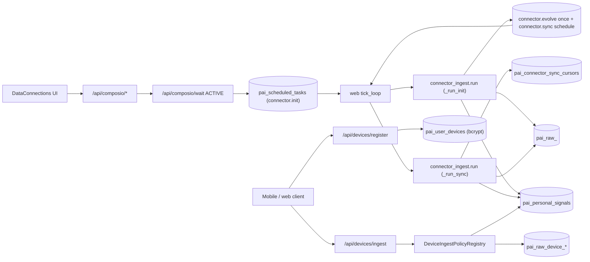
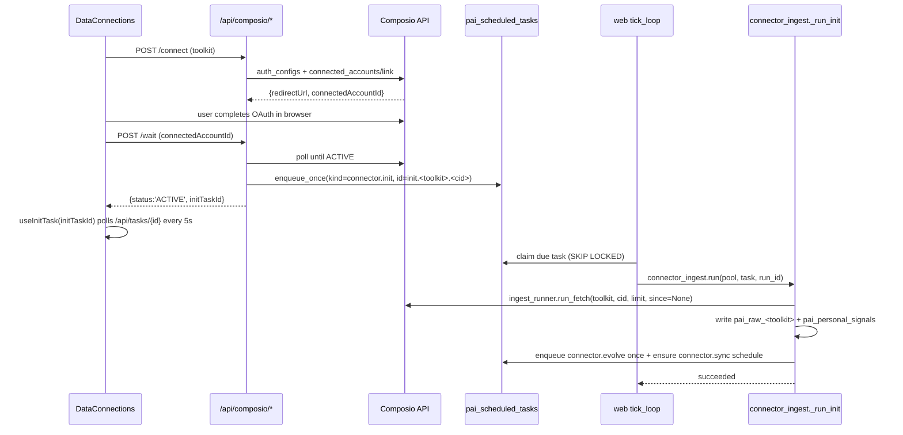
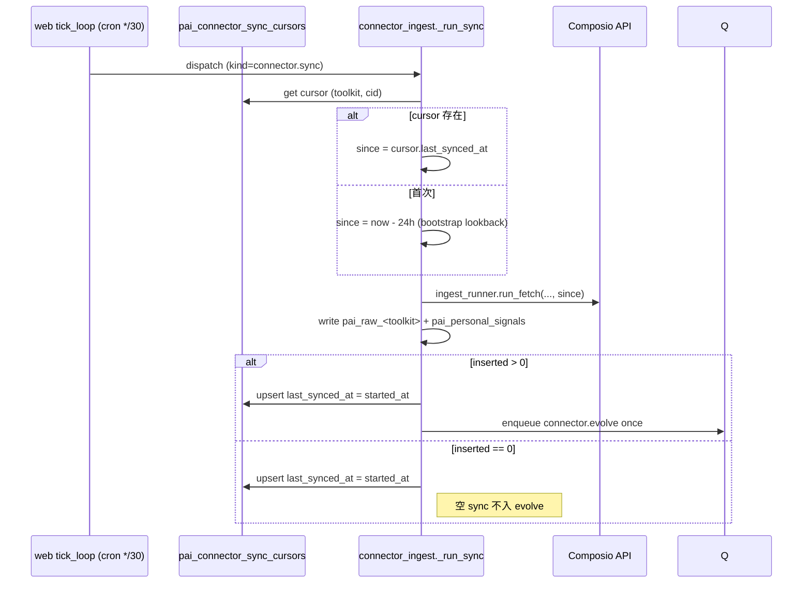
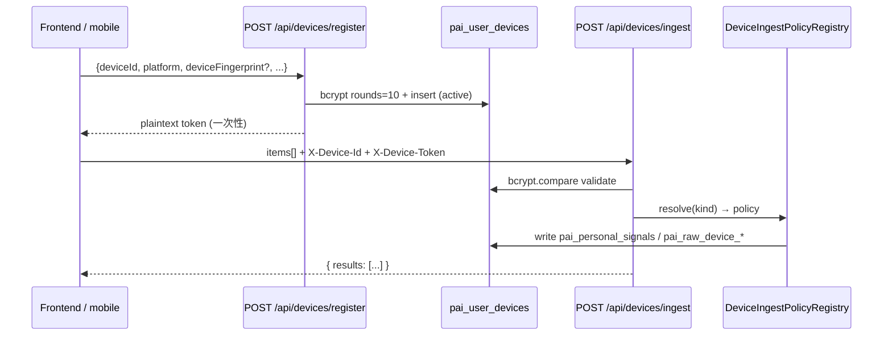

# Data Connectors

## 结论

Data Connectors 负责"数据源怎么接进来",不负责后续记忆提炼。两条主链路:

- **Composio**:用户在前端 OAuth 连 SaaS 账号 → `/api/composio/wait` 轮询到 ACTIVE 后入队 `connector.init` 任务(`pai_scheduled_tasks`,kind=`connector.init`)→ scheduler 把它派给 `web/services/connector_ingest.py` in-process handler → handler 从 Composio 拉一批数据写到 `pai_raw_<toolkit>` typed 表 + `pai_personal_signals` → 同时入一次 once-shot `connector.evolve`(LLM 沉淀)和一行 recurring `connector.sync`(cron `*/30 * * * *`)。`connector.sync` 用 `pai_connector_sync_cursors.last_synced_at` 当 since 下界做增量。
- **Device / mobile**:用户在前端注册设备拿一次性 token(bcrypt 存 `pai_user_devices`),后续走 `POST /api/devices/ingest`(`X-Device-Id` + `X-Device-Token` 鉴权)写入 `pai_personal_signals` 或 `pai_raw_device_*`。落点由 `web/device_ingest/policies.py:DEVICE_INGEST_POLICIES` 决定,unknown kind 默认 fallback 到 signal。



## 边界

包含:

- Composio API key 状态、连接、断开、reconnect、`/composio/wait` ACTIVE 入队。
- `connector.init` / `connector.sync` 两个 handler 的拉数据→写 raw / signal → 入 evolve / sync schedule 链路。
- `pai_connector_sync_cursors` 游标推进语义。
- `web/services/ingest_runner.py` + `db/ingest_recipes/*.yaml` 的 recipe 机制。
- 当前真正能 ingest 的 toolkit 矩阵。
- `pai_user_devices` 注册、token 轮换、撤销、bcrypt 校验。
- `web/device_ingest/policies.py` 落点 policy(signal_only / raw_only / dual)和 `sync_mode=full|incremental` 行为。
- 前端 `DataConnections.tsx` / `useComposio.ts` / `useInitTask.ts` / `DeviceConnections.tsx`。

不包含:

- evolve agent 怎么把 `pai_evolution_runs.refs_consumed` 沉淀成 memory / skill,看 [Memory](./memory)。
- 卡片生成、反馈回流,看 [Generation](./generation) / [Feedback](./feedback)。
- scheduler 框架本身、`pai_scheduled_tasks` schema,看 [Background Tasks](./background-tasks)。
- 容器 / 部署 / dotenvx,看 [Runtime & Deployment](./runtime-deployment)。

## 当前连接源

| 来源 | 当前作用 | 代码入口 | 数据落点 |
|---|---|---|---|
| Composio(`/api/composio/*`) | OAuth、ACTIVE 状态、label 展示、入队 connector.init | `web/routes/ui/composio.py`、`web/composio_service.py`、`useComposio.ts` | 状态来自 Composio API;label 持久化在 `pai_connector_labels`(eager resolve on /wait,lazy retry on /connections);ACTIVE 入队 `connector.init`;支持多账号(`allow_multiple=True`) |
| `connector.init` handler | ACTIVE 后首次拉一批 | `web/services/connector_ingest.py:_run_init` | `pai_raw_<toolkit>` + `pai_personal_signals` + 入 `connector.evolve` + 建立 `connector.sync` schedule |
| `connector.sync` handler | 周期增量拉取(cron `*/30 * * * *`) | `web/services/connector_ingest.py:_run_sync` | 同上 raw / signals;成功才前推 `pai_connector_sync_cursors.last_synced_at` |
| Device registry | 给 web / iOS / Android / wearable 等设备发 token | `web/routes/ui/devices.py`、`web/db/repositories/devices.py` | `pai_user_devices`(`device_token_hash` 是 bcrypt rounds=10) |
| Device ingest | 接收端侧整理后的 item / snapshot / health observation | `web/routes/ui/devices.py:POST /ingest`、`web/device_ingest/policies.py`、`web/device_ingest/health.py` | 由 policy 决定:`pai_personal_signals` / `pai_raw_device_apps_snapshot` / `pai_raw_device_contacts_snapshot` / `pai_raw_device_health_observations` |

## 当前 Composio toolkit 状态

`pinai-agents/db/ingest_recipes/` 下的老 typed toolkit 仍是 recipe + raw 表 + `_UPSERTERS` mapper 三者齐全;新增/长尾 toolkit 默认只需要 recipe,数据落 `pai_raw_events`。前端 `DataConnections.tsx` 只把产品主推源列在首屏,全量目录走 catalog。

| Toolkit | Composio action(来自 recipe) | raw 表 | 状态 |
|---|---|---|---|
| `gmail` | `GMAIL_FETCH_EMAILS`(`verbose=false`,`include_payload=true`) | `pai_raw_gmail_messages` | ✅ live(`_upsert_gmail`) |
| `googlecalendar` | `GOOGLECALENDAR_EVENTS_LIST` | `pai_raw_gcal_events` | ✅ live(`_upsert_gcal`) |
| `googledrive` | `GOOGLEDRIVE_FIND_FILE` | `pai_raw_gdrive_files` | ✅ live(`_upsert_gdrive_files`) |
| `googledocs` | `GOOGLEDOCS_SEARCH_DOCUMENTS` | `pai_raw_events`(`toolkit='googledocs', entity_type='documents'`) | ✅ live(generic storage, latest 100) |
| `googlesheets` | `GOOGLESHEETS_SEARCH_SPREADSHEETS` | `pai_raw_events`(`toolkit='googlesheets', entity_type='spreadsheets'`) | ✅ live(generic storage, latest 100) |
| `slack` | `SLACK_SEARCH_MESSAGES` | `pai_raw_slack_messages` | ✅ live(`_upsert_slack_messages`) |
| `github` | `GITHUB_LIST_ISSUES_ASSIGNED_TO_THE_AUTHENTICATED_USER` | `pai_raw_github_issues` | ✅ live(`_upsert_github_issues`) |
| `calendly` | `CALENDLY_LIST_SCHEDULED_EVENTS` | `pai_raw_calendly_events` | ✅ live(`_upsert_calendly_events`) |
| `linkedin` | `LINKEDIN_GET_MY_INFO` | `pai_raw_linkedin_profile` | ✅ live(`_upsert_linkedin_profile`) |
| `stripe` | `STRIPE_LIST_INVOICES` | `pai_raw_stripe_invoices` | ✅ live(`_upsert_stripe_invoices`) |
| `youtube` | `YOUTUBE_LIST_USER_SUBSCRIPTIONS` | `pai_raw_youtube_subscriptions` | ✅ live(`_upsert_youtube_subscriptions`) |

**加新 toolkit 的默认路径已经变了(2026-06 generic 存储上线)**:新 toolkit 一律走通用存储 `pai_raw_events`(见下节),只需一份 recipe yaml(甚至没有 yaml 也能靠推断跑),**不再**写 `_map_<tk>` / `_upsert_<tk>` / 注册 dict。上表 9 个老 toolkit 维持 typed 表不迁移;一个 toolkit 的存储归属是二选一、全局唯一(routing 真相 = `web/routes/agent/raw.py:_RAW_TABLES`),绝不混。

## Generic 存储与全量 connector(2026-06)

9 个 typed toolkit 之外的所有 connector(Composio 全量目录 + 自定义)落 **`pai_raw_events`**(migration `089`):统一信封列(`user_id/id/toolkit/entity_type/external_id/occurred_at/ingested_at/dedupe_key` + reference 三元组)+ 可选展示列 `title`/`snippet` + 原始 item 全量 `payload JSONB`。要点:

- **通用 mapper/upserter**:`web/services/generic_ingest.py`。dedupe_key = `<toolkit>:<entity>:<external_id>`(recipe `id_field`),无 id 时退化 payload sha256;`ON CONFLICT DO UPDATE` 刷新 payload(长尾多为可变实体);无 `timestamp_path` 的行 occurred_at 落 NOW() 且冲突更新时**不**前推(防止永远占住生成 24h 窗口)。
- **接入点**:`connector_ingest._resolve_upserter` — typed `_UPSERTERS` 命中优先,miss 走 generic。init/sync 主体、cursor、evolve 入队全复用。
- **sync 节奏**:typed 维持 `*/30` cron;generic 按 recipe `sync_interval_hours` 派生(默认 12h,`_cron_for_interval`),防全量目录打爆 Composio 配额。
- **读取单一分支点**:`web/routes/agent/raw.py:list_raw` — `_RAW_TABLES` 命中查 typed 表,miss 时按 (toolkit, entity_type) 参数化查 `pai_raw_events`,信封同形,evolve(Code Mode 读 `client.raw.<tk>.<entity>`)与 generation 零感知。SDK `Raw.list` 对未知 toolkit 透传(服务端 enforcer)。
- **raw 源发现**:`/api/agent/composio/connections` 每项带 `rawSources`(web 读 recipe 算出,fanout 展开),chat 的 `generation_context` 优先消费、静态 map 兜底——不破 web/chat trust boundary。
- **recipe 推断**:`web/services/recipe_infer.py`。无 yaml 的 toolkit 在首次 `connector.init` 时从 Composio tool schema 推断(挑无副作用 list action、推 result_path/id_field/timestamp_path),置信度 high(直接跑)/ mid(dedupe 退化 hash,标记补 yaml)/ 无可读 action → connect_only 降级。手写 yaml 永远优先;进程内缓存,sync 不重复打 meta API。
- **googlesuper 一键连**:`db/ingest_recipes/googlesuper.yaml` 声明 `fanout: [gmail, googlecalendar, googledrive, googledocs, googlesheets]`——一次 OAuth、一个 cid,init/sync 内部扇出跑五个 sub recipe。Gmail/Calendar/Drive 复用 typed 表,Docs/Sheets 走 `pai_raw_events`;cursor 按 **sub** toolkit 各自推进,sync schedule 只有一条 `sync.googlesuper.<cid>`,单 sub 失败不拖垮其余。identity 复用 `GMAIL_GET_PROFILE`。与单独连 sub-toolkit 共存,dedupe 天然去重。Slides 目前通过 Drive 文件元数据覆盖,因为 Composio Google Slides 没有批量 list/search action。
- **全量目录 + 自定义 auth**:`GET /api/composio/catalog`(分页浏览 1000+ toolkit;`connect` 本来就接受任意 slug);`POST /connect` 带 `authConfig: {authScheme, credentials}` 走 `use_custom_auth`(用户自带 OAuth client / API key)。
- **命令行验收**:`pinai-agents/scripts/collector_cli.py` — `catalog`/`infer`/`connect`/`connections`/`ingest`(伪造 task 直调 `connector_ingest.run()`,绕过 scheduler)/`raw`/`evolve`(入队+轮询)/`signals`/`memory`/`pipeline`(一条龙)。后台链路全程不依赖前端。

migration 历史:
- `036_drop_unused_raw_tables.sql` 把 `pai_raw_gdocs_*` / `pai_raw_outlook_*` / `pai_raw_notion_*` / `pai_raw_asana_*` / `pai_raw_zoom_*` / `pai_raw_clickup_*` 等不在主线上的 raw 表删除。
- `045_drop_twitter_discord_artifacts.sql` 移除 twitter / discord 这两个最后的 connect-only / recipe-only 残留:删 `pai_raw_twitter_bookmarks` 表,清掉这两个 toolkit 的 scheduled tasks / sync cursors / connector labels。Twitter 之所以下线是因为 Composio 2026-02 停了自有 OAuth credential,Discord 则因为 server-scoped API 给不出 cross-server 信号,产品面也撤掉了入口。

留意 LinkedIn organizations(`pai_raw_linkedin_organizations`)表还在,但没接 recipe / upserter — 留作下一轮如果要做"用户管理的 LinkedIn 公司页"再用,目前空表。

## 核心链路

### Composio OAuth + 后台 init



前端 `useInitTask` 用确定性 `init.<toolkit-lower>.<cid>` 重建 taskId,reload 也能继续轮询。

### `connector.sync` 增量



关键点:

- **schedule**:`connector.init` 跑成功才 INSERT ON CONFLICT DO NOTHING 一条 sync 行,`cron '*/30 * * * *'`,`status='active'`。
- **Cursor**:成功才前推;失败保留旧值,下次 sync 重拉同一窗口(raw 表 `UNIQUE(user_id, dedupe_key)` 自然吸收重复)。
- **Bootstrap**:首次 sync 没 cursor,回看 24h 补 init 到首次 sync 之间漏的内容。
- **Per-toolkit since**:由 recipe 的 `since_param` + `since_format` 决定。Gmail 用 `query: after:<unix>`,GCal 用 `time_min: <iso>`,Slack 用 `query: after:YYYY-MM-DD`,GitHub 用 `since=<iso>`,Calendly 用 `min_start_time=<iso>`。在 `ingest_runner.py:_format_since` 集中实现。

### Device 注册 + ingest



`X-Device-Token` 服务端只存 bcrypt hash,明文只在 register / rotate 时返回一次。`device_fingerprint_hash`(sha256 of platform + 客户端 fingerprint)用来识别"换 deviceId 但实际同一台逻辑设备";fingerprint 命中时复用原 server `device_id`,只刷新 token/metadata,不能把 registry 改到客户端新 UUID,否则旧 raw/signal evidence 会从可见设备下脱落。Native 前端优先用 Capacitor Device 的 app-visible identifier 做 fingerprint,同时把稳定的 `hardware_signature` 写进 metadata(不包含用户可改的设备名);`/api/devices/list` 会用 hardware signature 和 legacy iOS generic rows 做显示层收敛,避免同一台 iPhone 因 canonical/dev app 或旧无 fingerprint 记录显示成多台设备。

### Ingest per-item status(5 态契约)

`POST /api/devices/ingest` 对每条 item 在 `results[i].status` 里返回 5 个值之一。前端 outbox(`proactive-ai-frontend/src/services/ambient/sync-scheduler.ts:bucketRecords`)按此分流;契约 SSOT 在 `docs/plans/2026-05-12-v2-to-v3-migration.mdx#D-3`。

| status | 含义 | outbox 行为 |
|---|---|---|
| `inserted` | raw / signal 实际写入了一行 | 移除,记为成功 |
| `duplicate` | ON CONFLICT 触发(raw_only 路径才会出现的真 idempotent no-op) | 移除,记为成功 |
| `rejected` | 确定性 client-side bug:缺 `kind` / cross-device dispatch / unsupported_full_sync 等。重传不会变好 | 永久移除,记 warning log,不 retry |
| `parse_failed` | `IngestItemIn.model_validate` 抛异常那条 item。client schema 错位 | 永久移除,记 warning log,不 retry |
| `retryable_failed` | 服务端写入抛异常被 catch(DB blip / Supabase 抖 / repository bug)。本质 transient | **保留**在 outbox,按指数退避 retry |

服务端写入异常**禁止**折叠成 `rejected` — 那会让一次 DB 抽风把用户事件永久删掉而 client 完全无感(200 OK + outbox 移除)。`web/routes/ui/devices.py:_ingest_for_device` 的 `try / except` 必须把异常 reason 写进 result 的 `reason` 字段并设 `retryable_failed`,不能再用 `logger.warning` 吞掉。

### Health observation 全替换 scope

`web/device_ingest/health.py:health_full_replace_scope` 返回 `(device_id, local_date, metric?)` 三元组。当 envelope 携带 `payload.metric` 或所有 observations 共享同一 `metric` 时,DELETE 限定到该 metric,避免一次 steps push 把同日的 `heart_rate` 行抹掉(V2 commit `089e1f94` 的高优修)。当 envelope 主动是多 metric 的 end-of-day 批量,scope 回退到 date-only。

`web/db/repositories/raw_device.py:replace_health` 的 DELETE 永远带 `AND reference_count = 0`,被 memory / evolution_run 引用过的 raw evidence 行不会被 full-sync 删掉(V2 `raw-db.ts:1934` 的设计)。V3 当前还没有任何代码会把 `reference_count` 增到 > 0,这条是前置防御,等 raw 引用机制上线时不需要再回头改 SQL。

### Mobile ambient capture(opt-in,@pin/capacitor-ambient-ai)

- iOS / Android(stub)端的 `@pin/capacitor-ambient-ai`(`capacitor-plugins/ambient-ai/`)把 SoundClassifier / Visit / Activity / Location / Barometer / Health / NotificationUsage / MediaNotebook / NearbyConnectivity 等 source 封装成统一 facade,前端 `proactive-ai-frontend/src/services/ambient/` 把事件 batched 成 `PersonalSignalInput`,落进 outbox(native = SQLite,web = memory),按 60s 周期 drain 上传到 `/api/devices/ingest`。
- **隐私不变量**:登录本身**绝不**启动任何 source。`startAmbientUpload({ enabledSources })`(`services/ambient/lifecycle.ts`)只对用户在 `pai_user_settings.ambient_sources`(migration `041_pai_user_settings_ambient_sources.sql`)里显式 opt-in 的 source 调 `runtime.startSource(<key>)`,**不调** `runtime.autoStart()`。
- `bindAmbientLifecycle()`(`main.tsx` 在 `isNative` 分支动态 import)只负责把 `App.appStateChange` 绑到 `runtime.drain()` — 这条只 flush 已经在队列里的事件,不会引起任何新采集。
- 用户 UI:`components/AmbientSourcesPanel.tsx`(挂在 `DebugPanel` 里,`React.lazy` + `isNative` 守 web build)读 `useUserSettings().ambientSources`,toggle 一旦 flip 既 PATCH 到 server 又同步调 `runtime.start/stop(key)`,做到 UI 立即反映 + server 是持久真源。
- Voice Identity 开启时,Ambient 云转录先走 `/api/voice/transcribe-diarized` + `gpt-4o-transcribe-diarize` 保留 `self` / speaker labels,再用 `gpt-5-nano` 对每个 diarized segment 的 `text` 做后处理纠错。speaker / start / end 结构只由代码保留和拼回,后处理 prompt 只允许改文本,热词在 `pinai-agents/src/pinai_agents/web/services/voice_transcription.py` 的 `TRANSCRIPTION_POSTPROCESS_TERMS`。
- 改 ambient source 列表 / lifecycle 行为 / `pai_user_settings.ambient_sources` schema 前必读 [Ambient AI Plugin](../plans/2026-05-10-ambient-ai-plugin) + [V2 → V3 功能迁移计划 D-5](../plans/2026-05-12-v2-to-v3-migration)。

### 设备统一时间线

`GET /api/devices/{deviceId}/timeline` 在 server 端 UNION `pai_personal_signals` + `pai_raw_device_health_observations`,按 `occurred_at DESC` 排序 + 单一 keyset cursor。返回 envelope:

```json
{
  "ok": true,
  "items": [
    {"type": "signal" | "health", "occurred_at": "...", "row": {...}}
  ],
  "next_cursor": "..." | null,
  "has_more": true
}
```

`_HEALTH_POLICY` 留 `raw_only`(health 频率高,per-observation 写 signal 会让 `pai_personal_signals` 行数爆,影响 memory pipeline / generator 选卡)。前端 `DeviceTimeline.tsx` 用 `fetchDeviceTimeline` 一次拉合并流,signal 走 `SignalRow`,health 走 `HealthRow`,不做 client-side k-way merge。

## 当前设计

### Composio 服务层

- `web/composio_service.py` 是单一真源:
  - SDK 直调(connection 生命周期、tool discovery、execute)→ 给 ingest_runner 用。
  - 每用户 `ToolRouterSession` LRU + 1h idle TTL → 给 chat 端 meta-tool 用(`/api/agent/composio/meta/*`)。
  - **Label / identity 解析**:`_IDENTITY_SPECS` 给 8 个 toolkit 各登记一个 "get me" action + extractor(gmail → GMAIL_GET_PROFILE → emailAddress;googlecalendar → GOOGLECALENDAR_GET_CALENDAR(`primary`) → id;youtube → YOUTUBE_GET_CHANNEL_STATISTICS(`mine=true`) → snippet.title 等)。`/api/composio/wait` 命中 ACTIVE 时 eager-resolve 一次,结果写 `pai_connector_labels`(PK = `user_id, connected_account_id`)。`/api/composio/connections` 直接 join 这张表,~0 延迟。失败行带 `resolve_attempts / last_attempt_error`,下次 `/connections` lazy-retry。Stripe 没有 identity action,fallback 到 `fallback_label("stripe", cid)`。
- Composio master key 从 env `COMPOSIO_API_KEY`(只在 web 进程,FORBIDDEN_ENVS 名单内,chat 看不到)。
- 同一 `(user_id, toolkit)` 支持多账号(`connected_accounts.link(allow_multiple=True)`)。前端 `+add` 按钮触发后端新建独立 `connected_account_id`,所有 per-account 状态(label / sync cursor / `init.{toolkit}.{cid}` 任务)按 cid 区分。
- `/api/agent/composio/*` 是 sandbox 内 `pinai_sdk.composio` 的对端,执行有 allowlist 守门。

### Ingest recipe 机制

`pinai-agents/db/ingest_recipes/<toolkit>.yaml`:

```yaml
toolkit: gmail
slug: GMAIL_FETCH_EMAILS
args_template:
  max_results: 100
  verbose: false
  include_payload: true
since_param: query
since_format: gmail_query
result_path: [messages]
id_field: messageId
sync_interval_hours: 12
```

`web/services/ingest_runner.py:Recipe.load_recipe()` 读、`run_fetch(user_id, toolkit, cid, limit, since)` 执行。校验脚本:`pinai-agents/scripts/validate_ingest_recipe.py`。

加新 toolkit 步骤(generic 路径,当前默认):
1. 加 `db/ingest_recipes/<toolkit>.yaml`,声明 `entity_type` + `id_field` + `timestamp_path`(可选 `title_path`/`snippet_path`)。没有 yaml 也能跑——首次 init 会走 `recipe_infer` 自动推断,yaml 是推断不准时的覆盖手段(`collector_cli infer <tk> --dump-yaml` 可生成草稿)。
2. 用 `collector_cli pipeline <tk> --cid <cid>` 命令行验收(连接→ingest→raw→evolve→signals)。
3. 不写 mapper/upserter、不建表、不注册 dict——数据落 `pai_raw_events`。

(老 typed 路径仅维护存量 9 个 toolkit:`_map_<tk>` + `_upsert_<tk>` + `_UPSERTERS` 注册 + 专属 raw 表,新 toolkit 不再走。)

### Raw 表共用结构

每张 `pai_raw_<toolkit>_<entity>` 都满足:

- `(user_id, id)` PK。
- 业务字段(`message_id` / `event_id` / `file_id` 之类的 natural key + payload)。
- `occurred_at`:数据本身的事件时间(用来排序、过滤、做 since 边界)。
- `ingested_at`:写入 PIN 的时间。
- `dedupe_key`:`UNIQUE (user_id, dedupe_key) WHERE dedupe_key IS NOT NULL`,保证 init / sync 重叠 window 不重复写。
- `reference_count`、`last_referenced_at`、`referenced_by_runs JSONB`:被 evolve / generate 引用过的痕迹,memory / signal supersede 时不破坏证据。

device 三张表(`pai_raw_device_apps_snapshot`、`pai_raw_device_contacts_snapshot`、`pai_raw_device_health_observations`)同结构,加 `snapshot_id` / `local_date` 这种端侧 scope 字段。

### Device ingest policy

`web/device_ingest/policies.py:DEVICE_INGEST_POLICIES`(open 字典,加新 kind 直接挂):

| Kind | 模式 | 落点 |
|---|---|---|
| `app_inventory` / `app_inventory_bootstrap` / `app_inventory_snapshot` | dual | `pai_raw_device_apps_snapshot` + `pai_personal_signals` |
| `contact_directory` / `contact_bootstrap` / `contact_directory_snapshot` | dual | `pai_raw_device_contacts_snapshot` + `pai_personal_signals` |
| `health.observation` | raw_only | `pai_raw_device_health_observations`(`web/device_ingest/health.py:parse_health_observations` 解析) |
| `moment.*` / `attention.*` / 未知 kind | signal_only(fallback) | `pai_personal_signals`,payload 带 `ingest_fallback_reason` |

`sync_mode`(item envelope 字段):

- `incremental`(默认):只 INSERT,raw 表 `dedupe_key UNIQUE` 自然吸收重复。
- `full`:替换语义。
  - app/contact:替换该 device 全部 snapshot 行(端侧 snapshot 视图是 ephemeral,可以全删)。
  - health:**只**替换 scope 内未被引用的旧行 — scope = `(device_id, local_date)`,且 `reference_count = 0` 的才删,已被 evolution / memory 引用的 raw 行保留(避免断证据)。多个 local_date 或 ambiguous scope 时 fallback 回 incremental,signal 带 `ingest_fallback_reason='unsafe_full_scope'`。

## 开发入口

| 改动 | 先看 |
|---|---|
| Composio UI 按钮 / OAuth / init chip | `proactive-ai-frontend/src/components/DataConnections.tsx`、`hooks/useComposio.ts`、`hooks/useInitTask.ts` |
| Composio web 路由 + `/wait` 入队钩子 | `pinai-agents/src/pinai_agents/web/routes/ui/composio.py` |
| Composio sandbox 路由 | `web/routes/agent/composio.py` |
| Composio SDK / session pool / label resolution (`_IDENTITY_SPECS`) | `web/composio_service.py` |
| `pai_connector_labels` 持久化 | `web/db/repositories/connector_labels.py`, migration `040_pai_connector_labels.sql` |
| 加新 toolkit 到 ingest | `web/services/connector_ingest.py`(`_map_<tk>` + `_upsert_<tk>` + 注册);`db/ingest_recipes/<tk>.yaml`;raw 表 migration |
| Recipe schema / since 格式化 | `web/services/ingest_runner.py`、`scripts/validate_ingest_recipe.py` |
| Cursor 推进 | `web/db/repositories/connectors.py`(`pai_connector_sync_cursors` 读写) |
| Device 注册 / token / rotate | `web/routes/ui/devices.py`、`web/db/repositories/devices.py` |
| Device ingest policy / health 解析 | `web/device_ingest/policies.py`、`web/device_ingest/health.py` |
| Raw schema | `pinai-agents/db/migrations/016_pai_raw_workspace.sql`、`017_pai_raw_collab.sql`、`018_pai_raw_personal.sql`、`019_pai_raw_device.sql`、`036_drop_unused_raw_tables.sql` |
| 前端设备列表 / 注册 UI | `proactive-ai-frontend/src/components/DeviceConnections.tsx`、`src/hooks/useUserDevices.ts` |

## 验证方式

```bash
cd pinai-agents && uv run pytest tests/web/services/test_connector_ingest.py
cd pinai-agents && uv run pytest tests/web/services/test_connector_sync.py
cd pinai-agents && uv run pytest tests/web/services/test_connector_slack.py
cd pinai-agents && uv run pytest tests/web/services/test_connector_drive.py
cd pinai-agents && uv run pytest tests/web/services/test_connector_calendly.py
cd pinai-agents && uv run pytest tests/web/services/test_connector_github.py
cd pinai-agents && uv run pytest tests/web/services/test_connector_linkedin.py
cd pinai-agents && uv run pytest tests/web/services/test_connector_stripe.py
cd pinai-agents && uv run pytest tests/web/services/test_connector_youtube.py
cd pinai-agents && uv run pytest tests/web/test_composio_service.py            # SDK wrapper / label extractors
cd pinai-agents && uv run pytest tests/web/devices                              # token + ingest policies
cd pinai-agents && uv run pytest tests/web/db/repositories/test_connectors_repo.py
cd pinai-agents && uv run pytest tests/web/routes/                              # 路由集成
npm run type-check --workspace proactive-ai-frontend
```

手工查 DB(本地 compose Postgres `localhost:54322` postgres/postgres):

```sql
-- Composio 任务历史
SELECT id, kind, status, attempts, last_run_status, last_error
FROM pai_scheduled_tasks
WHERE kind LIKE 'connector.%' AND user_id = $1
ORDER BY updated_at DESC LIMIT 20;

-- 单 toolkit 的 raw 行
SELECT count(*), max(occurred_at) FROM pai_raw_gmail_messages WHERE user_id = $1;
SELECT count(*) FROM pai_personal_signals WHERE user_id = $1 AND kind LIKE 'connector.%';

-- Cursor 状态
SELECT * FROM pai_connector_sync_cursors WHERE user_id = $1;

-- Device 注册
SELECT id, device_id, platform, status, last_seen_at
FROM pai_user_devices WHERE user_id = $1;
```

容器日志:

```bash
make logs-pinai-web | grep -E "connector\.|composio|/devices/ingest"
```

## 踩坑

- Composio API key 是 master credential,只能在 web 进程读;chat 进程通过 `/api/agent/composio/meta/*` 间接调,不会拿到 key。
- 加 toolkit 的时候,`_UPSERTERS` 没注册的 toolkit 入队后直接 `succeeded`,`payload.skipped_reason='unsupported_v0'`,reconciler 不会反复重试 — 看上去"跑过了"但什么都没干。检查方式:`SELECT result FROM pai_scheduled_task_runs ...`。当前 9 个 live toolkit 都有注册;前端 panel 也只列这 9 个,所以正常路径不会触发 `unsupported_v0`。
- `connector.sync` cron 是 `*/30 * * * *` 写死在 `connector_ingest._SYNC_CRON_EXPR`,改频率改这里,不在 env。
- raw 表 `dedupe_key` 必须包含 `connectedAccountId` + natural key,否则多账号(比如同一用户两个 Gmail)的同 id 数据会撞 unique。
- Composio Gmail `verbose=true` 默认 100 条响应 ≥6MB 会 413;recipe 显式 `verbose=false`。改 recipe 时别改回来。
- Composio 在大响应里偶尔塞未转义 `\n` / `\r` / `\x00-\x1F`,标准 JSON.parse 会拒;`ingest_runner` fetcher 内置 sanitize-and-retry。
- Composio 返回字段名经常和原生 API 不一致(Gmail `to` 是 string 而非 array、Notion 是 slim shape `{id,title,type}`),写新 mapper 前先 probe 一下真实形状。
- GitHub slug 是 `GITHUB_LIST_ISSUES_ASSIGNED_TO_THE_AUTHENTICATED_USER`,没 `LIST_` 的版本 404。
- Device token 不能写日志、不能存明文,bcrypt 校验失败一律 401 不带 detail。
- `pai_user_devices.device_fingerprint_hash` 不能放 raw fingerprint,只能放 sha256 hash;app 端 fingerprint 用 secure storage 持久化,换 device_id 时复用同一逻辑设备。
- `sync_mode=full` 对 health 是 `(device_id, local_date)` scope 替换,且只删 `reference_count=0` 的;多 date payload 自动 fallback incremental,不要靠它做"今天数据整体覆盖"。
- 旧的 `apis/src/domain/proactive/mobile_proxy.ts` 和 `MOBILE_SYNC_TARGET_USER_ID` 默认容器兜底全部退役,mobile 数据现在唯一入口是 `/api/devices/ingest`,跟 chat 路径同进程。
- `/api/composio/wait` 入队失败不影响 ACTIVE 状态(只 log warning),前端 chip 拿不到 `initTaskId` 时不渲染,等 reconciler 兜底 — 但当前 pinai-agents 还没有专门的 reconciler 服务,失败的 OAuth-but-no-init 暂时需要手动 reconnect。

## 相关模块

- [Memory](./memory):evolve agent 把 `pai_evolution_runs.refs_consumed` 沉淀成 memory / skill 的下游链路。
- [Background Tasks](./background-tasks):`connector.init` / `connector.sync` / `connector.evolve` 在 scheduler 上的派发。
- [Generation](./generation):卡片 prompt 读 `pai_raw_*` + `pai_personal_signals` + `pai_world_signals`。
- [Runtime & Deployment](./runtime-deployment):web/chat 信任边界、Composio master key、device token bcrypt。

## 相关 AI Plans

- [Web Cloud Data Self-Sufficient Plan](../plans/2026-05-17-web-cloud-data-self-sufficient):Web 端围绕已上传 device/mobile 数据做 summary、all-device cloud timeline、freshness 和页面展示时必读。
- [Ambient AI-visible Records SSOT 重构](../plans/2026-05-17-ambient-ai-visible-records-ssot):改 native Ambient 本地 ledger、outbox、上传记录可见性时必读。
- [Transcript Window Upsert + 存量清理](../plans/2026-05-18-transcript-window-upsert-storage-cleanup):改 transcript_session window、ambient outbox 去重、`pai_personal_signals` upsert、或 local/cloud 存量重复合并时必读。
- [Ambient Live Freshness + Persistent Transcript Queue](../plans/2026-05-18-ambient-live-freshness-persistent-transcript-queue):改 Live 转录显示、iOS native transcript/capture 持久队列、后台转录恢复、或 Ambient timeline backlog 分批补齐时必读。
- [Ambient Lock-Screen Audio + Live Session Fix](../plans/2026-06-05-ambient-lock-screen-audio-live-session-fix):改熄屏录音、后台 WAV capture、captureSessionId 旋转、Live 当前/历史分区显示时必读。
- [iOS Place Visits Durable Capture](../plans/2026-05-20-ios-place-visits-durable-capture):改 iOS CLVisit / Place Visits 采集、后台 visit 持久队列、Always 权限诊断、visit drain 入 Ambient timeline、或 Ambient settings source 启停判断时必读。
- [Ambient Voice Identity + Speaker Diarization](../plans/2026-05-27-ambient-voice-identity-diarization):改 Setting > Ambient 本人声音录入、OpenAI diarized transcription、speaker segments payload、或 Ambient 转录里 `self` / `speaker_1` 等说话人标注时必读。
- [Ambient 中英混合转录质量优化](../plans/2026-06-09-ambient-mixed-language-transcription-quality):改 Ambient live transcript / timeline 的中英混说转录质量、WAV burst 切片参数、OpenAI transcription language hint、或普通 `gpt-4o-transcribe` prompt/术语表时必读。
