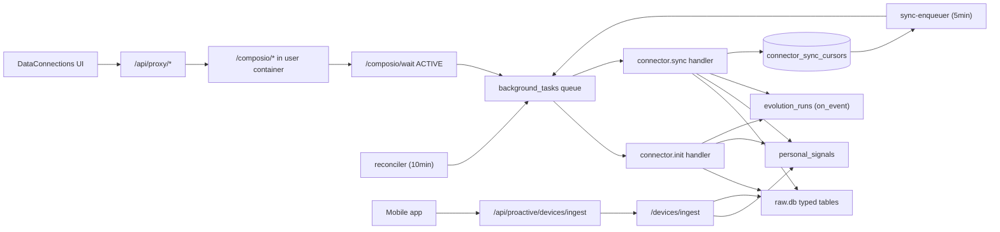
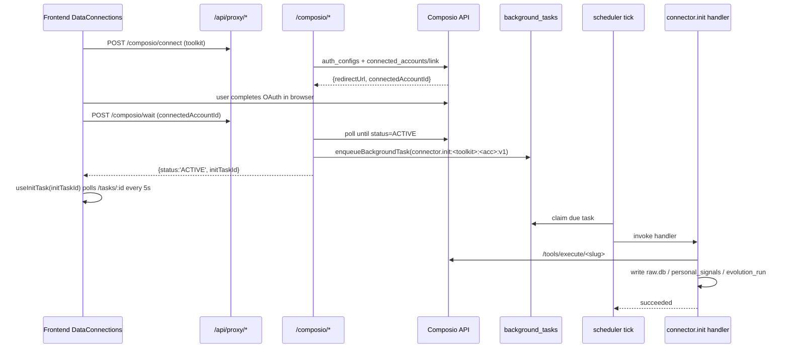
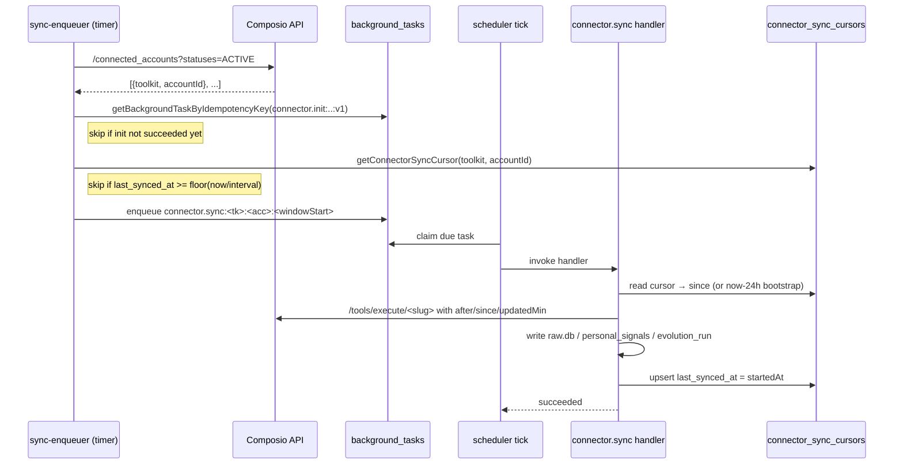
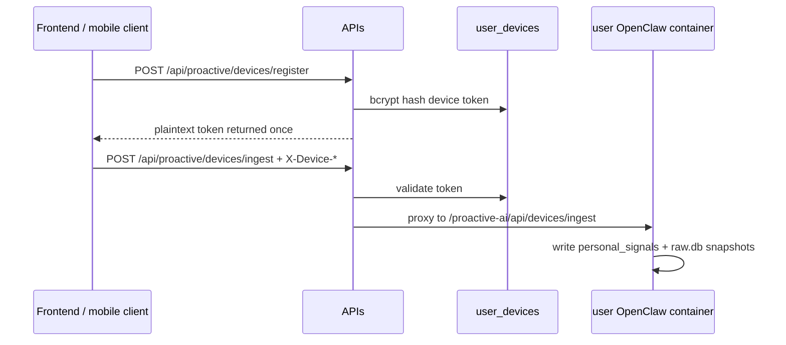

# Data Connectors

## 结论

Data Connectors 负责"数据源怎么接进来"，不负责后续记忆提炼。三条主链路：

- **Composio**：连接 SaaS 账号（OAuth + identity cache）；连接 ACTIVE 后由 `connector.init` 后台任务从 Composio 拉一批最近数据写到 `raw.db` typed 表 + `personal_signals`，并打开 `evolution_runs(trigger_kind='on_event')` 给 Memory 模块的 evolve agent 消费。之后由 `connector.sync` 每隔 `CONNECTOR_SYNC_INTERVAL_MS`（默认 12h）做增量拉取，靠 `connector_sync_cursors.last_synced_at` 当 since 下界。
- **Device / mobile**：作为第一方数据源，通过 device token 路由到用户容器，写入 `personal_signals`，snapshot 类 payload 同时 fan-out 到 `raw.db`。
- **Background scheduler**：`connector.init` / `connector.sync` / `auto.dreaming` 都跑在共用的 `background_tasks` 队列上（lease + heartbeat + reaper + 单 worker mutex）。`connector.init` 入队靠 `/composio/wait` ACTIVE 触发 + 周期性 reconciler 兜底；`connector.sync` 入队靠 `connector-sync-enqueuer` 周期扫 ACTIVE 账号 + window/cursor 双重 gate。



## 边界

包含：

- Composio API key 保存、连接、断开、等待 OAuth 完成。
- connected accounts 状态和 identity 展示。
- `/composio/wait` ACTIVE 后入队 `connector.init` 后台任务。
- `connector.init` handler：从 Composio 拉一批数据 → 写 `raw.db` typed 表 → 派生 `personal_signals` → 打开 `evolution_run`。
- `connector.sync` handler：用 `connector_sync_cursors.last_synced_at` 当 since 下界，向 Composio 增量取，写同样的 `raw.db` / `personal_signals` / `evolution_run`，成功后 upsert cursor。
- `tasks/reconciler.ts`：周期扫 ACTIVE accounts，给没有 init task 的账号补一个。
- `tasks/connector-sync-enqueuer.ts`：周期扫 ACTIVE accounts；当 init 已 succeeded 且当前 window 还没 sync 过时入队 `connector.sync`。
- `user_devices` 注册、token 轮换、撤销和校验。
- `/api/proactive/devices/ingest` 到用户容器内 `/proactive-ai/api/devices/ingest` 的代理；`/api/mobile/*` 只作为旧客户端兼容入口。
- `/devices/ingest` 写入 `personal_signals` 和 raw snapshot 表，并返回 item-level `results[]` 给端侧确认哪些 item 已入库或已存在。

不包含：

- evolve agent 怎么把 `evolution_runs.refs_consumed` 转成 memory 写入，看 [Memory](./memory)。
- 卡片生成和反馈学习，看 [Generation](./generation) / [Feedback](./feedback)。
- 容器创建、LiteLLM、`BACKGROUND_AUTO_LOOP_TASKS_ENABLED` 之类的环境变量、CI/CD，看 [Runtime & Deployment](./runtime-deployment)。

## 当前连接源

| 来源 | 当前作用 | 代码入口 | 数据落点 |
|---|---|---|---|
| Composio (OAuth + identity) | 连接 SaaS 账号，展示 ACTIVE 连接和身份 | `routes/composio.ts`、`useComposio.ts`、`DataConnections.tsx` | 连接状态来自 Composio；identity cache 在容器 `/app/data/composio-identity-cache.json` |
| Composio (`connector.init`) | ACTIVE 后台首次拉一批数据 | `tasks/handlers/connector-init.ts`、`tasks/reconciler.ts` | 各 toolkit 自己的 raw 表 + `personal_signals` + `evolution_runs(trigger_kind='on_event')` |
| Composio (`connector.sync`) | 周期增量拉取，按 cursor 续游 | `tasks/handlers/connector-sync.ts`、`tasks/connector-sync-enqueuer.ts` | 同上 raw / signals / evolution_runs；额外 upsert `connector_sync_cursors` |
| Device registry | 给 web/iOS/Android 设备发 token，用于后续 mobile sync | `apis/src/domain/devices/index.ts`、`proactive_routes.ts` | APIs Postgres `user_devices` |
| Mobile ingest | 接收端侧整理后的高价值 item | `mobile_proxy.ts`、`routes/devices.ts` | `personal_signals`；snapshot fan-out 到 `raw.db.device_*_snapshot` |

## 当前支持的 Composio toolkit（11 个）

`connector.init` 的 `SUPPORTED_TOOLKITS` 决定哪些 toolkit 真去拉数据；其他的入队后立即返回 `succeeded` + `reason: 'unsupported_toolkit_v0'`，reconciler 不会反复重试。

| Toolkit | Composio action | raw 表 | 验证状态 |
|---|---|---|---|
| `gmail` | `GMAIL_FETCH_EMAILS` (`verbose: false`) | `gmail_messages` | ✅ live |
| `googlecalendar` | `GOOGLECALENDAR_EVENTS_LIST` (primary 日历) | `gcal_events` | ✅ live |
| `slack` | `SLACK_SEARCH_MESSAGES` (`query: '*'`) | `slack_messages` | ✅ live |
| `notion` | `NOTION_FETCH_DATA` (`get_pages: true`) | `notion_pages` | ✅ live |
| `googledrive` | `GOOGLEDRIVE_FIND_FILE` (90 天窗口) | `gdrive_files` | ✅ live |
| `github` | `GITHUB_LIST_ISSUES_ASSIGNED_TO_THE_AUTHENTICATED_USER` | `github_issues` | ✅ live |
| `googledocs` | `GOOGLEDOCS_SEARCH_DOCUMENTS` | `gdocs_documents` | ✅ live |
| `outlook` | `OUTLOOK_LIST_MESSAGES` | `outlook_messages` | ⚠ schema only（无连接帐号） |
| `googlesheets` | `GOOGLESHEETS_SEARCH_SPREADSHEETS` | `gsheets_spreadsheets` | ⚠ schema only |
| `stripe` | `STRIPE_LIST_INVOICES` | `stripe_invoices` | ⚠ schema only |
| `discord` | `DISCORD_LIST_MY_GUILDS` | `discord_guilds` | ⚠ schema only |

⚠ 标记表示靠 Composio `/tools/<slug>` schema 推导，handler / mapper 实现按 schema 写但没真实数据跑过；首次部署应观察 `PIN_CLI_SURFACE=internal pin tasks list --status failed` 看是否需要修。

非 Composio toolkit（前端列出但不属于 connector.init 范畴）：strava / oura / apple-health / twitter / linkedin / discord 之外的 personal 类、jira / asana / hubspot / spotify / youtube / calendly / zoom / dropbox / todoist / trello / figma / clickup —— 当前都返回 `unsupported_toolkit_v0`，不会拉数据，但前端展示连接状态正常。

## 核心链路

### Composio OAuth + 后台 init



### Reconciler 兜底

OAuth 完成但用户关掉页面时，`/composio/wait` 不会触发。`tasks/reconciler.ts` 每 10 分钟扫 Composio 上所有 ACTIVE accounts，给没有 task 的账号补入队（同一 idempotency key 不重复）。

```bash
# reconciler 默认每 10 分钟跑一次；调试时可以改：
CONNECTOR_INIT_RECONCILER_INTERVAL_MS=60000
```

### `connector.sync` 增量拉取



关键点：
- **Window 模型**：`windowStart = floor(now / CONNECTOR_SYNC_INTERVAL_MS) * interval`，进 idempotency key。同一 window 内多次 enqueue 撞 key 自动去重。默认 interval 12h，本地测试可调小（如 60_000）。
- **Init gate**：handler 只检查 toolkit 支持，但 enqueuer 额外要求 `connector.init` 已 `succeeded`，避免 init 还在跑时 sync 抢 raw 表。
- **Cursor**：成功才写 `last_synced_at = startedAt`；失败保留旧 cursor，下次 sync 重拉同一窗口（raw / signal `dedupe_key UNIQUE` 自然吸收重复）。
- **Bootstrap**：首次 sync（cursor 不存在）回看 24h，足以补上 init 之后到首次 sync 之间漏的内容。
- **Discord 例外**：guild list 没有增量语义，handler 直接 `skipped` with `reason='no_incremental_sync_v0'`。
- **Per-toolkit since 参数**：Gmail 用 `query: after:<unix>`；GCal 用 `updatedMin`；Slack 用 `query: after:YYYY-MM-DD`（多回看 1 天容错）；Drive / Docs / Sheets 用 `q: modifiedTime > '<iso>'`；GitHub / Outlook / Stripe 用各自原生 since 参数；Notion 客户端按 `last_edited_time` 过滤。

```bash
# 默认 12h；本地调试想看实时入队改成 60s：
CONNECTOR_SYNC_INTERVAL_MS=60000
# enqueuer 扫描频率（默认 5 分钟）：
CONNECTOR_SYNC_ENQUEUER_INTERVAL_MS=60000
# 临时禁掉某个 toolkit 的 sync（init 不受影响）：
CONNECTOR_SYNC_DISABLED_TOOLKITS=gmail,slack
```

### Device / mobile



## 当前设计

- Composio API key 优先读 `/app/data/composio-api-key`（用户提供），再读 `COMPOSIO_API_KEY` env。统一通过 `shared/composio-key.ts`，CLI / dreaming / connector.init 同一份逻辑。
- Composio connected accounts 只查询 `ACTIVE`，identity 缺失时尝试通过 toolkit-specific action 补齐，并缓存 24 小时。
- `connector.init` 默认每个 toolkit 拉 100 条，`max_attempts=3`，lease 60s（handler 内部按需 heartbeat 续约）。kill switch：`CONNECTOR_INIT_DISABLED_TOOLKITS=gmail,slack` 跳过指定 toolkit。
- `connector.sync` 同样默认 100 条，`max_attempts=2`（sync 失败下个 window 还有机会，不靠重试硬扛），lease 60s + heartbeat。kill switch：`CONNECTOR_SYNC_DISABLED_TOOLKITS=gmail,slack`。
- `/composio/wait` 默认返回 `initTaskId`；仅在 `BACKGROUND_AUTO_LOOP_TASKS_ENABLED=0` 等显式关闭值时保持旧行为，前端 chip 不渲染。
- `personal_signals.dedupe_key` 包含 `connectedAccountId` + 自然主键 + `:init:v1`，相同 toolkit 多账号不会重复入。
- 每个 raw 表都带 `dedupe_key UNIQUE` + reference 三元组（`reference_count` / `last_referenced_at` / `referenced_by_runs`）。
- Device token 只在注册/轮换时明文返回一次，服务端只保存 bcrypt hash。
- mobile proxy 默认非生产可用；生产需显式 `MOBILE_SYNC_PROXY_ENABLED=1`。
- `/devices/ingest` 是当前 mobile 写入入口；`/api/mobile/items/ingest` 只做兼容重写到新路由。旧 `/mobile/items`、`/mobile/items/claim`、`/mobile/items/commit` 已返回 `410 Gone`。

## 开发入口

| 改动 | 先看 |
|---|---|
| Composio 连接按钮、OAuth 流程、init progress chip | `proactive-ai-frontend/src/components/DataConnections.tsx`、`proactive-ai-frontend/src/hooks/useComposio.ts`、`proactive-ai-frontend/src/hooks/useInitTask.ts` |
| Composio 容器路由 + `/wait` enqueue 钩子 | `pinai-openclaw/plugins/proactive-ai/routes/composio.ts` |
| 加新 toolkit 到 connector.init | `tasks/handlers/connector-init.ts`（SUPPORTED_TOOLKITS + fetch + extract + map + signal）、`raw-db.ts`（typed table + ingest + list）、`tasks/handlers/connector-evolve.ts`（sampling） |
| 加新 toolkit 到 connector.sync | `tasks/handlers/connector-sync.ts`（fetchXxxSince）；mapper / extractor / signal builder 直接 import 自 connector-init.ts |
| 后台 task 队列 / scheduler | `tasks/scheduler.ts`、`db.ts` 里的 `background_tasks` 段 |
| Reconciler / dreaming-enqueuer / sync-enqueuer 周期 | `tasks/reconciler.ts`、`tasks/dreaming-enqueuer.ts`、`tasks/connector-sync-enqueuer.ts`、`index.ts` 启动接线 |
| internal `pin tasks` CLI / `/tasks` HTTP | `cli/tasks.ts`、`routes/tasks.ts` |
| Device 注册和 token | `apis/src/domain/devices/index.ts`、`apis/src/controller/proactive_routes.ts` |
| Mobile proxy / ingest | `apis/src/domain/proactive/mobile_proxy.ts`、`pinai-openclaw/plugins/proactive-ai/routes/devices.ts` |
| raw snapshot 表 | `pinai-openclaw/plugins/proactive-ai/raw-db.ts` |

## 验证方式

### 一键回归

改完 connector.init / connector.sync / scheduler / reconciler / sync-enqueuer / `/tasks` / internal pin tasks / public pin raw 任一处后跑：

```bash
bash pinai-openclaw/plugins/proactive-ai/scripts/test-tasks.sh
```

12 层覆盖：schema/repo → scheduler → CLI → connector.init handler → connector-evolve → auto.dreaming → dreaming-enqueuer → connector.sync handler → connector-sync-enqueuer → reconciler → /composio/wait 钩子 → /tasks read API。

mobile / device / 旧 mobile route 形状回归走 memory 模块的：

```bash
bash pinai-openclaw/plugins/proactive-ai/scripts/test-memory.sh
```

### 单跑

```bash
# connector.init 各 toolkit 端到端 (mock Composio)
npx tsx --test pinai-openclaw/plugins/proactive-ai/tasks/handlers/connector-init.test.ts

# connector.sync cursor + 增量 + 与 init 去重
npx tsx --test pinai-openclaw/plugins/proactive-ai/tasks/handlers/connector-sync.test.ts

# sync-enqueuer init/window gate
npx tsx --test pinai-openclaw/plugins/proactive-ai/tasks/connector-sync-enqueuer.test.ts

# reconciler ACTIVE 扫描 + 幂等
npx tsx --test pinai-openclaw/plugins/proactive-ai/tasks/reconciler.test.ts

# /composio/wait → enqueue 钩子
npx tsx --test pinai-openclaw/plugins/proactive-ai/routes/composio.test.ts

# /tasks 读 API
npx tsx --test pinai-openclaw/plugins/proactive-ai/routes/tasks.test.ts
```

### 真实 Composio 演练

把容器内的 Composio key 借出来，本地直接驱动一次 connector.init（避免污染容器 DB）：

```bash
export COMPOSIO_API_KEY=$(docker exec proactive-285d35b0 cat /app/data/composio-api-key)
export COMPOSIO_USER_ID=285d35b0-e031-4cfd-97b3-0e21064d0d0e
# 写一个临时 .mts 调 enqueueBackgroundTask + scheduler.tick()，用 OPENCLAW_HOME=/tmp/...
# 完整脚本示例参考 git log feature/background-tasks-scheduler 里的 commit 描述。
```

### 手工验证

```bash
PIN_CLI_SURFACE=internal pin tasks list --type connector.init   # 看 init 入队历史
PIN_CLI_SURFACE=internal pin tasks list --type connector.sync   # 看 sync 入队历史
PIN_CLI_SURFACE=internal pin tasks show --id <task_id>          # 单个任务全状态 + lease
PIN_CLI_SURFACE=internal pin tasks attempts --id <task_id>      # 多次 attempt audit
pin raw gmail recent --hours 720 --limit 10             # gmail
pin raw slack list --channelId C01                      # slack
pin raw notion list                                     # notion
pin raw gdrive list --mimeType application/vnd.google-apps.document
pin raw github list --state open --isPullRequest false
pin raw outlook list --importance high
pin signals recent --kind connector.gmail.message
PIN_CLI_SURFACE=internal pin evolution recent --kind on_event   # connector.init / connector.sync 元记录
pin memory list --source 'connector_init:gmail'         # evolve 写入的事实
```

## 踩坑

- 不要恢复 `mobile_items.db` 读写链路；mobile 数据已经直写 `personal_signals`。
- `container_status=running` 不代表 mobile target 可用，proxy 仍可能因容器未就绪返回 503。
- Composio 连接状态是外部平台事实，不能只信前端本地状态。
- Device token 不能写日志，不能存明文到 APIs DB。
- **Composio Gmail `verbose: true` 默认会让 100 条响应 ≥6MB 触发 413。**connector.init 显式设 `verbose: false`，但写新 toolkit 时务必先看 schema 默认值。
- **Composio 在大响应里塞未转义 `\n`/`\r` / `\x00-\x1F` 控制字符**，标准 `JSON.parse` 会拒；fetcher 内置 sanitize-and-retry。
- **Composio 返回的字段名经常和原生 API 不一致**（Gmail `to` 是 string 而非 array、`preview` 是 object 而非 string；Calendar 用 camelCase；Notion 是 slim shape `{id,title,type}`）。改 mapper 前先 probe。
- **GitHub slug 是 `GITHUB_LIST_ISSUES_...`**，没 `LIST_` 的版本 404。改 toolkit 先 search slug。
- LinkedIn / Twitter 现有 Composio 表面只有 `GET_MY_INFO` / `BOOKMARKS`，没法做 init batch；保持 `unsupported_toolkit_v0` 直到有合适的 list/fetch action。
- `/composio/wait` 在 scheduler 显式关闭时（`BACKGROUND_AUTO_LOOP_TASKS_ENABLED=0/false/off/no/disabled`）不返回 `initTaskId`；前端 chip 设计上就不渲染，避免老路径出 bug。
