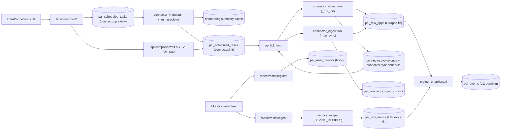
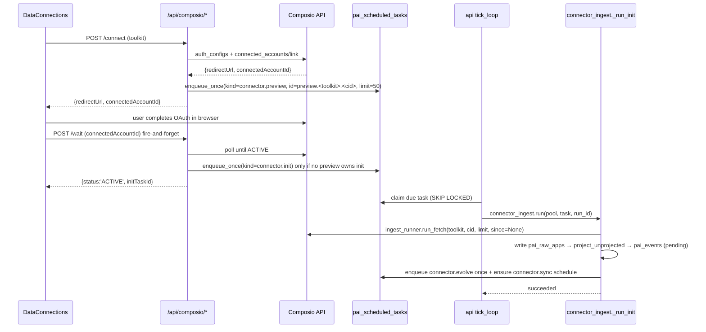
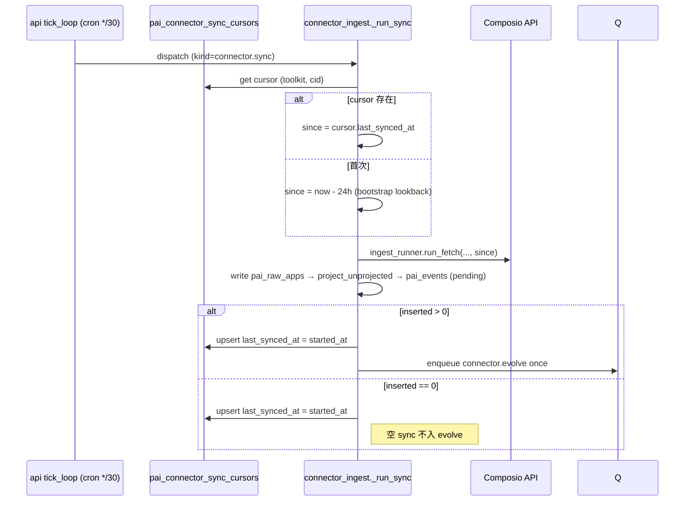
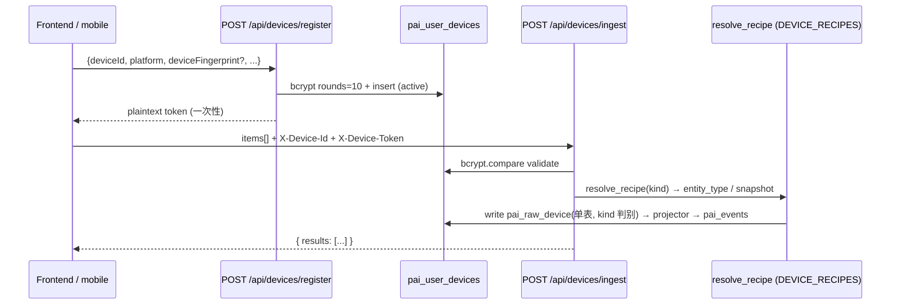

# Data Connectors

## 结论

Data Connectors 负责"数据源怎么接进来",不负责后续记忆提炼。两条主链路:

- **Composio**:用户在前端 OAuth 连 SaaS 账号 → `/api/composio/connect` 立即入队 `connector.preview`(onboarding 快速反馈,后台等 ACTIVE 后只拉最多 50 条并生成 summary cache)→ preview 完成后再入队 `connector.init` → scheduler 派给 `domains/connector/apps/connector_ingest.py` in-process handler → handler 从 Composio 拉一批数据写到 **L0 apps 域表 `pai_raw_apps`**(`119` 按域拆分;所有 toolkit 走 generic upserter,`_resolve_upserter` 恒返回 `generic_ingest.upsert_generic`;typed `pai_raw_<toolkit>` 表已 `118` 全删)→ 调 `project_unprojected` 把新 raw 投影成 L1 `pai_events`(`pending`)→ 同时入一次 once-shot `connector.evolve`(LLM curate 事件 + 蒸馏画像)和一行 recurring `connector.sync`(高频 toolkit cron `*/30 * * * *`,其余按 recipe interval)。`connector.sync` 用 `pai_connector_sync_cursors.last_synced_at` 当 since 下界做增量。
- **Device / mobile**:用户在前端注册设备拿一次性 token(bcrypt 存 `pai_user_devices`),后续走 `POST /api/devices/ingest`(`X-Device-Id` + `X-Device-Token` 鉴权)。落点由 `domains/connector/device/device_ingest/recipes.py:DEVICE_RECIPES` 决定(P2 recipe 化,typed 时代的 `DEVICE_INGEST_POLICIES`/typed 表已删):所有 kind 统一写单表 `pai_raw_device`(`kind` + `platform` 判别,`124` 前的 `123` 加 platform 列),经 `project_unprojected` 投影成 L1 `pai_events`(location/visit/motion→movement、session_summary→utterance;transcript_window 走 rollup_semantic 卷 episode;apps/contacts 状态类不投影)。



## 边界

包含:

- Composio API key 状态、连接、断开、reconnect、`/composio/connect` onboarding preview 入队、`/composio/wait` ACTIVE 入队。
- `connector.preview` / `connector.init` / `connector.sync` 三个 handler 的拉数据→写 raw / signal → 入 evolve / sync schedule 链路。
- `pai_connector_sync_cursors` 游标推进语义。
- `domains/connector/apps/ingest_runner.py` + `db/ingest_recipes/*.yaml` 的 recipe 机制。
- 当前真正能 ingest 的 toolkit 矩阵。
- `pai_user_devices` 注册、token 轮换、撤销、bcrypt 校验。
- `domains/connector/device/device_ingest/recipes.py` 的 DEVICE_RECIPES 落点(entity_type / snapshot)和 `sync_mode=full|incremental` 行为。
- 前端(RN)`apps/mobile/src/components/connect/DataConnections.tsx` / `DeviceConnections.tsx` 及 `apps/mobile/src/lib/devices.ts`。

不包含:

- evolve agent 怎么把 `pai_evolution_runs.refs_consumed` 沉淀成 memory / skill,看 [Memory](./memory)。
- 卡片生成、反馈回流,看 [Generation](./generation) / [Feedback](./feedback)。
- scheduler 框架本身、`pai_scheduled_tasks` schema,看 [Background Tasks](./background-tasks)。
- 容器 / 部署 / dotenvx,看 [Runtime & Deployment](./runtime-deployment)。

## 当前连接源

| 来源 | 当前作用 | 代码入口 | 数据落点 |
|---|---|---|---|
| Composio(`/api/composio/*`) | OAuth、ACTIVE 状态、label 展示、入队 connector.preview / connector.init | `domains/connector/apps/composio_ui.py`、`domains/connector/apps/composio_service.py`、`useComposio.ts` | 状态来自 Composio API;label 持久化在 `pai_connector_labels`(eager resolve on /wait,lazy retry on /connections);`/connect` 入队 `connector.preview`;preview 完成后入队 `connector.init`;旧连接 / 无 preview 时 `/wait` 仍会 ACTIVE 入队 init;支持多账号(`allow_multiple=True`) |
| `connector.preview` handler | onboarding 独立快速反馈 | `domains/connector/apps/connector_ingest.py:_run_preview` | 后台等 ACTIVE,只拉 summary source 最多 50 条,写 raw 后生成 `pai_onboarding_connector_summary_cache`;同时保证 `connector.init` 入队 |
| `connector.init` handler | ACTIVE 后首次拉一批 | `domains/connector/apps/connector_ingest.py:_run_init` | `pai_raw_apps` → `project_unprojected` 投影 `pai_events`(pending) + 入 `connector.evolve` + 建立 `connector.sync` schedule |
| `connector.sync` handler | 周期增量拉取(cron `*/30 * * * *`) | `domains/connector/apps/connector_ingest.py:_run_sync` | 同上 raw → projector → events;成功才前推 `pai_connector_sync_cursors.last_synced_at` |
| Device registry | 给 web / iOS / Android / wearable 等设备发 token | `domains/connector/device/devices_ui.py`、`platform/db/repositories/devices.py` | `pai_user_devices`(`device_token_hash` 是 bcrypt rounds=10) |
| Device ingest | 接收端侧整理后的 item / snapshot / health observation | `domains/connector/device/devices_ui.py:POST /ingest`、`domains/connector/device/device_ingest/recipes.py`、`domains/connector/device/device_ingest/health.py` | 由 `resolve_recipe(kind)` 决定 entity_type / snapshot 语义,**全部落单表 `pai_raw_device`**(`kind`+`platform` 判别);经 projector 投影 `pai_events`(state 类 apps/contacts 与 transcript_window firehose 除外) |

## 当前 Composio toolkit 状态

**typed 表时代已终结**(`118_drop_typed_raw.sql` 删光 `pai_raw_<toolkit>_<entity>` 与 `_upsert_<tk>` mapper):所有 toolkit 统一经 generic upserter 落 **`pai_raw_apps`**,action / 参数以 `backend/db/ingest_recipes/*.yaml` 为准。存量 recipe 覆盖:gmail / googlecalendar / googledrive / googledocs / googlesheets / slack / github / calendly / linkedin / notion / stripe / youtube + `googlesuper`(fanout 一键连);其余 1000+ toolkit 靠 `recipe_infer` 推断或 connect-only。前端 DataConnections 只把产品主推源列在首屏,全量目录走 catalog。

老"9 个主推 toolkit"现在只剩**一个**特殊性:在 `connector_ingest._FAST_CADENCE_TOOLKITS` 名单里,sync 用 `*/30 * * * *` 高频 cron;名单外按 recipe `sync_interval_hours`(默认 12h)。存储、mapper、读取路径与长尾 toolkit 完全一致,没有 typed/generic 之分。

## Generic 存储与全量 connector(2026-06)

所有 Composio connector(主推 + 全量目录 + 自定义)落 **`pai_raw_apps`**(演进:`090` 建 generic `pai_raw_events` → `118` 删 typed 表 → `119` 按域拆成 `pai_raw_apps` / `pai_raw_device` 两张):统一信封列(`user_id/id/toolkit/entity_type/external_id/occurred_at/ingested_at/dedupe_key` + reference 三元组)+ 可选展示列 `title`/`snippet` + 原始 item 全量 `payload JSONB`,`UNIQUE(user_id, toolkit, entity_type, dedupe_key)`。要点:

- **通用 mapper/upserter**:`domains/connector/apps/generic_ingest.py`。dedupe_key = `<toolkit>:<entity>:<external_id>`(recipe `id_field`),无 id 时退化 payload sha256;`ON CONFLICT DO UPDATE` 刷新 payload(长尾多为可变实体);无 `timestamp_path` 的行 occurred_at 落 NOW() 且冲突更新时**不**前推(防止永远占住生成窗口)。`content_updated_at`(`124`)只在 payload 真变时 touch——projector 靠它对"已投影但内容已变"的行做 supersede 重投影(改期/编辑在 L1 成链)。
- **接入点**:`connector_ingest._resolve_upserter` 恒返回 generic(typed `_UPSERTERS` 已删)。init/sync 主体、cursor、evolve 入队全复用。
- **sync 节奏**:`_FAST_CADENCE_TOOLKITS` 走 `*/30` cron;其余按 recipe `sync_interval_hours` 派生(默认 12h,`_cron_for_interval`),防全量目录打爆 Composio 配额。
- **读取按域路由**:`domains/connector/apps/raw_agent.py:list_raw` — `raw_sources.py` registry 是 path→(toolkit, entity, domain) 的 SSOT:device 域查 `pai_raw_device`(by kind),其余查 `pai_raw_apps`(by toolkit+entity),信封同形,evolve(Code Mode 读 `client.raw.<tk>.<entity>`)与 generation 零感知。SDK `Raw.list` 对未知 toolkit 透传(服务端 enforcer);自定义 MCP connector(`custom_mcp.py`,`/connect` 带自建 authConfig)也作为 raw 源经 `is_custom_mcp_active` 参与 list。
- **raw 源发现**:`/api/agent/composio/connections` 每项带 `rawSources`(api 进程读 recipe 算出,fanout 展开),agent-engine 的 `generation_context` 优先消费、静态 map 兜底——不破 api/agent-engine trust boundary。
- **recipe 推断**:`domains/connector/apps/recipe_infer.py`。无 yaml 的 toolkit 在首次 `connector.init` 时从 Composio tool schema 推断(挑无副作用 list action、推 result_path/id_field/timestamp_path),置信度 high(直接跑)/ mid(dedupe 退化 hash,标记补 yaml)/ 无可读 action → connect_only 降级。手写 yaml 永远优先;进程内缓存,sync 不重复打 meta API。
- **googlesuper 一键连**:`db/ingest_recipes/googlesuper.yaml` 声明 `fanout: [gmail, googlecalendar, googledrive, googledocs, googlesheets]`——一次 OAuth、一个 cid,init/sync 内部扇出跑五个 sub recipe,五个 sub 全落 `pai_raw_apps`;cursor 按 **sub** toolkit 各自推进,sync schedule 只有一条 `sync.googlesuper.<cid>`,单 sub 失败不拖垮其余。identity 复用 `GMAIL_GET_PROFILE`。与单独连 sub-toolkit 共存,dedupe 天然去重。Slides 目前通过 Drive 文件元数据覆盖,因为 Composio Google Slides 没有批量 list/search action。
- **全量目录 + 自定义 auth**:`GET /api/composio/catalog`(分页浏览 1000+ toolkit;`connect` 本来就接受任意 slug);`POST /connect` 带 `authConfig: {authScheme, credentials}` 走 `use_custom_auth`(用户自带 OAuth client / API key)。
- **命令行验收**:`backend/scripts/collector_cli.py` — `catalog`/`infer`/`connect`/`connections`/`ingest`(伪造 task 直调 `connector_ingest.run()`,绕过 scheduler)/`raw`/`evolve`(入队+轮询)/`signals`/`memory`/`pipeline`(一条龙)。后台链路全程不依赖前端;`signals`/`memory` 子命令已改查 `pai_events`(老 `pai_personal_signals`/`pai_memory` 表 `114` DROP 后同步过)。

migration 历史(raw 存储演进):
- `036_drop_unused_raw_tables.sql` / `045_drop_twitter_discord_artifacts.sql`:typed 时代清理不在主线的 raw 表与 twitter/discord 残留(Twitter 因 Composio 2026-02 停自有 OAuth credential 下线,Discord 因 server-scoped API 给不出 cross-server 信号)。
- `090_pai_raw_events.sql` 建 generic 单表 → `118_drop_typed_raw.sql` 把存量 typed 表数据迁入后**全部 DROP**(含 `pai_raw_linkedin_*`)→ `119_split_raw_domain.sql` 按域拆成 `pai_raw_apps` / `pai_raw_device` → `123` 加 device platform 列、`124` 加 apps `content_updated_at`。

## 核心链路

### Composio OAuth + 后台 preview/init



前端连接后不再等待 `/composio/wait` 的返回才继续;popup 关闭后 UI 先回到 onboarding,后台 wait 成功后刷新连接列表。进度轮询用确定性 `preview.<toolkit-lower>.<cid>` / `init.<toolkit-lower>.<cid>` 重建 taskId,reload 也能继续轮询。

### Onboarding 即时总结

Onboarding 会先进入 Connect data,并在 `/api/composio/connect` 返回时立刻排一个独立 `connector.preview` once task。这个任务后台等 Composio ACTIVE,然后只拉 summary source 的最近最多 50 条,写 raw 后直接生成 `pai_onboarding_connector_summary_cache`;前端 watcher 看到新鲜 `connector.preview` 成功后调用 `POST /api/onboarding/connector-summary`,通常命中 cache。api 进程从 `pai_raw_apps` 读取当前用户最近最多 50 条可读记录,同时带上 connector label / userInfo / 登录邮箱整理出的 identity hints,先蒸馏成一个小的 signal pack(`identity` / `sourceCounts` / `topContacts` / `topTerms` / `dateRange` + 10 条样例),再用 LiteLLM `gpt-5-nano` 生成结构化的 "Here's what we know about you" 页面。Gmail 的 `topContacts` 会显式读取 `from_addr` / `to_addrs` / `cc_addrs`,过滤 self、noreply、bot、mailing-list、路径噪声,并把真实人名 pin 到第一段第一条,避免模型只讲 repo 或 workflow。summary 固定三段:先展示 `Key People & Accounts`,再展示 `Professional Identity`,最后展示 `Communication Style`,每段 2 条,优先把用户最容易感知的人、团队、账号放到最前。`googlesuper`(Google Workspace) 是例外:preview 和 summary 有效数据源固定归一到 `gmail`,其他 Calendar / Drive / Docs / Sheets 仍由后续 `connector.init` fanout 自己拉,不会阻塞 summary。

展示时机是**中间不打断,结束前拦一下**:用户连完 connector 后可以继续 Ambient / 本地模型步骤;summary 在后台生成。用户点最后 Done 时,如果 summary 已生成,先展示结果页;如果还没生成,留在 onboarding 的等待页("PIN AI is learning your context")直到结果回来。用户看完结果页点 Enter PIN AI 后,才调用 `onComplete` 进入主页面。

展示规则是**一次连接动作只打断一次**:前端会先收集当前 ACTIVE connector 的 preview task 状态,再选一个 insight 展示;没有 preview 的旧连接才 fallback 到新鲜 init task。`googlesuper` 作为 Google Workspace 整体优先展示,不会因为 Gmail / Calendar / Drive / Docs / Sheets fanout 跳出多张页面;真正生成 summary 时服务端只读 Gmail raw rows,返回 source 也标记为 `gmail`。如果用户很快连了多个 connector,也只进入一个 insight 页面。

服务端有一层 summary cache:cache key = `schema version + model + toolkit + connected_account_id + raw fingerprint`。同一批 raw 数据重复进入 onboarding / 刷新 / 前端重复触发时,直接返回 `pai_onboarding_connector_summary_cache.summary`,不再打 LLM。每次请求都会写 `pai_onboarding_connector_summary_runs`,记录 `item_count / collect_ms / llm_ms / total_ms / status(empty|cached|succeeded|failed)` 便于持续观察首轮生成是否能压到 5-6 秒。

这条链路只负责**用户可见的 onboarding 反馈**:不 curate 事件、不写 L2 画像 / skill,也不替代后台 `connector.evolve`。长期沉淀(L1 事件 curate + L2 画像蒸馏)仍由 `connector.init` 入队的 `connector.evolve` 完成。

### `connector.sync` 增量



关键点:

- **schedule**:`connector.init` 跑成功才 INSERT ON CONFLICT DO NOTHING 一条 sync 行,`cron '*/30 * * * *'`,`status='active'`。
- **Cursor**:成功才前推;失败保留旧值,下次 sync 重拉同一窗口(raw 表 `UNIQUE(user_id, dedupe_key)` 自然吸收重复)。
- **Bootstrap**:首次 sync 没 cursor,回看 24h 补 init 到首次 sync 之间漏的内容。
- **Per-toolkit since**:由 recipe 的 `since_param` + `since_format` 决定。Gmail 用 `query: after:<unix>`,GCal 用 `time_min: <iso>`,Slack 用 `query: after:YYYY-MM-DD`,GitHub 用 `since=<iso>`,Calendly 用 `min_start_time=<iso>`。在 `ingest_runner.py:_format_since` 集中实现。

### Device 注册 + ingest



`X-Device-Token` 服务端只存 bcrypt hash,明文只在 register / rotate 时返回一次。`device_fingerprint_hash`(sha256 of platform + 客户端 fingerprint)用来识别"换 deviceId 但实际同一台逻辑设备";fingerprint 命中时复用原 server `device_id`,只刷新 token/metadata,不能把 registry 改到客户端新 UUID,否则旧 raw/signal evidence 会从可见设备下脱落。Native 前端(apps/mobile,Expo RN)用平台稳定 identifier 做 fingerprint,同时把稳定的 `hardware_signature` 写进 metadata(不包含用户可改的设备名);`/api/devices/list` 会用 hardware signature 和 legacy iOS generic rows 做显示层收敛,避免同一台 iPhone 因 canonical/dev app 或旧无 fingerprint 记录显示成多台设备。

### Ingest per-item status(5 态契约)

`POST /api/devices/ingest` 对每条 item 在 `results[i].status` 里返回 5 个值之一。前端 outbox(RN:`apps/mobile/src/ambient/ingest.ts` + `runtime.ts` 的 durable sqlite outbox)按此分流;契约 SSOT 在 `docs/plans/2026-05-12-v2-to-v3-migration.mdx#D-3`。

| status | 含义 | outbox 行为 |
|---|---|---|
| `inserted` | raw / signal 实际写入了一行 | 移除,记为成功 |
| `duplicate` | ON CONFLICT 触发(raw_only 路径才会出现的真 idempotent no-op) | 移除,记为成功 |
| `rejected` | 确定性 client-side bug:缺 `kind` / cross-device dispatch / unsupported_full_sync 等。重传不会变好 | 永久移除,记 warning log,不 retry |
| `parse_failed` | `IngestItemIn.model_validate` 抛异常那条 item。client schema 错位 | 永久移除,记 warning log,不 retry |
| `retryable_failed` | 服务端写入抛异常被 catch(DB blip / Supabase 抖 / repository bug)。本质 transient | **保留**在 outbox,按指数退避 retry |

服务端写入异常**禁止**折叠成 `rejected` — 那会让一次 DB 抽风把用户事件永久删掉而 client 完全无感(200 OK + outbox 移除)。`domains/connector/device/devices_ui.py:_ingest_for_device` 的 `try / except` 必须把异常 reason 写进 result 的 `reason` 字段并设 `retryable_failed`,不能再用 `logger.warning` 吞掉。

### Health observation 全替换 scope

`domains/connector/device/device_ingest/health.py:health_full_replace_scope` 返回 `(device_id, local_date, metric?)` 三元组。当 envelope 携带 `payload.metric` 或所有 observations 共享同一 `metric` 时,DELETE 限定到该 metric,避免一次 steps push 把同日的 `heart_rate` 行抹掉(V2 commit `089e1f94` 的高优修)。当 envelope 主动是多 metric 的 end-of-day 批量,scope 回退到 date-only。

`domains/connector/device/raw_device.py:replace_health` 的 DELETE 永远带 `AND reference_count = 0`,被 memory / evolution_run 引用过的 raw evidence 行不会被 full-sync 删掉(V2 `raw-db.ts:1934` 的设计)。V3 当前还没有任何代码会把 `reference_count` 增到 > 0,这条是前置防御,等 raw 引用机制上线时不需要再回头改 SQL。

### Mobile ambient capture(opt-in,apps/mobile RN)

- 采集端是 **apps/mobile(Expo RN)**:native 模块在 `apps/mobile/modules/`(`ambient-audio` / `ambient-visit` / `ambient-models` 等),JS 侧 source 实现在 `apps/mobile/src/ambient/sources/*`,事件经 `apps/mobile/src/ambient/runtime.ts` 进 durable sqlite outbox,上传到 `/api/devices/ingest`。原 Capacitor 插件 `@pin/capacitor-ambient-ai`(capacitor-plugins/)已随前端退役删除(2026-07-09)。
- **方案 A(2026-07-01):手机是哑采集器**——各 source 原始信号直接进 outbox 并**事件级实时上传**(入队后立即 drain,周期 drain 只作断网兜底),不做本地聚合 candidate_window / 本地 LLM summary。聚合/去噪/摘要全部下沉后端:kind → `device_ingest/recipes.py` → `pai_raw_device` → projector 实时投 `pai_events`。RN 2026-07-07 已对齐同款直传(此前 RN 只上传本地蒸馏产物,原始 ambient 数据进不了 `pai_raw_device`/`pai_events`)。
- **隐私不变量**:登录本身**绝不**启动任何 source。只有用户在 `pai_user_settings.ambient_sources`(migration `041_pai_user_settings_ambient_sources.sql`)里显式 opt-in 的 source 会被启动;app 状态变化只触发 outbox drain(flush 已队列事件),不会引起任何新采集。
- 用户 UI:`apps/mobile/src/components/ambient/AmbientSourceControlsPanel.tsx` + `useAmbientToggle.ts`,toggle 一旦 flip 既 PATCH 到 server 又同步启停本地 source,做到 UI 立即反映 + server 是持久真源。
- Voice Identity 开启时,Ambient 云转录先走 `/api/voice/transcribe-diarized` + `gpt-4o-transcribe-diarize` 保留 `self` / speaker labels,再用 `gpt-5-nano` 对每个 diarized segment 的 `text` 做后处理纠错。speaker / start / end 结构只由代码保留和拼回,后处理 prompt 只允许改文本,热词在 `backend/services/api/src/pinai_api/domains/voice/voice_transcription.py` 的 `TRANSCRIPTION_POSTPROCESS_TERMS`。
- 改 ambient source 列表 / lifecycle 行为 / `pai_user_settings.ambient_sources` schema 前必读 [Ambient AI Plugin](../plans/2026-05-10-ambient-ai-plugin) + [V2 → V3 功能迁移计划 D-5](../plans/2026-05-12-v2-to-v3-migration)。

### 设备统一时间线

`GET /api/devices/{deviceId}/timeline`(`devices_ui.py:get_device_timeline`)自 lifelong-memory L0 统一后**只查 `pai_raw_device`**(`external_id = device_id`)——该设备的所有 source(health observation、apps/contacts snapshot、ambient/device context event)都落在这张单表,`kind` 当 `type` 区分 source,按 `occurred_at DESC` 排序 + 单一 keyset cursor。返回 envelope:

```json
{
  "ok": true,
  "items": [
    {"type": "<entity_type>", "occurred_at": "...", "row": {...}}
  ],
  "next_cursor": "..." | null,
  "has_more": true
}
```

health 走 recipe 的 `snapshot='health'` 语义(频率高,逐 observation 留 L0 档案、不进 L1 retrieval;老 `_HEALTH_POLICY` 已随 policies→recipes 收敛删除)。前端 `apps/mobile/src/components/connect/DeviceTimeline.tsx` 用 `fetchDeviceTimeline` 一次拉合并流,按 `type` 分流渲染,不做 client-side k-way merge。

## 当前设计

### Composio 服务层

- `domains/connector/apps/composio_service.py` 是单一真源:
  - SDK 直调(connection 生命周期、tool discovery、execute)→ 给 ingest_runner 用。
  - 每用户 `ToolRouterSession` LRU + 1h idle TTL → 给 agent-engine 端 meta-tool 用(`/api/agent/composio/meta/*`)。
  - **Label / identity 解析**:`_IDENTITY_SPECS` 给 8 个 toolkit 各登记一个 "get me" action + extractor(gmail → GMAIL_GET_PROFILE → emailAddress;googlecalendar → GOOGLECALENDAR_GET_CALENDAR(`primary`) → id;youtube → YOUTUBE_GET_CHANNEL_STATISTICS(`mine=true`) → snippet.title 等)。`/api/composio/wait` 命中 ACTIVE 时 eager-resolve 一次,结果写 `pai_connector_labels`(PK = `user_id, connected_account_id`)。`/api/composio/connections` 直接 join 这张表,~0 延迟。失败行带 `resolve_attempts / last_attempt_error`,下次 `/connections` lazy-retry。Stripe 没有 identity action,fallback 到 `fallback_label("stripe", cid)`。
- Composio master key 从 env `COMPOSIO_API_KEY`(只在 api 进程,FORBIDDEN_ENVS 名单内,agent-engine 看不到)。
- 同一 `(user_id, toolkit)` 支持多账号(`connected_accounts.link(allow_multiple=True)`)。前端 `+add` 按钮触发后端新建独立 `connected_account_id`,所有 per-account 状态(label / sync cursor / `init.{toolkit}.{cid}` 任务)按 cid 区分。
- `/api/agent/composio/*` 是 sandbox 内 `pinai_sdk.composio` 的对端,执行有 allowlist 守门。

### Ingest recipe 机制

`backend/db/ingest_recipes/<toolkit>.yaml`:

```yaml
toolkit: gmail
slug: GMAIL_FETCH_EMAILS
args_template:
  max_results: 100
  verbose: true
  include_payload: false
since_param: query
since_format: gmail_query
result_path: [messages]
id_field: id
```

`domains/connector/apps/ingest_runner.py:Recipe.load_recipe()` 读、`run_fetch(user_id, toolkit, cid, limit, since)` 执行。校验脚本:`backend/scripts/validate_ingest_recipe.py`。

加新 toolkit 步骤(generic 路径,当前默认):
1. 加 `db/ingest_recipes/<toolkit>.yaml`,声明 `entity_type` + `id_field` + `timestamp_path`(可选 `title_path`/`snippet_path`)。没有 yaml 也能跑——首次 init 会走 `recipe_infer` 自动推断,yaml 是推断不准时的覆盖手段(`collector_cli infer <tk> --dump-yaml` 可生成草稿)。
2. 用 `collector_cli pipeline <tk> --cid <cid>` 命令行验收(连接→ingest→raw→evolve→signals)。
3. 不写 mapper/upserter、不建表、不注册 dict——数据落 `pai_raw_apps`。

### Raw 表共用结构(两张域表)

L0 只有两张域表(`119_split_raw_domain.sql`),共用统一信封:

- **`pai_raw_apps`**(Composio / 自定义 connector):`user_id/id/toolkit/entity_type/external_id` + `occurred_at`(事件时间)/`ingested_at`(写入时间)/`content_updated_at`(`124`,payload 真变才 touch,驱动 supersede 重投影)+ `title`/`snippet` 展示列 + `payload JSONB` 全量 + `dedupe_key`(`UNIQUE(user_id, toolkit, entity_type, dedupe_key)`)+ reference 三元组(`reference_count`/`last_referenced_at`/`referenced_by_runs`)。
- **`pai_raw_device`**(设备):同信封,判别列是 `kind`(+ `platform`,`123`),`external_id` = device_id(让 full-sync replace 的 DELETE 限定到单台设备),`snapshot_id`/`local_date` 类端侧 scope 字段进 payload/专列。

typed 时代的 `pai_raw_<toolkit>_<entity>` 多表已 `118` 全删。reference 三元组保证被 evolve / generate 引用过的行在 full-sync replace 时不被删(证据不断链)。

### Device ingest recipes

`domains/connector/device/device_ingest/recipes.py:DEVICE_RECIPES`(open 字典,加新 kind 直接挂;typed 时代的 `DEVICE_INGEST_POLICIES` 四模式已删):

| Kind | recipe 语义 | 落点 |
|---|---|---|
| `app_inventory*` / `contact_directory*` 等 snapshot 类 | `snapshot`(全替换语义) | `pai_raw_device`(state 类不投 L1) |
| `health.observation` | `snapshot='health'`(`health.py:parse_health_observations` 解析,per-metric scope 替换) | `pai_raw_device`(留 L0 档案,不投 L1 retrieval) |
| ambient(`ambient.utterance` / `ambient.visit` / `device.motion_segment` 等)/ 未知 kind | 事件类(fallback 带 `ingest_fallback_reason`) | `pai_raw_device` → projector 投 L1 `pai_events`(`source='device'`) |

> device 各 kind 统一写单表 `pai_raw_device`,经 `project_unprojected` 投影成 L1 `pai_events`,不再写退役的 `pai_personal_signals`;`transcript_window` firehose 不直投,由 rollup_semantic 卷成 episode。

`sync_mode`(item envelope 字段):

- `incremental`(默认):只 INSERT,raw 表 `dedupe_key UNIQUE` 自然吸收重复。
- `full`:替换语义。
  - app/contact:替换该 device 全部 snapshot 行(端侧 snapshot 视图是 ephemeral,可以全删)。
  - health:**只**替换 scope 内未被引用的旧行 — scope = `(device_id, local_date)`,且 `reference_count = 0` 的才删,已被 evolution / memory 引用的 raw 行保留(避免断证据)。多个 local_date 或 ambiguous scope 时 fallback 回 incremental,signal 带 `ingest_fallback_reason='unsafe_full_scope'`。

## 开发入口

| 改动 | 先看 |
|---|---|
| Composio UI 按钮 / OAuth / init chip | `apps/mobile/src/components/connect/DataConnections.tsx`(RN)、`apps/web/src/ui-web/connect/`(web)、`apps/mobile/src/lib/card-connector-oauth.ts` |
| Composio api 路由 + `/wait` 入队钩子 | `backend/services/api/src/pinai_api/domains/connector/apps/composio_ui.py` |
| Composio sandbox 路由 | `domains/connector/apps/composio_agent.py` |
| Composio SDK / session pool / label resolution (`_IDENTITY_SPECS`) | `domains/connector/apps/composio_service.py` |
| `pai_connector_labels` 持久化 | `domains/connector/apps/connector_labels.py`, migration `040_pai_connector_labels.sql` |
| 加新 toolkit 到 ingest | 只需 `db/ingest_recipes/<tk>.yaml`(或靠 `recipe_infer` 推断);无 mapper / 无建表(全落 `pai_raw_apps`) |
| Recipe schema / since 格式化 | `domains/connector/apps/ingest_runner.py`、`scripts/validate_ingest_recipe.py` |
| Cursor 推进 | `domains/connector/apps/connectors.py`(`pai_connector_sync_cursors` 读写) |
| Device 注册 / token / rotate | `domains/connector/device/devices_ui.py`、`platform/db/repositories/devices.py` |
| Device ingest recipes / health 解析 | `domains/connector/device/device_ingest/recipes.py`、`domains/connector/device/device_ingest/health.py` |
| Raw schema | `backend/db/migrations/090_pai_raw_events.sql`(前身)、`118_drop_typed_raw.sql`、`119_split_raw_domain.sql`、`123_pai_raw_device_platform.sql`、`124_pai_raw_apps_content_updated.sql` |
| 前端设备列表 / 注册 UI | `apps/mobile/src/components/connect/DeviceConnections.tsx`、`apps/mobile/src/lib/devices.ts` |

## 验证方式

```bash
cd backend && uv run pytest tests/web/services/test_connector_ingest.py
cd backend && uv run pytest tests/web/services/test_connector_sync.py
cd backend && uv run pytest tests/web/services/test_connector_slack.py
cd backend && uv run pytest tests/web/services/test_connector_drive.py
cd backend && uv run pytest tests/web/services/test_connector_calendly.py
cd backend && uv run pytest tests/web/services/test_connector_github.py
cd backend && uv run pytest tests/web/services/test_connector_linkedin.py
cd backend && uv run pytest tests/web/services/test_connector_stripe.py
cd backend && uv run pytest tests/web/services/test_connector_youtube.py
cd backend && uv run pytest tests/web/test_composio_service.py            # SDK wrapper / label extractors
cd backend && uv run pytest tests/web/devices                              # token + ingest policies
cd backend && uv run pytest tests/web/db/repositories/test_connectors_repo.py
cd backend && uv run pytest tests/web/routes/                              # 路由集成
cd apps/mobile && npm run type-check
```

手工查 DB(本地 compose Postgres `localhost:54322` postgres/postgres):

```sql
-- Composio 任务历史
SELECT id, kind, status, attempts, last_run_status, last_error
FROM pai_scheduled_tasks
WHERE kind LIKE 'connector.%' AND user_id = $1
ORDER BY updated_at DESC LIMIT 20;

-- 单 toolkit 的 raw 行(Composio 落 pai_raw_apps)
SELECT count(*), max(occurred_at) FROM pai_raw_apps WHERE user_id = $1 AND toolkit = 'gmail';
-- 投影出的 L1 事件(取代退役的 pai_personal_signals)
SELECT (curated_at IS NULL) AS uncurated, count(*) FROM pai_events WHERE user_id = $1 GROUP BY 1;

-- Cursor 状态
SELECT * FROM pai_connector_sync_cursors WHERE user_id = $1;

-- Device 注册
SELECT id, device_id, platform, status, last_seen_at
FROM pai_user_devices WHERE user_id = $1;
```

容器日志:

```bash
make logs-api | grep -E "connector\.|composio|/devices/ingest"
```

## 踩坑

- Composio API key 是 master credential,只能在 api 进程读;agent-engine 进程通过 `/api/agent/composio/meta/*` 间接调,不会拿到 key。
- typed `_UPSERTERS` / `unsupported_v0` 跳过路径已随 generic 统一删除——所有 toolkit 都会真跑;新坑变成 **recipe 推断置信度**:mid 置信时 dedupe 退化 payload hash(要补 yaml),无可读 action 时降级 connect_only(数据不进来但连接显示正常)。
- `connector.sync` 高频名单写死在 `connector_ingest._FAST_CADENCE_TOOLKITS`(cron `*/30`),名单外按 recipe `sync_interval_hours`;改频率改这两处,不在 env。
- generic dedupe_key = `<toolkit>:<entity>:<external_id>`(**不含** connectedAccountId)——多账号同 external_id 会合并成一行,依赖 provider id 全局唯一;改 dedupe 公式前想清楚多账号语义。
- Composio Gmail 大响应 413 的修法是 `include_payload=false`(`verbose` 保持 `true`);改 recipe 别把 include_payload 改回 true。
- Composio 在大响应里偶尔塞未转义 `\n` / `\r` / `\x00-\x1F`,标准 JSON.parse 会拒;`ingest_runner` fetcher 内置 sanitize-and-retry。
- Composio 返回字段名经常和原生 API 不一致(Gmail `to` 是 string 而非 array、Notion 是 slim shape `{id,title,type}`),写新 mapper 前先 probe 一下真实形状。
- GitHub slug 是 `GITHUB_LIST_ISSUES_ASSIGNED_TO_THE_AUTHENTICATED_USER`,没 `LIST_` 的版本 404。
- Device token 不能写日志、不能存明文,bcrypt 校验失败一律 401 不带 detail。
- `pai_user_devices.device_fingerprint_hash` 不能放 raw fingerprint,只能放 sha256 hash;app 端 fingerprint 用 secure storage 持久化,换 device_id 时复用同一逻辑设备。
- `sync_mode=full` 对 health 是 `(device_id, local_date)` scope 替换,且只删 `reference_count=0` 的;多 date payload 自动 fallback incremental,不要靠它做"今天数据整体覆盖"。
- 旧的 `apis/src/domain/proactive/mobile_proxy.ts` 和 `MOBILE_SYNC_TARGET_USER_ID` 默认容器兜底全部退役,mobile 数据现在唯一入口是 `/api/devices/ingest`,由 api 进程直接处理,不再经独立 proxy 服务。
- `/api/composio/wait` 入队失败不影响 ACTIVE 状态(只 log warning),前端 chip 拿不到 `initTaskId` 时不渲染,等 reconciler 兜底 — 但当前 backend 还没有专门的 reconciler 服务,失败的 OAuth-but-no-init 暂时需要手动 reconnect。

## 相关模块

- [Memory](./memory):evolve agent 把 `pai_evolution_runs.refs_consumed` 沉淀成 memory / skill 的下游链路。
- [Background Tasks](./background-tasks):`connector.init` / `connector.sync` / `connector.evolve` 在 scheduler 上的派发。
- [Generation](./generation):卡片生成读 L1 `pai_events`(`events_search`)+ `pai_world_signals` + L2 portrait。
- [Runtime & Deployment](./runtime-deployment):api/agent-engine 信任边界、Composio master key、device token bcrypt。

## 相关 AI Plans

- [Web Cloud Data Self-Sufficient Plan](../plans/2026-05-17-web-cloud-data-self-sufficient):Web 端围绕已上传 device/mobile 数据做 summary、all-device cloud timeline、freshness 和页面展示时必读。
- [Ambient AI-visible Records SSOT 重构](../plans/2026-05-17-ambient-ai-visible-records-ssot):改 native Ambient 本地 ledger、outbox、上传记录可见性时必读。
- [Transcript Window Upsert + 存量清理](../plans/2026-05-18-transcript-window-upsert-storage-cleanup):改 transcript_session window、ambient outbox 去重、`pai_personal_signals` upsert、或 local/cloud 存量重复合并时必读。
- [Ambient Live Freshness + Persistent Transcript Queue](../plans/2026-05-18-ambient-live-freshness-persistent-transcript-queue):改 Live 转录显示、iOS native transcript/capture 持久队列、后台转录恢复、或 Ambient timeline backlog 分批补齐时必读。
- [Ambient Lock-Screen Audio + Live Session Fix](../plans/2026-06-05-ambient-lock-screen-audio-live-session-fix):改熄屏录音、后台 WAV capture、captureSessionId 旋转、Live 当前/历史分区显示时必读。
- [iOS Place Visits Durable Capture](../plans/2026-05-20-ios-place-visits-durable-capture):改 iOS CLVisit / Place Visits 采集、后台 visit 持久队列、Always 权限诊断、visit drain 入 Ambient timeline、或 Ambient settings source 启停判断时必读。
- [Ambient Voice Identity + Speaker Diarization](../plans/2026-05-27-ambient-voice-identity-diarization):改 Setting > Ambient 本人声音录入、OpenAI diarized transcription、speaker segments payload、或 Ambient 转录里 `self` / `speaker_1` 等说话人标注时必读。
- [Ambient 中英混合转录质量优化](../plans/2026-06-09-ambient-mixed-language-transcription-quality):改 Ambient live transcript / timeline 的中英混说转录质量、WAV burst 切片参数、OpenAI transcription language hint、或普通 `gpt-4o-transcribe` prompt/术语表时必读。
