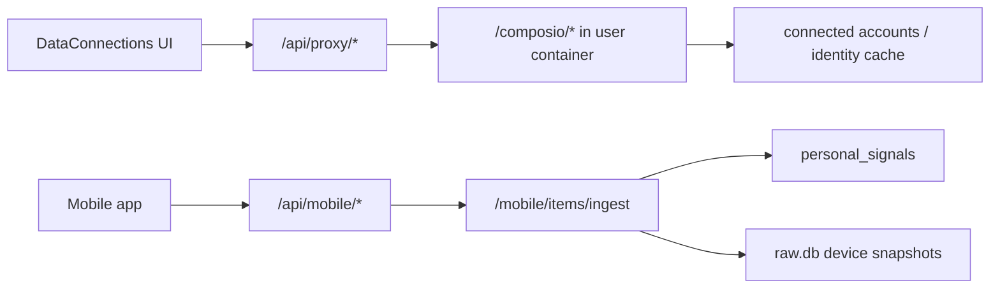
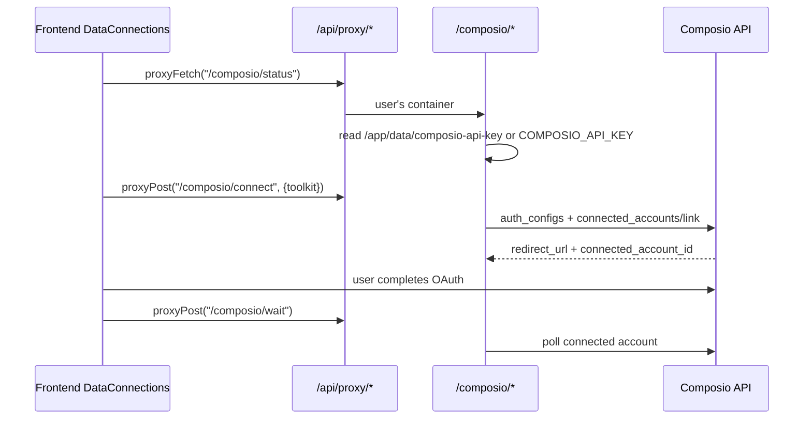
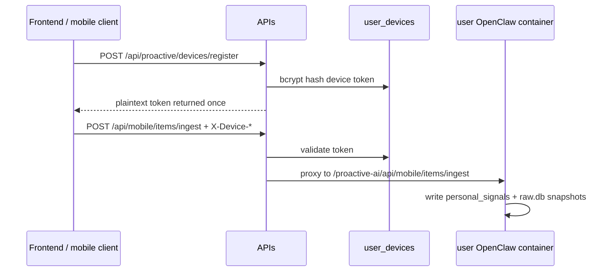

# Data Connectors

## 结论

Data Connectors 负责“数据源怎么接进来”，不负责后续记忆提炼。当前有两条主链路：

- Composio 连接 SaaS 账号，主要维护连接状态、OAuth、identity cache。
- Device / mobile 作为第一方数据源，通过 device token 路由到用户容器，写入 `personal_signals`，snapshot 类 payload 同时 fan-out 到 `raw.db`。



## 边界

包含：

- Composio API key 保存、连接、断开、等待 OAuth 完成。
- connected accounts 状态和 identity 展示。
- `user_devices` 注册、token 轮换、撤销和校验。
- `/api/mobile/*` 到用户容器内 `/proactive-ai/api/mobile/*` 的代理。
- `/mobile/items/ingest` 写入 `personal_signals` 和 raw snapshot 表。

不包含：

- `personal_signals` 如何进入 prompt 或被 evolution 消费，看 [Memory](./memory)。
- 卡片生成和反馈学习，看 [Generation](./generation) / [Feedback](./feedback)。
- 容器创建、LiteLLM、部署策略，看 [Runtime & Deployment](./runtime-deployment)。

## 当前连接源

| 来源 | 当前作用 | 代码入口 | 数据落点 |
|---|---|---|---|
| Composio | 连接 Gmail、Calendar、Slack、Notion 等 SaaS，展示 ACTIVE 连接和身份 | `routes/composio.ts`、`useComposio.ts`、`DataConnections.tsx` | 连接状态来自 Composio；identity cache 在容器 `/app/data/composio-identity-cache.json` |
| Device registry | 给 web/iOS/Android 设备发 token，用于后续 mobile sync | `apis/src/domain/devices/index.ts`、`proactive_routes.ts` | APIs Postgres `user_devices` |
| Mobile ingest | 接收端侧整理后的高价值 item | `mobile_proxy.ts`、`routes/mobile.ts` | `personal_signals`；snapshot fan-out 到 `raw.db.device_*_snapshot` |

## 核心链路

### Composio



### Device / mobile



## 当前设计

- Composio API key 优先读 `/app/data/composio-api-key`，再读 `COMPOSIO_API_KEY`。
- Composio connected accounts 只查询 `ACTIVE`，identity 缺失时尝试通过 toolkit-specific action 补齐，并缓存 24 小时。
- Device token 只在注册/轮换时明文返回一次，服务端只保存 bcrypt hash。
- mobile proxy 默认非生产可用；生产需显式 `MOBILE_SYNC_PROXY_ENABLED=1`。
- `/mobile/items/ingest` 是当前唯一 mobile 写入入口。
- 旧 `/mobile/items`、`/mobile/items/claim`、`/mobile/items/commit` 已返回 `410 Gone`。

## 开发入口

| 改动 | 先看 |
|---|---|
| Composio 连接按钮、OAuth 流程 | `proactive-ai-frontend/src/components/DataConnections.tsx`、`proactive-ai-frontend/src/hooks/useComposio.ts` |
| Composio 容器路由 | `pinai-openclaw/plugins/proactive-ai/routes/composio.ts` |
| Device 注册和 token | `apis/src/domain/devices/index.ts`、`apis/src/controller/proactive_routes.ts` |
| Mobile proxy | `apis/src/domain/proactive/mobile_proxy.ts` |
| Mobile ingest 写入 | `pinai-openclaw/plugins/proactive-ai/routes/mobile.ts` |
| raw snapshot 表 | `pinai-openclaw/plugins/proactive-ai/raw-db.ts` |

## 验证方式

```bash
npm run type-check
npm run test --workspace @pin-ai/apis
npx tsx --test pinai-openclaw/plugins/proactive-ai/routes/mobile.test.ts
npx tsx --test pinai-openclaw/plugins/proactive-ai/routes/mobile-http.test.ts
```

手工验证：

- Composio：打开 Data Connections，保存 API key，连接 Gmail/Calendar，确认 `/composio/connections` 返回 `ACTIVE`。
- Device：注册设备后确认只首次返回 `device_token`，后续 `/api/mobile/*` 带 `X-Device-Id` / `X-Device-Token`。
- Mobile：发送 `app_inventory_snapshot`，确认 `personal_signals` 有一行，同时 `raw.db.device_apps_snapshot` 有多行。

## 踩坑

- 不要恢复 `mobile_items.db` 读写链路；当前 mobile 数据已经直写 `personal_signals`。
- `container_status=running` 不代表 mobile target 可用，proxy 仍可能因容器未就绪返回 503。
- Composio 连接状态是外部平台事实，不能只信前端本地状态。
- Device token 不能写日志，不能存明文到 APIs DB。

## 相关 AI Plans

- [Memory Architecture](../plans/memory-architecture)：device registry、mobile ingest 与 raw/signals 的设计背景。
- [Data Connector Init Tasks](../plans/2026-04-24-data-connector-init-tasks)：Composio 连接 ACTIVE 后，按 Hermes-style scheduler 创建后台初始化任务、拉 typed raw 数据并触发 evolution；同一 scheduler 也接管 auto dreaming / auto generate。
