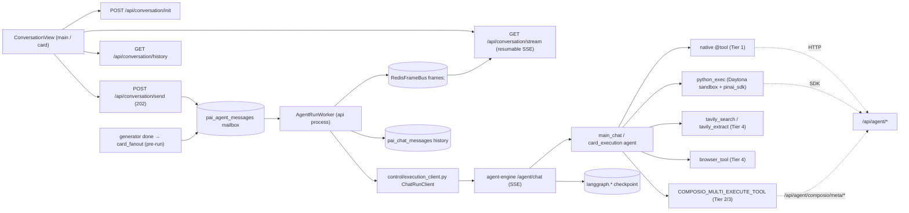
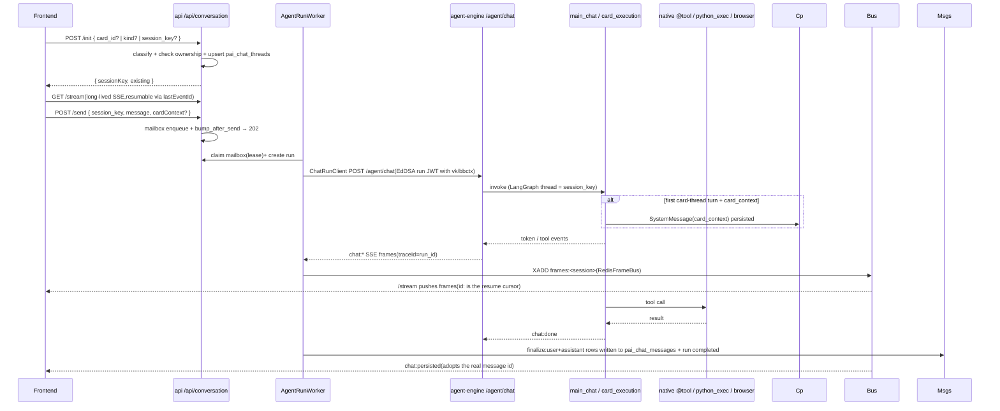

# Execution

## Summary

The execution layer is a single conversation (actor kernel) path:

`user → ConversationView (main / card, same frontend) → POST /api/conversation/send (202, enqueued to mailbox) → AgentRunWorker (api process) → control/execution_client.py ChatRunClient (EdDSA agent-run JWT) → agent-engine /agent/chat (DeepAgents) → agent calls a native @tool or python_exec (Daytona sandbox + pinai_sdk) → frames via RedisFrameBus (Redis Streams) → GET /api/conversation/stream (resumable SSE) → frontend`

Replies are asynchronous: `/send` only enqueues and returns 202; the turn's frames are pushed back over the long-lived `/stream` connection (on disconnect, reconnect with `lastEventId` to replay the gap; on refresh, the `active` field of `/history` rebuilds the in-progress turn). When the turn ends, the worker writes the user+assistant rows to `pai_chat_messages` (the source of truth for history).

session_key decides which agent runs: `card-thread-<card_id>` → `card_execution`; everything else (including `main-<user_id>` and the legacy `proactive-` prefix) → `main_chat`. **The proactive agent was deleted with the proactive sunset** (`098_sunset_proactive_drop_tables.sql`); the api side keeps only the session_key scaffolding for compatibility. A card's `card_context` is written as a SystemMessage into the LangGraph checkpointer on the first turn and persisted (later turns don't need the frontend to send it again). After cards are generated, the scheduler dispatcher uses `domains/generation/card_fanout.py` to post_message directly for the top N cards (`PINAI_CARD_FANOUT_LIMIT`, default 2) and pre-run a bootstrap turn (pre-run); the agent runs until `propose_action` and stops the turn naturally. The drawer (useCardExecutionRun) and CardChat now share **the same SSE conversation runtime** (useConversationRuntime): the drawer uses the pure selector `deriveRunSnapshot` to project the transcript into a RunSnapshot (plan/drafts/result/plan_revisions), replacing the old 1.5s polling of `/conversation/history`, and reads the same thread as CardChat.

Tool decisions are layered into Tier 1-4 by the agent system prompt; **side effects additionally have a runtime hard gate** (no longer prompt-only; see the "Composio side-effect" section below):

1. **Tier 1 Local read** — native @tool: `events_search` / `event_source` / `event_append` / `memory_edit` / `feedback_list`, etc. (the old `memory_*`/`signals_*`/`raw_*`/`world_*` were retired with the lifelong-memory rebuild)
2. **Tier 2 Composio read** — `COMPOSIO_MULTI_EXECUTE_TOOL` calls read-only GET / FETCH / SEARCH / LIST slugs (read-only VERBs are allowed through)
3. **Tier 3 Composio write** — the same meta-tool; side-effect classification goes through `pinai_contracts.composio_policy.is_side_effecting` (slug VERB heuristic, **fail-closed**), and a match goes to **HITL human approval** (`chat:requires_action`); the prompt's draft flow is still there as the UX layer
4. **Tier 4 Last resort** — `tavily_search` / `tavily_extract` (LangChain Tavily tools) read URLs; `browser_tool` (Browserbase) does real interaction (destructive labels force a takeover at runtime)



## Boundaries

In scope:

- `POST /api/conversation/{init,send,decision,cancel}` + `GET /api/conversation/{stream,history}` (control/conversation.py, the actor kernel entry point).
- Agent Core kernel: `control/` (mailbox / runs / sessions / worker / RedisFrameBus / ChatRunClient).
- card pre-run fanout: `domains/generation/card_fanout.py` (enqueues a bootstrap turn after the generator finishes).
- The `pai_chat_threads` metadata table (kind / card_id / message_count / last_message_at) + the `pai_chat_messages` history table (source of truth for persisted turns).
- The LangGraph Postgres checkpointer persisting thread state (`langgraph` schema).
- The agent-engine side `main_chat` / `card_execution` agent prompts and the native @tool suite.
- The `python_exec` sandbox tool (Daytona) + the code-mode path where `pinai_sdk` calls back to `/api/agent/*`.
- Browser tool (Browserbase session management, AI/user control, SSE event bus).
- Composio meta-tool forwarding + the two side-effect gates (403 on the sandbox path + native HITL).
- The `tavily_search` / `tavily_extract` web read tools.
- The chat memory tool surface (`events_search` / `event_source` / `event_append` / `memory_edit`) + always-on portrait injection via `PortraitMiddleware`.
- The frontend chat runtime and tool activity rendering.

Out of scope:

- How cards are generated: see [Generation](./generation).
- Writing `card_action:confirm/dismiss/modify` feedback: see [Feedback](./feedback).
- The schemas of the three memory layers and evolve distillation: see [Memory](./memory).
- Async tasks such as `connector.init` / `auto.dreaming`: see [Background Tasks](./background-tasks).
- The scheduler framework: see [Background Tasks](./background-tasks).

## Core flow



## Current design

### conversation routes (actor kernel entry point)

| Endpoint | Module | Behavior |
|---|---|---|
| `POST /api/conversation/init` | `control/conversation.py` | Resolves / mints session_key (explicit / `card_id` / `kind=proactive` / empty → the main singleton). Upserts `pai_chat_threads`. `existing` = has a persisted turn **or** is in flight (active run / pending mailbox), so that a refresh while the first turn is still in progress also lands in the conversation view. |
| `POST /api/conversation/send` | Same | Enqueues to the mailbox and returns **202**; the reply arrives asynchronously over /stream. While the agent is replying, the FE can keep sending; by default the message stays in the mailbox as a queued user message, and the worker processes it in order after the current turn ends. `interrupt=true` first cancels the current active run, then enqueues this user message with the same `clientMsgId`; used for the "Send now" forced send. `cardContext` goes into meta, and chat injects it as the first-turn SystemMessage. `clientMsgId` (FE `crypto.randomUUID`) serves as the mailbox `idempotency_key` (retried POSTs don't send twice), and is persisted with the row as `pai_chat_messages.client_msg_id` (089). |
| `PATCH /api/conversation/message` | Same | Edits a queued user message. Request `{ session_key, clientMsgId, message }`; only the current user's own mailbox rows with `source=user`, `consumed_at IS NULL`, `run_id IS NULL` may be changed. Once the worker has claimed the row it returns 409, to avoid changing input the agent is already processing. |
| `DELETE /api/conversation/message` | Same | Deletes a queued user message. Request `{ session_key, clientMsgId }`; permission and lifecycle boundaries are the same as PATCH. Once deleted, the queued item is not consumed by later turns. |
| `GET /api/conversation/stream` | Same | Long-lived resumable SSE: frames carry `id:` (Redis Stream entry id); on reconnect after a disconnect, `?lastEventId=` replays the gap; stale cursor → `conversation:resync`. |
| `GET /api/conversation/history` | Same | `pai_chat_messages` pagination (newest page + `before` cursor); `awaiting` rebuilds the HITL approval gate, `active` (`{userTexts, userEntries: [{text, clientId, queued?}], replayFrom}`) rebuilds the in-progress turn (restore on refresh); `queued=true` means the worker hasn't claimed this user message yet, so the queue edit/delete/Send now controls still show after a refresh. User rows echo `clientMsgId`; the FE reconciles optimistic bubbles by clientId identity (same text ≠ same message), and falls back to matching by text when there is no id. Pre-kernel legacy threads are backfilled once from the checkpoint on first read. |
| `POST /api/conversation/decision` | Same | HITL approve/reject/edit/respond → mailbox → Command(resume=) to resume the run. |
| `POST /api/conversation/cancel` | Same | Actually stops the in-flight turn (DB flag + cross-instance NOTIFY abort). |

`pai_chat_threads` (migration `035_pai_chat_threads.sql`) columns: `user_id`, `thread_id` composite PK, `kind` ∈ `main|card` (CHECK constraint), `card_id`, `title`, `archived`, `created_at`, `last_message_at`, `message_count`.

### worker → chat execution

- `control/worker.py`: drains the mailbox under a per-session lease → creates a run → `ChatRunClient` calls agent-engine → frames are published to RedisFrameBus + accumulated by `ChatTurnRecorder` → finalize writes `pai_chat_messages`.
- `control/execution_client.py:ChatRunClient` signs an EdDSA agent-run JWT with claims `user_id` / `run_id` / `virtual_key` / `browserbase_context_id` / 1h TTL / `jti`. It POSTs to `CHAT_INTERNAL_URL=http://agent-engine:8001/agent/chat` and parses the SSE into frames.
- `control/chat_proxy.py` now only holds one-shot proxies: `call_chat_history` (conversation backfill), `call_proactive_history` (proactive pagination), `call_generate`.
- `domains/generation/card_fanout.py`: after the generator finishes, calls `post_message` for the top N cards (`idempotency_key=card-bootstrap-<id>`) to pre-run a bootstrap turn.

The agent-engine side verifies the signature + checks the `jti` denylist (`pai_jti_revocations`); failures return 401.

### agent-engine agent

`agent_engine/transport/routes/chat.py:POST /agent/chat`:
- verify run JWT → `RunPrincipal`.
- Picks the agent by session_key prefix: `card-thread-` → `make_card_execution_agent`, otherwise `make_main_chat_agent` (the proactive agent was deleted).
- Gets the LangGraph checkpointer (`agent_engine/harness/checkpoint.py` persists to the Postgres `langgraph` schema); thread_id = session_key.
- Every regular send turn injects a hidden `turn_context` SystemMessage containing the current UTC time; the agent uses it to resolve relative times such as "today / tomorrow / the next batch", and in particular must make sure the expiry is in the future when writing a temporary preference (`structured.expires` of `event_append` `event_type="preference"`).
- card_context injection differs between two kinds of threads (`agent_engine/transport/routes/chat.py:_build_send_messages`): for a **card thread**, on the first turn with a `card_context`, `SystemMessage(json.dumps(card_context))` is pushed into the thread state, and the frontend doesn't need to send it again afterwards; a **main thread** is a per-user singleton (migration 053) whose first turn happens only once in its whole lifetime, so instead it **injects whenever the current turn carries a `card_context`** (when main chat is opened from a card to give feedback), regardless of whether it is the first turn. Both are filtered out by `/history` and are not rendered in the frontend.
- Runs the agent loop and converts the LangGraph stream into SSE frames: `chat:thinking` / `chat:delta` / `chat:reasoning:delta` / `chat:tool:start` / `chat:tool:result` / `chat:group:title` / `chat:requires_action` (HITL) / `chat:error` / `chat:done`, each frame with `traceId=run_id` (`agent_engine/transport/sse.py:langgraph_to_sse`). The SSE layer also handles: filtering out summarization's internal LLM output (tagged by `lc_source`), suppressing write_todos frames inside subagents, tagging nested tool events with a `parentTaskId` owner based on `checkpoint_ns`, extracting `links` from tavily results, and asynchronously calling Haiku for a group title when a group closes (`agent_engine/harness/group_title.py`). The frontend renders by work group + vertical rail (text segments break groups; `work-group.ts` segments → `WorkGroup`/`TaskCard`); TodoPanel is the turn-level plan (closed out on chat:done). For the design SSOT see Related AI Plans.
- **context compaction** (unified compaction at the end of the turn, `agent_engine/harness/compaction.py:compact_thread`): keeps the thread's working context within a bounded window. It is triggered inside the response generator (before the SSE stream closes) by two signals: the previous turn's reported input tokens > `DEFAULT_TOKEN_TRIGGER` (150k) **or** message count > `DEFAULT_MESSAGE_TRIGGER` (200). On a hit: an LLM (the user's default model) compresses the old turns into one summary → `aupdate_state` **rewrites messages in place** with `RemoveMessage(REMOVE_ALL_MESSAGES) + [summary, *last DEFAULT_KEEP_RECENT_TURNS=12 user-turns]` (mutating; cut on turn boundaries so no ToolMessage is orphaned). main + proactive share the same path. What this compresses is **checkpoint state storage** (the blob really gets smaller), not the non-mutating kind like deepagents' built-in summarization, which "compresses only the view fed to the LLM while the state stays full" (proactive's 5.6GB was the latter: the LLM read a compressed view, but storage kept the full 400k-token messages). Trade-off: the blob is now bounded, but the checkpoint **row count still grows with every super-step append** (LangGraph is append-only history and never deletes on its own). The row count is bounded by the **thread lifecycle** (main chat conversations are finite and naturally bounded; proactive is never-ending and grows slowly, so roll the thread over once it actually reaches that scale), not by compaction. **Why in-place REMOVE_ALL instead of physically deleting rows** (end-to-end tested on 2026-06-10): `adelete_thread` deletes the ancestor chain that the messages DeltaChannel needs for rebuilding → `aget_state` silently rebuilds as empty (rows 40→1 but msgs 16→0); a hand-built force-snapshot checkpoint → the snapshot itself reads correctly but **the next turn can't append to it**; only in-place REMOVE_ALL passes all three checks. Safety: agent_core per-session lease + the worker `await`s the whole chat stream (compaction runs inside the stream), so the next turn of the same session doesn't run concurrently. Card threads are short-lived and not compacted; HITL pending is skipped. It only touches the `langgraph` checkpoint, not RedisFrameBus `frames:<session>` or `pai_chat_messages`, so frontend streaming / replay / `/history` are unaffected; the summary uses the user's default model (possibly a reasoning model such as kimi, hence the 300s timeout).
- **History hygiene (same end-of-turn maintenance point, 2026-06-10)**: two layers guard against "malformed history breaking strict providers" (after dev switched to kimi-k2.6 we observed two kinds of Moonshot 400: empty assistant message `must not be empty`, and orphaned tool result `tool_call_id is not found`; Anthropic tolerates both, so landmines laid in the Claude era only blew up after switching models). **Request layer** (`agent_engine/harness/llm.py:_drop_unreplayable_history`, applied to every chat-completions request): before sending to the model, drops "assistant messages with no text and no tool_calls" (0-token closing replies, and empty shells left after the chat-completions conversion strips reasoning blocks) and "tool results with no matching tool_call earlier in the history", so already-poisoned old threads become usable again without cleaning any data. **Storage layer** (`agent_engine/harness/compaction.py:scrub_empty_ai_messages`): after the turn ends, physically `RemoveMessage`s truly empty AIMessages (no text, no reasoning, no tool_calls) from the checkpoint; **it runs for all thread types (card included; compaction still runs only for non-card)**, and HITL pending is skipped; reasoning-only messages are kept (the history UI still needs to render thinking), with the request layer as the fallback.

#### main_chat agent

`agent_engine/agents/main_chat.py:make_main_chat_agent`:

- The model connects to the LiteLLM proxy via langchain-openai `ChatOpenAI` and uses the deployment-level default `settings.default_model` (`harness/llm.py:make_chat_model`; it differs per environment, see the deployment config for the dev and prod default models).
- Prompt structure: role + language matching + persona grounding (memory / signals / past turns) + tool routing (Tier 1-4 + native tools list + composio meta + browser + python_exec) + side-effect rules + output style.
- Tool set: all of `agent_engine/tools/direct/*` + `python_exec` from `agent_engine/tools/code_mode/sandbox.py` + `agent_engine/tools/browser/tools.py` + `agent_engine/tools/direct/tavily.py` + the 4 meta-tools in `agent_engine/tools/direct/composio_meta.py`.

#### card_execution agent

`agent_engine/agents/card_execution.py`:

- Same tool set, but the prompt focuses on "executing within a single card's context"; `card_context` is the SystemMessage in the thread state.
- Three speak situations: missing user information, side-effect confirmation, tool failure. Other turns execute silently.

### Native @tool suite

`agent_engine/tools/direct/`: each file is a set of thin wrappers decorated with LangChain `@tool`; internally they call `/api/agent/*` via `agent_engine/tools/http_client.py` (the run JWT is signed and forwarded automatically):

| File | Tools |
|---|---|
| `events.py` | **Unified surface for memory retrieval/writes**: `events_search` (L1 hybrid retrieval, query/event_type/since/until, returns snippet + `hasSource`), `event_source` (drills down from an event to the L0 original text, resolving the supersede chain automatically), `event_append` (append-only; preferences also go through here, `structured{polarity,weight,scope,expires}`). The old memory_*/signals_*/raw_*/world_* tools are all retired |
| `user_strings.py` | `memory_edit` (L2 portrait, 5 slots, add/replace/remove/batch, may carry `evidence_event_ids`; the server writes the portrait change back to L1 in the same transaction). The portrait itself is always injected via `PortraitMiddleware` and is not read through a tool |
| `cards.py` | `generate_card` (`cards_recent` was deleted) |
| `composio_meta.py` | `composio_search_tools`, `composio_get_tool_schemas`, `composio_multi_execute`, connection management (Tool Router meta tools) |
| `feedback.py` | `feedback_list` |
| `preferences.py` | `set_generation_language` (changes the output language → a deterministic setting, not a preference row; content preferences go through `event_append`) |
| `propose_action.py` | `propose_action` (HITL proposal) |
| `scheduled_generators.py` | `scheduled_generator_{preview,create,create_once,list,pause,resume,delete}` |
| `development_feedback.py` | `development_feedback_log` (for product team triage, not a personalization signal) |
| `tavily.py` | `tavily_search`, `tavily_extract` |

### python_exec (Code Mode)

`agent_engine/tools/code_mode/sandbox.py:python_exec`:

- A native tool provided by DeepAgents that runs arbitrary Python in a Daytona sandbox.
- One sandbox per LangGraph thread (LRU 256, 60min auto_stop, 24h auto_delete; see [Runtime & Deployment](./runtime-deployment)).
- Injected env: `PAI_API_URL` (local ngrok / public URL in production) + `PAI_SANDBOX_TOKEN` phantom token + `PAI_RUN_JWT`.
- `pinai_sdk` is baked into the sandbox (`from pinai_sdk import client`); all `/api/agent/*` calls authenticate with the phantom token.
- When you only want to check chat/generator quality locally without going through Daytona/ngrok, set `PINAI_LOCAL_SANDBOX=1` and rebuild `agent-engine`; both the chat route and the generator then use `LocalShellBackend` to execute inside the `agent-engine` container, and `pinai_sdk` calls back to the api process via `http://api:8000`.
- Suited to multi-step composite calls (`run_query=fetch + filter + reduce + memory.add`); don't open a native tool for every step.
- On thread exit, `evict_thread(thread_id)` reclaims it proactively; `auto_stop` is the fallback against sandbox leaks.

### Browser tool

`agent_engine/tools/browser/`:

| File | Role |
|---|---|
| `manager.py` | `BrowserbaseManager`: session limit 5, reclaimed after 5min idle, remote health probe every 60s. |
| `tools.py` | LangChain tool entry point; the description is headed with LAST-RESORT TOOL + snapshot-first. |
| `control_state.py` | `controlMode='ai' / 'user'`; while the user has taken over, the agent may only use the read-only allowlist (`snapshot` / `get_text` / `console` / `request_takeover`). **Destructive label hard gate** `is_destructive_label`: when the click target's accessible name matches pay/order/checkout/transfer/delete (including the Chinese equivalents for pay/place order/transfer/delete, etc.), the click is intercepted at runtime and control is forcibly handed back to the user; bypass mode is not exempt either. |
| `events.py` | Event bus: `browser:opened` / `browser:navigated` / `browser:closed` / `browser:control:granted` / `browser:control:takeover`. |
| `routes.py` | `/agent/browser/*`: `events` (SSE reconnect replay), `input` (direct drive by user gestures), `heartbeat`, `refresh-live-view`, `login-check`, `control`, `DELETE sessions/:id`, `context/clear-site` (clears cookies for a logged-in site). |

Actions supported by the browser tool: `open` / `snapshot` / `click` / `type` / `press_key` / `wait` / `scroll` / `navigate` / `go_back` / `go_forward` / `reload` / `get_text` / `console` / `request_takeover` / `close`. Each action returns a new a11y snapshot with refs (like `e3`) for later actions to reference.

The Browserbase context (`ensure_browserbase_context`, `domains/browser/provisioning.py`) is provisioned during onboarding / settings updates (`domains/user_model/settings_ui.py`) (same pattern as the LiteLLM vk); cookies are reused across sessions, so after the user does OAuth once, later turns don't need to log in again.

### Composio side-effect control (two runtime gates + HITL)

The single source of truth for side-effect classification is `pinai_contracts.composio_policy.is_side_effecting`: it classifies by a slug VERB heuristic and is **fail-closed**: any non-read-only VERB is a side effect, and unknown tools are treated as side-effecting by default. Defenses currently in effect:

1. **Hard rejection on the sandbox code-mode path**: `/api/agent/composio/{execute,multi_execute}` (`domains/connector/apps/composio_agent.py`) returns **403** outright for side-effecting slugs; the sandbox has no interactive HITL, so side effects must go through native instead.
2. **Native HITL human gate**: `COMPOSIO_MULTI_EXECUTE_TOOL` is registered in `SIDE_EFFECT_TOOL_NAMES → HITL_INTERRUPT_ON` (`tools/direct/__init__.py`) and goes through the deepagents HumanInTheLoopMiddleware `interrupt()` → frontend `chat:requires_action` approval (approve/reject/edit). `bypass_permissions` is derived server-side from `pai_user_settings.permission_mode` and passed through per run (when it applies, `interrupt_on={}`); the client cannot bypass it. The frontend entry point is PermissionModeMenu.
3. **Meta-tool route allowlist** (`_ALLOWED_META_TOOLS`): only 4 Composio meta slugs are allowed — `SEARCH_TOOLS / GET_TOOL_SCHEMAS / MULTI_EXECUTE_TOOL / MANAGE_CONNECTIONS`; anything else gets 404.
4. **Agent prompt**: the Tier table + the "draft first → wait for the user's OK" draft flow guidance are still there, as the first UX-level constraint (on top of the hard gates).

> Historical note: before mid-June 2026 the side-effect gate was prompt-only (the "Side-effect gate: deferred" era; the old docstring has been rewritten). It has since been flipped to two runtime gates; don't assume, based on old versions of the docs, that "the code won't intercept dangerous slugs".

### How conversations enter long-term memory (crystallize was deleted)

The old conversation crystallize (the whole set of agent/routes/stub) was deleted with the lifelong-memory rebuild; per-session distillation falls between the two and is not needed. Conversations now enter long-term memory through two paths: **hot** (when the user explicitly states something durable, the chat agent immediately writes the portrait with `memory_edit` / records an event with `event_append`) + **periodic evolve** (cross-conversation inference every 4h, see [Memory](./memory)). The chat agent's system prompt gets the portrait injected persistently via `PortraitMiddleware` (AGENTS safety constants + 5 slots, fetched once per agent instance, as a transient SystemMessage to preserve the cache); this is the read path for "knowing you".

- Distinct from chat-feedback: hot/evolve write the long-term portrait and events; chat-feedback writes a per-card bias that only affects the next generation round (see [Feedback](./feedback)). Both consume the same transcript but feed different downstreams.

### SSE events

| event | Meaning | Key fields |
|---|---|---|
| `conversation:hello` | /stream connected (lets even an idle stream be marked connected immediately) | `sessionKey` |
| `conversation:resync` | The reconnect cursor has expired (stream TTL); the client re-fetches history | — |
| `chat:thinking` | Turn started | — |
| `chat:delta` | Visible text delta | `delta` |
| `chat:reasoning:delta` | Extended thinking delta | `delta` |
| `chat:tool:start` | Tool call started | `toolCallId`, `name`, `argsPreview`, `args?`, `parentTaskId?`/`agentName?` (subagent owner; absent = main agent or degraded) |
| `chat:tool:result` | Tool finished | `toolCallId`, `isError`, `meta`, `links?` (`[{title,url}]` ≤10 for web-search tools) |
| `chat:group:title` | Async work group title (generated by Haiku, scheduled when the group closes, flushed before done with a ≤3s wait) | `anchorToolCallId` (the group's first tool-call; the frontend/recorder backfills `groupTitle`), `title` |
| `chat:requires_action` | HITL: a side-effect tool is waiting for approval | `interruptId`, `toolName`, `args`, `allowedDecisions` |
| `chat:error` | Agent / system error | `error` |
| `chat:done` | Turn ended (the chat stream's finally guarantees it is sent; for terminations the chat stream didn't deliver (worker `_fail`/cancel/reaper), the worker's `_publish_terminal_frames` publishes a fallback `chat:error`+`chat:done` to the FrameBus, best-effort) | — |
| `chat:persisted` | Backfills the real message id after finalize | `messageId` |
| `proactive:tick` | Legacy: no new frames after the proactive sunset; `history.py` still synthesizes it when replaying old threads | `text`, `windowStart/End` |

All chat:* frames carry `traceId` (= run_id) and the SSE `id:` (Redis Stream entry id, the resume cursor).

### History and thread metadata

The source of truth for history is `pai_chat_messages` (written by worker finalize, paginated directly by `/api/conversation/history`, O(page)). `agent_engine/transport/routes/history.py:GET /agent/chat/history` is still kept: the api's `call_chat_history` uses it for the one-time backfill from the checkpoint on the first read of pre-kernel legacy threads, and proactive pagination also goes through it; it pulls messages from the LangGraph checkpointer and filters out SystemMessages (card_context is not exposed to the frontend).

### Transcript scrolling (frontend, reading first)

The Virtuoso in `ConversationView` is a pure virtual list (`followOutput={false}`, all built-in auto-scrolling off); the only owner of scroll decisions is the `following`/`free` state machine in `conversation/scroll/useChatScroll.ts`: on send, it optimistically opens a placeholder turn + a runway spacer holds up the bottom + the user message is anchored to the top of the viewport (zero reading-position movement during streaming, the Claude/ChatGPT model); breaking out of follow only responds to user gestures (`scroll-intent.ts`), and resuming only responds to the transition back to the bottom; when not at the bottom, a floating `JumpToLatest` ⬇ appears. The HITL approval card renders inside the entry of the paused turn (the Footer keeps only the fallback for debug-hidden turns). Hard rule: `scrollTo*` may only appear inside `scroll/`. For the design rationale and acceptance checklist see Related AI Plans.

### Card drawer: Sources / How I reasoned (frontend)

The Sources and How I reasoned sections of the card drawer consume structured fields of `IntentCard` (`DrawerDetailBody` in `apps/web/src/ui-web/card/CardDrawerBody.tsx`; the chat side reuses the same component) instead of parsing them back out of display text:

- **Sources**: takes `IntentCard.sourceApps` (an array of app slugs derived deterministically on the generation side; for derivation and injection see [Generation](./generation)); each slug is looked up via `apps/web/src/ui-web/card/source-app-display.ts` to render a `SourcePill` (brand logo / icon / initial-letter fallback). `line2` no longer carries sources data: `now/card-model.ts` keeps only the `Scheduled · label` branch, and the old `Sources: …` concatenation and the drawer-side `parseSources` reverse parsing were deleted.
- **How I reasoned**: `HowGeneratedSection` takes `IntentCard.reasoningSteps` (LLM-generated step-by-step reasoning, `label` + `detail`), collapsed by default and expanding into a numbered step list; when `steps` is empty (old cards / reminder cards) the whole section is hidden.
- **Old-card degradation**: for cards generated before the backend started injecting `sourceApps`, `normalizeIntentCard` in `packages/core` provides a client-side fallback: when `sourceApps` is missing, `deriveSourceAppsFromCitations` infers slugs from the citation prefixes in `sources[]`, and audit citations are not rendered raw in the UI.

## Development entry points

| Change | Look at first |
|---|---|
| conversation UI routes | `backend/services/api/src/pinai_api/control/conversation.py` |
| actor kernel (worker / mailbox / runs / FrameBus) | `backend/services/api/src/pinai_api/control/` |
| card pre-run fanout | `backend/services/api/src/pinai_api/domains/generation/card_fanout.py` |
| api → agent-engine one-shot proxy (history/generate) | `backend/services/api/src/pinai_api/control/chat_proxy.py` |
| agent-engine SSE endpoint | `backend/services/agent-engine/src/agent_engine/transport/routes/chat.py` |
| agent prompt | `backend/services/agent-engine/src/agent_engine/agents/main_chat.py`, `agents/card_execution.py` |
| Native @tool suite | `backend/services/agent-engine/src/agent_engine/tools/direct/` |
| Tool HTTP client (signs the run JWT) | `backend/services/agent-engine/src/agent_engine/tools/http_client.py` |
| python_exec sandbox tool | `backend/services/agent-engine/src/agent_engine/tools/code_mode/sandbox.py` |
| Local sandbox helper | `backend/services/agent-engine/src/agent_engine/tools/code_mode/local_sandbox.py` |
| Browser tool / state / routes | `backend/services/agent-engine/src/agent_engine/tools/browser/{manager,tools,control_state,events,routes}.py` |
| Composio meta-tool forwarding / side-effect gates | `backend/libs/contracts/src/pinai_contracts/composio_policy.py` (`is_side_effecting` VERB classification), `pinai_api/domains/connector/apps/composio_agent.py` (403 gate on the sandbox path), `agent_engine/tools/direct/__init__.py` (`SIDE_EFFECT_TOOL_NAMES` → HITL registration), `agent_engine/tools/direct/composio_meta.py`, `domains/connector/apps/composio_service.py` (session `tools=` allowlist) |
| LangGraph checkpointer | `backend/services/agent-engine/src/agent_engine/harness/checkpoint.py` |
| context compaction (in-place LLM compaction triggered by token/message counts) | `backend/services/agent-engine/src/agent_engine/harness/compaction.py` |
| SSE envelope / frame conversion | `backend/libs/contracts/src/pinai_contracts/sse_envelope.py`, `agent_engine/transport/sse.py` |
| Thread metadata table | `backend/db/migrations/035_pai_chat_threads.sql`, `pinai_api/platform/db/repositories/chat_threads.py` |
| Shared api models | `backend/libs/contracts/src/pinai_contracts/api_models.py` (`ChatInitRequest` / `ChatSendRequest` / `ChatHistoryResponse`, etc.) |
| Frontend chat runtime | `packages/state/src/queries/conversation.ts` (`useConversationRuntime`) |
| Shared chat views | `apps/web/src/ui-web/chat/conversation/ConversationView.tsx`, `apps/web/src/ui-web/card/card-chat.tsx` (shells: apps/web card panel, apps/mobile ChatDetailView) |
| Tool activity rows / work group | `packages/core/src/machines/tool-steps.ts`, work group rendering in `apps/web/src/ui-web/chat/` |
| Card drawer Sources / How I reasoned | `apps/web/src/ui-web/card/CardDrawerBody.tsx`, `apps/web/src/ui-web/card/source-app-display.ts`, `packages/core/src/domain/intent-card.ts` (`normalizeIntentCard` / `deriveSourceAppsFromCitations`) |
| Browser sub-view | `apps/web/src/ui-web/browser/` |

## How to verify

```bash
# routes / conversation + thread metadata
cd backend && uv run pytest tests/web/routes/test_chat_threads_routes.py
cd backend && uv run pytest tests/web/db/repositories/test_chat_threads_repo.py
cd backend && uv run pytest tests/web/routes/                    # full route suite

# chat agent / native tools / browser
cd backend && uv run pytest tests/chat/test_native_tools.py
cd backend && uv run pytest tests/chat/browser/test_event_bus.py
cd backend && uv run pytest tests/chat/browser/test_control_state.py
cd backend && uv run pytest tests/chat/                          # full chat suite

# types + frontend
cd backend && uv run ruff check .
npm run check:packages                    # core/state/ui-kit boundaries + types + unit tests
cd apps/web && npm run type-check && npm test
```

Manually verify 6 representative scenarios (local login + chat):

1. **Tier 1**: card "Today's schedule highlights" → open it → the agent should first call a native tool such as `events_search`, with **no** `browser:opened`.
2. **Tier 2**: card "What's in Gmail this morning" (data not synced for >12h) → the agent uses `COMPOSIO_MULTI_EXECUTE_TOOL` slug=`GMAIL_FETCH_EMAILS` (read-only VERB, allowed through directly).
3. **Tier 3**: card "Set up a 1on1 with Sarah on Wednesday at 3pm" → first `events_search` / Composio read-only calls to check for conflicts → draft in chat → calling `COMPOSIO_MULTI_EXECUTE_TOOL` slug=`GOOGLECALENDAR_CREATE_EVENT` should pop a `chat:requires_action` HITL approval card, and nothing executes before approve.
4. **Tier 4 web read**: card "Read the Forbes article Regan shared in Slack" → `events_search` finds the URL in the slack message → `tavily_extract` → summarize.
5. **GMAIL_SEND_EMAIL (side-effecting slug)**: the sandbox code-mode path should get 403; the native path should pop HITL approval. The prompt's draft flow (`GMAIL_CREATE_EMAIL_DRAFT` → user OK → `GMAIL_SEND_DRAFT`) is still the recommended UX, but the safeguard no longer relies on the prompt alone.

LangSmith trace:

```bash
set -a && . backend/.env && set +a
langsmith trace list --project pinai-agents-dev --format pretty | head -20
langsmith thread list --project pinai-agents-dev                   # chat session
```

Container logs:

```bash
make logs-api | grep -E "conversation|fanout|agent worker"
make logs-agent-engine | grep -E "/agent/chat|chat:tool|browser:"
```

## Gotchas

- The stable / volatile boundary of the chat agent prompt has no hard test assertions like the old OpenClaw plugin had; when changing the prompt, take care to put volatile fields such as `card_context` / firstMessage at the very end and don't pollute the prefix (otherwise the LiteLLM cache is invalidated).
- Composio side effects now have **two runtime gates** (sandbox 403 + native HITL) and are no longer prompt-only, but classification is a VERB heuristic (`composio_policy.is_side_effecting`, fail-closed): before changing the VERB list, understand the semantics of "unknown VERBs are treated as side-effecting by default"; loosening it widens the set of actions that skip approval.
- Side-effecting slugs such as `GMAIL_SEND_EMAIL`: sandbox code-mode gets 403, native goes through HITL and doesn't execute before approve; the draft-flow prompt rule is still kept (better UX), so don't remove it when changing the prompt.
- python_exec runs in the sandbox, which is asynchronous to the agent-engine process; `/state/*.json` files live on the sandbox filesystem, the frontend can't get them, and they can only be seen through the agent's text output. With local `PINAI_LOCAL_SANDBOX=1`, these files are under `/state` in the `agent-engine` container.
- Browser sessions are capped at 5; opening a sixth is rejected. A session auto-closes after 5min idle; when the frontend reconnects, the server pushes `browser:closed`, and frontend calls to `/input` with the expired session id fail hard.
- AI / user control switching only applies to write actions; `snapshot` / `get_text` / `screenshot` are also allowed while the user has taken over — this is by design, so the AI keeps situational awareness.
- The LangGraph checkpointer writes to the `langgraph` schema; to clear chat state, don't truncate `pai_chat_threads` (that's metadata), clear the `langgraph.*` tables.
- The `pai_chat_threads.message_count` / `last_message_at` bump is in the `/send` finalizer — when the client cuts the stream early (default ~10min timeout on the SSE path), the finalizer still runs, but the remaining tool frames from the agent running in the background are lost.
- When card context parsing fails, the prompt falls back to raw string mode, structured fields (`primaryAction` / `sources`, etc.) are unavailable, and the Tier 1 source_kind hint isn't injected.
- Conversation distillation (hot memory_edit / periodic evolve) and chat-feedback both consume the same transcript but feed different downstreams; when changing the normalization logic, run both test suites.
- `_ALLOWED_META_TOOLS = {SEARCH_TOOLS, GET_TOOL_SCHEMAS, MULTI_EXECUTE_TOOL, MANAGE_CONNECTIONS}` is currently the **only** Composio route allowlist on the api side; a new meta-tool (e.g. introducing `REMOTE_WORKBENCH` in the future) must be added here explicitly, otherwise it gets 404.

## Related modules

- [Generation](./generation): upstream — IntentCards come from here; this module takes them in via `card_context`.
- [Feedback](./feedback): sibling — `card_action` and `intent_card_state` go through the feedback path, not chat SSE.
- [Memory](./memory): downstream — read here for the events / portrait schemas and evolve distillation.
- [Background Tasks](./background-tasks): sibling — `connector.*` / `auto.dreaming` (periodic evolve) run on the async queue, fully separate from the chat path.
- [Runtime & Deployment](./runtime-deployment): api/agent-engine process trust boundary, agent-run JWT issuance, Daytona sandbox lifecycle, Browserbase configuration.

## Related AI Plans

- [Long tasks / multi-agent conversation UX improvements (P0-P4)](../plans/2026-06-09-long-task-agent-ux): summarization leak filtering, subagent tool event ownership (`parentTaskId`/`agentName` on `chat:tool:*` frames), the `chat:group:title` group title frame (generated asynchronously by Haiku), the frontend work group + vertical rail rendering system (TaskCard child rail / thinking scroll window / web search result list), and the TodoPanel turn-level lifecycle. Required reading before changing event filtering/ownership in `agent_engine/transport/sse.py`, `control/chat_turn_recorder.py`, or the frontend conversation rendering system.
- [Chat scrolling strategy: reading first](../plans/2026-06-10-chat-scroll-reading-first): the design SSOT for the transcript scroll state machine — why virtuoso followOutput's built-in heuristics were dropped, send anchor-to-top + runway, asymmetric hysteresis between gesture break-out and position resume, the optimistic placeholder turn, and the acceptance checklist. Required reading before changing `conversation/scroll/`, the TranscriptView scroll wiring, or the ConversationView send path.
