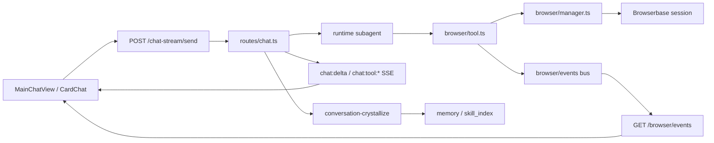
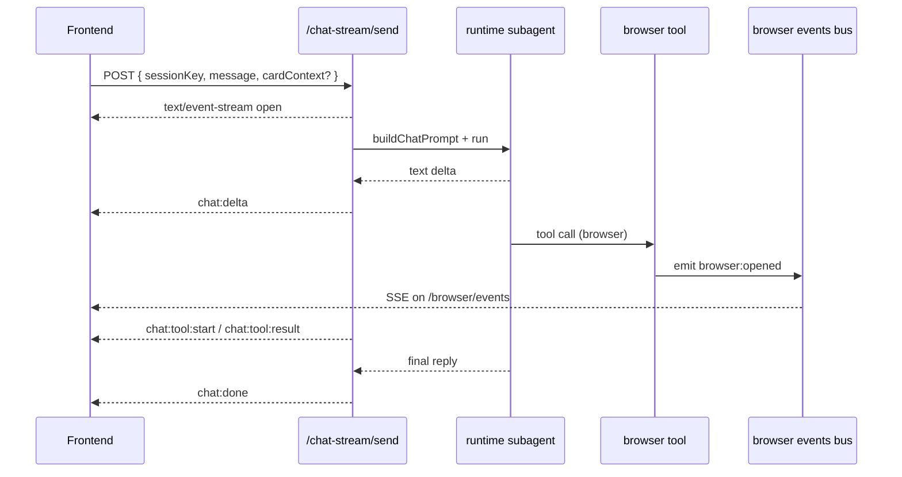

# Execution

## 结论

执行层主链路是:

`POST /chat-stream/send -> routes/chat.ts -> runtime subagent -> browser tool -> SSE 推 chat:tool:* 事件`

前端在 main chat 和 card chat 共享 `MainChatView`,通过 `useProactiveChatRuntime` 消费 SSE,把 `chat:delta` 拼成文本、把 `chat:tool:start/result` 渲染成 `ToolActivityCard`。Browser session 的生命周期事件走另一条 SSE 通道 `GET /browser/events`,跟主聊天流分开。



## 边界

包含:

- `/chat-stream/send`、`/chat-stream/init`、`/chat-stream/history` 和 legacy `/chat`、`/chat/history`。
- chat 系统 prompt 构建(card context、active skills 注入)。
- runtime subagent 调度、tool 调用 SSE 转发。
- browser 工具:session 生命周期、control mode、AI/user 抢占、读写动作分级。
- 前端 chat runtime + tool 活动渲染 + CardChat 薄壳。
- `conversation-crystallize`:把跨会话对话计数沉淀回 skill / memory 的触发框架。

不包含:

- 卡片怎么生成,看 [Generation](./generation)。
- `card_action:confirm/dismiss/modify` 反馈的写入,看 [Feedback](./feedback)。
- crystallize 写入 memory / skill 的具体 schema,看 [Memory](./memory)。
- `connector.sync`、`auto.dreaming` 等后台异步任务,看 [Background Tasks](./background-tasks)。

## 核心链路



## 当前设计

### Chat 路由

| Endpoint | 作用 |
|---|---|
| `POST /chat-stream/send` | 发消息,返回 SSE,推 `chat:delta` / `chat:tool:*` / `chat:done`。 |
| `POST /chat-stream/init` | 初始化或恢复 session,返回 sessionKey。 |
| `GET /chat-stream/history?sessionKey=...` | 历史消息,经 `chat-history-merge` 合成 Claude 风格 turn。 |
| `POST /chat` / `GET /chat/history` | Legacy 同步接口,留给 webhook / 程序化消费者。 |

### SSE 事件

| event | 含义 | 关键字段 |
|---|---|---|
| `chat:thinking` | agent 开始思考 | — |
| `chat:delta` | 文本增量 | `text` |
| `chat:tool:start` | 工具调用开始 | `toolCallId`, `name`, `argsPreview`, `pinCommand`, `meta` |
| `chat:tool:update` | 工具进度更新 | `toolCallId`, `meta` |
| `chat:tool:result` | 工具完成 | `toolCallId`, `isError`, `meta` |
| `chat:reply` | 非流式 fallback 完整回复 | `text` |
| `chat:error` | agent / 系统错误 | `message` |
| `chat:done` | 流结束 | — |

### Browser 路由(独立 SSE 通道)

| Endpoint | 作用 |
|---|---|
| `GET /browser/events?sessionKey=...` | session 生命周期 SSE,reconnect 时回放当前最新状态。 |
| `GET /browser/sessions` | 列出活跃 session。 |
| `POST /browser/sessions` | 主动创建 session。 |
| `DELETE /browser/sessions/:id` | 销毁 session。 |
| `POST /browser/sessions/:id/control` | 切换 control mode(`ai` / `user` / `idle`)。 |

Browser bus event 类型:`browser:opened`、`browser:navigated`、`browser:closed`、`browser:control`、`browser:takeover-requested`(captcha / 2FA 时)。

### Browser tool 行为

| 维度 | 当前事实 |
|---|---|
| 工具入口 | `browser/tool.ts` 注册单个 `browser` 工具,snapshot-first 工作流。 |
| 动作 | `open` / `snapshot` / `click` / `type` / `press_key` / `select` / `wait` / `scroll` / `navigate` / `go_back` / `go_forward` / `reload` / `get_text` / `upload_file` / `set_viewport` / `screenshot`。 |
| 返回 | 每次动作返回新 a11y snapshot,带 ref(如 `e3`)给后续动作引用。 |
| Session 上限 | `BrowserbaseManager` 最多 5 个并发,空闲 5 分钟自动回收。 |
| Health check | 每 60s 探活,远端死掉立即销毁本地句柄。 |
| Reconnect | CDP 最多重试 3 次,2s 指数退避。 |
| Context sync | 销毁后等 3s 再复用 persistent context,等 cookies / localStorage 同步。 |
| 读写分级 | `MUTATION_ACTIONS` 集合定义可写动作;`controlMode='user'` 时只允许只读动作(snapshot / get_text / screenshot)。 |

### Chat agent prompt

`agents/chat.ts` 构建:

- 基底:`You are the **Chat** agent in the Proactive AI system`。
- 输出语言:从 `user_settings.generation_language` 读出,经 `buildOutputLanguageInstruction` 转成英文指令。
- Card context:有结构化 JSON(`{title, primaryAction, ...}`)就用 JSON 段;否则用 `rawCardContext` 字符串 fallback。
- Active skills:`loadActiveSkillsSection()` 注入预格式化 markdown 段(可选,无 active skill 就跳过)。
- Tool catalog:由 OpenClaw runtime 注入,prompt 里不重复声明。

### Conversation crystallize

| 维度 | 当前事实 |
|---|---|
| 角色 | 跨 session 跟踪聊天 turn,达到阈值后跑子 agent,把对话沉淀成 profile memory 或 active skill。 |
| 入口 | `conversation-crystallize/service.ts`,触发由 `scheduler/auto-loop.ts` 1 分钟检测定时器或 debug panel `Run now` 拉。 |
| 跟踪范围 | sessionKey 前缀 `agent:main:proactive-ai:chat:*` / `chat-stream:*` / `chat:card:*`。 |
| 排除 | `chat-feedback:` / `crystallize:` / `dreaming:` 这些内部子 agent 自己的 session。 |
| 与 chat-feedback 区分 | crystallize 是长期沉淀(写 memory / skill);chat-feedback 是单卡偏置(只影响下一轮 generation)。两者都用 `normalizeCardChatMessages`,但下游不同。 |

## 开发入口

| 改动 | 先看 |
|---|---|
| chat HTTP / SSE | `pinai-openclaw/plugins/proactive-ai/routes/chat.ts` |
| chat 系统 prompt | `pinai-openclaw/plugins/proactive-ai/agents/chat.ts` |
| 历史 turn 合并 | `pinai-openclaw/plugins/proactive-ai/routes/chat-history-merge.ts` |
| browser HTTP / SSE | `pinai-openclaw/plugins/proactive-ai/routes/browser.ts` |
| browser 工具定义 | `pinai-openclaw/plugins/proactive-ai/browser/tool.ts` |
| browser session 管理 | `pinai-openclaw/plugins/proactive-ai/browser/manager.ts` |
| browser 事件总线 | `pinai-openclaw/plugins/proactive-ai/browser/events.ts` |
| AI/user 控制权 | `pinai-openclaw/plugins/proactive-ai/browser/control-state.ts` |
| 对话沉淀 | `pinai-openclaw/plugins/proactive-ai/conversation-crystallize/service.ts` |
| skill 注入 prompt | `pinai-openclaw/plugins/proactive-ai/conversation-crystallize/skill-injection.ts` |
| 前端 chat runtime | `proactive-ai-frontend/src/components/chat/useProactiveChatRuntime.ts` |
| 流式 content builder | `proactive-ai-frontend/src/components/chat/tool-steps.ts` |
| 共享 chat 视图 | `proactive-ai-frontend/src/components/main-chat/MainChatView.tsx` |
| 工具活动行 | `proactive-ai-frontend/src/components/main-chat/ToolActivityCard.tsx` |
| CardChat 薄壳 | `proactive-ai-frontend/src/components/CardChat.tsx` |

## 验证方式

```bash
npx tsx --test pinai-openclaw/plugins/proactive-ai/routes/chat.test.ts
npx tsx --test pinai-openclaw/plugins/proactive-ai/routes/chat.tool-events.test.ts
npx tsx --test pinai-openclaw/plugins/proactive-ai/routes/chat-history-merge.test.ts
npx tsx --test pinai-openclaw/plugins/proactive-ai/browser/control-state.test.ts
npx tsx --test pinai-openclaw/plugins/proactive-ai/browser/events.test.ts
npx tsx --test pinai-openclaw/plugins/proactive-ai/conversation-crystallize/service.test.ts
npm run type-check
```

手工验证:

- 打开一张 card 进 CardChat,Network 应看到 `POST /chat-stream/send` 持续 SSE,帧含 `chat:delta` 和 `chat:tool:start` / `chat:tool:result`。
- 同时 `GET /browser/events` 在 agent 触发 `browser` 工具时推 `browser:opened`,前端 panel 出现 live view iframe。
- 切 control mode 到 `user`,`POST /browser/sessions/:id/control` 后 SSE 推 `browser:control`,期间 agent 调写动作会被 `assertBrowserToolAllowed` 拒绝。
- 跟同一卡聊够阈值后,过几分钟 auto-loop 触发 crystallize 子 agent,SQLite 的 `proactive_chat_turns` 计数清零、`memory` 或 `skill_index` 多出对应行。

## 踩坑

- chat SSE 单条 `/chat-stream/send` 默认 10 分钟超时;客户端早断流后 agent 仍在后台跑,但 tool 事件帧丢失。
- 重连 `/browser/events` 时,如果当前没有活跃 session,server 会主动推一条 `browser:closed`,避免前端用过期 session id 调 `/input` 打死接口。
- session 复用前的 3s 等待是为了 Browserbase 同步 cookies / localStorage,缩短会出现登录态丢失。
- AI/user control 切换只对写动作生效。`snapshot` / `get_text` / `screenshot` 在用户接管期间也会被 agent 调用,这是设计:让 AI 保留情境感知。
- card context 解析失败会回退到 `rawCardContext` 字符串模式,prompt 还是能跑,但结构化字段(`primaryAction` 等)不可用。
- crystallize 跟 chat-feedback 都消费同一份 transcript 但下游分流;改 transcript 归一化(`normalizeCardChatMessages`)要同时跑两套测试。

## 相关模块

- [Generation](./generation):上游 — 用户聊的 card 来自哪一轮 pipeline。
- [Feedback](./feedback):兄弟 — `card_action` 和 `intent_card_state` 走 feedback 路径,不进 chat SSE。
- [Memory](./memory):下游 — crystallize 沉淀的 memory / skill 在这里读。
- [Background Tasks](./background-tasks):兄弟 — `auto.dreaming` 等异步任务由后台调度跑,跟同步 chat 区分。
