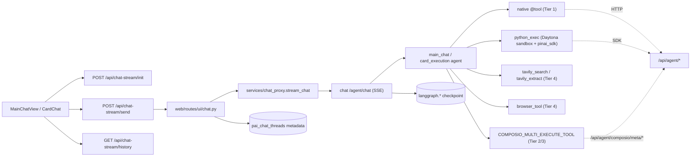
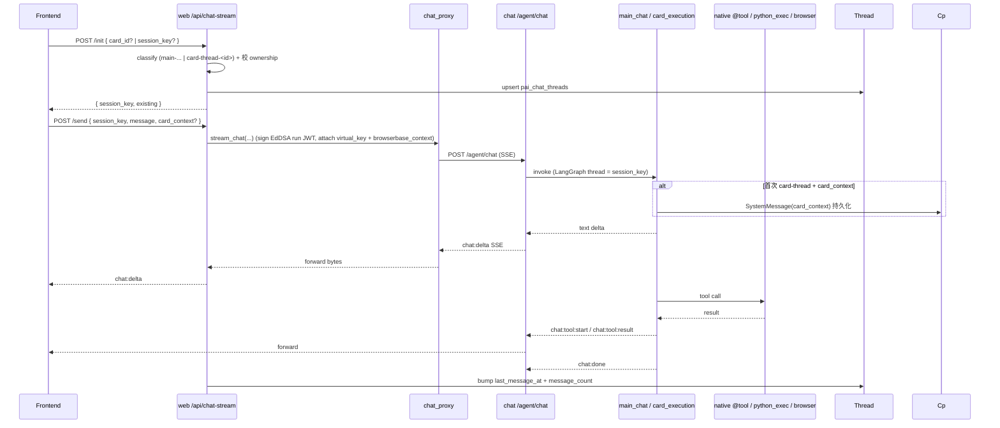

# Execution

## 结论

执行层是 chat-stream 单一链路:

`用户 → MainChatView / CardChat → POST /api/chat-stream/send → web/routes/ui/chat.py → services/chat_proxy.stream_chat(EdDSA agent-run JWT)→ chat /agent/chat (DeepAgents)→ agent 调原生 @tool 或 python_exec(Daytona sandbox + pinai_sdk)→ SSE 推 chat:delta / chat:tool:* 帧 → 前端`

session_key 决定走哪个 agent:`main-<user_id>-<rand>` → `main_chat` agent;`card-thread-<card_id>` → `card_execution` agent。第一次发到 card-thread 时,`card_context` 作为 SystemMessage 写进 LangGraph checkpointer 持久化(后续 turn 不需要前端再传)。

工具决策 Tier 1-4 政策**完全靠 agent system prompt 和 native tool 命名区分**(没有运行时硬拦截 hook,Composio side-effect 强制门**当前只是 prompt 规则 + tools allowlist,没有 verb 分类硬闸**,详见下方"Composio side-effect"段):

1. **Tier 1 Local read** — native @tool:`memory_*` / `signals_*` / `profile_*` / `raw_*` / `cards_*` / `feedback_*` / `world_*`
2. **Tier 2 Composio read** — `COMPOSIO_MULTI_EXECUTE_TOOL` 调 GET / FETCH / SEARCH / LIST 类 slug
3. **Tier 3 Composio write** — 同一个 meta-tool,prompt 要求先在 chat 起草 + 等用户 OK 才发起;`GMAIL_SEND_EMAIL` 等高风险 slug 走 prompt 规定的 draft 链路 — **代码层面没有 slug verb 黑/白名单**
4. **Tier 4 Last resort** — `tavily_search` / `tavily_extract`(LangChain Tavily 工具)读 URL,`browser_tool`(Browserbase)做真交互



## 边界

包含:

- `POST /api/chat-stream/{init,send}` + `GET /api/chat-stream/history`。
- `pai_chat_threads` metadata 表(kind / card_id / message_count / last_message_at)。
- LangGraph Postgres checkpointer 持久化 thread state(`langgraph` schema)。
- chat 端 `main_chat` / `card_execution` agent prompt 与 native @tool 套件。
- `python_exec` sandbox 工具(Daytona)+ `pinai_sdk` 回连 `/api/agent/*` 的 code-mode 链路。
- Browser tool(Browserbase session 管理、AI/user control、SSE 事件总线)。
- Composio meta-tool 转发 + 当前的 prompt-only 副作用约束(代码层 verb gate 还没实现)。
- `tavily_search` / `tavily_extract` web read 工具。
- conversation crystallize(chat 进程内联触发的长期沉淀;scheduler `crystallize` kind 已预留路由但未接 producer)。
- 前端 chat runtime 与工具活动渲染。

不包含:

- 卡片怎么生成,看 [Generation](./generation)。
- `card_action:confirm/dismiss/modify` 反馈写入,看 [Feedback](./feedback)。
- crystallize 写入 memory / skill 的 schema,看 [Memory](./memory)。
- `connector.init` / `auto.dreaming` 等异步任务,看 [Background Tasks](./background-tasks)。
- scheduler 框架,看 [Background Tasks](./background-tasks)。

## 核心链路



## 当前设计

### chat-stream 路由

| Endpoint | 模块 | 行为 |
|---|---|---|
| `POST /api/chat-stream/init` | `web/routes/ui/chat.py` | 解析 / mint session_key,validate 三种形态:1) 显式 body.session_key + 校 user 名空间;2) `card_id` → `card-thread-<id>`;3) 空 → 找用户最新 main thread 或 mint `main-<user_id>-<uuid>`。upsert `pai_chat_threads` metadata。返回 `{session_key, existing}`(existing 决定前端是否绕过 bootstrap)。 |
| `POST /api/chat-stream/send` | `web/routes/ui/chat.py` | SSE。`_ensure_virtual_key` lazy-recover LiteLLM key,`ensure_browserbase_context` 一次性建 Browserbase context(用于 browser tool 复用 cookies)。调 `stream_chat()`,最后在 finalizer 里 bump `last_message_at` + `message_count`。 |
| `GET /api/chat-stream/history?session_key=...` | `web/routes/ui/chat.py` | 一次性 GET 给 `chat /agent/chat/history`,返回合并后的 turn 列表(用户 / assistant / tool 调用)。 |

`pai_chat_threads`(migration `035_pai_chat_threads.sql`)字段:`user_id`、`thread_id` 复合 PK、`kind` ∈ `main|card`、`card_id`、`title`、`archived`、`created_at`、`last_message_at`、`message_count`。CHECK 约束 enforce session_key 命名 `main-{user_id}-{rand}` 或 `card-thread-{card_id}`。

### web → chat 代理

`web/services/chat_proxy.py`:

- `stream_chat(...)` 签 EdDSA agent-run JWT,claims 带 `user_id` / `run_id` / `virtual_key` / `browserbase_context_id` / 1h TTL / `jti`。POST 到 `CHAT_INTERNAL_URL=http://pinai-chat:8001/agent/chat`,把 SSE 字节直转回前端。
- `call_chat_exists(session_key)` 一次性 GET `/agent/chat/exists` — 给 `/init` 决定 existing。
- `call_chat_history(session_key)` 一次性 GET `/agent/chat/history` — 给 `/history`。

chat 端验签 + `jti` 黑名单(`pai_jti_revocations`),失败 401。

### chat agent

`chat/routes/chat.py:POST /agent/chat`:
- verify run JWT → `RunPrincipal`。
- 看 session_key prefix 选 agent:`card-thread-` → `make_card_execution_agent`,否则 `make_main_chat_agent`。
- 拿 LangGraph checkpointer(`chat/runtime/checkpoint.py` 在 Postgres `langgraph` schema 持久化);thread_id = session_key。
- card_context 注入分两种线程(`chat/routes/chat.py:_build_send_messages`):**card thread** 首次 + 有 `card_context` 时把 `SystemMessage(json.dumps(card_context))` push 进 thread state,之后不需要前端再传;**main thread** 是每用户单例(migration 053),首轮一辈子只真一次,所以改成**本轮带 `card_context` 就注入**(从某张卡打开 main chat 给反馈时),不看是不是首轮。两种都被 `/history` 过滤掉,不进前端渲染。
- 跑 agent loop,把 LangGraph stream 转成 SSE 帧:`chat:thinking` / `chat:delta` / `chat:tool:start` / `chat:tool:update` / `chat:tool:result` / `chat:reply`(非流式 fallback)/ `chat:error` / `chat:done`(`chat/streaming.py:langgraph_to_sse`)。

#### main_chat agent

`chat/agents/main_chat.py:make_main_chat_agent`:

- LiteLLM (Sonnet 4.6) 通过 langchain-openai `ChatOpenAI` 接到 LiteLLM proxy。
- prompt 结构:role + 语言匹配 + persona grounding(memory / signals / past turns)+ tool routing(Tier 1-4 + native tools 清单 + composio meta + browser + python_exec)+ 副作用规则 + 输出风格。
- 工具集合:全部 `chat/tools/native/*` + `chat/tools/sandbox.python_exec` + `chat/browser/tool.py` + `chat/tools/tavily` + `chat/tools/native/composio_meta` 的 4 个 meta-tool。

#### card_execution agent

`chat/agents/card_execution.py`:

- 同样的工具集,但 prompt 聚焦"执行单卡上下文",`card_context` 是 thread state 里的 SystemMessage。
- 三种 speak situation:缺用户信息、副作用确认、tool failure。其余 turn 静默执行。

### Native @tool 套件

`chat/tools/native/`,每个文件是一组 LangChain `@tool` 装饰的薄壳,内部通过 `chat/tools/http_client.py` 打 `/api/agent/*`(签 run JWT 自动转发):

| 文件 | 工具 |
|---|---|
| `cards.py` | `cards_recent`、`cards_get` |
| `composio_meta.py` | `COMPOSIO_SEARCH_TOOLS`、`COMPOSIO_GET_TOOL_SCHEMAS`、`COMPOSIO_MULTI_EXECUTE_TOOL`、`COMPOSIO_MANAGE_CONNECTIONS` |
| `feedback.py` | `feedback_list`、`feedback_get` |
| `memory.py` | `memory_list`、`memory_search`、`memory_get`、`memory_add`、`memory_upsert` |
| `preferences.py` | `preference_add`(持续性内容偏好 → `pai_preference_records`,高权重)、`set_generation_language`(改输出语言 → `generation_language` 设置,确定性,非偏好行)。详见 [Feedback](./feedback) 偏好层 |
| `profile.py` | `profile_get`、`profile_upsert`、`goal_list`、`goal_upsert` |
| `raw.py` | `raw_list`、`raw_get`、`raw_gmail_recent`、`raw_gcal_today`、`raw_gcal_week` |
| `signals.py` | `signals_recent`、`signals_get` |
| `tavily.py` | `tavily_search`、`tavily_extract`(LangChain Tavily 工具,API key 在 web 进程,chat 通过 web 转发) |
| `world.py` | `world_recent`、`world_search` |

### python_exec(Daytona Code Mode)

`chat/tools/sandbox.py:python_exec`:

- DeepAgents 自带的 native tool,把任意 Python 跑在 Daytona sandbox 里。
- 每个 LangGraph thread 一个 sandbox(LRU 100,5min auto_stop,24h auto_delete,详见 [Runtime & Deployment](./runtime-deployment))。
- 注入 env:`PAI_API_URL`(本地 ngrok / 生产公网)+ `PAI_SANDBOX_TOKEN` phantom token + `PAI_RUN_JWT`。
- sandbox 里 baked `pinai_sdk`,`from pinai_sdk import client`,所有 `/api/agent/*` 走 phantom token 鉴权。
- 适合多步组合调用(`run_query=fetch + filter + reduce + memory.add`),不要为每步都开 native tool。
- 退出 thread 时 `evict_thread(thread_id)` 主动回收;`auto_stop` 兜底防 sandbox 泄漏。

### Browser tool

`chat/browser/`:

| 文件 | 角色 |
|---|---|
| `manager.py` | `BrowserbaseManager`,session 上限 5,空闲 5min 回收,60s 远端健康探活。 |
| `tool.py` | LangChain 工具入口,description 头标 LAST-RESORT TOOL + snapshot-first。 |
| `control_state.py` | `controlMode='ai' / 'user' / 'idle'`;`MUTATION_ACTIONS` 集合定义可写动作,user 模式只允许只读(`snapshot` / `get_text` / `screenshot`)。 |
| `events.py` | 事件总线:`browser:opened` / `browser:navigated` / `browser:closed` / `browser:control` / `browser:takeover-requested`。 |
| `routes.py` | `GET /agent/browser/events?session_key=...`(SSE 重连回放)、`GET /agent/browser/sessions`、`POST /agent/browser/sessions`、`DELETE /agent/browser/sessions/:id`、`POST /agent/browser/sessions/:id/control`。 |

Browser tool 支持的 actions:`open` / `snapshot` / `click` / `type` / `press_key` / `wait` / `scroll` / `navigate` / `go_back` / `go_forward` / `reload` / `get_text` / `console` / `request_takeover` / `close`。每个动作返回新 a11y snapshot 带 ref(`e3` 之类)给后续动作引用。

Browserbase context(`ensure_browserbase_context`)在 `/chat-stream/send` 入口处 lazy 建立,session 间复用 cookies,user OAuth 一次后后续 turn 不需要重登。

### Composio 副作用闭环(当前状态:prompt + allowlist,**没有运行时 verb 闸**)

文件 `pinai-agents/src/pinai_agents/web/routes/agent/composio.py` 顶部 docstring 写得很清楚:

> Side-effect gate: deferred. The plan currently relies on session `tools=` allowlist as the physical guard; per-call HITL approval is TBD pending DeepAgents permission middleware integration.

也就是说,**今天的代码没有按 slug 动词(CREATE/UPDATE/DELETE 等)做白/黑名单分类**。当前实际生效的只有两层:

1. **agent prompt**(`main_chat.py` / `card_execution.py`):指令式约束 — 写明 Tier 表、`GMAIL_SEND_EMAIL` 黑名单、"先草稿 → 等用户 OK → 再发起"用户审批闭环。这是软约束,LLM 不遵守时没有运行时拦截。
2. **Meta-tool 路由白名单**(`web/routes/agent/composio.py:_ALLOWED_META_TOOLS`):只允许 4 个 Composio meta slug — `SEARCH_TOOLS / GET_TOOL_SCHEMAS / MULTI_EXECUTE_TOOL / MANAGE_CONNECTIONS`,其它 404。
3. **Session-level tools allowlist**:`COMPOSIO_MULTI_EXECUTE_TOOL` 的 `tools=[...]` 参数限定本次 session 能调的 Composio slug 集合,由 caller(agent prompt 决定)填,没有强制内容。`composio_service.py` 顶部注释明确把它叫"current side-effect guard"。

**待办(代码层面今天没有,跟旧 OpenClaw 的实现不同)**:
- 没有 slug verb 黑名单(没有"DELETE / CHARGE / PAY 自动拒绝"硬闸)。
- `allow_side_effect=true` 这种参数当前**不被任何 route 强制要求**。
- `GMAIL_SEND_EMAIL` 不会被 web 拒,只在 prompt 里建议走 draft 链路。

实施 HITL middleware 之后才会在 web 端补 verb 分类闸 — 在那之前,任何"新接 toolkit 副作用安全"的判断都得靠 prompt 控住,不能依赖代码。

### Conversation crystallize

`chat/agents/crystallize.py` 沉淀 chat session 成长期 memory / skill(详见 [Memory](./memory))。

**当前触发路径**:chat 进程 inline 调用 — 没有走 scheduler 队列。`web/scheduler/dispatcher.py` 顶部注释明确说 `crystallize → not scheduled (chat worker fires inline)`,grep `kind="crystallize"` 在 web 端没有任何 enqueue 点。前端 UI 的 `/api/crystallize/state` / `/api/crystallize/config` 路由当前是 stubs(`web/routes/ui/stubs.py`),返回静态状态,不真触发任何东西。

预留 schedule 通路:dispatcher 已经实现了 `crystallize` kind → POST `chat /agent/run/crystallize` 的路由;后续要把"session 阈值触发"换成 scheduler enqueue 时,只需要加一个 enqueuer service 写 `kind='crystallize'` 行,不需要再改 dispatcher。

- 与 chat-feedback 区分:crystallize 写长期 memory / skill;chat-feedback 写单卡偏置只影响下一轮 generation(看 [Feedback](./feedback))。两者消费同一份 transcript 但下游分流。

### SSE 事件

| event | 含义 | 关键字段 |
|---|---|---|
| `chat:thinking` | agent 开始思考 | — |
| `chat:delta` | 文本增量 | `text` |
| `chat:tool:start` | 工具调用开始 | `toolCallId`、`name`、`argsPreview`、`meta` |
| `chat:tool:update` | 进度更新 | `toolCallId`、`meta` |
| `chat:tool:result` | 完成或拦截 | `toolCallId`、`isError`、`meta` |
| `chat:reply` | 非流式 fallback 完整回复 | `text` |
| `chat:error` | agent / 系统错误 | `message` |
| `chat:done` | 流结束 | — |

### 历史与 thread metadata

`chat/routes/history.py:GET /agent/chat/history?session_key=...` 从 LangGraph checkpointer 拉所有 message,过滤 SystemMessage(card_context 不暴露给前端),组成 `{user, assistant, tool_calls[], metadata}` turn 列表返回。web 的 `/api/chat-stream/history` 是这条的薄壳代理。

## 开发入口

| 改动 | 先看 |
|---|---|
| chat-stream UI 路由 | `pinai-agents/src/pinai_agents/web/routes/ui/chat.py` |
| web → chat SSE 代理 | `pinai-agents/src/pinai_agents/web/services/chat_proxy.py` |
| chat 端 SSE 端点 | `pinai-agents/src/pinai_agents/chat/routes/chat.py` |
| chat agent prompt | `pinai-agents/src/pinai_agents/chat/agents/main_chat.py`、`chat/agents/card_execution.py` |
| Native @tool 套件 | `pinai-agents/src/pinai_agents/chat/tools/native/` |
| Tool HTTP client(签 run JWT) | `pinai-agents/src/pinai_agents/chat/tools/http_client.py` |
| python_exec sandbox 工具 | `pinai-agents/src/pinai_agents/chat/tools/sandbox.py` |
| Browser tool / 状态 / 路由 | `pinai-agents/src/pinai_agents/chat/browser/{manager,tool,control_state,events,routes}.py` |
| Composio meta-tool 转发 / 副作用约束 | `pinai-agents/src/pinai_agents/chat/tools/native/composio_meta.py`、`web/routes/agent/composio.py`(顶部 docstring 说明 verb gate deferred)、`web/composio_service.py` 的 session `tools=` allowlist |
| LangGraph checkpointer | `pinai-agents/src/pinai_agents/chat/runtime/checkpoint.py` |
| SSE 信封 | `pinai-agents/src/pinai_agents/shared/sse_envelope.py`、`chat/streaming.py` |
| Thread metadata 表 | `pinai-agents/db/migrations/035_pai_chat_threads.sql`、`web/db/repositories/chat_threads.py` |
| 共享 api 模型 | `pinai-agents/src/pinai_agents/shared/api_models.py`(`ChatInitRequest` / `ChatSendRequest` / `ChatHistoryResponse` 等) |
| 前端 chat runtime | `proactive-ai-frontend/src/components/chat/useProactiveChatRuntime.ts` |
| 共享 chat 视图 | `proactive-ai-frontend/src/components/main-chat/MainChatView.tsx`、`MainChat.tsx`、`CardChat.tsx` |
| 工具活动行 | `proactive-ai-frontend/src/components/chat/tool-steps.ts`、`main-chat/ToolActivityCard.tsx` |
| 浏览器子视图 | `proactive-ai-frontend/src/components/browser-view/`、`hooks/useBrowserSession.ts` |

## 验证方式

```bash
# 路由 / chat-stream + thread metadata
cd pinai-agents && uv run pytest tests/web/routes/test_chat_threads_routes.py
cd pinai-agents && uv run pytest tests/web/db/repositories/test_chat_threads_repo.py
cd pinai-agents && uv run pytest tests/web/routes/                    # 全 route 套件

# chat agent / native tools / browser
cd pinai-agents && uv run pytest tests/chat/test_native_tools.py
cd pinai-agents && uv run pytest tests/chat/browser/test_event_bus.py
cd pinai-agents && uv run pytest tests/chat/browser/test_control_state.py
cd pinai-agents && uv run pytest tests/chat/                          # 全 chat 套件

# 类型 + 前端
cd pinai-agents && uv run ruff check .
cd proactive-ai-frontend && npm run type-check
cd proactive-ai-frontend && npm test
```

手工验证 6 个代表场景(本地登录 + chat):

1. **Tier 1**:卡"今日日程亮点" → 点开 → agent 应首调 `raw_gcal_today` 这种 native tool,**无** `browser:opened`。
2. **Tier 2**:卡"今早 Gmail 有什么"(数据 >12h 没同步)→ agent 走 `COMPOSIO_MULTI_EXECUTE_TOOL` slug=`GMAIL_FETCH_EMAILS`。
3. **Tier 3**:卡"周三 3pm 和 Sarah 约 1on1" → 先 `raw_gcal_week` 看冲突 → 在 chat 起草 → 等用户 OK 后才 `COMPOSIO_MULTI_EXECUTE_TOOL` slug=`GOOGLECALENDAR_CREATE_EVENT`。代码不会拦"未经确认就直接调",这一步要靠 trace + agent prompt 自觉。
4. **Tier 4 web read**:卡"读一下 Regan 在 Slack 分享的 Forbes 文章" → `raw_list` slack 找 URL → `tavily_extract` → 总结。
5. **GMAIL_SEND_EMAIL 走 draft 链路**:观察 agent 是否在 prompt 引导下走 `GMAIL_CREATE_EMAIL_DRAFT` → 用户 OK → `GMAIL_SEND_DRAFT`。注意:web 端**不会拒**直接 `GMAIL_SEND_EMAIL`,完全靠 prompt 自律 — 看到 agent 直接发就改 prompt。

LangSmith trace:

```bash
set -a && . pinai-agents/.env && set +a
langsmith trace list --project pinai-agents-dev --format pretty | head -20
langsmith thread list --project pinai-agents-dev                   # chat session
```

容器日志:

```bash
make logs-pinai-web | grep -E "chat-stream|stream_chat"
make logs-pinai-chat | grep -E "/agent/chat|chat:tool|browser:"
```

## 踩坑

- chat agent prompt 的 stable / volatile 边界没像旧 OpenClaw plugin 那样有硬测试断言,改 prompt 时要自觉把 `card_context` / firstMessage 这种 volatile 字段放在最末,不要污染前缀(否则 LiteLLM cache 失效)。
- Composio side-effect gate 当前是 **prompt-only**(`web/routes/agent/composio.py` docstring 明说 "Side-effect gate: deferred"),没有 verb 黑/白名单硬闸 — 改 toolkit / 改 agent prompt 时**不要**假设代码会兜底拦截危险 slug。等 DeepAgents permission middleware 落地之后才会补 verb 闸。
- `GMAIL_SEND_EMAIL` 不会被代码拒;agent 走不走 draft 链路完全靠 prompt 控住,改 prompt 别去掉这条规则。
- python_exec 在 sandbox 里跑,sandbox 跟 chat 进程异步;`/state/*.json` 文件是 sandbox 文件系统,前端拿不到,只能通过 agent 输出的文本看。
- Browser session 上限 5,开第六个会 reject;开 session 后 5min 空闲会自动 close,前端 reconnect 时 server 会主推 `browser:closed`,前端用过期 session id 调 `/input` 打死。
- AI / user control 切换只对写动作生效,`snapshot` / `get_text` / `screenshot` 在 user 接管期间也允许 — 设计就是让 AI 保留情境感知。
- LangGraph checkpointer 写 `langgraph` schema,清 chat 状态不要 truncate `pai_chat_threads`(那是 metadata),要清 `langgraph.*` 表。
- `pai_chat_threads.message_count` / `last_message_at` bump 在 `/send` 的 finalizer 里 — 流被客户端早断(SSE 链路 ~10min 默认 timeout)时 finalizer 仍会跑,但 agent 在后台跑的剩余 tool 帧丢失。
- card context 解析失败时,prompt 退到 raw string 模式,结构化字段(`primaryAction` / `sources` 等)拿不到,Tier 1 source_kind hint 不会注入。
- conversation crystallize 跟 chat-feedback 都消费同一份 transcript 但下游分流,改归一化逻辑要同时跑两套测试。
- `_ALLOWED_META_TOOLS = {SEARCH_TOOLS, GET_TOOL_SCHEMAS, MULTI_EXECUTE_TOOL, MANAGE_CONNECTIONS}` 是当前 web 端**唯一**的 Composio 路由白名单;扩 meta-tool(比如未来引入 `REMOTE_WORKBENCH`)必须显式加进这里,不然 404。

## 相关模块

- [Generation](./generation):上游 — IntentCard 从这里出,本模块通过 `card_context` 接入。
- [Feedback](./feedback):兄弟 — `card_action` 和 `intent_card_state` 走 feedback 路径,不进 chat SSE。
- [Memory](./memory):下游 — crystallize 沉淀的 memory / skill 在这里读。
- [Background Tasks](./background-tasks):兄弟 — `connector.*` / `auto.dreaming` / `crystallize` 跑在异步队列上,跟 chat 链路完全分离。
- [Runtime & Deployment](./runtime-deployment):web/chat 进程信任边界、agent-run JWT 签发、Daytona sandbox 生命周期、Browserbase 配置。
