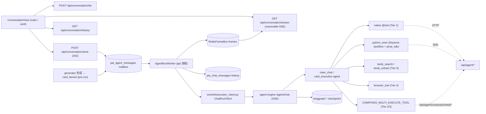
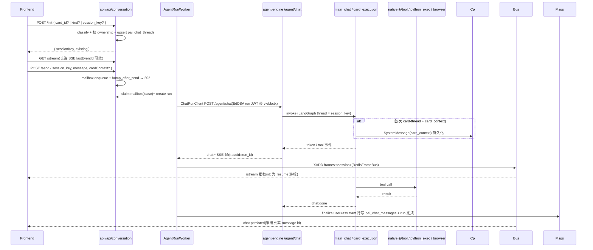

# Execution

## 结论

执行层是 conversation(actor kernel)单一链路:

`用户 → ConversationView(main / card 同一前端)→ POST /api/conversation/send(202,入 mailbox)→ AgentRunWorker(api 进程)→ control/execution_client.py ChatRunClient(EdDSA agent-run JWT)→ agent-engine /agent/chat (DeepAgents)→ agent 调原生 @tool 或 python_exec(Daytona sandbox + pinai_sdk)→ 帧经 RedisFrameBus(Redis Streams)→ GET /api/conversation/stream(resumable SSE)→ 前端`

回复是异步的:`/send` 只入队返回 202,turn 的帧从长连 `/stream` 推回(断线带 `lastEventId` 重连 replay gap;刷新靠 `/history` 的 `active` 重建进行中 turn)。turn 结束时 worker 把 user+assistant 行写进 `pai_chat_messages`(history 真相)。

session_key 决定走哪个 agent:`card-thread-<card_id>` → `card_execution`;其余(含 `main-<user_id>` 与历史 `proactive-` 前缀)→ `main_chat`。**proactive agent 已随 proactive sunset 删除**(`098_sunset_proactive_drop_tables.sql`),api 侧只剩 session_key 脚手架兼容。card 的 `card_context` 在首轮作为 SystemMessage 写进 LangGraph checkpointer 持久化(后续 turn 不需要前端再传)。卡片生成后,scheduler dispatcher 经 `domains/generation/card_fanout.py` 为前 N 张卡(`PINAI_CARD_FANOUT_LIMIT`,默认 2)直接 post_message 预跑 bootstrap turn(pre-run),agent 跑到 `propose_action` 自然停轮;抽屉(useCardExecutionRun)和 CardChat 现复用**同一个 SSE conversation runtime**(useConversationRuntime),抽屉用 `deriveRunSnapshot` 纯 selector 把 transcript 投影成 RunSnapshot(plan/drafts/result/plan_revisions),取代旧的 1.5s 轮询 `/conversation/history`,与 CardChat 读同一线程。

工具决策 Tier 1-4 由 agent system prompt 分层,**副作用另有运行时硬闸**(不再是 prompt-only,详见下方"Composio side-effect"段):

1. **Tier 1 Local read** — native @tool:`events_search` / `event_source` / `event_append` / `memory_edit` / `feedback_list` 等(老 `memory_*`/`signals_*`/`raw_*`/`world_*` 已随 lifelong-memory 重构退役)
2. **Tier 2 Composio read** — `COMPOSIO_MULTI_EXECUTE_TOOL` 调 GET / FETCH / SEARCH / LIST 类只读 slug(只读 VERB 放行)
3. **Tier 3 Composio write** — 同一个 meta-tool;副作用判定走 `pinai_contracts.composio_policy.is_side_effecting`(slug VERB 启发式,**fail-closed**),命中即走 **HITL 人工审批**(`chat:requires_action`);prompt 的 draft 链路仍在,作为体验层
4. **Tier 4 Last resort** — `tavily_search` / `tavily_extract`(LangChain Tavily 工具)读 URL,`browser_tool`(Browserbase)做真交互(破坏性 label 运行时强制 takeover)



## 边界

包含:

- `POST /api/conversation/{init,send,decision,cancel}` + `GET /api/conversation/{stream,history}`(control/conversation.py,actor kernel 入口)。
- Agent Core kernel:`control/`(mailbox / runs / sessions / worker / RedisFrameBus / ChatRunClient)。
- card pre-run fanout:`domains/generation/card_fanout.py`(generator 完成后入队 bootstrap turn)。
- `pai_chat_threads` metadata 表(kind / card_id / message_count / last_message_at)+ `pai_chat_messages` history 表(turn 落库真相)。
- LangGraph Postgres checkpointer 持久化 thread state(`langgraph` schema)。
- agent-engine 端 `main_chat` / `card_execution` agent prompt 与 native @tool 套件。
- `python_exec` sandbox 工具(Daytona)+ `pinai_sdk` 回连 `/api/agent/*` 的 code-mode 链路。
- Browser tool(Browserbase session 管理、AI/user control、SSE 事件总线)。
- Composio meta-tool 转发 + 副作用双闸(sandbox 路径 403 + native HITL)。
- `tavily_search` / `tavily_extract` web read 工具。
- chat 的 memory 工具面(`events_search` / `event_source` / `event_append` / `memory_edit`)+ `PortraitMiddleware` 画像常驻注入。
- 前端 chat runtime 与工具活动渲染。

不包含:

- 卡片怎么生成,看 [Generation](./generation)。
- `card_action:confirm/dismiss/modify` 反馈写入,看 [Feedback](./feedback)。
- memory 三层的 schema 与 evolve 蒸馏,看 [Memory](./memory)。
- `connector.init` / `auto.dreaming` 等异步任务,看 [Background Tasks](./background-tasks)。
- scheduler 框架,看 [Background Tasks](./background-tasks)。

## 核心链路



## 当前设计

### conversation 路由(actor kernel 入口)

| Endpoint | 模块 | 行为 |
|---|---|---|
| `POST /api/conversation/init` | `control/conversation.py` | 解析 / mint session_key(显式 / `card_id` / `kind=proactive` / 空 → main 单例)。upsert `pai_chat_threads`。`existing` = 有落库 turn **或** in-flight(active run / pending mailbox)——首轮 turn 进行中刷新也要落到对话视图。 |
| `POST /api/conversation/send` | 同上 | 入 mailbox 返回 **202**;回复异步走 /stream。agent 正在回复时,FE 仍可继续发送,默认作为 queued user message 留在 mailbox,当前 turn 结束后由 worker 顺序处理。`interrupt=true` 会先 cancel 当前 active run,再用同一个 `clientMsgId` 入队这条用户消息,用于"Send now"强制发送。`cardContext` 放 meta,由 chat 注入首轮 SystemMessage。`clientMsgId`(FE `crypto.randomUUID`)作 mailbox `idempotency_key`(重试 POST 不双发),并随行落 `pai_chat_messages.client_msg_id`(089)。 |
| `PATCH /api/conversation/message` | 同上 | 编辑 queued user message。请求 `{ session_key, clientMsgId, message }`;只允许改当前用户自己的 `source=user`、`consumed_at IS NULL`、`run_id IS NULL` mailbox 行。worker claim 后返回 409,避免改到正在被 agent 处理的输入。 |
| `DELETE /api/conversation/message` | 同上 | 删除 queued user message。请求 `{ session_key, clientMsgId }`;权限和生命周期边界同 PATCH。删除后该队列项不会被后续 turn 消费。 |
| `GET /api/conversation/stream` | 同上 | 长连 resumable SSE:帧带 `id:`(Redis Stream entry id),断线重连带 `?lastEventId=` replay gap;stale cursor → `conversation:resync`。 |
| `GET /api/conversation/history` | 同上 | `pai_chat_messages` 分页(newest page + `before` 游标);`awaiting` 重建 HITL 审批门,`active`(`{userTexts, userEntries: [{text, clientId, queued?}], replayFrom}`)重建进行中 turn(刷新恢复);`queued=true` 表示这条用户消息还没被 worker claim,刷新后仍显示队列编辑/删除/Send now 控件。user 行回显 `clientMsgId`,FE 的 optimistic 气泡按 clientId 身份对账(同文本≠同消息),无 id 时回退 text 认领。pre-kernel 老线程首读从 checkpoint 一次性 backfill。 |
| `POST /api/conversation/decision` | 同上 | HITL approve/reject/edit/respond → mailbox → Command(resume=) 续跑。 |
| `POST /api/conversation/cancel` | 同上 | 真停 in-flight turn(DB 标记 + 跨实例 NOTIFY abort)。 |

`pai_chat_threads`(migration `035_pai_chat_threads.sql`)字段:`user_id`、`thread_id` 复合 PK、`kind` ∈ `main|card`(CHECK 约束)、`card_id`、`title`、`archived`、`created_at`、`last_message_at`、`message_count`。

### worker → chat 执行

- `control/worker.py`:per-session lease drain mailbox → 创建 run → `ChatRunClient` 调 agent-engine → 帧 publish 到 RedisFrameBus + `ChatTurnRecorder` 累积 → finalize 写 `pai_chat_messages`。
- `control/execution_client.py:ChatRunClient` 签 EdDSA agent-run JWT,claims 带 `user_id` / `run_id` / `virtual_key` / `browserbase_context_id` / 1h TTL / `jti`。POST `CHAT_INTERNAL_URL=http://agent-engine:8001/agent/chat`,解析 SSE 成帧。
- `control/chat_proxy.py` 只剩一次性代理:`call_chat_history`(conversation backfill)、`call_proactive_history`(proactive 分页)、`call_generate`。
- `domains/generation/card_fanout.py`:generator 完成后对前 N 张卡 `post_message`(`idempotency_key=card-bootstrap-<id>`)预跑 bootstrap turn。

agent-engine 端验签 + `jti` 黑名单(`pai_jti_revocations`),失败 401。

### agent-engine agent

`agent_engine/transport/routes/chat.py:POST /agent/chat`:
- verify run JWT → `RunPrincipal`。
- 看 session_key prefix 选 agent:`card-thread-` → `make_card_execution_agent`,否则 `make_main_chat_agent`(proactive agent 已删)。
- 拿 LangGraph checkpointer(`agent_engine/harness/checkpoint.py` 在 Postgres `langgraph` schema 持久化);thread_id = session_key。
- 每个普通发送 turn 都注入隐藏 `turn_context` SystemMessage,包含当前 UTC 时间;agent 用它解析"今天 / 明天 / 下一批"等相对时间,尤其是写临时 preference(`event_append` `event_type="preference"` 的 `structured.expires`)时必须保证过期时间在未来。
- card_context 注入分两种线程(`agent_engine/transport/routes/chat.py:_build_send_messages`):**card thread** 首次 + 有 `card_context` 时把 `SystemMessage(json.dumps(card_context))` push 进 thread state,之后不需要前端再传;**main thread** 是每用户单例(migration 053),首轮一辈子只真一次,所以改成**本轮带 `card_context` 就注入**(从某张卡打开 main chat 给反馈时),不看是不是首轮。两种都被 `/history` 过滤掉,不进前端渲染。
- 跑 agent loop,把 LangGraph stream 转成 SSE 帧:`chat:thinking` / `chat:delta` / `chat:reasoning:delta` / `chat:tool:start` / `chat:tool:result` / `chat:group:title` / `chat:requires_action`(HITL)/ `chat:error` / `chat:done`,每帧 `traceId=run_id`(`agent_engine/transport/sse.py:langgraph_to_sse`)。SSE 层同时负责:过滤 summarization 内部 LLM 输出(`lc_source` 标)、压制 subagent 内部 write_todos 帧、按 `checkpoint_ns` 给嵌套工具事件标 `parentTaskId` 归属、tavily 结果提取 `links`、组封口异步调 Haiku 出组标题(`agent_engine/harness/group_title.py`)。前端按 work group + 垂直 rail 渲染(text 段打断分组,`work-group.ts` 分段 → `WorkGroup`/`TaskCard`),TodoPanel 是 turn 级计划(chat:done 收尾)。设计 SSOT 见相关 AI Plans。
- **context compaction**(turn 尾部统一压缩,`agent_engine/harness/compaction.py:compact_thread`):把 thread 的工作上下文限定在有界窗口。在 response generator 内(SSE 流关闭前)按两个信号触发——上一轮 reported input tokens > `DEFAULT_TOKEN_TRIGGER`(150k)**或** message 数 > `DEFAULT_MESSAGE_TRIGGER`(200)。命中后:LLM(用户 default model)把旧 turns 压成一条 summary → `aupdate_state` 用 `RemoveMessage(REMOVE_ALL_MESSAGES) + [summary, *最近 DEFAULT_KEEP_RECENT_TURNS=12 个 user-turn]` **原地重写** messages(mutating,turn 边界切分不孤立 ToolMessage)。main + proactive 同一条路。这压的是 **checkpoint state 存储**(blob 真变小)——不是 deepagents 内建 summarization 那种 non-mutating「只压喂 LLM 的视图、state 仍全量」(proactive 5.6GB 就是后者:LLM 读的是压缩视图,但存储留了全量 400k-token messages)。代价:blob 有上限了,但 checkpoint **行数仍随 super-step append**(LangGraph 是 append-only 历史,永不自删)——行数有界靠 **thread 生命周期**(main chat 对话有限天然有界;proactive never-ending 慢涨,真到量级再 thread roll-over),不靠压缩。**为什么是 in-place REMOVE_ALL 而非物理删行**(2026-06-10 端到端实测):`adelete_thread` 删掉 messages DeltaChannel 重建所需的 ancestor 链 → `aget_state` 静默重建为空(rows 40→1 但 msgs 16→0);手搓 force-snapshot checkpoint → snapshot 本身读对但**下一轮 append 不上去**;只有 in-place REMOVE_ALL 三项全过。安全:agent_core per-session lease + worker `await` 整个 chat 流(compaction 在流内),同 session 下一个 turn 不并发。card thread 短命不压;HITL pending 跳过。只动 `langgraph` checkpoint,不碰 RedisFrameBus `frames:<session>` 和 `pai_chat_messages`,前端 streaming / replay / `/history` 不受影响;summary 用用户 default model(可能是 reasoning model 如 kimi,故 timeout 300s)。
- **历史卫生(同一 turn 尾部维护点,2026-06-10)**:两层防"畸形历史打挂严格 provider"(dev 切 kimi-k2.6 后实测两种 Moonshot 400:空 assistant 消息 `must not be empty`、孤儿 tool 结果 `tool_call_id is not found`;Anthropic 都容忍,所以 Claude 时代埋的雷换模型才炸)。**请求层**(`agent_engine/harness/llm.py:_drop_unreplayable_history`,所有 chat-completions 请求统一过):发给模型前丢弃「无 text 无 tool_calls 的 assistant 消息」(0-token 收尾回复、reasoning 块被 chat-completions 转换剥掉后的空壳)和「前文没有对应 tool_call 的 tool 结果」——已毒化的旧 thread 不用清数据即恢复可用。**存储层**(`agent_engine/harness/compaction.py:scrub_empty_ai_messages`):turn 结束后把真正空的 AIMessage(无 text 无 reasoning 无 tool_calls)从 checkpoint 物理 `RemoveMessage` 掉,**所有 thread 类型都跑(card 也跑,compaction 仍只跑非 card)**,HITL pending 跳过;reasoning-only 消息保留(历史 UI 还要渲染 thinking),靠请求层兜底。

#### main_chat agent

`agent_engine/agents/main_chat.py:make_main_chat_agent`:

- 模型经 langchain-openai `ChatOpenAI` 接到 LiteLLM proxy,取部署级默认 `settings.default_model`(`harness/llm.py:make_chat_model`;各环境不同,dev 与 prod 的默认模型见部署配置)。
- prompt 结构:role + 语言匹配 + persona grounding(memory / signals / past turns)+ tool routing(Tier 1-4 + native tools 清单 + composio meta + browser + python_exec)+ 副作用规则 + 输出风格。
- 工具集合:全部 `agent_engine/tools/direct/*` + `agent_engine/tools/code_mode/sandbox.py` 的 `python_exec` + `agent_engine/tools/browser/tools.py` + `agent_engine/tools/direct/tavily.py` + `agent_engine/tools/direct/composio_meta.py` 的 4 个 meta-tool。

#### card_execution agent

`agent_engine/agents/card_execution.py`:

- 同样的工具集,但 prompt 聚焦"执行单卡上下文",`card_context` 是 thread state 里的 SystemMessage。
- 三种 speak situation:缺用户信息、副作用确认、tool failure。其余 turn 静默执行。

### Native @tool 套件

`agent_engine/tools/direct/`,每个文件是一组 LangChain `@tool` 装饰的薄壳,内部通过 `agent_engine/tools/http_client.py` 打 `/api/agent/*`(签 run JWT 自动转发):

| 文件 | 工具 |
|---|---|
| `events.py` | **memory 检索/写入的统一面**:`events_search`(L1 hybrid 检索,query/event_type/since/until,返回 snippet + `hasSource`)、`event_source`(按 event 下钻 L0 原文,supersede 链自动 resolve)、`event_append`(纯追加;preference 也走这,`structured{polarity,weight,scope,expires}`)。老的 memory_*/signals_*/raw_*/world_* 工具全部退役 |
| `user_strings.py` | `memory_edit`(L2 画像 5 slot add/replace/remove/batch,可带 `evidence_event_ids`;服务端同事务把画像变更写回 L1)。画像本身经 `PortraitMiddleware` 常驻注入,不用工具读 |
| `cards.py` | `generate_card`(`cards_recent` 已删) |
| `composio_meta.py` | `composio_search_tools`、`composio_get_tool_schemas`、`composio_multi_execute`、连接管理(Tool Router meta 工具) |
| `feedback.py` | `feedback_list` |
| `preferences.py` | `set_generation_language`(改输出语言 → 确定性设置,非偏好行;内容偏好走 `event_append`) |
| `propose_action.py` | `propose_action`(HITL 提议) |
| `scheduled_generators.py` | `scheduled_generator_{preview,create,create_once,list,pause,resume,delete}` |
| `development_feedback.py` | `development_feedback_log`(产品团队 triage,非个性化信号) |
| `tavily.py` | `tavily_search`、`tavily_extract` |

### python_exec(Code Mode)

`agent_engine/tools/code_mode/sandbox.py:python_exec`:

- DeepAgents 自带的 native tool,把任意 Python 跑在 Daytona sandbox 里。
- 每个 LangGraph thread 一个 sandbox(LRU 256,60min auto_stop,24h auto_delete,详见 [Runtime & Deployment](./runtime-deployment))。
- 注入 env:`PAI_API_URL`(本地 ngrok / 生产公网)+ `PAI_SANDBOX_TOKEN` phantom token + `PAI_RUN_JWT`。
- sandbox 里 baked `pinai_sdk`,`from pinai_sdk import client`,所有 `/api/agent/*` 走 phantom token 鉴权。
- 本地只想验证 chat/generator 质量、不想走 Daytona/ngrok 时,设置 `PINAI_LOCAL_SANDBOX=1` 并重建 `agent-engine`;chat route 和 generator 都会用 `LocalShellBackend` 在 `agent-engine` 容器内执行,`pinai_sdk` 通过 `http://api:8000` 回连 api 进程。
- 适合多步组合调用(`run_query=fetch + filter + reduce + memory.add`),不要为每步都开 native tool。
- 退出 thread 时 `evict_thread(thread_id)` 主动回收;`auto_stop` 兜底防 sandbox 泄漏。

### Browser tool

`agent_engine/tools/browser/`:

| 文件 | 角色 |
|---|---|
| `manager.py` | `BrowserbaseManager`,session 上限 5,空闲 5min 回收,60s 远端健康探活。 |
| `tools.py` | LangChain 工具入口,description 头标 LAST-RESORT TOOL + snapshot-first。 |
| `control_state.py` | `controlMode='ai' / 'user'`;user 接管期间 agent 只许只读 allowlist(`snapshot` / `get_text` / `console` / `request_takeover`)。**破坏性 label 硬闸** `is_destructive_label`:点击目标的 accessible name 命中 pay/order/checkout/transfer/delete(含中文 付款/下单/转账/删除 等)即运行时拦截、强制交还用户,bypass 模式也不豁免。 |
| `events.py` | 事件总线:`browser:opened` / `browser:navigated` / `browser:closed` / `browser:control:granted` / `browser:control:takeover`。 |
| `routes.py` | `/agent/browser/*`:`events`(SSE 重连回放)、`input`(用户手势直驱)、`heartbeat`、`refresh-live-view`、`login-check`、`control`、`DELETE sessions/:id`、`context/clear-site`(登录站 cookie 清除)。 |

Browser tool 支持的 actions:`open` / `snapshot` / `click` / `type` / `press_key` / `wait` / `scroll` / `navigate` / `go_back` / `go_forward` / `reload` / `get_text` / `console` / `request_takeover` / `close`。每个动作返回新 a11y snapshot 带 ref(`e3` 之类)给后续动作引用。

Browserbase context(`ensure_browserbase_context`,`domains/browser/provisioning.py`)在 onboarding / settings 更新时(`domains/user_model/settings_ui.py`)provision(和 LiteLLM vk 同模式),session 间复用 cookies,user OAuth 一次后后续 turn 不需要重登。

### Composio 副作用闭环(运行时双闸 + HITL)

副作用判定的单一真源是 `pinai_contracts.composio_policy.is_side_effecting`:按 slug VERB 启发式分类,**fail-closed**——非只读 VERB 即副作用,未知工具默认按副作用处理。当前生效的防线:

1. **sandbox code-mode 路径硬拒**:`/api/agent/composio/{execute,multi_execute}`(`domains/connector/apps/composio_agent.py`)对副作用 slug 直接 **403**——沙箱没有交互 HITL 能力,副作用必须改走 native。
2. **native HITL 人工闸**:`COMPOSIO_MULTI_EXECUTE_TOOL` 注册在 `SIDE_EFFECT_TOOL_NAMES → HITL_INTERRUPT_ON`(`tools/direct/__init__.py`),经 deepagents HumanInTheLoopMiddleware `interrupt()` → 前端 `chat:requires_action` 审批(approve/reject/edit)。`bypass_permissions` 由服务端 `pai_user_settings.permission_mode` 派生、per-run 透传(命中时 `interrupt_on={}`),client 不能绕过;前端入口是 PermissionModeMenu。
3. **Meta-tool 路由白名单**(`_ALLOWED_META_TOOLS`):只允许 4 个 Composio meta slug — `SEARCH_TOOLS / GET_TOOL_SCHEMAS / MULTI_EXECUTE_TOOL / MANAGE_CONNECTIONS`,其它 404。
4. **agent prompt**:Tier 表 + "先草稿 → 等用户 OK"draft 链路指引仍在,作为第一层体验约束(在硬闸之上)。

> 历史注:2026-06 中旬前 side-effect gate 是 prompt-only("Side-effect gate: deferred" 时代,老 docstring 已改写)。现在已翻转成运行时双闸——别再按老版本文档假设"代码不会拦截危险 slug"。

### 对话怎么进长期记忆(crystallize 已删除)

老的 conversation crystallize(agent/路由/stub 全套)已随 lifelong-memory 重构删除——单 session 蒸馏两头不靠。现在对话进入长期记忆走两条路:**hot**(用户明确说了 durable 的事,chat agent 当场 `memory_edit` 写画像 / `event_append` 记事件)+ **periodic evolve**(每 4h 跨对话推断,看 [Memory](./memory))。chat agent 的 system prompt 经 `PortraitMiddleware` 常驻注入画像(AGENTS 安全常量 + 5 slot,每 agent instance fetch 一次、transient SystemMessage 保 cache),这是「懂你」的读路径。

- 与 chat-feedback 区分:hot/evolve 写长期画像与 events;chat-feedback 写单卡偏置只影响下一轮 generation(看 [Feedback](./feedback))。两者消费同一份 transcript 但下游分流。

### SSE 事件

| event | 含义 | 关键字段 |
|---|---|---|
| `conversation:hello` | /stream 连上(空闲流也能立刻置 connected) | `sessionKey` |
| `conversation:resync` | 重连游标已过期(stream TTL),客户端重拉 history | — |
| `chat:thinking` | turn 开始 | — |
| `chat:delta` | 可见文本增量 | `delta` |
| `chat:reasoning:delta` | extended thinking 增量 | `delta` |
| `chat:tool:start` | 工具调用开始 | `toolCallId`、`name`、`argsPreview`、`args?`、`parentTaskId?`/`agentName?`(subagent 归属,缺失=主 agent 或降级) |
| `chat:tool:result` | 工具完成 | `toolCallId`、`isError`、`meta`、`links?`(web 搜索类的 `[{title,url}]`≤10) |
| `chat:group:title` | work group 异步标题(Haiku 生成,组封口时调度,done 前 flush≤3s) | `anchorToolCallId`(组首 tool-call,前端/recorder 回填 `groupTitle`)、`title` |
| `chat:requires_action` | HITL:side-effect 工具等审批 | `interruptId`、`toolName`、`args`、`allowedDecisions` |
| `chat:error` | agent / 系统错误 | `error` |
| `chat:done` | turn 结束(chat 流 finally 保证发出;chat 流没送达的终止——worker `_fail`/cancel/reaper——由 worker `_publish_terminal_frames` 补发 `chat:error`+`chat:done` 到 FrameBus,best-effort) | — |
| `chat:persisted` | finalize 后回填真实 message id | `messageId` |
| `proactive:tick` | 历史遗留:proactive sunset 后无新帧,`history.py` 仍为老线程 replay 合成 | `text`、`windowStart/End` |

所有 chat:* 帧带 `traceId`(= run_id)与 SSE `id:`(Redis Stream entry id,resume 游标)。

### 历史与 thread metadata

history 真相是 `pai_chat_messages`(worker finalize 写入,`/api/conversation/history` 直接分页读,O(page))。`agent_engine/transport/routes/history.py:GET /agent/chat/history` 仍保留:api 的 `call_chat_history` 在 pre-kernel 老线程首读时从 checkpoint 一次性 backfill,proactive 分页也走它;它从 LangGraph checkpointer 拉 message,过滤 SystemMessage(card_context 不暴露给前端)。

### Transcript 滚动(前端,阅读优先)

`ConversationView` 的 Virtuoso 是纯虚拟列表(`followOutput={false}`,内建自动滚动全关),滚动决策唯一 owner 是 `conversation/scroll/useChatScroll.ts` 的 `following`/`free` 状态机:发送时乐观开 placeholder turn + runway spacer 撑底 + 用户消息锚到视口顶(流式期间阅读位置零移动,Claude/ChatGPT 模型);断开跟随只认用户手势(`scroll-intent.ts`),恢复只认回底 transition;不在底部时浮 `JumpToLatest` ⬇。HITL 审批卡渲染在暂停 turn 的 entry 内(Footer 只剩 debug-隐藏 turn 的 fallback)。硬约定:`scrollTo*` 只允许出现在 `scroll/` 内。设计依据与验收清单见相关 AI Plans。

### Card drawer:Sources / How I reasoned(前端)

卡片抽屉的 Sources 和 How I reasoned 两个区块吃 `IntentCard` 的结构化字段(`packages/ui-web/src/card/CardDrawerBody.tsx` 的 `DrawerDetailBody`,chat 侧复用同一组件),不再从展示文本反向解析:

- **Sources**:接 `IntentCard.sourceApps`(generation 侧确定性派生的 app slug 数组,派生与注入见 [Generation](./generation)),每个 slug 经 `packages/ui-web/src/card/source-app-display.ts` 查表渲染 `SourcePill`(品牌 logo / 图标 / 首字母 fallback)。`line2` 不再承载 sources 数据:`now/card-model.ts` 只保留 `Scheduled · label` 分支,旧的 `Sources: …` 拼接和 drawer 端 `parseSources` 反向解析已删除。
- **How I reasoned**:`HowGeneratedSection` 接 `IntentCard.reasoningSteps`(LLM 生成的分步推理,`label` + `detail`),默认收起,展开为编号步骤列表;`steps` 为空(旧卡 / 提醒卡)时区块整体隐藏。
- **旧卡降级**:后端注入 `sourceApps` 之前生成的卡,由 `packages/core` 的 `normalizeIntentCard` 客户端兜底——`sourceApps` 缺失时用 `deriveSourceAppsFromCitations` 从 `sources[]` 引文前缀推断 slug,审计引文不裸渲染到 UI。

## 开发入口

| 改动 | 先看 |
|---|---|
| conversation UI 路由 | `backend/services/api/src/pinai_api/control/conversation.py` |
| actor kernel(worker / mailbox / runs / FrameBus) | `backend/services/api/src/pinai_api/control/` |
| card pre-run fanout | `backend/services/api/src/pinai_api/domains/generation/card_fanout.py` |
| api → agent-engine 一次性代理(history/generate) | `backend/services/api/src/pinai_api/control/chat_proxy.py` |
| agent-engine 端 SSE 端点 | `backend/services/agent-engine/src/agent_engine/transport/routes/chat.py` |
| agent prompt | `backend/services/agent-engine/src/agent_engine/agents/main_chat.py`、`agents/card_execution.py` |
| Native @tool 套件 | `backend/services/agent-engine/src/agent_engine/tools/direct/` |
| Tool HTTP client(签 run JWT) | `backend/services/agent-engine/src/agent_engine/tools/http_client.py` |
| python_exec sandbox 工具 | `backend/services/agent-engine/src/agent_engine/tools/code_mode/sandbox.py` |
| 本地 sandbox helper | `backend/services/agent-engine/src/agent_engine/tools/code_mode/local_sandbox.py` |
| Browser tool / 状态 / 路由 | `backend/services/agent-engine/src/agent_engine/tools/browser/{manager,tools,control_state,events,routes}.py` |
| Composio meta-tool 转发 / 副作用闸 | `backend/libs/contracts/src/pinai_contracts/composio_policy.py`(`is_side_effecting` VERB 判定)、`pinai_api/domains/connector/apps/composio_agent.py`(sandbox 路径 403 闸)、`agent_engine/tools/direct/__init__.py`(`SIDE_EFFECT_TOOL_NAMES` → HITL 注册)、`agent_engine/tools/direct/composio_meta.py`、`domains/connector/apps/composio_service.py`(session `tools=` allowlist) |
| LangGraph checkpointer | `backend/services/agent-engine/src/agent_engine/harness/checkpoint.py` |
| context compaction(token/message 触发的 in-place LLM 压缩) | `backend/services/agent-engine/src/agent_engine/harness/compaction.py` |
| SSE 信封 / 帧转换 | `backend/libs/contracts/src/pinai_contracts/sse_envelope.py`、`agent_engine/transport/sse.py` |
| Thread metadata 表 | `backend/db/migrations/035_pai_chat_threads.sql`、`pinai_api/platform/db/repositories/chat_threads.py` |
| 共享 api 模型 | `backend/libs/contracts/src/pinai_contracts/api_models.py`(`ChatInitRequest` / `ChatSendRequest` / `ChatHistoryResponse` 等) |
| 前端 chat runtime | `packages/state/src/queries/conversation.ts`(`useConversationRuntime`) |
| 共享 chat 视图 | `packages/ui-web/src/chat/conversation/ConversationView.tsx`、`packages/ui-web/src/card/card-chat.tsx`(端壳:apps/web 卡片面板、apps/mobile ChatDetailView) |
| 工具活动行 / work group | `packages/core/src/machines/tool-steps.ts`、`packages/ui-web/src/chat/` 的 work group 渲染 |
| Card drawer Sources / How I reasoned | `packages/ui-web/src/card/CardDrawerBody.tsx`、`packages/ui-web/src/card/source-app-display.ts`、`packages/core/src/domain/intent-card.ts`(`normalizeIntentCard` / `deriveSourceAppsFromCitations`) |
| 浏览器子视图 | `packages/ui-web/src/browser/` |

## 验证方式

```bash
# 路由 / conversation + thread metadata
cd backend && uv run pytest tests/web/routes/test_chat_threads_routes.py
cd backend && uv run pytest tests/web/db/repositories/test_chat_threads_repo.py
cd backend && uv run pytest tests/web/routes/                    # 全 route 套件

# chat agent / native tools / browser
cd backend && uv run pytest tests/chat/test_native_tools.py
cd backend && uv run pytest tests/chat/browser/test_event_bus.py
cd backend && uv run pytest tests/chat/browser/test_control_state.py
cd backend && uv run pytest tests/chat/                          # 全 chat 套件

# 类型 + 前端
cd backend && uv run ruff check .
npm run check:packages                    # core/state/ui-kit/ui-web 边界 + 类型 + 单测
cd apps/web && npm run type-check && npm test
```

手工验证 6 个代表场景(本地登录 + chat):

1. **Tier 1**:卡"今日日程亮点" → 点开 → agent 应首调 `events_search` 这种 native tool,**无** `browser:opened`。
2. **Tier 2**:卡"今早 Gmail 有什么"(数据 >12h 没同步)→ agent 走 `COMPOSIO_MULTI_EXECUTE_TOOL` slug=`GMAIL_FETCH_EMAILS`(只读 VERB,直接放行)。
3. **Tier 3**:卡"周三 3pm 和 Sarah 约 1on1" → 先 `events_search` / Composio 只读查冲突 → 在 chat 起草 → 调 `COMPOSIO_MULTI_EXECUTE_TOOL` slug=`GOOGLECALENDAR_CREATE_EVENT` 时应弹 `chat:requires_action` HITL 审批卡,approve 之前不执行。
4. **Tier 4 web read**:卡"读一下 Regan 在 Slack 分享的 Forbes 文章" → `events_search` 找到 slack 消息里的 URL → `tavily_extract` → 总结。
5. **GMAIL_SEND_EMAIL(副作用 slug)**:sandbox code-mode 路径应被 403;native 路径应弹 HITL 审批。prompt 的 draft 链路(`GMAIL_CREATE_EMAIL_DRAFT` → 用户 OK → `GMAIL_SEND_DRAFT`)仍是推荐 UX,但兜底不再只靠 prompt。

LangSmith trace:

```bash
set -a && . backend/.env && set +a
langsmith trace list --project pinai-agents-dev --format pretty | head -20
langsmith thread list --project pinai-agents-dev                   # chat session
```

容器日志:

```bash
make logs-api | grep -E "conversation|fanout|agent worker"
make logs-agent-engine | grep -E "/agent/chat|chat:tool|browser:"
```

## 踩坑

- chat agent prompt 的 stable / volatile 边界没像旧 OpenClaw plugin 那样有硬测试断言,改 prompt 时要自觉把 `card_context` / firstMessage 这种 volatile 字段放在最末,不要污染前缀(否则 LiteLLM cache 失效)。
- Composio 副作用现在是**运行时双闸**(sandbox 403 + native HITL),不再是 prompt-only——但判定是 VERB 启发式(`composio_policy.is_side_effecting`,fail-closed):改 VERB 词表前先理解"未知 VERB 默认按副作用处理"的语义,放宽即扩大免审面。
- `GMAIL_SEND_EMAIL` 等副作用 slug:sandbox code-mode 会被 403,native 走 HITL,approve 前不执行;draft 链路 prompt 规则仍保留(体验更好),改 prompt 别去掉。
- python_exec 在 sandbox 里跑,sandbox 跟 agent-engine 进程异步;`/state/*.json` 文件是 sandbox 文件系统,前端拿不到,只能通过 agent 输出的文本看。本地 `PINAI_LOCAL_SANDBOX=1` 时这些文件在 `agent-engine` 容器的 `/state` 下。
- Browser session 上限 5,开第六个会 reject;开 session 后 5min 空闲会自动 close,前端 reconnect 时 server 会主推 `browser:closed`,前端用过期 session id 调 `/input` 打死。
- AI / user control 切换只对写动作生效,`snapshot` / `get_text` / `screenshot` 在 user 接管期间也允许 — 设计就是让 AI 保留情境感知。
- LangGraph checkpointer 写 `langgraph` schema,清 chat 状态不要 truncate `pai_chat_threads`(那是 metadata),要清 `langgraph.*` 表。
- `pai_chat_threads.message_count` / `last_message_at` bump 在 `/send` 的 finalizer 里 — 流被客户端早断(SSE 链路 ~10min 默认 timeout)时 finalizer 仍会跑,但 agent 在后台跑的剩余 tool 帧丢失。
- card context 解析失败时,prompt 退到 raw string 模式,结构化字段(`primaryAction` / `sources` 等)拿不到,Tier 1 source_kind hint 不会注入。
- 对话蒸馏(hot memory_edit / periodic evolve)跟 chat-feedback 都消费同一份 transcript 但下游分流,改归一化逻辑要同时跑两套测试。
- `_ALLOWED_META_TOOLS = {SEARCH_TOOLS, GET_TOOL_SCHEMAS, MULTI_EXECUTE_TOOL, MANAGE_CONNECTIONS}` 是当前 api 端**唯一**的 Composio 路由白名单;扩 meta-tool(比如未来引入 `REMOTE_WORKBENCH`)必须显式加进这里,不然 404。

## 相关模块

- [Generation](./generation):上游 — IntentCard 从这里出,本模块通过 `card_context` 接入。
- [Feedback](./feedback):兄弟 — `card_action` 和 `intent_card_state` 走 feedback 路径,不进 chat SSE。
- [Memory](./memory):下游 — events / 画像的 schema 与 evolve 蒸馏在这里读。
- [Background Tasks](./background-tasks):兄弟 — `connector.*` / `auto.dreaming`(periodic evolve)跑在异步队列上,跟 chat 链路完全分离。
- [Runtime & Deployment](./runtime-deployment):api/agent-engine 进程信任边界、agent-run JWT 签发、Daytona sandbox 生命周期、Browserbase 配置。

## 相关 AI Plans

- [长任务 / 多 Agent 对话体验优化（P0-P4）](../plans/2026-06-09-long-task-agent-ux):summarization 泄漏过滤、subagent 工具事件归属（`chat:tool:*` 帧 `parentTaskId`/`agentName`）、`chat:group:title` 组标题帧（Haiku 异步生成）、前端 work group + 垂直 rail 渲染体系（TaskCard 子 rail / thinking 滚动窗口 / web 搜索结果列表）、TodoPanel turn 级生命周期。改 `agent_engine/transport/sse.py` 事件过滤/归属、`control/chat_turn_recorder.py`、前端 conversation 渲染体系前必读。
- [Chat 滚动策略:阅读优先](../plans/2026-06-10-chat-scroll-reading-first):transcript 滚动状态机的设计 SSOT — 为什么弃用 virtuoso followOutput 内建启发式、发送锚顶 + runway、手势断开/位置恢复不对称滞回、乐观 placeholder turn、验收清单。改 `conversation/scroll/`、TranscriptView 滚动接线、ConversationView 发送链路前必读。
