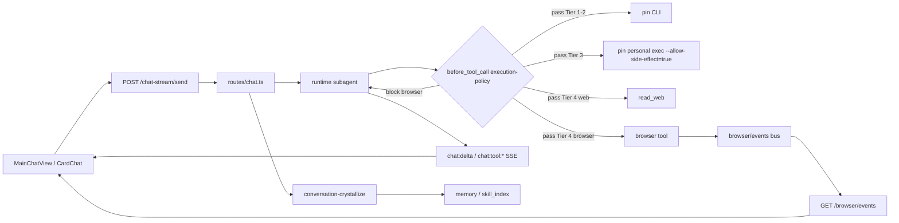
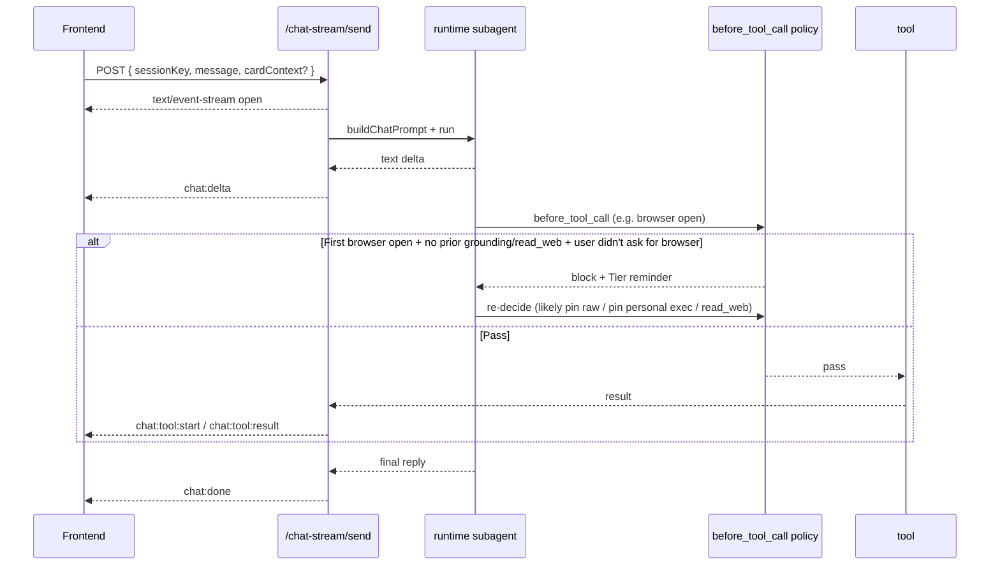

# Execution

## 结论

执行层是 chat-stream 单一链路:用户 → MainChatView / CardChat → `POST /chat-stream/send` → `routes/chat.ts` → runtime subagent → agent 自由调工具(pin CLI 全集 + `read_web` + browser)→ SSE 推 `chat:delta` / `chat:tool:*`。

agent 的工具决策由 **Tier 1-4 政策**收敛(优先级从上到下,Browser 是最后手段):

1. **Local read** — `pin raw / signals / memory / profile / cards / feedback / world`
2. **Composio read** — `pin personal exec --tool <READ_TOOL>`(slug 含 GET/FETCH/SEARCH/LIST/READ/QUERY/LOOKUP/RETRIEVE/FIND)
3. **Composio write** — 普通写必须 `--allow-side-effect=true`;高风险写先拒绝;`GMAIL_SEND_EMAIL` 永久走 draft 链路
4. **Last resort** — `read_web(url, intent)`(先 fetch,不够再自动升级 browser)/ `browser`(captcha / OAuth / 真交互)

收敛靠 `execution-policy.ts` 单一真源:chat prompt、`pin SKILL.md`、browser description、`pin personal exec` verb gate、`before_tool_call` browser 拦截都对齐同一套规则。browser 拦截现在下沉到 OpenClaw tool execution 前,被拦时 Browserbase session 不会创建。



## 边界

包含:

- `POST /chat-stream/send` / `POST /chat-stream/init` / `GET /chat-stream/history` 和 legacy `POST /chat` / `GET /chat/history`
- chat agent system prompt(`agents/chat.ts`):role + Tier 1-4 决策表 + 反例 + 副作用规则 + 输出风格,中间 `OPENCLAW_CACHE_BOUNDARY` 切稳定 prefix / 易变 suffix(`card_context` / learned skills)
- `pin SKILL.md` 标准获取顺序段(Tier 1-4 表 + 决策反例 + 各 Tier sample)
- `browser/tool.ts` description "LAST-RESORT TOOL" 段
- `execution-policy.ts` 单一真源(Tier / Composio verb 分类 / browser 规则 / prompt 文案)
- `execution-policy-runtime.ts` `before_tool_call` 硬拦截(browser open 前)
- 副作用 verb-based 门(`cli/personal.ts`,普通写 `--allow-side-effect=true`,高风险写拒绝)
- `read_web`(`browser/read-web-tool.ts`,先复用 `pin web fetch`,必要时升级 browser)
- `pin web fetch`(`cli/web.ts`,`read_web` 的安全 fetch 层和 CLI fallback)
- runtime subagent 调度、tool 调用 SSE 转发
- browser tool:session 生命周期、control mode、AI/user 抢占、读写动作分级
- 前端 chat runtime + tool 活动渲染 + CardChat 薄壳
- `conversation-crystallize`:把跨会话对话计数沉淀回 skill / memory

不包含:

- `card_executions` 状态机 / Tool Registry / 形式化 plan_steps —— 已删,见 [执行层 Plan 1](../plans/2026-05-01-execution-chat-driven)
- 卡片对话化 UI(card detail = chat thread / option chips / draft preview / browser embed) —— [执行层 Plan 2](../plans/2026-05-01-card-as-chat-ux)
- 卡片怎么生成 —— [Generation](./generation)
- `card_action:confirm/dismiss/modify` 反馈写入 —— [Feedback](./feedback)
- crystallize 写入 memory / skill 的 schema —— [Memory](./memory)
- `connector.sync` / `auto.dreaming` 等后台异步任务 —— [Background Tasks](./background-tasks)

## 核心链路



## 当前设计

### Tier 1-4 工具决策政策

| Tier | 工具前缀 | 何时用 | 何时不用 |
|---|---|---|---|
| **1 Local read** | `pin raw / signals / memory / profile / cards / feedback / world` | 任何"读用户已同步数据"。**优先级最高**。 | 数据 >12h 没同步 + latency 敏感 → Tier 2 |
| **2 Composio read** | `pin personal exec --tool <READ_TOOL>`(slug 含 GET/FETCH/SEARCH/LIST/READ/QUERY/LOOKUP/RETRIEVE/FIND) | Tier 1 没数据 / 太旧 / 用户要"现在" | Tier 1 已能满足时不重复拉 |
| **3 Composio write** | `pin personal exec --tool <WRITE_TOOL> --allow-side-effect=true`(普通写 slug 含 CREATE/UPDATE/SEND/POST/REPLY/DRAFT/SCHEDULE/PUBLISH/UPLOAD 等;**verb-based 跨 toolkit**) | 用户**明确**要求对外部系统写动作 | 用户没批准前不要直接 Tier 3;DELETE/REMOVE/CANCEL/TRANSFER/CHARGE/PAY/PURCHASE/ARCHIVE/MOVE/EXECUTE/RUN 暂时拒绝 |
| **4 Last resort** | `read_web(url, intent)`(先 fetch,不够自动 browser)/ `browser`(captcha / OAuth / 真交互) | 读 URL 或真没别的办法 | Tier 1-3 能做的,绝不 browser;不要跳过 `read_web` 直接 browser |

**决策提示来自 IntentCard.sources**:`sources` 字段格式 `<source_kind>:[<metadata>] '<quoted>'`。`buildChatPrompt` 把 source_kind 转成 firstMessage 末尾一句 routing hint(`Sources: gmail, memory. Start with the matching pin path...`),agent 第一调直接命中正确 pin path,不靠临场推断。

### 决策强制方式:单一真源 + tool execution 前硬拦截

| 位置 | 强制方式 | 文件 |
|---|---|---|
| `execution-policy.ts` | Tier 文案、Composio verb 分类、browser 规则的单一真源 | `pinai-openclaw/plugins/proactive-ai/execution-policy.ts` |
| `chat agent` system prompt | 从单一真源渲染 Tier 决策表 + 反例 + 副作用规则;`OPENCLAW_CACHE_BOUNDARY` 切稳定 prefix / 易变 suffix | `agents/chat.ts` |
| `pin SKILL.md` | 同步同一套 Tier / side-effect / read_web 规则 | `pinai-openclaw/image/skills/pin/SKILL.md` |
| `browser/tool.ts` description | 从单一真源复用 LAST-RESORT 文案 | `pinai-openclaw/plugins/proactive-ai/browser/tool.ts` |
| `execution-policy-runtime.ts` hook | **硬**`before_tool_call`:browser open + 本 run 无 grounding/read_web + 用户没说 browser → block,LLM 收到 blockReason 后重决策 | `pinai-openclaw/plugins/proactive-ai/execution-policy-runtime.ts` |

### 副作用闭环(verb-based)

| 维度 | 当前事实 |
|---|---|
| 门 | `cli/personal.ts` 调 `validateComposioExecTool`:Read 动词默认放行;普通 Write 动词必须 `--allow-side-effect=true`;高风险 Write 和未知动词在调用 Composio 前拒绝。 |
| Read 动词 | GET / FETCH / SEARCH / LIST / READ / QUERY / LOOKUP / RETRIEVE / FIND。 |
| 普通 Write 动词 | CREATE / UPDATE / SEND / POST / REPLY / DRAFT / SCHEDULE / PUBLISH / UPLOAD / ADD / INSERT / PATCH / SUBMIT / FORWARD / INVITE。 |
| 高风险 Write 动词 | DELETE / REMOVE / CANCEL / TRANSFER / CHARGE / PAY / PURCHASE / ARCHIVE / MOVE / EXECUTE / RUN。 |
| 范围 | **跨 toolkit 统一**:Gmail / Calendar / Slack / Notion / GitHub / Stripe / Linear / 等所有 Composio tool 都按 slug 动词分类,不再挑 toolkit。 |
| 黑名单 | `GMAIL_SEND_EMAIL` 永久拒绝 —— 走 `GMAIL_CREATE_EMAIL_DRAFT` → 用户 review → `GMAIL_SEND_DRAFT` 链路。 |
| 用户审批 | agent 在 chat 里把内容草稿展示 → 等用户回 OK → 再调发送 tool。一次 OK 覆盖一次写,不跨动作复用。 |

### Browser 执行前拦截

| 触发条件 | 行为 |
|---|---|
| `toolName === 'browser'` && `args.action === 'open'` && **本 run 没 prior Pin grounding / `read_web` 调用** && **用户最近一条消息不含 browser/网页/网站/browse/navigate/浏览/打开 url 关键词** && **没 prior browser open**(retry) | `before_tool_call` 返回 `block=true` + Tier reminder。OpenClaw 在真正 tool execution 前中断,所以 `BrowserbaseManager.createSession` 不会被调用。agent LLM 收到 blockReason 后重决策。 |
| `browser open <https-url>` 前没有 same-host `read_web` / `pin web fetch` | `before_tool_call` block,提示先 `read_web(url, intent)`。 |
| 上述任一不满足 | 正常进入 tool runtime,再通过 SSE 转发 `chat:tool:start` / `chat:tool:result`。 |

`routes/chat.ts` 在 subagent `runId` 创建后调用 `registerExecutionPolicyRunContext`,run 完成后 `clearExecutionPolicyRunContext`。prior tool calls 存在 `execution-policy-runtime.ts` 的 run 级 Map,不跨 run。第一次被 block 的 browser open 会被记录,同一 run 第二次 browser open 放行,避免无限拦截。

`shouldInterceptBrowserFirstCall` 现在只是保留给旧测试/调用方的纯函数 wrapper,真实拦截不在 SSE 层。

### `read_web`

`read_web(url, intent)` 是 agent 读网页的 Tier 4 入口。它内部先调 `fetchUrl`(`cli/web.ts`),继承 HTTPS-only、SSRF 防护、redirect 校验、content-type allowlist、body cap、timeout 等规则。fetch 结果够用时直接返回 `{ mode: "fetch", upgraded: false, text }`。

只有以下情况才升级 browser:

- fetch 报 401 / 403 / login / auth / forbidden / unauthorized。
- fetch 文本为空、太短,或看起来是 Loading / JS-only SPA shell。
- fetch 内容不足以回答用户问题。

升级时 `read_web` 创建 Browserbase session 并返回首个 accessibility snapshot,同时 `upgraded=true` 和 `upgradeReason` 说明为什么升级。agent 不再自己判断"先 fetch 还是先 browser"。

### Chat 路由

| Endpoint | 作用 |
|---|---|
| `POST /chat-stream/send` | 发消息,返回 SSE,推 `chat:delta` / `chat:tool:*` / `chat:done`。 |
| `POST /chat-stream/init` | 初始化或恢复 session,返回 sessionKey。 |
| `GET /chat-stream/history?sessionKey=...` | 历史消息,经 `chat-history-merge` 合成 Claude 风格 turn。 |
| `POST /chat` / `GET /chat/history` | Legacy 同步接口,留给 webhook / 程序化消费者。 |

### SSE 事件

| event | 含义 | 关键字段 |
|---|---|---|
| `chat:thinking` | agent 开始思考 | — |
| `chat:delta` | 文本增量 | `text` |
| `chat:tool:start` | 工具调用开始 | `toolCallId`, `name`, `argsPreview`, `pinCommand`, `meta` |
| `chat:tool:update` | 工具进度更新 | `toolCallId`, `meta` |
| `chat:tool:result` | 工具完成(或拦截 reminder) | `toolCallId`, `isError`, `meta` |
| `chat:reply` | 非流式 fallback 完整回复 | `text` |
| `chat:error` | agent / 系统错误 | `message` |
| `chat:done` | 流结束 | — |

### Chat agent prompt(cache boundary)

`agents/chat.ts` 构建:

**Stable prefix**(进 cache,任何 input 不污染):
- role(`You are the Chat agent...`)
- `outputLanguage` instruction
- Tier 1-4 决策表(`<tool_decision_policy>`)
- 反例(`<routing_examples>`,≥5 条)
- 副作用规则(`<side_effect_rules>`,verb-based / 黑名单 / 审批闭环)
- 输出风格(`<output_style>`)

`<!-- OPENCLAW_CACHE_BOUNDARY -->`

**Volatile suffix**(每次 invocation 不同):
- `<card_context>` JSON
- `learnedSkillsSection`(由 `conversation-crystallize/skill-injection.ts` 生成)

`agents/chat.test.ts` 硬测试:不同 card / 不同 learned skills / 有无 card 时 prefix 完全相等(防止 volatile 字段污染 prefix)。

`buildFirstMessage` 用 `card.sources` 的 source_kind 注入 Tier 1 路由 hint。

### Browser 路由(独立 SSE 通道)

| Endpoint | 作用 |
|---|---|
| `GET /browser/events?sessionKey=...` | session 生命周期 SSE,reconnect 时回放当前最新状态。 |
| `GET /browser/sessions` | 列出活跃 session。 |
| `POST /browser/sessions` | 主动创建 session。 |
| `DELETE /browser/sessions/:id` | 销毁 session。 |
| `POST /browser/sessions/:id/control` | 切换 control mode(`ai` / `user` / `idle`)。 |

Browser bus event 类型:`browser:opened`、`browser:navigated`、`browser:closed`、`browser:control`、`browser:takeover-requested`(captcha / 2FA 时)。

### Browser tool 行为

| 维度 | 当前事实 |
|---|---|
| 工具入口 | `browser/tool.ts` 注册单个 `browser` 工具,description 头部声明 LAST-RESORT TOOL,snapshot-first 工作流。 |
| 动作 | `open` / `snapshot` / `click` / `type` / `press_key` / `select` / `wait` / `scroll` / `navigate` / `go_back` / `go_forward` / `reload` / `get_text` / `upload_file` / `set_viewport` / `screenshot` / `request_takeover` / `new_tab` / `switch_tab` / `close_tab` / `list_tabs` / `handle_dialog` / `download` / `console` / `close`。 |
| 返回 | 每次动作返回新 a11y snapshot,带 ref(如 `e3`)给后续动作引用。 |
| Session 上限 | `BrowserbaseManager` 最多 5 个并发,空闲 5 分钟自动回收。 |
| Health check | 每 60s 探活,远端死掉立即销毁本地句柄。 |
| 读写分级 | `MUTATION_ACTIONS` 集合定义可写动作;`controlMode='user'` 时只允许只读动作(snapshot / get_text / screenshot)。 |

### Conversation crystallize

| 维度 | 当前事实 |
|---|---|
| 角色 | 跨 session 跟踪聊天 turn,达到阈值后跑子 agent,把对话沉淀成 profile memory 或 active skill。 |
| 入口 | `conversation-crystallize/service.ts`,触发由 `scheduler/auto-loop.ts` 1 分钟检测定时器或 debug panel `Run now` 拉。 |
| 跟踪范围 | sessionKey 前缀 `agent:main:proactive-ai:chat:*` / `chat-stream:*` / `chat:card:*`。 |
| 排除 | `chat-feedback:` / `crystallize:` / `dreaming:` 这些内部子 agent 自己的 session。 |
| 与 chat-feedback 区分 | crystallize 是长期沉淀(写 memory / skill);chat-feedback 是单卡偏置(只影响下一轮 generation)。两者都用 `normalizeCardChatMessages`,但下游不同。 |

## 开发入口

| 改动 | 先看 |
|---|---|
| chat HTTP / SSE | `pinai-openclaw/plugins/proactive-ai/routes/chat.ts` |
| Tier / Composio / browser policy 单一真源 | `pinai-openclaw/plugins/proactive-ai/execution-policy.ts` |
| tool execution 前硬拦截 | `pinai-openclaw/plugins/proactive-ai/execution-policy-runtime.ts` |
| chat agent prompt | `pinai-openclaw/plugins/proactive-ai/agents/chat.ts` |
| Tier 政策 SKILL doc | `pinai-openclaw/image/skills/pin/SKILL.md` 的"标准获取顺序"段 |
| 副作用 verb 门 | `pinai-openclaw/plugins/proactive-ai/cli/personal.ts` 调用的 `validateComposioExecTool` |
| `read_web` | `pinai-openclaw/plugins/proactive-ai/browser/read-web-tool.ts` |
| `pin web fetch` | `pinai-openclaw/plugins/proactive-ai/cli/web.ts` |
| 历史 turn 合并 | `pinai-openclaw/plugins/proactive-ai/routes/chat-history-merge.ts` |
| browser HTTP / SSE | `pinai-openclaw/plugins/proactive-ai/routes/browser.ts` |
| browser 工具定义 | `pinai-openclaw/plugins/proactive-ai/browser/tool.ts` |
| browser session 管理 | `pinai-openclaw/plugins/proactive-ai/browser/manager.ts` |
| browser 事件总线 | `pinai-openclaw/plugins/proactive-ai/browser/events.ts` |
| AI/user 控制权 | `pinai-openclaw/plugins/proactive-ai/browser/control-state.ts` |
| 对话沉淀 | `pinai-openclaw/plugins/proactive-ai/conversation-crystallize/service.ts` |
| skill 注入 prompt | `pinai-openclaw/plugins/proactive-ai/conversation-crystallize/skill-injection.ts` |
| 前端 chat runtime | `proactive-ai-frontend/src/components/chat/useProactiveChatRuntime.ts` |
| 流式 content builder | `proactive-ai-frontend/src/components/chat/tool-steps.ts` |
| 共享 chat 视图 | `proactive-ai-frontend/src/components/main-chat/MainChatView.tsx` |
| 工具活动行 | `proactive-ai-frontend/src/components/main-chat/ToolActivityCard.tsx` |
| CardChat 薄壳 | `proactive-ai-frontend/src/components/CardChat.tsx` |

## 验证方式

```bash
# Chat agent prompt + Tier policy + cache boundary
npx tsx --test pinai-openclaw/plugins/proactive-ai/agents/chat.test.ts

# execution policy 单一真源 + tool execution 前拦截
npx tsx --test pinai-openclaw/plugins/proactive-ai/execution-policy.test.ts
npx tsx --test pinai-openclaw/plugins/proactive-ai/execution-policy-runtime.test.ts

# route 兼容 wrapper
npx tsx --test pinai-openclaw/plugins/proactive-ai/routes/chat.test.ts

# 副作用 verb 门
npx tsx --test pinai-openclaw/plugins/proactive-ai/cli/v3-review-fixes.test.ts

# read_web fetch -> browser upgrade
npx tsx --test pinai-openclaw/plugins/proactive-ai/browser/read-web-tool.test.ts

# pin web fetch SSRF / 内容类型 / body cap
npx tsx --test pinai-openclaw/plugins/proactive-ai/cli/web.test.ts

# Browser + crystallize
npx tsx --test pinai-openclaw/plugins/proactive-ai/browser/control-state.test.ts
npx tsx --test pinai-openclaw/plugins/proactive-ai/browser/events.test.ts
npx tsx --test pinai-openclaw/plugins/proactive-ai/conversation-crystallize/service.test.ts

# 全栈 type-check
npm run type-check
cd proactive-ai-frontend && npm run type-check
```

手工验证 6 个代表性场景(进 user 容器):

1. **Tier 1**:卡"今日日程亮点" → 点开 → agent 应首调 `pin raw gcal today`,**无** `browser:opened`。
2. **Tier 2**:卡"今早有什么新邮件没看?"(Gmail >12h 没同步)→ agent `pin personal exec --tool GMAIL_FETCH_EMAILS ...`。
3. **Tier 3**:卡"建一个周三 3pm 跟 Sarah 的 1on1" → 先 `pin raw gcal week` 看冲突 → 在 chat 起草事件细节 → 等用户 OK → `pin personal exec --tool GOOGLECALENDAR_CREATE_EVENT --allow-side-effect=true ...`。
4. **Tier 4 web**:卡"读一下 Regan 在 Slack 分享的 Forbes 文章" → `pin raw slack list` 找 URL → `read_web(url, intent)` → 总结。fetch 够用时**无** `browser:opened`。
5. **硬拦截**:卡"去 Gmail 网页看 Sarah 的邮件" → agent 第一调 `browser open https://mail.google.com` → 应在 `before_tool_call` 被 block,`BrowserbaseManager.createSession` 不被调用 → agent 重决策走 `pin raw gmail recent` / `pin personal exec` / `read_web`。
6. **副作用闭环**:Tier 3 调用前,agent 必须先在 chat 起草内容,等用户回 OK 才 exec。手工验证 agent 没有"未经确认直接发"。

容器日志:

```bash
docker ps --format '{{.Names}}' | grep -E '^proactive-|^assistant-'
docker logs <容器名> 2>&1 | grep -E 'chat-stream|tool-start|tool-result|run-complete|browser:|execution-policy|before_tool_call' | tail -60
```

## 踩坑

- **chat agent prompt 的 cache boundary 必须严格切在 stable prefix / volatile suffix 之间**。改 prompt 时不要把 `card_context` / `learnedSkillsSection` / `firstMessage` 内容混进 prefix(`agents/chat.test.ts` 硬测试会 fail)。
- **`pin SKILL.md` 同时被 unified-generator 用**。改"标准获取顺序"段对 generation 也有效。Tier 表对 generation 也是有用的提示;副作用边界段不要为 chat 改坏 generation。
- **Tier / Composio / browser policy 只能改 `execution-policy.ts`**。prompt、SKILL、browser description、CLI gate、hook 测试都应从这里对齐,避免漂移。
- **browser 拦截必须在 tool execution 前**。只在 SSE 层 fake 一个 `chat:tool:result` 不够,那样 Browserbase session 可能已经创建。当前真源是 `execution-policy-runtime.ts` 的 `before_tool_call` hook。
- **`card_executions` SQLite 表已不存在**(Plan 1 上线时表定义被删,新启容器 `ensureSchema()` 不再 CREATE)。老用户容器可能有遗留行,无人访问 = 等价于不存在,也不会主动 DROP(审计痕迹)。
- **`pin web fetch` SSRF defense 在 CLI 层做**。`read_web` 复用这条路径,不要在 chat agent 里再加一层防御。
- **chat SSE 单条 `/chat-stream/send` 默认 10 分钟超时**;客户端早断流后 agent 仍在后台跑,但 tool 事件帧丢失。
- **重连 `/browser/events` 时**,如果当前没有活跃 session,server 主动推一条 `browser:closed`,避免前端用过期 session id 调 `/input` 打死接口。
- **AI/user control 切换只对写动作生效**。`snapshot` / `get_text` / `screenshot` 在用户接管期间也会被 agent 调用 —— 设计就是让 AI 保留情境感知。
- **card context 解析失败回退到 `rawCardContext` 字符串模式**,prompt 还能跑,但结构化字段(`primaryAction` / `sources` 等)不可用 —— 包括 firstMessage 的 source_kind hint 不会注入。
- **crystallize 跟 chat-feedback 都消费同一份 transcript 但下游分流**;改 transcript 归一化(`normalizeCardChatMessages`)要同时跑两套测试。

## 相关模块

- [Generation](./generation):上游 — IntentCard 从这里出,本模块通过 `cardContext` 接入。
- [Feedback](./feedback):兄弟 — `card_action` 和 `intent_card_state` 走 feedback 路径,不进 chat SSE。
- [Memory](./memory):下游 — crystallize 沉淀的 memory / skill 在这里读。
- [Background Tasks](./background-tasks):兄弟 — `connector.init` / `connector.sync` / `auto.dreaming` handler 跑在 `background_tasks` 队列上,跟 chat 链路完全分离。

## 相关 AI Plans

- [执行层 Plan 1:chat-driven 执行 + Tier 工具政策](../plans/2026-05-01-execution-chat-driven) — 本模块当前形态的设计依据。
- [执行层 Plan 1 实施计划](../plans/2026-05-02-execution-chat-driven-impl) — 1-A → 1-E 五步骤的 file-level 拆分。
- [执行层 Plan 2:Card-as-Chat UX 深化](../plans/2026-05-01-card-as-chat-ux) — Plan 1 上线后开,UI 层把 card detail 统一成 thread 视图。
