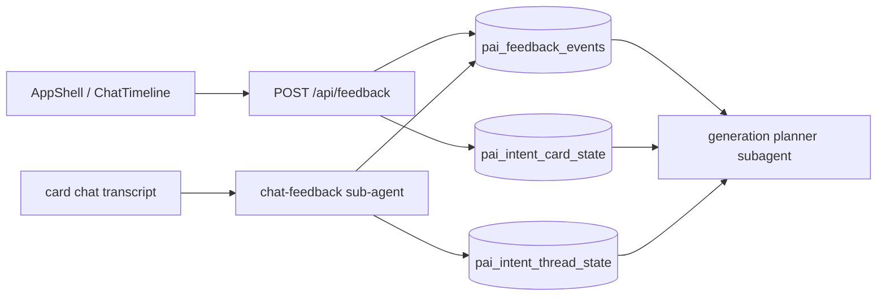
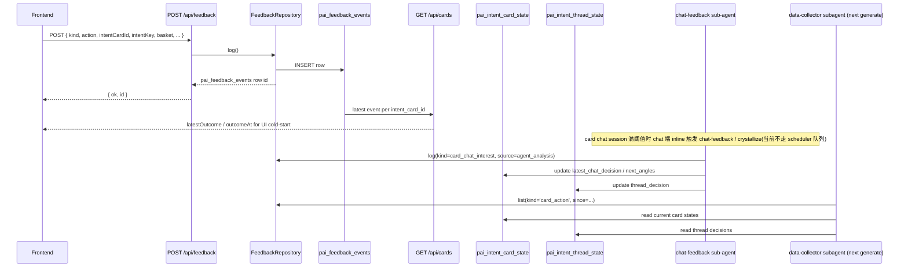

# Feedback

## 结论

Feedback 模块把用户对卡片和卡片聊天的反应转成下一轮生成可用的偏置信号。两类输入:

- **用户直接操作**:confirm / modify / dismiss / snooze / complete / text feedback。前端 `POST /api/feedback` 写 `pai_feedback_events`；`/api/cards` 会带回每张卡从 feedback 事件推导出的 `latestOutcome` / `outcomeAt`，用于 iOS/web 冷启动恢复 sphere 和 drawer 状态。
- **agent 分析**:card chat session 满阈值后,sub-agent 汇总成 `card_chat_interest` 类型 feedback,`source='agent_analysis'`,跟 `pai_intent_card_state.latest_chat_decision` / `pai_intent_thread_state` 联动。

下一轮 generation 跑 `data-collector` subagent 时通过 `feedback_list` 工具拉最近反馈,planner subagent 按反馈做 dedupe + cold-basket 抑制。



## 边界

包含:

- `POST /api/feedback` + `GET /api/feedback` + `GET /api/feedback/dismissed`。
- `pai_feedback_events` 表 schema 与写入语义。
- `pai_intent_card_state`(单卡 outcome / chat decision / next angles)。
- `pai_intent_thread_state`(同 intent 跨卡片状态、`thread_decision` ∈ advance / refine / hold / suppress)。
- `pai_card_evaluations`(generation 自评,不是用户反馈,但跟 feedback 一起解释卡片质量)。
- card chat 沉淀触发的 `agent_analysis` 反馈。
- 前端 confirm / dismiss / modify UI 与 polling。

不包含:

- 卡片怎么生成,看 [Generation](./generation)。
- crystallize 写长期 memory / skill,看 [Memory](./memory)。
- chat-stream SSE / 卡内对话执行,看 [Execution](./execution)。
- 容器 / 部署,看 [Runtime & Deployment](./runtime-deployment)。

## 表结构

`pai_feedback_events`(migration `011_pai_memory_signals.sql`):

| 列 | 含义 |
|---|---|
| `user_id`、`id` | 复合 PK。 |
| `kind` | 反馈类型,如 `card_action`、`card_chat_interest`、`text_feedback`。 |
| `action` | `confirm` / `modify` / `dismiss` / `snooze`(`card_action` 用),`agent_analysis` 类可能为 `interest_up` / `interest_down` 等。 |
| `push_id`、`intent_card_id`、`intent_key`、`basket` | 反向定位被反馈的卡。 |
| `source` | `user_direct` / `agent_analysis` 区分用户直接 vs sub-agent 汇总。 |
| `value` | 数值偏置(可选)。 |
| `text` | 文本反馈正文。 |
| `metadata` | JSONB,前端可塞渠道、tab 之类的扩展位。 |
| `conversation_id`、`message_id`、`channel` | 链回 chat session(`source='agent_analysis'` 必填)。 |
| `created_at` | 写入时间。 |

`pai_intent_card_state`(migration `014_pai_pipeline.sql`):

| 列 | 含义 |
|---|---|
| `(user_id, card_id)` | PK。 |
| `intent_key`、`goal_basket` | 卡所属 intent / basket。 |
| `latest_outcome` | `confirm` / `modify` / `dismiss` / `snooze` / `none`。 |
| `outcome_at` | 上次 outcome 时间。 |
| `has_deep_chat`、`latest_chat_decision`、`latest_chat_summary`、`next_angles JSONB` | card-chat 沉淀产物。 |
| `updated_at` | bookkeeping。 |

`pai_intent_thread_state`(同 migration):

| 列 | 含义 |
|---|---|
| `(user_id, intent_key)` | PK。 |
| `goal_basket`、`latest_card_id`、`latest_generated_at`、`latest_card_outcome` | 当前 intent 的最近代表卡片状态。 |
| `has_any_confirmed_card`、`has_any_dismissed_card` | 跨卡片累计信号。 |
| `latest_chat_decision`、`latest_chat_summary`、`next_angles JSONB` | 最近一次 chat 沉淀。 |
| `thread_decision` | `advance` / `refine` / `hold` / `suppress`,给 planner 看的明确建议。 |
| `updated_at` | bookkeeping。 |

`pai_card_evaluations`(同 migration)是 generation 自评(详见 [Generation](./generation)),`pass / overall / dim_*` 五维评分,跟用户反馈联合解释卡片质量。

## 用户操作映射

| 输入 | 写入 |
|---|---|
| `card_action: confirm` | `pai_feedback_events`(`kind=card_action`,`action=confirm`),`/api/cards.latestOutcome=confirm` |
| `card_action: modify` | 同上,`latestOutcome=modify` |
| `dismiss` | `pai_feedback_events`(`kind=dismiss`),`/api/cards.latestOutcome=dismiss` |
| `snooze` | `pai_feedback_events`(`kind=snooze`),`/api/cards.latestOutcome=snooze` |
| `card_action: complete` | `pai_feedback_events`(`kind=card_action`,`action=complete`),`/api/cards.latestOutcome=complete` |
| 自由文本反馈 | `kind=text_feedback`,`text` 写正文 |
| card chat summary(sub-agent)| `kind=card_chat_interest`,`source=agent_analysis`,同步更新 `pai_intent_card_state.latest_chat_decision` + `pai_intent_thread_state` |

## 核心链路



## 当前设计

| 维度 | 当前事实 |
|---|---|
| 路由 | `pinai-agents/src/pinai_agents/web/routes/ui/feedback.py`:`POST /api/feedback`、`GET /api/feedback`(可按 kind / action / since 查)、`GET /api/feedback/dismissed`、`GET /api/feedback/completed`。`/api/cards` 也会随卡片返回 `latestOutcome` / `outcomeAt`,这是 cold-start 时 sphere/drawer 的优先状态来源。 |
| 鉴权 | Supabase JWT(`current_user`)。 |
| Repository | `web/db/repositories/feedback.py:FeedbackRepository.log()` 写 `pai_feedback_events`;当前 UI 卡片 outcome 冷启动恢复由 `web/routes/ui/runs_and_cards.py:/api/cards` 从最新 feedback 事件推导。 |
| Agent 路由 | `web/routes/agent/feedback.py` 暴露 `list` / `log`,给 chat 端 native tool `feedback_list` / `feedback_log` 用。`source='agent_analysis'` 走这条。 |
| chat-feedback 触发 | 当前由 chat 进程**内联**触发(scheduler 的 `crystallize` kind 路由已就位但未接 enqueue producer),`chat/agents/crystallize.py` 处理 transcript;失败只 warn,不阻断 generation。crystallize 写 memory / skill **跟** chat-feedback 写 feedback events 是两条不同链路,但都用同一份 `normalizeCardChatMessages`。 |
| Generation 使用 | `chat/agents/generator.py:_DATA_COLLECTOR_PROMPT` 让 data-collector 调 `feedback_list` 拉最近 feedback,写进 `/state/phase1.json`;planner 据此 dedupe(`skipped_duplicates`)+ cold-basket 抑制(`cold_baskets`)。 |
| `metadata` | 字符串 / object 都接,字符串会尝试 JSON.parse;前端约定传 object。 |
| `intentKey` / `basket` fallback | route 在缺失时按 `intentCardId` 查最近 generation 卡补齐(避免前端老版本 schema 漏字段)。 |
| Reward ledger 分界 | 用户打开卡片时,`AppShell` 额外写 `pai_card_reward_events(source='user', event_type='card_open', score=1)` 到 `/api/reward-dashboard/cards/{card_id}/score`。confirm / dismiss / snooze / text feedback 仍写 `pai_feedback_events`;不要把所有 feedback 复制进 reward ledger。 |

## 开发入口

| 改动 | 先看 |
|---|---|
| Feedback UI 路由 | `pinai-agents/src/pinai_agents/web/routes/ui/feedback.py` |
| Feedback agent 路由 | `pinai-agents/src/pinai_agents/web/routes/agent/feedback.py` |
| Repository / SQL | `pinai-agents/src/pinai_agents/web/db/repositories/feedback.py` |
| Schema | `pinai-agents/db/migrations/011_pai_memory_signals.sql`(feedback_events)、`014_pai_pipeline.sql`(intent_card_state、intent_thread_state、card_evaluations) |
| chat-feedback / crystallize agent | `pinai-agents/src/pinai_agents/chat/agents/crystallize.py` |
| Generation 端使用 | `pinai-agents/src/pinai_agents/chat/agents/generator.py` 里 `_DATA_COLLECTOR_PROMPT` 调 `feedback_list`,`_PLANNER_PROMPT` 用 skipped_duplicates / cold_baskets 字段 |
| native `feedback_*` 工具 | `pinai-agents/src/pinai_agents/chat/tools/native/feedback.py` |
| 前端卡片操作 UI | `proactive-ai-frontend/src/components/AppShell.tsx`、`NowFeed.tsx`、`CardDetailBody.tsx` |
| 前端 chat 反馈 UI | `proactive-ai-frontend/src/components/ChatTimeline.tsx` |

## 验证方式

```bash
# Repository + route
cd pinai-agents && uv run pytest tests/web/db/repositories/test_feedback_repo.py
cd pinai-agents && uv run pytest tests/web/routes/                          # 全 route 套件

# chat-feedback / crystallize(若存在专项测试)
cd pinai-agents && uv run pytest tests/chat/agents/                         # 含 crystallize

# 类型 + 前端
cd pinai-agents && uv run ruff check .
cd proactive-ai-frontend && npm run type-check
cd proactive-ai-frontend && npm test
```

手工验证:

- 对一张卡 dismiss → `GET /api/feedback/dismissed` 返回该 `intentCardId`,前端 NowFeed 该卡不再出现。
- 对一张卡 Done / complete → `/api/cards` 该卡条目应返回 `latestOutcome='complete'`,前端冷启动后 sphere 不应再显示该卡;如果仍打开 drawer,底部只显示灰色 `Close`。
- card chat 跑过阈值后,下次 generate 前应该看到 `data-collector` 在 trace 里调 `feedback_list`;planner 输出的 `PlanOutput.skipped_duplicates` / `cold_baskets` 应该体现新反馈。失败只 warn(不阻断 generation)。
- 下一轮 `pai_pipeline_runs.iterations` JSON 里(audit dump)应能看到 feedback summary 段。

容器日志:

```bash
make logs-pinai-web | grep -E "/api/feedback|FeedbackRepository"
make logs-pinai-chat | grep -E "feedback_list|crystallize"
```

DB 速查:

```sql
SELECT kind, action, source, count(*)
FROM pai_feedback_events WHERE user_id = $1 GROUP BY kind, action, source;

SELECT card_id, intent_key, latest_outcome, latest_chat_decision
FROM pai_intent_card_state WHERE user_id = $1 ORDER BY updated_at DESC LIMIT 20;

SELECT intent_key, thread_decision, has_any_confirmed_card, has_any_dismissed_card
FROM pai_intent_thread_state WHERE user_id = $1 ORDER BY updated_at DESC LIMIT 10;
```

## 踩坑

- `metadata` 前端最好传 object,字符串会走 JSON.parse 容错路径,失败时存 raw 文本,不影响 log 但影响下游解析。
- `intentKey` / `basket` 缺失时 route 会按 `intentCardId` 查最近卡补齐;**不要**靠这个兜底,前端应该总是传齐。
- chat-feedback / crystallize sub-agent 失败时 generation 不会重试,只 warn — 这是有意设计避免拖死主路径。但失败堆积久了反馈学习会断,需要看日志主动排查。
- `pai_card_evaluations` 是 generator 自评,不要跟 user feedback 混。两者一起读才解释得清卡片质量。
- `source='agent_analysis'` 的反馈不等同用户直接表达,planner prompt 里要区分对待(用户 dismiss 是强信号,agent 推断的 interest_down 是弱信号)。
- `pai_intent_thread_state.thread_decision` 是给 planner 看的明确建议;前端不展示。改算法时不要把它当 UI 字段。
- `next_angles JSONB` 是数组,代表"这条 intent 还可以从哪些角度切",由 chat-feedback / crystallize 写入;planner 读取做后续卡片生成的角度替换。
- chat-feedback 和 conversation-crystallize 都消费同一份 transcript 归一化(`normalizeCardChatMessages`),改 normalization 时要同时跑两套测试,否则一端走偏。
- `pai_feedback_events.id` 不要在 web 侧手写,repository 用 `uuid4()` 生成;前端传的"id"字段应该是 push_id / message_id 等业务 id,不是行 PK。

## 相关模块

- [Generation](./generation):feedback summary 和 intent state 怎么进 planner 输入。
- [Execution](./execution):card chat transcript 由执行层产出,chat-feedback / crystallize 都消费它(下游不同)。
- [Memory](./memory):长期沉淀走 crystallize(memory / skill),feedback 只影响短期生成偏置。
- [Background Tasks](./background-tasks):scheduler 的 `crystallize` kind 路由已注册但当前没有 producer;chat-feedback / crystallize 走 chat 进程内联触发。
- [Internal Reward Dashboard](./internal-reward-dashboard):reward ledger 和用户 feedback 的分界,以及内部 reviewer score/casebook。

## 相关 AI Plans

- [Card Reward Infra + Internal Dashboard](../plans/2026-05-13-card-reward-infra):用户 open reward、reviewer score、casebook 和 trace artifact。
