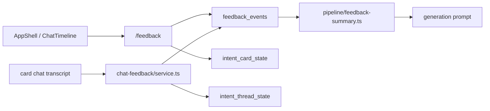
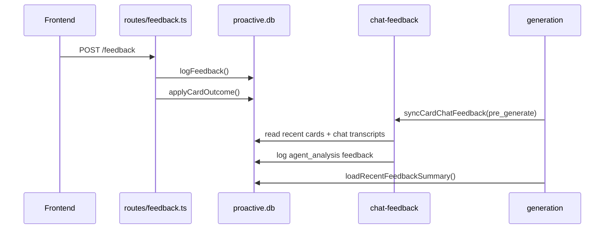

# Feedback

## 结论

Feedback 模块负责把用户对卡片和卡片聊天的反应转成下一轮生成可用的偏置信号。当前有两类输入：

- 用户直接操作：confirm、modify、dismiss、snooze、text feedback。
- agent 分析：card chat session 达到阈值后，汇总成 `card_chat_interest` 类型的 feedback。



## 边界

包含：

- `/feedback` 和 `/feedback/dismissed`。
- `feedback_events` 写入。
- card action 到 `intent_card_state` 的 outcome。
- card chat transcript 总结和 `intent_thread_state` 更新。
- feedback summary 进入 generation prompt。

不包含：

- 卡片怎么生成，看 [Generation](./generation)。
- memory/profile/skill 的长期沉淀，看 [Memory](./memory)。
- 前端容器连接和 proxy，看 [Runtime & Deployment](./runtime-deployment)。

## 当前设计

| 数据 | 作用 |
|---|---|
| `feedback_events` | 原始反馈事件。 |
| `intent_card_state` | 单张卡片当前 outcome、chat decision、next angles。 |
| `intent_thread_state` | 同一 intent 的跨卡片状态，用于下一轮生成判断。 |
| `card_evaluations` | generation 自评，不是用户反馈，但会和 feedback 一起解释卡片质量。 |

用户操作映射：

| 输入 | 结果 |
|---|---|
| `card_action:confirm` | `intent_card_state.latest_outcome = confirm` |
| `card_action:modify` | `latest_outcome = modify` |
| `dismiss` | `latest_outcome = dismiss` |
| `snooze` | `latest_outcome = snooze` |
| card chat summary | 写 `text_feedback`，source 为 `agent_analysis`，并更新 chat decision |

## 核心链路



## 开发入口

| 改动 | 先看 |
|---|---|
| feedback route | `pinai-openclaw/plugins/proactive-ai/routes/feedback.ts` |
| feedback DB helpers | `pinai-openclaw/plugins/proactive-ai/db.ts` |
| card chat 分析 | `pinai-openclaw/plugins/proactive-ai/chat-feedback/service.ts` |
| generation 读取反馈 | `pinai-openclaw/plugins/proactive-ai/pipeline/feedback-summary.ts` |
| 前端卡片操作 | `proactive-ai-frontend/src/components/AppShell.tsx` |
| 前端聊天反馈 | `proactive-ai-frontend/src/components/ChatTimeline.tsx` |

## 验证方式

```bash
npx tsx --test pinai-openclaw/plugins/proactive-ai/chat-feedback/service.test.ts
npx tsx --test pinai-openclaw/plugins/proactive-ai/pipeline/feedback-summary.test.ts
npx tsx --test pinai-openclaw/plugins/proactive-ai/db.intent-state.test.ts
npx tsx --test pinai-openclaw/plugins/proactive-ai/routes/chat.tool-events.test.ts
npm run type-check
```

手工验证：

- 对一张卡点击 dismiss，`GET /feedback/dismissed` 应返回该 `intentCardId`。
- 对一张卡 confirm/modify 后，`intent_card_state` 应记录对应 outcome。
- 卡片聊天超过阈值后，下次 generate 前会尝试同步 chat feedback；失败只 warn。
- 下一轮 generation prompt 应包含 recent feedback summary。

## 踩坑

- `metadata` 如果是字符串，route 会尝试 JSON.parse；前端应优先传 object。
- `intentKey` / `basket` 缺失时，route 会尝试根据 `intentCardId` 查最近生成卡补齐。
- chat feedback 有阈值：消息数、用户 turn 数、用户文本长度都太低时不会总结。
- `agent_analysis` 是派生反馈，不等同用户直接表达。

## 相关模块

- [Generation](./generation)：feedback summary 和 intent state 进入下一轮 generation prompt。
- [Execution](./execution)：card chat transcript 由执行层产出，再被 chat-feedback 总结成 `agent_analysis` 反馈。
- [Memory](./memory)：长期沉淀走 conversation-crystallize 而非 feedback；两者用同一份归一化 transcript。

## 相关 AI Plans

- [Memory Architecture](../plans/memory-architecture)：intent state、feedback summary 与长期 memory 回流的设计背景。
