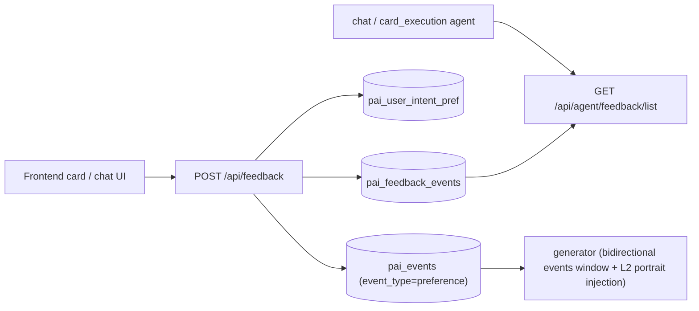
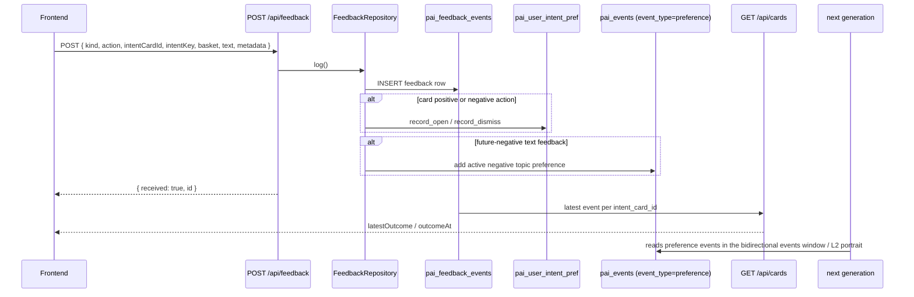

# Feedback

## Summary

Feedback currently takes effect in three layers:

- **Event layer**: every user action is first written to `pai_feedback_events`, which is used for auditing, cold-start recovery of `/api/cards.latestOutcome`, and reads by the `feedback_list` tool of the chat / card_execution agents.
- **Fingerprint layer**: card-level positive/negative actions fan out synchronously to `pai_user_intent_pref`, so the preference weight of the same intent / basket can change gradually.
- **Immediate preference layer**: when the user explicitly says "don't show / show fewer of this kind of card from now on", besides writing a feedback event, an active `event_type=preference` row is also written to `pai_events` (after the lifelong-memory sunset the `pai_preference_records` table was retired and preferences went back to the L1 event stream); the next generator round sees it in the bidirectional events window / L2 portrait and avoids it as a high-weight constraint.



## Boundaries

Includes:

- `POST /api/feedback`, `GET /api/feedback`, `GET /api/feedback/dismissed`, `GET /api/feedback/completed`.
- Write semantics of `pai_feedback_events` and how `latestOutcome` is derived.
- Positive/negative fingerprint fan-out from card actions to `pai_user_intent_pref`.
- Immediate preference writes from future-negative text feedback to `event_type=preference` events (`pai_events`).
- Writes from main chat assistant thumbs up / down to the unified feedback event.
- The agent-side `feedback_list` tool surface; how preferences enter generation through the events window / L2 portrait.

Excludes:

- How cards are generated: see [Generation](./generation).
- How the long-term portrait (L2) / skills are built up: see [Memory](./memory).
- conversation SSE / in-card conversation execution: see [Execution](./execution).
- Manual scoring, casebook, and trace artifacts of the reward dashboard: see [Internal Reward Dashboard](./internal-reward-dashboard).
- Product development suggestions such as user requests to "add a button / change the UI / add a feature / change a product flow": see "Development Suggestion Boundary" below.

## Table Schemas

`pai_feedback_events` (migration `011_pai_memory_signals.sql`):

| Column | Meaning |
|---|---|
| `user_id`, `id` | Composite PK; the repository generates `fb_...` ids and does not accept a row id passed in by the frontend. |
| `kind` | Feedback type, e.g. `card_action`, `text_feedback`, `chat_message_feedback`; for compatibility, old frontends may pass `dismiss` / `snooze` directly as the kind. |
| `action` | `confirm` / `modify` / `dismiss` / `snooze` / `complete` / `thumbs_up` / `thumbs_down`, etc. |
| `push_id`, `intent_card_id`, `intent_key`, `basket` | Locate the card and intent that received the feedback. |
| `source` | Direct user writes default to `user_direct`; the agent route defaults to `agent`; text preference writes accept `user` / `user_direct`. |
| `value`, `text` | Numeric feedback and the body of free-text feedback. |
| `metadata` | JSONB; the repository accepts an object or a JSON string; an invalid string is stored as `{ raw }`. |
| `conversation_id`, `message_id`, `channel` | Link back to the chat / message, e.g. main chat thumbs write `message_id` + `channel='main_chat'`. |
| `created_at` | Write time. |

`pai_user_intent_pref` (migration `043_pai_card_patterns.sql`):

| Column | Meaning |
|---|---|
| `(user_id, intent, basket)` | Per-user intent / basket fingerprint. |
| `ctr_7d`, `ctr_30d` | Simplified preference strength; positive feedback raises it, negative feedback lowers it. |
| `last_open_at`, `last_dismiss_at` | Time of the most recent positive/negative action. |

**Preference events** (`pai_events` rows with `event_type='preference'`; the `pai_preference_records` table was DROPped in `114_drop_legacy_memory.sql`, and the historical migrations `056_pai_preference_records.sql` + `057_pai_preference_lifetime.sql` are kept as a record). Preference fields are stored directly on the `pai_events` row itself + the `structured` JSONB:

| Field | Stored in | Meaning |
|---|---|---|
| `statement` | `pai_events.title` | A generation preference or prohibition explicitly stated by the user. |
| `scope` | `structured.scope` | `topic` / `source` / `timing` / `format` / `global`. |
| `polarity` | `structured.polarity` | `positive` / `negative`. |
| `durability`, `expires_at` | `structured.{durability,expires_at}` | `temporary` has an expiry time; `persistent` stays valid long-term (`list(active)` hides expired rows). |
| `weight`, `confidence` | `structured.{weight,confidence}` + `pai_events.importance` | Explicit user statements default to high weight. |
| `source`, `status` | `pai_events.source` (feedback-domain writes = `pinai_feedback`, the actor is server-stamped into `structured` via the JWT) + supersede chain (`superseded_by_id IS NULL` = current version) | Source and current/superseded status. |

`pai_intent_card_state` / `pai_intent_thread_state` were deleted by migration `051_drop_intent_state_tables.sql`. The current card outcome is derived from `pai_feedback_events`; a separate intent state table is no longer maintained.

## User Action Mapping

| Input | Writes | Immediate effect |
|---|---|---|
| `card_action: confirm` | `pai_feedback_events` + positive fan-out to `pai_user_intent_pref` | `/api/cards.latestOutcome=confirm`; the weight of the same intent / basket goes up. |
| `card_action: complete` | `pai_feedback_events` + positive fan-out to `pai_user_intent_pref` | `/api/cards.latestOutcome=complete`; after a refresh, the completed card does not return to the sphere. |
| `card_action: dismiss` or `kind=dismiss` | `pai_feedback_events` + negative fan-out to `pai_user_intent_pref` | `/api/feedback/dismissed` returns the card; the weight of the same intent / basket goes down. |
| `card_action: snooze` or `kind=snooze` | Same as dismiss | `/api/feedback/dismissed` returns the card; the next batch treats it as a short-term cold signal. |
| `card_action: modify` | `pai_feedback_events` | `/api/cards.latestOutcome=modify`; the fingerprint is not updated. |
| `text_feedback` | `pai_feedback_events` | `feedback_list` can read the original text. |
| future-negative `text_feedback` | `pai_feedback_events` + active `event_type=preference` event (`pai_events`) | The preference event enters L1 (fixed `scope=topic` / `polarity=negative` / `durability=persistent`, idempotent by `dedupe_key=pref:<fid>`); the generator sees it through the bidirectional events window / L2 portrait and avoids it as a high-weight constraint. |
| main chat thumbs up/down | `pai_feedback_events(kind=chat_message_feedback, action=thumbs_up/thumbs_down)` | Goes into the unified feedback log; currently does not update the card fingerprint. |

Deterministic future-negative detection only covers explicit statements that rule something out for the future, e.g. `stop showing`, `do not show`, `don't show`, `no more`, `less of`, plus six Chinese phrases meaning "don't ... again" (two variants), "no need to ... again", "push fewer", "block", and "stop" (exact list: `_FUTURE_NEGATIVE_TEXT_RE` in `domains/feedback/repository.py`). This is a small, conservative rule: first make sure the case where "the user explicitly says no" really takes effect, and avoid misrecording ordinary complaints as long-term preferences.

## Development Suggestion Boundary

When the user raises requests for product features, UI, or flow improvements in Main Chat, nothing is written to `pai_feedback_events` / preference events; they go to the separate `pai_development_feedback` instead.

Examples:

- "Can you add an export button?"
- "This page is too hard to tap on a phone."
- "I'd like a setting to turn this feature off."

These requests are triage data for the product team, not personalization signals about the user. The only write path is the agent's `development_feedback_log` tool (`POST /api/agent/development-feedback/log`) — the agent-engine layer has no keyword fast path, and ordinary chat messages always reach the agent unchanged (a test locks this in). The acknowledgment must be honest: the request has been recorded for the team to evaluate; it must not pretend the change is already implemented.

## Core Flow



## Current Design

| Aspect | Current facts |
|---|---|
| UI routes | `backend/services/api/src/pinai_api/domains/feedback/ui.py` exposes `POST /api/feedback`, `GET /api/feedback`, `GET /api/feedback/dismissed`, `GET /api/feedback/completed`. |
| Auth | Supabase JWT (`current_user`) + `user_scoped_tx`. |
| Repository | `FeedbackRepository.log()` writes `pai_feedback_events` first, then decides based on the input type whether to fan out to fingerprint / preference. |
| `/api/cards` | The runs/cards UI routes of the generation domain derive each card's `latestOutcome` / `outcomeAt` from the latest feedback event; they do not depend on intent state tables. |
| Agent feedback | `GET /api/agent/feedback/list` is read by the `feedback_list` native tool; `POST /api/agent/feedback/log` keeps agent-originated feedback writes, defaulting to `source='agent'`. |
| Preference writes | Regular chat agents go through `event_append` (`event_type=preference` + `structured{polarity,weight,scope,expires}`; the separate preferences route was deleted with Block2); future-negative card text feedback appends a `source='pinai_feedback'` preference event directly inside the feedback repository (stamped with `curated_at` on write). evolve also distills repeated dismisses into standing preference events. |
| Generation usage | The generator (`agent_engine/agents/generator.py`) **does not pull** the feedback / preference list directly — it only has the events_search / event_source / tavily / submit_card tools; preferences take effect through L1 preference events (the deterministic events log window) + L2 portrait injection. `feedback_list` is a tool of the chat / card_execution agents. |
| Development suggestions | `pai_development_feedback` records product/UI/feature requests separately; the only writer is the agent's `development_feedback_log` tool; generation does not read this table. |
| `metadata` | Accepts both object and JSON string; an invalid string is stored as `{ raw: <original text> }` so the feedback write is not interrupted. |
| `intentKey` / `basket` | The route does not fill them in; the frontend should pass them as completely as possible. When fields are missing the event is still written, but the fingerprint can only update the intent / basket dimensions that are present. |
| Reward ledger boundary | User card opens still go through reward dashboard score events; confirm / dismiss / snooze / complete / text feedback are not copied into the reward ledger. |

## Development Entry Points

| Change | Look at first |
|---|---|
| Feedback UI route | `backend/services/api/src/pinai_api/domains/feedback/ui.py` |
| Agent feedback route | `backend/services/api/src/pinai_api/domains/feedback/agent.py` |
| Repository / SQL | `backend/services/api/src/pinai_api/domains/feedback/repository.py` |
| Preference writes | `backend/services/api/src/pinai_api/domains/feedback/repository.py` (future-negative appends a preference event); the chat agent goes through `event_append` (`domains/memory/events/agent.py`). The separate preference repo / route was deleted with the lifelong-memory sunset |
| Fingerprint repository | `backend/libs/db/src/pinai_db/repositories/user_fingerprint.py` |
| Card latestOutcome derivation | `backend/services/api/src/pinai_api/domains/generation/runs_and_cards.py` |
| Schema | `011_pai_memory_signals.sql`, `043_pai_card_patterns.sql`, `056_pai_preference_records.sql`, `057_pai_preference_lifetime.sql`, `051_drop_intent_state_tables.sql`, `114_drop_legacy_memory.sql` (DROPs `pai_preference_records`, preferences go back to `pai_events`), `111_pai_events.sql` |
| Generation-side usage | `backend/services/agent-engine/src/agent_engine/agents/generator.py` |
| Native feedback tool | `backend/services/agent-engine/src/agent_engine/tools/direct/feedback.py` |
| Native preference tool | `backend/services/agent-engine/src/agent_engine/tools/direct/preferences.py` (now only the `set_generation_language` output-language switch; content preferences go through `tools/direct/events.py:event_append`, which writes `event_type=preference` events; the old `profile.py` portrait tool is retired, and the portrait goes through `tools/direct/user_strings.py:memory_edit`) |
| Frontend card feedback UI | `apps/web/src/ui-web/card/useCardActions.ts` (shared on web), the `apps/web` card detail panel, `apps/mobile/src/components/now/CardDetailSheet.tsx` (RN) |
| Frontend main chat thumbs | `apps/web/src/ui-web/chat/conversation/CardResultFeedbackBar.tsx`, `packages/core/src/domain/chat-feedback.ts`, `apps/mobile/src/components/chat/MessageActions.tsx` |
| Development suggestion collection | `backend/services/agent-engine/src/agent_engine/transport/routes/chat.py`, `backend/services/api/src/pinai_api/domains/feedback/dev_agent.py`, `backend/services/agent-engine/src/agent_engine/tools/direct/development_feedback.py`, `backend/services/agent-engine/src/agent_engine/agents/main_chat.py` |

## How to Verify

```bash
# Repository + end-to-end route flow
cd backend && uv run pytest tests/web/db/repositories/test_feedback_repo.py tests/web/routes/test_feedback_flow.py

# Preference repository
cd backend && uv run pytest tests/web/db/repositories/test_preferences_repo.py

# Related card route / native tools
cd backend && uv run pytest tests/web/routes/test_cards_route.py tests/chat/test_native_tools.py

# Static checks
cd backend && uv run ruff check .
cd backend && uv run mypy services libs

# Frontend feedback helpers and card feedback state (in the packages shared layer)
npm run check:packages    # covers apps/web/src/ui-web/card/useCardActions.test.tsx, packages/core/src/domain/chat-feedback.test.ts, etc.
```

Manual verification:

- Dismiss / snooze a card: `GET /api/feedback/dismissed` should return that `intentCardId`, and after a refresh the card does not return to the sphere.
- Mark a card Done / complete: `GET /api/feedback/completed` should return that `intentCardId`, and `/api/cards` should return `latestOutcome='complete'`.
- Submit explicit negative text on a future card, e.g. "Stop showing me VC funding rumor cards again": `/api/agent/feedback/list` should be able to read the original text, and `pai_events` should contain a corresponding negative row with `event_type='preference'` (confirm with the DB quick reference below).
- Click thumbs up/down on a main chat assistant message: `pai_feedback_events` should contain `kind='chat_message_feedback'`, `message_id`, `channel='main_chat'`.

DB quick reference:

```sql
SELECT kind, action, source, count(*)
FROM pai_feedback_events
WHERE user_id = $1
GROUP BY kind, action, source
ORDER BY kind, action, source;

SELECT intent, basket, ctr_7d, ctr_30d, last_open_at, last_dismiss_at
FROM pai_user_intent_pref
WHERE user_id = $1
ORDER BY updated_at DESC
LIMIT 20;

-- Preferences are now pai_events rows with event_type='preference' (pai_preference_records is retired)
SELECT title AS statement,
       structured->>'scope'  AS scope,
       structured->>'polarity' AS polarity,
       structured->>'durability' AS durability,
       source, recorded_at
FROM pai_events
WHERE user_id = $1 AND event_type = 'preference' AND superseded_by_id IS NULL
ORDER BY recorded_at DESC
LIMIT 20;
```

## Gotchas

- For `metadata`, the frontend should preferably pass an object; string is only a compatibility path.
- `intentKey` / `basket` are not filled in automatically by the route. Card actions must pass them in full, otherwise the intent / basket dimensions of the fingerprint will be missing.
- `kind=dismiss` / `kind=snooze` are compatibility paths for old frontends; new code should prefer `kind='card_action'` + `action`.
- `complete` is positive feedback, not just a UI close; it updates the fingerprint.
- Writing a preference from future-negative text is a conservative rule; it does no complex natural language classification. Feedback with unclear meaning only goes into `pai_feedback_events`.
- Preference events are only the immediate preference layer. The long-term portrait still has to be built up through the L2 USER / MEMORY portrait (agent `memory_edit` + evolve distillation); don't force all feedback into the portrait.
- `pai_card_evaluations` is the generator's self-evaluation, not user feedback; don't mix it up with `pai_feedback_events`.

## Related Modules

- [Generation](./generation): how feedback / preferences enter the planner input.
- [Execution](./execution): the execution path of chat events and the main chat UI.
- [Memory](./memory): long-term accumulation goes through the L2 portrait (USER / MEMORY / GOALS) / skills.
- [Internal Reward Dashboard](./internal-reward-dashboard): reward ledger, reviewer score, casebook, trace artifact.

## Related AI Plans

- [Card Reward Infra + Internal Dashboard](../plans/2026-05-13-card-reward-infra): user open reward, reviewer score, casebook, and trace artifact.
- [Feedback Merged into Main Chat + High-Weight Preferences](../plans/2026-05-24-feedback-into-main-chat-preferences): feedback is no longer a separate Feedback Agent but goes through main chat; the `pai_preference_records` table in the plan was later retired with the lifelong-memory sunset, and preferences now live in `pai_events`.
- [Development Feedback Collection](../plans/2026-06-04-development-feedback-collection): requests in Main Chat that cannot be executed immediately, such as "add a button / change the UI / add a feature", go through a separate development suggestion path, to avoid polluting the existing feedback / preference learning path.
