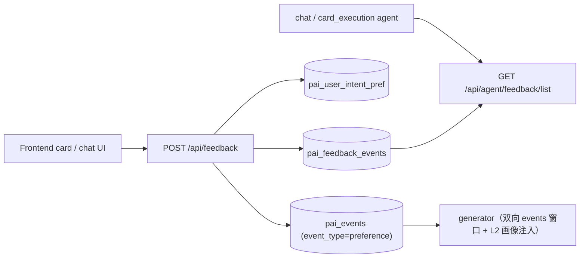
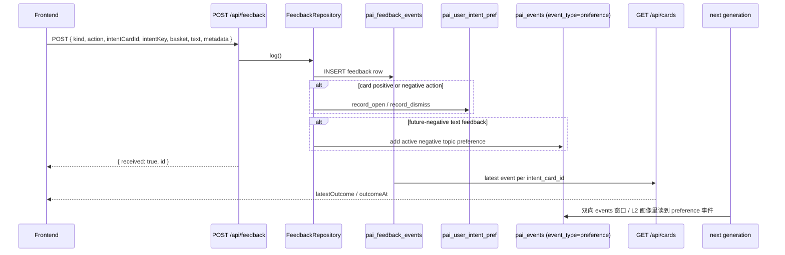

# Feedback

## 结论

Feedback 现在分三层生效：

- **事件层**：所有用户操作先写 `pai_feedback_events`，用于审计、`/api/cards.latestOutcome` 冷启动恢复、chat / card_execution agent 的 `feedback_list` 工具读取。
- **指纹层**：卡片级正负操作同步 fan-out 到 `pai_user_intent_pref`，让同 intent / basket 的偏好权重能逐步变化。
- **即时偏好层**：用户明确说“以后不要/少推某类卡”时，除了写 feedback event，还会写一条 active `event_type=preference` 的 `pai_events`（lifelong-memory sunset 后 `pai_preference_records` 表已退役，偏好回到 L1 事件流），下一轮 generator 在双向 events 窗口 / L2 画像里看到它并按高权重约束避开。



## 边界

包含：

- `POST /api/feedback`、`GET /api/feedback`、`GET /api/feedback/dismissed`、`GET /api/feedback/completed`。
- `pai_feedback_events` 的写入语义和 `latestOutcome` 推导。
- card action 到 `pai_user_intent_pref` 的正负指纹 fan-out。
- future-negative 文本反馈到 `event_type=preference` 事件（`pai_events`）的即时偏好写入。
- main chat assistant thumbs up / down 到统一 feedback event 的写入。
- agent 侧 `feedback_list` 工具面；偏好如何经 events 窗口 / L2 画像进入 generation。

不包含：

- 卡片怎么生成，看 [Generation](./generation)。
- 长期画像（L2）/ skill 怎么沉淀，看 [Memory](./memory)。
- conversation SSE / 卡内对话执行，看 [Execution](./execution)。
- reward dashboard 的人工评分、casebook、trace artifact，看 [Internal Reward Dashboard](./internal-reward-dashboard)。
- 用户要求“加按钮 / 改 UI / 加功能 / 改产品流程”等产品开发建议，看下方“开发建议分界”。

## 表结构

`pai_feedback_events`（migration `011_pai_memory_signals.sql`）：

| 列 | 含义 |
|---|---|
| `user_id`、`id` | 复合 PK；repository 用 `fb_...` 生成，不吃前端传入的行 id。 |
| `kind` | 反馈类型，如 `card_action`、`text_feedback`、`chat_message_feedback`；兼容老前端直接传 `dismiss` / `snooze` kind。 |
| `action` | `confirm` / `modify` / `dismiss` / `snooze` / `complete` / `thumbs_up` / `thumbs_down` 等。 |
| `push_id`、`intent_card_id`、`intent_key`、`basket` | 反向定位被反馈的卡和 intent。 |
| `source` | 用户直写默认 `user_direct`；agent route 默认 `agent`；文本偏好写入时接受 `user` / `user_direct`。 |
| `value`、`text` | 数值反馈和自由文本反馈正文。 |
| `metadata` | JSONB；repository 接受 object 或 JSON string，非法 string 会存为 `{ raw }`。 |
| `conversation_id`、`message_id`、`channel` | 链回 chat / message，例如 main chat thumbs 写 `message_id` + `channel='main_chat'`。 |
| `created_at` | 写入时间。 |

`pai_user_intent_pref`（migration `043_pai_card_patterns.sql`）：

| 列 | 含义 |
|---|---|
| `(user_id, intent, basket)` | 单用户 intent / basket 指纹。 |
| `ctr_7d`、`ctr_30d` | 简化偏好强度；正反馈上调，负反馈下调。 |
| `last_open_at`、`last_dismiss_at` | 最近正/负操作时间。 |

**偏好事件**（`pai_events` 的 `event_type='preference'` 行；`pai_preference_records` 表已在 `114_drop_legacy_memory.sql` DROP，历史 migration `056_pai_preference_records.sql` + `057_pai_preference_lifetime.sql` 保留作记录）。偏好字段直接落 `pai_events` 本体 + `structured` JSONB：

| 字段 | 落点 | 含义 |
|---|---|---|
| `statement` | `pai_events.title` | 用户明确表达的生成偏好/禁忌。 |
| `scope` | `structured.scope` | `topic` / `source` / `timing` / `format` / `global`。 |
| `polarity` | `structured.polarity` | `positive` / `negative`。 |
| `durability`、`expires_at` | `structured.{durability,expires_at}` | `temporary` 有过期时间；`persistent` 长期有效（`list(active)` 隐藏过期行）。 |
| `weight`、`confidence` | `structured.{weight,confidence}` + `pai_events.importance` | 用户明确表达默认高权重。 |
| `source`、`status` | `pai_events.source`（feedback 域写入 = `pinai_feedback`,actor 经 JWT server-stamp 进 `structured`）+ supersede 链（`superseded_by_id IS NULL` = 当前版） | 来源与当前/被替代状态。 |

`pai_intent_card_state` / `pai_intent_thread_state` 已由 migration `051_drop_intent_state_tables.sql` 删除。当前卡片 outcome 从 `pai_feedback_events` 推导，不再维护独立 intent state 表。

## 用户操作映射

| 输入 | 写入 | 立即效果 |
|---|---|---|
| `card_action: confirm` | `pai_feedback_events` + `pai_user_intent_pref` 正向 fan-out | `/api/cards.latestOutcome=confirm`；同 intent / basket 权重上调。 |
| `card_action: complete` | `pai_feedback_events` + `pai_user_intent_pref` 正向 fan-out | `/api/cards.latestOutcome=complete`；刷新后 completed card 不回到 sphere。 |
| `card_action: dismiss` 或 `kind=dismiss` | `pai_feedback_events` + `pai_user_intent_pref` 负向 fan-out | `/api/feedback/dismissed` 返回该卡；同 intent / basket 权重下调。 |
| `card_action: snooze` 或 `kind=snooze` | 同 dismiss | `/api/feedback/dismissed` 返回该卡；下一批视为短期冷信号。 |
| `card_action: modify` | `pai_feedback_events` | `/api/cards.latestOutcome=modify`；不更新 fingerprint。 |
| `text_feedback` | `pai_feedback_events` | `feedback_list` 能读到原文。 |
| future-negative `text_feedback` | `pai_feedback_events` + active `event_type=preference` 事件（`pai_events`） | 偏好事件进 L1（固定 `scope=topic` / `polarity=negative` / `durability=persistent`，按 `dedupe_key=pref:<fid>` 幂等），generator 经双向 events 窗口 / L2 画像看到并按高权重约束避开。 |
| main chat thumbs up/down | `pai_feedback_events(kind=chat_message_feedback, action=thumbs_up/thumbs_down)` | 统一进入 feedback log；当前不更新 card fingerprint。 |

future-negative 的确定性识别只覆盖明确未来禁忌表达，例如 `stop showing`、`do not show`、`don't show`、`no more`、`less of`、`不要再`、`不用再`、`别再`、`少推`、`屏蔽`、`停止`。这是小而保守的规则：先保证“用户明确说不要”的场景真实生效，避免把普通吐槽误写成长期偏好。

## 开发建议分界

用户在 Main Chat 里提出产品功能、界面、流程改进诉求时，不写 `pai_feedback_events` / preference 事件，而是走独立 `pai_development_feedback`。

例子：

- “能不能加一个导出按钮？”
- “这个页面手机上太难点了。”
- “希望设置里能关掉这个功能。”

这类诉求是产品团队 triage 数据，不是用户个性化信号。唯一写入路径是 agent 的 `development_feedback_log` 工具（`POST /api/agent/development-feedback/log`）——agent-engine 层没有 keyword fast path，普通聊天消息永远原样进入 agent（有测试锁这一点）。回执必须诚实：已记录给团队评估，不能假装已经实现。

## 核心链路



## 当前设计

| 维度 | 当前事实 |
|---|---|
| UI 路由 | `backend/services/api/src/pinai_api/domains/feedback/ui.py` 暴露 `POST /api/feedback`、`GET /api/feedback`、`GET /api/feedback/dismissed`、`GET /api/feedback/completed`。 |
| 鉴权 | Supabase JWT（`current_user`）+ `user_scoped_tx`。 |
| Repository | `FeedbackRepository.log()` 先写 `pai_feedback_events`，再按输入类型决定是否 fan-out 到 fingerprint / preference。 |
| `/api/cards` | generation 域的 runs/cards UI 路由从最新 feedback event 推导每张卡的 `latestOutcome` / `outcomeAt`；不依赖 intent state 表。 |
| Agent feedback | `GET /api/agent/feedback/list` 给 `feedback_list` native tool 读取；`POST /api/agent/feedback/log` 保留 agent-originated feedback 写入，默认 `source='agent'`。 |
| Preference 写入 | 常规 chat agent 经 `event_append`（`event_type=preference` + `structured{polarity,weight,scope,expires}`；独立 preferences 路由已随 Block2 删除）；future-negative card text feedback 在 feedback repository 内直接 append 一条 `source='pinai_feedback'` 的 preference 事件（写入即盖 `curated_at`）。evolve 还会把反复 dismiss 蒸馏成 standing preference 事件。 |
| Generation 使用 | generator（`agent_engine/agents/generator.py`）**不直接拉** feedback / preference list——它只带 events_search / event_source / tavily / submit_card 工具；偏好经 L1 preference 事件（确定性 events 日志窗口）+ L2 画像注入生效。`feedback_list` 是 chat / card_execution agent 的工具。 |
| 开发建议 | `pai_development_feedback` 独立记录产品/UI/功能诉求；唯一写入方是 agent 的 `development_feedback_log` 工具；generation 不读取这张表。 |
| `metadata` | object / JSON string 都接；非法 string 存 `{ raw: <原文> }`，避免打断 feedback 写入。 |
| `intentKey` / `basket` | route 不做补齐；前端需要尽量传齐。缺字段时 event 仍写入，但 fingerprint 只能更新已有的 intent / basket 维度。 |
| Reward ledger 分界 | 用户 open card 仍走 reward dashboard score 事件；confirm / dismiss / snooze / complete / text feedback 不复制进 reward ledger。 |

## 开发入口

| 改动 | 先看 |
|---|---|
| Feedback UI route | `backend/services/api/src/pinai_api/domains/feedback/ui.py` |
| Agent feedback route | `backend/services/api/src/pinai_api/domains/feedback/agent.py` |
| Repository / SQL | `backend/services/api/src/pinai_api/domains/feedback/repository.py` |
| Preference 写入 | `backend/services/api/src/pinai_api/domains/feedback/repository.py`（future-negative append preference 事件）；chat agent 走 `event_append`（`domains/memory/events/agent.py`）。独立 preference repo / route 已随 lifelong-memory sunset 删除 |
| Fingerprint repository | `backend/libs/db/src/pinai_db/repositories/user_fingerprint.py` |
| Card latestOutcome 推导 | `backend/services/api/src/pinai_api/domains/generation/runs_and_cards.py` |
| Schema | `011_pai_memory_signals.sql`、`043_pai_card_patterns.sql`、`056_pai_preference_records.sql`、`057_pai_preference_lifetime.sql`、`051_drop_intent_state_tables.sql`、`114_drop_legacy_memory.sql`（DROP `pai_preference_records`，偏好回 `pai_events`）、`111_pai_events.sql` |
| Generation 端使用 | `backend/services/agent-engine/src/agent_engine/agents/generator.py` |
| Native feedback tool | `backend/services/agent-engine/src/agent_engine/tools/direct/feedback.py` |
| Native preference tool | `backend/services/agent-engine/src/agent_engine/tools/direct/preferences.py`（现在只有 `set_generation_language` 输出语言开关；内容偏好走 `tools/direct/events.py:event_append` 写 `event_type=preference` 事件；老 `profile.py` 画像工具已退役，画像走 `tools/direct/user_strings.py:memory_edit`） |
| 前端卡片反馈 UI | `apps/web/src/ui-web/card/useCardActions.ts`（web 共享）、`apps/web` 卡片详情面板、`apps/mobile/src/components/now/CardDetailSheet.tsx`（RN） |
| 前端 main chat thumbs | `apps/web/src/ui-web/chat/conversation/CardResultFeedbackBar.tsx`、`packages/core/src/domain/chat-feedback.ts`、`apps/mobile/src/components/chat/MessageActions.tsx` |
| 开发建议收集 | `backend/services/agent-engine/src/agent_engine/transport/routes/chat.py`、`backend/services/api/src/pinai_api/domains/feedback/dev_agent.py`、`backend/services/agent-engine/src/agent_engine/tools/direct/development_feedback.py`、`backend/services/agent-engine/src/agent_engine/agents/main_chat.py` |

## 验证方式

```bash
# Repository + end-to-end route flow
cd backend && uv run pytest tests/web/db/repositories/test_feedback_repo.py tests/web/routes/test_feedback_flow.py

# Preference repository
cd backend && uv run pytest tests/web/db/repositories/test_preferences_repo.py

# Related card route / native tools
cd backend && uv run pytest tests/web/routes/test_cards_route.py tests/chat/test_native_tools.py

# Static checks
cd backend && uv run ruff check .
cd backend && uv run mypy services libs

# Frontend feedback helpers and card feedback state（在 packages 共享层）
npm run check:packages    # 覆盖 apps/web/src/ui-web/card/useCardActions.test.tsx、packages/core/src/domain/chat-feedback.test.ts 等
```

手工验证：

- 对一张卡 dismiss / snooze，`GET /api/feedback/dismissed` 应返回该 `intentCardId`，刷新后卡不回到 sphere。
- 对一张卡 Done / complete，`GET /api/feedback/completed` 应返回该 `intentCardId`，`/api/cards` 应返回 `latestOutcome='complete'`。
- 对一张未来卡提交明确 negative 文本，例如 “Stop showing me VC funding rumor cards again”，`/api/agent/feedback/list` 应能读到原文，`pai_events` 应出现对应 `event_type='preference'` 的 negative 行（用下方 DB 速查确认）。
- 对 main chat assistant message 点 thumbs up/down，`pai_feedback_events` 应出现 `kind='chat_message_feedback'`、`message_id`、`channel='main_chat'`。

DB 速查：

```sql
SELECT kind, action, source, count(*)
FROM pai_feedback_events
WHERE user_id = $1
GROUP BY kind, action, source
ORDER BY kind, action, source;

SELECT intent, basket, ctr_7d, ctr_30d, last_open_at, last_dismiss_at
FROM pai_user_intent_pref
WHERE user_id = $1
ORDER BY updated_at DESC
LIMIT 20;

-- 偏好现在是 pai_events 的 event_type='preference' 行（pai_preference_records 已退役）
SELECT title AS statement,
       structured->>'scope'  AS scope,
       structured->>'polarity' AS polarity,
       structured->>'durability' AS durability,
       source, recorded_at
FROM pai_events
WHERE user_id = $1 AND event_type = 'preference' AND superseded_by_id IS NULL
ORDER BY recorded_at DESC
LIMIT 20;
```

## 踩坑

- `metadata` 前端最好传 object；string 只是兼容路径。
- `intentKey` / `basket` 不会在 route 自动补齐。卡片操作要传齐，否则 fingerprint 的 intent / basket 维度会缺失。
- `kind=dismiss` / `kind=snooze` 是老前端兼容路径；新代码优先传 `kind='card_action'` + `action`。
- `complete` 是正反馈，不是单纯 UI 关闭；它会更新 fingerprint。
- future-negative 文本写 preference 是保守规则，不做复杂自然语言分类。语义不明确的反馈只进 `pai_feedback_events`。
- preference 事件只是即时偏好层。长期画像仍要靠 L2 USER / MEMORY 画像（agent `memory_edit` + evolve 蒸馏）沉淀，不要把所有 feedback 都硬塞进画像。
- `pai_card_evaluations` 是 generator 自评，不是用户反馈；不要和 `pai_feedback_events` 混用。

## 相关模块

- [Generation](./generation)：feedback / preferences 怎么进入 planner 输入。
- [Execution](./execution)：chat 事件和 main chat UI 的执行链路。
- [Memory](./memory)：长期沉淀走 L2 画像（USER / MEMORY / GOALS）/ skill。
- [Internal Reward Dashboard](./internal-reward-dashboard)：reward ledger、reviewer score、casebook、trace artifact。

## 相关 AI Plans

- [Card Reward Infra + Internal Dashboard](../plans/2026-05-13-card-reward-infra)：用户 open reward、reviewer score、casebook 和 trace artifact。
- [反馈并入 Main Chat + 高权重偏好](../plans/2026-05-24-feedback-into-main-chat-preferences)：反馈不再独立成 Feedback Agent，而是走 main chat；plan 里的 `pai_preference_records` 表后随 lifelong-memory sunset 退役，偏好现落 `pai_events`。
- [Development Feedback Collection](../plans/2026-06-04-development-feedback-collection)：Main Chat 里“加按钮 / 改 UI / 加功能”等不可即时执行诉求走独立开发建议链路，避免污染现有 feedback / preference 学习路径。
