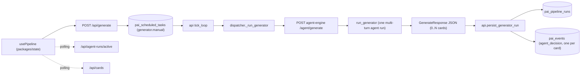
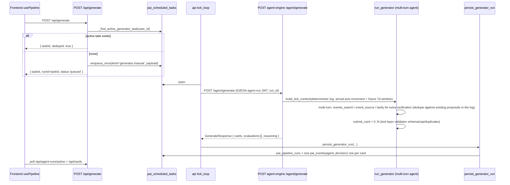

# Generation

## Summary

Card generation is asynchronous end to end, and the generation itself is **one multi-turn agent run** (design SSOT: [Card Generation (Lifelong Memory Consumer Side)](../plans/2026-06-23-proactive-card-generation)):

`POST /api/generate → enqueue_once(kind=generator.manual) → pai_scheduled_tasks → api tick_loop → dispatcher._run_generator → HTTP POST agent-engine /agent/generate → deterministic context log (arrival-axis increment + future window) → multi-turn agent run (events_search / event_source / tavily / submit_card) → 0..N cards → return JSON → api persist_generator_run → pai_pipeline_runs + one L1 agent_decision per card`

**0 cards is a normal result** (better no card than a bad card; it is not an error); `cards_to_generate` is an upper cap, not a target count. The old batch pipeline (planner → writer×12 → evaluator×12 → top-up → final_selection, 26–48 LLM calls) and pattern matcher / phase1_seed have been retired entirely.



## Boundaries

Includes:

- `/api/generate` enqueue, dedup, virtual_key lazy provisioning.
- `pai_pipeline_runs` persistence + **writing emitted cards back to L1 as `agent_decision`** (the only L1 write on the consumer side).
- The agentic generator on the agent-engine side (seed window + tools + `submit_card`).
- Card schema (`GeneratedCard`), citation → `sourceApps` derivation, card id rewriting.
- Injection of the scheduled task snapshot into the chat agent (prospective memory).
- The frontend `usePipeline` / `useActiveAgentRuns` polling model (`packages/state/src/queries/`).

Excludes:

- The scheduler framework (tick / claim / lease / retry): see [Background Tasks](./background-tasks).
- `pai_events` / portrait themselves (the generator's input): see [Memory](./memory).
- Downstream chat / tool execution after the user opens a card: see [Execution](./execution).

## Core Flow



## Current Design

| Stage | Current facts |
|---|---|
| Entry | `domains/generation/generate_ui.py:POST /api/generate`. `_find_active_generator_task` dedupes by `kind='generator.manual'` + active + user; if one exists it returns `{deduped:true, taskId}`. |
| Enqueue | `enqueue_once(kind='generator.manual', payload={cards_to_generate, output_language, trigger})`. `cards_to_generate` means **an upper cap** (≤8), not a target count. |
| Virtual key | `_ensure_virtual_key` / dispatcher-side `ensure_user_litellm_key` lazy-recover; on failure 502/run failed. |
| Output language | Reads `generation_language` from user_settings and passes it to the engine in the payload. |
| **Context log** | `generation_context.build_tick_context`: **deterministic context log + future window**. On the past side the log is extended incrementally along the **arrival axis** — the first build uses a 3d lookback, after which newly arrived events are pulled from the growth anchor→now (`recordedSince/Until + arrivalsLimit + newestFirst`); when the log exceeds its token budget (80k) it is reset in place, and the effective anchor is persisted on the api side. The future 7d window goes through `/api/agent/events/search` (L1-only, status=active, limit 100, ascending by occurredAt). The log is injected as a prompt-caching cache_control block (ttl 5m/1h decided per user by api). The portrait (USER/GOALS, including distilled preferences) is injected via `PortraitMiddleware`, not into the log. **No direct raw reads / single world query / feedback / connections prefetch**. |
| Dispatch | dispatcher routes `generator.manual`/`generator.chat`/`generator.scheduled` to `_run_generator`; timeout budget 600s. **pattern matcher / phase1_seed have been deleted** (patterns are positioned as a cold-start prior, a later iteration). The `generator.auto` kind is in the routing table but has no producer (dead code). |
| Persistence | `persist_generator_run` → `persist_pipeline_run_strict`: one `pai_pipeline_runs` row (`id=run_id`, the two columns hold the same value; `final_cards JSONB`) + **one L1 `agent_decision` event per card in the same transaction** (`source=agent_action`, `structured={kind:"proactive_proposal", card_id, run_id, related_event_ids}`, idempotent via `dedupe_key=card_decision:{card_id}`, stamped curated directly). **A silent run (0 cards) writes nothing to L1**. reminder.card passes `record_decisions=False` (a user-set nudge is not an AI proposal). The `pai_card_evaluations` write path is kept but is always empty on the main path (evaluator retired). |
| Reward review | `/api/reward-dashboard/*` is served by the separate reward-dashboard service (`pinai_reward_dashboard`), which only reads `pai_pipeline_runs.final_cards` (+ historical `pai_card_evaluations`); new cards have no eval rows. |
| Frontend polling | `usePipeline` (`packages/state/src/queries/pipeline.ts`, the /status check has been inlined into it) + `useActiveAgentRuns`; on success, `useCardsQuery` fetches `/api/cards`. Note that **0 cards is also completed** — the product layer presents it as "nothing worth saying this round", not as a failure. |
| Prospective injection | `ScheduledTasksMiddleware` (harness/middleware.py): main_chat + card_execution inject, on every run, a bounded snapshot of their own scheduled_generator tasks (≤8 entries, one per line), so the agent can answer about / modify / dedupe the crons it scheduled itself. Not injected for the generator. |

## Generator on the agent-engine Side (One Multi-Turn Agent Run)

`transport/routes/generate.py` → `agents/generator.py:run_generator()`.

- **Shape**: `build_agent` (deepagents) + `LazyThreadSandbox` (the prompt forbids file/exec tools → **never provisions Daytona**) + `with_portrait=True`; `recursion_limit=80`; a single run is bounded by the route's `asyncio.timeout(600s)` as a fallback.
- **Five tools**: `events_search` (supplementary retrieval outside the log / verifying that an event is the current version — the supersede chain guarantees reschedules/cancellations are visible), `event_source` (drill down to L0 verbatim, body projection capped at 280 characters), `tavily_search` / `tavily_extract` (world / news verification), `submit_card` (run-scoped: args_schema=GeneratedCard; on Pydantic validation failure it returns a readable error so the agent can fix and resubmit; rejects outright when the cap is full / the intent_key is a duplicate). **The dedupe baseline is in the context log**: existing agent_decision (kind=proactive_proposal) entries are folded into the deterministic log, and the prompt instructs the agent to drop overlaps — it does not rely on the agent choosing to call a tool. The `cards_recent` tool and the `/api/agent/cards/recent` endpoint have been deleted.
- **Verification is built into generation**: by the time it decides to emit a card, the sources have already been verified with tools — **there is no separate evaluator / final_selection / top-up**. `GeneratorOutput.evaluations` is always empty.
- **0..N semantics**: one card per point worth raising; if there is none, 0 cards (the prompt hard-codes "better no card than a bad card": one bad card costs more than ten good cards that were missed).
- **Context messages**: the system section carries `<current_date>` / `<context_map>`; the deterministic log is injected as a cache_control block, and each round's `_tick_message` appends the log-tail increment + future_view; chat-triggered focus / scheduled generation_request also go into the context (no `<seed_json>` tag).

### Card Fields

| Field | Current facts |
|---|---|
| `title` | Action-first formula (≤70 characters, verb+object + " — " + concrete trigger), GOOD/BAD contrast examples in `<card_rules>`; fact-first is forbidden. |
| `sources[]` | **Cite L1 events**: `{toolkit} event id={event id}, title={title}`, where toolkit is the event's `structured.toolkit` (connector events) or the event source (world/device/ambient). The schema's `min_length=1` enforces grounding. |
| `sourceApps` | Derived deterministically in Python (`derive_source_apps`, first word of the citation → app slug: gmail→gmail, googlecalendar→gcal, world→web, unknown toolkits pass through), injected by the route's `_serialize_cards`; the LLM is not involved. |
| `reasoningSteps` | 2-4 steps (observed→cross_referenced→decided); detail only points at data already cited in sources. |
| `primary_action.agent_prompt` | The full task spec the Card Execution agent runs after confirmation (concrete deliverable + this card's key parameters). |
| card id | Rewritten on the route side to `f"{run_id}_card_{i:02d}"` (`_serialize_cards`, which also injects sourceApps). |

## Development Entry Points

| Change | Look at first |
|---|---|
| Generation HTTP entry / dedupe / lazy virtual key | `backend/services/api/src/pinai_api/domains/generation/generate_ui.py` |
| Scheduler dispatcher generator handler | `backend/services/api/src/pinai_api/orchestration/dispatcher.py` (`_run_generator`) + `control/chat_proxy.py` (`call_generate`) |
| **agentic generator + prompt + submit_card** | `backend/services/agent-engine/src/agent_engine/agents/generator.py` |
| **Context log (arrival axis + future window)** | `backend/services/agent-engine/src/agent_engine/agents/generation_context.py` (`build_tick_context`) |
| agent-engine HTTP route (0 cards is valid / cap / id rewrite) | `backend/services/agent-engine/src/agent_engine/transport/routes/generate.py` |
| Persistence + **L1 decision write-back** | `backend/services/api/src/pinai_api/domains/generation/pipeline_persistence.py` |
| Card schema | `backend/libs/contracts/src/pinai_contracts/api_models.py` (`GeneratedCard` / `GeneratorOutput`) |
| Prospective snapshot injection | `backend/services/agent-engine/src/agent_engine/harness/middleware.py` (`ScheduledTasksMiddleware` / `render_scheduled_tasks`) |
| Frontend pipeline hook | `packages/state/src/queries/pipeline.ts` (`usePipeline`), `packages/state/src/queries/agent-runs.ts` (`useActiveAgentRuns`) |

## How to Verify

```bash
# engine side: agent tools / seed window / route
cd backend && uv run pytest tests/chat/agents/test_generator_agent.py \
  tests/chat/agents/test_generation_context.py tests/chat/agents/test_source_apps.py \
  tests/chat/routes/test_generate.py tests/chat/routes/test_source_apps_injection.py

# api side: persistence + L1 decision write-back (needs a pgvector DB)
cd backend && uv run pytest tests/web/routes/test_generate_persist.py

# full suite
cd backend && uv run ruff check && uv run lint-imports && uv run mypy services libs
```

Manual verification: click Generate in the frontend → `POST /api/generate` 200 `{taskId}` → poll until success → `/api/cards` returns the new cards; in the DB, `pai_pipeline_runs.final_cards` + `pai_events` should have the corresponding `agent_decision` rows (`structured->>'kind'='proactive_proposal'`); a 0-card run has only the run row and no event. LangSmith: one trace per run (the multi-turn tool calls are visible, replacing the old per-stage metadata).

## Gotchas

- `/api/generate` is an async enqueue; it **always** returns `{ taskId, runId }` and then the frontend polls; only one `generator.manual` runs per user at a time (a duplicate returns `{deduped:true}`).
- **0 cards is completed, not a failure** — the old pipeline semantics of "generator returned no cards → 502" have been removed; the product layer must not treat an empty result as an error and retry.
- `cards_to_generate` is a cap, not a target: the agent only emits a card when it judges it worthwhile; there is no top-up to fill the count.
- **The generator no longer touches Daytona**: the backend is `LazyThreadSandbox` and the prompt forbids file/exec, so it is a purely conversational tool run. The old `PINAI_LOCAL_SANDBOX=1` has no effect on the generator (it still applies to chat).
- Card `sources[]` cite **L1 event ids** (`evt_*`), no longer raw/signal/world ids; persistence recovers `related_event_ids` from the citations by regex into the agent_decision. When changing the citation shape, update the `derive_source_apps` vocabulary + `_EVENT_ID_RE` together.
- `pai_pipeline_runs.id` and `run_id` have the same value; clients poll by `runId`, so don't guess the latest row by timestamp.
- A `persist_generator_run` failure is only logged and does not block (the cards have already been returned to the client) — on failure, check `pai_scheduled_task_runs.error` yourself; the L1 decision write-back is in the same transaction, so if persistence fails the decision events are not written either (consistent).
- Post-generation card fanout (pre-warming the execution threads of the first 2 cards) is unchanged; it is triggered best-effort after the dispatcher persists the run.
- `output_language` comes from user_settings, not from an override in the request body.
- `pai_card_evaluations` / `pai_card_pattern_hits` are no longer written, but the tables are kept (expand-contract); reward-dashboard features that read them show empty for new cards.

## Related Modules

- [Background Tasks](./background-tasks): scheduler tick / dispatcher / lease / generator kind routing.
- [Memory](./memory): `pai_events` bidirectional window + portrait — the generator's entire input.
- [Feedback](./feedback): user confirm/dismiss feedback (feeding it back into generation is a later iteration).
- [Execution](./execution): the downstream path when the user opens a generated card to chat / call tools.
- [Internal Reward Dashboard](./internal-reward-dashboard): internal review reads generation runs.

## Related AI Plans

- [Card Generation (Lifelong Memory Consumer Side)](../plans/2026-06-23-proactive-card-generation): the design SSOT of this module (keep the current triggers, single-run multi-turn agent, 0..N, list of later iterations).
- [Lifelong Memory System Design](../plans/2026-06-23-lifelong-memory-system): `pai_events` / `events_search` / portrait / supersede — the data foundation of the generator.
- [Card Reward Infra + Internal Dashboard](../plans/2026-05-13-card-reward-infra): reward ledger and internal scoring (feeding it back into generation is a later iteration).
