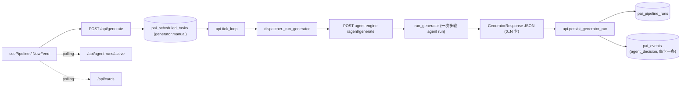
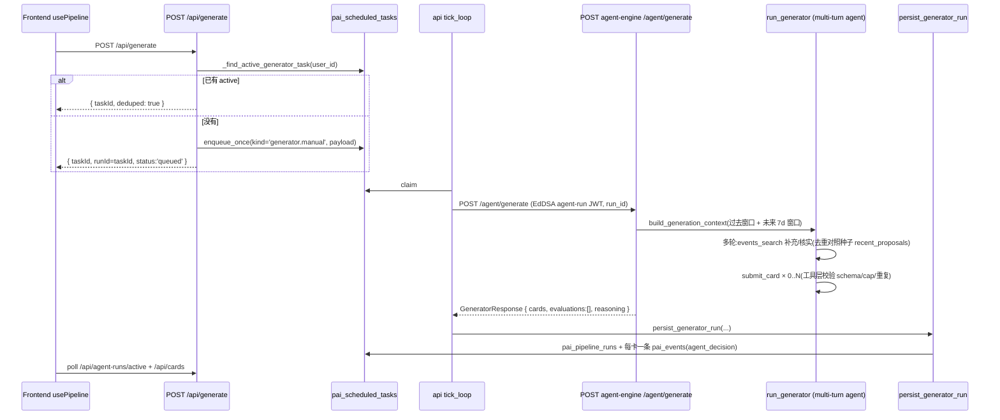

# Generation

## 结论

卡片生成全链路异步,生成本体是**一次多轮 agent run**(设计 SSOT:[卡片生成(Lifelong Memory 消费侧)](../plans/2026-06-23-proactive-card-generation)):

`POST /api/generate → enqueue_once(kind=generator.manual) → pai_scheduled_tasks → api tick_loop → dispatcher._run_generator → HTTP POST agent-engine /agent/generate → 种子上下文(过去 + 未来 events 窗口) → 多轮 agent run(events_search / submit_card) → 0..N 张卡 → 返回 JSON → api persist_generator_run → pai_pipeline_runs + 每卡一条 L1 agent_decision`

**0 张是正常结果**(宁缺毋滥,不是错误);`cards_to_generate` 是上限 cap 不是目标数。旧 batch pipeline(planner → writer×12 → evaluator×12 → top-up → final_selection,26–48 次 LLM)与 pattern matcher / phase1_seed 已整体退役。



## 边界

包含:

- `/api/generate` 入队、dedup、virtual_key lazy provisioning。
- `pai_pipeline_runs` 持久化 + **出卡写回 L1 `agent_decision`**(消费侧唯一 L1 写入)。
- agent-engine 端 agentic generator(种子窗口 + 工具 + `submit_card`)。
- 卡 schema(`GeneratedCard`)、citation → `sourceApps` 派生、card id 重写。
- chat agent 的 scheduled 任务快照注入(prospective memory)。
- 前端 `usePipeline` / `useGenerationStatus` / `useActiveAgentRuns` 轮询模型。

不包含:

- scheduler 框架(tick / claim / lease / retry),看 [Background Tasks](./background-tasks)。
- `pai_events` / portrait 本身(generator 的输入),看 [Memory](./memory)。
- 用户点开卡片的下游 chat / 工具执行,看 [Execution](./execution)。

## 核心链路



## 当前设计

| 环节 | 当前事实 |
|---|---|
| 入口 | `domains/generation/generate_ui.py:POST /api/generate`。`_find_active_generator_task` 按 `kind='generator.manual'` + active + user 去重;有就返回 `{deduped:true, taskId}`。 |
| 入队 | `enqueue_once(kind='generator.manual', payload={cards_to_generate, output_language, trigger})`。`cards_to_generate` 语义 = **上限 cap**(≤8),不是目标数。 |
| Virtual key | `_ensure_virtual_key` / dispatcher 侧 `ensure_user_litellm_key` lazy-recover;失败 502/run failed。 |
| 输出语言 | 读 user_settings 的 `generation_language`,payload 传给 engine。 |
| **种子上下文** | `generation_context.build_generation_context`:**只拉两个 events 窗口**——过去窗口(`compute_context_window`,≥24h、覆盖到上次成功 run)+ **未来 7d 窗口**(会议/predicted,旧管线 until=now 根本看不到未来)。均经 `/api/agent/events/search`(L1-only,status=active,limit 100);未来窗口按 occurredAt 升序。portrait(USER/GOALS,含蒸馏偏好)走 `PortraitMiddleware` 注入,不进种子。**没有 raw 直读 / world 单查 / feedback / connections 预拉**。 |
| 派发 | dispatcher `generator.manual`/`generator.chat`/`generator.scheduled` 走 `_run_generator`;超时预算 600s。**pattern matcher / phase1_seed 已删**(pattern 定位冷启动先验,后续迭代)。`generator.auto` kind 在路由表里但无 producer(死代码)。 |
| 持久化 | `persist_generator_run` → `persist_pipeline_run_strict`:`pai_pipeline_runs` 一行(`id=run_id` 两列同值、`final_cards JSONB`)+ **同事务每卡一条 L1 `agent_decision` event**(`source=agent_action`、`structured={kind:"proactive_proposal", card_id, run_id, related_event_ids}`,`dedupe_key=card_decision:{card_id}` 幂等,curated 直接盖章)。**静默 run(0 卡)L1 零写入**。reminder.card 传 `record_decisions=False`(用户自设 nudge 不是 AI 提议)。`pai_card_evaluations` 写口保留但主路径恒空(evaluator 退役)。 |
| Reward review | `/api/reward-dashboard/*` 只读 `pai_pipeline_runs.final_cards`(+历史 `pai_card_evaluations`);新卡无 eval 行。 |
| 前端轮询 | 不变:`usePipeline` / `useActiveAgentRuns` / `useGenerationStatus`;成功后 `useCardsQuery` 拉 `/api/cards`。注意 **0 卡也是 completed**——产品层按"本轮没有值得说的"呈现,不是失败。 |
| Prospective 注入 | `ScheduledTasksMiddleware`(harness/middleware.py):main_chat + card_execution 每 run 注入自己 scheduled_generator 任务的有界快照(≤8 条一行一条),agent 可回答/修改/去重自己排的 cron。generator 不注入。 |

## agent-engine 端 generator(一次多轮 agent run)

`transport/routes/generate.py` → `agents/generator.py:run_generator()`。

- **形态**:`build_agent`(deepagents)+ `LazyThreadSandbox`(prompt 禁 file/exec 工具 → **永不 provision Daytona**)+ `with_portrait=True`;`recursion_limit=80`;单 run 由 route 的 `asyncio.timeout(600s)` 兜底。
- **工具两个**:`events_search`(种子外补充检索 / 核实 event 是当前版本——supersede 链保证改期/取消可见)、`submit_card`(run-scoped:args_schema=GeneratedCard,Pydantic 校验失败回可读错误让 agent 修正重交;cap 满 / intent_key 重复直接拒绝)。**去重基准在种子里**:`recent_proposals`(最近 7d 的 agent_decision/kind=proactive_proposal,含 cardId+relatedEventIds,`structured.kind` 过滤掉画像变更双写)——不靠工具自觉。`cards_recent` 工具与 `/api/agent/cards/recent` 端点已删。
- **验证内建于生成**:决定出卡时 sources 已经工具核实过——**没有独立 evaluator / final_selection / top-up**。`GeneratorOutput.evaluations` 恒空。
- **0..N 语义**:每个值得说的点一张,没有就 0 张(prompt 写死宁缺毋滥:一张烂卡比十张漏掉的好卡代价更高)。
- **种子消息**:`Today is {user-local date}` + focus(chat 触发的话题)+ generation_request(scheduled 的 brief)+ `<seed_json>`(双向窗口)。

### 卡面字段

| 字段 | 当前事实 |
|---|---|
| `title` | 动作先行公式(≤70 字符,verb+object + " — " + 具体触发),GOOD/BAD 对照例在 `<card_rules>`;fact-first 禁止。 |
| `sources[]` | **引用 L1 event**:`{toolkit} event id={event id}, title={title}`,toolkit 取 event 的 `structured.toolkit`(connector 事件)或 event source(world/device/ambient)。schema `min_length=1` 强制 grounding。 |
| `sourceApps` | Python 确定性派生(`derive_source_apps`,citation 首词 → app slug:gmail→gmail、googlecalendar→gcal、world→web、未知 toolkit 透传),route `_serialize_cards` 注入,LLM 不参与。 |
| `reasoningSteps` | 2-4 步(observed→cross_referenced→decided),detail 只指向 sources 已引数据。 |
| `primary_action.agent_prompt` | 确认后 Card Execution agent 执行的完整任务规格(具体交付物 + 本卡关键参数)。 |
| card id | route 侧重写 `f"{run_id}_card_{i:02d}"`(`_serialize_cards`,同处注入 sourceApps)。 |

## 开发入口

| 改动 | 先看 |
|---|---|
| 生成 HTTP 入口 / dedupe / lazy virtual key | `backend/services/api/src/pinai_api/domains/generation/generate_ui.py` |
| Scheduler dispatcher generator handler | `backend/services/api/src/pinai_api/orchestration/dispatcher.py`(`_run_generator`)+ `control/chat_proxy.py`(`call_generate`) |
| **agentic generator + prompt + submit_card** | `backend/services/agent-engine/src/agent_engine/agents/generator.py` |
| **种子上下文(双向窗口)** | `backend/services/agent-engine/src/agent_engine/agents/generation_context.py` |
| agent-engine HTTP route(0 卡合法 / cap / id 重写) | `backend/services/agent-engine/src/agent_engine/transport/routes/generate.py` |
| 持久化 + **L1 决策写回** | `backend/services/api/src/pinai_api/domains/generation/pipeline_persistence.py` |
| 卡 schema | `backend/libs/contracts/src/pinai_contracts/api_models.py`(`GeneratedCard` / `GeneratorOutput`) |
| Prospective 快照注入 | `backend/services/agent-engine/src/agent_engine/harness/middleware.py`(`ScheduledTasksMiddleware` / `render_scheduled_tasks`) |
| 前端 pipeline hook | `proactive-ai-frontend/src/hooks/usePipeline.ts`、`useGenerationStatus.ts`、`useActiveAgentRuns.ts` |

## 验证方式

```bash
# engine 侧:agent 工具 / 种子窗口 / route
cd backend && uv run pytest tests/chat/agents/test_generator_agent.py \
  tests/chat/agents/test_generation_context.py tests/chat/agents/test_source_apps.py \
  tests/chat/routes/test_generate.py tests/chat/routes/test_source_apps_injection.py

# api 侧:持久化 + L1 决策写回(需 pgvector DB)
cd backend && uv run pytest tests/web/routes/test_generate_persist.py

# 全套
cd backend && uv run ruff check && uv run lint-imports && uv run mypy services libs
```

手工验证:前端点 Generate → `POST /api/generate` 200 `{taskId}` → 轮询到 success → `/api/cards` 拿新卡;DB 里 `pai_pipeline_runs.final_cards` + `pai_events` 应有对应 `agent_decision` 行(`structured->>'kind'='proactive_proposal'`);0 卡 run 只有 run 行、无 event。LangSmith:每 run 一条 trace(多轮工具调用可见,替代旧的 per-stage metadata)。

## 踩坑

- `/api/generate` 是异步 enqueue,**总是**返回 `{ taskId, runId }` 然后前端轮询;同一用户同时只跑一个 `generator.manual`(duplicate 返回 `{deduped:true}`)。
- **0 卡是 completed 不是失败**——旧管线"generator returned no cards → 502"的语义已删;产品层不要把空结果当错误重试。
- `cards_to_generate` 是 cap 不是目标:agent 判断值得才出,没有 top-up 凑数。
- **generator 不再碰 Daytona**:backend 是 `LazyThreadSandbox` 且 prompt 禁 file/exec,纯对话式工具 run。旧 `PINAI_LOCAL_SANDBOX=1` 对 generator 无意义(chat 仍适用)。
- 卡 `sources[]` 引用的是 **L1 event id**(`evt_*`),不再是 raw/signal/world id;`related_event_ids` 由 persistence 从引文正则回收进 agent_decision。改 citation 形状要同步 `derive_source_apps` 词表 + `_EVENT_ID_RE`。
- `pai_pipeline_runs.id` 与 `run_id` 同值;客户端按 `runId` 轮询,别按时间戳猜最新行。
- `persist_generator_run` 失败只 log 不阻断(卡已返回客户端)——失败主动查 `pai_scheduled_task_runs.error`;L1 决策写回在同一事务里,persistence 失败则决策事件也不会写(一致)。
- 生成后 card fanout(预热前 2 张卡的执行线程)不变,在 dispatcher 持久化之后 best-effort 触发。
- `output_language` 走 user_settings,不是请求体覆盖。
- `pai_card_evaluations` / `pai_card_pattern_hits` 停写但表保留(expand-contract);reward-dashboard 读它们的功能对新卡显示为空。

## 相关模块

- [Background Tasks](./background-tasks):scheduler tick / dispatcher / lease / generator kind 路由。
- [Memory](./memory):`pai_events` 双向窗口 + portrait——generator 的全部输入。
- [Feedback](./feedback):用户 confirm/dismiss 反馈(回流到生成是后续迭代)。
- [Execution](./execution):用户在生成卡上点开做 chat / 调工具的下游链路。
- [Internal Reward Dashboard](./internal-reward-dashboard):内部 review 读取 generation run。

## 相关 AI Plans

- [卡片生成(Lifelong Memory 消费侧)](../plans/2026-06-23-proactive-card-generation):本模块的设计 SSOT(触发保留现状、单 run 多轮 agent、0..N、后续迭代清单)。
- [Lifelong Memory 系统设计](../plans/2026-06-23-lifelong-memory-system):`pai_events` / `events_search` / portrait / supersede——generator 的数据地基。
- [Card Reward Infra + Internal Dashboard](../plans/2026-05-13-card-reward-infra):reward ledger 与内部评分(回流到生成属后续迭代)。
