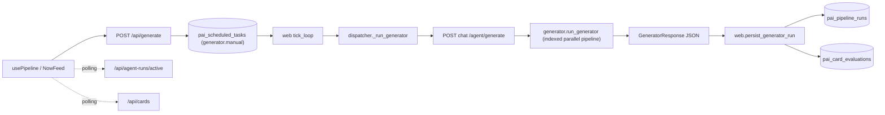
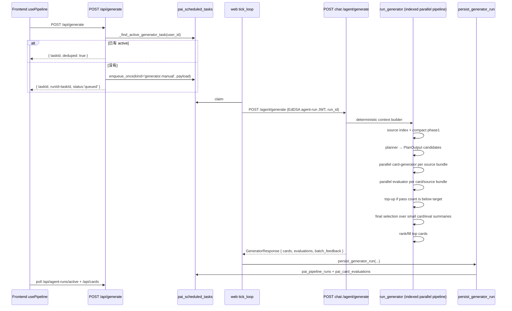

# Generation

## 结论

卡片生成全链路异步:

`POST /api/generate → enqueue_once(kind=generator.manual) → pai_scheduled_tasks → web tick_loop → dispatcher._run_generator → HTTP POST chat /agent/generate → deterministic context builder → source index → planner → 并行 card-generator / evaluator → 必要时 top-up → final selection → rank → 返回 JSON → web persist_generator_run → pai_pipeline_runs + pai_card_evaluations`

前端 `POST /api/generate` 拿 `taskId` 后轮询 `/api/agent-runs/active` + `/api/cards`。同一用户只能有一个 active generator,duplicate 直接返回既有 taskId(dedupe pattern)。`generator.auto` 是另一种 kind,frontend settings 改 interval 时 web 侧 upsert 到 `pai_scheduled_tasks` 上,scheduler 周期触发。



## 边界

包含:

- `/api/generate` 入队、dedup、virtual_key lazy provisioning。
- `pai_pipeline_runs` + `pai_card_evaluations` 持久化语义。
- auto-generate 的 settings → scheduler 桥(`generator.auto` kind)。
- chat 端 `generator.py` indexed parallel pipeline + 输出 schema。
- 选卡阈值、`overall >= 5.0` pass 判定、card id 重写。
- 前端 `usePipeline` / `useGenerationStatus` / `useActiveAgentRuns` 轮询模型。

不包含:

- scheduler 框架(tick / claim / lease / retry),看 [Background Tasks](./background-tasks)。
- generator 拿来当输入的 memory / signals / profile / skill,看 [Memory](./memory)。
- 前一轮反馈进 prompt 的语义,看 [Feedback](./feedback)。
- 用户点开卡片的下游 chat / 工具执行,看 [Execution](./execution)。

## 核心链路



## 当前设计

| 环节 | 当前事实 |
|---|---|
| 入口 | `web/routes/ui/generate.py:POST /api/generate`。`_find_active_generator_task` 按 `kind='generator.manual'` + `status='active'` + user 去重;有就返回 `{deduped:true, taskId}`。 |
| 入队 | `enqueue_once(kind='generator.manual', id=f"gen.{uuid4().hex[:12]}", payload={cards_to_generate, output_language, trigger})`,trigger_kind=`once`。用户可见生成默认/上限是 8 张;dispatcher 对旧 payload 也会 clamp 到 8。 |
| Virtual key | `_ensure_virtual_key`:user 没 `litellm_virtual_key` 时调 `services/litellm_provisioning.ensure_user_litellm_key` lazy-recover;失败 502。 |
| 输出语言 | 读 user_settings 的 `generation_language`(`zh-Hans` / `en` 等),走 payload 传给 chat。语言类偏好走这条设置(确定性),**不**进 `pai_preference_records`。新用户首次创建 `pai_user_settings` 时,`/api/settings` / `/api/profile` 会用客户端 `X-Pin-Client-Locale` 初始化默认语言;settings 行一旦存在,后续不会再被系统 locale 覆盖。 |
| 高权重偏好 / fresh raw | chat 侧 deterministic context builder 用本次 run JWT 调 web agent API,收集 `profile/goals/memory/signals/raw/cards_recent/feedback/world/preferences/connections`。window 是 `min(上次成功生成 completed_at, now-24h) → now`;没有上次成功则取过去 24h。raw/signals 在收集层分页拉完窗口内行,world 也按同一 window 过滤,不再每源 cap 20;planner 只看 source index 的 compact JSON,writer/evaluator 只看单卡 source bundle。active preferences 仍过滤过期 temporary 行,planner 把最新有效 + 高 `weight` 的当近似硬约束。 |
| 自动生成 | `web/routes/ui/profile.py:_sync_auto_generate_schedule`:settings 写 `auto_generate=true/false` + `auto_generate_interval_minutes`,upsert 到 `pai_scheduled_tasks` 一行 `kind='generator.auto'`,`trigger_kind='schedule'`,`interval_seconds = interval_minutes * 60`,关掉切 `archived`。默认 `auto_generate=ON`(migration `038_auto_generate_default_on.sql`),默认间隔 12h(`037_pai_user_settings_auto_generate_interval.sql`)。 |
| 派发 | dispatcher 看到 `generator.manual` / `generator.auto` 都走 `_run_generator`(`039_split_generator_kinds.sql` 拆 kind 但共用 handler);generator 是用户可见链路,DB lease、web→chat `/agent/generate` read timeout、chat route 内部 timeout 都是 600s。手动 `generator.manual` 不自动 retry,超过 10 分钟直接失败。 |
| chat 调用 | `_run_generator` HTTP POST `chat /agent/generate`,签 EdDSA agent-run JWT,带 `run_id` + virtual_key claim。 |
| 持久化 | `persist_generator_run`:`pai_pipeline_runs` 一行(`id=run_id`,`run_id=run_id` 两列同值,`status='completed'`,`final_cards JSONB`,`iterations JSONB`,`trigger`,`started_at`,`completed_at`);`_persist_evaluations`:返回给 web 的卡对应评价写一行 `pai_card_evaluations`(ON CONFLICT (user_id, card_id) DO UPDATE),全部候选都未 pass 时会保留最高分候选及其 failed 评价。 |
| Reward review | 内部 review 不改 generation 主链路。`/api/reward-dashboard/*` 只读 `pai_pipeline_runs.final_cards` + `pai_card_evaluations`,把用户 open / score 和 reviewer score 追加到 `pai_card_reward_events`,案例库写 `pai_card_casebook`,trace artifact 写 `pai_trace_artifacts`。 |
| LangSmith metadata | generator 每个固定 stage invocation 带 `metadata={pinai_run_id, pinai_user_id, pinai_agent:'generator', pinai_generator_stage}` 和 `tags=['pinai','generator','stage:...']`,reward dashboard 用这个稳定绑定 trace,不靠时间窗口猜。 |
| 前端轮询 | `usePipeline.ts` 用 sessionStorage 恢复 run state;`useActiveAgentRuns.ts` 轮询 `/api/agent-runs/active`;`useGenerationStatus.ts` 取 `pai_scheduled_task_runs` 状态;成功后 cards query(`packages/state/src/queries/cards.ts` 的 `useCardsQuery`)拉 `/api/cards`。`/api/cards` 除了 `card/runId/score` 还带 `latestOutcome/outcomeAt`(用户处置)和 `runStatus`(卡片执行线程 `card-thread-<card_id>` 最新一条 `pai_agent_runs.status`,null=没跑过),让 cold-start 后的 sphere/drawer 同时恢复用户处置和执行中/待输入/已完成/失败状态。前端用 `latestOutcome`/本地参与信号做门槛(fanout 预跑的卡不能只凭 runStatus 显示完成态),派生逻辑在 `packages/core/src/domain/card-run-status.ts`。 |

## chat 端 generator agent

`pinai-agents/src/pinai_agents/chat/routes/generate.py` → `chat/agents/generator.py:run_generator()`。

### Stage 拓扑

Context builder 不走 DeepAgents / Code Mode。它在 chat 进程内用本次 run JWT 读 web 的 `/api/agent/*` 确定性接口,先收集完整窗口数据;后续 stage 不共享完整 artifact:Python 先把 context 压成 source index,planner 用 compact phase1 选候选,card-generator/evaluator 按单卡 source bundle 并行执行。

```
run_generator()
  ├─ context-builder     → 收集 full 24h / last-cycle context
  ├─ source-index        → SourceRecord[] + compact planner input
  ├─ planner             → PlanOutput(最多 target+4,上限 12)
  ├─ card-generator x N  → 每个 PlanItem 一个 source bundle,并发上限 4
  ├─ evaluator x N       → 每张卡独立评价,并发上限 4
  ├─ top-up              → pass 不足目标数时再规划/生成/评价一小批候选
  ├─ final-selection     → 只看卡片摘要 + evaluator 分数,做最终编辑排序
  └─ rank/fill           → final-selection 不足或失败时按 pass/overall/importance/urgency + intent 去重补齐 top N
```

### Stage 职责

| Stage | 输入 | 输出 |
|---|---|---|
| context-builder | 用本次 run JWT 调 web agent API,按 window 分页拉 raw/signals,并拉 profile / goals / memory / cards_recent / feedback / world / **active non-expired preferences** | full context artifact(dict) |
| source-index | full phase1 JSON | `SourceRecord[]`(`id/source_type/title/snippet/timestamp/salience/citation/payload`) + compact planner input。`cards_recent` 保留 title / whyNow / summary / sources 摘要,用于语义去重。 |
| planner | compact phase1 + matched patterns | `PlanOutput {plan[], skipped_duplicates[], cold_baskets[], notes}`。目标候选数是 `cards_to_generate + 4`,最多 12。 |
| card-generator | 单个 `PlanItem` + 对应 source bundle | `CardsList`,通常一张卡;`sources[]` 必须复制 bundle citation。 |
| evaluator | 单张卡 + 同一个 source bundle | `EvalReport`,5 维评分 `relevance / actionability / why_now_clarity / novelty / decision_compression`,`overall = mean`,`pass = (overall >= 5.0 AND no grounding violation)`。 |
| top-up | compact phase1 + existing intent keys + existing card summaries | 当 `pass=true` 少于目标数时,最多补 2 轮。top-up 只看 top 40 sources + 12 张 recent cards 的压缩视图;第一轮最多 6 个新候选,第二轮最多 4 个,都跳过既有 intent,并显式避开 recent/current card 的语义重复。 |
| final-selection | 小的 card/eval summaries | 结构化 `FinalSelection`,只输出 intent key 顺序和 rejection notes,用于最终编辑精选;失败时回退规则排序。 |
| rank/fill | cards + evaluations + final selection | 去重同 intent,优先 `pass=true` / high overall / high importance / high urgency,并按 final-selection 顺序补齐 top N。 |

### 选卡规则

- `pass==true` 的卡优先进最终响应,chat route 再按请求的 `cards_to_generate` 硬截断;当前用户可见生成默认/上限是 8 张。
- route 只用 `overall >= 5` 的非 duplicate failed 卡补数;如果 evaluator 明确说 near-duplicate / novelty critically low,不会为了凑数进入最终卡流。
- 如果当前数据里不足 8 张非重复、可通过 evaluator 的候选,最终响应允许少于 8 张;这是质量底线,不是 timeout/error。产品层要展示"本轮只找到 N 张高质量卡",不要把重复卡硬凑进去。
- 如果 evaluator 把所有真实候选都判 fail,chat route 保留最高 `overall` 的 1 张候选,同时把 failed evaluation 保留做审计,避免整轮生成 502。
- connector guidance(`intentKey="connect:<slug>"`)在 planner 后有确定性过滤:已 ACTIVE 的 toolkit 不再推,最近已出现或用户 dismiss/snooze 过的同 slug 不再推,并且初始规划 + top-up 合计每轮最多 1 张连接建议卡。
- infra tombstone / error card 不允许进入卡流:空 `GeneratorOutput` 或只有 `ConnectError` / `_error` / `no-grounded-source-fallback` 的候选会变成失败 run,不会持久化为 `pai_pipeline_runs.final_cards`。
- card id 在 web 侧重写:`f"{run_id}_card_{i:02d}"`(`chat/routes/generate.py:121`),evaluation 的 cardId 按 `intentKey` 匹配 + 重 map(`:130`)。

### Cache boundary

generator 走 LiteLLM 时,`ops/litellm/litellm_config.yaml` 的 `cache_control_injection_points` 把 stable prefix(role + 输出 schema + Tier 文案)注入 cache,所以多个 run 命中率高。具体注入点配置看 litellm config,这边只确保 prompt 的 stable 段没被 volatile 字段污染。

## 开发入口

| 改动 | 先看 |
|---|---|
| 生成 HTTP 入口 / dedupe / lazy virtual key / persist | `pinai-agents/src/pinai_agents/web/routes/ui/generate.py` |
| Auto-generate settings → schedule 同步 | `pinai-agents/src/pinai_agents/web/routes/ui/profile.py`(`_sync_auto_generate_schedule`、`_ensure_auto_generate_schedule`)|
| Scheduler dispatcher generator handler | `pinai-agents/src/pinai_agents/web/scheduler/dispatcher.py`(`_run_generator`、`call_generate`)|
| chat 端 indexed parallel pipeline + GeneratorOutput | `pinai-agents/src/pinai_agents/chat/agents/generator.py`(`_build_source_index` / `_source_bundle_for_plan_item` / `_PLANNER_PROMPT` / `_CARD_GENERATOR_PROMPT` / `_EVALUATOR_PROMPT`) 和 `chat/agents/generation_context.py` |
| chat HTTP route | `pinai-agents/src/pinai_agents/chat/routes/generate.py` |
| 输出 schema(GeneratorOutput / PlanOutput / CardsList / EvalReport) | `pinai-agents/src/pinai_agents/chat/agents/generator.py` 顶部 pydantic |
| 共享 api models | `pinai-agents/src/pinai_agents/shared/api_models.py`(`GenerateRequest` 等) |
| 持久化表 schema | `pinai-agents/db/migrations/014_pai_pipeline.sql`(`pai_pipeline_runs`、`pai_card_evaluations`、`pai_intent_card_state`、`pai_intent_thread_state`)、`039_split_generator_kinds.sql` |
| Settings 默认值 migration | `037_pai_user_settings_auto_generate_interval.sql`、`038_auto_generate_default_on.sql` |
| 前端 pipeline hook | `proactive-ai-frontend/src/hooks/usePipeline.ts`、`useGenerationStatus.ts`、`useActiveAgentRuns.ts`、`useCards.ts` |
| 前端 UI | `proactive-ai-frontend/src/components/NowFeed.tsx`、`AutoGenerateSettings.tsx`、`GenerationIndicator.tsx`、`GenerationLanguageSettings.tsx` |

## 验证方式

```bash
# 路由 / persist
cd pinai-agents && uv run pytest tests/web/routes/                    # 含 /api/generate
cd pinai-agents && uv run pytest tests/web/db/repositories/test_scheduled_tasks_repo.py

# scheduler
cd pinai-agents && uv run pytest tests/web/scheduler                  # 含 generator dispatch

# chat 端 generator(如已有)
cd pinai-agents && uv run pytest tests/chat/                          # 含 generator.py / routes/generate

# 类型 + lint
cd pinai-agents && uv run ruff check .
cd proactive-ai-frontend && npm run type-check
cd proactive-ai-frontend && npm test                                  # 包括 usePipeline 单测
```

手工验证:

```bash
# 前端登录 → 点 Generate
# Network 应看到 POST /api/generate → 200 { taskId, runId, status:'queued' }
# Network 应看到周期 GET /api/agent-runs/active(直到 status='success')
# 完成后 GET /api/cards 拿新卡

# DB 看
psql -h localhost -p 54322 -U postgres -c "
SELECT id, status, jsonb_array_length(final_cards) AS n_cards, started_at, completed_at
FROM pai_pipeline_runs WHERE user_id = $1 ORDER BY started_at DESC LIMIT 5;
"

# 评价行
psql -h localhost -p 54322 -U postgres -c "
SELECT card_id, basket, overall, pass FROM pai_card_evaluations
WHERE user_id = $1 ORDER BY evaluated_at DESC LIMIT 10;
"

# 看 chat 端 LangSmith trace
langsmith trace list --project pinai-agents-dev --run-type chain --format pretty | head -20
```

## 踩坑

- `/api/generate` 是异步 enqueue,**总是**返回 `{ taskId, runId }` 然后前端轮询。没有"快路 inline 完成"分支,旧文档的 fast-path 已删。
- 同一用户同时只能跑一个 `generator.manual`,duplicate `POST /api/generate` 返回 `{deduped:true}` 同 taskId — 前端 race 多点几下不会真的多跑。
- `generator.manual` 跟 `generator.auto` 是两个独立 kind(migration `039` 拆开),dispatcher 走同一 `_run_generator`,但 dedupe 只查 `manual`;auto 周期跑不阻塞 manual,反过来也不阻塞。
- `pai_pipeline_runs.id` 和 `run_id` 现在故意同值(老 schema 留两列做 multi-run pipeline 时分开,现在 step 1 generator 是单 agent invocation,合一)。
- 客户端必须按 `runId` polling 而不是按时间戳猜 — auto-generate 会让"最新一行" race condition。
- writer / evaluator 是 per-card 并发调用,final-selection 也只看小的 card/eval summaries;不要重新把 full phase1 放回每张卡或终选 prompt,否则 8 张会重新退化成大上下文超时问题。
- 生成后 card fanout 默认只预热前 2 张卡,其余卡用户打开时按 existing fallback bootstrap;不要把 8 张卡全部同步预热。
- `cards[i].sources[]` 必须非空且能在 sandbox 里 verbatim 验证(signal id 真存在、gmail id 能 fetch 到),evaluator 把"grounding violation"当 hard fail。这是 LLM 编卡内容的一道闸,实施层别削弱它。
- 本地只想验证 generator 质量、不想走 Daytona/ngrok 时,可以用 `PINAI_LOCAL_SANDBOX=1 docker compose up -d --force-recreate pinai-chat`。这会让 generator 的 DeepAgents code execution 在 `pinai-chat` 容器里跑,`pinai_sdk` 通过 docker DNS 调 `http://pinai-web:8000`。默认值仍是 `0`,线上不走这条。
- `persist_generator_run` 失败只 log warn 不阻断(`pai_pipeline_runs` 持久化是 best-effort,卡片已经返回客户端),所以失败需要主动查 `pai_scheduled_task_runs.error`。
- `output_language` 走 user_settings,不是请求体覆盖 — 改语言要去 settings(`/api/settings`)。
- auto-generate 在新用户首次 `GET /api/profile` 时 lazy CREATE schedule 行(`_ensure_auto_generate_schedule`),避免空 settings 时无 schedule。改 settings 路由别绕过这步。

## 相关模块

- [Background Tasks](./background-tasks):scheduler tick / dispatcher / 长 lease / generator kind 路由。
- [Memory](./memory):generator 拿到的 raw / signals / memory / profile / skill / world 上下文。
- [Feedback](./feedback):recent feedback summary + intent state 怎么进 planner 的输入。
- [Execution](./execution):用户在生成卡上点开做 chat / 调工具的下游链路。
- [Internal Reward Dashboard](./internal-reward-dashboard):内部 review 怎么读取 generation run、evaluation 和 LangSmith trace。

## 相关 AI Plans

- [Card Reward Infra + Internal Dashboard](../plans/2026-05-13-card-reward-infra):reward ledger、casebook、trace artifact 和内部评分网页。
- [Web Cloud Data Self-Sufficient Plan](../plans/2026-05-17-web-cloud-data-self-sufficient):卡片生成需要读取 uploaded device health / ambient signals / device raw context,以及在卡片 source chips 展示 freshness 时必读。
- [Eight-card Generation Runtime](../plans/2026-06-04-eight-card-generation-runtime):一次生成 8 张的 source index、per-card source bundle、并行 writer/evaluator、fanout 限流设计。
