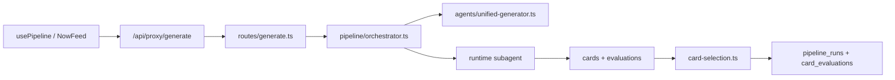
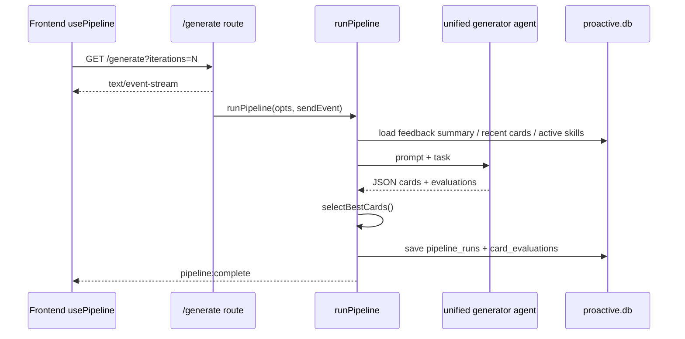

# Generation

## 结论

当前在线卡片生成主链路是：

`GET /generate -> runPipeline() -> buildUnifiedGeneratorPrompt() -> runAgent() -> selectBestCards()`

前端通过 `/api/proxy/generate?iterations=N` 打到用户容器，后端用 SSE 推送 pipeline 事件。



## 边界

包含：

- 手动 `/generate` 和 auto-generate 触发。
- prompt 构建、agent 调用、JSON 解析。
- self-review evaluation、card selection、多样性约束。
- pipeline run 和 evaluation 持久化。
- 前端 run state、SSE 消费、NowFeed 展示。

不包含：

- 数据怎么接进来，看 [Data Connectors](./data-connectors)。
- memory/profile/skill 的存储规则，看 [Memory](./memory)。
- feedback event 的写入和学习回流，看 [Feedback](./feedback)。

## 核心链路



## 当前设计

| 环节 | 当前事实 |
|---|---|
| 路由 | `routes/generate.ts` 只允许一个 pipeline 同时运行；重复请求返回 409。 |
| 输出语言 | 读取 `user_settings.generation_language`，规范值是 `zh-Hans` / `en`。 |
| 反馈输入 | generation 前会调用 `syncCardChatFeedback()`，失败只 warn，不阻断生成。 |
| prompt 输入 | recent feedback summary、recent generated cards summary、active skills section。 |
| agent 输出 | 期待 JSON，包含 `cards`、`evaluations`、`iterationFeedback`。 |
| 选卡 | `PASS_THRESHOLD = 5.0`，最多 10 张，每个 `goalBasket` 最多 3 张。 |
| 持久化 | `pipeline_runs` 存 run 和 iterations；`card_evaluations` 存可 SQL 查询的评价行。 |
| 前端状态 | `usePipeline.ts` 用 sessionStorage 恢复 run state，消费 SSE data line。 |

## 开发入口

| 改动 | 先看 |
|---|---|
| 生成 HTTP/SSE | `pinai-openclaw/plugins/proactive-ai/routes/generate.ts` |
| pipeline 编排 | `pinai-openclaw/plugins/proactive-ai/pipeline/orchestrator.ts` |
| prompt / 输出契约 | `pinai-openclaw/plugins/proactive-ai/agents/unified-generator.ts` |
| agent 调用和 JSON 解析 | `pinai-openclaw/plugins/proactive-ai/pipeline/agent-runner.ts` |
| 选卡规则 | `pinai-openclaw/plugins/proactive-ai/pipeline/card-selection.ts` |
| evaluation 提取 | `pinai-openclaw/plugins/proactive-ai/pipeline/extract-evaluations.ts` |
| 自动生成 | `scheduler/auto-loop.ts`、`routes/settings.ts` |
| 前端 | `proactive-ai-frontend/src/hooks/usePipeline.ts`、`components/NowFeed.tsx`、`components/AutoGenerateSettings.tsx` |

## 验证方式

```bash
npx tsx --test pinai-openclaw/plugins/proactive-ai/routes/generate.test.ts
npx tsx --test pinai-openclaw/plugins/proactive-ai/agents/unified-generator.test.ts
npx tsx --test pinai-openclaw/plugins/proactive-ai/pipeline/orchestrator-evaluations.test.ts
npx tsx --test pinai-openclaw/plugins/proactive-ai/pipeline/generated-cards-summary.test.ts
npx tsx --test pinai-openclaw/plugins/proactive-ai/scheduler/auto-loop.test.ts
npm run type-check
```

手工验证：

- 登录 proactive frontend，确保 container running。
- 点击 generate，Network 应看到 `/api/proxy/generate?iterations=...`。
- SSE 应出现 `pipeline:start`、`pipeline:iteration`、`pipeline:cards`、`pipeline:evaluation`、`pipeline:complete`。
- 生成后可查最近 `pipeline_runs` 和 `card_evaluations`。

## 踩坑

- `/generate` 是 GET + SSE，不是 JSON POST。
- `PASS_THRESHOLD` 现在是 5.0；不要按旧 README 里的 7.0 判断。
- `syncCardChatFeedback()` 失败不会中断生成，这是为了避免反馈总结故障拖垮主路径。
- agent 可能输出 placeholder card id，pipeline 会按 run id 重新赋全局唯一 id。
- auto loop 和手动 `/generate` 不是完全同一个入口，改动时要分别验证。

## 相关模块

- [Memory](./memory)：generation 使用的 raw、signals、memory、profile、skill 上下文。
- [Feedback](./feedback)：feedback summary 和 intent state 如何影响下一轮生成。
