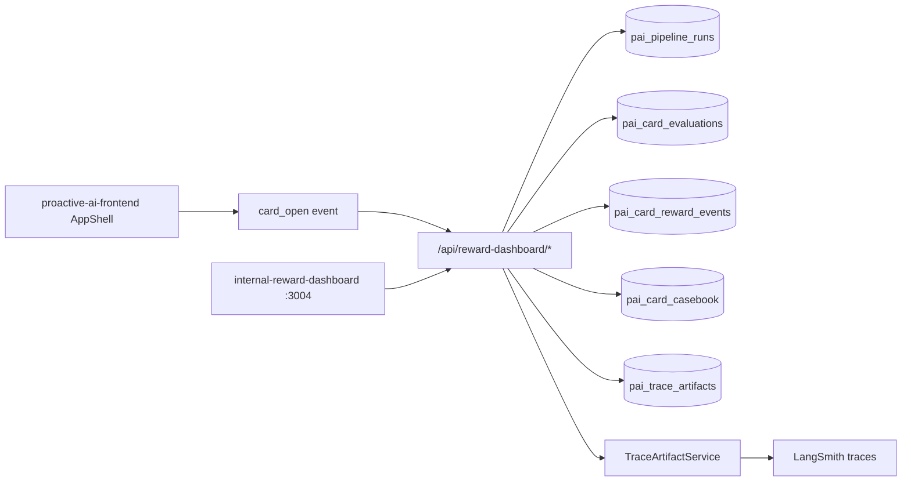

# Internal Reward Dashboard

## 结论

`internal-reward-dashboard/` 是 repo 顶层独立 Vite React app,用于内部 review 主动生成的卡片。它不是主产品前端,也不参与 `proactive-ai-frontend` 的用户体验。

核心链路:

`proactive-ai-frontend card open → /api/reward-dashboard/cards/{cardId}/score → pai_card_reward_events`

`internal-reward-dashboard → /api/reward-dashboard/* → pai_pipeline_runs + pai_card_evaluations + pai_card_reward_events + pai_card_casebook + pai_trace_artifacts`



## 边界

包含:

- 内部 review 页面:`/runs`、`/runs/:runId`、`/cards/:cardId`、`/casebook`、`/traces/:runId`、`/personal-data`。
- 后端 `/api/reward-dashboard/*` 面向内部 dashboard 的读写 API。
- 用户打开卡片的轻量 reward ledger 事件(`card_open`)。
- reviewer 1-10 打分、好/坏案例库、LangSmith trace artifact、personal data snapshot。

不包含:

- 主产品 Now Feed、card chat、用户反馈体验,看 [Execution](./execution) 和 [Feedback](./feedback)。
- generator 如何产卡、如何自评,看 [Generation](./generation)。
- scheduler 框架本身,看 [Background Tasks](./background-tasks)。
- memory/raw/signals schema 的业务语义,看 [Memory](./memory)。

## 当前设计

| 维度 | 当前事实 |
|---|---|
| 前端位置 | `internal-reward-dashboard/` 是独立 Vite app,端口 `3004`,包名 `@pin-ai/internal-reward-dashboard`。不要放进 `proactive-ai-frontend/src/`,也不要默认加入 root npm workspace。 |
| 登录 | 复用 Supabase Google OAuth,读取 `../pinai-agents/.env` 里的 `VITE_SUPABASE_URL` / `VITE_SUPABASE_PUBLISHABLE_KEY`。 |
| API 代理 | 本地开发时走 same-origin `/api/*`,Vite proxy 默认转到 `http://127.0.0.1:8000`;可用 `VITE_PIN_API_PROXY_TARGET` 覆盖。 |
| Fly dev | 独立 Fly app `proactive-ai-reward-dashboard-dev`,默认 URL `https://proactive-ai-reward-dashboard-dev.fly.dev`;nginx 运行时把 `/api/*` 反代到 `https://proactive-ai-agents-dev.fly.dev`。 |
| 后端 route | `pinai-agents/src/pinai_agents/web/routes/ui/reward_dashboard.py`,prefix 是 `/api/reward-dashboard`。 |
| Repository | `pinai-agents/src/pinai_agents/web/db/repositories/reward.py`,必须在 `user_scoped_tx` 内构造,所有查询按 `user_id` scope。 |
| Reward ledger | `pai_card_reward_events` 是 append-only ledger。`card_open` / `user_score` 来源是 `user`,`reviewer_score` 来源是 `reviewer`,`imported_feedback` 来源是 `system`。 |
| Casebook | `pai_card_casebook` 存 reviewer 选出的好/坏/惊喜/重复/幻觉/弱来源等案例,用于后续人工分析,不直接改 generation 主链路。 |
| Trace artifact | `TraceArtifactService` 用 LangSmith metadata `pinai_run_id` 定位 generator root trace,生成可重复渲染的 `trace_tree` / `summary` / SVG。 |
| Personal data | `/personal-data` 是给 reviewer 查 generator 可见上下文的只读 snapshot,不作为 agent runtime 依赖。 |

## 页面工作流

| 页面 | 当前职责 |
|---|---|
| `/runs` | 入口工作台。顶部 metrics strip 看总体规模和风险；主体是可筛选 run table，不再渲染独立的摘要区块。触发生成和 active generation 状态刷新失败只显示局部错误，不阻断历史批次列表，也不清空已有生成中行；历史批次首次加载失败但 active generation 已返回时，也必须继续展示生成中行。active generation 行必须显示 attempts/maxAttempts 和 lastError，不能只给“查看任务日志”这种没有入口的空提示。批次时间字段来自后端时必须容错，坏时间显示 `-`，不能让入口页白屏；日期筛选只接受合法 `YYYY-MM-DD`，坏值按未设置处理。未落库的 active placeholder 不能放行到批次/链路详情，真实落库的空结果或失败批次仍然可以打开详情和 trace。同一筛选条件下的 run 列表刷新失败会保留上一次成功加载的数据并显示局部错误；筛选条件已变化时保留控制区但隐藏旧批次。正常工作台必须提供手动刷新当前批次视图的入口。初始加载失败且没有任何可展示行时，必须保留重新加载、样本库、上下文入口。 |
| `/runs/:runId` | 逐张评一批卡。展示生成过程摘要、输入来源、四阶段链路说明、卡片正文、证据、用户反馈/reward 数量、evaluator feedback、1-10 reviewer score、casebook editor,并支持复制批次复盘摘要。正常详情页必须提供手动刷新当前批次的入口，尤其用于 score / casebook 保存后刷新失败的恢复。批次时间字段必须容错，坏时间显示 `-` 或“未完成”。初始加载失败时必须保留返回批次列表、查看生成链路、重新加载入口。 |
| `/cards/:cardId` | 深挖单卡。顶部显示人工判断、评估分差、反馈事件、证据/样本状态;展示卡片正文、写卡依据、为什么现在、建议动作、评估器维度、批次/链路/样本库/上下文复盘动作、可复制的单卡复盘摘要、reward history、产品反馈事件、同 intent 历史卡。正常详情页必须提供手动刷新当前卡片的入口，尤其用于 score / casebook 保存后刷新失败的恢复。奖励事件、反馈事件、相关卡片时间字段必须容错，坏时间显示 `-` 或回退到 run id。初始加载失败时必须保留返回批次列表、样本库、重新加载入口。 |
| `/traces/:runId` | 看生成链路。展示 LangSmith 绑定、白话摘要、artifact/LangSmith/SVG/阶段完整性检查、批次/首卡/样本库/上下文复盘动作、可复制的链路复盘摘要、四阶段 story、输入和决策、trace SVG;trace missing / failed 时必须显示明确原因。正常链路页必须提供手动刷新入口；已有 trace artifact 后刷新失败时保留旧 trace 并显示局部错误。读取 trace artifact 首次失败时保留返回批次、重新加载、重建链路记录入口,不能只给整页死错误。 |
| `/casebook` | 样本库。按 label、分数、basket、intent、evaluator gap、时间过滤;顶部显示当前页样本数、正负样本、保存分均值、平均绝对评估分差;支持展开或复制带卡片/批次/链路路径和证据引用的当前页 markdown。移除样本走二次确认，删除失败显示局部错误，不清空当前表格。样本更新时间字段必须容错，坏时间显示 `-`，不能让样本库白屏。同一筛选/分页条件下的刷新失败保留上一次成功加载的数据但禁用复制和导出；筛选或分页已变化时保留控制区但隐藏旧样本。正常样本库页必须提供手动刷新当前页样本的入口。初始加载失败时必须保留返回批次列表、重新加载入口。 |
| `/personal-data` | 只读 inspect surface。顶部显示总上下文、当前视图、筛选命中和时间范围,提供回评审、样本库、刷新上下文和复制当前视图入口;按 category / 时间 / query 浏览 generator 可见的 profile、memory、signals、raw、devices、connectors 等上下文。概况 overview 刷新失败只降级成局部提示，当前 category 数据能加载时继续显示主表；query / 时间变更时先隐藏旧 overview 计数。上下文时间字段必须容错，坏时间显示 `-`。同一 category / 时间 / query / 分页条件下的刷新失败保留上一次成功加载的数据但禁用复制；筛选或分页已变化时保留控制区但隐藏旧数据。初始加载失败时必须保留返回批次列表、样本库、重新加载入口。 |

`/personal-data` 后端 snapshot 和前端展示/复制都必须递归脱敏 secret-like payload key,包括 `token`、`accessToken`、`refresh_token`、`secret`、`clientSecret`、`api_key`、`apiKey`、`password`、`private_key`、`authorization`、`cookie`、`session`、`credential` 等。`app_state` 的敏感含义可能在 KV 的 `key` 里,后端和前端都必须在 `key` 命中这些模式时脱敏 `value`,并且摘要只能来自脱敏后的结构化 payload 或固定提示。脱敏值显示为 `已隐藏敏感值`,保留字段存在但不能把真实值发到页面或 markdown。

Card / run / trace 页面里的 raw JSON debug 面板也视为不可信展示边界,必须先走前端共享脱敏 helper 再渲染,不能直接把 API payload `JSON.stringify` 到页面。这里是后端 snapshot 脱敏之外的第二道防线,用于兜住 trace summary、card snapshot 或第三方 metadata 里漏出的 secret-like key。

API client 组 query string 时只允许有限数字和白名单 enum。`NaN` / `Infinity` / 非正 limit / 负 offset 这类异常值必须在本地忽略;run quality、casebook label、personal-data category 这类 enum 即使 TypeScript 类型被绕过,运行时也必须按白名单过滤;casebook score / evaluator gap 筛选只能是 `0..10`,且最低分不能大于最高分。日期区间开始日期不能晚于结束日期。页面上出现越界或矛盾输入时必须显示本地错误并停止请求,不能静默按未筛选加载;metrics 窗口只能是 `1..90` 的整数。分页条数只能使用页面白名单值。手动触发生成的 `cardsToGenerate` 只能是 `1..10` 的整数,异常值回退到后端默认的 `8`。

后端返回的 `total` / 分类计数也按不可信边界处理。页面展示和分页计算只接受有限非负整数,异常值显示为 `0` 或按当前页条目数兜底,不能出现 `NaN` / `Infinity` 或 `1 / NaN` 分页。

人工评分写入必须是 `1..10` 的有限数字。前端 API client 必须在发请求前拒绝 `NaN` / `Infinity` / 0 / >10;后端 `/cards/{card_id}/score` 对 `user_score` / `reviewer_score` 也必须要求 score 存在且在 `1..10`,并显式拒绝 boolean score,不能让 JSON `true` 被 Python 当成 `1`。只有 `card_open` 可以不传 score 并由后端固定写 `1.0`。

复制出的复盘 markdown 必须只写真实可打开的卡片/批次/链路路径。后端返回空 ID 或坏 ID 时,页面路由可以安全回到 `/runs`,但复制文本里要显示 `未保存`,不能把兜底路由当成详情链接。页面里的卡片/批次/链路操作按钮也必须在缺少目标 ID 时禁用,不能让 reviewer 点到兜底页。打分、样本库保存/移除这类写操作缺少卡片 ID 时必须禁用或在 API client 边界拒绝,不能发出坏请求。LangSmith 外链也必须复用 `safeExternalHref`,只接受 `http/https`。

## API 表面

| Endpoint | 用途 |
|---|---|
| `GET /api/reward-dashboard/runs` | run 列表、review 状态、reward/evaluator 汇总、trace 状态。 |
| `GET /api/reward-dashboard/runs/{run_id}` | 单次 generation 的卡片、evaluation、reward history、casebook、trace。 |
| `GET /api/reward-dashboard/cards/{card_id}` | 单卡详情、相关历史卡、反馈、trace。 |
| `POST /api/reward-dashboard/cards/{card_id}/score` | 追加 `card_open` / `user_score` / `reviewer_score` 等 reward event。 |
| `POST /api/reward-dashboard/cards/{card_id}/casebook` | upsert reviewer casebook entry。 |
| `DELETE /api/reward-dashboard/cards/{card_id}/casebook` | 删除 casebook entry。 |
| `GET /api/reward-dashboard/casebook` | 按 label、score、basket、intent、evaluator gap、时间筛 casebook。 |
| `GET /api/reward-dashboard/runs/{run_id}/trace` | 读取已有 trace artifact;不存在时返回 explicit missing。 |
| `POST /api/reward-dashboard/runs/{run_id}/trace` | 按需从 LangSmith 生成/刷新 trace artifact。 |
| `GET /api/reward-dashboard/metrics` | dashboard 时间序列指标。 |
| `GET /api/reward-dashboard/personal-data` | reviewer inspect 用的 profile/settings/memory/signals/raw/device/connector snapshot。 |

## 开发入口

| 改动 | 先看 |
|---|---|
| dashboard shell / routes | `internal-reward-dashboard/src/app/App.tsx`、`src/routes/*.tsx` |
| dashboard API client / types | `internal-reward-dashboard/src/api/reward.ts` |
| dashboard auth | `internal-reward-dashboard/src/auth/supabase.ts` |
| shared trace 文本摘要 | `internal-reward-dashboard/src/lib/traceText.ts` |
| review components | `internal-reward-dashboard/src/components/CasebookEditor.tsx`、`ScoreControl.tsx`、`MetricStrip.tsx` |
| backend route | `pinai-agents/src/pinai_agents/web/routes/ui/reward_dashboard.py` |
| reward SQL/read model | `pinai-agents/src/pinai_agents/web/db/repositories/reward.py` |
| personal-data snapshot | `pinai-agents/src/pinai_agents/web/services/personal_data_snapshot.py` |
| LangSmith trace artifact | `pinai-agents/src/pinai_agents/web/services/trace_artifacts.py` |
| schema | `pinai-agents/db/migrations/042_pai_card_reward_infra.sql` |
| 用户侧 card open 打点 | `proactive-ai-frontend/src/components/AppShell.tsx`、`src/lib/api.ts:recordCardOpen` |

## 本地运行

后端先起 `pinai-web`:

```bash
make up
# 或轻量本地:
cd pinai-agents && uv run uvicorn pinai_agents.web.asgi:app --reload --port 8000
```

dashboard:

```bash
cd internal-reward-dashboard
npm install
npm run dev -- --host 127.0.0.1 --port 3004
```

打开 `http://127.0.0.1:3004/runs`。本地 API 请求走 Vite proxy 到 `pinai-web:8000`,浏览器里不需要额外 CORS 配置。

## 部署

dev 环境是独立 Fly 静态站点:

```bash
make deploy-reward-dashboard-dev
```

CI/CD 入口是独立 workflow `.github/workflows/internal-reward-dashboard-dev.yml`:PR 只跑 `type-check` / `test` / `build`;push 到 `proactive-ai-v3` 时,只要 `internal-reward-dashboard/**` 变化,就会从 `pinai-agents/.env.dev` 解出 `VITE_SUPABASE_URL` / `VITE_SUPABASE_PUBLISHABLE_KEY` 作为 build args,再执行 `flyctl deploy --config internal-reward-dashboard/fly.toml --remote-only`。部署后的默认地址是 `https://proactive-ai-reward-dashboard-dev.fly.dev`。

这个 app 不使用自定义域名,也不复用 `proactive-ai-frontend` 镜像。`internal-reward-dashboard/Dockerfile` 只构建 dashboard 静态产物,运行时 nginx 负责 SPA fallback 和 `/api/*` same-origin proxy。

## 验证方式

```bash
# dashboard
cd internal-reward-dashboard && npm run type-check
cd internal-reward-dashboard && npm test
cd internal-reward-dashboard && npm run build

# backend reward surface
cd pinai-agents && uv run ruff check .
cd pinai-agents && uv run pytest tests/web/db/repositories/test_reward_repo.py
cd pinai-agents && uv run pytest tests/web/routes/test_reward_dashboard.py
cd pinai-agents && uv run pytest tests/web/services/test_trace_artifacts.py

# 主前端 card_open helper
cd proactive-ai-frontend && npm run type-check
```

手工验证:

- 登录主前端,点开一张卡,应写入 `pai_card_reward_events(source='user', event_type='card_open', score=1)`。
- 登录 `http://127.0.0.1:3004/runs`,run 列表应能看到真实 generation runs、trace 状态和 evaluator gap。
- 在 `/runs/:runId` 或 `/cards/:cardId` 打 reviewer score / casebook,刷新后 reward history 和 casebook 状态应保留。
- 在 `/traces/:runId` 触发 trace 生成;没有 `LANGSMITH_API_KEY` 时应显示 explicit missing,不是空白页。

## 踩坑

- 这个 app 是独立 Fly app,不是 `proactive-ai-frontend` 的一个路由。改 dashboard 后看 `.github/workflows/internal-reward-dashboard-dev.yml`,不要去改主前端部署路径。
- 不要把 `/api/reward-dashboard/*` 当普通用户产品 API 扩散。它走 Supabase JWT,但语义是内部 review/read model。
- `card_open` 只表示用户打开卡片,默认 score=1;confirm / dismiss / snooze / text feedback 仍写 `pai_feedback_events`,不要复制进 reward ledger。
- trace 绑定必须靠 generator LangSmith metadata `pinai_run_id`,不要按最近时间窗口猜 trace。
- personal-data snapshot 是 reviewer inspection surface,不要让 chat/generator runtime 依赖它。
- reward event 的 `source/event_type` 配对要保持严格,否则 dashboard 指标会混掉用户信号和 reviewer 信号。

## 相关模块

- [Generation](./generation):`pai_pipeline_runs`、`pai_card_evaluations`、LangSmith metadata 的来源。
- [Feedback](./feedback):用户 feedback 和 reward ledger 的边界。
- [Background Tasks](./background-tasks):`generator.manual` / `generator.auto` 任务状态来源。
- [Runtime & Deployment](./runtime-deployment):本地启动、web 进程和环境变量。

## 相关 AI Plans

- [Card Reward Infra + Internal Dashboard](../plans/2026-05-13-card-reward-infra):reward ledger、casebook、trace artifact 和内部评分网页的设计计划。
- [Card Quality Iteration Dashboard](../plans/2026-05-15-card-quality-iteration-dashboard):把 dashboard 升级为卡片质量标注、坏因归因、trace 阶段映射和 weekly failure review 的实施计划。
