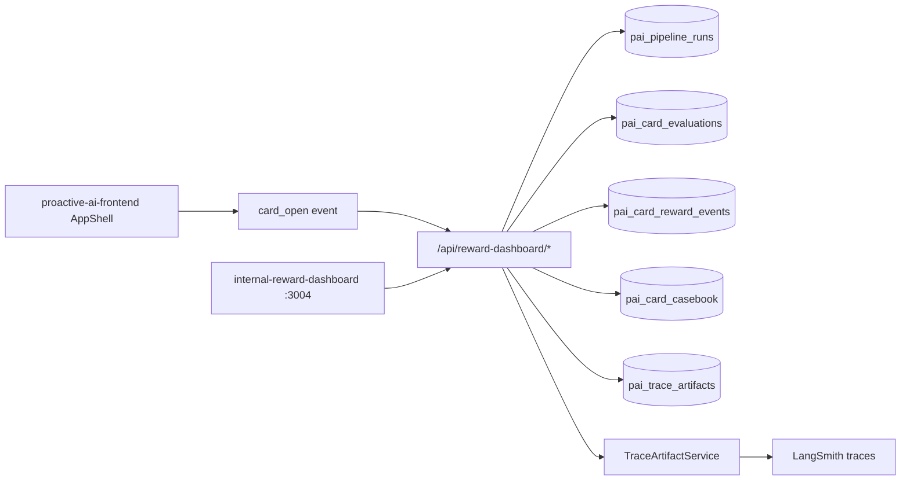

# Internal Reward Dashboard

## 结论

`internal-reward-dashboard/` 是 repo 顶层独立 Vite React app,用于内部 review 主动生成的卡片。它不是主产品前端,也不参与 `proactive-ai-frontend` 的用户体验。

核心链路:

`proactive-ai-frontend card open → /api/reward-dashboard/cards/{cardId}/score → pai_card_reward_events`

`internal-reward-dashboard → /api/reward-dashboard/* → pai_pipeline_runs + pai_card_evaluations + pai_card_reward_events + pai_card_casebook + pai_trace_artifacts`



## 边界

包含:

- 内部 review 页面:`/runs`、`/runs/:runId`、`/cards/:cardId`、`/casebook`、`/traces/:runId`、`/personal-data`。
- 后端 `/api/reward-dashboard/*` 面向内部 dashboard 的读写 API。
- 用户打开卡片的轻量 reward ledger 事件(`card_open`)。
- reviewer 1-10 打分、好/坏案例库、LangSmith trace artifact、personal data snapshot。

不包含:

- 主产品 Now Feed、card chat、用户反馈体验,看 [Execution](./execution) 和 [Feedback](./feedback)。
- generator 如何产卡、如何自评,看 [Generation](./generation)。
- scheduler 框架本身,看 [Background Tasks](./background-tasks)。
- memory/raw/signals schema 的业务语义,看 [Memory](./memory)。

## 当前设计

| 维度 | 当前事实 |
|---|---|
| 前端位置 | `internal-reward-dashboard/` 是独立 Vite app,端口 `3004`,包名 `@pin-ai/internal-reward-dashboard`。不要放进 `proactive-ai-frontend/src/`,也不要默认加入 root npm workspace。 |
| 登录 | 复用 Supabase Google OAuth,读取 `../pinai-agents/.env` 里的 `VITE_SUPABASE_URL` / `VITE_SUPABASE_PUBLISHABLE_KEY`。 |
| API 代理 | 本地开发时走 same-origin `/api/*`,Vite proxy 默认转到 `http://127.0.0.1:8000`;可用 `VITE_PIN_API_PROXY_TARGET` 覆盖。 |
| 后端 route | `pinai-agents/src/pinai_agents/web/routes/ui/reward_dashboard.py`,prefix 是 `/api/reward-dashboard`。 |
| Repository | `pinai-agents/src/pinai_agents/web/db/repositories/reward.py`,必须在 `user_scoped_tx` 内构造,所有查询按 `user_id` scope。 |
| Reward ledger | `pai_card_reward_events` 是 append-only ledger。`card_open` / `user_score` 来源是 `user`,`reviewer_score` 来源是 `reviewer`,`imported_feedback` 来源是 `system`。 |
| Casebook | `pai_card_casebook` 存 reviewer 选出的好/坏/惊喜/重复/幻觉/弱来源等案例,用于后续人工分析,不直接改 generation 主链路。 |
| Trace artifact | `TraceArtifactService` 用 LangSmith metadata `pinai_run_id` 定位 generator root trace,生成可重复渲染的 `trace_tree` / `summary` / SVG。 |
| Personal data | `/personal-data` 是给 reviewer 查 generator 可见上下文的只读 snapshot,不作为 agent runtime 依赖。 |

## API 表面

| Endpoint | 用途 |
|---|---|
| `GET /api/reward-dashboard/runs` | run 列表、review 状态、reward/evaluator 汇总、trace 状态。 |
| `GET /api/reward-dashboard/runs/{run_id}` | 单次 generation 的卡片、evaluation、reward history、casebook、trace。 |
| `GET /api/reward-dashboard/cards/{card_id}` | 单卡详情、相关历史卡、反馈、trace。 |
| `POST /api/reward-dashboard/cards/{card_id}/score` | 追加 `card_open` / `user_score` / `reviewer_score` 等 reward event。 |
| `POST /api/reward-dashboard/cards/{card_id}/casebook` | upsert reviewer casebook entry。 |
| `DELETE /api/reward-dashboard/cards/{card_id}/casebook` | 删除 casebook entry。 |
| `GET /api/reward-dashboard/casebook` | 按 label、score、basket、intent、evaluator gap、时间筛 casebook。 |
| `GET /api/reward-dashboard/runs/{run_id}/trace` | 读取已有 trace artifact;不存在时返回 explicit missing。 |
| `POST /api/reward-dashboard/runs/{run_id}/trace` | 按需从 LangSmith 生成/刷新 trace artifact。 |
| `GET /api/reward-dashboard/metrics` | dashboard 时间序列指标。 |
| `GET /api/reward-dashboard/personal-data` | reviewer inspect 用的 profile/settings/memory/signals/raw/device/connector snapshot。 |

## 开发入口

| 改动 | 先看 |
|---|---|
| dashboard shell / routes | `internal-reward-dashboard/src/app/App.tsx`、`src/routes/*.tsx` |
| dashboard API client / types | `internal-reward-dashboard/src/api/reward.ts` |
| dashboard auth | `internal-reward-dashboard/src/auth/supabase.ts` |
| shared trace 文本摘要 | `internal-reward-dashboard/src/lib/traceText.ts` |
| review components | `internal-reward-dashboard/src/components/CasebookEditor.tsx`、`ScoreControl.tsx`、`MetricStrip.tsx` |
| backend route | `pinai-agents/src/pinai_agents/web/routes/ui/reward_dashboard.py` |
| reward SQL/read model | `pinai-agents/src/pinai_agents/web/db/repositories/reward.py` |
| personal-data snapshot | `pinai-agents/src/pinai_agents/web/services/personal_data_snapshot.py` |
| LangSmith trace artifact | `pinai-agents/src/pinai_agents/web/services/trace_artifacts.py` |
| schema | `pinai-agents/db/migrations/042_pai_card_reward_infra.sql` |
| 用户侧 card open 打点 | `proactive-ai-frontend/src/components/AppShell.tsx`、`src/lib/api.ts:recordCardOpen` |

## 本地运行

后端先起 `pinai-web`:

```bash
make up
# 或轻量本地:
cd pinai-agents && uv run uvicorn pinai_agents.web.asgi:app --reload --port 8000
```

dashboard:

```bash
cd internal-reward-dashboard
npm install
npm run dev -- --host 127.0.0.1 --port 3004
```

打开 `http://127.0.0.1:3004/runs`。本地 API 请求走 Vite proxy 到 `pinai-web:8000`,浏览器里不需要额外 CORS 配置。

## 验证方式

```bash
# dashboard
cd internal-reward-dashboard && npm run type-check
cd internal-reward-dashboard && npm test
cd internal-reward-dashboard && npm run build

# backend reward surface
cd pinai-agents && uv run ruff check .
cd pinai-agents && uv run pytest tests/web/db/repositories/test_reward_repo.py
cd pinai-agents && uv run pytest tests/web/routes/test_reward_dashboard.py
cd pinai-agents && uv run pytest tests/web/services/test_trace_artifacts.py

# 主前端 card_open helper
cd proactive-ai-frontend && npm run type-check
```

手工验证:

- 登录主前端,点开一张卡,应写入 `pai_card_reward_events(source='user', event_type='card_open', score=1)`。
- 登录 `http://127.0.0.1:3004/runs`,run 列表应能看到真实 generation runs、review queue、trace 状态和 evaluator gap。
- 在 `/runs/:runId` 或 `/cards/:cardId` 打 reviewer score / casebook,刷新后 reward history 和 casebook 状态应保留。
- 在 `/traces/:runId` 触发 trace 生成;没有 `LANGSMITH_API_KEY` 时应显示 explicit missing,不是空白页。

## 踩坑

- 这个 app 当前是内部本地 review 工具,没有纳入 `proactive-ai-frontend` 的 Fly 部署路径。上线成独立 app 前,不要假设 CI 会部署它。
- 不要把 `/api/reward-dashboard/*` 当普通用户产品 API 扩散。它走 Supabase JWT,但语义是内部 review/read model。
- `card_open` 只表示用户打开卡片,默认 score=1;confirm / dismiss / snooze / text feedback 仍写 `pai_feedback_events`,不要复制进 reward ledger。
- trace 绑定必须靠 generator LangSmith metadata `pinai_run_id`,不要按最近时间窗口猜 trace。
- personal-data snapshot 是 reviewer inspection surface,不要让 chat/generator runtime 依赖它。
- reward event 的 `source/event_type` 配对要保持严格,否则 dashboard 指标会混掉用户信号和 reviewer 信号。

## 相关模块

- [Generation](./generation):`pai_pipeline_runs`、`pai_card_evaluations`、LangSmith metadata 的来源。
- [Feedback](./feedback):用户 feedback 和 reward ledger 的边界。
- [Background Tasks](./background-tasks):`generator.manual` / `generator.auto` 任务状态来源。
- [Runtime & Deployment](./runtime-deployment):本地启动、web 进程和环境变量。

## 相关 AI Plans

- [Card Reward Infra + Internal Dashboard](../plans/2026-05-13-card-reward-infra):reward ledger、casebook、trace artifact 和内部评分网页的设计计划。
