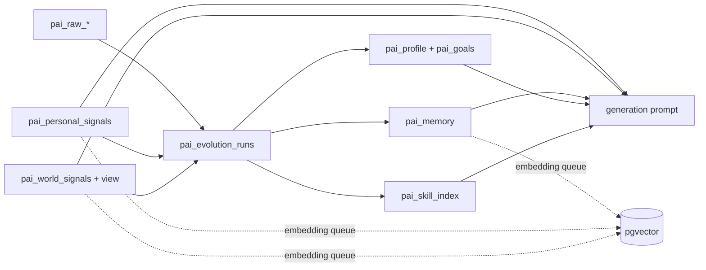

# Memory

## 结论

Memory 模块负责把已接入的数据沉淀为生成链路可用的上下文。数据进入 `pai_raw_*` / `pai_personal_signals` / `pai_world_signals` 之后,本模块管它怎么存、怎么读、怎么演进。所有表都在 Postgres 同一 DB 的 public schema(前缀 `pai_*`);LangGraph chat checkpointer 独占 `langgraph` schema。**老的 SQLite `raw.db` / `proactive.db` / `mobile_items.db` 已经彻底退役**,代码里没有任何引用。

上游接入看 [Data Connectors](./data-connectors)。



## 边界

包含:

- `pai_raw_*` 各 typed 表的 schema 与共用结构(reference 三元组、`occurred_at` / `ingested_at`、`dedupe_key`)。
- `pai_personal_signals` 的 `open → consumed → archived` 状态机。
- `pai_world_signals`(全局共享)+ `pai_world_signal_user_view`(per-user 投影)的双表设计。
- `pai_memory`(`active → archived / superseded` + `superseded_by` 链)、`pai_profile` + `pai_goals`、`pai_skill_index`(body inline)。
- `pai_evolution_runs` 的 5 种 `trigger_kind` + status 生命周期。
- pgvector embedding 队列(`pai_embedding_queue`)与异步生成。
- `/api/memory|signals|profile|skills|raw|evolution|world` 路由(UI + agent 双表面)。
- `pinai_sdk` 在 sandbox 内的对端调用。
- 三个 chat-side agent(crystallize / dream / evolve)的写入语义。
- RLS(`SET LOCAL app.user_id`)的多租户隔离。

不包含:

- 数据怎么进来(Composio / device ingest),看 [Data Connectors](./data-connectors)。
- 卡片 pipeline 怎么读 memory,看 [Generation](./generation)。
- 反馈事件如何生成,看 [Feedback](./feedback)。
- scheduler 怎么派 `auto.dreaming` / `connector.evolve`(以及 `crystallize` 的预留 kind 现状),看 [Background Tasks](./background-tasks)。

## 表层级

| Tier | 表 | 作用 |
|---|---|---|
| 0 raw | `pai_raw_gmail_messages` / `pai_raw_gcal_events` / `pai_raw_gdrive_files` / `pai_raw_slack_messages` / `pai_raw_github_issues` / `pai_raw_calendly_events` / `pai_raw_stripe_invoices` / `pai_raw_twitter_bookmarks` / `pai_raw_youtube_subscriptions` / `pai_raw_linkedin_profile` / `pai_raw_events` / `pai_raw_device_apps_snapshot` / `pai_raw_device_contacts_snapshot` / `pai_raw_device_health_observations` | 字段化批量数据。老 connector 保留 typed 表;长尾 / generic connector 统一落 `pai_raw_events`(`toolkit`,`entity_type`,`payload`);device source 仍按 policy 落 typed 表或 signal。 |
| 1 signals | `pai_personal_signals` / `pai_world_signals`(+ `pai_world_signal_user_view`) | 短期观察,先给 pipeline / evolution 消费。 |
| 2 memory | `pai_memory` | evolution / manual 沉淀出的长期事实,带 `quality` / `confidence` / `status` / `superseded_by`。 |
| 3 profile / skill | `pai_profile` / `pai_goals` / `pai_skill_index` | 高浓缩画像、长期目标、可执行 skill。 |

每张 `pai_raw_*` 共用结构:

- `(user_id, id)` PK + 业务 natural key。
- `occurred_at`(事件时间)、`ingested_at`(写入 PIN 的时间)。
- `dedupe_key`:`UNIQUE (user_id, dedupe_key) WHERE dedupe_key IS NOT NULL`。
- reference 三元组:`reference_count INT`、`last_referenced_at TIMESTAMPTZ`、`referenced_by_runs JSONB`(被 evolve / generate 引用后 bump)。

## 状态机

### `pai_personal_signals.status`

```
open                              (刚 ingest)
  ↓ signals.consume(id, run_id)   (evolve / generation 引用)
consumed                          (consumed_by_run_id 锁定)
  ↓ expires_at 到期 / 手动 archive
archived
```

关键字段:`status`、`consumed_by_run_id`、`expires_at`、reference 三元组、`source_raw_table` + `source_raw_ids JSONB`。

### `pai_memory.status`

```
active                            (当前事实)
  ├→ archived                     (不再相信 / 不再相关)
  └→ superseded                   (被新陈述替换;superseded_by → 新 id)
       新行 status='active',形成链 mem_old ← mem_new ← mem_current
```

查询默认只看 `status='active'`;追溯链路时 follow `superseded_by`。

### `pai_world_signal_user_view.status`

`new → open → consumed → archived`。world signal 全局共享,但每用户单独存 `salience` / `scored_reason` / `consumed_by_run_id` 和自己的 reference 三元组。

### `pai_evolution_runs.status` + `trigger_kind`

| `trigger_kind` | 触发源 |
|---|---|
| `chat_burst` | crystallize agent(当前由 chat 进程内联触发;scheduler `crystallize` kind 路由已就位但没接 producer) |
| `daily_dream` | scheduler kind `auto.dreaming` |
| `manual` | CLI / 内部 / 测试触发 |
| `on_event` | scheduler kind `connector.evolve`(init / 非空 sync 之后) |
| `consolidation` | 预留,未启用 |

`status`:`running` / `completed` / `failed`。所有 run 都写 `refs_consumed JSONB`(`{table: [id, ...]}`)+ `refs_produced JSONB` 做审计;LLM 失败时 `status='failed'` + `error_message`,raw / signals 不回滚。

## pgvector 与 embedding

migration `029_pgvector_semantic_memory.sql` 给 `pai_memory` / `pai_personal_signals` / `pai_world_signals` 各加一列 `embedding vector(1536)` + `embedding_model TEXT` + `embedded_at TIMESTAMPTZ`,model pin `text-embedding-3-small`(`web/embeddings.py:_MODEL`)。

异步队列 `pai_embedding_queue`:

- `(user_id, table_name, row_id)` PK,`status` ∈ `pending / running / done / failed`。
- 写入侧:repository 在 `memory.add` / `signals.add` / `world_signals.add` 之后 `embeddings.enqueue(conn, user_id, table_name, row_id, text)`。
- 消费侧:`web/scheduler/tick_loop.py` 每轮顺手 `embeddings.drain_queue()`(batch 32 条,调 LiteLLM `/embeddings` master key,写回 source 表的 embedding 列,翻 queue 行 `done`)。
- 失败 attempts 上限 5,`last_error TEXT(500)`。

HNSW 索引 + RLS(WHERE user_id 先短路再做 vector op),hot path:

- `pai_memory.embedding`:`USING hnsw (embedding vector_cosine_ops) WHERE embedding IS NOT NULL`。
- world signals 多一层 `title_summary_tsv tsvector`(`034_pai_world_signals_fts.sql`,GENERATED STORED),做语义 + 关键词 RRF 混合搜索。

## HTTP 路由

两份对称的路由,共用同一份 repository,只换鉴权层。

### UI 面(`/api/*`,Supabase JWT)

| Prefix | 作用 |
|---|---|
| `/api/memory` | list / get / add / archive / supersede / search |
| `/api/signals` | list / get / add / archive(写动作受限) |
| `/api/profile` | get / patch / goal CRUD |
| `/api/skills` | list / get / add / patch / disable |
| `/api/raw` | get(只读 raw 表;e.g. `/api/raw/gmail/recent`) |
| `/api/evolution-runs` 或 `/api/dreaming/runs` | 列 evolution_runs 给 dreaming panel |
| `/api/world` | recent / search(可读 world signals + 自己的 view) |

### Agent 面(`/api/agent/*`,EdDSA agent-run JWT 或 phantom token)

| Prefix | 作用 |
|---|---|
| `/api/agent/memory` | list / get / add / search / archive / supersede |
| `/api/agent/signals` | recent / get / add / consume |
| `/api/agent/profile` | get / upsert / preferences/merge / upsert_goal |
| `/api/agent/skills` | list / get / add |
| `/api/agent/raw` | list / get(toolkit-aware) |
| `/api/agent/world` | recent / search / score / consume / reference |
| `/api/agent/evolution` | create / list / get / complete / fail(`_dispatch_dream` 在 web 侧管 lifecycle,agent 调写) |
| `/api/agent/feedback` | list / log |
| `/api/agent/cards` | recent(读 generation 卡片做上下文) |
| `/api/agent/state` | KV(sandbox 跑 python 时持久 state) |

## pinai_sdk(sandbox 内对端)

`backend/packages/pinai_sdk/`,sandbox image 里 baked。chat 端工具或 `python_exec` 里都通过 `from pinai_sdk import client` 调,SDK 读 `PAI_API_URL` + `PAI_SANDBOX_TOKEN` env,打 `/api/agent/*`:

```python
await client.memory.list(min_quality=0.6, subject="topic:", limit=20)
await client.memory.search(q="投资偏好", min_quality=0.5, limit=10)
await client.memory.add(text="...", source="dream", source_run_id=run_id, quality=0.8)
await client.memory.supersede(old_id="...", new_id="...")

await client.signals.recent(status="open", kind="connector.gmail.message", limit=20)
await client.signals.consume(id="...", run_id=run_id)
await client.signals.add(kind="...", title="...", payload={...}, dedupe_key="...")

await client.profile.get()                       # {profile, goals}
await client.profile.upsert(facts={...}, preferences={...}, constraints={...})
await client.profile.merge_preference(key="card_topics", value="Prefers proactive AI and market-news cards.")
await client.profile.upsert_goal(key="health_marathon", title="...", priority="high")

await client.skills.list(status="enabled")
await client.skills.add(title="...", body="<markdown>", triggers=[...], created_run_id=run_id)

await client.raw.gmail.recent(hours=24, limit=10)
await client.raw.gcal.today(timezone="Asia/Shanghai")
await client.raw.list(toolkit="github", entity="issues", since="...", limit=50)

await client.world.recent(status="open", hours=24, limit=20)
await client.world.search(q="fed rate decision", limit=10)
await client.world.consume(id="...", run_id=run_id)
```

SDK 顶层 `client.sys.schema()` 列出当前 sandbox 能调的全部 endpoint(给 agent 自检用)。

## evolution 链路

### `connector.evolve`(`on_event`)

scheduler 派 → POST `chat /agent/run/evolve` → `chat/agents/evolve.py`:

输入:刚 ingest 的 raw 行(20 条 sample,从 `task.payload.refs` 取)+ 现有 memory subjects(去重)+ profile summary(避免矛盾)。

输出顺序:

1. `personal_signals`(最多 — 高 salience open signals)。
2. `memory`(自由 fact,`source='connector_init:<toolkit>'` 或 `'connector_sync:<toolkit>'`,`source_run_id=evolution_run.id`)。
3. `profile`(结构化 upsert,`facts` / `preferences` / `constraints` JSONB 桶里写描述性整句,不是 tag 词)。
4. `goals`(罕见 — 只在 ≥3 个事件跨周持续才升级成 goal,带 `key` 稳定 slug)。

LLM 失败:`evolution_runs.status='failed'` + `error_message`,raw + signals 保留。skill 写入比 memory 更保守 — 只有可形成可执行流程 + 置信度达阈值的 candidate 才落 `pai_skill_index`,普通事实只写 memory。

### `auto.dreaming`(`daily_dream`)

scheduler 派(每日按用户 timezone 06:00 左右一次)→ web 侧 `_dispatch_dream` 先写 `pai_evolution_runs` 行(`status='running'`)→ POST `chat /agent/run/dream` → chat agent 跑长 loop → web 侧根据 HTTP 结果翻 `completed` / `failed`。

输入:过去 24h 的 personal_signals 全量窗口是主输入,`auto.dreaming` 必须用 `status=all, hours=24, limit=10000, includePayload=true` 拉取,避免默认 20–50 条分页漏掉当天 ambient transcript / connector summary,同时保证 transcript payload 正文也进入分析窗口。raw 是同一 24h 窗口的补充证据,通过 `raw.list(..., hours=24, limit=10000)` 按支持的 typed raw source 拉取;再叠加当前 memory / profile / goals。

输出:`memory.add` / `memory.supersede`(整理矛盾)/ `profile.upsert`(每日漂移)/ 偶尔 `goals.upsert`。失败 lifecycle 包在 dispatcher 里,chat OOM 也能翻成 `failed` 不留 ghost row。

### `crystallize`(`chat_burst`)

`chat/agents/crystallize.py`,**当前 chat 进程 inline 触发**(不走 scheduler 队列;dispatcher 的 `crystallize` kind 路由已实现 POST `chat /agent/run/crystallize`,但 web 端没有 producer 入队 — 详见 [Background Tasks](./background-tasks))。

输入:chat agent 从 LangGraph checkpointer 读完整 transcript + recent personal_signals + 当前 memory / profile,生成 `source='crystallize'` 的 memory / skill。

跟 [Feedback](./feedback) 模块的 `card_chat_interest` 不一样:crystallize 写长期 memory / skill,feedback 只生成 next-generation 偏置。两者共用同一份 transcript 归一化。

## RLS 多租户

`023_pai_rls.sql` 给所有 per-user 表(22 张)挂 `USING (user_id = current_setting('app.user_id', true)::bigint)`。

repository 层 `user_scoped_tx(pool, user_id)`(`web/db/rls.py`)异步 context manager 包所有读写:

```python
async with user_scoped_tx(pool, user_id) as conn:
    await conn.execute("SET LOCAL app.user_id = $1", (user_id,))
    # 跑 SELECT / INSERT / UPDATE,RLS 自动按 user_id 过滤
```

`service_tx(pool)`(不带 user)用于 scheduler / world_ingest / migration 这类不属于任何用户的 batch job,policy 里有 fallback 允许 `app.user_id` 为空时通过。

`pai_world_signals` / `pai_yoyo_migration_log` 是例外,跟 user_id 无关,policy 单独写。

## 开发入口

| 改动 | 先看 |
|---|---|
| Schema 改 / 加表 | `backend/db/migrations/`(NNN 顺序,只向前,RLS policy 同步加在 023 风格的新文件里) |
| Memory repository | `web/db/repositories/memory.py`(`list_active`、`add`、`supersede`、`archive`) |
| Personal signals repository | `web/db/repositories/personal_signals.py`(`list`、`consume`、`add`、`mark_referenced`) |
| World signals repository / 全局 ingest | `web/db/repositories/world_signals.py`、`web/services/world_ingest.py` |
| Profile / goals repository | `web/db/repositories/profile.py` |
| Skills repository | `web/db/repositories/skills.py`(`body` inline TEXT,有 `revision` + `body_hash`) |
| Raw device repository | `web/db/repositories/raw_device.py` |
| Evolution repository | `web/db/repositories/evolution.py` |
| UI 路由 | `web/routes/ui/{memory,signals,profile,skills,raw,dreaming}.py` |
| Agent 路由 | `web/routes/agent/{memory,signals,profile,skills,raw,world,evolution,cards,feedback,state}.py` |
| pgvector embedding | `web/embeddings.py`、`pai_embedding_queue` migration `029` |
| pinai_sdk client | `backend/packages/pinai_sdk/src/pinai_sdk/` |
| dream / evolve / crystallize agent | `backend/src/pinai_agents/chat/agents/{dream,evolve,crystallize}.py` |
| RLS helper | `backend/src/pinai_agents/web/db/rls.py` |
| 前端 memory / profile / skill | `proactive-ai-frontend/src/hooks/{useMemories,useSkills}.ts`、`components/{MemoriesPanel,SkillsPanel,ControlPanel,GoalsView}.tsx` |

## 验证方式

```bash
# Repository 单测
cd backend && uv run pytest tests/web/db/                       # 全 repository 套件
cd backend && uv run pytest tests/web/db/test_memory_repo.py
cd backend && uv run pytest tests/web/db/test_personal_signals_repo.py
cd backend && uv run pytest tests/web/db/test_profile_repo.py

# Agent / UI 路由集成
cd backend && uv run pytest tests/web/routes/test_agent_profile_routes.py
cd backend && uv run pytest tests/web/routes/                   # 全 route 套件

# chat-side evolution agent
cd backend && uv run pytest tests/chat/agents/                  # dream / evolve / crystallize(若存在)

# pinai_sdk
cd backend/packages/pinai_sdk && uv run pytest

# 类型 + lint
cd backend && uv run ruff check .
cd proactive-ai-frontend && npm run type-check
```

手工 SQL(本地 compose Postgres):

```sql
-- memory 概览
SELECT count(*) FILTER (WHERE status='active') AS active,
       count(*) FILTER (WHERE status='archived') AS archived,
       count(*) FILTER (WHERE status='superseded') AS superseded
FROM pai_memory WHERE user_id = $1;

-- supersede 链
SELECT id, text, status, superseded_by FROM pai_memory
WHERE user_id = $1 AND subject = $2 ORDER BY created_at;

-- signal pipeline
SELECT status, count(*) FROM pai_personal_signals WHERE user_id = $1 GROUP BY status;

-- 最近 evolution runs
SELECT id, trigger_kind, status, started_at,
       memories_written, memories_superseded, skills_added
FROM pai_evolution_runs WHERE user_id = $1 ORDER BY started_at DESC LIMIT 10;

-- embedding queue 状态
SELECT status, count(*) FROM pai_embedding_queue GROUP BY status;
```

## 踩坑

- 不要在端侧或 ingest 层直接写高 `quality` memory;高质量长期事实必须经过 evolve / dream / manual 三个有 `pai_evolution_runs` 审计的路径。
- `pai_world_signals` 没 `user_id`,RLS policy 跟 per-user 表不一样;写代码时不要套同一个 `user_scoped_tx`。
- `pai_memory.embedding` / `pai_personal_signals.embedding` / `pai_world_signals.embedding` 是异步队列写的,不要在 INSERT 之后立刻 vector 搜 — 给至少一轮 tick(默认 3s)让 `drain_queue` 跑。
- skill `body` 现在 inline 在 `pai_skill_index.body TEXT` 列,**没有**文件系统路径 `/opt/pinai/skills/<id>/SKILL.md`(OpenClaw 退役),代码读 SKILL.md 走 DB,不要再回到 `existsSync` candidate 模式。
- `pai_evolution_runs` 的 `_dispatch_dream` lifecycle 在 web 进程拿着,chat 端只算 LLM;chat OOM 时 web 仍能把行翻 `failed`,不要在 chat 端自己写 `status='completed'`。
- v2 satellite 表已经全部撤掉:`profile_signals` / `profile_interests` / `dream_runs` / `auto_loop_state` / `chat_crystallize_state` / `push_records` / `push_outcomes` 不存在,代码里不要再 grep。
- `mobile_items.db` / `raw.db` / `proactive.db` 三个 SQLite 文件**完全不在用了**,所有数据在 Postgres `pai_*`。
- `pai_goals.key` 是 `UNIQUE (user_id, key)`,upsert 用 key 当 dedup 锚,不要按 id 重复 INSERT。
- `superseded_by` 链不要写成循环;`memory.supersede(old_id, new_id)` 必须保证 new_id 之前是 `status='active'`,repository 里有断言。
- pgvector cosine 距离 `<=>` 越小越像,跟 langchain 默认 similarity score 方向相反 — 自己查 raw SQL 时注意。
- LangGraph checkpointer 在 `langgraph` schema,跟 `pai_chat_threads`(memory 关心的)是两个东西;清 chat 状态时不要误删 metadata 行。

## 相关模块

- [Data Connectors](./data-connectors):raw / signal 是怎么写进来的(Composio init/sync、device ingest)。
- [Generation](./generation):卡片生成怎么读 memory / signals / profile / skills。
- [Background Tasks](./background-tasks):`auto.dreaming` / `connector.evolve` 的派发框架(`crystallize` kind 已预留但当前未接 producer)。
- [Execution](./execution):conversation 聊天沉淀触发 crystallize 的入口。
- [Runtime & Deployment](./runtime-deployment):RLS / Postgres pool / yoyo migration 通用基建。

## 相关 AI Plans

- [反馈并入 Main Chat + 高权重偏好](../plans/2026-05-24-feedback-into-main-chat-preferences):main chat 把用户亲口偏好写进新表 `pai_preference_records`(表达层),和 `pai_profile`(聚合画像)/ `pai_user_fingerprint`(行为层)分工;不走 Personal Evolution Agent。
