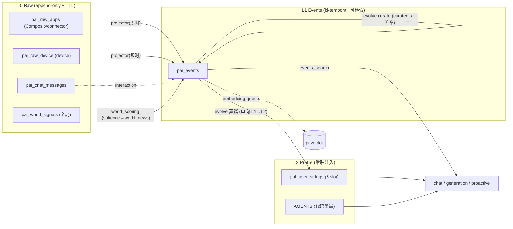

# Memory

## 结论

Memory 模块把用户的 digital + physical + interaction context 收敛成**三层**:

- **L0 · Raw**(`pai_raw_apps` + `pai_raw_device` + `pai_chat_messages` + `pai_world_signals`)—— 原始日志,append-only,需追溯的大内容。
- **L1 · Events**(`pai_events`)—— 不可变 bi-temporal 语义事件流(修正 = append + supersede 修订链),是 agent 检索的唯一入口。
- **L2 · Profile**(`pai_user_strings`)—— 常驻 markdown 画像(5 slot + AGENTS 代码常量),agent 经 `memory_edit` 自维护(用户只读、经对话表达意图),注入 system prompt 让 agent「懂你」。

写入两个延迟档:**projector**(即时,无 LLM,把 L0 投影成 L1 事件,`curated_at` NULL 排进 evolve 待整理队列——**不影响可检索性**)+ **evolve**(异步 LLM,整理队列 + 蒸馏画像)。读取一个入口:`events_search`(L1)+ 常驻注入(L2)。所有表都在 Postgres 同一 DB 的 public schema(前缀 `pai_*`);LangGraph chat checkpointer 独占 `langgraph` schema。

agent 工具从老的 21 个收敛到 **4 个**:`events_search`(检索 L1,hybrid + 时间窗)/ `event_source`(按 event 下钻 L0 原文,supersede 链自动 resolve)/ `event_append`(追加 L1)/ `memory_edit`(改 L2 画像,服务端同事务把画像变更写回 L1)。

> **退役**:老的 `pai_memory` / `pai_personal_signals` / `pai_profile` / `pai_goals` / `pai_preference_records` 五张表已在 migration `114_drop_legacy_memory.sql` 里 **DROP**;`pai_timeline_events` 死表在 `111` 里 drop。代码里不要再 grep 这些表。设计 SSOT 见 [Lifelong Memory 系统重构](../plans/2026-06-23-lifelong-memory-system)。

上游接入看 [Data Connectors](./data-connectors)。



## 边界

包含:

- **L0** 按域分两张表(`119` 拆分):`pai_raw_apps`(Composio/connector 域,`toolkit` + `entity_type` 判别)+ `pai_raw_device`(device 域,`kind` 判别、无 toolkit、`external_id`=device_id)。两表共用 envelope(`payload JSONB`/`occurred_at`/`expires_at` reference-aware TTL/reference 三元组)。
- **L1** `pai_events`(`111`,`117` 收口)的 schema、bi-temporal 双时间轴(`occurred_at` / `recorded_at`)、`curated_at` 待整理队列、append + supersede 修订链(含生产者:内容变更重投影 + cancelled tombstone)、hybrid 检索(HNSW 语义 + tsvector 关键词 RRF)。
- **L2** `pai_user_strings`(`112`,`115` 删 MEMORY)5 slot 画像、hermes MemoryStore 编辑算法(乐观锁 + char_budget 防截断 + 威胁扫描)、`memory_edit` 服务端原子双写(画像变更 → L1 `agent_decision` 事件)、`AGENTS` 代码常量、PortraitMiddleware 注入。
- `pai_world_signals`(全局共享 L0,无 user_id)→ `world_scoring` 按 salience 投成 `pai_events` 的 `world_news` 事件(per-user view 已 `121` DROP,world 不再是独立检索 source)。
- `pai_skill_index`(body inline)。
- `pai_evolution_runs` 的 `trigger_kind` + status 生命周期(evolve 审计 + provenance)。
- pgvector embedding 队列(`pai_embedding_queue`,allowlist = `pai_events` only)。
- `/api/events` / `/api/user-strings`(UI 面)+ `/api/agent/events`(search / append / curate / `{id}/source`)/ `/api/agent/user-strings`(agent 面)路由。
- agent-engine 的 **evolve**(on_event per-user coalesce / periodic 每 4h)+ **rollup_semantic**(firehose→episode,periodic 先行)的写入语义。
- RLS(`SET LOCAL app.user_id` + `SET LOCAL ROLE pai_app`)的多租户隔离。

不包含:

- 数据怎么进来(Composio / device ingest),看 [Data Connectors](./data-connectors)。
- 卡片 pipeline 怎么读 events / portrait,看 [Generation](./generation)。
- 反馈事件如何生成,看 [Feedback](./feedback)。
- scheduler 怎么派 `auto.dreaming`(periodic evolve 的 legacy kind 名)/ `connector.evolve`,看 [Background Tasks](./background-tasks)。

## 三层结构

| 层 | 表 | 可变性 | 谁写 |
|---|---|---|---|
| **L0 · Raw** | `pai_raw_apps`(Composio/connector)+ `pai_raw_device`(device)+ `pai_chat_messages`(对话)+ `pai_world_signals`(全局)| **append-only + TTL** | 系统 ingest |
| **L1 · Events** | `pai_events` | **append-only**(修正 = append supersede)| projector(系统)+ `event_append`(agent 纯追加)|
| **L2 · Profile** | `pai_user_strings`(markdown 5 slot)+ `AGENTS`(代码常量)| **mutable**(原地改;每次变更同事务写回 L1 不可变流)| agent `memory_edit`(hot=chat / bg=evolve;用户经对话表达意图)|

> **核心对称:历史(L0/L1)不可变,当前(L2)可变。** event-sourcing 内核——事件流记「发生了什么」(只能 append),投影出「现在是什么样」(随便改)。想「edit 一条 event」时,落在 L2 画像,不是事件层。

### L0 · `pai_raw_apps` / `pai_raw_device`(`119`)

L0 按**域**分两张表(`119` 把早先的单一 `pai_raw` 拆开——统一发生在投影管线 + source→table registry,不在物理表)。两表共用同一套 envelope:`(user_id, id)` PK / `external_id` / `occurred_at` / `ingested_at` / `expires_at`(reference-aware TTL)/ `title` / `snippet`(可选展示投影)/ `payload JSONB`(source-specific 全字段)/ `dedupe_key` + reference 三元组——只判别列不同:

| 表 | 域 | 判别列 | 唯一键 |
|---|---|---|---|
| `pai_raw_apps` | Composio app / 通用 connector | `toolkit` + `entity_type` | `(user_id, toolkit, entity_type, dedupe_key)` |
| `pai_raw_device` | 设备(snapshot + ambient) | `kind`(无 toolkit;`external_id`=device_id) | `(user_id, kind, dedupe_key)` |

**写入路径**:
- **Composio connector ingest** → `connector_ingest` → `generic_ingest.upsert_generic` → `pai_raw_apps`(toolkit 来自 task,entity_type 来自 `db/ingest_recipes/<toolkit>.yaml`)。
- **device ingest** → `raw_device.py` → `pai_raw_device`:snapshot 的 `raw_only`/`dual` kind(apps/contacts/health)+ ambient 的 `signal_only` kind(utterance/visit/motion 等 context event)都写这一张表,没有 typed 分流。`external_id`=device_id 让 full-sync replace 把 DELETE 限定到单台设备。

> projector(`event_projector.py` 的 `project_unprojected`)读 **`pai_raw_apps` + `pai_raw_device` 两表 UNION** 投成 pending 事件:apps 行带真实 toolkit、device 行以 `toolkit='device'` / `entity=kind` 归一,`(toolkit, entity)` 经 `_EVENT_TYPE_MAP` 映射出 event_type。device 跳过 semantic firehose(utterance/transcript,evolve rollup 合成 episode)+ apps/contacts(state 非事件)。

### L1 · `pai_events`(`111`)

一行 = 一个**语义事件**(发生的事 + 用户反馈)。核心字段:

| 字段 | 含义 |
|---|---|
| `(user_id, id)` | 主键(`id` TEXT,per-user 唯一)|
| `source` | 来源**类别**:`composio` / `device` / `ambient` / `pinai_chat` / `pinai_feedback` / `agent_action` / `world` / `predicted.*`。agent 可写值由服务端白名单强制(仅 `pinai_chat`/`agent_action`/`predicted.*`),actor 由 JWT server-stamp 进 `structured` |
| `event_type` | 语义大类:`communication` / `meeting` / `utterance` / `movement` / `transaction` / `interaction` / `agent_decision` / `preference` / `world_news`;兼作检索排序的结构性先验 |
| `occurred_at` / `end_at` | **事件发生时刻**(过去/未来同轴)+ 区间事件的结束 |
| `recorded_at` | **系统写入时刻**(事务时间;bi-temporal 另一轴,backfill 旧邮件=今天)|
| `title` / `body` | 一句话摘要 + 可选长文 |
| `structured JSONB` | 结构化字段(participants/location;preference 的 `{scope,polarity,weight,confidence,durability,expires_at}`)|
| `source_ref` | 指回 L0 raw 的 id(projector 幂等依据;`event_source` 按 event 的 `source` 经 registry 路由域表取原文)|
| `curated_at` | NULL = evolve 待整理队列(`117` 把四态 `curation_status` 压成这个 flag,`importance` 列同批删除——重要性检索时客观算,不存 LLM 分);agent/feedback/hot 写入直接盖章 |
| `supersedes_id` / `superseded_by_id` | append-as-correction 链 |
| `dedupe_key` | 幂等键(`UNIQUE (user_id, dedupe_key)`)|
| `embedding` | `vector(1536)` HNSW cosine,复用 `pai_embedding_queue` |
| `reference_count` / `last_referenced_at` / `referenced_by_runs` | 客观质量信号:agent 检索命中即 bump(带 run_id 才 bump、per-run 去重、SAVEPOINT 隔离失败),喂检索排序 + formation + forgetting |

**bi-temporal**:`occurred_at`(何时发生)+ `recorded_at`(何时记下),学 Graphiti。「我去年这时在忙什么」= 查 `occurred_at` 落在去年的事件(append-only 全保留)。不再有第三个 `valid_from/valid_to` 时间轴(fact 走 L2 markdown)。

**修正 = append + supersede(生产者已接)**:「删除/更新」不物理改行,append 新修订 + 关旧版本链。生产者 = projector 的 supersede pass:raw 重 ingest 时 `content_updated_at` 只在 payload 真变时 touch(`124`),projector 对「已投影但内容已变」的行 append 新修订(revision dedupe = 基础键 + 变更时刻 µs)并 supersede 旧 event——**改期的会议、编辑过的内容在 L1 成链**;cancelled(gcal `showDeleted:true` 拉进的取消信号)成 `[cancelled]` tombstone 修订,已 cancelled 的新 raw 永不首投。**读侧链是内部机制**:检索只回链头(`superseded_by_id IS NULL`),`event_source` 对旧版 id 自动 resolve 到当前修订(WITH RECURSIVE + `resolvedTo` 提示)。**agent 的 `event_append` 纯追加,碰不到改写历史**。

**fact / preference 归属**:durable fact / 画像型偏好("住上海"、"喜欢简洁")→ **L2 USER markdown**。硬约束 / 负向偏好指令("别再推 crypto"、dismiss)→ **L1 `event_type=preference` 事件**(`structured` 带 `polarity/weight/scope/expires`,给 generation 当硬约束)。供给端两个:用户显式(chat `event_append`)+ **evolve 负信号蒸馏**(反复 dismiss/忽略/失败由 evolve 归纳成 standing preference 事件)。独立 preferences 路由已随 Block2 删除——preference 就是普通 event,经 `event_append`/`events_search` 读写。

### L2 · `pai_user_strings`(`112`)+ AGENTS

5 slot markdown 画像(`115` 删了 MEMORY——它和 USER/events 定位重叠、是 drift 雷区),`(user_id, slot)` PK,`content TEXT`(`§` 分隔 entry)+ `version INT`(乐观锁)+ `char_budget INT` + `updated_at`。`AGENTS` 是 agent-engine 代码常量(`agents/prompts/portrait.py`),**不落盘**——agent/用户工具都够不着。

**全部 5 slot 都由 agent 经 `memory_edit` 维护,用户只读**(Mirror 页;想改就和 agent 说——没有"设置 UI 直接改 markdown"这条路),区别在触发来源:

| slot | 职责 | 写入触发 |
|---|---|---|
| **AGENTS** | 行为规范 + 安全强约束 | 开发者(代码常量,谁都不能改)|
| **IDENTITY / SOUL** | agent 是谁 / 人设(voice)| 用户对话明确要求改人设;新用户默认 persona seed(`portrait/seed.py`)|
| **TOOLS** | 用户对 agent 用工具的要求 + agent 学到的 durable 具体情况(账户/渠道;**不是**用户自用 app 清单——那是 USER fact)| 用户明说 tool-use 要求 / agent 学到具体情况(hot)|
| **USER** | 用户 durable facts + 画像型偏好 + 负向信号教训 | 用户指令(hot)+ evolve 学(bg)|
| **GOALS** | 长期目标(90+ 天)| evolve(≥3 事件持续证据)+ 新用户 starter seed(`portrait/seed.py`)|

新用户 seed 只播 IDENTITY/SOUL(默认 persona baseline,让「把你设得更正式」有基线可改)+ GOALS(starter);**USER/TOOLS 有意不 seed**——它们装的是 agent 对这个具体用户学到的东西,首触没有可写的真话,空槽由注入侧占位说明兜底(见下)。

**编辑算法 = adapt hermes MemoryStore**(`UserStringsRepository.edit`):entry add/replace/remove + batch;乐观锁 `version`(并发 edit → WHERE version 失败 → no-op 逼 re-read);**超 char_budget 的 add 失败 → 回吐全部 entry 逼 agent 整合**(hermes 防截断,绝不静默 drop);**batch 只校验最终预算**;成功只返回新 version 不回吐 entry(防 thrash);**威胁扫描**(伪造 `<agent_safety>`/`<portrait>` 边界、NUL 拒写,在 api 信任侧做)。

**原子双写(画像变更进事件流)**:`/api/agent/user-strings/edit` 成功后**同事务** append 一条 `agent_decision` 变更事件进 L1(`structured:{slot, ops, evidence_event_ids?}`,dedupe = `user_strings:{slot}:v{version}`)——L2 随便改,改动历史永远可追;失败(version_conflict/over_budget/threat)零写入。

**注入(单层信任模型)**:`PortraitMiddleware`(`harness/middleware.py`)每个 agent instance fetch 一次 `/api/agent/user-strings/`,`build_portrait(slots)` 组装 `AGENTS` + 5 slot,prepend 成 transient SystemMessage(不落 checkpoint,放最前保 cache 稳定)。每段 header 带一行语义标注(`_SLOT_NOTES` 代码常量,和 `memory_edit` slot schema 的写侧语义呼应,agent 改不掉);fetch 成功时五段**全渲染**,空槽给占位说明(让 agent 知道该维度存在、有地方可写);fetch 失败(`slots={}`)降级成只注入 AGENTS——不渲染任何段,避免把「拉取失败」谎报成「画像为空」,不杀对话轮。读侧**不再** `<untrusted-text>` 逐段包裹——唯一写口在 api 信任侧且有威胁扫描,AGENTS 常量注入最前 outrank 一切段落(残余风险 = 间接注入,读时包裹留作事故升级位;设计取舍见 plan §七安全)。

## `curated_at` 队列(projector→evolve 交接,不是检索 gate)

`117` 把四态 `curation_status` 压成单一 `curated_at` flag:

- **NULL** = projector 刚投影,排在 evolve 待整理队列(`idx_pai_events_uncurated` partial index);
- **NOT NULL** = evolve 处理过,或写入时就不需要 evolve 判断的事件直接盖章(agent `event_append` / feedback / memory_edit 双写)。

> **⚠️ 事实纠正(老文档的反坑)**:`curated_at` **不影响可检索性**——检索(三条路)只过滤 `superseded_by_id IS NULL`,pending 事件**立即可见**。「connector ingest 后搜不到要等 evolve」的老 gate 已随 `117` 移除:噪声靠客观排序沉底(reference × recency × event_type 先验),不靠拦截;`filtered_out` 不存在(投影期跳过的如 device apps/contacts 根本不进 L1),`archived` 由 supersede 链表达。evolve 挂了只影响画像蒸馏的新鲜度,不影响检索。

## evolve(两触发)+ rollup_semantic

**evolve = 原 evolve/dream 合并、crystallize 删除**(`agents/evolve.py`,Code Mode sandbox agent):对话蒸馏由 hot path(chat agent 即时 `memory_edit`)+ periodic evolve 覆盖,单 session 蒸馏两头不靠。一个 agent、两种 trigger、统一两个 job:

1. **CURATE L1**:读 `client.events.search(status="pending")`,逐条 `client.events.curate(id)` 盖 `curated_at` 离队——**没有 status/importance 可打**(重要性检索时客观算,噪声排序沉底)。
2. **DISTIL L2**:从事件(正向 + 负向)单向蒸馏画像进 USER / GOALS(`client.user_strings.edit`;formation 门槛全客观:反复引用 ∨ 用户显式 ∨ durable pattern ≥3;forgetting = evict 不硬删 + 保护名单),硬约束偏好顺手 `client.events.append(event_type="preference")`。**单向 L1→L2、画像是 events 的派生**——防双真源漂移。

两种 trigger:

| trigger_kind | 触发源 | scope |
|---|---|---|
| `on_event` | scheduler kind `connector.evolve` —— **per-user 单例任务 `"evolve"`**:所有 connector 的触发合并(`connectors`/`rawSources` 并集),sync 触发带 **~2min debounce**(同拍 sync 折叠成一轮,合并保留更早到期),init 冷启动 / 手动刷新 immediate | 该批 connectors 的新事件 + 蒸馏 |
| `periodic` | scheduler kind `auto.dreaming`(legacy 命名;**每 4 小时**,用户时区整点边界,cron `0 */4 * * *`)| 全待整理队列;forget + 刷新画像 |

**periodic 编排顺序(load-bearing)**:`/agent/run/dream` 先跑 **`rollup_semantic`**(独立 agent:把上个周期的 ambient firehose——transcript_window——卷成 episode 事件落 L1)、**再**跑 evolve;顺序反了本周期 firehose 进不了画像。episode dedupe 让 4h 高频重跑天然幂等。

**HTTP 端点**:`/agent/run/dream`(periodic:rollup_semantic + evolve)+ `/agent/run/evolve`(on_event);`/agent/run/crystallize` 已删。`auto.dreaming` 的 `pai_evolution_runs` lifecycle 包在 api 侧 `dispatcher._dispatch_dream`(agent-engine OOM 也能翻 `failed`)。

**provenance**:evolve 每次蒸馏在 `pai_evolution_runs` 记 `refs_consumed` / `refs_produced`;画像的每次变更另有 L1 `agent_decision` 事件(memory_edit 双写)可程序化追溯。

## pgvector 与 embedding

`pai_events.embedding vector(1536)`(`111`)+ HNSW cosine 索引(`WHERE embedding IS NOT NULL`),model pin `text-embedding-3-small`(`platform/embeddings.py`)。

异步队列 `pai_embedding_queue`(`(user_id, table_name, row_id)` PK,`status` ∈ `pending/running/done/failed`):

- **allowlist = `pai_events` only**(`122` 把 `pai_world_signals` 移出——world 迁进 events 后它自己的 embedding/FTS 列已没有检索消费者,连列带索引带队列项一并删)。
- 写入侧:`EventsRepository.append` 在同一事务里 `enqueue(conn, user_id, "pai_events", row_id, title+body)`(仅新插入时)。
- 消费侧:`orchestration/tick_loop.py` 每轮 `drain_queue()`(batch 调 LiteLLM `/embeddings`,写回 `pai_events.embedding`)。每条事件按该用户 virtual key 计费;keyless 用户的行留 pending,等 onboarding 配 key 后补算(个人数据从不计到 master)。

## world signals

`pai_world_signals`(全局共享 L0,无 user_id,`020`)是唯一保留的 world 表:`world_ingest` 拉 RSS 写这里(RLS 公开 SELECT + service-role-only INSERT,`normalized_url` 去重)。**world IS an event**——`world_scoring` 给每个活跃用户按 salience(≥阈值)+ top-K 把信号投成 `pai_events` 的 `world_news` 事件(`source='world'`,salience 在 `structured`),agent 经 `events_search(event_type="world_news")` 读,和任何 event 一样。per-user `pai_world_signal_user_view` 已 `121` DROP;world 不再 LEFT JOIN、不再有 `world_recent` / `world_search` 工具或 `/api/world` / `/api/agent/world` 路由(W5/W6 退役)。

## HTTP 路由

### UI 面(`/api/*`,Supabase JWT)

| Prefix | 作用 |
|---|---|
| `/api/events` | list(active 事件时间线,Ambient / Mirror 渲染,只读)|
| `/api/events/stream` | SSE 信号面:`pai_events` 有写入时推一帧 `{"type":"changed"}`(不带数据,前端收到后 invalidate + refetch list)。发布端收口在 `EventsRepository.append` 的 `pg_notify`(COMMIT 才投递、同事务去重),每台 api 实例一条 LISTEN 连接分发(`events/notify.py`);掉信号退化为前端兜底 poll。消费端:`useEventsLiveRefresh`(state)+ zebra web Events 面板 |
| `/api/user-strings` | get(6 slot 画像 markdown,Mirror 渲染,无 UI 写路径)|
| `/api/settings` | get / patch(含 timezone)|
| `/api/evolution` | 列 evolution_runs 给 dreaming panel |
| `/api/skills` | list / get / patch / disable |

### Agent 面(`/api/agent/*`,EdDSA agent-run JWT)

| Prefix | 作用 |
|---|---|
| `/api/agent/events` | `search`(hybrid/recency + `since`/`until` 时间窗;`recordedSince`+`recordedUntil` 切 **arrival 轴**——按 recorded_at 的到达流、含 superseded,generator 的 cache-stable log 源)/ `append`(纯追加,source 白名单)/ `curate`(evolve 盖章)/ **`{id}/source`**(L0 原文下钻,supersede 链自动 resolve)|
| `/api/agent/user-strings` | `/`(读 5 slot 画像)/ `edit`(memory_edit;全 5 slot;成功同事务双写 L1 变更事件)|
| `/api/agent/skills` | list / get / add |
| `/api/agent/evolution` | create / list / get / complete / fail |
| `/api/agent/raw` | list / get(按域路由:device→`pai_raw_device` by kind,其余→`pai_raw_apps` by toolkit+entity)|

## agent 工具(21 → 4)

| 工具 | 替代掉 | 落点 |
|---|---|---|
| **`events_search`**(检索)| memory_search / signals_recent / raw_list / world reads | `/api/agent/events/search`(query?/event_type?/**since/until**/limit;返回 200 字符 snippet + `hasSource` 可下钻标记)|
| **`event_source`**(下钻 L0 原文)| 老 raw 读工具 | `/api/agent/events/{id}/source`(source→table registry 路由域表;旧版 id 自动 resolve 到当前修订,`status`/`revisionNote` 透出;无档案/已 TTL 优雅降级)|
| **`event_append`**(纯追加一条事件)| (新增)| `/api/agent/events/append`(写入即盖 curated;source 白名单)|
| **`memory_edit`**(改 L2 画像 add/replace/remove/batch,可带 `evidence_event_ids` 证据锚)| memory_add / profile_upsert / goal_upsert / preference_add | `/api/agent/user-strings/edit`(全 5 slot;服务端同事务双写 L1 变更事件)|

> 对应三层可变性:events 工具是检索 + 下钻 + 纯追加(**没有 edit/delete,历史不可改**);画像工具 `memory_edit` 有 add/replace/remove(当前状态会变)。四个职责一眼可分:找 / 看原文 / 记 / 画像。chat agent 的工具集真源在 `agent-engine/.../tools/direct/__init__.py` 的 `ALL_TOOLS`;`memory_edit` + `event_append` 是频繁自治写,**故意不进 HITL gate**(否则 approval 刷屏)。

## RLS 多租户

新三层表(`pai_raw_apps` / `pai_raw_device` / `pai_events` / `pai_user_strings`)沿用 `user_scoped_tx`(`libs/db/src/pinai_db/rls.py`):`SET LOCAL ROLE pai_app`(非-BYPASSRLS)+ `SET LOCAL app.user_id`,双 policy(`user_scope` PUBLIC + `service_role` fallback)+ `FORCE ROW LEVEL SECURITY`。RLS 现已真激活(PR #200-204,之前「superuser bypass、名存实亡」已修)。

```python
async with user_scoped_tx(pool, user_id) as conn:
    repo = EventsRepository(user_id, conn)
    rows = await repo.search_structured(status="active", limit=20)
```

`service_tx(pool)`(不带 user)用于 scheduler / world_ingest / migration batch job(policy 有空 `app.user_id` fallback)。`pai_world_signals` 无 user_id,policy 单独写。

## 开发入口

| 改动 | 先看 |
|---|---|
| Schema 改 / 加表 | `backend/db/migrations/`(`110`-`114` 是本次 sunset;NNN 顺序只向前,RLS policy 同款双 policy + FORCE)|
| **模块地图** | `pinai_api/domains/memory/` 四子包(events/projection/portrait/curation),目录=模块=设计节,依赖方向 import-linter 锁(5 条契约);地图见 plan §十一 |
| L1 events repository(③)| `pinai_api/domains/memory/events/repository.py`(`append` / `search_semantic` / `search_hybrid` / `search_structured` / `list_arrivals` / `resolve_head` / `fetch_source_content` / `mark_curated` / `supersede`)|
| L0→L1 projector(②)| `pinai_api/domains/memory/projection/projector.py`(`raw_to_event_input` 纯函数 + `project_unprojected` 含 supersede pass;`_EVENT_TYPE_MAP`/`_TOMBSTONE_MAP` 是 domain 知识)+ `window.py`(health 按天聚合)+ `pinai_contracts.rollup_policy`(三档声明)|
| L2 画像 repository(⑤)| `pinai_api/domains/memory/portrait/repository.py`(hermes `edit`:乐观锁 + char_budget + 威胁扫描)+ `seed.py`(新用户 IDENTITY/SOUL persona + GOALS starter)|
| Evolution 审计(④)| `pinai_api/domains/memory/curation/runs.py` |
| timezone / settings | `pinai_api/domains/user_model/settings.py`(`pai_user_settings.timezone`,`113` 从退役的 `pai_profile` 迁来)|
| World signals / 全局 ingest | `pinai_api/domains/connector/world/world_signals.py`、`world_ingest.py`、`world_scoring.py`(salience fan-out 投影)|
| Skills repository | `pinai_api/domains/user_model/skills.py`(`body` inline TEXT)|
| UI 路由 | `memory/{events,portrait,curation}/ui.py` + `user_model/{settings_ui,skills_ui}.py` |
| Agent 路由 | `memory/{events,portrait,curation}/agent.py` + `user_model/{settings_agent,skills_agent}.py` |
| evolve agent(LLM)| `backend/services/agent-engine/src/agent_engine/agents/evolve.py` + `rollup_semantic.py` |
| evolve 调度 | `pinai_api/orchestration/dispatcher.py`(`_dispatch_dream` + `connector.evolve`)+ `connector_ingest.enqueue_user_evolve`(per-user coalesce + debounce)|
| AGENTS 常量 + 画像组装 | `agent-engine/.../agents/prompts/portrait.py`(`AGENTS` + `build_portrait`)|
| 画像注入 middleware | `agent-engine/.../harness/middleware.py`(`PortraitMiddleware`)|
| chat 工具集 | `agent-engine/.../tools/direct/__init__.py`(`ALL_TOOLS`)、`tools/direct/{events,user_strings}.py` |
| pgvector embedding | `pinai_api/platform/embeddings.py`、`pai_embedding_queue`(`029` + `111`/`122` 收窄 allowlist 到 `pai_events` only)|
| RLS helper | `backend/libs/db/src/pinai_db/rls.py` |

## 验证方式

```bash
# Repository 单测
cd backend && uv run pytest tests/web/db/                       # 全 repository 套件

# Agent / UI 路由集成
cd backend && uv run pytest tests/web/routes/

# agent-engine evolve agent
cd backend && uv run pytest tests/chat/agents/

# 类型 + lint
cd backend && uv run ruff check .
cd backend && uv run lint-imports
cd backend && uv run mypy services libs
```

手工 SQL(本地 compose Postgres):

```sql
-- 事件流概览(待整理 vs 已整理)
SELECT (curated_at IS NULL) AS uncurated, count(*) FROM pai_events
WHERE user_id = $1 GROUP BY 1;

-- evolve 待整理队列
SELECT id, event_type, occurred_at, title FROM pai_events
WHERE user_id = $1 AND curated_at IS NULL AND superseded_by_id IS NULL
ORDER BY occurred_at DESC LIMIT 20;

-- supersede 修订链
SELECT id, title, supersedes_id, superseded_by_id FROM pai_events
WHERE user_id = $1 AND event_type = $2 ORDER BY recorded_at;

-- L2 画像 5 slot
SELECT slot, length(content) AS chars, version, updated_at FROM pai_user_strings
WHERE user_id = $1 ORDER BY slot;

-- 最近 evolution runs
SELECT id, trigger_kind, status, started_at, skills_added, profile_updated
FROM pai_evolution_runs WHERE user_id = $1 ORDER BY started_at DESC LIMIT 10;

-- embedding queue 状态
SELECT table_name, status, count(*) FROM pai_embedding_queue GROUP BY table_name, status;
```

## 踩坑

- **不要按老文档找「检索 quality gate」**:`curated_at`(`117`)只是 evolve 的待整理队列旗,**不影响可检索性**——检索只滤 `superseded_by_id IS NULL`,新投影的事件立即可搜。connector ingest 后搜不到 → 查 projector 有没有跑 / embedding queue(语义路径要向量),不是 evolve。
- **L0 raw 是两张域表,不是 generic 单表也不是 typed 多表**:`119` 把早先的单一 `pai_raw` 拆成 `pai_raw_apps`(Composio)+ `pai_raw_device`(device)并 DROP 了 `pai_raw`;backend DB 里 raw 只有这两张,代码零 typed 表写入。apis 时代的 typed raw 表不在 backend migration 管辖,别照旧文档/旧注释以为还有 generic `pai_raw` 或 `pai_raw_device_*`。
- **事件不按内容去重**:同一动作不同时刻是 N 行(频率本身是 evolve 蒸馏画像的信号);`dedupe_key` 只防同一事件被写两次(backfill + webhook 撞一封邮件)。
- **`pai_events.embedding` 是异步队列写的**:INSERT 后不要立刻 vector 搜,给至少一轮 tick(默认 3s)让 `drain_queue` 跑;没 embedding 的行 `search_semantic` 直接跳过,要 recency 用 `search_structured`。
- **画像 edit 超预算不是静默截断**:`memory_edit` over_budget 会回吐全部 entry 逼 agent 整合后重发(hermes 防失明);乐观锁 `version` 冲突会 no-op,agent 要 re-read 重试。
- **AGENTS 不落盘**:安全强约束是 `agents/prompts/portrait.py` 的代码常量,agent/用户工具够不着。注入是**单层信任模型**(不再 `<untrusted-text>` 逐段包裹;写口威胁扫描 + AGENTS outrank),改注入顺序要同步测试;别按老文档把包裹加回来——那是被有意移除的设计(见 plan §七安全)。
- **evolve 两端点、一个 agent**:`/agent/run/dream`(periodic = rollup_semantic → evolve 编排)与 `/agent/run/evolve`(on_event)都进 `run_evolve(trigger_kind)`;`crystallize` 路由/agent 已删。改 consolidation 逻辑动 `evolve.py`,改 firehose 卷动 `rollup_semantic.py`,**别把两者的职责混回去**(L0→L1 卷 vs L1→L2 蒸馏是两层)。
- **`pai_world_signals` 没 `user_id`**:RLS policy 跟 per-user 表不一样,不要套 `user_scoped_tx`,用 `service_tx`。world 的 per-user 落点是 `pai_events` 的 `world_news` 事件(`world_scoring` 投),不是 view——`pai_world_signal_user_view` 已 `121` DROP。
- **timezone 在 `pai_user_settings` 不在 `pai_profile`**:`pai_profile` 已 DROP(`114`);timezone 是它唯一有运行时消费者的字段,已迁 `pai_user_settings`(`113`),`locale` / `display_name` 无消费者随表删。
- **退役表别再 grep**:`pai_memory` / `pai_personal_signals` / `pai_profile` / `pai_goals` / `pai_preference_records` / `pai_timeline_events` 全 DROP;旧的 `superseded_by` 链 / 三桶 JSONB profile / signals 队列语义都没了。
- **LangGraph checkpointer 在 `langgraph` schema**,跟 `pai_chat_threads`(memory 关心的)是两个东西;清 chat 状态时不要误删 metadata 行。
- **带 `q` 的检索三条 lane 都吃 `since`/`until`**:曾经 q 路径的 `until` 全链静默失效(repo 没参数、route 收了不传),已修;改检索 SQL 时 semantic candidates / keyword 两条 lane 的时间条件要对称维护。

## 相关模块

- [Data Connectors](./data-connectors):raw 怎么写进来(Composio init/sync、device ingest)+ projector 投影 L1。
- [Generation](./generation):卡片生成怎么读 events / portrait / preference。
- [Background Tasks](./background-tasks):`auto.dreaming`(periodic evolve,每 4h)/ `connector.evolve`(on_event,per-user coalesce)的派发框架。
- [Execution](./execution):chat agent 的 memory 工具面(events_search / event_source / event_append / memory_edit)+ portrait 注入。
- [Runtime & Deployment](./runtime-deployment):RLS / Postgres pool / yoyo migration 通用基建。

## 相关 AI Plans

- [Lifelong Memory 系统设计](../plans/2026-06-23-lifelong-memory-system):三层架构 + 六模块地图 + 工具收敛 + evolve 的设计 SSOT(章节即模块)。
- [Proactive + 卡片生成](../plans/2026-06-23-proactive-card-generation):本 memory 的消费侧(proactive agent + 卡片生成)。
