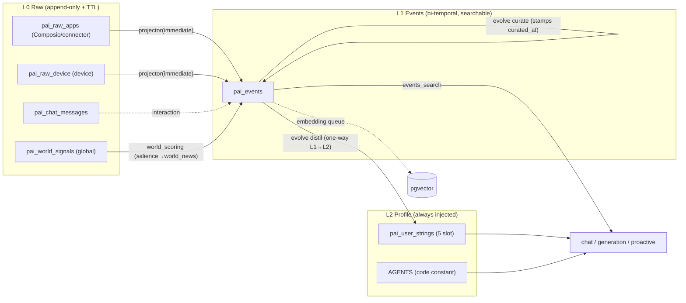

# Memory

## Summary

The Memory module consolidates the user's digital + physical + interaction context into **three layers**:

- **L0 · Raw** (`pai_raw_apps` + `pai_raw_device` + `pai_chat_messages` + `pai_world_signals`) — raw logs, append-only, large content that must stay traceable.
- **L1 · Events** (`pai_events`) — an immutable bi-temporal semantic event stream (correction = append + supersede revision chain); the single entry point for agent retrieval.
- **L2 · Profile** (`pai_user_strings`) — an always-resident markdown portrait (5 slots + the AGENTS code constant), self-maintained by the agent via `memory_edit` (read-only for the user, who expresses intent through conversation), injected into the system prompt so the agent "knows you".

Writes have two latency tiers: **projector** (immediate, no LLM; projects L0 into L1 events, and `curated_at` NULL puts them in the evolve curation queue — **this does not affect searchability**) + **evolve** (async LLM; works through the queue + distils the portrait). Reads have one entry point: `events_search` (L1) + always-on injection (L2). All tables live in the public schema of the same Postgres DB (prefix `pai_*`); the LangGraph chat checkpointer has the `langgraph` schema to itself.

Agent tools were consolidated from the old 21 down to **4**: `events_search` (search L1, hybrid + time window) / `event_source` (drill down from an event to the L0 original, supersede chain resolved automatically) / `event_append` (append to L1) / `memory_edit` (edit the L2 portrait; the server writes the portrait change back to L1 in the same transaction).

> **Retired**: the five old tables `pai_memory` / `pai_personal_signals` / `pai_profile` / `pai_goals` / `pai_preference_records` were **DROPped** in migration `114_drop_legacy_memory.sql`; the dead table `pai_timeline_events` was dropped in `111`. Don't grep for these tables in code anymore. Design SSOT: [Lifelong Memory system rebuild](../plans/2026-06-23-lifelong-memory-system).

For upstream ingestion see [Data Connectors](./data-connectors).



## Boundaries

Includes:

- **L0** split into two tables by domain (split in `119`): `pai_raw_apps` (Composio/connector domain, discriminated by `toolkit` + `entity_type`) + `pai_raw_device` (device domain, discriminated by `kind`, no toolkit, `external_id`=device_id). Both tables share an envelope (`payload JSONB`/`occurred_at`/`expires_at` reference-aware TTL/reference triple).
- **L1** `pai_events` (`111`, narrowed in `117`): schema, bi-temporal dual time axes (`occurred_at` / `recorded_at`), the `curated_at` curation queue, the append + supersede revision chain (including its producers: re-projection on content change + cancelled tombstones), hybrid retrieval (HNSW semantic + tsvector keyword RRF).
- **L2** `pai_user_strings` (`112`; `115` deleted MEMORY): the 5-slot portrait, the hermes MemoryStore edit algorithm (optimistic lock + char_budget truncation guard + threat scanning), the `memory_edit` server-side atomic dual write (portrait change → L1 `agent_decision` event), the `AGENTS` code constant, PortraitMiddleware injection.
- `pai_world_signals` (globally shared L0, no user_id) → `world_scoring` projects signals by salience into `world_news` events in `pai_events` (the per-user view was DROPped in `121`; world is no longer a separate retrieval source).
- `pai_skill_index` (body inline).
- The `trigger_kind` + status lifecycle of `pai_evolution_runs` (evolve audit + provenance).
- The pgvector embedding queue (`pai_embedding_queue`, allowlist = `pai_events` only).
- Routes `/api/events` / `/api/user-strings` (UI surface) + `/api/agent/events` (search / append / curate / `{id}/source`) / `/api/agent/user-strings` (agent surface).
- Write semantics of agent-engine's **evolve** (on_event per-user coalesce / periodic every 4h) + **rollup_semantic** (firehose→episode, runs first in periodic).
- Multi-tenant isolation via RLS (`SET LOCAL app.user_id` + `SET LOCAL ROLE pai_app`).

Excludes:

- How data comes in (Composio / device ingest): see [Data Connectors](./data-connectors).
- How the card pipeline reads events / portrait: see [Generation](./generation).
- How feedback events are produced: see [Feedback](./feedback).
- How the scheduler dispatches `auto.dreaming` (the legacy kind name for periodic evolve) / `connector.evolve`: see [Background Tasks](./background-tasks).

## Three-layer structure

| Layer | Tables | Mutability | Who writes |
|---|---|---|---|
| **L0 · Raw** | `pai_raw_apps` (Composio/connector) + `pai_raw_device` (device) + `pai_chat_messages` (conversations) + `pai_world_signals` (global) | **append-only + TTL** | system ingest |
| **L1 · Events** | `pai_events` | **append-only** (correction = append supersede) | projector (system) + `event_append` (agent, append-only) |
| **L2 · Profile** | `pai_user_strings` (markdown, 5 slots) + `AGENTS` (code constant) | **mutable** (edited in place; every change is written back to the immutable L1 stream in the same transaction) | agent `memory_edit` (hot=chat / bg=evolve; the user expresses intent through conversation) |

> **Core symmetry: history (L0/L1) is immutable, the present (L2) is mutable.** An event-sourcing core — the event stream records "what happened" (append-only), and the projection gives "what things look like now" (freely editable). When you want to "edit an event", the change belongs in the L2 portrait, not in the event layer.

### L0 · `pai_raw_apps` / `pai_raw_device` (`119`)

L0 is split into two tables by **domain** (`119` split the earlier single `pai_raw` — unification happens in the projection pipeline + the source→table registry, not in the physical table). Both tables share the same envelope: `(user_id, id)` PK / `external_id` / `occurred_at` / `ingested_at` / `expires_at` (reference-aware TTL) / `title` / `snippet` (optional display projection) / `payload JSONB` (all source-specific fields) / `dedupe_key` + reference triple — only the discriminator columns differ:

| Table | Domain | Discriminator columns | Unique key |
|---|---|---|---|
| `pai_raw_apps` | Composio apps / generic connectors | `toolkit` + `entity_type` | `(user_id, toolkit, entity_type, dedupe_key)` |
| `pai_raw_device` | device (snapshot + ambient) | `kind` (no toolkit; `external_id`=device_id) | `(user_id, kind, dedupe_key)` |

**Write paths**:
- **Composio connector ingest** → `connector_ingest` → `generic_ingest.upsert_generic` → `pai_raw_apps` (toolkit comes from the task, entity_type from `db/ingest_recipes/<toolkit>.yaml`).
- **device ingest** → `raw_device.py` → `pai_raw_device`: snapshot `raw_only`/`dual` kinds (apps/contacts/health) + ambient `signal_only` kinds (context events such as utterance/visit/motion) all write to this one table; there is no typed split. `external_id`=device_id scopes the DELETE in a full-sync replace to a single device.

> The projector (`project_unprojected` in `event_projector.py`) reads a **UNION of the two tables `pai_raw_apps` + `pai_raw_device`** and projects it into pending events: apps rows carry the real toolkit, device rows are normalized to `toolkit='device'` / `entity=kind`, and `(toolkit, entity)` is mapped to an event_type through `_EVENT_TYPE_MAP`. For device, only the `transcript_window` firehose (rolled up into episodes by evolve rollup; utterance / session_summary now use 1→1 real-time projection) + apps/contacts (state, not events) are skipped.

### L1 · `pai_events` (`111`)

One row = one **semantic event** (something that happened + user feedback). Core fields:

| Field | Meaning |
|---|---|
| `(user_id, id)` | primary key (`id` TEXT, unique per user) |
| `source` | source **category**: `composio` / `device` / `ambient` / `pinai_chat` / `pinai_feedback` / `agent_action` / `world` / `predicted.*`. The values an agent may write are enforced by a server-side allowlist (only `pinai_chat`/`agent_action`/`device` + the `predicted.*` prefix); the actor is server-stamped from the JWT into `structured` |
| `event_type` | semantic category: `communication` / `meeting` / `utterance` / `movement` / `transaction` / `interaction` / `agent_decision` / `preference` / `world_news`; also serves as a structural prior for retrieval ranking |
| `occurred_at` / `end_at` | **when the event happened** (past and future on the same axis) + end of interval events |
| `recorded_at` | **when the system wrote it** (transaction time; the other bi-temporal axis; a backfilled old email = today) |
| `title` / `body` | one-line summary + optional long text |
| `structured JSONB` | structured fields (participants/location; for preference, `{scope,polarity,weight,confidence,durability,expires_at}`) |
| `source_ref` | id pointing back to the L0 raw row (basis for projector idempotency; `event_source` routes by the event's `source` through the registry to the domain table to fetch the original) |
| `curated_at` | NULL = in the evolve curation queue (`117` compressed the four-state `curation_status` into this flag and dropped the `importance` column in the same batch — importance is computed objectively at retrieval time, no LLM score is stored); agent/feedback/hot writes are stamped directly |
| `supersedes_id` / `superseded_by_id` | append-as-correction chain |
| `dedupe_key` | idempotency key (`UNIQUE (user_id, dedupe_key)`) |
| `embedding` | `vector(1536)` HNSW cosine, reuses `pai_embedding_queue` |
| `reference_count` / `last_referenced_at` / `referenced_by_runs` | objective quality signals: bumped whenever an agent retrieval hits the row (only bumped when a run_id is present, deduplicated per run, failures isolated by SAVEPOINT); feeds retrieval ranking + formation + forgetting |

**bi-temporal**: `occurred_at` (when it happened) + `recorded_at` (when it was recorded), borrowed from Graphiti. "What was I busy with this time last year" = query events whose `occurred_at` falls in last year (append-only keeps everything). There is no longer a third `valid_from/valid_to` time axis (facts go to L2 markdown).

**Correction = append + supersede (producer wired up)**: "delete/update" does not physically modify rows; a new revision is appended + the old version is closed off in the chain. The producer = the projector's supersede pass: on raw re-ingest, `content_updated_at` is only touched when the payload actually changed (`124`), and for rows that "were already projected but whose content has changed" the projector appends a new revision (revision dedupe = base key + change time in µs) and supersedes the old event — **rescheduled meetings and edited content form chains in L1**; cancelled items (cancellation signals pulled in via gcal `showDeleted:true`) become `[cancelled]` tombstone revisions, and a new raw row that is already cancelled is never projected in the first place. **The chain is an internal mechanism on the read side**: retrieval returns only chain heads (`superseded_by_id IS NULL`), and `event_source` automatically resolves an old version id to the current revision (WITH RECURSIVE + a `resolvedTo` hint). **The agent's `event_append` is append-only and cannot rewrite history**.

**fact / preference placement**: durable facts / portrait-style preferences ("lives in Shanghai", "likes things concise") → **L2 USER markdown**. Hard constraints / negative preference instructions ("stop recommending crypto", dismiss) → **L1 `event_type=preference` events** (`structured` carries `polarity/weight/scope/expires`, used by generation as hard constraints). There are two supply sides: explicit from the user (chat `event_append`) + **evolve negative-signal distillation** (repeated dismiss/ignore/failure is summarized by evolve into a standing preference event). The separate preferences route was deleted with Block2 — a preference is just a normal event, read and written via `event_append`/`events_search`.

### L2 · `pai_user_strings` (`112`) + AGENTS

5-slot markdown portrait (`115` deleted MEMORY — it overlapped with USER/events in purpose and was a drift hazard), `(user_id, slot)` PK, `content TEXT` (entries separated by `§`) + `version INT` (optimistic lock) + `char_budget INT` + `updated_at`. `AGENTS` is an agent-engine code constant (`agents/prompts/portrait.py`), **not persisted** — neither agent nor user tools can reach it.

**All 5 slots are maintained by the agent via `memory_edit` and read-only for the user** (the Mirror page; to change something, tell the agent — there is no "edit the markdown directly in a settings UI" path); they differ in what triggers the writes:

| slot | Responsibility | Write trigger |
|---|---|---|
| **AGENTS** | behavior rules + hard safety constraints | developers (code constant, nobody can change it) |
| **IDENTITY / SOUL** | who the agent is / persona (voice) | the user explicitly asks in conversation to change the persona; default persona seed for new users (`portrait/seed.py`) |
| **TOOLS** | the user's requirements for how the agent uses tools + durable specifics the agent has learned (accounts/channels; **not** a list of apps the user uses — that is a USER fact) | the user states a tool-use requirement / the agent learns a specific detail (hot) |
| **USER** | durable user facts + portrait-style preferences + lessons from negative signals | user instructions (hot) + evolve learning (bg) |
| **GOALS** | long-term goals (90+ days) | evolve (sustained evidence from ≥3 events) + new-user starter seed (`portrait/seed.py`) |

The new-user seed only seeds IDENTITY/SOUL (default persona baseline, so that "make yourself more formal" has a baseline to change) + GOALS (starter); **USER/TOOLS are intentionally not seeded** — they hold what the agent learns about this specific user, there is nothing true to write on first contact, and empty slots fall back to a placeholder note on the injection side (see below).

**Edit algorithm = adapted hermes MemoryStore** (`UserStringsRepository.edit`): entry add/replace/remove + batch; optimistic lock `version` (concurrent edits → WHERE version fails → no-op forces a re-read); **an add that exceeds char_budget fails → all entries are returned to force the agent to consolidate** (hermes truncation guard, never a silent drop); **batch only validates the final budget**; success returns only the new version, not the entries (avoids thrash); **threat scanning** (rejects forged `<agent_safety>`/`<portrait>` boundaries and NUL; done on the api trusted side).

**Atomic dual write (portrait changes enter the event stream)**: after `/api/agent/user-strings/edit` succeeds, it appends an `agent_decision` change event to L1 **in the same transaction** (`structured:{slot, ops, evidence_event_ids?}`, dedupe = `user_strings:{slot}:v{version}`) — L2 can change freely, and the change history is always traceable; failures (version_conflict/over_budget/threat) write nothing.

**Injection (single-layer trust model)**: `PortraitMiddleware` (`harness/middleware.py`) fetches `/api/agent/user-strings/` once per agent instance; `build_portrait(slots)` assembles `AGENTS` + the 5 slots and prepends them as a transient SystemMessage (not stored in the checkpoint; placed first to keep the cache stable). Each section header carries a one-line semantic note (`_SLOT_NOTES` code constant, matching the write-side semantics of the `memory_edit` slot schema; the agent cannot change it); when the fetch succeeds all five sections are **always rendered**, with placeholder notes for empty slots (so the agent knows the dimension exists and has a place to write); when the fetch fails (`slots={}`) it degrades to injecting only AGENTS — no sections are rendered, to avoid misreporting "fetch failed" as "portrait is empty", and the conversation turn is not killed. The read side **no longer** wraps each section in `<untrusted-text>` — the only write path is on the api trusted side with threat scanning, and the AGENTS constant injected first outranks every section (residual risk = indirect injection; read-time wrapping is kept in reserve as an incident escalation step; for the design trade-off see plan §7 Security).

## `curated_at` queue (projector→evolve handoff, not a retrieval gate)

`117` compressed the four-state `curation_status` into a single `curated_at` flag:

- **NULL** = just projected by the projector, waiting in the evolve curation queue (`idx_pai_events_uncurated` partial index);
- **NOT NULL** = processed by evolve, or stamped directly at write time for events that need no evolve judgment (agent `event_append` / feedback / memory_edit dual write).

> **⚠️ Fact correction (the old docs got this wrong)**: `curated_at` **does not affect searchability** — retrieval (all three paths) only filters on `superseded_by_id IS NULL`, so pending events are **visible immediately**. The old gate of "after connector ingest you can't find it until evolve runs" was removed with `117`: noise sinks through objective ranking (reference × recency × event_type prior), not through filtering; `filtered_out` does not exist (things skipped at projection time, such as device apps/contacts, never enter L1), and `archived` is expressed by the supersede chain. If evolve is down, only the freshness of portrait distillation suffers, not retrieval.

## evolve (two triggers) + rollup_semantic

**evolve = the former evolve/dream merged, crystallize deleted** (`agents/evolve.py`, Code Mode sandbox agent): conversation distillation is covered by the hot path (the chat agent calls `memory_edit` in real time) + periodic evolve; per-session distillation falls between the two and is not needed. One agent, two triggers, two unified jobs:

1. **CURATE L1**: read `client.events.search(status="pending")`, then call `client.events.curate(id)` on each item to stamp `curated_at` and take it off the queue — **there is no status/importance to assign** (importance is computed objectively at retrieval time; noise sinks in ranking).
2. **DISTIL L2**: distil the portrait one way from events (positive + negative) into USER / GOALS (`client.user_strings.edit`; formation thresholds are all objective: repeated references ∨ explicit from the user ∨ durable pattern ≥3; forgetting = evict, not hard delete + a protected list), and along the way write hard-constraint preferences via `client.events.append(event_type="preference")`. **One-way L1→L2; the portrait is derived from events** — this prevents drift between two sources of truth.

Two triggers:

| trigger_kind | Trigger source | scope |
|---|---|---|
| `on_event` | scheduler kind `connector.evolve` — **per-user singleton task `"evolve"`**: triggers from all connectors are merged (union of `connectors`/`rawSources`); sync triggers have a **~2min debounce** (syncs in the same beat fold into one run; merging keeps the earlier due time); init cold start / manual refresh run immediately | new events from that batch of connectors + distillation |
| `daily` (constant `TRIGGER_DAILY`, semantics = periodic sweep) | scheduler kind `auto.dreaming` (legacy name; **every 4 hours**, on hour boundaries in the user's time zone, cron `0 */4 * * *`) | the whole curation queue; forget + refresh the portrait |

**periodic orchestration order (load-bearing)**: `/agent/run/dream` first runs **`rollup_semantic`** (a separate agent: rolls the previous period's ambient firehose — transcript_window — into episode events written to L1), **then** runs evolve; in the reverse order this period's firehose would not reach the portrait. Episode dedupe makes the high-frequency 4h reruns naturally idempotent.

**HTTP endpoints**: `/agent/run/dream` (periodic: rollup_semantic + evolve) + `/agent/run/evolve` (on_event); `/agent/run/crystallize` was deleted. The `pai_evolution_runs` lifecycle for `auto.dreaming` is wrapped on the api side in `dispatcher._dispatch_dream` (so it can still flip to `failed` even if agent-engine OOMs).

**provenance**: each evolve distillation records `refs_consumed` / `refs_produced` in `pai_evolution_runs`; each portrait change additionally has an L1 `agent_decision` event (memory_edit dual write) that can be traced programmatically.

## pgvector and embedding

`pai_events.embedding vector(1536)` (`111`) + HNSW cosine index (`WHERE embedding IS NOT NULL`), model pinned to `text-embedding-3-small` (`platform/embeddings.py`).

Async queue `pai_embedding_queue` (`(user_id, table_name, row_id)` PK, `status` ∈ `pending/running/done/failed`):

- **allowlist = `pai_events` only** (`122` removed `pai_world_signals` — after world moved into events, its own embedding/FTS columns had no retrieval consumer, so the columns, indexes and queue entries were all deleted together).
- Write side: `EventsRepository.append` calls `enqueue(conn, user_id, "pai_events", row_id, title+body)` in the same transaction (only on new inserts).
- Consume side: `orchestration/tick_loop.py` calls `drain_queue()` every round (batch calls to LiteLLM `/embeddings`, writes back `pai_events.embedding`). Each event is billed to that user's virtual key; rows of keyless users stay pending and are backfilled after onboarding sets up a key (personal data is never billed to master).

## world signals

`pai_world_signals` (globally shared L0, no user_id, `020`) is the only remaining world table: `world_ingest` pulls RSS into it (RLS public SELECT + service-role-only INSERT, deduplicated by `normalized_url`). **world IS an event** — `world_scoring` projects signals for each active user by salience (≥ threshold) + top-K into `world_news` events in `pai_events` (`source='world'`, salience in `structured`); the agent reads them via `events_search(event_type="world_news")`, like any other event. The per-user `pai_world_signal_user_view` was DROPped in `121`; world no longer uses a LEFT JOIN, and there are no more `world_recent` / `world_search` tools or `/api/world` / `/api/agent/world` routes (retired in W5/W6).

## HTTP routes

### UI surface (`/api/*`, Supabase JWT)

| Prefix | Purpose |
|---|---|
| `/api/events` | list (timeline of active events, rendered by Ambient / Mirror, read-only; the response carries a computed field `importance` = visual_importance(event_type, reference_count), not a stored column) |
| `/api/events/stream` | SSE signal surface: pushes one `{"type":"changed"}` frame whenever `pai_events` is written (no data; on receipt the frontend invalidates + refetches the list). Publishing is centralized in the `pg_notify` inside `EventsRepository.append` (delivered only on COMMIT, deduplicated within a transaction); each api instance fans out over one LISTEN connection (`events/notify.py`); if signals are lost, the frontend falls back to polling. Consumers: `useEventsLiveRefresh` (state) + the zebra web Events panel |
| `/api/user-strings` | get (5-slot portrait markdown, rendered by Mirror, no UI write path) |
| `/api/settings` | get / patch (including timezone) |
| `/api/evolution` | lists evolution_runs for the dreaming panel |
| `/api/skills` | list / get / patch / disable |

### Agent surface (`/api/agent/*`, EdDSA agent-run JWT)

| Prefix | Purpose |
|---|---|
| `/api/agent/events` | `search` (hybrid/recency + `since`/`until` time window; `recordedSince`+`recordedUntil` switch to the **arrival axis** — the arrival stream by recorded_at, including superseded rows; the generator's cache-stable log source) / `append` (append-only, source allowlist) / `curate` (evolve stamping) / **`{id}/source`** (L0 original drill-down, supersede chain resolved automatically) |
| `/api/agent/user-strings` | `/` (read the 5-slot portrait) / `edit` (memory_edit; all 5 slots; on success dual-writes an L1 change event in the same transaction) |
| `/api/agent/settings` | get / patch (including timezone, `settings_agent.py`) |
| `/api/agent/skills` | list / get / add |
| `/api/agent/evolution` | create / list / get / complete / fail |
| `/api/agent/raw` | list / get (routed by domain: device→`pai_raw_device` by kind, everything else→`pai_raw_apps` by toolkit+entity) |

## Agent tools (21 → 4)

| Tool | Replaces | Lands on |
|---|---|---|
| **`events_search`** (search) | memory_search / signals_recent / raw_list / world reads | `/api/agent/events/search` (query?/event_type?/**since/until**/limit; returns a 200-character snippet + a `hasSource` drill-down marker) |
| **`event_source`** (drill down to the L0 original) | old raw read tools | `/api/agent/events/{id}/source` (the source→table registry routes to the domain table; old version ids are automatically resolved to the current revision, with `status`/`revisionNote` passed through; degrades gracefully when there is no record / it has expired by TTL) |
| **`event_append`** (append one event) | (new) | `/api/agent/events/append` (stamped curated on write; source allowlist) |
| **`memory_edit`** (edit the L2 portrait add/replace/remove/batch, optionally with `evidence_event_ids` evidence anchors) | memory_add / profile_upsert / goal_upsert / preference_add | `/api/agent/user-strings/edit` (all 5 slots; the server dual-writes an L1 change event in the same transaction) |

> This matches the mutability of the three layers: the events tools are search + drill-down + append-only (**no edit/delete; history cannot be changed**); the portrait tool `memory_edit` has add/replace/remove (the current state changes). The four responsibilities are easy to tell apart: find / read the original / record / portrait. The source of truth for the chat agent's tool set is `ALL_TOOLS` in `agent-engine/.../tools/direct/__init__.py`; `memory_edit` + `event_append` are frequent autonomous writes and are **intentionally not behind the HITL gate** (otherwise approval prompts would flood the screen).

## RLS multi-tenancy

The new three-layer tables (`pai_raw_apps` / `pai_raw_device` / `pai_events` / `pai_user_strings`) follow `user_scoped_tx` (`libs/db/src/pinai_db/rls.py`): `SET LOCAL ROLE pai_app` (non-BYPASSRLS) + `SET LOCAL app.user_id`, two policies (`user_scope` PUBLIC + `service_role` fallback) + `FORCE ROW LEVEL SECURITY`. RLS is now actually active (PR #200-204; the earlier "superuser bypass, RLS in name only" problem has been fixed).

```python
async with user_scoped_tx(pool, user_id) as conn:
    repo = EventsRepository(user_id, conn)
    rows = await repo.search_structured(status="active", limit=20)
```

`service_tx(pool)` (no user) is used for scheduler / world_ingest / migration batch jobs (the policy has a fallback for an empty `app.user_id`). `pai_world_signals` has no user_id; its policy is written separately.

## Development entry points

| Change | Look at first |
|---|---|
| Schema change / new table | `backend/db/migrations/` (`110`-`114` are this sunset; NNN order only moves forward; RLS policies use the same dual policy + FORCE) |
| **Module map** | the four subpackages of `pinai_api/domains/memory/` (events/projection/portrait/curation); directory = module = design section; dependency direction locked by import-linter (5 contracts); map in plan §11 |
| L1 events repository (③) | `pinai_api/domains/memory/events/repository.py` (`append` / `search_semantic` / `search_hybrid` / `search_structured` / `list_arrivals` / `resolve_head` / `fetch_source_content` / `mark_curated` / `supersede`) |
| L0→L1 projector (②) | `pinai_api/domains/memory/projection/projector.py` (`raw_to_event_input` pure function + `project_unprojected` including the supersede pass; `_EVENT_TYPE_MAP`/`_TOMBSTONE_MAP` are domain knowledge) + `window.py` (health aggregated per day) + `pinai_contracts.rollup_policy` (three-tier declaration) |
| L2 portrait repository (⑤) | `pinai_api/domains/memory/portrait/repository.py` (hermes `edit`: optimistic lock + char_budget + threat scanning) + `seed.py` (new-user IDENTITY/SOUL persona + GOALS starter) |
| Evolution audit (④) | `pinai_api/domains/memory/curation/runs.py` |
| timezone / settings | `pinai_api/domains/user_model/settings.py` (`pai_user_settings.timezone`, migrated by `113` from the retired `pai_profile`) |
| World signals / global ingest | `pinai_api/domains/connector/world/world_signals.py`, `world_ingest.py`, `world_scoring.py` (salience fan-out projection) |
| Skills repository | `pinai_api/domains/user_model/skills.py` (`body` inline TEXT) |
| UI routes | `memory/{events,portrait,curation}/ui.py` + `user_model/{settings_ui,skills_ui}.py` |
| Agent routes | `memory/{events,portrait,curation}/agent.py` + `user_model/{settings_agent,skills_agent}.py` |
| evolve agent (LLM) | `backend/services/agent-engine/src/agent_engine/agents/evolve.py` + `rollup_semantic.py` |
| evolve scheduling | `pinai_api/orchestration/dispatcher.py` (`_dispatch_dream` + `connector.evolve`) + `connector_ingest.enqueue_user_evolve` (per-user coalesce + debounce) |
| AGENTS constant + portrait assembly | `agent-engine/.../agents/prompts/portrait.py` (`AGENTS` + `build_portrait`) |
| Portrait injection middleware | `agent-engine/.../harness/middleware.py` (`PortraitMiddleware`) |
| chat tool set | `agent-engine/.../tools/direct/__init__.py` (`ALL_TOOLS`), `tools/direct/{events,user_strings}.py` |
| pgvector embedding | `pinai_api/platform/embeddings.py`, `pai_embedding_queue` (`029` + `111`/`122` narrowed the allowlist to `pai_events` only) |
| RLS helper | `backend/libs/db/src/pinai_db/rls.py` |

## How to verify

```bash
# Repository unit tests
cd backend && uv run pytest tests/web/db/                       # full repository suite

# Agent / UI route integration
cd backend && uv run pytest tests/web/routes/

# agent-engine evolve agent
cd backend && uv run pytest tests/chat/agents/

# types + lint
cd backend && uv run ruff check .
cd backend && uv run lint-imports
cd backend && uv run mypy services libs
```

Manual SQL (local compose Postgres):

```sql
-- event stream overview (uncurated vs curated)
SELECT (curated_at IS NULL) AS uncurated, count(*) FROM pai_events
WHERE user_id = $1 GROUP BY 1;

-- evolve curation queue
SELECT id, event_type, occurred_at, title FROM pai_events
WHERE user_id = $1 AND curated_at IS NULL AND superseded_by_id IS NULL
ORDER BY occurred_at DESC LIMIT 20;

-- supersede revision chain
SELECT id, title, supersedes_id, superseded_by_id FROM pai_events
WHERE user_id = $1 AND event_type = $2 ORDER BY recorded_at;

-- L2 portrait, 5 slots
SELECT slot, length(content) AS chars, version, updated_at FROM pai_user_strings
WHERE user_id = $1 ORDER BY slot;

-- recent evolution runs
SELECT id, trigger_kind, status, started_at, skills_added, profile_updated
FROM pai_evolution_runs WHERE user_id = $1 ORDER BY started_at DESC LIMIT 10;

-- embedding queue status
SELECT table_name, status, count(*) FROM pai_embedding_queue GROUP BY table_name, status;
```

## Gotchas

- **Don't look for a "retrieval quality gate" based on old docs**: `curated_at` (`117`) is only the evolve curation-queue flag and **does not affect searchability** — retrieval only filters on `superseded_by_id IS NULL`, so newly projected events are searchable immediately. If something can't be found after connector ingest → check whether the projector ran / the embedding queue (the semantic path needs vectors), not evolve.
- **L0 raw is two domain tables, neither a single generic table nor many typed tables**: `119` split the earlier single `pai_raw` into `pai_raw_apps` (Composio) + `pai_raw_device` (device) and DROPped `pai_raw`; the backend DB has only these two raw tables, and the code writes to zero typed tables. The typed raw tables from the apis era are not managed by backend migrations; don't follow old docs/old comments and assume there is still a generic `pai_raw` or `pai_raw_device_*`.
- **Events are not deduplicated by content**: the same action at different moments is N rows (the frequency itself is a signal for evolve to distil into the portrait); `dedupe_key` only prevents the same event from being written twice (backfill + webhook hitting the same email).
- **`pai_events.embedding` is written by an async queue**: don't run a vector search right after INSERT; give `drain_queue` at least one tick (3s by default) to run; rows without an embedding are simply skipped by `search_semantic`; for recency use `search_structured`.
- **Portrait edits over budget are not silently truncated**: `memory_edit` over_budget returns all entries to force the agent to consolidate and resend (the hermes pattern that keeps the agent from editing blind); an optimistic-lock `version` conflict is a no-op, and the agent must re-read and retry.
- **AGENTS is not persisted**: the hard safety constraints are a code constant in `agents/prompts/portrait.py`, out of reach of agent/user tools. Injection uses a **single-layer trust model** (no more per-section `<untrusted-text>` wrapping; write-path threat scanning + AGENTS outranks); changes to injection order must update the tests too; don't add the wrapping back based on old docs — it was intentionally removed by design (see plan §7 Security).
- **Two evolve endpoints, one agent**: `/agent/run/dream` (periodic = rollup_semantic → evolve orchestration) and `/agent/run/evolve` (on_event) both go into `run_evolve(trigger_kind)`; the `crystallize` route/agent was deleted. Change consolidation logic in `evolve.py` and firehose rollup in `rollup_semantic.py`; **don't merge the two responsibilities back together** (L0→L1 rollup vs L1→L2 distillation are two layers).
- **`pai_world_signals` has no `user_id`**: its RLS policy differs from the per-user tables; don't wrap it in `user_scoped_tx`, use `service_tx`. The per-user landing point for world is `world_news` events in `pai_events` (projected by `world_scoring`), not a view — `pai_world_signal_user_view` was DROPped in `121`.
- **timezone is in `pai_user_settings`, not `pai_profile`**: `pai_profile` was DROPped (`114`); timezone was its only field with a runtime consumer and was migrated to `pai_user_settings` (`113`); `locale` / `display_name` had no consumers and were dropped with the table.
- **Don't grep for retired tables**: `pai_memory` / `pai_personal_signals` / `pai_profile` / `pai_goals` / `pai_preference_records` / `pai_timeline_events` are all DROPped; the old `superseded_by` chain / three-bucket JSONB profile / signals queue semantics are all gone.
- **The LangGraph checkpointer is in the `langgraph` schema**, a different thing from `pai_chat_threads` (which memory cares about); when clearing chat state, don't delete metadata rows by mistake.
- **All three retrieval lanes with `q` honor `since`/`until`**: the q path's `until` once silently failed end to end (the repo had no parameter; the route accepted it but didn't pass it on); this has been fixed. When changing retrieval SQL, keep the time conditions of the semantic candidates / keyword lanes symmetric.

## Related modules

- [Data Connectors](./data-connectors): how raw data gets written (Composio init/sync, device ingest) + projector projection into L1.
- [Generation](./generation): how card generation reads events / portrait / preference.
- [Background Tasks](./background-tasks): the dispatch framework for `auto.dreaming` (periodic evolve, every 4h) / `connector.evolve` (on_event, per-user coalesce).
- [Execution](./execution): the chat agent's memory tool surface (events_search / event_source / event_append / memory_edit) + portrait injection.
- [Runtime & Deployment](./runtime-deployment): shared infrastructure for RLS / Postgres pool / yoyo migrations.

## Related AI Plans

- [Lifelong Memory system design](../plans/2026-06-23-lifelong-memory-system): design SSOT for the three-layer architecture + six-module map + tool consolidation + evolve (chapters = modules).
- [Proactive + card generation](../plans/2026-06-23-proactive-card-generation): the consumer side of this memory (card generation as a single agentic run).
