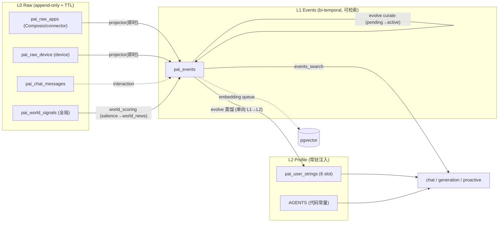

# Memory

## 结论

Memory 模块把用户的 digital + physical + interaction context 收敛成**三层**:

- **L0 · Raw**(`pai_raw_apps` + `pai_raw_device` + `pai_chat_messages` + `pai_world_signals`)—— 原始日志,append-only,需追溯的大内容。
- **L1 · Events**(`pai_events`)—— 不可变 bi-temporal 语义事件流,带 `curation_status` 状态机,是 agent 检索的唯一入口。
- **L2 · Profile**(`pai_user_strings`)—— 常驻 markdown 画像(6 slot),agent 自维护 + 用户 customize,注入 system prompt 让 agent「懂你」。

写入两个延迟档:**projector**(即时,无 LLM,把 L0 投影成 L1 `pending` 事件)+ **evolve**(异步 LLM,curate 事件 + 蒸馏画像)。读取一个入口:`events_search`(L1)+ 常驻注入(L2)。所有表都在 Postgres 同一 DB 的 public schema(前缀 `pai_*`);LangGraph chat checkpointer 独占 `langgraph` schema。

agent 工具从老的 21 个收敛到 **3 个**:`events_search`(读 L1)/ `event_append`(追加 L1)/ `memory_edit`(改 L2 画像)。

> **退役**:老的 `pai_memory` / `pai_personal_signals` / `pai_profile` / `pai_goals` / `pai_preference_records` 五张表已在 migration `114_drop_legacy_memory.sql` 里 **DROP**;`pai_timeline_events` 死表在 `111` 里 drop。代码里不要再 grep 这些表。设计 SSOT 见 [Lifelong Memory 系统重构](../plans/2026-06-23-lifelong-memory-system)。

上游接入看 [Data Connectors](./data-connectors)。



## 边界

包含:

- **L0** 按域分两张表(`119` 拆分):`pai_raw_apps`(Composio/connector 域,`toolkit` + `entity_type` 判别)+ `pai_raw_device`(device 域,`kind` 判别、无 toolkit、`external_id`=device_id)。两表共用 envelope(`payload JSONB`/`occurred_at`/`expires_at` reference-aware TTL/reference 三元组)。
- **L1** `pai_events`(`111`)的 schema、bi-temporal 双时间轴(`occurred_at` / `recorded_at`)、`curation_status` 状态机(`pending → active / filtered_out / archived`)、append + supersede 修正链、HNSW 语义检索。
- **L2** `pai_user_strings`(`112`)6 slot 画像、hermes MemoryStore 编辑算法(乐观锁 + char_budget 防截断 + 威胁扫描)、`AGENTS` 代码常量、PortraitMiddleware 注入。
- `pai_world_signals`(全局共享 L0,无 user_id)→ `world_scoring` 按 salience 投成 `pai_events` 的 `world_news` 事件(per-user view 已 `121` DROP,world 不再是独立检索 source)。
- `pai_skill_index`(body inline)。
- `pai_evolution_runs` 的 `trigger_kind` + status 生命周期(evolve 审计 + provenance)。
- pgvector embedding 队列(`pai_embedding_queue`,allowlist = `pai_events` only)。
- `/api/events` / `/api/user-strings`(UI 面)+ `/api/agent/events` / `/api/agent/user-strings` / `/api/agent/preferences`(agent 面)路由。
- 三个 agent-engine 触发收敛进 **evolve**(on_event / daily / chat_burst)的写入语义。
- RLS(`SET LOCAL app.user_id` + `SET LOCAL ROLE pai_app`)的多租户隔离。

不包含:

- 数据怎么进来(Composio / device ingest),看 [Data Connectors](./data-connectors)。
- 卡片 pipeline 怎么读 events / portrait,看 [Generation](./generation)。
- 反馈事件如何生成,看 [Feedback](./feedback)。
- scheduler 怎么派 `auto.dreaming` / `connector.evolve` / `crystallize`,看 [Background Tasks](./background-tasks)。

## 三层结构

| 层 | 表 | 可变性 | 谁写 |
|---|---|---|---|
| **L0 · Raw** | `pai_raw_apps`(Composio/connector)+ `pai_raw_device`(device)+ `pai_chat_messages`(对话)+ `pai_world_signals`(全局)| **append-only + TTL** | 系统 ingest |
| **L1 · Events** | `pai_events` | **append-only**(修正 = append supersede)| projector(系统)+ `event_append`(agent 纯追加)|
| **L2 · Profile** | `pai_user_strings`(markdown 6 slot)+ `AGENTS`(代码常量)| **mutable**(原地改)| 用户 customize + agent `memory_edit` + evolve 蒸馏 |

> **核心对称:历史(L0/L1)不可变,当前(L2)可变。** event-sourcing 内核——事件流记「发生了什么」(只能 append),投影出「现在是什么样」(随便改)。想「edit 一条 event」时,落在 L2 画像,不是事件层。

### L0 · `pai_raw_apps` / `pai_raw_device`(`119`)

L0 按**域**分两张表(`119` 把早先的单一 `pai_raw` 拆开——统一发生在投影管线 + source→table registry,不在物理表)。两表共用同一套 envelope:`(user_id, id)` PK / `external_id` / `occurred_at` / `ingested_at` / `expires_at`(reference-aware TTL)/ `title` / `snippet`(可选展示投影)/ `payload JSONB`(source-specific 全字段)/ `dedupe_key` + reference 三元组——只判别列不同:

| 表 | 域 | 判别列 | 唯一键 |
|---|---|---|---|
| `pai_raw_apps` | Composio app / 通用 connector | `toolkit` + `entity_type` | `(user_id, toolkit, entity_type, dedupe_key)` |
| `pai_raw_device` | 设备(snapshot + ambient) | `kind`(无 toolkit;`external_id`=device_id) | `(user_id, kind, dedupe_key)` |

**写入路径**:
- **Composio connector ingest** → `connector_ingest` → `generic_ingest.upsert_generic` → `pai_raw_apps`(toolkit 来自 task,entity_type 来自 `db/ingest_recipes/<toolkit>.yaml`)。
- **device ingest** → `raw_device.py` → `pai_raw_device`:snapshot 的 `raw_only`/`dual` kind(apps/contacts/health)+ ambient 的 `signal_only` kind(utterance/visit/motion 等 context event)都写这一张表,没有 typed 分流。`external_id`=device_id 让 full-sync replace 把 DELETE 限定到单台设备。

> projector(`event_projector.py` 的 `project_unprojected`)读 **`pai_raw_apps` + `pai_raw_device` 两表 UNION** 投成 pending 事件:apps 行带真实 toolkit、device 行以 `toolkit='device'` / `entity=kind` 归一,`(toolkit, entity)` 经 `_EVENT_TYPE_MAP` 映射出 event_type。device 跳过 semantic firehose(utterance/transcript,evolve rollup 合成 episode)+ apps/contacts(state 非事件)。

### L1 · `pai_events`(`111`)

一行 = 一个**语义事件**(发生的事 + 用户反馈)。核心字段:

| 字段 | 含义 |
|---|---|
| `(user_id, id)` | 主键(`id` TEXT,per-user 唯一)|
| `source` | 来源**类别**:`composio` / `device` / `ambient` / `chat` / `pinai_feedback` / `internal_operator` / `user` |
| `event_type` | 语义大类:`communication` / `meeting` / `utterance` / `movement` / `transaction` / `interaction` / `agent_decision` / `preference` |
| `occurred_at` / `end_at` | **事件发生时刻**(过去/未来同轴)+ 区间事件的结束 |
| `recorded_at` | **系统写入时刻**(事务时间;bi-temporal 另一轴,backfill 旧邮件=今天)|
| `title` / `body` | 一句话摘要 + 可选长文 |
| `structured JSONB` | 结构化字段(participants/location;preference 的 `{scope,polarity,weight,confidence,durability,expires_at}`)|
| `source_ref` | 指回 L0 raw 的 id(projector 幂等依据)|
| `importance` | salience 0–1(gating/检索核心,projector 默认 0.5 → evolve 校准)|
| `curation_status` | `pending` / `active` / `filtered_out` / `archived`(CHECK 约束)|
| `supersedes_id` / `superseded_by_id` | append-as-correction 链 |
| `dedupe_key` | 幂等键(`UNIQUE (user_id, dedupe_key)`)|
| `embedding` | `vector(1536)` HNSW cosine,复用 `pai_embedding_queue` |
| `reference_count` / `last_referenced_at` | forgetting 客观依据 |

**bi-temporal**:`occurred_at`(何时发生)+ `recorded_at`(何时记下),学 Graphiti。「我去年这时在忙什么」= 查 `occurred_at` 落在去年的事件(append-only 全保留)。不再有第三个 `valid_from/valid_to` 时间轴(fact 走 L2 markdown)。

**修正 = append + supersede**:「删除/更新」不物理改行,append 新版本 + 关旧版本链。`EventsRepository.supersede(old_id, new_id)` 把旧行标 `superseded_by_id` + `curation_status='archived'`,断言 `new_id` 已是该用户该 `event_type` 的 active 事件。**agent 的 `event_append` 纯追加,碰不到改写历史**;supersede 是系统/evolve/preference 路由内部操作。

**fact / preference 归属**:durable fact / 画像型偏好("住上海"、"喜欢简洁")→ **L2 USER markdown**(纯文本真源)。硬约束 / 负向偏好指令("别再推 crypto"、dismiss)→ **L1 `event_type=preference` 事件**(`structured` 带 `polarity/weight/expires_at`,给 generation 当硬约束)。preference 路由(`/api/agent/preferences`)内部就是写 `pai_events`,`_event_to_preference_dict` 把事件投影回历史 PreferenceRow wire shape 让 internal dashboard 不动。

### L2 · `pai_user_strings`(`112`)+ AGENTS

6 slot markdown 画像,`(user_id, slot)` PK,`content TEXT`(`§` 分隔 entry)+ `version INT`(乐观锁)+ `char_budget INT` + `updated_at`。第 7 段 `AGENTS` 是 agent-engine 代码常量(`agents/prompts/portrait.py`),**不落盘**——agent/用户工具都够不着。

**切分按「谁编辑」分三类(关键安全边界)**:

| slot | 职责 | 谁编辑 |
|---|---|---|
| **AGENTS** | 行为规范 + 安全强约束 | 开发者(代码常量,谁都不能改)|
| **IDENTITY / SOUL / TOOLS** | agent 是谁 / 人设 / 工具说明 | **用户** customize(settings UI;注入时 `<untrusted-text>` 包裹防注入)|
| **USER** | 用户 durable facts + 画像型偏好 | agent `memory_edit` + evolve(纯文本真源,replace 更新)|
| **MEMORY** | agent 主观长期笔记 / 解读 / 负向信号教训 | agent `memory_edit` + evolve(自身真源,不对应具体 event)|
| **GOALS** | 长期目标(90+ 天)| agent `memory_edit` + evolve(≥3 事件持续证据才升级)|

**编辑算法 = adapt hermes MemoryStore**(`UserStringsRepository.edit`):entry add/replace/remove + batch;乐观锁 `version`(并发 edit → WHERE version 失败 → no-op 逼 re-read);**超 char_budget 的 add 失败 → 回吐全部 entry 逼 agent 整合**(hermes 防截断,绝不静默 drop);**batch 只校验最终预算**;成功只返回新 version 不回吐 entry(防 thrash);**威胁扫描**(`<untrusted-text>` 标记 / NUL 拒写,在 api 信任侧做)。

**注入**:`PortraitMiddleware`(`harness/middleware.py`)每个 agent instance fetch 一次 `/api/agent/user-strings/`,`build_portrait(slots)` 组装 `AGENTS` + 6 slot(用户 slot `<untrusted-text>` 包裹、agent slot 可信),prepend 成 transient SystemMessage(不落 checkpoint,放最前保 cache 稳定)。fetch 失败降级成只注入 AGENTS,不杀对话轮。

## `curation_status` 状态机(检索 quality gate)

```
pending                                    (projector 投影 L0→L1 的落点)
  │ evolve curate (client.events.curate)
  ├→ active        (保留,可被 search_semantic 召回)
  ├→ filtered_out  (噪声:newsletter/自动回执,留 L0 但不进检索)
  └→ archived      (被 supersede / 过期)
```

> **⚠️ 检索 quality gate(关键踩坑)**:projector 投影的事件落 `pending`,**必须经 evolve curate 成 `active` 才被 `search_semantic` 召回**(repo 里 `search_semantic` 硬过滤 `curation_status='active'`)。agent 主动 `event_append` 的事件**直接落 `active` 立即可见**(agent 选择记录的事件跳过 pending)。preference 路由 `/add` 的偏好也直接 `active`。
>
> 所以 **connector ingest → chat 搜到** 之间夹着一次 evolve:connector_ingest 写 raw → projector 投影 pending 事件 → 入队 `connector.evolve` task → evolve curate 成 active → chat 才搜得到。**evolve 调度必须在线**,否则新 ingest 的事件永远卡在 pending 搜不到。

## evolve(三合一)

**evolve = 原 evolve / dream / crystallize 三合一**(`agents/evolve.py`,Code Mode sandbox agent),一个 agent、三种 trigger kind,统一两个 job:

1. **CURATE L1**:读 `client.events.search(status="pending")`,逐个 `client.events.curate(id, status, importance)` 判定 active / filtered_out / archived + 校准 importance。
2. **DISTIL L2**:从事件(正向 + 负向)单向蒸馏画像进 USER / MEMORY / GOALS(`client.user_strings.edit`),硬约束偏好顺手 `client.events.append(event_type="preference")`。**单向 L1→L2、画像是 events 的派生**——防双真源漂移。

三种 trigger:

| trigger_kind | 触发源 | scope |
|---|---|---|
| `on_event` | scheduler kind `connector.evolve`(connector ingest 写 raw 后入队)| curate 该 connector 的新 pending 事件 + 蒸馏画像 |
| `daily` | scheduler kind `auto.dreaming`(每日按用户 timezone 06:00)| 全 pending 队列;roll up + forget + 刷新画像 |
| `chat_burst` | chat session 结束(agent-engine 内联触发;修复了老 crystallize dormant)| 蒸馏对话表达的偏好/计划/事实 |

**HTTP 端点**:dispatcher 仍 POST 三个独立端点 `/agent/run/{dream,evolve,crystallize}`(`transport/routes/run.py`),但它们都是瘦 shell,内部全调 `run_evolve(trigger_kind=...)`——`dream.py` / `crystallize.py` agent 文件已删,只剩 `evolve.py`。`auto.dreaming` 的 `pai_evolution_runs` lifecycle 包在 api 侧 `dispatcher._dispatch_dream`(agent-engine OOM 也能翻 `failed`)。

**provenance**:evolve 每次蒸馏在 `pai_evolution_runs` 记 `refs_consumed` / `refs_produced`(目前 skill 维度可按 `created_run_id` / `last_updated_run_id` 聚合;`pai_events` 还没 run-association 列,per-run 事件账是 evolve-audit gap)。

## pgvector 与 embedding

`pai_events.embedding vector(1536)`(`111`)+ HNSW cosine 索引(`WHERE embedding IS NOT NULL`),model pin `text-embedding-3-small`(`platform/embeddings.py`)。

异步队列 `pai_embedding_queue`(`(user_id, table_name, row_id)` PK,`status` ∈ `pending/running/done/failed`):

- **allowlist = `pai_events` only**(`122` 把 `pai_world_signals` 移出——world 迁进 events 后它自己的 embedding/FTS 列已没有检索消费者,连列带索引带队列项一并删)。
- 写入侧:`EventsRepository.append` 在同一事务里 `enqueue(conn, user_id, "pai_events", row_id, title+body)`(仅新插入时)。
- 消费侧:`orchestration/tick_loop.py` 每轮 `drain_queue()`(batch 调 LiteLLM `/embeddings`,写回 `pai_events.embedding`)。每条事件按该用户 virtual key 计费;keyless 用户的行留 pending,等 onboarding 配 key 后补算(个人数据从不计到 master)。

## world signals

`pai_world_signals`(全局共享 L0,无 user_id,`020`)是唯一保留的 world 表:`world_ingest` 拉 RSS 写这里(RLS 公开 SELECT + service-role-only INSERT,`normalized_url` 去重)。**world IS an event**——`world_scoring` 给每个活跃用户按 salience(≥阈值)+ top-K 把信号投成 `pai_events` 的 `world_news` 事件(`source='world'`,salience 在 `structured`),agent 经 `events_search(event_type="world_news")` 读,和任何 event 一样。per-user `pai_world_signal_user_view` 已 `121` DROP;world 不再 LEFT JOIN、不再有 `world_recent` / `world_search` 工具或 `/api/world` / `/api/agent/world` 路由(W5/W6 退役)。

## HTTP 路由

### UI 面(`/api/*`,Supabase JWT)

| Prefix | 作用 |
|---|---|
| `/api/events` | list(active 事件时间线,Ambient / Mirror 渲染,只读)|
| `/api/user-strings` | get(6 slot 画像 markdown,Mirror 渲染,无 UI 写路径)|
| `/api/settings` | get / patch(含 timezone)|
| `/api/evolution` | 列 evolution_runs 给 dreaming panel |
| `/api/skills` | list / get / patch / disable |

### Agent 面(`/api/agent/*`,EdDSA agent-run JWT)

| Prefix | 作用 |
|---|---|
| `/api/agent/events` | `search`(语义/recency/gating)/ `append`(纯追加)/ `curate`(evolve 用,pending→active/...)|
| `/api/agent/user-strings` | `/`(读 6 slot 画像)/ `edit`(memory_edit;只允许 USER/MEMORY/GOALS)|
| `/api/agent/preferences` | `add` / `list` / `supersede`(底层写 `pai_events` event_type=preference;source 从 JWT principal 强制派生)|
| `/api/agent/skills` | list / get / add |
| `/api/agent/evolution` | create / list / get / complete / fail |
| `/api/agent/raw` | list / get(按域路由:device→`pai_raw_device` by kind,其余→`pai_raw_apps` by toolkit+entity)|

## agent 工具(21 → 3)

| 工具 | 替代掉 | 落点 |
|---|---|---|
| **`events_search`**(读)| memory_search / signals_recent / raw_list / world reads | `/api/agent/events/search` |
| **`event_append`**(纯追加一条事件)| (新增)| `/api/agent/events/append`(直接 active)|
| **`memory_edit`**(改 L2 画像 add/replace/remove/batch)| memory_add / profile_upsert / goal_upsert / preference_add | `/api/agent/user-strings/edit` |

> 对应三层可变性:events 工具只有 search + append(**没有 edit/delete,历史不可改**);画像工具 `memory_edit` 有 add/replace/remove(当前状态会变)。IDENTITY/SOUL/TOOLS 走用户设置 UI(不在 agent 工具)。chat agent 的工具集真源在 `agent-engine/.../tools/direct/__init__.py` 的 `ALL_TOOLS`;`memory_edit`(USER/MEMORY/GOALS)+ `event_append` 是频繁自治写,**故意不进 HITL gate**(否则 approval 刷屏)。

## RLS 多租户

新三层表(`pai_raw_apps` / `pai_raw_device` / `pai_events` / `pai_user_strings`)沿用 `user_scoped_tx`(`libs/db/src/pinai_db/rls.py`):`SET LOCAL ROLE pai_app`(非-BYPASSRLS)+ `SET LOCAL app.user_id`,双 policy(`user_scope` PUBLIC + `service_role` fallback)+ `FORCE ROW LEVEL SECURITY`。RLS 现已真激活(PR #200-204,之前「superuser bypass、名存实亡」已修)。

```python
async with user_scoped_tx(pool, user_id) as conn:
    repo = EventsRepository(user_id, conn)
    rows = await repo.search_structured(status="active", limit=20)
```

`service_tx(pool)`(不带 user)用于 scheduler / world_ingest / migration batch job(policy 有空 `app.user_id` fallback)。`pai_world_signals` 无 user_id,policy 单独写。

## 开发入口

| 改动 | 先看 |
|---|---|
| Schema 改 / 加表 | `backend/db/migrations/`(`110`-`114` 是本次 sunset;NNN 顺序只向前,RLS policy 同款双 policy + FORCE)|
| L1 events repository | `pinai_api/domains/user_model/events.py`(`append` / `search_semantic` / `search_structured` / `mark_curated` / `supersede` / `list_pending`)|
| L0→L1 projector | `pinai_api/domains/user_model/event_projector.py`(`raw_to_event_input` 纯函数 + `project_unprojected`;`_EVENT_TYPE_MAP` 是唯一 domain 知识)|
| L2 画像 repository | `pinai_api/domains/user_model/user_strings.py`(hermes `edit`:乐观锁 + char_budget + 威胁扫描)|
| timezone / settings | `pinai_api/domains/user_model/settings.py`(`pai_user_settings.timezone`,`113` 从退役的 `pai_profile` 迁来)|
| preference(event_type=preference)| `pinai_api/domains/user_model/preferences_agent.py` |
| Evolution repository | `pinai_api/domains/user_model/evolution.py` |
| World signals / 全局 ingest | `pinai_api/domains/connector/world/world_signals.py`、`world_ingest.py` |
| Skills repository | `pinai_api/domains/user_model/skills.py`(`body` inline TEXT)|
| UI 路由 | `pinai_api/domains/user_model/{events_ui,user_strings_ui,settings_ui,evolution_ui,skills_ui}.py` |
| Agent 路由 | `pinai_api/domains/user_model/{events_agent,user_strings_agent,preferences_agent,settings_agent,skills_agent,evolution_agent}.py` |
| evolve agent(LLM)| `backend/services/agent-engine/src/agent_engine/agents/evolve.py`(三 trigger 合一)|
| evolve 调度 | `pinai_api/orchestration/dispatcher.py`(`_dispatch_dream` + `connector.evolve` / `crystallize` 路由)、`cron.py` |
| AGENTS 常量 + 画像组装 | `agent-engine/.../agents/prompts/portrait.py`(`AGENTS` + `build_portrait`)|
| 画像注入 middleware | `agent-engine/.../harness/middleware.py`(`PortraitMiddleware`)|
| chat 工具集 | `agent-engine/.../tools/direct/__init__.py`(`ALL_TOOLS`)、`tools/direct/{events,user_strings}.py` |
| pgvector embedding | `pinai_api/platform/embeddings.py`、`pai_embedding_queue`(`029` + `111`/`122` 收窄 allowlist 到 `pai_events` only)|
| RLS helper | `backend/libs/db/src/pinai_db/rls.py` |

## 验证方式

```bash
# Repository 单测
cd backend && uv run pytest tests/web/db/                       # 全 repository 套件

# Agent / UI 路由集成
cd backend && uv run pytest tests/web/routes/

# agent-engine evolve agent
cd backend && uv run pytest tests/chat/agents/

# 类型 + lint
cd backend && uv run ruff check .
cd backend && uv run lint-imports
cd backend && uv run mypy services libs
```

手工 SQL(本地 compose Postgres):

```sql
-- 事件流概览(按 curation_status)
SELECT curation_status, count(*) FROM pai_events
WHERE user_id = $1 GROUP BY curation_status;

-- pending 队列(等 evolve curate)
SELECT id, event_type, occurred_at, title FROM pai_events
WHERE user_id = $1 AND curation_status = 'pending' ORDER BY occurred_at DESC LIMIT 20;

-- supersede 链
SELECT id, title, curation_status, supersedes_id, superseded_by_id FROM pai_events
WHERE user_id = $1 AND event_type = $2 ORDER BY recorded_at;

-- L2 画像 6 slot
SELECT slot, length(content) AS chars, version, updated_at FROM pai_user_strings
WHERE user_id = $1 ORDER BY slot;

-- 最近 evolution runs
SELECT id, trigger_kind, status, started_at, skills_added, profile_updated
FROM pai_evolution_runs WHERE user_id = $1 ORDER BY started_at DESC LIMIT 10;

-- embedding queue 状态
SELECT table_name, status, count(*) FROM pai_embedding_queue GROUP BY table_name, status;
```

## 踩坑

- **检索 quality gate**:projector 投影的事件落 `pending`,只有 evolve curate 成 `active` 才被 `events_search`(`search_semantic`)召回;agent `event_append` / preference `/add` 直接落 `active`。connector ingest 后新事件搜不到,先确认 `connector.evolve` task 跑没跑、evolve 调度在不在线。
- **L0 raw 是两张域表,不是 generic 单表也不是 typed 多表**:`119` 把早先的单一 `pai_raw` 拆成 `pai_raw_apps`(Composio)+ `pai_raw_device`(device)并 DROP 了 `pai_raw`;backend DB 里 raw 只有这两张,代码零 typed 表写入。apis 时代的 typed raw 表不在 backend migration 管辖,别照旧文档/旧注释以为还有 generic `pai_raw` 或 `pai_raw_device_*`。
- **事件不按内容去重**:同一动作不同时刻是 N 行(频率本身是 evolve 蒸馏画像的信号);`dedupe_key` 只防同一事件被写两次(backfill + webhook 撞一封邮件)。
- **`pai_events.embedding` 是异步队列写的**:INSERT 后不要立刻 vector 搜,给至少一轮 tick(默认 3s)让 `drain_queue` 跑;没 embedding 的行 `search_semantic` 直接跳过,要 recency 用 `search_structured`。
- **画像 edit 超预算不是静默截断**:`memory_edit` over_budget 会回吐全部 entry 逼 agent 整合后重发(hermes 防失明);乐观锁 `version` 冲突会 no-op,agent 要 re-read 重试。
- **AGENTS 不落盘**:安全强约束是 `agents/prompts/portrait.py` 的代码常量,agent/用户工具够不着;用户可改的 IDENTITY/SOUL/TOOLS 注入时 `<untrusted-text>` 包裹,改注入顺序/包裹要同步测试。
- **evolve 三端点都指向同一个 agent**:`/agent/run/{dream,evolve,crystallize}` 全 `run_evolve(trigger_kind)`;`dream.py` / `crystallize.py` 已删,改 consolidation 逻辑只动 `evolve.py`。
- **`pai_world_signals` 没 `user_id`**:RLS policy 跟 per-user 表不一样,不要套 `user_scoped_tx`,用 `service_tx`。world 的 per-user 落点是 `pai_events` 的 `world_news` 事件(`world_scoring` 投),不是 view——`pai_world_signal_user_view` 已 `121` DROP。
- **timezone 在 `pai_user_settings` 不在 `pai_profile`**:`pai_profile` 已 DROP(`114`);timezone 是它唯一有运行时消费者的字段,已迁 `pai_user_settings`(`113`),`locale` / `display_name` 无消费者随表删。
- **退役表别再 grep**:`pai_memory` / `pai_personal_signals` / `pai_profile` / `pai_goals` / `pai_preference_records` / `pai_timeline_events` 全 DROP;旧的 `superseded_by` 链 / 三桶 JSONB profile / signals 队列语义都没了。
- **LangGraph checkpointer 在 `langgraph` schema**,跟 `pai_chat_threads`(memory 关心的)是两个东西;清 chat 状态时不要误删 metadata 行。

## 相关模块

- [Data Connectors](./data-connectors):raw 怎么写进来(Composio init/sync、device ingest)+ projector 投影 L1。
- [Generation](./generation):卡片生成怎么读 events / portrait / preference。
- [Background Tasks](./background-tasks):`auto.dreaming`(daily evolve)/ `connector.evolve`(on_event)/ `crystallize`(chat_burst)的派发框架。
- [Execution](./execution):chat session 结束触发 chat_burst evolve 的入口。
- [Runtime & Deployment](./runtime-deployment):RLS / Postgres pool / yoyo migration 通用基建。

## 相关 AI Plans

- [Lifelong Memory 系统重构](../plans/2026-06-23-lifelong-memory-system):三层架构(L0 Raw / L1 Events / L2 Profile)+ 工具收敛 + evolve 三合一的设计 SSOT。
- [Proactive + 卡片生成](../plans/2026-06-23-proactive-card-generation):本 memory 的消费侧(proactive agent + 卡片生成)。
