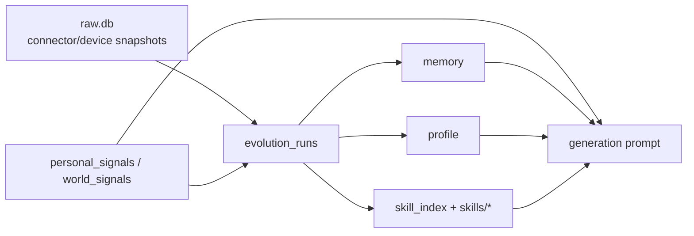
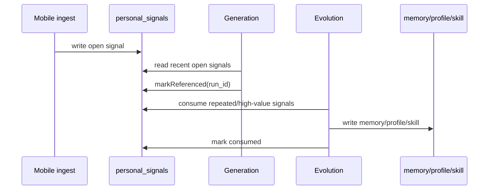
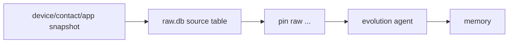

# Memory

## 结论

Memory 模块负责把已接入的数据沉淀为生成链路可用的上下文。上游接入看 [Data Connectors](./data-connectors)；本页只关心数据进入 `raw.db` / `personal_signals` / `world_signals` 之后怎么存、怎么读、怎么演进。



## 边界

包含：

- `raw.db` 分源表。
- `personal_signals`、`world_signals`。
- `memory`、`profile`、`skill_index` 和 `skills/<id>/SKILL.md`。
- `evolution_runs`、dreaming、conversation crystallize、manual CLI 写入。
- agent / CLI 查询接口。

不包含：

- 数据源 OAuth、device token、mobile proxy，看 [Data Connectors](./data-connectors)。
- 卡片 pipeline、评价、选卡，看 [Generation](./generation)。
- feedback event 如何生成，看 [Feedback](./feedback)。

## 当前设计

| 层 | 存储 | 作用 |
|---|---|---|
| Tier 0 raw | `raw.db` | Gmail、Calendar、device app/contact snapshot 等字段化批量数据。 |
| Tier 1 signals | `personal_signals`、`world_signals` | 短期观察，默认先给 pipeline / evolution 消费。 |
| Tier 2 memory | `memory` | evolution/manual 沉淀出的长期事实，有 `quality`、`confidence`、`status`。 |
| Tier 3 profile/skill | `profile`、`skill_index`、`skills/` | 高浓缩画像和可执行技能。 |

关键规则：

- `personal_signals.status` 流转：`open -> consumed -> archived`。
- `memory.status` 流转：`active -> archived|superseded`。
- `skill_index` 只存索引，正文在 `OPENCLAW_HOME/data/skills/<id>/SKILL.md`。
- `raw.db` 是独立 SQLite 文件，路径为 `${OPENCLAW_HOME}/data/raw.db`。
- `proactive.db` 是主 SQLite 文件，路径为 `${OPENCLAW_HOME}/data/proactive.db`。
- 需要追溯的表使用 `reference_count` / `last_referenced_at` / `referenced_by_runs`。

## 核心链路

### Mobile signal 到 memory



### raw snapshot 到 memory



## 开发入口

| 改动 | 先看 |
|---|---|
| 主 DB schema / helpers | `pinai-openclaw/plugins/proactive-ai/db.ts` |
| raw DB schema / helpers | `pinai-openclaw/plugins/proactive-ai/raw-db.ts` |
| HTTP routes | `routes/memory.ts`、`routes/signals.ts`、`routes/raw.ts`、`routes/profile.ts`、`routes/skills.ts`、`routes/evolution.ts` |
| CLI | `cli/memory.ts`、`cli/signals.ts`、`cli/raw.ts`、`cli/profile.ts`、`cli/skills.ts`、`cli/evolution.ts` |
| crystallize | `conversation-crystallize/` |
| dreaming | `dreaming/` |
| world signals | `world/`、`cli/world.ts` |

## 验证方式

```bash
npx tsx --test pinai-openclaw/plugins/proactive-ai/db.memory.test.ts
npx tsx --test pinai-openclaw/plugins/proactive-ai/db.personal-signals.test.ts
npx tsx --test pinai-openclaw/plugins/proactive-ai/db.skill-index.test.ts
npx tsx --test pinai-openclaw/plugins/proactive-ai/db.evolution-runs.test.ts
npx tsx --test pinai-openclaw/plugins/proactive-ai/raw-db.test.ts
npx tsx --test pinai-openclaw/plugins/proactive-ai/routes/v3-routes.test.ts
npx tsx --test pinai-openclaw/plugins/proactive-ai/cli/v3-cli.test.ts
```

手工查询常用命令：

```bash
pin profile get
pin signals recent --hours 24
pin memory search --query "投资偏好" --limit 10
pin raw gcal today --timezone Asia/Shanghai
pin skills list
pin evolution recent --limit 5
```

## 踩坑

- 不要把上游连接状态当成 memory；连接属于 Data Connectors。
- 不要让 device trigger 直接写高质量长期事实；高 `quality` memory 应由 evolution/manual 产生。
- 不要把大 JSON 长期堆进 SQLite 行；大 run artifact 应落到 `data/run-artifacts/`。
- 旧 `profile_memories`、`profile_interests`、`goals` 仍有兼容代码，改动时要确认调用方是否还读旧 shape。
- `mobile_items.db` 已废弃，不是当前 read/write path。

## 相关 AI Plans

- [Memory Architecture](../plans/memory-architecture)：Memory / Profile / Skill v3 的详细 schema、迁移映射和实施计划。
