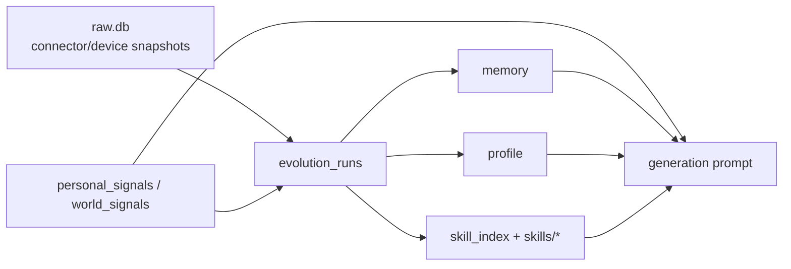
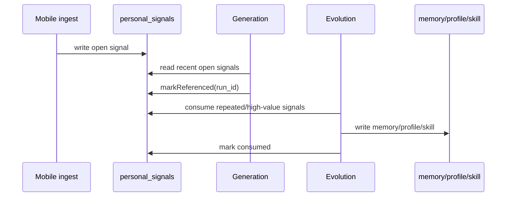
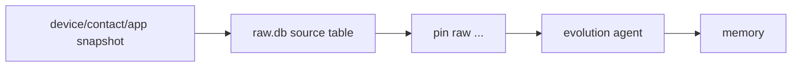
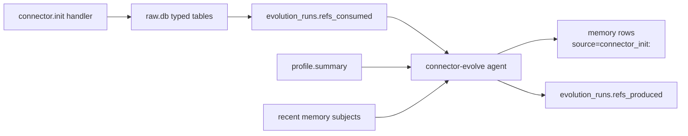

# Memory

## 结论

Memory 模块负责把已接入的数据沉淀为生成链路可用的上下文。上游接入看 [Data Connectors](./data-connectors)；本页只关心数据进入 `raw.db` / `personal_signals` / `world_signals` 之后怎么存、怎么读、怎么演进。



## 边界

包含：

- `raw.db` 分源表。
- `personal_signals`、`world_signals`。
- `memory`、`profile`、`skill_index` 和 `skills/<id>/SKILL.md`。
- `evolution_runs`、dreaming、conversation crystallize、manual CLI 写入。
- agent / CLI 查询接口。

不包含：

- 数据源 OAuth、device token、mobile proxy，看 [Data Connectors](./data-connectors)。
- 卡片 pipeline、评价、选卡，看 [Generation](./generation)。
- feedback event 如何生成，看 [Feedback](./feedback)。

## 当前设计

| 层 | 存储 | 作用 |
|---|---|---|
| Tier 0 raw | `raw.db` | Gmail / Calendar / Slack / Notion / Drive / GitHub / Docs / Outlook / Sheets / Stripe / Discord / device app/contact snapshot 等字段化批量数据。每个 Composio toolkit 一张 typed 表。 |
| Tier 1 signals | `personal_signals`、`world_signals` | 短期观察，默认先给 pipeline / evolution 消费。`connector.init` 落的信号 `kind=connector.<toolkit>.<entity>`。 |
| Tier 2 memory | `memory` | evolution/manual 沉淀出的长期事实，有 `quality`、`confidence`、`status`。connector init 写入的 `source='connector_init:<toolkit>'`。 |
| Tier 3 profile/skill | `profile`、`skill_index`、`skills/` | 高浓缩画像和可执行技能。 |

关键规则：

- `personal_signals.status` 流转：`open -> consumed -> archived`。
- `memory.status` 流转：`active -> archived|superseded`。
- `skill_index` 只存索引，正文在 `OPENCLAW_HOME/data/skills/<id>/SKILL.md`。
- `raw.db` 是独立 SQLite 文件，路径为 `${OPENCLAW_HOME}/data/raw.db`。
- `proactive.db` 是主 SQLite 文件，路径为 `${OPENCLAW_HOME}/data/proactive.db`。
- 需要追溯的表使用 `reference_count` / `last_referenced_at` / `referenced_by_runs`。
- `evolution_runs.trigger_kind` 现在有 5 种来源：`chat_burst`（crystallize）、`daily_dream`（auto.dreaming）、`manual`（CLI / 手动）、`on_event`（connector.init 拉数据后开的）、`consolidation`（预留）。
- connector init 的 evolve agent（`tasks/handlers/connector-evolve.ts`）专门处理 `on_event`：把刚 ingest 的 raw + signals sample 进 prompt，让 LLM 抽出 durable facts 写到 `memory`，`source='connector_init:<toolkit>'`、`sourceRunId=<evolution_run_id>`。失败时 `evolution_runs.status='failed'`，`memory` 不写，`raw + signals` 仍然保留。
- 默认 `pin` 入口是 **Public PCI surface**，只允许读取层和受控 `personal` 执行层：`raw`、`signals recent/list/get`、`memory list/get/search`、`profile get/snapshot`、`world` 查询、`cards recent`、`feedback list/get/stats`、`personal status/connections/connect/wait/tools/exec`、`sys schema`。`skills / evolution / tasks` 以及 `memory add/archive/supersede`、`signals consume`、`feedback log` 等写命令只保留为 internal/admin surface，必须显式 `PIN_CLI_SURFACE=internal pin ...`。
- `pin personal exec` 默认只允许 read/query 类 Composio tool；有副作用的 tool 目前只允许 `GMAIL_CREATE_EMAIL_DRAFT` 和 `GMAIL_SEND_DRAFT`，且必须带 `--allow-side-effect true`。

## 核心链路

### Mobile signal 到 memory



### raw snapshot 到 memory



### connector.init → evolution → memory

`connector.init` 在 [Data Connectors](./data-connectors) 那边拉好数据后，handler 会创建一行 `evolution_runs(trigger_kind='on_event')` 并把 `refs_consumed` 填为 `gmail_messages` / `slack_messages` / 等的新插入 id。`tasks/handlers/connector-evolve.ts` 立刻在同一 task 内执行：sample 20 条 → 拼 prompt（含 profile summary + recent memory subjects 防止重复）→ 跑 subagent → parse JSON → `addMemoryV3({source:'connector_init:<toolkit>', sourceRunId, ...})`。



LLM 失败 / 超时 / 解析不出 JSON 时不抛出：`evolution_runs.status='failed'` + `error_message`，但 `connector.init` task 仍 `succeeded`（raw + signals 是独立有效产物，不应该因为 LLM 失败而回滚）。

## 开发入口

| 改动 | 先看 |
|---|---|
| 主 DB schema / helpers | `pinai-openclaw/plugins/proactive-ai/db.ts` |
| raw DB schema / helpers | `pinai-openclaw/plugins/proactive-ai/raw-db.ts` |
| HTTP routes | `routes/memory.ts`、`routes/signals.ts`、`routes/raw.ts`、`routes/profile.ts`、`routes/skills.ts`、`routes/evolution.ts` |
| Public CLI dispatcher / schema | `cli/bin.ts`、`cli/sys.ts` |
| Public CLI handlers | `cli/memory.ts`、`cli/signals.ts`、`cli/raw.ts`、`cli/profile.ts`、`cli/world.ts`、`cli/cards.ts`、`cli/feedback.ts`、`cli/personal.ts` |
| Internal CLI handlers | `cli/skills.ts`、`cli/evolution.ts`、`cli/tasks.ts`（必须 `PIN_CLI_SURFACE=internal`） |
| crystallize | `conversation-crystallize/` |
| dreaming | `dreaming/` |
| world signals | `world/`、`cli/world.ts` |

## 验证方式

### 一键回归

改完 memory / signals / raw / profile / skill / evolution / dreaming / crystallize 任一处后，先跑这一条：

```bash
bash pinai-openclaw/plugins/proactive-ai/scripts/test-memory.sh
```

它把以下三类测试串成一遍跑完：

1. **schema + helper 单测**：`db.memory` / `db.personal-signals` / `db.world-signals` / `db.evolution-runs` / `db.skill-index` / `db.app-state` / `raw-db`。验证表结构和读写助手。
2. **迁移回放**：`db.legacy-migration` / `db.phase15-migration` / `db.phase2b-migration` / `db.phase2c-migration` / `db.phase2d-migration` / `db.phase2e-goals-references`。每个文件先建出 v2 旧表 + 旧数据，再让 `openProactiveDb()` 跑迁移，断言数据进了 v3 sink、旧表 DROP 干净。**这是"我没把以前数据兼容坏"的硬保证。**
3. **端到端 + CLI 烟雾**：`v3-end-to-end` / `cli/v3-cli` / `cli/v3-review-fixes` / `evolution-three-triggers`。从 mobile ingest → personal_signals → 三种 evolution 触发（chat_burst / daily_dream / manual）→ memory + profile + goals 写入 → reference 三元组 bump，全链路在临时 DB 里跑一遍。所有 `pin xxx` 子命令都有最小烟雾用例。

任意一步红，对应的 PR 不进。绿就说明：v3 SSOT 数据流没断、旧数据兼容没掉、CLI/路由形状没变。

### 单跑

需要单独诊断时按层挑一个跑：

```bash
# schema/helper
npx tsx --test pinai-openclaw/plugins/proactive-ai/db.memory.test.ts

# 迁移回放（v2→v3 兼容）
npx tsx --test pinai-openclaw/plugins/proactive-ai/db.phase2c-migration.test.ts

# 端到端 + 三种 evolution 触发
npx tsx --test pinai-openclaw/plugins/proactive-ai/v3-end-to-end.test.ts
npx tsx --test pinai-openclaw/plugins/proactive-ai/evolution-three-triggers.test.ts

# CLI 全量烟雾
npx tsx --test pinai-openclaw/plugins/proactive-ai/cli/v3-cli.test.ts
npx tsx --test pinai-openclaw/plugins/proactive-ai/cli/v3-review-fixes.test.ts
```

### 真 HTTP + 真 DB 演练（可选）

不跑 LLM、跑真 http.Server + 真 SQLite，看三条 evolution 路径在 wire 上的反应：

```bash
cd pinai-openclaw/plugins/proactive-ai && npx tsx scripts/evolution-smoke.ts
```

输出包含每个 HTTP 请求的状态码、响应体，以及 `evolution_runs` / `memory` / `skills` 的最终行。

### 手工查询

```bash
pin profile get
pin signals recent --hours 24
pin memory search --query "投资偏好" --limit 10
pin memory list --subject-prefix topic:        # interests 现在以 memory 形式存
pin raw gcal today --timezone Asia/Shanghai
pin sys schema                                  # public PCI surface

# internal/admin only
PIN_CLI_SURFACE=internal pin skills list
PIN_CLI_SURFACE=internal pin evolution recent --limit 5
```

## 踩坑

- 不要把上游连接状态当成 memory；连接属于 Data Connectors。
- 不要让 device trigger 直接写高质量长期事实；高 `quality` memory 应由 evolution/manual 产生。
- 不要把大 JSON 长期堆进 SQLite 行；大 run artifact 应落到 `data/run-artifacts/`。
- v2 satellite 表已全部撤掉：`profile_signals` → `personal_signals`、`profile_interests` → `memory{subject:"<kind>:<key>"}`、`dream_runs` → `evolution_runs(trigger_kind='daily_dream')`、`auto_loop_state` / `chat_crystallize_state` → `app_state` KV、`push_records` / `push_outcomes` 整张干掉。改动前不要再去查这些表。
- `mobile_items.db` 整个文件已撤；mobile 数据走 `personal_signals` + `raw.db` 双轨，不存在第三个 SQLite 文件。
- `goals` 表保留（一等集合），但带 `reference_count` / `last_referenced_at` / `referenced_by_runs` 三元组，evolution 引用 goal 时要 `markGoalsReferenced()`。

## 相关 AI Plans

- [Memory Architecture](../plans/memory-architecture)：Memory / Profile / Skill v3 的详细 schema、迁移映射和实施计划。

## 与其他模块的边界

- **入站接入**：connector.init 拉数据写 raw + signals → 看 [Data Connectors](./data-connectors)。
- **出站消费**：generation pipeline 怎么读 memory + signals 进 prompt → 看 [Generation](./generation)。
- **scheduler / lease / heartbeat / internal `pin tasks`**：通用基建在 [Runtime & Deployment](./runtime-deployment#background_tasks-scheduler) 里讲。
