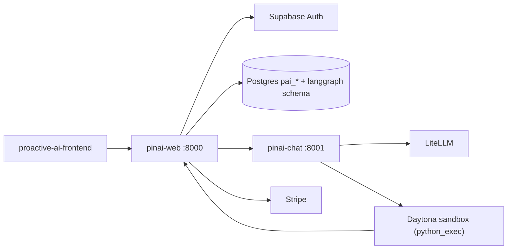

# Runtime & Deployment

## 结论

整个后端收敛到 **pinai-agents**(Python / FastAPI / DeepAgents),单镜像两进程:`web` 拿 master credentials 做控制面,`chat` 跑 LLM loop。前端 **proactive-ai-frontend** 直接打 pinai-agents,中间没有 proxy。LLM 走 **LiteLLM**,长任务通过 web 进程的 scheduler tick loop 派到 chat。旧的 `apis/`(Node) + `pinai-openclaw/`(用户容器)整套已经退役。



## 边界

包含:

- 本地启动、验证命令。
- `pinai-web` / `pinai-chat` 进程拆分与信任边界。
- HTTP / SSE 入口、`/api/*` 与 `/agent/*` 表面。
- 鉴权链(Supabase JWT、agent-run JWT、phantom token、device token)。
- Daytona sandbox、yoyo 迁移、LiteLLM、dotenvx、Fly CI/CD、Stripe billing 概述。

不包含:

- scheduler 内部、`pai_scheduled_tasks` 表结构、连接器/dreaming/generator 任务调度,看 [Background Tasks](./background-tasks)。
- connector 业务,看 [Data Connectors](./data-connectors)。
- memory / generation / execution / feedback 模块内部,看对应模块。

## 进程拓扑

| 进程 | 端口 | 入口 | 角色 |
|---|---|---|---|
| `pinai-web` | 8000 | `pinai_agents.web.asgi:app` | 控制面 + 出口流量。持有 master credentials(`SUPABASE_SERVICE_ROLE_KEY` / `PAI_JWT_SIGNING_KEY` / `COMPOSIO_API_KEY` / `STRIPE_*` / `LITELLM_MASTER_KEY`)。挂 `/api/*`、`/api/agent/*`、`/payment/*`、`/health`。lifespan 起 scheduler tick loop + world signals ingest。 |
| `pinai-chat` | 8001 | `pinai_agents.chat.asgi:app` | LLM loop。**不能**看到 master credentials,启动前 `chat/asgi.py` 检测到 forbidden var 直接 exit。挂 `/agent/chat`、`/agent/generate`、`/agent/run/*`、`/agent/history`、`/health`。lifespan 起 LangGraph Postgres checkpointer + Daytona sandbox idle GC(5 分钟一轮)。 |

两个进程共用一个镜像、共用 Postgres pool;web → chat 的内部调用走 `WEB_INTERNAL_URL` / `CHAT_INTERNAL_URL`,签 EdDSA (Ed25519) 每 run JWT。

## 信任边界

`pinai-agents/src/pinai_agents/chat/trust_boundary.py` 是 `FORBIDDEN_ENVS` 的单一真源。改动这里前先读 docstring。三道防线:

| 层 | 实现 |
|---|---|
| 启动 fail-fast | `chat/asgi.py` import 时 `assert_no_forbidden_envs()`,任何 forbidden var 存在直接 exit。 |
| 本地 compose | `make ensure-env-pinai-agents` 从 `pinai-agents/.env` 派生 `.env.chat`,把 FORBIDDEN_ENVS 剔掉,只给 `pinai-chat` 容器读。 |
| 部署 | `scripts/sync_fly_secrets.py` 在 CI 同步 fly secrets 时按 process group 剥离,chat process 拿不到 forbidden var。 |

外加静态防线:ruff `flake8-tidy-imports.banned-api` 禁止 `pinai_agents.web` ↔ `pinai_agents.chat` 互相 import,公共类型放 `pinai_agents.shared/`(纯 model / protocol,无副作用)。

## HTTP / SSE 表面

### web :8000

- `/api/*` — 前端面向接口,Supabase JWT 鉴权。路由模块在 `pinai-agents/src/pinai_agents/web/routes/ui/`:`chat`(`/api/chat-stream/*`)、`generate`、`memory`、`signals`、`profile`、`devices`、`feedback`、`composio`、`tasks`、`raw`、`runs_and_cards`、`dreaming`、`skills`、`browser`、`agent_runs`、`crystallize`、`jwt_revoke`、`payment`(独立 prefix)。
- `/api/agent/*` — sandbox 内 `pinai_sdk` 回连接口,phantom token 鉴权。模块在 `web/routes/agent/`:`memory`、`signals`、`world`、`state`、`profile`、`skills`、`composio`、`raw`、`cards`、`feedback`、`evolution`、`pipeline`、`sandbox_phantom`。
- `/health` — 含一次 `SELECT 1` 探活;DB 异常返回 `db: error` 但不翻 HTTP 状态码,交给 readiness probe 严控。
- 中间件:`CORSMiddleware`(origin allowlist 来自 `CORS_ALLOWED_ORIGINS`)、`AgentAuditMiddleware`(只在 `/api/agent/*` 路径下记录 audit log)。

### chat :8001

`chat/app.py` 挂:`/agent/chat`(SSE)、`/agent/generate`、`/agent/history`、`/agent/run/*`(`dream` / `evolve` / `crystallize`)、`/agent/browser/*`、`/health`。所有路由要 `Authorization: Bearer <agent-run-jwt>`,web 走 `services/chat_proxy.py` 签发并代理。

## 鉴权

| 链路 | 算法 | 单一真源文件 |
|---|---|---|
| 前端 → web | Supabase JWT(RS256,public key from `SUPABASE_JWT_SECRET`) | `web/auth/supabase_jwt.py`、`web/auth/deps.py`(`current_user` 依赖) |
| web → chat | EdDSA (Ed25519) 每 run JWT,默认 1 小时 TTL,`jti` 在 `pai_jti_revocations` 黑名单 | `web/auth/agent_jwt.py` 签发(私钥 `PAI_JWT_SIGNING_KEY`,base64 raw 32B);`chat/auth/run_jwt.py` 用公钥验签 |
| sandbox → web `/api/agent/*` | Phantom token(opaque,1 小时 TTL,sandbox 关闭即吊销) | `web/routes/agent/sandbox_phantom.py` mint;`web/db/repositories/sandbox_phantom_tokens.py`;chat 端 sandbox 启动时把 token 注入 `PAI_SANDBOX_TOKEN` env |
| 设备 → web | `X-Device-Id` + `X-Device-Token`(bcrypt rounds=10) | `web/routes/ui/devices.py`、`web/db/repositories/devices.py` |

`/api/agent/*` 跟前端的 `/api/*` 是同一进程不同前缀:前者走 phantom token / agent-run JWT,后者走 Supabase JWT,鉴权依赖在 route 级别区分。

## Daytona sandbox

chat 进程的 `python_exec` / browser 工具跑在远端 Daytona sandbox 里,不能直接访问主 DB。逻辑在 `pinai-agents/src/pinai_agents/chat/tools/sandbox.py`:

- 每个 LangGraph thread 对应一个 sandbox(LRU 100 entries,OrderedDict)。
- `auto_stop=5min` 让 Daytona 自动停闲置,`auto_delete=24h` 兜底回收。
- 每次命中缓存先 `refresh_data()` 校验真实状态;`STOPPED` lazy resume,`ARCHIVED` / `DESTROYED` evict + 重建。
- 并发同一个 thread_id miss 共用 `asyncio.Future`,防止开多个孤儿 sandbox。
- 进程级 5 分钟 GC 循环 `_sandbox_gc_loop()` 扫缓存里和云端不一致的项。

snapshot 构建在 `pinai-agents/infra/daytona/`:Dockerfile 装 pinai_sdk + 必要 deps,`build_snapshot.sh` 推上 Daytona。Deploy Test workflow 每次 deploy 都 refresh 一次。

sandbox 内通过 `PAI_API_URL` + `PAI_SANDBOX_TOKEN` 回连 web `/api/agent/*`,SDK 在 `pinai-agents/packages/pinai_sdk/`。本地 Daytona 跑不到 `pinai-web:8000` 这种 compose 内网 host,需要先 `make tunnel-up` 起 ngrok 把 8000 暴出去。

## 本地开发

首次设置:

```bash
make init                      # npm install root + frontend(只跑一次)
# 找团队成员要 .env.keys,放到:
#   pinai-agents/.env.keys
#   ops/litellm/.env.keys
make up                        # 解密 .env.dev → .env,build 全栈,起 postgres + litellm + db-migrate + pinai-web + pinai-chat + frontend
```

常用循环:

| 改动 | 用什么 |
|---|---|
| pinai-agents Python 代码 | `make restart` |
| 前端代码(容器版) | `make restart-frontend`,或者本地 `cd proactive-ai-frontend && npm run dev` 直接连 `:8000` |
| docker-compose / Dockerfile | `make up`(会重 build) |
| 翻数据丢档从头来 | `make clean && make up`(`reset` 同语义 + 自动起 ngrok) |
| 状态/日志 | `make status` / `make logs` / `make logs-pinai-web` / `make logs-pinai-chat` / `make logs-frontend` |
| DB 强制重 migrate | `make migrate` |

Daytona / mobile 用 ngrok:

```bash
make tunnel-up      # 把 pinai-web:8000 暴出公网,Daytona sandbox 才能回连 /api/agent/*
make tunnel-status
make tunnel-down
```

Mobile(Capacitor):

```bash
make ios            # build frontend(VITE_CAPACITOR=1),sync iOS,打开 Xcode
make android        # 同理,装到 USB Android 设备
# 后端选择:
#   NGROK=<url> make ios      # 临时公网 URL,优先级最高
#   PROD=1 make ios           # fly prod
#   DEV=1 make ios            # fly dev
#   make ios                  # 默认优先用 ./.env 的 PAI_API_URL(ngrok)
#                             # 没配 PAI_API_URL 时直接失败,不退回 LAN IP
```

## Secrets 与环境变量

dotenvx 加密 checkin,每环境一把私钥:

```
pinai-agents/.env.dev   .env.test   .env.production       # 后端 + VITE_* 加密真源
ops/litellm/.env.dev    .env.test   .env.production       # LiteLLM 加密真源
pinai-agents/.env.keys  ops/litellm/.env.keys             # 私钥,不 checkin
pinai-agents/.env       ops/litellm/.env                  # make ensure-env 解密生成,不要手改
pinai-agents/.env.chat                                    # 从 .env 派生(去 FORBIDDEN_ENVS),给 pinai-chat 容器
```

常用命令:

```bash
npx @dotenvx/dotenvx get -f pinai-agents/.env.dev
npx @dotenvx/dotenvx set NEW_KEY "value" -f pinai-agents/.env.dev
make env-local                                           # 强制重 decrypt
```

CI 把 `DOTENV_PRIVATE_KEY_TEST` / `DOTENV_PRIVATE_KEY_PROD` 当 GitHub secret;deploy workflow 用 dotenvx 解密 `.env.test` / `.env.production`,再用 `scripts/sync_fly_secrets.py` 注入 fly app secrets(按 process group 剥离 FORBIDDEN_ENVS)。

## 数据库与迁移

- Postgres,本地 compose 用 `pgvector/pgvector:pg15`,prod 用 Supabase。
- 命名前缀:`pai_*`(用户表 + 业务表,public schema)、LangGraph checkpointer 独占 `langgraph` schema。
- yoyo migration 配置:`pinai-agents/yoyo.ini`(`sources = db/migrations`,`migration_table = pai_yoyo_migration_log`)。
- 迁移目录:`pinai-agents/db/migrations/`,命名 `NNN_pai_<topic>.sql`,目前到 `039_split_generator_kinds.sql`,**只向前,不回滚**。
- 本地:`make migrate` 一次性容器先 `CREATE DATABASE litellm` 再 `yoyo apply --batch`。
- 部署:Fly app 的 `release_command` 调 `yoyo apply --batch`,在 rolling restart 前完成。

## LiteLLM

- 配置:`ops/litellm/litellm_config.yaml`(model list、cache_control_injection、cost 表)。
- 本地容器:`docker.litellm.ai/berriai/litellm:main-v1.82.0.dev1`,端口 4000。
- 每用户 virtual key:`web/services/litellm_provisioning.py`,首次 signup 时 `ensure_user_litellm_key(pool, user)` 同步 mint;失败时 generate route lazy-recover 一次(`web/routes/ui/generate.py:_ensure_virtual_key`)。
- LiteLLM 自己用 `litellm` 数据库(db-migrate 容器 `CREATE DATABASE` 那一步),跟 `pai_*` 隔离。
- Budget / Stripe 同步在 `web/payment/`。

## 部署

| Fly app | dev | test | prod |
|---|---|---|---|
| pinai-agents(web + chat 同 app,`[processes]` 切分) | `proactive-ai-agents-dev` | `proactive-ai-agents-test` | `proactive-ai-agents-prod` |
| Frontend SPA(nginx + Vite static) | `proactive-ai-frontend-dev` | `proactive-ai-frontend-test` | `proactive-ai-frontend-prod` |
| LiteLLM | `proactive-ai-litellm-dev` | `proactive-ai-litellm-test` | `proactive-ai-litellm-prod` |

primary region `iad`(部分 dev/test 跨到 `ord`)。Daytona sandbox 不是 fly app。

GitHub Actions 入口在 `.github/workflows/`:

| Workflow | 触发 | 做什么 |
|---|---|---|
| `ci.yml` | PR | type-check + lint。 |
| `deploy-dev.yml` | push 到 `proactive-ai-v2`/`v3` 或手动 | 按 path filter 部署 pinai-agents / frontend / litellm。 |
| `deploy-test.yml` | 手动 | 先 refresh Daytona snapshot,再部署三个 app;跑 `sync_fly_secrets.py` 守 trust boundary。 |
| `deploy-prod.yml` | 手动 / `v*` tag | 创建 GitHub release,promote dev → prod env,部署三个 app(需要 environment approval)。 |
| `build-ios.yml` | 手动 | build frontend、sync Capacitor、装 iOS Xcode 项目工件。 |

本地部署兜底(CI 不可用时):

```bash
make deploy-pinai-dev
make deploy-pinai-prod
make deploy-frontend-dev
make deploy-frontend-prod
make deploy-litellm-dev
make deploy-litellm-prod
```

## Billing

- Stripe 管订阅,LiteLLM 管 token budget。
- 代码:`pinai-agents/src/pinai_agents/web/payment/`(`stripe_client.py`、`subscriptions.py`、`plans.py`、`guard.py`、`webhook.py`、`routes.py`)。
- `invoice.paid` 是唯一触发 LiteLLM budget reset + `max_budget` 设置的事件。
- 升级:取消旧订阅不退款,新套餐立即生效新账期。
- 降级:下期生效,本期额度不降。
- 取消:`subscription.deleted` 清 budget。

## 验证方式

基础:

```bash
make status                                           # 容器都 healthy?
make logs-pinai-web | grep -E "WEB starting|scheduler"
make logs-pinai-chat | grep -E "CHAT starting|sandbox gc"
curl -s http://localhost:8000/health | jq             # web 探活 + DB ping
curl -s http://localhost:8001/health | jq             # chat 探活
```

测试套件:

```bash
cd pinai-agents && uv run pytest                     # 全量 pytest(tests/web、tests/chat、tests/shared)
cd pinai-agents && uv run pytest tests/web/auth      # 鉴权层
cd pinai-agents && uv run pytest tests/web/scheduler # scheduler 单测
cd pinai-agents && uv run pytest tests/web/payment   # billing
cd pinai-agents && uv run ruff check .               # 含 banned-api 静态防线
cd proactive-ai-frontend && npm run type-check       # 前端类型
cd proactive-ai-frontend && npm test                 # vitest
```

部署相关只能通过 GitHub Actions 验,本地 `make deploy-*` 是 CI 不可用时的兜底,不要拿来当主路径。

## 开发入口

| 改动 | 先看 |
|---|---|
| FastAPI app 装配 / lifespan | `pinai-agents/src/pinai_agents/web/app.py`、`web/asgi.py` |
| chat app 装配 / lifespan / sandbox GC | `pinai-agents/src/pinai_agents/chat/app.py`、`chat/asgi.py` |
| 信任边界 / FORBIDDEN_ENVS | `pinai-agents/src/pinai_agents/chat/trust_boundary.py` |
| Supabase JWT 鉴权 | `pinai-agents/src/pinai_agents/web/auth/`(`supabase_jwt.py`、`deps.py`、`user_service.py`) |
| Agent-run JWT 签发 / 验证 | `web/auth/agent_jwt.py`、`chat/auth/run_jwt.py` |
| Sandbox phantom token | `web/routes/agent/sandbox_phantom.py`、`web/db/repositories/sandbox_phantom_tokens.py` |
| LiteLLM key 配额 | `web/services/litellm_provisioning.py` |
| Daytona sandbox 缓存 / GC | `chat/tools/sandbox.py`、`chat/app.py` `_sandbox_gc_loop` |
| Daytona snapshot 构建 | `pinai-agents/infra/daytona/` |
| Postgres pool / RLS | `web/db/pool.py`、`web/db/rls.py` |
| yoyo 迁移 | `pinai-agents/yoyo.ini`、`pinai-agents/db/migrations/` |
| Stripe + 订阅 | `web/payment/` |
| CORS / audit 中间件 | `web/app.py` 装配段,`web/middleware/audit.py` |
| docker-compose / Makefile | `docker-compose.yml`、`Makefile` |
| CI / fly secrets 守门 | `.github/workflows/`、`pinai-agents/scripts/sync_fly_secrets.py` |
| 前端 API base | `proactive-ai-frontend/src/lib/platform.ts`、`src/lib/api.ts` |

## 生产环境硬性规则

- 生产部署优先走 GitHub Actions(有审计 + approval)。
- 生产环境禁止直连数据库写 schema。
- 所有生产变更必须走代码评审 + CI/CD。
- FORBIDDEN_ENVS 改动必须经过 review,任何一个 master credential 漏到 chat process 就是 P0。
- yoyo 迁移一旦 merge 到主干禁止修改;只能加新文件做 additive 或 expand-contract。

## 踩坑

- `make up` 第一次拉镜像 + build 慢(尤其是 Python deps + pgvector),给 10-15 分钟。
- `pinai-chat` healthcheck 失败十有八九是 `.env.chat` 里漏了非 forbidden 但必须的 var(比如 `LITELLM_BASE_URL`);先 `cat pinai-agents/.env.chat | sort` 看完整性。
- Daytona sandbox 在本地需要 `make tunnel-up`,否则 SDK 回连 `pinai-web:8000` 这种 docker 内部 host 失败,具体表现是 generator / dreaming agent 在跑 `python_exec` 后挂。
- 本机全局代理可能让 `flyctl` 和 Docker push 失败;Makefile 已经在 deploy target 里 `env -u HTTP_PROXY HTTPS_PROXY ALL_PROXY` 处理。
- LiteLLM budget 报错先看 LiteLLM DB 里 spend / max_budget,不一定是 virtual key 缺;`web/services/litellm_provisioning.py` 有 lazy provisioning 逻辑。
- LangGraph checkpointer 在 `langgraph` schema,跟 `pai_*` 物理同库逻辑分离;清 chat 状态 `TRUNCATE langgraph.<tables>` 而不是删 `pai_chat_threads`。
- 改 docker-compose 后只 `make restart` 不够,要 `make down && make up` 才会让 compose 看到新声明。
- `make ios` / `make android` 选后端时,native shell 用绝对 URL(`VITE_PIN_API_URL`)。本地移动端默认使用项目根目录 `./.env` 的 `PAI_API_URL`(ngrok),这样手机离开当前局域网后仍能访问本机 `pinai-web`;没配 `PAI_API_URL` 时直接失败,不退回 LAN IP。

## 相关模块

- [Background Tasks](./background-tasks):scheduler tick loop、`pai_scheduled_tasks` 表、所有异步任务的派发框架。
- [Data Connectors](./data-connectors):Composio / device ingest 在 web 进程的入口。
- [Execution](./execution):chat-stream / browser tool / sandbox 工具决策。
- [Generation](./generation):`POST /api/generate` 怎么进 scheduler、chat 怎么跑 generator agent。
