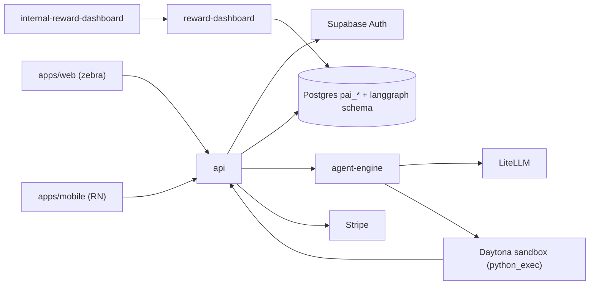

# Runtime & Deployment

## 结论

整个后端是 **backend** 下的 uv workspace monorepo(Python / FastAPI / DeepAgents):三个互不依赖的 service —— `api`(控制面)、`agent-engine`(LLM loop)、`reward-dashboard`(内部 review 后端)—— 加两个共享 lib(`libs/contracts`、`libs/db`)。**三环境的 Fly 拓扑都已拆成三个独立 app**:`proactive-ai-{api,engine,reward}-{dev,test,prod}`(test 2026-07-02 建、prod 2026-07-07 切),其中 `api` 持 master credentials,`agent-engine` 不持 master credentials 且 `ENGINE_TRUST_FAILFAST=1` armed。用户产品前端是「一套共享层 + 多个端壳」:**apps/web**(zebra 桌面 web 端,已上线 dev/prod)、**apps/mobile**(Expo RN iOS,TestFlight 交付)、**apps/desktop**(Electron,仅本地);原 Capacitor 前端 proactive-ai-frontend 已于 2026-07-09 退役删除。内部卡片 review 工具是独立 Vite app **internal-reward-dashboard**。LLM 走 **LiteLLM**,长任务通过 api 进程的 scheduler tick loop 派到 agent-engine。旧的 `apis/`(Node) + `pinai-openclaw/`(用户容器)整套已经退役。



## 边界

包含:

- 本地启动、验证命令。
- `api` / `agent-engine` 进程拆分与信任边界。
- 各前端入口(apps/web、apps/mobile、apps/desktop、internal-reward-dashboard)的本地启动方式。
- HTTP / SSE 入口、`/api/*` 与 `/agent/*` 表面。
- 鉴权链(Supabase JWT、agent-run JWT、phantom token、device token)。
- Daytona sandbox、yoyo 迁移、LiteLLM、dotenvx、Fly CI/CD、Stripe billing 概述。

不包含:

- scheduler 内部、`pai_scheduled_tasks` 表结构、连接器/evolve/generator 任务调度,看 [Background Tasks](./background-tasks)。
- connector 业务,看 [Data Connectors](./data-connectors)。
- memory / generation / execution / feedback 模块内部,看对应模块。

## 进程拓扑

| 进程               | 端口 | 入口                              | 角色                                                                                                                                                                                                                                                                              |
| ------------------ | ---- | --------------------------------- | ---------------------------------------------------------------------------------------------------------------------------------------------------------------------------------------------------------------------------------------------------------------------------------- |
| `api`              | 8000 | `pinai_api.asgi:app`              | 控制面 + 出口流量。持有 master credentials(`SUPABASE_SECRET_KEY` / `PAI_JWT_SIGNING_KEY` / `COMPOSIO_API_KEY` / `STRIPE_*` / `LITELLM_MASTER_KEY`)。挂 `/api/*`、`/api/agent/*`、`/payment/*`、`/health`。lifespan 起 scheduler tick loop + world signals ingest。                |
| `agent-engine`     | 8001 | `agent_engine.asgi:app`           | LLM loop。**不该看到** master credentials;三环境都设 `ENGINE_TRUST_FAILFAST=1`,启动前检测到 forbidden var 直接 exit。挂 `/agent/chat`、`/agent/generate`、`/agent/run/*`、`/agent/history`、`/agent/browser/*`、`/health`。lifespan 起 LangGraph Postgres checkpointer + Daytona sandbox idle GC(5 分钟一轮)+ browser session manager。 |
| `reward-dashboard` | 8002 | `pinai_reward_dashboard.asgi:app` | 内部 review 后端。只读产品 DB,不持 master credentials,不依赖 `pinai_api`。对外服务 `internal-reward-dashboard` 前端使用的 `/api/reward-dashboard/*`。                                                                                                                           |

三者都在 `backend/` monorepo 里物理拆包(互不 import)。**三环境部署形态一致**:各是三个独立 fly app,配置在 `backend/deploy/fly-split/fly.{api,engine,reward}.{dev,test,prod}.toml`。api → agent-engine 走 `CHAT_INTERNAL_URL`(fly 上是 6PN service discovery `http://proactive-ai-engine-<env>.internal:8001`,**不是 flycast**;engine 必须 `auto_stop_machines='off'` 常驻),签 EdDSA (Ed25519) 每 run JWT;agent-engine / sandbox 回连 api 用 `WEB_INTERNAL_URL`(本地默认 `http://api:8000`,sandbox 走公网 `PAI_API_URL`)。

## 信任边界

`backend/services/agent-engine/src/agent_engine/trust_boundary.py` 是 `FORBIDDEN_ENVS` 的单一真源。改动这里前先读 docstring。三道防线:

| 层             | 实现                                                                                                                                                                        |
| -------------- | ---------------------------------------------------------------------------------------------------------------------------------------------------------------------------- |
| 启动 fail-fast | `agent_engine/asgi.py` import 时 `assert_no_forbidden_envs()`,任何 forbidden var 存在直接 exit。**三环境 engine 都已 armed**(`fly.engine.{dev,test,prod}.toml` 设 `ENGINE_TRUST_FAILFAST="1"`)。 |
| 本地 compose   | `make ensure-env-backend` 从 `backend/.env` 派生 `.env.chat`,把 FORBIDDEN_ENVS 剔掉,只给 `agent-engine` 容器读。                                                            |
| 部署           | `scripts/sync_fly_secrets.py` 在 CI 按 per-app scoped secrets 同步:api 全量,engine / reward 用 `--exclude-master` 剥掉 master credentials。                                  |

外加静态防线:ruff `flake8-tidy-imports.banned-api` 禁止 `pinai_api` ↔ `agent_engine` 互相 import,import-linter(`uv run lint-imports`)跑三 service 两两互禁 + api 内部分层契约;公共类型放共享 lib `pinai_contracts`(`backend/libs/contracts/src/pinai_contracts/`,纯 model / protocol,无副作用)。

## HTTP / SSE 表面

### api :8000

- `/api/*` — 前端面向接口,Supabase JWT 鉴权。路由按 domain 拆在 `backend/services/api/src/pinai_api/domains/<domain>/`(单路由域就叫 `ui.py`,多路由域加 topic 前缀如 `composio_ui.py`),统一在 `pinai_api/app.py` 里 `include_router` 装配(`ui_*` 一组:conversation、generate、events、user_strings、settings、runs、tasks、scheduled_generators、devices、payment、browser、voice、ambient、account、feedback、evolution、composio、skills、onboarding、sync、impersonation、agent_runs、jwt_revoke、development_feedback 等)。
- `/api/agent/*` — sandbox 内 `pinai_sdk` 回连接口,phantom token 鉴权。路由在各 domain 的 `agent.py` / `*_agent.py`,同样在 `app.py` 里装配(`agent_*` 一组:events、user_strings、settings、skills、composio、raw 等)。
- `/health` — 含一次 `SELECT 1` 探活;DB 异常返回 `db: error` 但不翻 HTTP 状态码,交给 readiness probe 严控。
- 中间件:`CORSMiddleware`(origin allowlist 来自 `CORS_ALLOWED_ORIGINS`)、`AgentAuditMiddleware`(只在 `/api/agent/*` 路径下记录 audit log)。

### agent-engine :8001

`agent_engine/app.py` 挂:`/agent/chat`(SSE)、`/agent/generate`、`/agent/history`、`/agent/run/*`(`dream` / `evolve`;crystallize 已删)、`/agent/browser/*`、`/health`(路由实现在 `agent_engine/transport/routes/` + `tools/browser/routes.py`)。所有路由要 `Authorization: Bearer <agent-run-jwt>`;api 侧由 `control/execution_client.py`(ChatRunClient,/agent/chat)和 `control/chat_proxy.py`(history / generate 一次性代理)签发。

## 鉴权

| 链路                         | 机制                                                                                       | 单一真源文件                                                                                                                                                                            |
| ---------------------------- | ------------------------------------------------------------------------------------------ | --------------------------------------------------------------------------------------------------------------------------------------------------------------------------------------- |
| 前端 → api                   | Supabase JWT 活体校验:打 `${SUPABASE_URL}/auth/v1/user`(apikey = `SUPABASE_PUBLISHABLE_KEY`),LRU cache + inflight 去重 | `pinai_api/platform/auth/supabase_jwt.py`、`platform/auth/deps.py`(`current_user` 依赖)                                                                                                 |
| api → agent-engine           | EdDSA (Ed25519) 每 run JWT,默认 1 小时 TTL,`jti` 在 `pai_jti_revocations` 黑名单           | `pinai_api/platform/auth/agent_jwt.py` 签发(私钥 `PAI_JWT_SIGNING_KEY`,base64 raw 32B);`agent_engine/auth/run_jwt.py` 用公钥验签                                                        |
| sandbox → api `/api/agent/*` | Phantom token(opaque,1 小时 TTL,sandbox 关闭即吊销)                                        | `pinai_api/domains/identity/sandbox_phantom.py` mint;`pinai_api/platform/db/repositories/sandbox_phantom_tokens.py`;agent-engine 端 sandbox 启动时把 token 注入 `PAI_SANDBOX_TOKEN` env |
| 设备 → api                   | `X-Device-Id` + `X-Device-Token`(bcrypt rounds=10)                                         | `pinai_api/domains/connector/device/devices_ui.py`、`pinai_api/platform/db/repositories/devices.py`                                                                                     |

`/api/agent/*` 跟前端的 `/api/*` 是同一进程不同前缀:前者走 phantom token / agent-run JWT,后者走 Supabase JWT,鉴权依赖在 route 级别区分。

## Daytona sandbox

agent-engine 进程的 `python_exec` / browser 工具跑在远端 Daytona sandbox 里,不能直接访问主 DB。逻辑在 `backend/services/agent-engine/src/agent_engine/tools/code_mode/sandbox.py`:

- 每个 LangGraph thread 对应一个 sandbox(LRU 注册表,OrderedDict,满员逐出最久未用并 best-effort 删云端)。
- `auto_stop=60min` 让 Daytona 自动停闲置(保留文件系统),`auto_delete=24h` 兜底销毁;一次性 agent run(dream / evolve)另有 10 分钟 run 级超时兜底,防 hung tool call 吊死。
- 每次命中缓存先 `refresh_data()` 校验真实状态;`STOPPED` lazy resume,`ARCHIVED` / `DESTROYED` evict + 重建。
- 并发同一个 thread_id miss 共用 `asyncio.Future`,防止开多个孤儿 sandbox。
- 进程级 5 分钟 GC 循环 `_sandbox_gc_loop()` 扫缓存里和云端不一致的项。

snapshot 构建在 `backend/infra/daytona/`:Dockerfile 装 pinai_sdk + 必要 deps,`build_snapshot.sh` 推上 Daytona。CI(`_deploy.yml` 的 `build-daytona-snapshot` job)在每次 dev/test/prod 部署前刷新对应环境的 `pinai-sandbox:{dev,test,production}`;本地 compose 用独立的 `pinai-sandbox:local`(`make up` / `make restart` 检测到 SDK 或 builder 变化自动重建)。

sandbox 内通过 `PAI_API_URL` + `PAI_SANDBOX_TOKEN` 回连 api `/api/agent/*`,SDK 在 `backend/packages/pinai_sdk/`。本地 Daytona 跑不到 `api:8000` 这种 compose 内网 host,需要先 `make tunnel-up` 起 ngrok 把 api 暴出去。

## 本地开发

首次设置:

```bash
npm install
cd backend && uv sync && cd -
cd internal-reward-dashboard && npm install && cd -
# 找团队成员要 dotenvx 私钥，放到 ~/.zshrc 的 DOTENV_PRIVATE_KEY_DEV
# （或用 backend/.env.keys + ops/litellm/.env.keys 的老办法，二选一）
make up
```

本地开发推荐两条入口:

| 模式            | 命令                             | 适合场景                                 | 端口                                    | 数据                 | 登录                                     |
| --------------- | -------------------------------- | ---------------------------------------- | --------------------------------------- | -------------------- | ---------------------------------------- |
| Docker Isolated | `make up`                        | 默认入口；多 worktree 并行、完整镜像验收 | 随机 host port,`make urls` 查看         | worktree 独立 volume | 原 Supabase OAuth / dashboard dev bypass |
| Lightweight     | 手动起 `uvicorn` / `npm run dev` | 单服务排障、轻量调试                     | 常用 `8000 / 8001 / 8002 / 3004 / 3005` | 复用本机环境         | 取决于你起的是哪个前端壳                 |

默认 `make up` 会解密 `.env.dev`、构建并启动 postgres + redis + litellm + api + agent-engine + reward-dashboard + web(apps/web 容器版)。端口是**按 worktree 隔离的随机 host 端口**,用 `make urls` 看当前组的真实地址。

```bash
make up
make urls
make logs
make restart          # 重建 api + agent-engine
make restart-web      # 重建 apps/web 容器版
```

### 中美开发依赖切换

个人开发机用两份脚本切换依赖下载端点；地区配置写到用户目录
`~/.config/pinai/`，不进入仓库，且对本机所有 worktree 生效：

```bash
source scripts/dev-env-cn.sh  # npmmirror + TUNA + DaoCloud Docker bases
source scripts/dev-env-us.sh  # npm/PyPI/Homebrew/Electron 官方端点
make dev-env-status
```

直接执行 `./scripts/dev-env-cn.sh` / `./scripts/dev-env-us.sh` 也会持久化，
但受 shell 父子进程边界限制，当前终端要立即生效仍需 `source`；新终端无需再操作。
`make up` 会把同一份地区配置传入 web 的 npm build 和 backend 的 uv build。
CN profile 把本地 Compose 用到的 Python、Node、nginx、Redis、pgvector 和 uv 基础镜像
显式切到 DaoCloud；US profile 恢复 Docker Hub/GHCR。`ngrok/ngrok` 和 LiteLLM 的独立
registry 不经过该镜像，仍由 VPN 处理。CI/Fly 不加载用户 profile，继续使用官方地址。
CN backend build 从 canonical `uv.lock` 导出精确版本与 hashes，再从清华镜像下载，
避免重解析出不同版本，也避免把清华镜像 URL 写回仓库；
`make local` 首次运行会用相同办法执行 `make backend-install` 后再启动 host hot reload；
host 上直接运行 `uv sync` 仍使用提交的 canonical PyPI lock URL。Git、GitHub、VPN、
Docker daemon 不由脚本修改；DaoCloud 映射只用于本地开发。生产/CI 不依赖免费公共
加速器，团队建立 ACR/TCR/Harbor 后再把允许的镜像按 digest 显式接入。
CN profile 会把 `*.tsinghua.edu.cn` / `*.npmmirror.com` / `*.daocloud.io` 加入
`NO_PROXY`；若 VPN 使用
TUN/全局路由，仍须在 VPN 客户端把这三个 domain suffix 设为 `DIRECT`，否则国内镜像会
先出境再绕回国内；JAM 可在 Settings → Routing 开启 specified regions direct，Regions
保留 China，并把 `npmmirror.com`、`tsinghua.edu.cn`、`daocloud.io` 设为 domain suffix
Direct。不要把 `docker.io` 设为 Direct；未命中镜像的海外拉取应继续走 VPN。

轻量模式常用命令:

```bash
cd backend && uv run uvicorn pinai_api.asgi:app --reload --port 8000
cd backend && uv run uvicorn agent_engine.asgi:app --reload --port 8001
cd backend && uv run uvicorn pinai_reward_dashboard.asgi:app --reload --port 8002
cd apps/web && npm run dev                       # 3005
cd internal-reward-dashboard && npm run dev -- --host 127.0.0.1 --port 3004
```

常用循环:

| 改动                        | 用什么                                                                                                        |
| --------------------------- | -------------------------------------------------------------------------------------------------------------- |
| backend Python 代码         | `make restart`；轻量排障用 `uvicorn --reload`                                                                 |
| apps/web                    | `cd apps/web && npm run dev`；容器版验收用 `make restart-web`                                                 |
| 内部 reward dashboard       | `cd internal-reward-dashboard && npm run dev -- --host 127.0.0.1 --port 3004`                                 |
| reward-dashboard 后端       | `make up` 自带；轻量排障用 `uvicorn pinai_reward_dashboard.asgi:app --reload --port 8002`                     |
| docker-compose / Dockerfile | `make up`(会重 build)                                                                                         |
| 翻数据丢档从头来            | `make reset`                                                                                                  |
| 状态/日志                   | `make status` / `make logs` / `make logs-api` / `make logs-agent-engine` / `make logs-web` / `make logs-reward` |
| DB 强制重 migrate           | 先 `make build-backend`，再 `make migrate`                                                                    |

Daytona 用 ngrok(RN 真机不需要——`make rn` 默认同 WiFi 用 LAN IP 直连本地 api):

```bash
make tunnel-up      # 把 api 暴出公网,Daytona sandbox 才能回连 /api/agent/*
make tunnel-status
make tunnel-down
```

本地移动端 / 桌面壳入口:

```bash
make macos          # Electron 桌面壳，复用 apps/web renderer；DEV=1 / PROD=1 切 fly 环境
make rn-start DEV=1 # 已装 Development Build：只起 Metro + Fast Refresh，不编译/重装
make rn DEV=1       # Debug 编译 + 覆盖安装 + Metro；SIM=1 模拟器，TUNNEL=1 Metro 走 ngrok
```

`DEV=1` / `PROD=1` 只选择后端，不决定构建类型。纯 TS/TSX/JS、样式和文案改动用 `make rn-start`；Swift、Pod、原生依赖、Expo Module、权限或 `app.config.js` 改动用 `make rn`。`ios/` 已存在时 `expo run:ios` 不会自动 prebuild；配置或原生依赖图变化要先在 `apps/mobile` 执行 `npx expo prebuild --platform ios --clean`。Release 只用于 TestFlight、正式交付或明确要求的 standalone 验收。

真机 UI 验证默认先跑 `agent-device doctor` / `agent-device help workflow`，再做 open → `snapshot -i`/screenshot → 带 `--settle` 的操作 → 验证 settled diff/screenshot 的闭环；操作后旧 ref 失效，diff 信息不足时才重新 `snapshot -i`。保留 App 数据。XCTest runner 签名/profile 问题必须修根因；签名正确但 agent-device 自身仍失败时，再用 Appium 官方 XCUITest real-device 配置/排障流程定位。Expo MCP、`ios-debugger-agent` 和 XcodeBuildMCP 的 UI 自动化只作为 Simulator 路径，不能替代真机验收。

## Secrets 与环境变量

dotenvx 加密 checkin,每环境一把私钥:

```
backend/.env.dev   .env.test   .env.production       # 后端 + VITE_* 加密真源
ops/litellm/.env.dev    .env.test   .env.production       # LiteLLM 加密真源
./.env.dev                                                # 根:NGROK_AUTHTOKEN 加密真源(复用 DEV keypair)
backend/.env.keys  ops/litellm/.env.keys             # 私钥,不 checkin
backend/.env       ops/litellm/.env       ./.env     # make ensure-env 解密生成,不要手改
backend/.env.chat                                    # 从 .env 派生(去 FORBIDDEN_ENVS),给 agent-engine 容器
```

常用命令:

```bash
npx @dotenvx/dotenvx get -f backend/.env.dev
npx @dotenvx/dotenvx set NEW_KEY "value" -f backend/.env.dev
make env-local                                           # 强制重 decrypt
```

CI 把 `DOTENV_PRIVATE_KEY_{DEV,TEST,PROD}` 当 GitHub secret;deploy workflow 用 dotenvx 解密对应 `.env.*`,再用 `scripts/sync_fly_secrets.py` 按 per-app scoped secrets 注入(engine / reward 用 `--exclude-master` 剥离 master credentials)。

Main Chat 语音输入优先走 api 进程代理 ByteDance / Volcengine 流式 ASR,密钥只放后端:

```bash
BYTEDANCE_ASR_APP_KEY=...
BYTEDANCE_ASR_ACCESS_KEY=...
BYTEDANCE_ASR_ENDPOINT=wss://voice.ap-southeast-1.bytepluses.com/api/v3/sauc/bigmodel
BYTEDANCE_ASR_RESOURCE_ID=volc.bigasr.sauc.duration
```

前端只连 `/api/voice/transcribe-stream` WebSocket 并上传 16 kHz mono PCM 分片;默认不启用 browser-native fallback,这样本地和真机测试能直接暴露 ByteDance 配置或上游问题。

ByteDance / Volcengine ASR 是直接 provider 调用,不进入 LiteLLM token 账。api 进程在流式会话结束后按 PCM 字节数估算秒数,写入 `pai_provider_usage_events`;后续 ByteDance 文件转录也走同一张 provider usage ledger。

## 数据库与迁移

- Postgres,本地 compose 用 `pgvector/pgvector:pg15`,prod 用 Supabase。
- prod Supabase 自 2026-11 重建起用 **Free 计划**(500MB 库、无备份、连续 7 天无数据库活动会暂停)。api 的 worker / scheduler 每几秒查一次库,api 在跑就不会被判不活跃;`.github/workflows/prod-keepalive.yml` 每天 GET 一次 prod `/health`(内含 `SELECT 1`)兜底,同时在 api 挂掉或 `db != ok` 时让 workflow 失败、GitHub 发邮件。prod fly 规格同步降到 test 规格(api 2gb、engine 1gb/1cpu、reward 与 web `min_machines_running = 0`)。
- 命名前缀:`pai_*`(用户表 + 业务表,public schema)、LangGraph checkpointer 独占 `langgraph` schema。
- yoyo migration 配置:`backend/yoyo.ini`(`sources = db/migrations`,`migration_table = pai_yoyo_migration_log`)。
- 迁移目录:`backend/db/migrations/`,命名 `NNN_<topic>.sql`(触碰 pai schema 的表习惯加 `pai_` 前缀),**只向前,不回滚**。最新 migration 以目录里的最新文件为准,不要依赖本文里写死的旧编号。
- 本地:改了 `backend/db/migrations/` 后,先 `make build-backend`,再 `make migrate`。原因是 migration SQL 会跟 backend image 一起构建;只跑 `make migrate` 可能沿用旧镜像,看起来成功但没执行新 SQL。`make migrate` 的一次性容器会先 `CREATE DATABASE litellm` 再 `yoyo apply --batch`。
- 部署:Fly api app 的 `release_command` 调 `yoyo apply --batch`,在 rolling restart 前完成(engine / reward 无 release_command)。

## LiteLLM

- 配置:`ops/litellm/litellm_config.yaml`(model list、cache_control_injection、cost 表;anthropic 注入点带 `ttl=1h`)。
- 本地容器:`docker.litellm.ai/berriai/litellm`,端口 4000(版本以 `docker-compose.yml` 为准)。
- 每用户 virtual key:`pinai_api/domains/billing/provisioning.py`,onboarding 完成(`identity/onboarding.py`)与 settings 更新(`user_model/settings_ui.py`)时 `ensure_user_litellm_key(pool, user)` mint;voice / ambient / checkout / scheduler dispatcher 等使用点 re-ensure(顺带做模型覆盖检查,payment 套餐变更靠它传播到 key)。chat send 路径**不做**懒恢复——SPA 用 onboarding gate,key 在聊天前已就位。
- LiteLLM 自己用 `litellm` 数据库(db-migrate 容器 `CREATE DATABASE` 那一步),跟 `pai_*` 隔离。
- Budget / Stripe 同步在 `pinai_api/domains/billing/payments/` + `billing/budget_reconcile.py`。

## 部署

| Fly app                                        | dev                                              | test                                               | prod                                               |
| ---------------------------------------------- | ------------------------------------------------ | -------------------------------------------------- | -------------------------------------------------- |
| backend                                        | `proactive-ai-{api,engine,reward}-dev`(三-app)   | `proactive-ai-{api,engine,reward}-test`(三-app)    | `proactive-ai-{api,engine,reward}-prod`(三-app)    |
| Web (zebra)                                    | `proactive-ai-web-dev`                           | 暂无(CI 跳过)                                      | `proactive-ai-web-prod`                            |
| Internal reward dashboard(nginx + Vite static) | `proactive-ai-reward-dashboard-dev`              | 暂无独立 app                                       | 暂无独立 app                                       |
| LiteLLM                                        | `proactive-ai-litellm-dev`                       | `proactive-ai-litellm-test`                        | `proactive-ai-litellm-prod`                        |

primary region `iad`(部分 dev/test 跨到 `ord`)。Daytona sandbox 不是 fly app。原 proactive-ai-frontend 的三个网页 app(`proactive-ai-frontend-{dev,test,prod}`)已于 2026-07-09 挂起(machines=0 留壳,观察期后销毁);旧单 app `proactive-ai-agents-{dev,prod}` 已停,仅留作回滚。

GitHub Actions 入口在 `.github/workflows/`:

| Workflow                            | 触发                             | 做什么                                                                                                       |
| ----------------------------------- | -------------------------------- | ------------------------------------------------------------------------------------------------------------ |
| `ci.yml`                            | PR                               | `pinai-agents-checks`(ruff check/format + mypy + migration/seed + pytest 带 pgvector DB)+ `frontend-check`(三端 type-check + packages 边界 + apps/web 镜像 build),两个都是 main ruleset 的 required check。 |
| `deploy-dev.yml`                    | push 到 `main` 或手动            | 按 path filter 部署 dev;`agents_split: true` 走三-app(`_deploy.yml` 的 `deploy-agents-split`)。              |
| `internal-reward-dashboard-dev.yml` | PR / push 到 `main` / 手动       | 独立验证并部署内部 reward dashboard 到 Fly dev。                                                             |
| `deploy-test.yml`                   | 手动                             | 从任意分支部署 test 三-app backend + LiteLLM(web 跳过);Daytona snapshot 随部署 refresh。                     |
| `deploy-prod.yml`                   | `v*` tag 自动 / 手动             | 部署 prod 三-app backend + web + LiteLLM;发版入口是 `scripts/release.sh vX.Y.Z` 打 tag。                     |
| `build-rn-ios.yml`                  | push main(命中 apps/mobile 或 packages)自动 / 手动 | RN iOS:dev 自动 build → TestFlight,prod 仅手动 dispatch;带 ccache 滚动缓存。                                 |
| `preview.yml`                       | 手动(填 PR 号)                   | 按 PR 改动范围起临时 preview app `pinai-pr-<N>[-api]`(动 migration 再带独立 db 机器)。                       |
| `preview-down.yml` / `preview-cleanup.yml` | 手动 / PR 关闭             | 销毁该 PR 的 preview 环境。                                                                                  |

本地部署兜底(CI 不可用时):

```bash
make deploy-pinai-dev       # ⚠️ 旧单-app dev 兜底(fly.dev.toml),不是当前三-app 形态
make deploy-pinai-prod      # prod 三-app(api → engine → reward 依次 deploy)
make deploy-reward-dashboard-dev
make deploy-web-dev
make deploy-web-prod
make deploy-litellm-dev
make deploy-litellm-prod
```

## Billing

- Stripe 管订阅,LiteLLM 管 token budget。
- LiteLLM 只统计 LLM/token 类调用;ByteDance ASR 这种直接 provider 调用写 `pai_provider_usage_events` 单独按秒记账,再由我们自己的 billing/report 层汇总。
- ByteDance ASR PAYG 当前按官方单价估算:Streaming ASR `$0.15/hour`,Audio File ASR `$0.12/hour`,Audio File ASR Fast Mode `$0.36/hour`。默认并发额度不单独入账;额外并发包后续需要作为固定月费项补充。
- 代码:`backend/services/api/src/pinai_api/domains/billing/payments/`(`stripe_client.py`、`subscriptions.py`、`plans.py`、`guard.py`、`webhook.py`、`routes.py`、`checkout.py`、`budget_periods.py`、`credit_grants.py`、`credit_consumption.py`)+ `billing/budget_reconcile.py`。
- Budget 窗口由 DB 自管(`budget_periods.py`,免费 + 付费统一对账):`invoice.paid` 重置付费用户窗口;免费用户没有 invoice.paid,靠 reconcile tick 开新窗口。
- 升级:取消旧订阅不退款,新套餐立即生效新账期。
- 降级:下期生效,本期额度不降。
- 取消:`subscription.deleted` 清 budget。

## 验证方式

基础:

```bash
make status                                           # 容器都 healthy?
make logs-api | grep -E "WEB starting|scheduler"
make logs-agent-engine | grep -E "CHAT starting|sandbox gc"
curl -s http://localhost:8000/health | jq             # api 探活 + DB ping(轻量模式;容器端口用 make urls 查)
curl -s http://localhost:8001/health | jq             # agent-engine 探活
```

测试套件:

```bash
cd backend && uv run pytest                       # 全量 pytest(tests/web、tests/chat、tests/shared)
cd backend && uv run pytest tests/web/auth        # 鉴权层
cd backend && uv run pytest tests/web/orchestration # scheduler / dispatcher 单测
cd backend && uv run pytest tests/web/payment     # billing
cd backend && uv run ruff check . && uv run ruff format --check   # 静态 + 格式(都是 CI 硬门禁)
cd backend && uv run lint-imports                 # import 契约
cd backend && uv run mypy services libs           # 类型
cd apps/web && npm run type-check && npm test        # zebra web 端
npm run check:packages                               # core/state/ui-kit 边界 + 类型 + 单测
cd internal-reward-dashboard && npm run type-check   # 内部 review app 类型
cd internal-reward-dashboard && npm test             # 内部 review app 单测
```

部署相关只能通过 GitHub Actions 验,本地 `make deploy-*` 是 CI 不可用时的兜底,不要拿来当主路径。

## 开发入口

| 改动                                          | 先看                                                                                                                                         |
| --------------------------------------------- | -------------------------------------------------------------------------------------------------------------------------------------------- |
| FastAPI app 装配 / lifespan                   | `backend/services/api/src/pinai_api/app.py`、`pinai_api/asgi.py`                                                                             |
| agent-engine app 装配 / lifespan / sandbox GC | `backend/services/agent-engine/src/agent_engine/app.py`、`agent_engine/asgi.py`                                                              |
| 信任边界 / FORBIDDEN_ENVS                     | `backend/services/agent-engine/src/agent_engine/trust_boundary.py`                                                                           |
| Supabase JWT 鉴权                             | `pinai_api/platform/auth/`(`supabase_jwt.py`、`deps.py`、`user_service.py`)                                                                  |
| Agent-run JWT 签发 / 验证                     | `pinai_api/platform/auth/agent_jwt.py`、`agent_engine/auth/run_jwt.py`                                                                       |
| Sandbox phantom token                         | `pinai_api/domains/identity/sandbox_phantom.py`、`pinai_api/platform/db/repositories/sandbox_phantom_tokens.py`                              |
| LiteLLM key 配额                              | `pinai_api/domains/billing/provisioning.py`                                                                                                  |
| Daytona sandbox 缓存 / GC                     | `agent_engine/tools/code_mode/sandbox.py`、`agent_engine/app.py` `_sandbox_gc_loop`                                                          |
| Daytona snapshot 构建                         | `backend/infra/daytona/`                                                                                                                     |
| Postgres pool / RLS                           | `backend/libs/db/src/pinai_db/pool.py`、`pinai_db/rls.py`                                                                                    |
| yoyo 迁移                                     | `backend/yoyo.ini`、`backend/db/migrations/`                                                                                                 |
| Stripe + 订阅                                 | `pinai_api/domains/billing/payments/`                                                                                                        |
| CORS / audit 中间件                           | `pinai_api/app.py` 装配段,`pinai_api/platform/middleware/audit.py`                                                                           |
| docker-compose / Makefile                     | `docker-compose.yml`、`Makefile`                                                                                                             |
| CI / fly secrets 守门                         | `.github/workflows/`、`backend/scripts/sync_fly_secrets.py`                                                                                  |
| 前端 API base / 平台判定                      | `apps/web/src/ui-web/auth/platform.ts`(web 形态同源 `/api`;Electron 打包件用 `VITE_PIN_API_URL` 绝对 URL)                           |
| 内部 reward dashboard                         | `internal-reward-dashboard/`、`internal-reward-dashboard/fly.toml`、`backend/services/reward-dashboard/src/pinai_reward_dashboard/routes.py` |

## 生产环境硬性规则

- 生产部署优先走 GitHub Actions(有审计日志;人工审批暂未启用,后续再加)。
- 生产环境禁止直连数据库写 schema。
- 所有生产变更必须走代码评审 + CI/CD。
- FORBIDDEN_ENVS 改动必须经过 review,任何一个 master credential 漏到 agent-engine 进程就是 P0。
- yoyo 迁移一旦 merge 到主干禁止修改;只能加新文件做 additive 或 expand-contract。

## 踩坑

- `make up` 第一次拉镜像 + build 慢(尤其是 Python deps + pgvector),给 10-15 分钟。
- `agent-engine` healthcheck 失败十有八九是 `.env.chat` 里漏了非 forbidden 但必须的 var(比如 `LITELLM_BASE_URL`);先 `cat backend/.env.chat | sort` 看完整性。
- Daytona sandbox 在本地需要 `make tunnel-up`,否则 SDK 回连 `api:8000` 这种 docker 内部 host 失败,具体表现是 generator / evolve agent 在跑 `python_exec` 后挂。
- 三-app 里 api→engine 必须走 6PN `.internal:8001`,**不是 flycast**(flycast 暴露的是 http_service 的 80/443,连 `flycast:8001` 必 ConnectError);engine 还要 `auto_stop_machines='off'` 常驻,否则 6PN 解析到 suspended machine 会间歇 ConnectError。
- 本机全局代理可能让 `flyctl` 和 Docker push 失败;Makefile 已经在 deploy target 里 `env -u` 处理。
- LiteLLM budget 报错先看 LiteLLM DB 里 spend / max_budget,不一定是 virtual key 缺;`pinai_api/domains/billing/provisioning.py` 有 lazy provisioning 逻辑。
- LangGraph checkpointer 在 `langgraph` schema,跟 `pai_*` 物理同库逻辑分离;清 chat 状态 `TRUNCATE langgraph.<tables>` 而不是删 `pai_chat_threads`。
- 改 docker-compose 后只 `make restart` 不够,要 `make down && make up` 才会让 compose 看到新声明。
- RN 真机连本地后端要求手机与 Mac 同 WiFi(`make rn` / `make rn-start` 用 LAN IP 注入 `EXPO_PUBLIC_PIN_API_URL`);不同网时用 `DEV=1` / `PROD=1` 打 fly 环境,或叠加 `TUNNEL=1` 让 Metro 走 ngrok(只解决 JS bundle,API 目标不变)。

## 相关模块

- [Background Tasks](./background-tasks):scheduler tick loop、`pai_scheduled_tasks` 表、所有异步任务的派发框架。
- [Data Connectors](./data-connectors):Composio / device ingest 在 api 进程的入口。
- [Execution](./execution):conversation 链路 / browser tool / sandbox 工具决策。
- [Generation](./generation):`POST /api/generate` 怎么进 scheduler、chat 怎么跑 generator agent。
- [Internal Reward Dashboard](./internal-reward-dashboard):内部 review app、reward ledger、casebook 和 trace artifact。
- [Dev Pipeline](./dev-pipeline):Linear → Codex → Fly PR preview 的内部研发流水线(preview workflows 的语境)。
