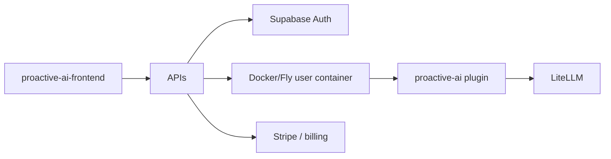
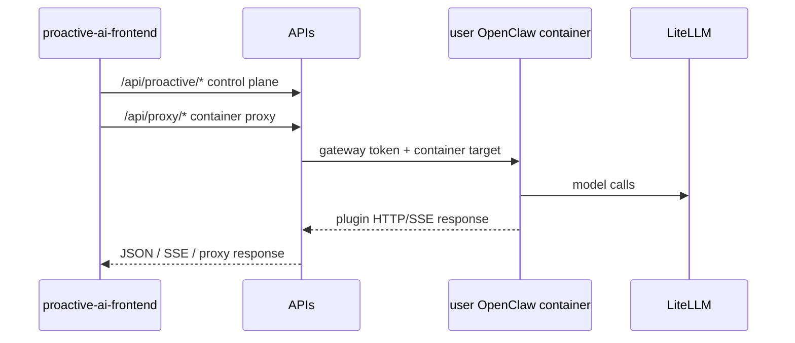

# Runtime & Deployment

## 结论

Proactive AI 的运行链路是：frontend 走 APIs，APIs 管用户容器和 proxy，用户容器内跑 OpenClaw proactive-ai plugin，LLM 统一经 LiteLLM。



## 边界

包含：

- 本地启动、验证命令。
- `/api/proactive/*`、`/api/proxy/*`、`/api/mobile/*` 的运行边界。
- container / gateway / LiteLLM / dotenvx / CI/CD。
- P0 secrets、production 规则。
- Billing 概览。

不包含：

- connector 细节，看 [Data Connectors](./data-connectors)。
- memory/generation/feedback 内部逻辑，看对应模块文档。

## 核心链路



## 当前设计

| 层 | 当前事实 |
|---|---|
| Frontend | Vite React SPA，入口在 `proactive-ai-frontend/src/`。 |
| APIs | Express 后端，负责 Supabase auth、container orchestration、gateway/proxy、payment。 |
| User container | 每个用户一台 OpenClaw assistant machine，内含 proactive-ai plugin。 |
| LiteLLM | 独立 Fly app，统一代理 Claude、GPT、ElevenLabs TTS 等模型调用。 |
| Storage | APIs 用 Postgres；用户容器内用 SQLite (`proactive.db` / `raw.db`)。 |

前端请求边界：

- `/api/proactive/*`：APIs 控制面，比如 auth、container、device。
- `/api/proxy/*`：转发到用户容器内 proactive-ai plugin。
- `/api/mobile/*`：device/mobile 入口，APIs 校验 device token 后转发到用户容器。

## 本地开发

首次设置：

```bash
npm install
# 找团队成员获取 .env.keys
# 放到 apis/.env.keys 和 ops/litellm/.env.keys
make up
```

常用命令：

```bash
make up
make logs
make restart
make reset
make status
make help
```

轻量开发：

```bash
npm run dev
cd proactive-ai-frontend && npm run dev
```

验证：

```bash
npm run type-check
npm run test --workspace @pin-ai/apis
```

## 验证方式

基础验证：

```bash
make status
npm run type-check
npm run test --workspace @pin-ai/apis
```

运行态验证：

- 前端登录后 `/api/proactive/auth/me` 返回当前 Supabase user 和 container 状态。
- container running 后 `/api/proxy/health` 返回 plugin health。
- LiteLLM 本地变更后重新创建容器，并验证 `/health/liveliness` 和一次真实 `/v1/chat/completions`。
- 部署相关改动以 GitHub Actions 为准，本地 deploy 只作为 CI 不可用时的备用路径。

## Secrets 和环境变量

- 加密真源：`apis/.env.dev`、`apis/.env.production`、`ops/litellm/.env.dev`、`ops/litellm/.env.production`。
- 私钥：`apis/.env.keys`、`ops/litellm/.env.keys`，不 checkin。
- 本地明文 `.env` 由 `make ensure-env` / `make env-local` 解密生成，不 checkin。
- 前端 `VITE_*` 在 `make up` 时作为 build args 注入。

常用 dotenvx：

```bash
npx dotenvx get -f apis/.env.dev
npx dotenvx set NEW_KEY "value" -f apis/.env.dev
npx dotenvx run -f apis/.env.dev -- node dist/src/server.js
make env-local
```

## 部署

| 环境 | APIs | Assistant Machines | LiteLLM | OpenClaw Registry |
|---|---|---|---|---|
| dev | `proactive-ai-api-dev` | `proactive-ai-assistant-dev` | `proactive-ai-litellm-dev` | `proactive-ai-openclaw` |
| prod | `proactive-ai-api-prod` | `proactive-ai-assistant-prod` | `proactive-ai-litellm-prod` | `proactive-ai-openclaw` |

CI/CD：

- push 到 `proactive-ai-v2` 后按路径部署 dev。
- `apis/` 或 `proactive-ai-frontend/` 变更部署 APIs。
- `pinai-openclaw/` 变更先构建 OpenClaw 镜像并更新 digest，再部署 APIs。
- `ops/litellm/` 变更部署 LiteLLM。
- prod 通过 GitHub Actions 手动触发或 `v*` tag。

本地部署备用：

```bash
make deploy-dev
make deploy-prod
make deploy-litellm-dev
make deploy-litellm-prod
make build-openclaw-image
```

## LiteLLM

- LiteLLM 使用单进程模式，不使用 `--num_workers`。
- schema migration 通过 Fly `release_command` 在 deploy 时执行。
- app 启动时设置 `DISABLE_SCHEMA_UPDATE=true`，避免每次启动跑 Prisma migration。
- dev/prod 都保持至少一台机器运行，避免冷启动抖动。

## Billing 概览

- Stripe 管订阅付款，LiteLLM 管 API budget。
- `invoice.paid` 是唯一触发 spend reset 和 max_budget 设置的事件。
- 升级：取消旧订阅不退款，新套餐全额支付，新账期立即开始。
- 降级：下期生效，本期额度不降。
- 取消：周期结束后 `subscription.deleted` 清 budget 并停止容器。

关键代码：

- `apis/src/domain/payment/`
- `apis/src/domain/litellm/`
- `apis/src/controller/payment_routes.ts`

## 安全和生产规则

- 生产部署优先 GitHub Actions。
- 生产环境禁止直接执行数据库变更。
- 所有生产变更必须走代码评审和 CI/CD。
- P0 secrets 禁止注入用户容器：`TELEGRAM_BOT_TOKEN`、`TELEGRAM_WEBHOOK_SECRET`、`ELEVENLABS_API_KEY`。
- 容器配置走 `OPENCLAW_CONFIG_B64`，避免 Fly 日志泄露明文。
- `OPENCLAW_IMAGE` 必须使用 digest：`registry.fly.io/proactive-ai-openclaw@sha256:<64hex>`。
- `container_status=running` 不等于服务可用，必须等 HTTP 探测通过。

## 开发入口

| 改动 | 先看 |
|---|---|
| Proactive auth / proxy / container | `apis/src/controller/proactive_routes.ts`、`apis/src/domain/proactive/` |
| Container runtime | `apis/src/domain/container/` |
| Gateway relay / RPC | `apis/src/domain/gateway/` |
| LiteLLM client/runtime | `apis/src/domain/litellm/`、`ops/litellm/` |
| Payment / billing | `apis/src/domain/payment/`、`apis/src/controller/payment_routes.ts` |
| Frontend API boundary | `proactive-ai-frontend/src/lib/api.ts` |
| CI/CD | `.github/workflows/` |

## 踩坑

- 改 `ops/litellm/.env` 后，本地 Docker 需要 recreate `pin-ai-litellm`，只 restart 可能不重读 env。
- 本机全局代理可能导致 `flyctl` 和 Docker push 失败，deploy 命令已内置 `env -u` 处理。
- LiteLLM budget 错误可能来自 DB spend/max_budget 状态，不一定是 API key 缺失。
- APIs proxy、desktop OpenClaw auth、用户容器内 plugin 是不同 runtime，排障时不要混在一起。

## 相关模块

- [Data Connectors](./data-connectors)：运行时里的 Composio、device、mobile 数据接入边界。
- [Memory](./memory)：用户容器内 SQLite 数据层和 evolution 链路。
