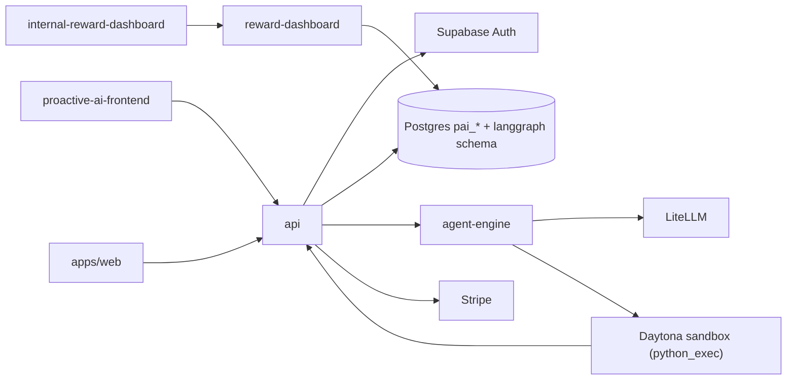

# Runtime & Deployment

## 结论

整个后端是 **backend** 下的 uv workspace monorepo(Python / FastAPI / DeepAgents):三个互不依赖的 service —— `api`(控制面)、`agent-engine`(LLM loop)、`reward-dashboard`(内部 review 后端)—— 加两个共享 lib(`libs/contracts`、`libs/db`)。**当前 Fly 拓扑是 dev 已拆三 app、test/prod 仍单 app**：dev 用 `proactive-ai-{api,engine,reward}-dev`，其中 `api` 持 master credentials，`agent-engine` 不持 master credentials 并启用 fail-fast；test/prod 仍是 `proactive-ai-agents-{test,prod}` 单 app、靠 `[processes]` 切 `web` / `chat`。用户产品前端有两个 web 壳：**proactive-ai-frontend**（当前生产 iOS 前端对应的 web/static 壳）和 **apps/web**（zebra 桌面 web 端）；内部卡片 review 工具是独立 Vite app **internal-reward-dashboard**。LLM 走 **LiteLLM**，长任务通过 api 进程的 scheduler tick loop 派到 agent-engine。旧的 `apis/`(Node) + `pinai-openclaw/`(用户容器)整套已经退役。



## 边界

包含:

- 本地启动、验证命令。
- `api` / `agent-engine` 进程拆分与信任边界。
- `proactive-ai-frontend` 与 `internal-reward-dashboard` 两个前端入口的本地启动方式。
- HTTP / SSE 入口、`/api/*` 与 `/agent/*` 表面。
- 鉴权链(Supabase JWT、agent-run JWT、phantom token、device token)。
- Daytona sandbox、yoyo 迁移、LiteLLM、dotenvx、Fly CI/CD、Stripe billing 概述。

不包含:

- scheduler 内部、`pai_scheduled_tasks` 表结构、连接器/dreaming/generator 任务调度,看 [Background Tasks](./background-tasks)。
- connector 业务,看 [Data Connectors](./data-connectors)。
- memory / generation / execution / feedback 模块内部,看对应模块。

## 进程拓扑

| 进程               | 端口 | 入口                              | 角色                                                                                                                                                                                                                                                                                                    |
| ------------------ | ---- | --------------------------------- | ------------------------------------------------------------------------------------------------------------------------------------------------------------------------------------------------------------------------------------------------------------------------------------------------------- |
| `api`              | 8000 | `pinai_api.asgi:app`              | 控制面 + 出口流量。持有 master credentials(`SUPABASE_SECRET_KEY` / `PAI_JWT_SIGNING_KEY` / `COMPOSIO_API_KEY` / `STRIPE_*` / `LITELLM_MASTER_KEY`)。挂 `/api/*`、`/api/agent/*`、`/payment/*`、`/health`。lifespan 起 scheduler tick loop + world signals ingest。                                      |
| `agent-engine`     | 8001 | `agent_engine.asgi:app`           | LLM loop。dev 拆三-app 后**正常态不该看到** master credentials；`ENGINE_TRUST_FAILFAST=1` 时启动前检测到 forbidden var 直接 exit。挂 `/agent/chat`、`/agent/generate`、`/agent/run/*`、`/agent/history`、`/health`。lifespan 起 LangGraph Postgres checkpointer + Daytona sandbox idle GC(5 分钟一轮)。 |
| `reward-dashboard` | 8002 | `pinai_reward_dashboard.asgi:app` | 内部 review 后端。只读产品 DB，不持 master credentials，不依赖 `pinai_api`。对外服务 `internal-reward-dashboard` 前端使用的 `/api/reward-dashboard/*`。                                                                                                                                                 |

三者都在 `backend/` monorepo 里物理拆包（互不 import）。**部署上分环境不同**：dev 是三个独立 fly app；test/prod 目前仍是 api + agent-engine 共用一个镜像/一个 app、通过 `[processes]` 切 `web` / `chat`；reward-dashboard 当前只在 dev 独立部署。api → agent-engine 的内部调用走 `WEB_INTERNAL_URL` / `CHAT_INTERNAL_URL`，签 EdDSA (Ed25519) 每 run JWT。

## 信任边界

`backend/services/agent-engine/src/agent_engine/trust_boundary.py` 是 `FORBIDDEN_ENVS` 的单一真源。改动这里前先读 docstring。三道防线:

| 层             | 实现                                                                                                                                                                                                                       |
| -------------- | -------------------------------------------------------------------------------------------------------------------------------------------------------------------------------------------------------------------------- |
| 启动 fail-fast | `agent_engine/asgi.py` import 时 `assert_no_forbidden_envs()`,任何 forbidden var 存在直接 exit。**dev 三-app 已 armed**（`proactive-ai-engine-dev` 设 `ENGINE_TRUST_FAILFAST="1"`）；test/prod 因仍是单 app 暂时默认 OFF。 |
| 本地 compose   | `make ensure-env-backend` 从 `backend/.env` 派生 `.env.chat`,把 FORBIDDEN_ENVS 剔掉,只给 `agent-engine` 容器读。                                                                                                           |
| 部署           | `scripts/sync_fly_secrets.py` 在 CI 同步 fly secrets。dev 三-app 走 per-app scoped secrets,其中 engine/reward 用 `--exclude-master`；test/prod 仍因单 app 退化成 app-level 整体推。                                        |

外加静态防线:ruff `flake8-tidy-imports.banned-api` 禁止 `pinai_api` ↔ `agent_engine` 互相 import,公共类型放共享 lib `pinai_contracts`(`backend/libs/contracts/src/pinai_contracts/`,纯 model / protocol,无副作用)。

## HTTP / SSE 表面

### api :8000

- `/api/*` — 前端面向接口,Supabase JWT 鉴权。路由模块按 domain 拆在 `backend/services/api/src/pinai_api/domains/<domain>/*_ui.py`,装配入口 `pinai_api/routes/ui/`:`conversation`(`/api/conversation/*`)、`generate`、`memory`、`signals`、`profile`、`devices`、`feedback`、`reward_dashboard`、`composio`、`tasks`、`raw`、`runs_and_cards`、`dreaming`、`skills`、`browser`、`voice`(`/api/voice/*`,含 Main Chat ByteDance 流式 ASR 代理和 Ambient/OpenAI stop-time 转录)、`agent_runs`、`crystallize`、`jwt_revoke`、`payment`(独立 prefix)。
- `/api/agent/*` — sandbox 内 `pinai_sdk` 回连接口,phantom token 鉴权。路由模块按 domain 拆在 `pinai_api/domains/<domain>/*_agent.py`:`memory`、`signals`、`world`、`state`、`profile`、`skills`、`composio`、`raw`、`cards`、`feedback`、`evolution`、`pipeline`、`sandbox_phantom`。
- `/health` — 含一次 `SELECT 1` 探活;DB 异常返回 `db: error` 但不翻 HTTP 状态码,交给 readiness probe 严控。
- 中间件:`CORSMiddleware`(origin allowlist 来自 `CORS_ALLOWED_ORIGINS`)、`AgentAuditMiddleware`(只在 `/api/agent/*` 路径下记录 audit log)。

### agent-engine :8001

`agent_engine/app.py` 挂:`/agent/chat`(SSE)、`/agent/generate`、`/agent/history`、`/agent/run/*`(`dream` / `evolve` / `crystallize`)、`/agent/browser/*`、`/health`(路由实现在 `agent_engine/transport/routes/`)。所有路由要 `Authorization: Bearer <agent-run-jwt>`;api 侧由 `control/execution_client.py`(ChatRunClient,/agent/chat)和 `control/chat_proxy.py`(history / generate 一次性代理)签发。

## 鉴权

| 链路                         | 算法                                                                             | 单一真源文件                                                                                                                                                                            |
| ---------------------------- | -------------------------------------------------------------------------------- | --------------------------------------------------------------------------------------------------------------------------------------------------------------------------------------- |
| 前端 → api                   | Supabase JWT(RS256,public key from `SUPABASE_JWT_SECRET`)                        | `pinai_api/platform/auth/supabase_jwt.py`、`platform/auth/deps.py`(`current_user` 依赖)                                                                                                 |
| api → agent-engine           | EdDSA (Ed25519) 每 run JWT,默认 1 小时 TTL,`jti` 在 `pai_jti_revocations` 黑名单 | `pinai_api/platform/auth/agent_jwt.py` 签发(私钥 `PAI_JWT_SIGNING_KEY`,base64 raw 32B);`agent_engine/auth/run_jwt.py` 用公钥验签                                                        |
| sandbox → api `/api/agent/*` | Phantom token(opaque,1 小时 TTL,sandbox 关闭即吊销)                              | `pinai_api/domains/identity/sandbox_phantom.py` mint;`pinai_api/platform/db/repositories/sandbox_phantom_tokens.py`;agent-engine 端 sandbox 启动时把 token 注入 `PAI_SANDBOX_TOKEN` env |
| 设备 → api                   | `X-Device-Id` + `X-Device-Token`(bcrypt rounds=10)                               | `pinai_api/domains/connector/device/devices_ui.py`、`pinai_api/platform/db/repositories/devices.py`                                                                                     |

`/api/agent/*` 跟前端的 `/api/*` 是同一进程不同前缀:前者走 phantom token / agent-run JWT,后者走 Supabase JWT,鉴权依赖在 route 级别区分。

## Daytona sandbox

agent-engine 进程的 `python_exec` / browser 工具跑在远端 Daytona sandbox 里,不能直接访问主 DB。逻辑在 `backend/services/agent-engine/src/agent_engine/tools/code_mode/sandbox.py`:

- 每个 LangGraph thread 对应一个 sandbox(LRU 100 entries,OrderedDict)。
- `auto_stop=5min` 让 Daytona 自动停闲置,`auto_delete=24h` 兜底回收。
- 每次命中缓存先 `refresh_data()` 校验真实状态;`STOPPED` lazy resume,`ARCHIVED` / `DESTROYED` evict + 重建。
- 并发同一个 thread_id miss 共用 `asyncio.Future`,防止开多个孤儿 sandbox。
- 进程级 5 分钟 GC 循环 `_sandbox_gc_loop()` 扫缓存里和云端不一致的项。

snapshot 构建在 `backend/infra/daytona/`:Dockerfile 装 pinai_sdk + 必要 deps,`build_snapshot.sh` 推上 Daytona。Deploy Test workflow 每次 deploy 都 refresh 一次。

sandbox 内通过 `PAI_API_URL` + `PAI_SANDBOX_TOKEN` 回连 api `/api/agent/*`,SDK 在 `backend/packages/pinai_sdk/`。本地 Daytona 跑不到 `api:8000` 这种 compose 内网 host,需要先 `make tunnel-up` 起 ngrok 把 8000 暴出去。

## 本地开发

首次设置:

```bash
npm install
cd backend && uv sync && cd -
cd internal-reward-dashboard && npm install && cd -
# 找团队成员要 dotenvx 私钥，放到 ~/.zshrc 的 DOTENV_PRIVATE_KEY_DEV
# （或用 backend/.env.keys + ops/litellm/.env.keys 的老办法，二选一）
make up
```

本地开发推荐两条入口:

| 模式            | 命令                             | 适合场景                                 | 端口                                    | 数据                 | 登录                                     |
| --------------- | -------------------------------- | ---------------------------------------- | --------------------------------------- | -------------------- | ---------------------------------------- |
| Docker Isolated | `make up`                        | 默认入口；多 worktree 并行、完整镜像验收 | 随机 host port,`make urls` 查看         | worktree 独立 volume | 原 Supabase OAuth / dashboard dev bypass |
| Lightweight     | 手动起 `uvicorn` / `npm run dev` | 单服务排障、轻量调试                     | 常用 `8000 / 8001 / 8002 / 3003 / 3004 / 3005` | 复用本机环境         | 取决于你起的是哪个前端壳                 |

默认 `make up` 会解密 `.env.dev`、构建并启动 postgres + litellm + api + agent-engine + reward-dashboard + proactive-ai-frontend + apps/web。端口是**按 worktree 隔离的随机 host 端口**，用 `make urls` 看当前组的真实地址。

```bash
make up
make urls
make logs
make restart
make restart-frontend
```

轻量模式常用命令:

```bash
cd backend && uv run uvicorn pinai_api.asgi:app --reload --port 8000
cd backend && uv run uvicorn agent_engine.asgi:app --reload --port 8001
cd backend && uv run uvicorn pinai_reward_dashboard.asgi:app --reload --port 8002
cd proactive-ai-frontend && npm run dev          # 3003
cd apps/web && npm run dev                       # 3005
cd internal-reward-dashboard && npm run dev -- --host 127.0.0.1 --port 3004
```

常用循环:

| 改动                             | 用什么                                                                                          |
| -------------------------------- | ----------------------------------------------------------------------------------------------- |
| backend Python 代码              | `make restart`；轻量排障用 `uvicorn --reload`                                                   |
| proactive-ai-frontend / apps/web | 各自 `npm run dev`；容器版验收用 `make restart-frontend`                                        |
| 内部 reward dashboard            | `cd internal-reward-dashboard && npm run dev -- --host 127.0.0.1 --port 3004`                   |
| reward-dashboard 后端           | `make up` 自带；轻量排障用 `uvicorn pinai_reward_dashboard.asgi:app --reload --port 8002`       |
| docker-compose / Dockerfile      | `make up`(会重 build)                                                                           |
| 翻数据丢档从头来                 | `make reset`                                                                                    |
| 状态/日志                        | `make status` / `make logs` / `make logs-api` / `make logs-agent-engine` / `make logs-reward` / `make logs-frontend` |
| DB 强制重 migrate                | 先 `make build-backend`，再 `make migrate`                                                      |

Daytona / mobile 用 ngrok:

```bash
make tunnel-up      # 把 api:8000 暴出公网,Daytona sandbox 才能回连 /api/agent/*
make tunnel-status
make tunnel-down
```

本地移动端 / 桌面壳入口:

```bash
make ios            # build frontend(VITE_CAPACITOR=1),sync iOS,打开 Xcode
make android        # 同理,装到 USB Android 设备
make macos          # Electron 桌面壳，复用 apps/web renderer
make rn             # Expo RN 真机；SIM=1 跑模拟器，DEV=1 / PROD=1 切远端环境
```

## Secrets 与环境变量

dotenvx 加密 checkin,每环境一把私钥:

```
backend/.env.dev   .env.test   .env.production       # 后端 + VITE_* 加密真源
ops/litellm/.env.dev    .env.test   .env.production       # LiteLLM 加密真源
backend/.env.keys  ops/litellm/.env.keys             # 私钥,不 checkin
backend/.env       ops/litellm/.env                  # make ensure-env 解密生成,不要手改
backend/.env.chat                                    # 从 .env 派生(去 FORBIDDEN_ENVS),给 agent-engine 容器
```

常用命令:

```bash
npx @dotenvx/dotenvx get -f backend/.env.dev
npx @dotenvx/dotenvx set NEW_KEY "value" -f backend/.env.dev
make env-local                                           # 强制重 decrypt
```

CI 把 `DOTENV_PRIVATE_KEY_TEST` / `DOTENV_PRIVATE_KEY_PROD` 当 GitHub secret;deploy workflow 用 dotenvx 解密 `.env.test` / `.env.production`,再用 `scripts/sync_fly_secrets.py` 注入 fly app secrets(按 process group 剥离 FORBIDDEN_ENVS)。

Main Chat 语音输入优先走 api 进程代理 ByteDance / Volcengine 流式 ASR,密钥只放后端:

```bash
BYTEDANCE_ASR_APP_KEY=...
BYTEDANCE_ASR_ACCESS_KEY=...
BYTEDANCE_ASR_ENDPOINT=wss://voice.ap-southeast-1.bytepluses.com/api/v3/sauc/bigmodel
BYTEDANCE_ASR_RESOURCE_ID=volc.bigasr.sauc.duration
```

前端只连 `/api/voice/transcribe-stream` WebSocket 并上传 16 kHz mono PCM 分片;默认不启用 browser-native fallback,这样本地和真机测试能直接暴露 ByteDance 配置或上游问题。

ByteDance / Volcengine ASR 是直接 provider 调用,不进入 LiteLLM token 账。api 进程在流式会话结束后按 PCM 字节数估算秒数,写入 `pai_provider_usage_events`;后续 ByteDance 文件转录也走同一张 provider usage ledger。

## 数据库与迁移

- Postgres,本地 compose 用 `pgvector/pgvector:pg15`,prod 用 Supabase。
- 命名前缀:`pai_*`(用户表 + 业务表,public schema)、LangGraph checkpointer 独占 `langgraph` schema。
- yoyo migration 配置:`backend/yoyo.ini`(`sources = db/migrations`,`migration_table = pai_yoyo_migration_log`)。
- 迁移目录:`backend/db/migrations/`,命名 `NNN_pai_<topic>.sql`,**只向前,不回滚**。最新 migration 以目录里的最新文件为准,不要依赖本文里写死的旧编号。
- 本地:改了 `backend/db/migrations/` 后,先 `make build-backend`,再 `make migrate`。原因是 migration SQL 会跟 backend image 一起构建;只跑 `make migrate` 可能沿用旧镜像,看起来成功但没执行新 SQL。`make migrate` 的一次性容器会先 `CREATE DATABASE litellm` 再 `yoyo apply --batch`。
- 部署:Fly app 的 `release_command` 调 `yoyo apply --batch`,在 rolling restart 前完成。

## LiteLLM

- 配置:`ops/litellm/litellm_config.yaml`(model list、cache_control_injection、cost 表)。
- 本地容器:`docker.litellm.ai/berriai/litellm:main-v1.82.0.dev1`,端口 4000。
- 每用户 virtual key:`pinai_api/domains/billing/provisioning.py`,onboarding 完成时(`profile_ui.py update_settings`)`ensure_user_litellm_key(pool, user)` mint;generate / ambient / voice / scheduler dispatcher 在使用点 re-ensure(顺带做模型覆盖检查,payment 套餐变更靠它传播到 key)。chat send(conversation + legacy chat-stream)**不做**懒恢复——SPA 用 onboarding gate,key 在聊天前已就位。
- LiteLLM 自己用 `litellm` 数据库(db-migrate 容器 `CREATE DATABASE` 那一步),跟 `pai_*` 隔离。
- Budget / Stripe 同步在 `pinai_api/domains/billing/payments/`。

## 部署

| Fly app                                        | dev                                                                            | test                         | prod                         |
| ---------------------------------------------- | ------------------------------------------------------------------------------ | ---------------------------- | ---------------------------- |
| backend                                        | `proactive-ai-api-dev` + `proactive-ai-engine-dev` + `proactive-ai-reward-dev` | `proactive-ai-agents-test`   | `proactive-ai-agents-prod`   |
| Frontend SPA(nginx + Vite static)              | `proactive-ai-frontend-dev`                                                    | `proactive-ai-frontend-test` | `proactive-ai-frontend-prod` |
| Web (zebra)                                    | `proactive-ai-web-dev`                                                         | 暂无（CI 跳过）              | `proactive-ai-web-prod`      |
| Internal reward dashboard(nginx + Vite static) | `proactive-ai-reward-dashboard-dev`                                            | 暂无独立 app                 | 暂无独立 app                 |
| LiteLLM                                        | `proactive-ai-litellm-dev`                                                     | `proactive-ai-litellm-test`  | `proactive-ai-litellm-prod`  |

primary region `iad`(部分 dev/test 跨到 `ord`)。Daytona sandbox 不是 fly app。

GitHub Actions 入口在 `.github/workflows/`:

| Workflow                            | 触发                       | 做什么                                                                                  |
| ----------------------------------- | -------------------------- | --------------------------------------------------------------------------------------- |
| `ci.yml`                            | PR                         | type-check + lint。                                                                     |
| `deploy-dev.yml`                    | push 到 `main` 或手动      | 按 path filter 部署 dev；backend caller 已传 `agents_split: true`，会走 dev 三-app。    |
| `internal-reward-dashboard-dev.yml` | PR / push 到 `main` / 手动 | 独立验证并部署内部 reward dashboard 到 Fly dev。                                        |
| `deploy-test.yml`                   | 手动                       | 先 refresh Daytona snapshot,再部署 test 当前单-app backend + frontend + LiteLLM。       |
| `deploy-prod.yml`                   | 手动 / `v*` tag            | 创建 GitHub release,promote dev → prod env,部署 prod 当前单-app backend + frontend + web + LiteLLM。 |
| `build-ios.yml`                     | main push / 手动           | build `proactive-ai-frontend` 的 Capacitor iOS 工件（dev TestFlight / prod dispatch）。 |
| `build-rn-ios.yml`                  | 手动                       | build `apps/mobile` 的 RN iOS 工件；当前未开自动触发。                                  |

本地部署兜底(CI 不可用时):

```bash
make deploy-pinai-dev       # 旧单-app backend dev 兜底，不是当前默认 dev 形态
make deploy-pinai-prod
make deploy-frontend-dev
make deploy-frontend-prod
make deploy-reward-dashboard-dev
make deploy-web-dev
make deploy-web-prod
make deploy-litellm-dev
make deploy-litellm-prod
```

## Billing

- Stripe 管订阅,LiteLLM 管 token budget。
- LiteLLM 只统计 LLM/token 类调用;ByteDance ASR 这种直接 provider 调用写 `pai_provider_usage_events` 单独按秒记账,再由我们自己的 billing/report 层汇总。
- ByteDance ASR PAYG 当前按官方单价估算:Streaming ASR `$0.15/hour`,Audio File ASR `$0.12/hour`,Audio File ASR Fast Mode `$0.36/hour`。默认并发额度不单独入账;额外并发包后续需要作为固定月费项补充。
- 代码:`backend/services/api/src/pinai_api/domains/billing/payments/`(`stripe_client.py`、`subscriptions.py`、`plans.py`、`guard.py`、`webhook.py`、`routes.py`)。
- `invoice.paid` 是唯一触发 LiteLLM budget reset + `max_budget` 设置的事件。
- 升级:取消旧订阅不退款,新套餐立即生效新账期。
- 降级:下期生效,本期额度不降。
- 取消:`subscription.deleted` 清 budget。

## 验证方式

基础:

```bash
make status                                           # 容器都 healthy?
make logs-api | grep -E "WEB starting|scheduler"
make logs-agent-engine | grep -E "CHAT starting|sandbox gc"
curl -s http://localhost:8000/health | jq             # api 探活 + DB ping
curl -s http://localhost:8001/health | jq             # agent-engine 探活
```

测试套件:

```bash
cd backend && uv run pytest                       # 全量 pytest(tests/web、tests/chat、tests/shared)
cd backend && uv run pytest tests/web/auth        # 鉴权层
cd backend && uv run pytest tests/web/orchestration # scheduler / dispatcher 单测
cd backend && uv run pytest tests/web/payment     # billing
cd backend && uv run ruff check .               # 含 banned-api 静态防线
cd proactive-ai-frontend && npm run type-check       # 前端类型
cd proactive-ai-frontend && npm test                 # vitest
cd internal-reward-dashboard && npm run type-check   # 内部 review app 类型
cd internal-reward-dashboard && npm test             # 内部 review app 单测
```

部署相关只能通过 GitHub Actions 验,本地 `make deploy-*` 是 CI 不可用时的兜底,不要拿来当主路径。

## 开发入口

| 改动                                          | 先看                                                                                                                                         |
| --------------------------------------------- | -------------------------------------------------------------------------------------------------------------------------------------------- |
| FastAPI app 装配 / lifespan                   | `backend/services/api/src/pinai_api/app.py`、`pinai_api/asgi.py`                                                                             |
| agent-engine app 装配 / lifespan / sandbox GC | `backend/services/agent-engine/src/agent_engine/app.py`、`agent_engine/asgi.py`                                                              |
| 信任边界 / FORBIDDEN_ENVS                     | `backend/services/agent-engine/src/agent_engine/trust_boundary.py`                                                                           |
| Supabase JWT 鉴权                             | `pinai_api/platform/auth/`(`supabase_jwt.py`、`deps.py`、`user_service.py`)                                                                  |
| Agent-run JWT 签发 / 验证                     | `pinai_api/platform/auth/agent_jwt.py`、`agent_engine/auth/run_jwt.py`                                                                       |
| Sandbox phantom token                         | `pinai_api/domains/identity/sandbox_phantom.py`、`pinai_api/platform/db/repositories/sandbox_phantom_tokens.py`                              |
| LiteLLM key 配额                              | `pinai_api/domains/billing/provisioning.py`                                                                                                  |
| Daytona sandbox 缓存 / GC                     | `agent_engine/tools/code_mode/sandbox.py`、`agent_engine/app.py` `_sandbox_gc_loop`                                                          |
| Daytona snapshot 构建                         | `backend/infra/daytona/`                                                                                                                     |
| Postgres pool / RLS                           | `backend/libs/db/src/pinai_db/pool.py`、`pinai_db/rls.py`                                                                                    |
| yoyo 迁移                                     | `backend/yoyo.ini`、`backend/db/migrations/`                                                                                                 |
| Stripe + 订阅                                 | `pinai_api/domains/billing/payments/`                                                                                                        |
| CORS / audit 中间件                           | `pinai_api/app.py` 装配段,`pinai_api/platform/middleware/audit.py`                                                                           |
| docker-compose / Makefile                     | `docker-compose.yml`、`Makefile`                                                                                                             |
| CI / fly secrets 守门                         | `.github/workflows/`、`backend/scripts/sync_fly_secrets.py`                                                                                  |
| 前端 API base                                 | `proactive-ai-frontend/src/lib/platform.ts`、`src/lib/api.ts`                                                                                |
| 内部 reward dashboard                         | `internal-reward-dashboard/`、`internal-reward-dashboard/fly.toml`、`backend/services/reward-dashboard/src/pinai_reward_dashboard/routes.py` |

## 生产环境硬性规则

- 生产部署优先走 GitHub Actions(有审计 + approval)。
- 生产环境禁止直连数据库写 schema。
- 所有生产变更必须走代码评审 + CI/CD。
- FORBIDDEN_ENVS 改动必须经过 review,任何一个 master credential 漏到 agent-engine 进程就是 P0。
- yoyo 迁移一旦 merge 到主干禁止修改;只能加新文件做 additive 或 expand-contract。

## 踩坑

- `make up` 第一次拉镜像 + build 慢(尤其是 Python deps + pgvector),给 10-15 分钟。
- `agent-engine` healthcheck 失败十有八九是 `.env.chat` 里漏了非 forbidden 但必须的 var(比如 `LITELLM_BASE_URL`);先 `cat backend/.env.chat | sort` 看完整性。
- Daytona sandbox 在本地需要 `make tunnel-up`,否则 SDK 回连 `api:8000` 这种 docker 内部 host 失败,具体表现是 generator / dreaming agent 在跑 `python_exec` 后挂。
- 本机全局代理可能让 `flyctl` 和 Docker push 失败;Makefile 已经在 deploy target 里 `env -u HTTP_PROXY HTTPS_PROXY ALL_PROXY` 处理。
- LiteLLM budget 报错先看 LiteLLM DB 里 spend / max_budget,不一定是 virtual key 缺;`pinai_api/domains/billing/provisioning.py` 有 lazy provisioning 逻辑。
- LangGraph checkpointer 在 `langgraph` schema,跟 `pai_*` 物理同库逻辑分离;清 chat 状态 `TRUNCATE langgraph.<tables>` 而不是删 `pai_chat_threads`。
- 改 docker-compose 后只 `make restart` 不够,要 `make down && make up` 才会让 compose 看到新声明。
- `make ios` / `make android` 选后端时,native shell 用绝对 URL(`VITE_PIN_API_URL`)。本地移动端默认使用项目根目录 `./.env` 的 `PAI_API_URL`(ngrok),这样手机离开当前局域网后仍能访问本机 `api`;没配 `PAI_API_URL` 时直接失败,不退回 LAN IP。

## 相关模块

- [Background Tasks](./background-tasks):scheduler tick loop、`pai_scheduled_tasks` 表、所有异步任务的派发框架。
- [Data Connectors](./data-connectors):Composio / device ingest 在 api 进程的入口。
- [Execution](./execution):conversation 链路 / browser tool / sandbox 工具决策。
- [Generation](./generation):`POST /api/generate` 怎么进 scheduler、chat 怎么跑 generator agent。
- [Internal Reward Dashboard](./internal-reward-dashboard):内部 review app、reward ledger、casebook 和 trace artifact。
