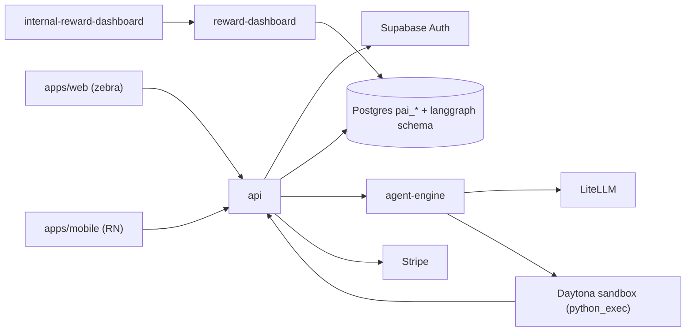

# Runtime & Deployment

## Summary

The whole backend is a uv workspace monorepo under **backend** (Python / FastAPI / DeepAgents): three mutually independent services — `api` (control plane), `agent-engine` (LLM loop), `reward-dashboard` (internal review backend) — plus two shared libs (`libs/contracts`, `libs/db`). **The Fly topology of all three environments is split into three separate apps**: `proactive-ai-{api,engine,reward}-{dev,test,prod}` (test built on 2026-07-02, prod cut over on 2026-07-07); `api` holds the master credentials, while `agent-engine` holds no master credentials and has `ENGINE_TRUST_FAILFAST=1` armed. The user-facing product frontend is "one shared layer + multiple platform shells": **apps/web** (the zebra desktop web app, live in dev/prod), **apps/mobile** (Expo RN iOS, delivered via TestFlight), **apps/desktop** (Electron, local only); the former Capacitor frontend proactive-ai-frontend was retired and deleted on 2026-07-09. The internal card review tool is the standalone Vite app **internal-reward-dashboard**. LLM calls go through **LiteLLM**; long tasks are dispatched to agent-engine by the scheduler tick loop in the api process. The old `apis/` (Node) + `pinai-openclaw/` (per-user containers) stack has been fully retired.



## Boundaries

In scope:

- Local startup and verification commands.
- The `api` / `agent-engine` process split and the trust boundary.
- How to start each frontend entry point locally (apps/web, apps/mobile, apps/desktop, internal-reward-dashboard).
- HTTP / SSE entry points, the `/api/*` and `/agent/*` surfaces.
- Auth chain (Supabase JWT, agent-run JWT, phantom token, device token).
- Overview of the Daytona sandbox, yoyo migrations, LiteLLM, dotenvx, Fly CI/CD, Stripe billing.

Out of scope:

- Scheduler internals, the `pai_scheduled_tasks` table schema, and scheduling of connector/evolve/generator tasks: see [Background Tasks](./background-tasks).
- Connector business logic: see [Data Connectors](./data-connectors).
- Internals of the memory / generation / execution / feedback modules: see the corresponding module docs.

## Process Topology

| Process            | Port | Entry point                       | Role                                                                                                                                                                                                                                                                              |
| ------------------ | ---- | --------------------------------- | ---------------------------------------------------------------------------------------------------------------------------------------------------------------------------------------------------------------------------------------------------------------------------------- |
| `api`              | 8000 | `pinai_api.asgi:app`              | Control plane + outbound traffic. Holds the master credentials (`SUPABASE_SECRET_KEY` / `PAI_JWT_SIGNING_KEY` / `COMPOSIO_API_KEY` / `STRIPE_*` / `LITELLM_MASTER_KEY`). Mounts `/api/*`, `/api/agent/*`, `/payment/*`, `/health`. The lifespan starts the scheduler tick loop + world signals ingest.                |
| `agent-engine`     | 8001 | `agent_engine.asgi:app`           | LLM loop. **Must not see** master credentials; all three environments set `ENGINE_TRUST_FAILFAST=1`, so it exits immediately at startup if a forbidden var is detected. Mounts `/agent/chat`, `/agent/generate`, `/agent/run/*`, `/agent/history`, `/agent/browser/*`, `/health`. The lifespan starts the LangGraph Postgres checkpointer + Daytona sandbox idle GC (every 5 minutes) + browser session manager. |
| `reward-dashboard` | 8002 | `pinai_reward_dashboard.asgi:app` | Internal review backend. Read-only product DB, holds no master credentials, does not depend on `pinai_api`. Serves `/api/reward-dashboard/*`, used by the `internal-reward-dashboard` frontend.                                                                                                                           |

All three are physically separate packages in the `backend/` monorepo (no imports between them). **All three environments use the same deployment shape**: three separate fly apps each, configured in `backend/deploy/fly-split/fly.{api,engine,reward}.{dev,test,prod}.toml`. api → agent-engine goes through `CHAT_INTERNAL_URL` (on fly this is 6PN service discovery `http://proactive-ai-engine-<env>.internal:8001`, **not flycast**; engine must stay always-on with `auto_stop_machines='off'`), with a per-run JWT signed with EdDSA (Ed25519); agent-engine / sandbox call back to api via `WEB_INTERNAL_URL` (local default `http://api:8000`; the sandbox uses the public `PAI_API_URL`).

## Trust Boundary

`backend/services/agent-engine/src/agent_engine/trust_boundary.py` is the single source of truth for `FORBIDDEN_ENVS`. Read its docstring before changing it. Three defenses:

| Layer             | Implementation                                                                                                                                                                        |
| -------------- | ---------------------------------------------------------------------------------------------------------------------------------------------------------------------------- |
| Startup fail-fast | `agent_engine/asgi.py` calls `assert_no_forbidden_envs()` at import time; if any forbidden var is present it exits immediately. **Engine is armed in all three environments** (`fly.engine.{dev,test,prod}.toml` sets `ENGINE_TRUST_FAILFAST="1"`). |
| Local compose   | `make ensure-env-backend` derives `.env.chat` from `backend/.env`, stripping FORBIDDEN_ENVS; only the `agent-engine` container reads it.                                                            |
| Deploy           | `scripts/sync_fly_secrets.py` syncs per-app scoped secrets in CI: api gets the full set, engine / reward use `--exclude-master` to strip master credentials.                                  |

Plus static defenses: ruff `flake8-tidy-imports.banned-api` forbids imports between `pinai_api` ↔ `agent_engine` in either direction; import-linter (`uv run lint-imports`) enforces pairwise import bans among the three services + api-internal layering contracts; shared types live in the shared lib `pinai_contracts` (`backend/libs/contracts/src/pinai_contracts/`, pure models / protocols, no side effects).

## HTTP / SSE Surface

### api :8000

- `/api/*` — frontend-facing endpoints, Supabase JWT auth. Routes are split by domain under `backend/services/api/src/pinai_api/domains/<domain>/` (single-router domains name the file `ui.py`; multi-router domains add a topic prefix, e.g. `composio_ui.py`), all assembled with `include_router` in `pinai_api/app.py` (the `ui_*` group: conversation, generate, events, user_strings, settings, runs, tasks, scheduled_generators, devices, payment, browser, voice, ambient, account, feedback, evolution, composio, skills, onboarding, sync, impersonation, agent_runs, jwt_revoke, development_feedback, etc.).
- `/api/agent/*` — callback endpoints for `pinai_sdk` inside the sandbox, phantom token auth. Routes are in each domain's `agent.py` / `*_agent.py`, also assembled in `app.py` (the `agent_*` group: events, user_strings, settings, skills, composio, raw, etc.).
- `/health` — includes one `SELECT 1` liveness probe; on a DB failure it returns `db: error` but does not change the HTTP status code, leaving strict control to the readiness probe.
- Middleware: `CORSMiddleware` (origin allowlist from `CORS_ALLOWED_ORIGINS`), `AgentAuditMiddleware` (records audit logs only under the `/api/agent/*` path).

### agent-engine :8001

`agent_engine/app.py` mounts: `/agent/chat` (SSE), `/agent/generate`, `/agent/history`, `/agent/run/*` (`dream` / `evolve`; crystallize was deleted), `/agent/browser/*`, `/health` (route implementations are in `agent_engine/transport/routes/` + `tools/browser/routes.py`). All routes require `Authorization: Bearer <agent-run-jwt>`; on the api side the tokens are signed by `control/execution_client.py` (ChatRunClient, /agent/chat) and `control/chat_proxy.py` (one-shot proxy for history / generate).

## Auth

| Path                         | Mechanism                                                                                       | Single source of truth file                                                                                                                                                                            |
| ---------------------------- | ------------------------------------------------------------------------------------------ | --------------------------------------------------------------------------------------------------------------------------------------------------------------------------------------- |
| Frontend → api                   | Live Supabase JWT validation: calls `${SUPABASE_URL}/auth/v1/user` (apikey = `SUPABASE_PUBLISHABLE_KEY`), LRU cache + in-flight dedup | `pinai_api/platform/auth/supabase_jwt.py`, `platform/auth/deps.py` (the `current_user` dependency)                                                                                                 |
| api → agent-engine           | Per-run EdDSA (Ed25519) JWT, default 1 hour TTL, `jti` blacklisted in `pai_jti_revocations`           | Signed by `pinai_api/platform/auth/agent_jwt.py` (private key `PAI_JWT_SIGNING_KEY`, base64 raw 32B); `agent_engine/auth/run_jwt.py` verifies with the public key                                                        |
| sandbox → api `/api/agent/*` | Phantom token (opaque, 1 hour TTL, revoked when the sandbox closes)                                        | Minted by `pinai_api/domains/identity/sandbox_phantom.py`; `pinai_api/platform/db/repositories/sandbox_phantom_tokens.py`; on the agent-engine side the token is injected into the `PAI_SANDBOX_TOKEN` env when the sandbox starts |
| Device → api                   | `X-Device-Id` + `X-Device-Token` (bcrypt rounds=10)                                         | `pinai_api/domains/connector/device/devices_ui.py`, `pinai_api/platform/db/repositories/devices.py`                                                                                     |

`/api/agent/*` and the frontend's `/api/*` are different prefixes in the same process: the former uses phantom token / agent-run JWT, the latter uses Supabase JWT; the auth dependency is chosen at the route level.

## Daytona sandbox

The `python_exec` / browser tools of the agent-engine process run in remote Daytona sandboxes and cannot access the main DB directly. The logic is in `backend/services/agent-engine/src/agent_engine/tools/code_mode/sandbox.py`:

- One sandbox per LangGraph thread (LRU registry, OrderedDict; when full, it evicts the least recently used one and deletes it in the cloud on a best-effort basis).
- `auto_stop=60min` lets Daytona stop idle sandboxes automatically (file system kept), `auto_delete=24h` destroys them as a fallback; one-shot agent runs (dream / evolve) also have a 10-minute run-level timeout as a fallback, so a hung tool call can't hang the run forever.
- Every cache hit first calls `refresh_data()` to check the real state; `STOPPED` is lazily resumed, `ARCHIVED` / `DESTROYED` are evicted + recreated.
- Concurrent misses for the same thread_id share one `asyncio.Future`, preventing multiple orphan sandboxes.
- A process-level 5-minute GC loop `_sandbox_gc_loop()` scans for cache entries that are inconsistent with the cloud.

The snapshot build is in `backend/infra/daytona/`: the Dockerfile installs pinai_sdk + required deps, and `build_snapshot.sh` pushes it to Daytona. CI (the `build-daytona-snapshot` job in `_deploy.yml`) refreshes the corresponding environment's `pinai-sandbox:{dev,test,production}` before every dev/test/prod deploy; local compose uses a separate `pinai-sandbox:local` (`make up` / `make restart` rebuild it automatically when they detect SDK or builder changes).

Inside the sandbox, `PAI_API_URL` + `PAI_SANDBOX_TOKEN` are used to call back to api `/api/agent/*`; the SDK is in `backend/packages/pinai_sdk/`. Locally, Daytona can't reach compose-internal hosts like `api:8000`, so first run `make tunnel-up` to start ngrok and expose api.

## Local Development

First-time setup:

```bash
npm install
cd backend && uv sync && cd -
cd internal-reward-dashboard && npm install && cd -
# Get the dotenvx private key from a team member and put it in DOTENV_PRIVATE_KEY_DEV in ~/.zshrc
# (or use the old way with backend/.env.keys + ops/litellm/.env.keys; pick one)
make up
```

Two recommended entry points for local development:

| Mode            | Command                             | Use case                                 | Ports                                    | Data                 | Login                                     |
| --------------- | -------------------------------- | ---------------------------------------- | --------------------------------------- | -------------------- | ---------------------------------------- |
| Docker Isolated | `make up`                        | Default entry point; parallel multi-worktree, full image acceptance | Random host port, see `make urls`         | Per-worktree volume | Original Supabase OAuth / dashboard dev bypass |
| Lightweight     | Start `uvicorn` / `npm run dev` manually | Single-service troubleshooting, lightweight debugging                     | Usually `8000 / 8001 / 8002 / 3004 / 3005` | Reuses the local machine environment         | Depends on which frontend shell you started                 |

By default `make up` decrypts `.env.dev`, then builds and starts postgres + redis + litellm + api + agent-engine + reward-dashboard + web (container version of apps/web). Ports are **random host ports isolated per worktree**; use `make urls` to see the actual addresses of the current group.

```bash
make up
make urls
make logs
make restart          # rebuild api + agent-engine
make restart-web      # rebuild the apps/web container version
```

### Switching dev dependencies between China and the US

Personal dev machines use two scripts to switch dependency download endpoints; the region config is written to the user directory
`~/.config/pinai/`, not to the repo, and applies to all worktrees on this machine:

```bash
source scripts/dev-env-cn.sh  # npmmirror + TUNA + DaoCloud Docker bases
source scripts/dev-env-us.sh  # npm/PyPI/Homebrew/Electron official endpoints
make dev-env-status
```

Running `./scripts/dev-env-cn.sh` / `./scripts/dev-env-us.sh` directly also persists the setting,
but because of the shell parent/child process boundary, the current terminal still needs `source` for it to take effect immediately; new terminals need nothing more.
`make up` passes the same region config into the web npm build and the backend uv build.
The CN profile explicitly switches the Python, Node, nginx, Redis, pgvector and uv base images used by local Compose
to DaoCloud; the US profile restores Docker Hub/GHCR. `ngrok/ngrok` and LiteLLM's separate
registry don't go through this mirror and are still handled by the VPN. CI/Fly don't load the user profile and keep using the official addresses.
The CN backend build exports exact versions and hashes from the canonical `uv.lock`, then downloads from the Tsinghua mirror,
which avoids re-resolving to different versions and avoids writing the Tsinghua mirror URL back into the repo;
on its first run, `make local` uses the same approach to run `make backend-install` before starting host hot reload;
running `uv sync` directly on the host still uses the committed canonical PyPI lock URLs. Git, GitHub, VPN, and
the Docker daemon are not modified by the scripts; the DaoCloud mapping is for local development only. Production/CI don't depend on free public
accelerators; once the team sets up ACR/TCR/Harbor, allowed images will be wired in explicitly by digest.
The CN profile adds `*.tsinghua.edu.cn` / `*.npmmirror.com` / `*.daocloud.io` to
`NO_PROXY`; if the VPN uses
TUN/global routing, you still have to set these three domain suffixes to `DIRECT` in the VPN client, otherwise traffic to the mirrors in China will
first leave the country and then route back in; in JAM you can enable specified regions direct under Settings → Routing, keep China under Regions,
and set `npmmirror.com`, `tsinghua.edu.cn`, `daocloud.io` as domain suffix
Direct. Don't set `docker.io` to Direct; overseas pulls that don't hit a mirror should keep going through the VPN.

Common commands for lightweight mode:

```bash
cd backend && uv run uvicorn pinai_api.asgi:app --reload --port 8000
cd backend && uv run uvicorn agent_engine.asgi:app --reload --port 8001
cd backend && uv run uvicorn pinai_reward_dashboard.asgi:app --reload --port 8002
cd apps/web && npm run dev                       # 3005
cd internal-reward-dashboard && npm run dev -- --host 127.0.0.1 --port 3004
```

Common loops:

| Change                        | What to use                                                                                                        |
| --------------------------- | -------------------------------------------------------------------------------------------------------------- |
| backend Python code         | `make restart`; for lightweight troubleshooting use `uvicorn --reload`                                                                 |
| apps/web                    | `cd apps/web && npm run dev`; for container-version acceptance use `make restart-web`                                                 |
| Internal reward dashboard       | `cd internal-reward-dashboard && npm run dev -- --host 127.0.0.1 --port 3004`                                 |
| reward-dashboard backend       | Included in `make up`; for lightweight troubleshooting use `uvicorn pinai_reward_dashboard.asgi:app --reload --port 8002`                     |
| docker-compose / Dockerfile | `make up` (rebuilds)                                                                                         |
| Wipe data and start from scratch            | `make reset`                                                                                                  |
| Status/logs                   | `make status` / `make logs` / `make logs-api` / `make logs-agent-engine` / `make logs-web` / `make logs-reward` |
| Force DB re-migrate           | `make build-backend` first, then `make migrate`                                                                    |

Daytona uses ngrok (RN on a physical device doesn't need it — `make rn` by default connects directly to the local api via LAN IP on the same WiFi):

```bash
make tunnel-up      # expose api to the public internet so the Daytona sandbox can call back to /api/agent/*
make tunnel-status
make tunnel-down
```

Local mobile / desktop shell entry points:

```bash
make macos          # Electron desktop shell, reuses the apps/web renderer; DEV=1 / PROD=1 switch the fly environment
make rn-start DEV=1 # Development Build already installed: start Metro + Fast Refresh only, no compile/reinstall
make rn DEV=1       # Debug build + overwrite install + Metro; SIM=1 for simulator, TUNNEL=1 to route Metro through ngrok
```

`DEV=1` / `PROD=1` only select the backend; they don't determine the build type. For pure TS/TSX/JS, style and copy changes use `make rn-start`; for Swift, Pod, native dependency, Expo Module, permission or `app.config.js` changes use `make rn`. When `ios/` already exists, `expo run:ios` doesn't prebuild automatically; when config or the native dependency graph changes, first run `npx expo prebuild --platform ios --clean` in `apps/mobile`. Release is only for TestFlight, formal delivery, or explicitly requested standalone acceptance.

For physical-device UI verification, by default first run `agent-device doctor` / `agent-device help workflow`, then go through the loop of open → `snapshot -i`/screenshot → actions with `--settle` → verify the settled diff/screenshot; old refs are invalid after an action, and only re-run `snapshot -i` when the diff doesn't give enough information. Keep app data. XCTest runner signing/profile issues must be fixed at the root cause; if signing is correct but agent-device itself still fails, use Appium's official XCUITest real-device config/troubleshooting flow to locate the problem. UI automation via Expo MCP, `ios-debugger-agent` and XcodeBuildMCP is only a Simulator path and cannot replace physical-device acceptance.

## Secrets and Environment Variables

Encrypted and checked in with dotenvx, one private key per environment:

```
backend/.env.dev   .env.test   .env.production       # encrypted source of truth for backend + VITE_*
ops/litellm/.env.dev    .env.test   .env.production       # encrypted source of truth for LiteLLM
./.env.dev                                                # root: encrypted source of truth for NGROK_AUTHTOKEN (reuses the DEV keypair)
backend/.env.keys  ops/litellm/.env.keys             # private keys, not checked in
backend/.env       ops/litellm/.env       ./.env     # generated by make ensure-env decryption, don't edit by hand
backend/.env.chat                                    # derived from .env (FORBIDDEN_ENVS stripped), for the agent-engine container
```

Common commands:

```bash
npx @dotenvx/dotenvx get -f backend/.env.dev
npx @dotenvx/dotenvx set NEW_KEY "value" -f backend/.env.dev
make env-local                                           # force re-decrypt
```

CI stores `DOTENV_PRIVATE_KEY_{DEV,TEST,PROD}` as GitHub secrets; the deploy workflow decrypts the corresponding `.env.*` with dotenvx, then injects per-app scoped secrets with `scripts/sync_fly_secrets.py` (engine / reward use `--exclude-master` to strip master credentials).

Main Chat voice input primarily goes through ByteDance / Volcengine streaming ASR proxied by the api process; the keys live only in the backend:

```bash
BYTEDANCE_ASR_APP_KEY=...
BYTEDANCE_ASR_ACCESS_KEY=...
BYTEDANCE_ASR_ENDPOINT=wss://voice.ap-southeast-1.bytepluses.com/api/v3/sauc/bigmodel
BYTEDANCE_ASR_RESOURCE_ID=volc.bigasr.sauc.duration
```

The frontend only connects to the `/api/voice/transcribe-stream` WebSocket and uploads 16 kHz mono PCM chunks; the browser-native fallback is disabled by default, so local and physical-device tests directly surface ByteDance config or upstream problems.

ByteDance / Volcengine ASR is a direct provider call and does not go into the LiteLLM token accounting. After a streaming session ends, the api process estimates the seconds from the PCM byte count and writes them to `pai_provider_usage_events`; ByteDance file transcription also goes through the same provider usage ledger.

## Database and Migrations

- Postgres; local compose uses `pgvector/pgvector:pg15`, prod uses Supabase.
- Since its rebuild in 2026-11, prod Supabase is on the **Free plan** (500MB database, no backups, paused after 7 consecutive days without database activity). The api worker / scheduler query the database every few seconds, so as long as api is running it won't be considered inactive; `.github/workflows/prod-keepalive.yml` GETs prod `/health` (which includes `SELECT 1`) once a day as a fallback, and also fails the workflow when api is down or `db != ok`, so GitHub sends an email. The prod fly sizing was lowered to match the test sizing (api 2gb, engine 1gb/1cpu, reward and web `min_machines_running = 0`).
- Naming prefixes: `pai_*` (user tables + business tables, public schema); the LangGraph checkpointer has the `langgraph` schema to itself.
- yoyo migration config: `backend/yoyo.ini` (`sources = db/migrations`, `migration_table = pai_yoyo_migration_log`).
- Migration directory: `backend/db/migrations/`, named `NNN_<topic>.sql` (migrations touching pai schema tables conventionally get a `pai_` prefix), **forward-only, no rollbacks**. The latest migration is whatever the newest file in the directory is; don't rely on old numbers hard-coded in this doc.
- Locally: after changing `backend/db/migrations/`, run `make build-backend` first, then `make migrate`. The reason is that migration SQL is built into the backend image; running only `make migrate` may reuse the old image, which looks successful but doesn't execute the new SQL. The one-off container of `make migrate` first runs `CREATE DATABASE litellm`, then `yoyo apply --batch`.
- Deploy: the `release_command` of the Fly api app calls `yoyo apply --batch`, which completes before the rolling restart (engine / reward have no release_command).

## LiteLLM

- Config: `ops/litellm/litellm_config.yaml` (model list, cache_control_injection, cost table; anthropic injection points carry `ttl=1h`).
- Local container: `docker.litellm.ai/berriai/litellm`, port 4000 (the version is whatever `docker-compose.yml` says).
- Per-user virtual key: `pinai_api/domains/billing/provisioning.py`; `ensure_user_litellm_key(pool, user)` mints it when onboarding completes (`identity/onboarding.py`) and when settings are updated (`user_model/settings_ui.py`); usage points such as voice / ambient / checkout / scheduler dispatcher re-ensure it (also running a model coverage check along the way, which is how payment plan changes propagate to the key). The chat send path does **not** do lazy recovery — the SPA uses an onboarding gate, so the key is already in place before chatting.
- LiteLLM uses its own `litellm` database (the `CREATE DATABASE` step in the db-migrate container), isolated from `pai_*`.
- Budget / Stripe sync is in `pinai_api/domains/billing/payments/` + `billing/budget_reconcile.py`.

## Deployment

| Fly app                                        | dev                                              | test                                               | prod                                               |
| ---------------------------------------------- | ------------------------------------------------ | -------------------------------------------------- | -------------------------------------------------- |
| backend                                        | `proactive-ai-{api,engine,reward}-dev` (three apps)   | `proactive-ai-{api,engine,reward}-test` (three apps)    | `proactive-ai-{api,engine,reward}-prod` (three apps)    |
| Web (zebra)                                    | `proactive-ai-web-dev`                           | None yet (skipped in CI)                                      | `proactive-ai-web-prod`                            |
| Internal reward dashboard (nginx + Vite static) | `proactive-ai-reward-dashboard-dev`              | No separate app yet                                       | No separate app yet                                       |
| LiteLLM                                        | `proactive-ai-litellm-dev`                       | `proactive-ai-litellm-test`                        | `proactive-ai-litellm-prod`                        |

Primary region `iad` (some dev/test span into `ord`). The Daytona sandbox is not a fly app. The three web apps of the former proactive-ai-frontend (`proactive-ai-frontend-{dev,test,prod}`) were suspended on 2026-07-09 (machines=0, shell kept, to be destroyed after an observation period); the old single apps `proactive-ai-agents-{dev,prod}` are stopped and kept only for rollback.

> **2026-11 status**: the `pin-ai` fly organization's billing is past due, and all dev/test/prod apps under that organization have been deleted (the dev/test apps in the table above currently don't exist). prod was rebuilt with the same app names in the maintainer's **personal organization**; Redis is `proactive-ai-redis-prod-personal` under personal; CI uses the GitHub **production environment-level** secret `FLY_API_TOKEN` (a personal-organization token that overrides the repo-level pin-ai token). The personal organization can't add members, so others can't see the logs; once the pin-ai billing is resolved, the apps can be moved back with `fly apps move` (Redis needs to be recreated).

GitHub Actions entry points are in `.github/workflows/`:

| Workflow                            | Trigger                             | What it does                                                                                                       |
| ----------------------------------- | -------------------------------- | ------------------------------------------------------------------------------------------------------------ |
| `ci.yml`                            | PR                               | `pinai-agents-checks` (ruff check/format + mypy + migration/seed + pytest with a pgvector DB) + `frontend-check` (type-check for all three platforms + packages boundaries + apps/web image build); both are required checks in the main ruleset. |
| `deploy-dev.yml`                    | Push to `main` or manual            | Deploys dev by path filter; the backend goes out as three apps (`deploy-agents-split` in `_deploy.yml`).                       |
| `internal-reward-dashboard-dev.yml` | PR / push to `main` / manual       | Separately verifies and deploys the internal reward dashboard to Fly dev.                                                             |
| `deploy-test.yml`                   | Manual                             | Deploys the test three-app backend + LiteLLM from any branch (web skipped); the Daytona snapshot is refreshed with the deploy.                     |
| `deploy-prod.yml`                   | `v*` tag automatically / manual             | Deploys the prod three-app backend + web + LiteLLM; the release entry point is `scripts/release.sh vX.Y.Z`, which creates the tag.                     |
| `build-rn-ios.yml`                  | Push to main (when apps/mobile or packages change) automatically / manual | RN iOS: dev builds automatically → TestFlight, prod only by manual dispatch; with a rolling ccache.                                 |

Local deployment fallback (when CI is unavailable):

```bash
make deploy-pinai-dev       # backend three apps (api → engine → reward deployed in order) → dev
make deploy-pinai-prod      # prod three apps (api → engine → reward deployed in order)
make deploy-reward-dashboard-dev
make deploy-web-dev
make deploy-web-prod
make deploy-litellm-dev
make deploy-litellm-prod
```

## Billing

- Stripe manages subscriptions, LiteLLM manages token budgets.
- LiteLLM only accounts for LLM/token-type calls; direct provider calls such as ByteDance ASR write to `pai_provider_usage_events` and are billed separately by the second, then aggregated by our own billing/report layer.
- ByteDance ASR PAYG is currently estimated at the official unit prices: Streaming ASR `$0.15/hour`, Audio File ASR `$0.12/hour`, Audio File ASR Fast Mode `$0.36/hour`. The default concurrency quota is not billed separately; extra concurrency packs need to be added later as a fixed monthly fee item.
- Code: `backend/services/api/src/pinai_api/domains/billing/payments/` (`stripe_client.py`, `subscriptions.py`, `plans.py`, `guard.py`, `webhook.py`, `routes.py`, `checkout.py`, `budget_periods.py`, `credit_grants.py`, `credit_consumption.py`) + `billing/budget_reconcile.py`.
- Budget windows are managed by the DB itself (`budget_periods.py`, free + paid reconciled the same way): `invoice.paid` resets the window for paid users; free users have no invoice.paid, so the reconcile tick opens a new window for them.
- Upgrade: the old subscription is canceled without a refund; the new plan takes effect immediately with a new billing period.
- Downgrade: takes effect next period; this period's quota isn't reduced.
- Cancel: `subscription.deleted` clears the budget.

## How to verify

Basics:

```bash
make status                                           # are all containers healthy?
make logs-api | grep -E "WEB starting|scheduler"
make logs-agent-engine | grep -E "CHAT starting|sandbox gc"
curl -s http://localhost:8000/health | jq             # api liveness + DB ping (lightweight mode; for container ports see make urls)
curl -s http://localhost:8001/health | jq             # agent-engine liveness
```

Test suites:

```bash
cd backend && uv run pytest                       # full pytest (tests/web, tests/chat, tests/shared)
cd backend && uv run pytest tests/web/auth        # auth layer
cd backend && uv run pytest tests/web/orchestration # scheduler / dispatcher unit tests
cd backend && uv run pytest tests/web/payment     # billing
cd backend && uv run ruff check . && uv run ruff format --check   # static + format (both are hard CI gates)
cd backend && uv run lint-imports                 # import contracts
cd backend && uv run mypy services libs           # types
cd apps/web && npm run type-check && npm test        # zebra web app
npm run check:packages                               # core/state/ui-kit boundaries + types + unit tests
cd internal-reward-dashboard && npm run type-check   # internal review app types
cd internal-reward-dashboard && npm test             # internal review app unit tests
```

Deployment can only be verified through GitHub Actions; local `make deploy-*` is the fallback for when CI is unavailable, don't use it as the main path.

## Development Entry Points

| Change                                          | Look at first                                                                                                                                         |
| --------------------------------------------- | -------------------------------------------------------------------------------------------------------------------------------------------- |
| FastAPI app assembly / lifespan                   | `backend/services/api/src/pinai_api/app.py`, `pinai_api/asgi.py`                                                                             |
| agent-engine app assembly / lifespan / sandbox GC | `backend/services/agent-engine/src/agent_engine/app.py`, `agent_engine/asgi.py`                                                              |
| Trust boundary / FORBIDDEN_ENVS                     | `backend/services/agent-engine/src/agent_engine/trust_boundary.py`                                                                           |
| Supabase JWT auth                             | `pinai_api/platform/auth/` (`supabase_jwt.py`, `deps.py`, `user_service.py`)                                                                  |
| Agent-run JWT signing / verification                     | `pinai_api/platform/auth/agent_jwt.py`, `agent_engine/auth/run_jwt.py`                                                                       |
| Sandbox phantom token                         | `pinai_api/domains/identity/sandbox_phantom.py`, `pinai_api/platform/db/repositories/sandbox_phantom_tokens.py`                              |
| LiteLLM key quota                              | `pinai_api/domains/billing/provisioning.py`                                                                                                  |
| Daytona sandbox cache / GC                     | `agent_engine/tools/code_mode/sandbox.py`, `agent_engine/app.py` `_sandbox_gc_loop`                                                          |
| Daytona snapshot build                         | `backend/infra/daytona/`                                                                                                                     |
| Postgres pool / RLS                           | `backend/libs/db/src/pinai_db/pool.py`, `pinai_db/rls.py`                                                                                    |
| yoyo migrations                                     | `backend/yoyo.ini`, `backend/db/migrations/`                                                                                                 |
| Stripe + subscriptions                                 | `pinai_api/domains/billing/payments/`                                                                                                        |
| CORS / audit middleware                           | The assembly section of `pinai_api/app.py`, `pinai_api/platform/middleware/audit.py`                                                                           |
| docker-compose / Makefile                     | `docker-compose.yml`, `Makefile`                                                                                                             |
| CI / fly secrets guard                         | `.github/workflows/`, `backend/scripts/sync_fly_secrets.py`                                                                                  |
| Frontend API base / platform detection                      | `apps/web/src/ui-web/auth/platform.ts` (the web form uses same-origin `/api`; Electron packaged builds use the absolute URL `VITE_PIN_API_URL`)                           |
| Internal reward dashboard                         | `internal-reward-dashboard/`, `internal-reward-dashboard/fly.toml`, `backend/services/reward-dashboard/src/pinai_reward_dashboard/routes.py` |

## Production Hard Rules

- Production deploys go through GitHub Actions whenever possible (audit log; manual approval isn't enabled yet and will be added later).
- Writing schema changes directly against the production database is forbidden.
- All production changes must go through code review + CI/CD.
- FORBIDDEN_ENVS changes must be reviewed; any master credential leaking into the agent-engine process is a P0.
- Once a yoyo migration is merged to the trunk it must not be modified; only add new files, either additive or expand-contract.

## Gotchas

- The first `make up` is slow to pull images + build (especially Python deps + pgvector); allow 10-15 minutes.
- When the `agent-engine` healthcheck fails, nine times out of ten `.env.chat` is missing a var that isn't forbidden but is required (e.g. `LITELLM_BASE_URL`); first run `cat backend/.env.chat | sort` to check it is complete.
- The Daytona sandbox needs `make tunnel-up` locally, otherwise the SDK fails to call back to docker-internal hosts like `api:8000`; the symptom is that generator / evolve agents die after running `python_exec`.
- In the three-app setup, api→engine must use 6PN `.internal:8001`, **not flycast** (flycast exposes the http_service's 80/443, so connecting to `flycast:8001` always fails with ConnectError); engine must also stay always-on with `auto_stop_machines='off'`, otherwise 6PN resolves to suspended machines and causes intermittent ConnectErrors.
- A machine-wide proxy may make `flyctl` and Docker push fail; the Makefile already handles this with `env -u` in the deploy targets.
- For LiteLLM budget errors, first check spend / max_budget in the LiteLLM DB; it is not necessarily a missing virtual key; `pinai_api/domains/billing/provisioning.py` has lazy provisioning logic.
- The LangGraph checkpointer is in the `langgraph` schema, physically in the same database as `pai_*` but logically separate; to clear chat state, `TRUNCATE langgraph.<tables>` instead of deleting `pai_chat_threads`.
- After changing docker-compose, `make restart` alone isn't enough; you need `make down && make up` for compose to see the new declarations.
- RN on a physical device connecting to the local backend requires the phone and the Mac to be on the same WiFi (`make rn` / `make rn-start` inject the LAN IP into `EXPO_PUBLIC_PIN_API_URL`); on different networks use `DEV=1` / `PROD=1` to hit a fly environment, or add `TUNNEL=1` to route Metro through ngrok (this only fixes the JS bundle; the API target doesn't change).

## Related Modules

- [Background Tasks](./background-tasks): scheduler tick loop, the `pai_scheduled_tasks` table, the dispatch framework for all async tasks.
- [Data Connectors](./data-connectors): entry points for Composio / device ingest in the api process.
- [Execution](./execution): conversation path / browser tool / sandbox tool decisions.
- [Generation](./generation): how `POST /api/generate` enters the scheduler, how chat runs the generator agent.
- [Internal Reward Dashboard](./internal-reward-dashboard): internal review app, reward ledger, casebook and trace artifacts.
