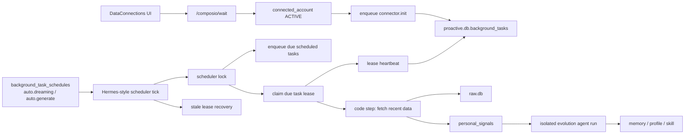
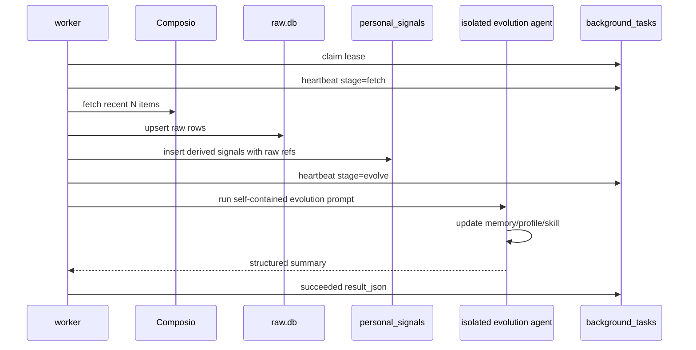
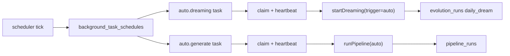

# Data Connector Init Tasks（Hermes-style）

> **状态**：方案草案，待实施。
> **范围**：用户在 Data Connections 里连接 Composio 数据源后，后台拉初始数据、写 `raw.db`、写 `personal_signals`，再触发 evolution 更新 memory / profile / skill。同时把现有 auto dreaming / auto generate 迁到同一套 Hermes-style task scheduler，避免维护两套后台调度机制。
> **参考**：主要照 [Hermes Agent Scheduled Tasks](https://hermes-agent.nousresearch.com/docs/user-guide/features/cron/) 和 [Cron Internals](https://hermes-agent.nousresearch.com/docs/developer-guide/cron-internals/) 的调度模型；任务状态命名对齐 OpenClaw task registry。

---

## 结论

Data Connector 初始化不要放在 `/composio/wait` 同步执行。连接变成 `ACTIVE` 后，只创建一个 durable task，由容器内常驻 scheduler 在后台执行。

现有 auto dreaming / auto generate 也迁到这套 scheduler。迁移后，`setInterval` 只保留为 scheduler tick，不再直接调用业务函数；到点后先创建 task instance，再由 worker claim + heartbeat + isolated agent session 执行。

这套机制按 Hermes Agent cron 抄三件事：

1. **Gateway-integrated scheduler tick**：常驻进程周期 tick，扫描 due task。
2. **Scheduler lock + isolated run**：每轮 tick 防重入，每个 agent 段在隔离 session 里跑。
3. **Self-contained task prompt + skill injection + recursion guard**：需要 agent 的任务必须有完整上下文，可附加固定 skill，禁止任务内再创建无限任务。

同时按我们的数据场景补一个 Hermes cron 没覆盖完整的能力：**lease heartbeat**。因为 connector init、auto dreaming、auto generate 都可能卡在 Composio、LLM、SQLite 写入或容器重启中，必须能发现 stale running task 并恢复。

术语约束：

- **trigger**：由 scheduler tick / enqueue wake 负责，判断 schedule 或 event 是否到点。
- **heartbeat**：只由 running task 续 lease，证明当前 attempt 还活着。不要用 heartbeat 直接表达业务到点。



---

## 为什么放在 Data Connectors

Data Connectors 负责“数据源怎么接进来”。Composio 当前只维护连接状态、OAuth 和 identity cache；初始化数据属于连接完成后的接入扩展，不属于 generation，也不属于纯 memory。

边界划分：

| 层 | 职责 |
|---|---|
| Data Connectors | 发现连接变 `ACTIVE`，创建 `connector.init` task，执行 source adapter 拉数据。 |
| raw.db | 保存源数据原文和字段化 snapshot。 |
| personal_signals | 放短期可消费观察，带 raw 引用。 |
| evolution | 从 raw/signals 提炼长期 memory、profile、skill。 |
| generation | 后续读 memory/profile/skill/signals，不直接关心 connector init。 |

---

## Hermes Agent 机制映射

| Hermes cron 做法 | 我们怎么抄 |
|---|---|
| gateway daemon 每 60 秒 tick scheduler | proactive-ai 插件启动 `backgroundTaskScheduler`，默认每 30-60 秒 tick；enqueue 后立即 wake 一次。 |
| tick 先拿 lock，防止上一轮没跑完又跑一轮 | `scheduler_locks` 表，`lock_key='connector-task-scheduler'`，带 `owner` 和 `expires_at`。 |
| jobs 有 schedule + lifecycle | `background_task_schedules` 保存 recurring job；`background_tasks.status` 保存每次 run 的 `queued/running/succeeded/failed/timed_out/cancelled/lost`。 |
| due job 逐个运行 | 每轮先把 due schedule materialize 成 task，再 claim 一批 `run_after <= now` 的 task，按 priority / created_at 排序。 |
| 每个 cron job 创建 fresh `AIAgent` session | 每个需要 LLM 的 task step 创建 `task:<task_id>:attempt:<n>` 隔离 agent session。 |
| cron prompt 必须 self-contained | evolution agent prompt 必须包含 connector、raw refs、样本摘要、目标输出 schema，不能依赖主对话上下文。 |
| job 可注入 skills | 不同 task type 绑定固定 skill，例如 `connector-evolution`、`profile-refinement`、`skill-refinement`。 |
| cron-run 禁用 cronjob tool，防止递归创建任务 | task agent session 禁用“创建/修改 background task”的工具；后续如需 fan-out，只允许白名单 handler 创建子任务。 |
| 结果落本地 output，便于审计 | task attempt 写 `task_attempts`，大 payload 写 `data/run-artifacts/<task_id>/...json`。 |

不照搬的部分：

- Hermes 用 `jobs.json` + atomic write；我们用 SQLite，因为本项目已有 `proactive.db`，而且要支持查询、claim、lease、审计。
- Hermes cron 面向“定时 agent prompt”；connector init 是“代码拉数据 + agent 提炼”的混合 workflow，不能让 agent 自己全权拉 Gmail。auto dreaming / auto generate 这种 LLM-heavy 任务则更接近 Hermes cron，可以直接建成 scheduled task。
- Hermes delivery model 面向 chat/platform；connector init 默认 silent，只写数据和 task result，不主动发用户消息。

---

## Schema 设计

### background_tasks

放在 `proactive.db`。这是通用调度表，不只服务 connector init。

| 字段 | 类型 | 说明 |
|---|---|---|
| id | TEXT PK | ULID |
| type | TEXT | `connector.init` / `connector.sync` / `auto.dreaming` / `auto.generate` / `auto.crystallize` / `auto.feedback.sync` / `memory.evolve` / `raw.backfill` |
| status | TEXT | `queued` / `running` / `succeeded` / `failed` / `timed_out` / `cancelled` / `lost` |
| priority | INTEGER | 数字越小越先跑 |
| run_after | TEXT | 到点才可 claim |
| idempotency_key | TEXT UNIQUE | 防重复创建 |
| payload_json | TEXT | task 参数 |
| progress_json | TEXT | 当前 stage、已拉数量、raw ids 等 |
| result_json | TEXT | 成功结果摘要 |
| attempts | INTEGER | 已尝试次数 |
| max_attempts | INTEGER | 默认 3 |
| lease_owner | TEXT | `hostname:pid:boot_id` |
| lease_token | TEXT | 每次 claim 生成 UUID |
| lease_expires_at | TEXT | lease 到期时间 |
| heartbeat_at | TEXT | 最近续约时间 |
| last_error_code | TEXT | 可聚合错误码 |
| last_error_message | TEXT | 最近错误 |
| created_at / updated_at | TEXT | |
| started_at / completed_at | TEXT | |

索引：

```sql
CREATE UNIQUE INDEX idx_background_tasks_idempotency
  ON background_tasks(idempotency_key);

CREATE INDEX idx_background_tasks_due
  ON background_tasks(status, run_after, priority, created_at);

CREATE INDEX idx_background_tasks_lease
  ON background_tasks(status, lease_expires_at);
```

### background_task_schedules

放在 `proactive.db`。这是 Hermes `jobs.json` 的 SQLite 版本，保存 recurring job 的 schedule，不保存某次执行的运行状态。

| 字段 | 类型 | 说明 |
|---|---|---|
| id | TEXT PK | 稳定 id，例如 `auto.dreaming.default` |
| type | TEXT | 生成的 task type，例如 `auto.dreaming` |
| enabled | INTEGER | 0/1 |
| schedule_kind | TEXT | `interval` / `daily_local` / `cron` / `manual` |
| schedule_json | TEXT | `{ "everyMs": 900000 }` 或 `{ "hour": 6, "minute": 0, "timezone": "profile" }` |
| payload_template_json | TEXT | 创建 task 时使用的 payload 模板 |
| idempotency_template | TEXT | 例如 `auto.dreaming:{local_day}` |
| priority | INTEGER | 生成 task 的默认优先级 |
| next_run_at | TEXT | 下次应 materialize task 的时间 |
| last_enqueued_at | TEXT | 最近一次创建 task 的时间 |
| last_task_id | TEXT | 最近一次 task id |
| created_at / updated_at | TEXT | |

索引：

```sql
CREATE INDEX idx_background_task_schedules_due
  ON background_task_schedules(enabled, next_run_at, priority);
```

### task_attempts

每次 claim 都写一行，方便排查“为什么 Gmail init 跑了三次”。

| 字段 | 类型 | 说明 |
|---|---|---|
| id | TEXT PK | ULID |
| task_id | TEXT | FK-like 到 `background_tasks.id` |
| attempt_no | INTEGER | 第几次 |
| worker_id | TEXT | 对应 `lease_owner` |
| lease_token | TEXT | 与 task 上的 token 对应 |
| status | TEXT | `running` / `succeeded` / `failed` / `timed_out` / `lost` |
| started_at / heartbeat_at / finished_at | TEXT | |
| error_code / error_message | TEXT | |
| logs_json | TEXT | 小型结构化日志，大 artifact 不放这里 |

### scheduler_locks

Hermes 用 `.tick.lock` 文件；我们用 SQLite lock。

| 字段 | 类型 | 说明 |
|---|---|---|
| lock_key | TEXT PK | `connector-task-scheduler` |
| owner | TEXT | `hostname:pid:boot_id` |
| expires_at | TEXT | 过期后别人可抢 |
| updated_at | TEXT | |

---

## 运行机制

### 1. enqueue

`/composio/wait` 发现 connected account 为 `ACTIVE` 后：

```json
{
  "type": "connector.init",
  "idempotencyKey": "connector.init:gmail:<connected_account_id>:v1",
  "payload": {
    "toolkit": "gmail",
    "connectedAccountId": "<connected_account_id>",
    "limit": 100,
    "reason": "first_connect"
  },
  "priority": 10,
  "runAfter": "now"
}
```

如果同一个 `idempotency_key` 已存在：

- `queued/running`：返回已有 task id。
- `succeeded`：不重复初始化，除非用户手动点 re-init。
- `failed/timed_out/lost`：允许显式 retry，创建新 revision 或重置原 task。

### 2. scheduler tick

按 Hermes cron tick 模型：

```text
tick()
  1. acquire scheduler lock
  2. materialize due schedules into background_tasks
  3. recover stale running tasks
  4. load due queued tasks
  5. claim task lease
  6. run task handler
  7. update final state
  8. release scheduler lock
```

默认：

- tick interval：60 秒。
- enqueue wake：新 task 创建后立即触发一次 tick。
- scheduler lock TTL：90 秒。
- task lease TTL：60 秒。
- heartbeat interval：15 秒，或每个 stage checkpoint 后立即续约。

Schedule materialization 规则：

- `background_task_schedules` 只负责“该不该生成一个 task instance”。
- 每个生成出来的 task 都走 `background_tasks`，不能由 schedule 直接执行业务。
- schedule 生成 task 时必须使用 `idempotency_template`，防止同一 due window 重复入队。
- task 完成后，由 scheduler 根据 schedule 类型更新 `next_run_at`。

### 3. claim lease

claim 必须是原子更新，避免两个 worker 同时跑同一个 task：

```sql
UPDATE background_tasks
SET
  status = 'running',
  attempts = attempts + 1,
  lease_owner = ?,
  lease_token = ?,
  lease_expires_at = ?,
  heartbeat_at = ?,
  started_at = COALESCE(started_at, ?),
  updated_at = ?
WHERE id = ?
  AND status = 'queued'
  AND run_after <= ?
  AND attempts < max_attempts;
```

如果未来要抢救 stale running task，先由 reaper 把它转回 `queued`，再走同一条 claim 路径。

### 4. heartbeat

heartbeat 只允许当前 lease holder 续约：

```sql
UPDATE background_tasks
SET
  heartbeat_at = ?,
  lease_expires_at = ?,
  progress_json = ?,
  updated_at = ?
WHERE id = ?
  AND status = 'running'
  AND lease_token = ?;
```

如果 affected rows = 0，handler 必须停止写最终结果。说明任务已经被取消、超时或被新 attempt 抢走。

### 5. stale recovery

每轮 tick 先扫：

| 情况 | 处理 |
|---|---|
| `running` 且 `lease_expires_at < now` 且 `attempts < max_attempts` | 写 attempt 为 `lost`，task 回 `queued`，`run_after = now + backoff` |
| `running` 且 lease 过期且 `attempts >= max_attempts` | task 进 `timed_out` |
| worker 正常失败 | task 进 `queued` 重试，或超过次数进 `failed` |
| 用户主动取消 | task 进 `cancelled`，handler 下次 heartbeat 发现 lease 不匹配后停掉 |

backoff：

```text
attempt 1: 30s
attempt 2: 2m
attempt 3: 10m
```

---

## Connector Init Workflow

`connector.init` 是 workflow task，不是一个纯 agent prompt。



### Gmail v1

默认拉最近 100 封邮件：

```json
{
  "toolkit": "gmail",
  "limit": 100,
  "stages": [
    "fetch_recent_messages",
    "persist_raw_gmail_messages",
    "emit_personal_signals",
    "run_evolution_agent"
  ]
}
```

数据落点：

| 阶段 | 落点 |
|---|---|
| fetch recent messages | Composio direct execution |
| persist raw | `raw.db.gmail_messages` |
| emit signals | `personal_signals(source='connector:gmail', source_raw_table='gmail_messages')` |
| evolve | `evolution_runs(trigger_kind='on_event')` + `memory/profile/skill_index/skills/*` |

幂等要求：

- raw Gmail 用 `connected_account_id + gmail_message_id` 去重。
- signal 用 `dedupe_key = connector:gmail:<connected_account_id>:<message_id>:init:v1`。
- evolution run 记录 consumed raw ids，失败重跑不能重复消费已经成功的 raw ids。

### Google Calendar v1

默认拉最近和未来窗口共 100 条：

- `time_min = now - 30d`
- `time_max = now + 90d`
- 按更新时间或开始时间排序，最多 100 条。

落点：

- `raw.db.gcal_events`
- `personal_signals(source='connector:googlecalendar')`
- `evolution_runs(trigger_kind='on_event')`

---

## Auto-loop 迁移

现有 `scheduler/auto-loop.ts` 直接用 `setInterval` 调业务函数。迁移后，timer 只做 scheduler tick，所有后台 run 都落到 `background_tasks`。



### auto.dreaming

Schedule:

```json
{
  "id": "auto.dreaming.default",
  "type": "auto.dreaming",
  "scheduleKind": "daily_local",
  "schedule": {
    "hour": 6,
    "minute": 0,
    "timezone": "profile"
  },
  "idempotencyTemplate": "auto.dreaming:{local_day}",
  "priority": 30
}
```

执行规则：

- scheduler tick 用 profile timezone 计算 local day。
- 本地时间过 06:00，且今天没有同 idempotency task，才 enqueue。
- task handler 继续复用 `startDreaming({ trigger: 'auto' })`。
- `evolution_runs(trigger_kind='daily_dream')` 仍是 dreaming 的业务账本。
- 如果 task lease 过期，scheduler 可 retry；如果 `evolution_runs` 已经 completed，retry handler 必须识别并直接 mark succeeded。

### auto.generate

Schedule:

```json
{
  "id": "auto.generate.default",
  "type": "auto.generate",
  "scheduleKind": "interval",
  "schedule": {
    "everyMs": 900000
  },
  "idempotencyTemplate": "auto.generate:{window_start_iso}",
  "priority": 40
}
```

执行规则：

- 保留用户设置 `auto_generate`。
- 保留 pipeline 并发锁；如果 pipeline 正在跑，task 记录为 skipped/succeeded，不并发启动第二轮。
- handler 调 `runPipeline(...)`，结果继续写 `pipeline_runs`。
- task 只记录调度状态、heartbeat、attempt 和摘要；业务产物仍归 `pipeline_runs`。

### 其他现有 auto-loop 项

| 当前项 | 新 task type | 迁移方式 |
|---|---|---|
| world ingest | `auto.world_ingest` | interval schedule；handler 调 world ingest。 |
| card chat feedback sync | `auto.feedback.sync` | interval schedule；handler 调 `syncCardChatFeedback`。 |
| auto crystallize | `auto.crystallize` | interval schedule；handler 调 `runCrystallize`。 |

迁移后不再让 `auto-loop` 自己维护 `dreamInFlight`、`loopInFlight` 这类进程内 flag。并发控制统一走 task lease、pipeline lock 和业务幂等键。

### 其他 UI Composio Connectors

前端 Data Connections 里已有 Composio connector，应全部支持创建 init task，但 handler 分阶段落地：

| 阶段 | connector |
|---|---|
| v1 typed raw adapter | Gmail、Google Calendar、Slack、Notion、Google Drive |
| v2 typed raw adapter | GitHub、Jira、Asana、Todoist、Trello、ClickUp、Dropbox、Google Docs、Google Sheets |
| v3 typed raw adapter | Outlook、Twitter/X、LinkedIn、Discord、Spotify、YouTube、Calendly、Zoom、Stripe、HubSpot、Figma、Strava |

raw 设计规则：

- **一个数据源一张 typed raw 表**。不新增 `connector_items` 这类大杂表。
- 没有 typed raw 表的 connector，不能宣称 init 已支持；必须先补表、adapter、去重键和测试。
- 表名按 source 语义命名，例如 `slack_messages`、`notion_pages`、`github_events`、`jira_issues`、`gdrive_files`。
- 每张 raw 表都必须包含 `connected_account_id`、source 原始 id、`raw_json`、时间字段、`reference_count` / `last_referenced_at` / `referenced_by_runs`。

---

## Agent 执行边界

不是每个 task 从头到尾都交给 agent。规则：

| 步骤 | 执行者 | 原因 |
|---|---|---|
| 拉 Composio 数据 | deterministic code handler | 工具参数明确，代码更可靠、可重试、可限流。 |
| raw upsert | deterministic code handler | 必须强幂等，不能让 agent 写 SQL。 |
| signal 派生 | code + 小模型/规则可选 | 初始版本用代码映射，避免成本和不稳定。 |
| memory/profile/skill 提炼 | isolated evolution agent | 需要理解、归纳、压缩和 skill 更新。 |

Agent session 要按 Hermes fresh session 原则：

```text
sessionKey = task:<task_id>:attempt:<attempt_no>:evolution
```

prompt 必须自包含：

- connector 类型和 connected account id。
- 本次 raw ids。
- 样本摘要，不塞完整 100 封邮件正文到 prompt。
- 当前 profile / memory / skills 摘要。
- 允许写入的 schema 和工具。
- 禁止创建新 background task，除非 handler 显式授权。

---

## API / CLI

### HTTP

| Endpoint | 作用 |
|---|---|
| `POST /composio/wait` | 连接 ACTIVE 后 enqueue init task，返回 `initTaskId`。 |
| `GET /tasks/:id` | 查单个任务状态、progress、错误。 |
| `GET /tasks?type=connector.init` | 查 connector init 列表。 |
| `GET /tasks/schedules` | 查 auto.dreaming / auto.generate 等 recurring schedules。 |
| `POST /tasks/schedules/:id/run` | 手动触发一个 scheduled task，下一轮 tick 入队。 |
| `POST /tasks/:id/cancel` | 取消任务。 |
| `POST /tasks/:id/retry` | 手动重试失败任务。 |

### CLI

```bash
pin tasks list --type connector.init
pin tasks show <task_id>
pin tasks schedules
pin tasks run-schedule auto.dreaming.default
pin tasks retry <task_id>
pin tasks cancel <task_id>
pin connector init gmail --account <connected_account_id> --limit 100
```

---

## 配置

| 配置 | 默认值 | 说明 |
|---|---:|---|
| `CONNECTOR_INIT_DEFAULT_LIMIT` | `100` | 每个 connector 默认初始化数量。 |
| `BACKGROUND_TASK_TICK_MS` | `60000` | scheduler tick 间隔。 |
| `BACKGROUND_TASK_LEASE_MS` | `60000` | task lease TTL。 |
| `BACKGROUND_TASK_HEARTBEAT_MS` | `15000` | heartbeat 间隔。 |
| `BACKGROUND_TASK_MAX_ATTEMPTS` | `3` | 默认重试次数。 |
| `CONNECTOR_INIT_ENABLED` | `1` | 总开关。 |
| `BACKGROUND_AUTO_LOOP_TASKS_ENABLED` | `1` | 是否用 task scheduler 接管 auto dreaming / auto generate。 |

---

## 实施阶段

### Phase 1：通用 task 表和 scheduler

- 新增 `background_tasks`、`background_task_schedules`、`task_attempts`、`scheduler_locks` schema。
- 实现 enqueue / claim / heartbeat / complete / fail / recover。
- 实现 schedule materialization：due schedule 只创建 task instance，不直接执行业务。
- 插件启动时 start scheduler，支持 interval tick + enqueue wake。
- 增加 `pin tasks` CLI 和最小 HTTP 查询接口。

验收：

- task 创建后能被 claim。
- worker 中途 crash 后，lease 过期能回 `queued` 或进 `timed_out`。
- stale task 有可读错误和 attempt 记录。

### Phase 2：auto-loop 迁移到 scheduled tasks

- seed `background_task_schedules`：`auto.dreaming.default`、`auto.generate.default`、`auto.world_ingest.default`、`auto.feedback.sync.default`、`auto.crystallize.default`。
- `auto-loop` 不再直接调用 `runPipeline` / `startDreaming`；只启动 task scheduler。
- `auto.dreaming` task 复用 `startDreaming({ trigger: 'auto' })`，业务账本仍写 `evolution_runs(trigger_kind='daily_dream')`。
- `auto.generate` task 复用 `runPipeline(...)`，业务账本仍写 `pipeline_runs`。

验收：

- 每天 06:00 后只生成一个 `auto.dreaming:{local_day}` task。
- auto generate 按 cooldown 生成 task，pipeline 正在跑时不并发启动。
- 插件重启后，running auto task 能通过 lease recovery 进入 retry 或 terminal 状态。

### Phase 3：Composio wait 接入 connector.init

- `/composio/wait` 在 ACTIVE 后创建 `connector.init`。
- idempotency 防重复 enqueue。
- 前端显示初始化状态：`queued/running/succeeded/failed`。

验收：

- Gmail OAuth 完成后返回 `initTaskId`。
- 刷新页面后仍能看到任务进度。

### Phase 4：Gmail / Calendar typed adapter

- Gmail 拉最近 100 封，写 `raw.db.gmail_messages`。
- Calendar 拉窗口内最多 100 条，写 `raw.db.gcal_events`。
- 写 `personal_signals` 并带 raw refs。

验收：

- 重跑 init 不重复写 raw/signals。
- `pin raw` 能查到 Gmail/Calendar 原始数据。

### Phase 5：Evolution agent

- connector init 完成 raw/signals 后，创建 `evolution_runs(trigger_kind='on_event')`。
- 用 isolated task session 跑 evolution，更新 memory/profile/skill。
- 写 `refs_consumed_json` / `refs_produced_json`。

验收：

- Gmail init 成功后 profile / memory / skill 至少有一次 evolution 记录。
- 失败时 task 可 retry，不破坏已写 raw。

### Phase 6：扩展所有 UI Composio connectors

- 为每个 source 增加专用 raw 表。
- 没有 typed raw 表的 connector 不走通用 fallback，不标记为 init supported。
- 为每个 connector 定义默认 limit、排序字段、最小 signal 映射。

验收：

- Data Connections UI 里所有带 `composioId` 的 connector，在对应 typed raw 表和 adapter 补齐后都能创建 init task。
- 每个已支持 connector 都有 source-specific raw 表、去重键和 raw 查询入口。

---

## 测试计划

| 测试 | 覆盖 |
|---|---|
| task repository 单测 | enqueue idempotency、claim lease、heartbeat、complete、fail。 |
| scheduler 单测 | lock 防重入、due schedule materialization、due task 排序、stale recovery。 |
| auto-loop task 迁移测试 | auto.dreaming 每天只入队一次；auto.generate 尊重 cooldown 和 pipeline lock。 |
| connector init 单测 | Gmail/Calendar mock Composio response，raw/signals 去重。 |
| evolution 集成测试 | mock agent 输出，验证 evolution_runs 和 memory/profile/skill 写入。 |
| HTTP 测试 | `/composio/wait` 返回 `initTaskId`，`/tasks/:id` 可查询。 |
| crash recovery 测试 | 人为让 handler throw / heartbeat 停止，确认 task 可恢复。 |

回归命令：

```bash
npm run type-check
npx tsx --test pinai-openclaw/plugins/proactive-ai/db.background-tasks.test.ts
npx tsx --test pinai-openclaw/plugins/proactive-ai/tasks/scheduler.test.ts
npx tsx --test pinai-openclaw/plugins/proactive-ai/tasks/auto-loop-tasks.test.ts
npx tsx --test pinai-openclaw/plugins/proactive-ai/connectors/init.test.ts
bash pinai-openclaw/plugins/proactive-ai/scripts/test-memory.sh
```

---

## 风险和约束

- Composio API 工具形状会变，adapter 不能硬编码过多 action 名；每个 toolkit 要有可测试 mapping。
- Gmail 邮件正文可能很大，prompt 里只能放摘要和必要字段，完整内容留在 `raw.db`。
- 初始化必须 silent，不要在用户刚连账号时刷一堆消息。
- agent session 不允许递归创建 task，防止 Hermes 文档里提到的 runaway scheduling loop。
- raw 层禁止 `connector_items` 这类泛化兜底表；缺哪个数据源就补哪个 typed raw 表。
- raw/signals/evolution 三层都要保留引用，后续 agent 查询才能解释“这个 profile/skill 是从哪来的”。
