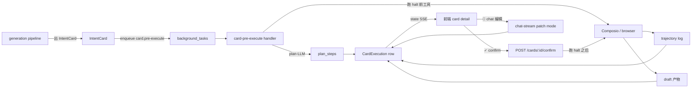
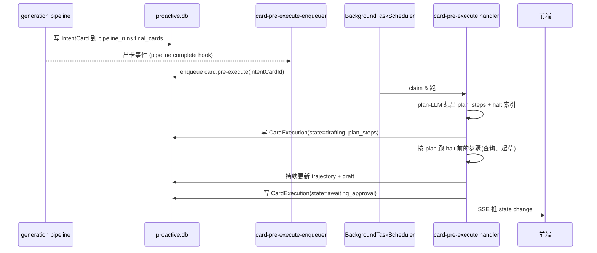
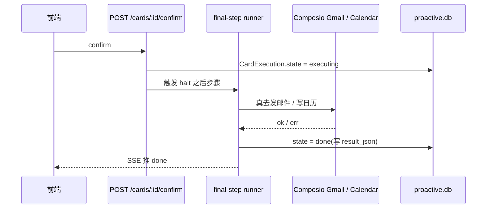

# Card Execution Architecture

> **状态**:决策完成,Q1–Q5 全部已拍板,**待 user review 后进入 implementation plan 阶段**。
> User 通过后,会被 [Execution](../modules/execution) 和 [Background Tasks](../modules/background-tasks) 在"相关 AI Plans"段引用。

## 产品方向

参考 Naro 的卡片设计:**卡片不是"建议",是"已经做完一半、等你审批的半成品"**。

具体说,卡片由三段组成:

1. **Plan** — 用户原话 + 高层步骤纲要(如:① 找联系人 ② 起草邮件 ③ HALT 等审批 ④ 发送)。
2. **Trajectory** — agent 已经跑过的细步骤回放(查 Gmail 几次、查 Calendar、查 memory),带图标 / 状态 / 耗时。
3. **Draft / Output** — 已经准备好的产物(邮件草稿、日历事件、消息草稿)。

底部三按钮:

- **✗** = 拒绝,丢弃
- **💬** = 进 chat 改 plan / draft(chat 不再是默认入口,是修改入口)
- **✓** = 同意,跑 halt 之后的"不可逆"步骤(发邮件 / 写日历)

核心模式可以一句话总结:**所有可逆的工作(查询、起草)在卡片生成时就跑完;不可逆的工作(发邮件、写日历、付款)在用户 confirm 后才跑**。

## 用户体验定位转变(主线变化)

这次改造的核心是**把执行的"主舞台"从 chat 挪到卡片**:

- 以前:agent 在 **chat** 里调工具完成任务,用户在对话流里看到 ToolActivityCard 一行一行冒。**chat 是主舞台,卡片只是打开 chat 的引子**。
- 现在:agent 在**卡片内部**完成预执行 + confirm 执行,用户在卡片上直接看到 plan / draft / trajectory + 三按钮。**卡片是主舞台,chat 降级为"跟 agent 讨论改卡片"的辅助入口**。

### 当前卡片定位(代码事实)

调研当前代码,卡片在前端的定位是 **"信息展示入口 + chat 上下文容器"**,而不是执行舞台:

- **IntentCard schema**(`proactive-ai-frontend/src/types/intent-card.ts`):只有 `title / whyNow / summary / primaryAction / secondaryActions / confidence / urgency / importance / sources / agentChain` 等信息字段,**没有 draft / plan_steps / trajectory**。卡片本身不携带执行内容。
- **Feed 渲染**(`proactive-ai-frontend/src/components/NowFeed.tsx`):浮动卡片网格,单卡只显示类别 icon + title + 状态标签,**无嵌入式操作按钮**;支持 swipe-dismiss / 点击进详情。
- **详情容器**(`proactive-ai-frontend/src/components/CardDetailBody.tsx`):Drawer 里铺陈 4 类 outcome 按钮(Modify / Snooze / Dismiss / Done)+ Confirm 按钮。**Confirm 按钮当前不直接执行任务** — 它只是发 `POST /feedback {kind:"card_action", action:"confirm"}` 写 outcome,然后 `setChatTarget(card)` 打开 CardChat,把执行**完全委托给 chat agent**。
- **CardChat 薄壳**(`proactive-ai-frontend/src/components/CardChat.tsx`):传 `cardContext` 给 `MainChatView`,前端进入 chat 后通过 `useProactiveChatRuntime.ts` 的 `needsBootstrap = true` 路径自动 `POST /chat-stream/send` 让 agent 写第一条回复。
- **进 chat 的 3 条路径**(`AppShell.tsx`):Confirm / Modify / Chat 按钮都打开 CardChat。
- **后端 card_action 处理**(`routes/feedback.ts`):只写 `intent_card_state.latest_outcome`,**不调任何工具,不触发任何执行**。真实执行的全部由 chat agent 在对话里自由发挥。

**一句话**:当前卡片的"执行"= 打开 chat 让 agent 现想现做。

### 新模型卡片定位(目标)

卡片变成"执行的主舞台":

- 卡片自带 `CardExecution` 视图:plan 步骤、trajectory(已跑工具回放)、draft(已起草产物)、state(drafting / awaiting_approval / executing / done / failed / rejected)。
- 三按钮 ✗ / 💬 / ✓ 直接挂在卡片底部,Confirm = 跑 halt 之后步骤(由后端 final-step runner 触发,**不再打开 chat**)。
- chat 角色降级为"修改入口" — 只在用户点 💬 时打开,语义变成"跟 agent 讨论改 plan / draft",chat agent 输出 patch / rerun 二选一(详见 Q3),不再自由发挥。

### 关键改动半径(代码层)

| 文件 | 当前职责 | 新职责 |
|---|---|---|
| `proactive-ai-frontend/src/types/intent-card.ts` | IntentCard schema(信息字段) | 加 `executionState?: CardExecutionView`,**字段从后端 merge 来,不是 generation 同事填**(执行层独占写) |
| `proactive-ai-frontend/src/components/NowFeed.tsx` | 浮动卡片渲染(信息+状态标签) | 加角标显示 `executionState.state`(drafting / awaiting / executing / done) |
| `proactive-ai-frontend/src/components/CardDetailBody.tsx` | 信息铺陈 + 4 outcome + Confirm 打开 chat | **重写**:展示 plan + draft(Phase 2 加 trajectory);Confirm 按钮文案 = `primaryAction.label`;Confirm 调 `POST /cards/:id/confirm` **不打开 chat**;Modify / Reject 保留;Chat 按钮变成"💬 跟 agent 改卡片" |
| `proactive-ai-frontend/src/components/CardChat.tsx` + `useProactiveChatRuntime.ts` | 主对话入口,bootstrap 触发 agent 自由跑 | 修改入口:`cardContext` 多带完整 `executionState`;chat agent 输出 patch / rerun(白名单 + SSE patch 帧) |
| `proactive-ai-frontend/src/components/AppShell.tsx` | 全局卡片状态(dismissedIds 等) | 加 CardExecution SSE 订阅,新状态字段(executingIds / draftingIds 等) |
| 后端 `routes/feedback.ts` | 写 outcome | **不动**(card_action 路径保留,跟新执行路径并存) |
| 后端**新文件** `routes/cards.ts`(或类似) | — | 新增 `GET /cards/:id/execution`、`POST /cards/:id/confirm`、`POST /cards/:id/reject`、SSE 状态推送 |
| 后端 `routes/chat.ts` | chat-stream 主路径 | 改造:cardContext 解析 `executionState`;system prompt 加 patch 白名单与强约束;返回 patch / rerun / 反问 三种结构化输出 |
| 后端 `agents/chat.ts` | chat 系统 prompt | 加 patch 模式段:白名单字段 / 强约束规则 / patch ops schema / rerun 触发条件;实现前先修正当前事实:**`PIN_CLI_COMMAND_GUIDE` 目前只在 generator prompt 里显式注入,chat prompt 不能只依赖一句 "loaded skill documents"**,要么显式注入同一 guide,要么在文档里说明由 OpenClaw skill loader 注入的真实边界 |
| 后端**新文件** `tasks/handlers/card-pre-execute.ts` 等 | — | 见 Q1-Q4 决策(异步预执行 handler、final-step runner、enqueuer) |
| 后端 `tasks/scheduler.ts` / 入队点 | 单 tick 默认只 claim 一个 due task;已有 `wake()` 可立即触发 tick | **建议改造,不阻塞 MVP 正确性**:预执行入队后调用 `wake()`,并加 `maxTasksPerTick` / `drainUntilEmpty` 让同一 tick 连续 claim due `card.pre-execute`,避免多张卡之间白等 60s tick。仍保持单进程串行执行,只去掉空等。 |
| 后端**新文件** `tools/pin-cli-validator.ts`(或类似)| — | **方案 A 核心**:thin validator + retry — 接 LLM 结构化 JSON 输出,做 schema 校验 + `--allow-side-effect` flag 阶段校验,失败 self-correct;通过则非 shell spawn `pin <command> <flags>`;envelope `error.hint` 送回 LLM retry 1-2 次;`NOT_SUPPORTED` / `FORBIDDEN` 触发 fallback 到 browser tool。validator 要带 per-tool schema cache,避免每次 pre-execute 都重复查 Composio schema。详见"工具调用架构(Phase 1: 渐进式增强)"段 |
| `pinai-openclaw/image/skills/pin/SKILL.md`(同事维护)| pin CLI 工具说明书,9.8 KB,自动注入 agent prompt | **可选小改**(Phase 1):加 "Output format(structured JSON)" 章节;补 side-effect 命令完整 input schema;加 "Fallback order" 一节(`pin CLI → browser → ask user`)。改前需跟同事 review |

### 执行入口边界(新增硬约束)

Phase 1 起,卡片执行的主路径必须从 `POST /cards/:id/confirm` 进入,而不是从 `CardChat` bootstrap 进入。Confirm 的语义是"用户已批准 HALT 之后的不可逆步骤",所以它只触发 final-step runner,并更新 `CardExecution.state`。Chat 只负责修改已有 plan / draft:Phase 1 只允许输出 rerun 请求,Phase 2 再允许白名单 patch。除非走 legacy fallback,chat agent 不应该直接调用副作用工具完成卡片 confirm。

### 卡片 UI 对照(逐段保留 / 替代 / 新增)

对照当前 `CardDetailBody.tsx`(L23-222)实际渲染的每一段,**已有功能不删,只在需要的位置替代或新增**。如果新内容跟老内容冲突,以新的为准。

| # | 段落 | 当前来源(`CardDetailBody.tsx`) | 新模型决定 |
|---|---|---|---|
| 1 | Swipe 提示 + 手势(`← swipe to dismiss / swipe to chat →`) | L50-55 + L200-214 | **保留**。语义不变(左滑 dismiss / 右滑 chat),右滑 chat 在新模型下进入"修改模式",一致。 |
| 2 | 类别 tag(GROWTH)+ Urgent 角标 | L57-63,从 `basketMeta(card.goalBasket)` 取 | **保留**。 |
| 3 | 标题(`card.title`) | L65 | **保留**。 |
| 4 | Why Now 段(绿色框) | L67-72,`card.whyNow` | **保留**。 |
| 5 | Summary 段(灰色框) | L74-79,`card.summary` | **保留**。 |
| 6 | 三/四个评分(Confidence / Importance / Urgency / Overall) | L81-88,`card.{confidence/importance/urgency}*100` + 可选 `score.overall*10` | **保留**。 |
| 7 | **粉色 "Will execute on confirm" 框** | L90-98,只显示 `card.primaryAction.label` 一行文字 | **替代为 Plan + Draft 主区块**。新内容: <br/>• **Plan**:从 `executionState.plan_steps` 列表渲染(标题 / 描述 / HALT 标识 / 状态点),参考 Naro 截图 2。<br/>• **Draft**:从 `executionState.draft` 按 action 类型渲染(email DRAFT 卡 / calendar event 卡 / message 卡)。<br/>• **状态指示**:基于 `executionState.state`(drafting / awaiting_approval / executing / done / failed)显示对应视觉。 |
| 8 | **(新增)Trajectory 折叠区** | — | **Phase 2 新增**。从 `executionState.trajectory` 渲染(参考 Naro 截图 3:工具图标 + 描述 + 耗时)。Phase 1 不渲染但数据照存。 |
| 9 | Quick Actions 4 项(modify / snooze / dismiss / done) | L100-132,写死文案 + `onModify/onSnooze/onDismiss/onDone` 回调 | **保留全部 4 项**。这些是用户对卡片态度的快速入口,跟"执行流程"是正交概念。注意 `onModify` 在新模型下等价于点 💬 chat(进入修改模式),前端可以让两个入口走同一函数。 |
| 10 | Data Sources | L134-144,`card.sources[]` | **保留**。 |
| 11 | Evaluator Feedback | L146-151,`score.feedback` | **保留**。 |
| 12 | 底部 Chat / Confirm 按钮 | L153-168 | **替代**。<br/>• **Confirm 按钮**:文案改为 `primaryAction.label`(`Send email` / `Schedule meeting` 等具体动词,Q5-P2);行为从 `onConfirm` 改为 `POST /cards/:id/confirm`,**不打开 chat**;按钮在 `state=drafting / executing` 时禁用并显示对应文案。<br/>• **Chat 按钮**:保留入口,语义改为"💬 跟 agent 改卡片"(修改入口);hover/aria-label 改成"修改卡片"。<br/>• **(新增)左侧 ✗ Reject 按钮**:把 dismiss 提到底部跟 Chat / Confirm 三连(参考 Naro 截图三按钮布局),Quick Actions 里的 dismiss 保留作冗余入口。 |
| 13 | "Tell AI what you prefer..." 输入框 + Send | L170-196,`onTextFeedback(text)` | **保留 + 行为升级**。当前是写 `text_feedback` outcome;新模型下输入文字回车 = 直接进入 chat 修改模式,把这条文字作为第一条 user message(等于点 💬 然后立刻发消息,省一次点击)。 |

**新增的全局视觉**(不在 `CardDetailBody` 现有段里,但新模型需要):

- **NowFeed 状态角标**(`NowFeed.tsx`):每张卡角标显示 `executionState.state`(drafting 黄点 / awaiting 默认 / executing 蓝色脉冲 / done 绿勾 / failed 红色 + 重试)。
- **CardExecution SSE 订阅**(`AppShell.tsx`):新增 `/cards/events` 或类似 SSE 通道,推送 `cardExecution:state` / `cardExecution:patch` / `cardExecution:trajectory-append` 事件,前端 reducer 更新对应卡片局部状态。

## 当前 vs 目标

| 维度 | 当前 | 目标 |
|---|---|---|
| 卡片性质 | 建议性 idea | 已预执行的半成品 |
| 用户进卡后 | chat 默认入口,agent 从零开始 | 直接看 plan + draft + trajectory,confirm 一键跑 |
| chat 角色 | 主路径(所有动作在 chat 里) | 修改路径(只在用户对方案不满意时进入) |
| 工具调用时机 | 用户点开 card 后边聊边跑 | 卡片生成后台预跑到 halt 点,chat-confirm 跑剩余 |
| 工具误选 | agent 自由发挥,常用错 | plan 携带 `recommended_tool`,agent 按 plan 走 |
| 用户感知 | "AI 在帮我想" | "AI 已经替我做好了一半,我审批就行" |

## 架构决定:全部在执行层做

**核心边界**:Generation 模块**不动**,所有 plan / pre-execute / draft / trajectory 在 **Execution + Background Tasks** 模块完成。

**理由**:

1. **模块语义清晰**:Generation 关心"什么值得做"(strategy),Execution 关心"怎么做"(tactics)。Naro 那套 plan / trajectory / draft 全是 tactics,本来就该在执行层。
2. **工程零侵入**:IntentCard schema 不动,generation pipeline 不动,generation 模块的代码不需要改。
3. **解耦未来 schema 演进**:即使 generation 后续重写 prompt 或加字段,execution 不受影响。
4. **复用已有框架**:预执行直接走现有的 `background_tasks` 框架(scheduler / lease / retry / heartbeat),不重新造。

**数据所有权**:

- `IntentCard`(Generation 真源)— 不动
- `CardExecution`(Execution 真源)— 新增,通过 `intent_card_id` 关联

**前端视图**:IntentCard ⊕ CardExecution 合并显示。CardExecution 不存在时退化成当前的 idea-only 卡片。

## 架构图



## 数据模型(草稿)

新表 `card_executions`(SQLite,落在 user 容器内 proactive.db):

| 字段 | 类型 | 含义 |
|---|---|---|
| `id` | uuid | PK |
| `intent_card_id` | text | 关联 IntentCard |
| `state` | text enum | `drafting` / `awaiting_approval` / `executing` / `done` / `failed` / `rejected` |
| `action_kind` | text | 执行层语义种子,例如 `email_draft` / `email_send_draft` / `calendar_create` / `message_reply`。**不要复用当前 `IntentCard.primaryAction.type`**:现有前端类型只有 `confirm` / `modify` / `snooze` / `dismiss`,不承载具体工具语义。 |
| `plan_steps` | json | `[{title, description, expected_output, doneCriteria, isHalt}]`。**没有 `recommendedTool` 字段** — 工具选择推迟到 exec 阶段由 thin validator + LLM 协商完成(见"工具调用架构(Phase 1: 渐进式增强)")。`isHalt` 由硬规则 + LLM 提议共同决定(见 Q4)。 |
| `trajectory` | json | tool call log `[{tool, args, status, durationMs, summary}]` |
| `draft` | json | 产物 schema(因 action 类型不同:email / calendar_event / message / ...) |
| `error_code` / `error_message` | text | 失败时填 |
| `created_at` / `updated_at` | iso | |

`schema 变更`:走 `db.ts` 的 `ensureDb()` `CREATE TABLE IF NOT EXISTS`(跟 `background_tasks` 一致),不走 `apis/db/migrations/`(那是 APIs Postgres,不是用户容器 SQLite)。

## 触发链路

### 预执行(generation 出新卡 → CardExecution.awaiting_approval)



### Confirm(用户点 ✓)



### Chat 编辑(用户点 💬)

进入现有 chat-stream 路径,但 cardContext 里多带 `executionState`(plan + draft + trajectory)。chat agent 输出二选一:

- **patch**:用户只改纯文字(语气、措辞、主题、收件人姓名)→ 后端校验白名单后 apply,SSE 推 `cardExecution:patch`,前端高亮被改字段。
- **rerun**:用户改了影响下游决策的内容(联系人、时间、任务范围)→ CardExecution 整张重置,重新 enqueue `card.pre-execute`,带上用户的修改指令作为最高优先级约束。

详细规则与白名单见 [Q3 决策](#q3chat-编辑的语义--已决c混合-patch--rerun-强约束)。

## 与现有模块的关系

| 模块 | 改动 |
|---|---|
| **Generation** | **不动**。同事零代码改动。 |
| **Execution** | 扩:新增 `routes/cards.ts`(GET execution / POST confirm)、新 SSE 通道、chat-stream patch mode。 |
| **Background Tasks** | 扩:新 handler `card.pre-execute`、新 enqueuer(在 generation 出卡后挂钩)、最后一步执行也复用 handler 框架(可选)。 |
| **Memory** | 不动。crystallize 现状走。 |
| **Feedback** | 小扩:execution 跑完写 `execution_signal`(成功 / 失败 / 用户改了几次),进入 feedback_events 影响下一轮 generation。 |
| **Data Connectors** | 不动。 |
| **前端** | card detail 重写,加状态机 + plan/trajectory/draft 显示 + 三按钮 + SSE 订阅。 |

## 工具调用架构(Phase 1: 渐进式增强)

> 决策记录:卡片执行的工具调用层面,Phase 1 走方案 A(thin validator + envelope retry),Phase 3+ 才考虑方案 B(native function calling + OpenClaw runtime 改造)。

### 当前事实(rebase 同事 commit `cfd03243` 之后)

- **SKILL.md 已可复用,但注入边界要核实**:`pinai-openclaw/image/skills/pin/SKILL.md`(9.8 KB)由 `pinai-openclaw/plugins/proactive-ai/agents/pin-cli-command-guide.ts` `fs.readFileSync` + strip frontmatter,当前 `unified-generator.ts` 已显式注入。`agents/chat.ts` 目前只写"loaded skill documents",没有显式 import `PIN_CLI_COMMAND_GUIDE`;进入实现前必须把 chat prompt 的真实注入方式补齐或写清。
- **pin CLI 是干净的 execution facade**:统一 JSON envelope、标准化 `error.code` / `error.hint`(见 `cli/shared.ts`)、side-effect allowlist 已 hardcoded 在 `cli/personal.ts`(当前 `SIDE_EFFECT_TOOL_ALLOWLIST = {GMAIL_CREATE_EMAIL_DRAFT, GMAIL_SEND_DRAFT}`)。
- **真正的 gap**:agent 输出 shell 字符串(`pin personal exec --tool X --input '{...}' --allow-side-effect true`),**无 schema 校验**,参数错才发现失败。

### Phase 1 决策:方案 A(渐进式增强)

不动 pin CLI / 不动 OpenClaw runtime / SKILL.md 保留。只在 PIN AI 这边的 pre-execute / final-step handler 里加 ~200-300 行 thin validator + retry。

链路对比:

| 步骤 | 现状 | Phase 1 改动 |
|---|---|---|
| 1. SKILL.md / pin CLI guide | guide 文件和 loader 已有;generator 已显式注入,chat 注入边界待核实 | chat prompt 必须有可测试的 pin CLI 执行约束;优先显式注入同一 guide |
| 2. agent 输出工具调用 | shell 字符串 | **改成结构化 JSON object**,LiteLLM JSON mode 强制 valid JSON |
| 3. 校验 | 无 | **新增 thin validator**:命令路径 / 必填字段 / Composio schema / `--allow-side-effect: true` 的阶段限制(pre-execute 拒绝、final-step 允许) |
| 4. 跑命令 | bash spawn shell | spawn `pin <command> <flags...>`(pin CLI 自己再做最终 allowlist 校验) |
| 5. 失败处理 | 直接 fail | **新增 envelope-driven retry**:`error.hint` 送回 LLM self-correct,自动重试 1-2 次 |
| 6. 工具不支持 | 任务 fail | **新增 system-level fallback**:pin CLI 报 `NOT_SUPPORTED` / `FORBIDDEN` → handler 自动尝试 browser tool 跑同任务,**agent 不参与决策** |

agent 输出的 JSON 形状(LiteLLM JSON mode 强制):

```json
{
  "tool": "pin",
  "command": ["personal", "exec"],
  "flags": {
    "tool": "GMAIL_CREATE_EMAIL_DRAFT",
    "input": { "recipient_email": "...", "subject": "...", "body": "..." },
    "allow-side-effect": false
  }
}
```

**核心提升**:
- 参数错从"发到 Composio 才知道"提前到"validator 直接拒绝"
- 失败可 self-correct retry 而不是直接 fail
- Fallback 是确定性逻辑而不是 LLM 自由发挥(更稳)

### Thin validator 约束补充

- validator 只接受结构化 object,不接受 agent 拼好的 shell 字符串。
- 执行命令时用 `spawn('pin', args, { shell: false })`,避免 quoting / injection 问题。
- `pin personal tools schema --tool <slug>` 的结果要做短 TTL cache(建议落 `app_state` 或进程内 Map + 过期时间),同一批卡预执行时不要重复拉 schema。
- pre-execute 阶段即使 LLM 输出 `allow-side-effect: true`,validator 也必须拒绝;final-step 阶段才允许把该 flag 传给 CLI。
- CLI envelope 的 `error.code` / `error.hint` 是 retry 输入;如果 retry 后仍失败,写 `CardExecution.state=failed` 和 `trajectory` 错误行,不要 fallback 成静默成功。

### 否决的方案

- ~~**B(native function calling)**~~:在 `cli/sys.ts` 加 `pin sys tools` 输出 JSON Schema + 改 OpenClaw runtime 注册 pin CLI 为 native tool。改动半径大,涉及 OpenClaw upstream(submodule 不允许直接改),Phase 1 不必要 → 留 Phase 3+ 再考虑。
- ~~**C(完全不动)**~~:agent 拼 shell 字符串容易错,失败发现晚,不可接受。

### SKILL.md 可选优化(Phase 1 一起做)

不是必须改,但 3 处投入小、收益明显(同事维护范围,需 review):

| 优化 | 内容 |
|---|---|
| 加 "Output format(structured JSON)" 章节 | 教 agent 输出 JSON object 而不是 shell string,给 schema 例子 |
| 补 side-effect 命令完整 input schema | `GMAIL_CREATE_EMAIL_DRAFT` / `GMAIL_SEND_DRAFT` 每个字段:必填 / 类型 / 描述,避免 LLM 漏字段 |
| 加 "Fallback order" 章节 | 教 agent 当 pin CLI 不支持时的顺序:`pin CLI → browser tool → ask user`(明确兜底路径) |

### 不在 Phase 1 范围

- 完整方案 B(native function calling + OpenClaw 改造)→ Phase 3+
- side-effect allowlist 扩展(加 Calendar / Slack / IM 写动作)→ Phase 2,需要改 `cli/personal.ts`,跟同事协商
- Capability map 抽象层(`email-draft → CLI command`)→ 暂时不做,SKILL.md 描述够用

## 风险与 Mitigation

| 风险 | Mitigation |
|---|---|
| Plan 跟 IntentCard 的 idea 脱节 | 把整张 IntentCard 完整塞进 plan-LLM prompt;前端把 plan 和 whyNow 并排显示。 |
| Generation self-eval 看不到 plan 维度 | execution 跑完 pre-execute 写 `execution_signal` 进 feedback_events,影响下一轮 generation 偏置。 |
| 数据所有权分散 | 文档边界写明:IntentCard 是 generation 真源、CardExecution 是 execution 真源。前端做 merge。 |
| Pre-execute 慢(30s-2min) | auto-loop 后置异步跑,绝大多数情况发生在用户不在场时,用户开 App 直接看到 awaiting_approval。边角情况(用户撞上跑预执行的窗口)前端 fallback skeleton + SSE 等 ready。 |
| 多张卡排队时被 tick 间隔拖慢 | 这不是"串行执行"的问题,而是"任务之间空等"的问题。保持单 worker 串行,但预执行入队后 `wake()` scheduler;每次 tick 允许最多连续 claim N 个 due task(`maxTasksPerTick`,优先 `card.pre-execute`),直到队列空或达到上限。 |
| Pre-execute 失败 | state=failed,卡片仍可展示但带"重试 / 进 chat 解决"。background_tasks 自带 retry。 |
| Halt 点判错(LLM 把 halt 标在 send email 之后) | 硬规则兜底:Composio 的 mutation 工具(send / create / delete)前一步**强制 halt**,LLM 提议只在硬规则允许范围内生效。 |
| 用户在 chat 改了影响下游决策的内容 | 触发 rerun(整张 CardExecution 重置 + 重新 enqueue),不做局部重跑 — 大改动靠"全重跑 + 用户指令做最高优先级约束"保证一致性。 |
| chat prompt 以为有 pin guide,实际没有明确注入 | implementation 前先写测试断言 `buildChatPrompt()` 包含 pin CLI 执行约束,或明确依赖 OpenClaw skill loader 的注入边界。不能让 chat agent 只靠一句"loaded skill documents"猜命令。 |
| `primaryAction.type` 语义太粗 | `primaryAction.label` 继续用于 confirm 按钮文案;具体执行类型写入 `CardExecution.action_kind`,由 plan-LLM / validator 基于整张卡和 draft 决定。 |
| 工具 schema 每次现查拖慢预执行 | thin validator 加 schema cache;同一 slug 在一个 TTL 内复用 schema,失败时再 refresh 一次。 |
| 工具事件只在 SSE 里,断流后丢轨迹 | `trajectory` 以 DB 为真源,每个工具 start/result 都 append 到 `card_executions.trajectory`;SSE 只负责实时展示,前端重连后从 `GET /cards/:id/execution` 恢复。 |

## 分期建议

- **Phase 1 (MVP, 1-1.5 周)**:
  - 异步预执行(Q1-E):auto-loop 出卡 → enqueue → 跑到 awaiting_approval。
  - 硬规则 halt + 5 层 defense-in-depth(Q4-C)。
  - `card_executions` 表(数据完整,trajectory 也存,Phase 1 只是 UI 不渲染)。
  - 卡片状态机(drafting / awaiting_approval / executing / done / failed / rejected)。
  - 前端展示 plan_steps + draft + 三按钮(reject / chat / confirm),trajectory 数据先不渲染。
  - chat 编辑只支持 **rerun**(整张卡重跑),不做 patch 模式 — Phase 1 用户改任何内容都触发全重跑,虽然慢但行为可预测。
  - `primaryAction.label` 当 confirm 按钮文案;具体执行语义写 `CardExecution.action_kind`,不要把当前 `primaryAction.type` 当 `email_send` / `calendar_create` 种子。
  - thin validator + schema cache + envelope retry;工具轨迹写 DB,不能只靠 chat/tool SSE。
- **Phase 1.5 / Early optimization**:
  - background scheduler drain:`card.pre-execute` 入队后 `wake()`,单 tick 内连续 claim due task,用 `maxTasksPerTick` 防止预执行长期霸占 connector sync / dreaming。
- **Phase 2 (1 周)**:
  - 前端补 trajectory 展示(图标 / 耗时 / 状态)。
  - chat patch 模式上线(Q3-C 完整版):白名单字段路径校验、SSE patch 帧、前端高亮改动。
  - 强约束 prompt + 测试覆盖。
- **Phase 3**:`execution_signal` 反馈回流到 generation;失败重试 UX;多卡批量审批等增量。

Phase 1 是最小可验证版本,上线后能直接看产品方向对不对,投入产出最大。

## 不包含

- Generation 模块的 prompt / schema 改动 — **明确不在范围**。
- Browser tool / control mode 的改造 — 沿用现状。
- 偏离 plan 的对话协商机制 — Phase 3 再考虑。
- 多用户并发审批 / 团队卡片 — 不在范围。

## 决策记录

> Q1–Q5 全部已决。以下保留每题的"选什么、否决什么、为什么",作为后续 implementation plan 的依据。

### Q1:预执行触发时机 — **已决:E(异步预执行)**

**关键产品上下文**:卡片由 auto-loop 定时任务自动生成,不是用户点 generate 触发。所以预执行链路挂在 auto-loop 之后:**generation 出新卡 → 立刻 enqueue `card.pre-execute` → scheduler 跑 → 卡片 ready** 全部发生在用户**不在场时**。用户开 App 主路径感知是"一堆 Awaiting Approval 的成熟卡片",几乎看不到 `drafting` 中间态。

- ~~**G**:generation 同步跑~~(否决,会阻塞 auto-loop 内部的 SSE 反馈)
- **E**:`background_tasks` 异步跑,跟着 auto-loop 后置 — **采用**
- ~~**H**:首次打开 card 才跑~~(否决,破坏"打开就准备好"产品承诺)

**不做"高优先级裁剪"**:5 张卡全部预执行,不为省成本牺牲产品体验。

**用户在场时撞上预执行**:边角情况(用户在 auto-loop 刚跑完那 1-2 分钟内开 App)前端 fallback 到 skeleton + SSE 等 ready,不是主路径。

### Q2:Plan 与 Trajectory 的关系 — **已决:B(两份独立)**

定位明确分工:

- **Plan**(`plan_steps`):产品语言,**给用户读**,plan-LLM 一次性写出"大概要做什么、按什么顺序"。给用户提前看到执行承诺。
- **Trajectory**(`trajectory`):工程语言,**给用户看真实的工具调用日志**(透明度)+ 给开发者 debug。agent 跑一个工具就 append 一行,带工具图标、耗时、状态。

两份**没有引用关系**,plan_steps[i] 不指向 trajectory 里的某些条目。Naro 截图里展示的就是这种 — Plan 4 步是叙事,Trajectory 7+ 步是工具 log,粒度完全不同。

~~**A**:同一份~~(否决,职责混在一起反而难维护)

### Q3:Chat 编辑的语义 — **已决:C(混合 patch / rerun)+ 强约束**

chat agent 拿到当前 CardExecution state 后输出二选一:

- **`{type: "patch", ops: [...], changedPaths: [...]}`** — 用户只改纯文字 / 措辞 / 主题等**不影响任务参数**的字段,直接改 `draft.body` / `draft.subject` / `draft.title` 等白名单字段路径。
- **`{type: "rerun", reasonForUser: "..."}`** — 用户改了**影响下游决策**的内容(联系人、时间、任务范围、目标对象),触发整张卡 CardExecution 重置,重新 enqueue `card.pre-execute`,带上用户的修改指令作为强约束。

**强约束规则**(写进 chat system prompt 必守):

1. **只改用户明确提到的字段**。其他字段绝对不动:不"顺手优化"、不"补充更全面"、不"重新润色"。
2. **不擅自添加内容**。用户说"改语气正式点",只改语气,不能加一句"另外你可能也想问对方周末方不方便"。
3. **不确定时输出澄清问题**,不要乱猜着改。chat agent 可以返回纯文本反问而不是 patch / rerun。
4. **rerun 时 plan-LLM prompt 把用户指令作为最高优先级**,覆盖原 idea 的推断。例如用户说"换成 Sarah",rerun 时不能因为 raw 数据里 Andy 信号更强就又选回 Andy。

**实现配套**:

- 后端校验 patch ops 只改白名单字段路径(目前白名单:`draft.body`、`draft.subject`、`draft.title`、`draft.to`、`draft.cc`、`plan_steps[i].title` 这种纯文字),其他字段路径直接 reject patch,fallback 到反问用户。
- patch 应用后 SSE 推 `cardExecution:patch` 帧带 `changedPaths`,前端高亮被改字段(产品观感 + 用户可验证 agent 真的按他说的改了)。

~~**A**:全重跑~~(否决,小改动也等 30s-2min 不可接受)
~~**B**:全 Patch~~(否决,复杂改动跨字段级联容易留下半更新不一致状态)

### Q4:Halt 点决定权 — **已决:C(硬规则兜底 + LLM 提议)**

- **硬规则**:任何 mutation 工具(`gmail.send_email` / `gmail.send_reply` / `calendar.create_event` / `calendar.update_event` / `calendar.delete_event` / browser 的写动作 / 未来接的支付 / IM 发送等)前**必须有 HALT**。
- **LLM 提议**:在硬规则之上,plan-LLM 可以提议**额外 HALT 点**(例如 draft 完成后再给用户预览一次,不只是 send 前 halt)。

~~**LLM 自由提议**~~(否决,LLM 漏标 halt = 直接发出去,产品事故)
~~**纯硬规则**~~(否决,硬规则不能体现 plan-LLM 的产品判断,例如多步任务里某个中间产物想让用户确认)

#### Defense-in-depth 工程兜底

硬规则不能违反 — 5 层兜底,任何一层失守另一层接住:

1. **复用 pin CLI 的 allowlist 作为单一真源** — `pinai-openclaw/plugins/proactive-ai/cli/personal.ts` 里 `SIDE_EFFECT_TOOL_ALLOWLIST` 已经是硬编码的 mutation 工具清单(pin CLI 内部强制校验)。我们**不在 PIN AI 这层重复维护清单**,handler 只判断"当前阶段是否允许在工具调用里加 `--allow-side-effect: true` flag":pre-execute 阶段拒绝、final-step 阶段允许。
2. **Plan 校验强制插入 HALT** — plan-LLM 出 plan 后,后端遍历 `plan_steps`,任何引用 mutation 工具的 step 前面强制插入 HALT;LLM 标没标都加。
3. **Pre-execute handler 拒绝跑 mutation 工具** — 即使前两步都没拦住,handler 在调工具时如果发现工具在 mutation 清单里,**直接 throw + fail-loud**(写日志 + 任务标 `failed` + 不偷偷跑)。
4. **未知工具默认当 mutation** — 新接 Composio 工具未登记到清单时,**默认按 mutation 处理**(safer fallback,宁可误标也不漏标)。
5. **测试硬覆盖**:
   - 一个测试文件枚举所有当前已登记 Composio 工具,断言每个 mutation 工具前都有 HALT。
   - e2e 测试模拟 plan-LLM 漏标 / 输出畸形场景,断言 handler 在 pre-execute 阶段拒绝调用 mutation 工具。
   - 加一条断言:"清单中未登记的工具被 handler 调用时也走 mutation 拒绝路径"。

### Q5:`primaryAction` 字段在新模型下的处理 — **修订:P2a(label 复用 + action_kind 新增)**

IntentCard 已有的 `primaryAction` 继续复用,但只复用它当前稳定的部分:

- `primaryAction.label`("Send email" / "Schedule meeting" / "Reply")→ **直接当 ✓ confirm 按钮文案**(用户看到具体动词,知道点下去发生什么)。
- `primaryAction.type` 当前前端类型只有 `confirm` / `modify` / `snooze` / `dismiss`,不是 `email_send` / `calendar_create` / `message_reply` 这种执行语义。**不要把它当工具选择种子**。
- 具体执行类型新增到 `CardExecution.action_kind`,由执行层基于整张 IntentCard、`primaryAction.label`、draft 类型和 validator 结果决定。

理由:让已有 label 有用,generation 同事不用改代码,同时避免把当前 UI action enum 误用成工具语义。confirm 按钮文案具体化让产品观感更接近 Naro;执行语义则归 CardExecution 所有。

~~**P1**:退化为纯标识~~(否决,丢掉一份已有的有用数据,边界干净不值得这个代价)

## 相关模块

- [Generation](../modules/generation):上游 IntentCard 的来源(本设计**不动它**)。
- [Execution](../modules/execution):本设计的主战场,新增 `routes/cards.ts` / chat patch mode / `card_executions` 表。
- [Background Tasks](../modules/background-tasks):预执行任务跑这里,handler 类型新增 `card.pre-execute` 和 `card.execute-final`。
- [Feedback](../modules/feedback):新增 `execution_signal` 来源。
