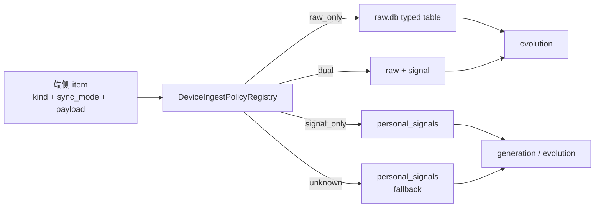

# Device Ingest Policy + Health Raw 方案

## 结论

端侧上传继续保持开放：端侧只需要稳定发送 `id / source / kind / sync_mode / occurred_at / title / summary / payload / dedupe_key`。但 raw 落库必须由云端注册制控制。

这次改造的目标是：

1. `kind` 由端侧声明语义，但云端决定怎么处理。
2. 已注册 `kind` 按 policy 写 `raw.db`、`personal_signals`，或双写。
3. unknown `kind` 默认写入 `personal_signals`，避免数据丢失。
4. raw 只允许进入已建好的 typed table；不做万能 raw JSON 表。
5. 健康数据只新增一张 raw 表：`device_health_observations`。
6. `sync_mode` 放在 `payload` 外，默认 `incremental`；只有显式 `full` 才走全量替代逻辑。



## 背景

当前 `/devices/ingest` 的实现是“所有 item 先写 `personal_signals`，然后 app/contact snapshot 再 fan-out 到 `raw.db`”。这个模型能避免丢数据，但长期会让不适合做 signal 的批量数据也进入 signal 表。

健康数据是典型例子：每分钟心率、步数、睡眠片段属于 raw evidence，不应该全部成为近期主动 AI 要看的 signal。它们应该先进入 `raw.db`，再由 evolution 提炼成长期 memory/profile；只有异常、提醒、总结类健康观察才进入 `personal_signals`。

## 设计原则

### 自由度边界

| 层 | 自由度 | 规则 |
|---|---|---|
| Envelope | 云端固定 | `id / source / kind / sync_mode / occurred_at / title / summary / payload / dedupe_key` |
| `kind` | 端侧可扩展，云端注册 | 端侧表达“这是什么”，云端决定是否支持 raw 解析 |
| `sync_mode` | 端侧声明同步语义，云端执行 | 缺省 `incremental`；显式 `full` 才按 policy 做全量替代 |
| `payload` | 端侧自由度最大 | 每个注册 `kind` 用自己的 parser 解析，建议带 `schema_version` |
| `raw.db` | 云端强控制 | 只有已注册 typed table 能写入 |
| `personal_signals` | 半开放 | unknown 默认进入这里，避免数据丢失，但不污染 raw |
| `memory/profile` | 云端强控制 | 由 evolution/manual 写入，端侧不直写 |

### raw 不是垃圾场

raw 表必须是 typed table。核心字段要成为一等列，`payload_json` 只作为保留原始字段和兼容未来扩展的兜底。

不新增 `connector_items`、`device_raw_events`、`device_health_data` 这类万能表。

### unknown 不丢数据

unknown `kind` 不写 raw，但默认写 `personal_signals`。这样端侧新版本或实验数据不会被直接丢弃，后续如果某个 `kind` 变重要，再补 policy 和 backfill 方案。

### 增量与全量

`sync_mode` 是 item envelope 字段，不放进 `payload`：

```json
{
  "id": "apps-2026-04-30",
  "source": "device:iphone-001",
  "kind": "app_inventory",
  "sync_mode": "full",
  "title": "Installed apps",
  "summary": "42 installed apps",
  "payload": { "apps": [] }
}
```

取值：

| `sync_mode` | 语义 | 默认行为 |
|---|---|---|
| 缺省 / `incremental` | 增量写入 | 只插入 / upsert 本次 payload 能解析出的 rows；不推断“没传的就是删除了” |
| `full` | 全量替代 | 本次 payload 代表该 policy scope 的完整当前状态；云端用 policy 定义的 scope 替代当前视图 |

几个约束：

1. 缺省必须是 `incremental`，这样旧端侧不传字段也能继续工作。
2. `full` 只对已注册 raw policy 生效；unknown `kind` 仍 fallback 到 signal，不做 raw 替代。
3. 全量替代的 scope 由云端 policy 定义，不能让端侧自由指定 SQL 条件。
4. “替代当前视图”不等于必须物理删除历史。对 `device_apps_snapshot` / `device_contacts_snapshot` 这类已有 `snapshot_id` 的表，优先写入新 snapshot，并让默认读取取最新 snapshot；这样保留历史和 `reference_count`，同时业务语义上是全量替代。

## Policy Registry

新增一个云端 registry，集中定义 `kind -> ingest policy`。

建议路径：

- `pinai-openclaw/plugins/proactive-ai/device-ingest/policies.ts`
- `pinai-openclaw/plugins/proactive-ai/device-ingest/health.ts`

建议类型：

```ts
export type DeviceIngestMode = "raw_only" | "signal_only" | "dual";
export type DeviceSyncMode = "incremental" | "full";

export interface DeviceIngestItem {
  id: string;
  deviceId: string;
  kind: string;
  syncMode: DeviceSyncMode;
  title: string;
  summary: string;
  payload: Record<string, unknown>;
  salience: number;
  confidence: number;
  dedupeKey?: string;
  occurredAt?: string | number;
  availableAt?: string | number;
  expiresAt?: string | number;
}

export type DeviceRawWrite =
  | { table: "device_apps_snapshot"; input: raw.IngestDeviceAppsInput }
  | { table: "device_contacts_snapshot"; input: raw.IngestDeviceContactsInput }
  | { table: "device_health_observations"; input: raw.IngestDeviceHealthInput };

export type DeviceRawReplaceScope =
  | { table: "device_apps_snapshot"; deviceId: string }
  | { table: "device_contacts_snapshot"; deviceId: string }
  | { table: "device_health_observations"; deviceId: string; localDate?: string; metric?: string };

export interface DeviceIngestPolicy {
  mode: DeviceIngestMode;
  rawTable?: string;
  parseRaw?: (item: DeviceIngestItem) => DeviceRawWrite[];
  fullReplaceScope?: (item: DeviceIngestItem) => DeviceRawReplaceScope | null;
  buildSignal?: (item: DeviceIngestItem) => db.IngestPersonalSignalInput | null;
}
```

初始 registry：

`bootstrap` / `snapshot` / 后续稳定后的 canonical `kind` 只是同一类数据在不同生命周期或命名阶段里的名字，不应该复制多份 policy。增量还是全量由 `sync_mode` 表达，不靠 `kind` 名字猜。用 canonical policy + alias map 表达，避免后面改 parser 或 signal builder 时两边漂移。

```ts
const APP_INVENTORY_POLICY: DeviceIngestPolicy = {
  mode: "dual",
  rawTable: "device_apps_snapshot",
  parseRaw: parseDeviceAppsSnapshot,
  fullReplaceScope: (item) => ({ table: "device_apps_snapshot", deviceId: item.deviceId }),
  buildSignal: buildDefaultDeviceSignal,
};

const CONTACT_DIRECTORY_POLICY: DeviceIngestPolicy = {
  mode: "dual",
  rawTable: "device_contacts_snapshot",
  parseRaw: parseDeviceContactsSnapshot,
  fullReplaceScope: (item) => ({ table: "device_contacts_snapshot", deviceId: item.deviceId }),
  buildSignal: buildDefaultDeviceSignal,
};

const HEALTH_OBSERVATION_POLICY: DeviceIngestPolicy = {
  mode: "raw_only",
  rawTable: "device_health_observations",
  parseRaw: parseHealthObservations,
};

const SIGNAL_ONLY_POLICY: DeviceIngestPolicy = {
  mode: "signal_only",
  buildSignal: buildDefaultDeviceSignal,
};

export const DEVICE_INGEST_POLICIES: Record<string, DeviceIngestPolicy> = {
  session_summary: SIGNAL_ONLY_POLICY,
  moment: SIGNAL_ONLY_POLICY,
  attention_item: SIGNAL_ONLY_POLICY,
  "ambient.image_chunk": SIGNAL_ONLY_POLICY,
  "ambient.audio_chunk": SIGNAL_ONLY_POLICY,
  "ambient.video_chunk": SIGNAL_ONLY_POLICY,
  app_inventory: APP_INVENTORY_POLICY,
  app_inventory_bootstrap: APP_INVENTORY_POLICY,
  app_inventory_snapshot: APP_INVENTORY_POLICY,
  contact_directory: CONTACT_DIRECTORY_POLICY,
  contact_bootstrap: CONTACT_DIRECTORY_POLICY,
  contact_directory_snapshot: CONTACT_DIRECTORY_POLICY,
  "health.observation": HEALTH_OBSERVATION_POLICY,
};
```

unknown fallback：

```ts
export const UNKNOWN_KIND_POLICY: DeviceIngestPolicy = {
  mode: "signal_only",
  buildSignal: (item) => buildDefaultDeviceSignal(item, {
    fallbackReason: "unknown_kind",
  }),
};
```

`device.media.*` 属于动态 kind 前缀，按 `SIGNAL_ONLY_POLICY` 处理；媒体二进制仍由 route 先把 `payload.binary_b64` 落盘并替换成 `file_path`。

## 健康 raw 表

只新增一张表：`device_health_observations`。

这张表承接健康样本、日汇总、睡眠、运动、健康指标等不同 observation。它不是万能 JSON 表，因为主查询字段仍然是 typed columns。

```sql
CREATE TABLE IF NOT EXISTS device_health_observations (
  id                  TEXT PRIMARY KEY,
  device_id           TEXT NOT NULL,
  observation_type    TEXT NOT NULL,
  metric              TEXT,
  value               REAL,
  unit                TEXT,
  start_at            TEXT,
  end_at              TEXT,
  local_date          TEXT,
  source_app          TEXT,
  payload_json        TEXT NOT NULL DEFAULT '{}',
  occurred_at         TEXT NOT NULL,
  ingested_at         TEXT NOT NULL,
  dedupe_key          TEXT,
  reference_count     INTEGER NOT NULL DEFAULT 0,
  last_referenced_at  TEXT,
  referenced_by_runs  TEXT NOT NULL DEFAULT '[]'
);

CREATE UNIQUE INDEX IF NOT EXISTS idx_health_dedupe
  ON device_health_observations(dedupe_key) WHERE dedupe_key IS NOT NULL;

CREATE INDEX IF NOT EXISTS idx_health_device_time
  ON device_health_observations(device_id, occurred_at DESC);

CREATE INDEX IF NOT EXISTS idx_health_metric_time
  ON device_health_observations(metric, occurred_at DESC);

CREATE INDEX IF NOT EXISTS idx_health_local_date
  ON device_health_observations(device_id, local_date);
```

字段语义：

| 字段 | 说明 |
|---|---|
| `observation_type` | `sample` / `daily_summary` / `sleep` / `workout` / `alert` / `insight` |
| `metric` | `heart_rate` / `steps` / `sleep_minutes` / `hrv` / `active_energy` 等 |
| `value` / `unit` | 可数值化指标 |
| `start_at` / `end_at` | 样本或 session 时间窗 |
| `local_date` | 日汇总所在本地日期 |
| `source_app` | HealthKit / Google Fit / Oura / Apple Watch 等来源 |
| `payload_json` | 原始 payload 或单条 observation 原文 |

## 健康 payload 约定

第一版健康只注册一个 `kind`：`health.observation`。所有健康 raw 数据都先由端侧或移动端 adapter 归一成 `payload.observations[]`，云端只维护一个 parser 和一张表。

这样做牺牲一点端侧直传自由度，但换来云端 raw 干净、parser 简单、evolution 查询稳定。

```json
{
  "schema_version": 1,
  "observations": [
    {
      "observation_type": "sample",
      "metric": "heart_rate",
      "value": 72,
      "unit": "bpm",
      "start_at": "2026-04-30T09:59:00Z",
      "end_at": "2026-04-30T10:00:00Z",
      "source_app": "healthkit"
    },
    {
      "observation_type": "daily_summary",
      "metric": "steps",
      "value": 8120,
      "unit": "count",
      "local_date": "2026-04-30",
      "source_app": "healthkit"
    },
    {
      "observation_type": "sleep",
      "metric": "sleep_minutes",
      "value": 390,
      "unit": "min",
      "start_at": "2026-04-29T15:10:00Z",
      "end_at": "2026-04-29T21:40:00Z",
      "local_date": "2026-04-30",
      "source_app": "healthkit"
    }
  ]
}
```

解析规则：

1. `health.observation`：把 `payload.observations[]` 展开成多行 `device_health_observations`。
2. 每个 observation 至少要有 `observation_type`；有数值时应带 `metric / value / unit`。
3. payload 缺字段时跳过无法解析的 observation。
4. 如果整条 item 无法解析出任何 observation，fallback 写 signal，payload 原文保留。
5. 健康异常、insight、提醒如果端侧还没归入 `health.observation`，就按 unknown `kind` 默认进入 signal，不额外注册健康 signal policy。
6. 健康默认也是 `incremental`。如果端侧传 `sync_mode: "full"`，第一版只允许在 payload 明确带 `local_date` 或 observations 都能归入同一 `local_date` 时，替代该 `device_id + local_date` 范围内的当前健康视图；替代时只清理 scope 内 `reference_count = 0` 的旧行，已被 evolution/memory 引用的 raw 证据保留；否则按 parse 失败 fallback 到 signal，避免误删大范围健康数据。

## `/devices/ingest` 写入逻辑

现状需要从“默认 signal + 少数 raw fan-out”改成“policy-first”。

伪代码：

```ts
for (const item of normalizedItems) {
  const syncMode = item.syncMode ?? "incremental";
  const policy = DEVICE_INGEST_POLICIES[item.kind] ?? UNKNOWN_KIND_POLICY;

  if (policy.mode === "raw_only" || policy.mode === "dual") {
    const writes = policy.parseRaw?.(item) ?? [];
    if (writes.length > 0) {
      if (syncMode === "full") {
        const scope = policy.fullReplaceScope?.(item);
        if (!scope) {
          signals.push(buildDefaultDeviceSignal(item, {
            fallbackReason: "unsupported_full_sync",
          }));
          continue;
        }
        replaceRawWrites(scope, writes);
      } else {
        writeRawWrites(writes);
      }
    } else {
      signals.push(buildDefaultDeviceSignal(item, {
        fallbackReason: "raw_parse_failed",
      }));
      continue;
    }
  }

  if (policy.mode === "signal_only" || policy.mode === "dual") {
    const signal = policy.buildSignal?.(item) ?? buildDefaultDeviceSignal(item);
    if (signal) signals.push(signal);
  }
}
```

注意：

- unknown `kind` 不报错，默认写 signal。
- `sync_mode` 不传或传非法值时按 `incremental` 处理，并在日志里记录一次 normalize warning。
- `sync_mode: "full"` 只改变 raw 写入语义，不改变 signal policy；`dual` policy 仍可写一条 summary signal。
- 健康 raw 是 reference-tracked 表，full 替代只刷新未被引用的当前 slice，不硬删已引用的历史证据。
- app/contact 这类 snapshot 表的 `replaceRawRows()` 第一版不要物理删除旧 snapshot，而是生成新 `snapshot_id` 并让默认读取使用 latest snapshot。
- 没有 full scope 的 policy 收到 `sync_mode: "full"` 时不尝试猜测，fallback 写 signal，并标记 `ingest_fallback_reason: "unsupported_full_sync"`。
- raw parse 失败不丢数据，fallback 写 signal，并在 payload 里标记 `ingest_fallback_reason`。
- raw 写入失败不应该导致 signal 写入失败，但响应里要返回 `raw_failed` 计数，便于排查。
- 响应第一版保持兼容的 `{ ok, accepted, inserted, ignored }`；同时在内部日志记录 `rawInserted / signalsInserted / fallbackSignals / rawFailed`，避免马上改动前端依赖的 response shape。

## 代码改动范围

### 1. Policy registry

Create:

- `pinai-openclaw/plugins/proactive-ai/device-ingest/policies.ts`
- `pinai-openclaw/plugins/proactive-ai/device-ingest/health.ts`

Responsibilities:

- `policies.ts` 定义 `DeviceIngestPolicy`、registry、unknown fallback、default signal builder。
- `health.ts` 定义健康 payload parser，输出 `DeviceHealthObservationInput[]`。

### 2. Device ingest route

Modify:

- `pinai-openclaw/plugins/proactive-ai/routes/devices.ts`

Responsibilities:

- 保留现有 envelope 解析、`source` 解析、media file persist。
- 把 app/contact snapshot 的 raw fan-out 从 route 内移到 policy registry。
- 按 policy 写 raw / signal / fallback signal。

### 3. Raw DB

Modify:

- `pinai-openclaw/plugins/proactive-ai/raw-db.ts`

Responsibilities:

- 创建 `device_health_observations` 表。
- 新增 `ingestDeviceHealthObservations()`。
- 新增 `replaceDeviceAppsSnapshot()` / `replaceDeviceContactsSnapshot()`，语义是写入新 `snapshot_id` 并让默认 list/count 读取最新 snapshot，不删除历史 snapshot。
- 新增 `replaceDeviceHealthObservations(scope, input)`，第一版 scope 只支持 `device_id + local_date` 或更窄，避免全设备健康数据被误替换。
- 新增最小 list/count helper，供 CLI / frontend 后续读取。

### 4. Tests

Modify / add:

- `pinai-openclaw/plugins/proactive-ai/routes/devices.test.ts`
- `pinai-openclaw/plugins/proactive-ai/routes/devices-http.test.ts`
- `pinai-openclaw/plugins/proactive-ai/raw-db.test.ts`

必须覆盖：

1. unknown `kind` 默认写入 `personal_signals`。
2. 缺省 `sync_mode` 等同 `incremental`，旧请求不传字段也能通过。
3. 非法 `sync_mode` normalize 成 `incremental`，不拒绝请求。
4. `app_inventory` / `app_inventory_bootstrap` / `app_inventory_snapshot` 共用 `APP_INVENTORY_POLICY`，且仍保持 dual。
5. `app_inventory` 传 `sync_mode: "full"` 时写入新的 latest snapshot，默认读取只看到最新全量视图。
6. `contact_directory` / `contact_bootstrap` / `contact_directory_snapshot` 共用 `CONTACT_DIRECTORY_POLICY`，且仍保持 dual。
7. `health.observation` 写入 `device_health_observations`，不写 signal。
8. `health.observation` raw parse 失败 fallback 写 signal。
9. `health.observation` 传 `sync_mode: "full"` 且缺少安全 scope 时 fallback 写 signal，不做 raw 替代。
10. 同一 `dedupe_key` 重传不重复插入。

## 分阶段落地

### Phase 1：引入 policy registry，不改变外部行为

目标：

- 把现有 app/contact snapshot 逻辑迁到 registry。
- unknown `kind` 明确默认写 signal。
- envelope 解析新增 `sync_mode` / `syncMode`，缺省和非法值都 normalize 成 `incremental`。
- 现有测试全部保持通过。

验收：

```bash
/Users/smile/.nvm/versions/node/v23.6.0/bin/node node_modules/tsx/dist/cli.mjs --test \
  pinai-openclaw/plugins/proactive-ai/routes/devices.test.ts \
  pinai-openclaw/plugins/proactive-ai/routes/devices-http.test.ts
```

### Phase 2：新增 `device_health_observations`

目标：

- 新增健康 typed raw 表。
- 接入唯一健康策略 `health.observation`。
- 保证健康批量数据不默认污染 signal。
- 支持 `sync_mode: "full"` 的安全 scope 校验；缺少 `device_id + local_date` 等明确范围时 fallback signal。

### Phase 2.5：补齐全量 raw 替代语义

目标：

- app/contact policy 支持 `sync_mode: "full"`。
- `full` 对 snapshot 表写新 `snapshot_id`，默认读取 latest snapshot，历史 snapshot 保留。
- `incremental` 继续只追加 / upsert 本次 rows，不推断删除。
- response / logs 区分 `rawInserted`、`rawReplaced`、`fallbackSignals`。

验收：

```bash
/Users/smile/.nvm/versions/node/v23.6.0/bin/node node_modules/tsx/dist/cli.mjs --test \
  pinai-openclaw/plugins/proactive-ai/raw-db.test.ts \
  pinai-openclaw/plugins/proactive-ai/routes/devices.test.ts
```

### Phase 3：接 evolution，不让 raw 直接进 prompt

目标：

- evolution 可以按时间窗读取 `device_health_observations`。
- 生成长期健康习惯 memory，例如睡眠不足、运动规律、静息心率趋势。
- generation 仍主要读 memory/profile/signals，不直接把大批健康 raw 放入 prompt。

验收：

```bash
bash pinai-openclaw/plugins/proactive-ai/scripts/test-memory.sh
```

## 不做什么

- 不新增万能 raw 表。
- 不让端侧传 `destination=raw/signal`；端侧只能传 `kind` 和 `sync_mode`，最终落点仍由云端 policy 决定。
- 不让端侧直接写 memory/profile。
- 不把所有健康样本写入 `personal_signals`。
- 不在第一版拆 `device_sleep_sessions`、`device_workouts` 等多张健康表。

## 后续需要同步的文档

实现完成后更新：

- `docs/modules/data-connectors.mdx`：补充 device ingest policy 和 health raw。
- `docs/modules/memory.mdx`：补充 `device_health_observations` 属于 Tier 0 raw。
- `docs/plans/README.mdx`：保持本 plan 索引。
