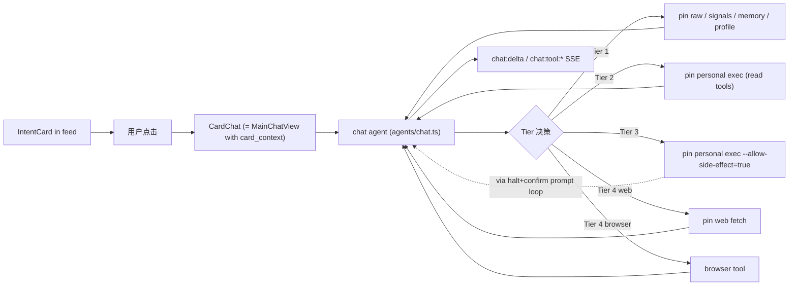
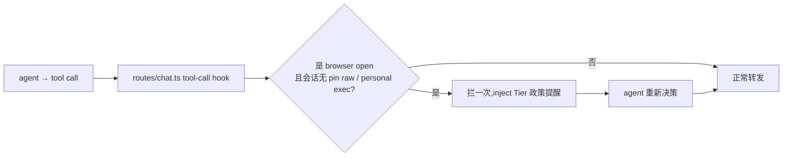

# 执行层 Plan 1:回归 chat-driven 执行 + Tier 工具政策

> **状态**:brainstorm 草稿。
>
> **关系**:
> - 取代旧 Plan B(lookup_only research loop)和旧 Plan C(unified harness),它们在 `feature/proactive-ai-frontend` 分支已删除。
> - 是 [Plan 2(Card-as-Chat UX)](./2026-05-01-card-as-chat-ux) 的前置:必须先把执行层稳定在 chat-driven + 工具收敛后,才动 UI 层卡片对话化。
> - 本计划的"砍"动作不是回退到原始 v2 状态:`pin personal exec` 副作用门已经从硬 allowlist 升级到 verb-based(在 `feature/proactive-ai-frontend` 分支上已落地),`pin web fetch` CLI 已存在,scheduler `maxTasksPerTick` perf 已存在。这三样保留,作为本计划的执行起点。

## 一句话

把执行从"plan-LLM → 形式化 plan_steps + halt boundary → final-step"砍回 chat agent 主导(用户点卡 → chat agent 拿 card_context → 自由调工具完成);**核心新增**是一套 Tier 1-4 工具决策政策(Local read → Composio read → Composio write → Browser),通过 system prompt + pin SKILL.md + 一两条硬拦截让 agent 不再滥用 browser 和不再绕过本地数据。

## 为什么要做

### 真实问题:形式化 state machine 把"capability"约束没了

`feature/proactive-ai-frontend` 分支为了卡片体验做的形式化路径(plan-LLM 提前规划 plan_steps,halt boundary 切分 pre-execute / final-step,confirm 后 dispatch final-step,modify-mode chat 只能 patch/rerun)在 happy path 下能跑,但暴露了几类无解的根本问题:

1. **Browser tool 进不来**:形式化 state machine 用 Tool Registry deterministically 编译 `tool_intent` → `pin CLI`,**根本没有 browser 通道**。Captcha / 2FA / 站点无 API 的场景全做不了。
2. **Mid-execution 用户输入做不到**:halt 是 plan-LLM 提前画好的固定 boundary。一旦执行中 agent 发现"啊我需要用户在三个候选里选一个",没有机制中途暂停问用户。状态机里没有"awaiting_user_input"这种细粒度状态,整张卡只有一个最终 confirm。
3. **CardChat 自由度被砍光**:有 CardExecution 时 CardChat 进 modify-mode,只能 patch / rerun。对话型操作("帮我把这段改一下"、"再深入查一下")无法直接驱动 agent 调工具。
4. **Plan-LLM 提前规划不能动态适应**:plan_steps 一旦生成就固化。中间某步出错或拿到出乎意料的结果时,只能 fail 整张卡 + 重新 plan-LLM。chat agent 那种"看到这个结果再决定下一步"做不到。

这四点合起来等于:**形式化 state machine 牺牲了 agent 自由度换取 UI 可预测性,但 agent 自由度才是产品价值**。

### 真实问题:proactive-ai-v2 的 chat agent 工具滥用没有约束

回到 chat-driven 又会暴露 v2 一直存在的问题 —— **agent 没有工具决策政策**。`agents/chat.ts` 系统 prompt 只有 5 句通用指令,没有路由表;browser tool description 只描述"我能做什么",没说"什么时候不要用我"。后果:

- 用户问"今天有什么会"→ agent 可能直接开 browser 上 Google Calendar 网页,而不是 `pin raw gcal today`
- 用户问"Sarah 上周给我发的邮件"→ agent 可能开 browser 登 Gmail,而不是 `pin raw gmail recent --hours 168`
- 同样的"读连接器数据"任务,agent 选 browser(慢、贵、撞 captcha)还是 pin CLI(快、稳、零成本),完全靠 LLM 临场决策

**这是用户体验差的真正源头之一**。

### 还有一项不是问题但要保留:verb-based 副作用扩展

`feature/proactive-ai-frontend` 分支已经把 `cli/personal.ts` 的副作用门从 `{GMAIL_CREATE_EMAIL_DRAFT, GMAIL_SEND_DRAFT}` 硬 allowlist 升级到了 **verb-based 跨 toolkit 允许**:slug 含 SEND/CREATE/POST/UPDATE/DELETE 等动词的任意 Composio tool 都可以用,前提是 `--allow-side-effect=true`。这条改进**与 state machine 解耦**,本计划保留。

意味着 chat agent 在 Tier 3 (Composio write) 的可用范围**直接覆盖**:Gmail 起草/发送 + Calendar 创建/更新/删除 + Slack 发消息 + Notion 创建/更新页面 + GitHub 创建 issue/PR + 其他任何动词形状对的 Composio tool。**不需要逐个加 allowlist 项**。

## 边界与所有权

| 数据 / 决策 | 真源 | 本计划怎么改 |
|---|---|---|
| `intent_cards` (Generation) | Generation | 不改。Generation 仍持续生成 IntentCard 推到 feed。 |
| `card_executions` 表 | Execution | **整张表 + helpers + 状态机全砍**。 |
| `card.pre-execute` / `card.execute-final` background tasks | Execution | **全砍**。card 不再有后台预执行任务。 |
| `tasks/handlers/card-pre-execute.ts` | Execution | **删**。 |
| Tool Registry (`tools/registry/`) | Execution | **整个目录砍**。tier 政策不依赖 registry,chat agent 直接读 `pin SKILL.md` + `browser tool description`。 |
| `tools/executor.ts` + `tools/pin-cli-validator.ts` | Execution | **全砍**。chat agent 通过 OpenClaw bash tool 直接 spawn `pin <args>`,不走中间 validator 层。 |
| `cli/personal.ts` verb-based 副作用门 | Execution | **保留**(已上线)。是 Tier 3 扩展的硬性基础。 |
| `cli/web.ts` (`pin web fetch`) | Execution | **保留**。Tier 4 兜底工具。 |
| chat agent (`agents/chat.ts`) | Execution | **重写**:加 Tier 1-4 决策表 + tool routing 引导 + IntentCard sources 提示路由。 |
| Browser tool (`browser/tool.ts`) | Execution | description 加"什么时候不要用我"段落;实现不动。 |
| `pin SKILL.md` | Memory(skill 文件)| 重写"工具决策"段:加 Tier 1-4 表 + 决策实例。 |
| `routes/chat.ts` | Execution | reset 到 v2 + 加一处轻量硬拦截(详见 §轻硬拦截)。 |
| 前端 CardDetailBody / CardChat | Frontend | reset 到 v2(execution-state-aware UI 全砍)。Plan 2 才动卡片对话化。 |
| `routes/cards.ts` + `routes/cards-events.ts` | Execution | **全删**。card 不再有独立 execution 路由 / SSE。 |

**硬边界**:本计划只动执行层(chat agent + 工具政策)。不动 generation pipeline、不动 memory 层、不动 background tasks 框架本身、不做 UI 层卡片对话化(那是 Plan 2)。

## 选定方案

### 1. 砍掉 card_executions 状态机

具体动作:

1. **删表 + 相关 helpers**:`db.ts` 里 `card_executions` 表定义 + 所有 `*CardExecution*` helpers(insert / get / update / setPlanSteps / setHaltAtStep / appendToolLogEntry / setDraft / mergeDraftCompletion / applyPatch / setError / setActionKind / setClarificationQuestions / setClarificationAnswers / resetForRerun / `card_execution_evidence` 表 + helpers)。
2. **删 background task handlers**:`tasks/handlers/card-pre-execute.ts`、`card-research-loop.ts`、`card-pre-execute-enqueuer.ts`、对应 tests。
3. **删 prompt builders**:`agents/card-pre-execute-prompt.ts`、`card-summarize-prompt.ts`、`card-research-prompt.ts`、`research-findings.ts` + tests。
4. **删 tool registry 层**:`tools/registry/` 整个目录、`tools/executor.ts`、`tools/pin-cli-validator.ts` + tests。
5. **删 routes**:`routes/cards.ts`、`routes/cards-events.ts` + tests。
6. **删类型**:`types/card-execution.ts` + test。
7. **删 scheduler 注册**:`index.ts` 里 `card.pre-execute` / `card.execute-final` 的 handler 注册。
8. **删 pipeline integration**:`pipeline/dispatch-finalize.ts`(本分支新增)。
9. **删前端**:`cards-api.ts`、CardDetailBody execution UI(reset 到 v2)、CardChat modify-mode 抑制(reset 到 v2)、NowFeed badge(reset 到 v2)、`intent-card.ts` 里 CardExecutionView/ResearchFindings 类型(reset 到 v2)、AppShell cardExecution SSE 订阅 + reducer(剥离掉,保留 ContainerStatus 集成)。
10. **删 modules/execution.mdx 里 card execution 段**:reset 到 v2,本计划上线后再补"chat-driven + Tier 政策"新内容。

完成这一步后,行为等价于"`feature/proactive-ai-frontend` 分支但只保留下面三样独立增量":
- `cli/personal.ts` verb-based 副作用门
- `cli/web.ts` (`pin web fetch`)
- `tasks/scheduler.ts` 的 `wake()` / `maxTasksPerTick`

CardChat 恢复 v2 自由度:有 cardContext 进入,chat agent 可以调任何工具(pin CLI 全集 + browser + web fetch)。

### 2. Tier 1-4 工具决策政策

四层 tier,**优先级从上到下**,agent 必须先尝试上层再 fallback:

| Tier | 工具 | 何时用 | 何时不用 |
|---|---|---|---|
| **Tier 1: Local read** | `pin raw / signals / memory / profile / cards / feedback / world` | 任何"读用户已同步数据"的需求 —— 邮件、日历、Slack 消息、Notion 页面、设备 app/contacts 等。**优先级最高,先查这里再说**。 | 数据需要绝对最新(>12h 没同步)且 latency 敏感时跳到 Tier 2。 |
| **Tier 2: Composio read** | `pin personal exec --tool <READ_TOOL>` (slug 含 GET/FETCH/SEARCH/LIST/READ 等读动词) | Tier 1 没数据 / 数据太旧 / 用户明确要"现在"的状态。 | 已有 Tier 1 数据时不重复拉。 |
| **Tier 3: Composio write** | `pin personal exec --tool <WRITE_TOOL> --allow-side-effect=true` (slug 含 SEND/CREATE/POST/UPDATE/DELETE 等写动词;**verb-based 跨 toolkit 允许**) | 用户**明确要求**对外部系统写动作 —— 起草/发邮件、建/改日程、发 Slack 消息、建 Notion 页等。 | 任何"先看再写"的场景必须先 Tier 1/2 grounding。**用户没明确批准前不要直接 Tier 3**。 |
| **Tier 4: Browser tool** | `browser open/click/type/...` | 真的没有别的办法时 —— 站点无 Composio 适配、需要用户手动登录/captcha/2FA、需要在网页上做复杂多步交互。 | **如果 Tier 1-3 能做的,绝不用 browser**。Browser 慢、贵、易撞 captcha、占用户注意力。 |

**附加规则**:

- **Public web 文章读取**:用 `pin web fetch --url <https-url>`(Tier 4 但是轻量),**不要开 browser**。SSRF / 内网 IP / 二进制 content-type 都已在 CLI 层防御。
- **决策提示来自 IntentCard.sources**:`sources` 字段格式 `<source_kind>:[<metadata>] '<quoted>'` 已经告诉 agent 数据从哪来。`gmail:` 前缀 → 走 Tier 1/2 Gmail 路径;`raw:gcal` → Tier 1 直接 `pin raw gcal`;`memory:topic:...` → Tier 1 `pin memory get/search`;`world:...` → Tier 1 `pin world ...`。
- **侧边栏:Composio tool 发现路径**:不知道 toolkit 有什么 tool 时,先 `pin personal tools search --query "..." --toolkit <name>` + `pin personal tools schema --tool <slug>`,再 exec。这是 Tier 2 / Tier 3 的标准前置。

### 3. 工具决策的"软约束"(主)+"轻硬拦截"(辅)

**软约束(写进 prompt + SKILL.md,让 LLM 自觉遵守)**:

- `agents/chat.ts` 系统 prompt 加入完整 Tier 决策表 + 5-7 条具体反例。例:
  - "用户问'今天有什么会' → 必须 `pin raw gcal today`,**不许开 browser**"
  - "用户问'Sarah 上周邮件' → 先 `pin raw gmail recent --hours 168`,找不到再 Tier 2"
  - "用户问'帮我看下 Forbes 这篇文章' → `pin web fetch --url ...`,**不许开 browser** 除非站点拒爬"
- `pin SKILL.md` 改"标准获取顺序"段加 Tier 表;改"副作用边界"段写明 verb-based 跨 toolkit 允许 + 必须 `--allow-side-effect=true`。
- `browser/tool.ts` 的 tool description 加"何时不要用我"段:显式列出 Gmail/GCal/Slack/Notion/GitHub 等"先用 pin"的场景;只有 OAuth 流程 / 站点无 API / 需要 captcha 时才用 browser。

**轻硬拦截(在 chat 路由层加,只针对最易滥用的 1-2 种情况)**:

- 在 `routes/chat.ts` 的 tool-call 转发路径上加 hook:**当 agent 第一个 tool call 是 `browser open` 且当前 conversation 还没有任何 `pin raw` / `pin personal exec` 调用时,拦截这次调用,inject 一条系统提醒消息**(类似 "Tier 政策提醒:browser 是最后手段,先尝试 `pin raw`/`pin personal exec` 拉数据"),让 agent 重新决策。
- 这是**唯一一处硬拦截**。其他全部走软约束。
- 拦截**只发生一次**,如果 agent 重新尝试后仍然选 browser,放行(可能真的需要,比如 OAuth 流程)。

### 4. 副作用 allowlist 扩展(已上线,Plan 1 只是确认范围)

`cli/personal.ts` 的 `validateControlledExecTool` 已经实现 verb-based 门:

```text
slug 中含任何 side-effect verb (SEND/CREATE/POST/UPDATE/DELETE/SCHEDULE/PUBLISH/SUBMIT/UPLOAD/MOVE/...)
  → 必须 --allow-side-effect=true,放行
slug 中含任何 read verb (GET/FETCH/SEARCH/LIST/READ/...)
  → 默认放行(无副作用)
都不含 (未知动词形状)
  → 拒绝(unknown verb)
```

意味着 chat agent 现在可以(且 Plan 1 鼓励)使用:

- Gmail: `GMAIL_CREATE_EMAIL_DRAFT`、`GMAIL_SEND_DRAFT`(已验证链路)
- Calendar: `GOOGLECALENDAR_CREATE_EVENT`、`GOOGLECALENDAR_UPDATE_EVENT`、`GOOGLECALENDAR_DELETE_EVENT`、`GOOGLECALENDAR_QUICK_ADD`
- Slack: `SLACK_SEND_MESSAGE`、`SLACK_POST_MESSAGE`、`SLACK_UPDATE_MESSAGE`
- Notion: `NOTION_CREATE_PAGE`、`NOTION_UPDATE_PAGE`、`NOTION_INSERT_BLOCK`
- GitHub: `GITHUB_CREATE_ISSUE`、`GITHUB_CREATE_PULL_REQUEST`、`GITHUB_ADD_COMMENT`
- 其他任何动词形状对的 Composio tool

**不允许**(规避用户审批闭环):

- `GMAIL_SEND_EMAIL`(直接发,绕过 draft → 用户看 → 发送的链路)。规则:Gmail 走 `CREATE_EMAIL_DRAFT` → user review → `SEND_DRAFT`。
- 任何 STRIPE_CHARGE_* / *_TRANSFER_* / *_DELETE_* (高风险破坏性):chat agent 系统 prompt 显式说**遇到这类先停下问用户**,不要直接 `--allow-side-effect=true`。

### 5. pin SKILL.md / chat.ts / browser tool description 改造

**`pin SKILL.md`** 改造点(已部分完成,本计划完成剩余):

- 副作用边界段(已完成):说清 verb-based 允许、必须 `--allow-side-effect=true`、保留 GMAIL_SEND_EMAIL 黑名单。
- 标准获取顺序段(待重写):加 Tier 1-4 决策表 + "如果用户问 X,先做 Y"反例若干。
- 移除 plan_steps / halt 相关引用(都是 state-machine 时代的产物)。

**`agents/chat.ts`** 重写(reset 到 v2 后再加 tier 内容):

```text
[stable prefix - cacheable]
1. role: 你是 chat agent;用户已经打开一张卡 / 在主界面对话
2. Tier 1-4 决策表(完整)
3. 反例若干(用户问 X 必须 tool A;不要 tool B)
4. 副作用规则(verb-based 允许 + halt-before-execute / 必须用户明确批准 / 不要 GMAIL_SEND_EMAIL)
5. 输出风格(简洁、specific、execute-once、3-5 句)

<!-- OPENCLAW_CACHE_BOUNDARY -->

[volatile suffix]
6. card_context (JSON)
7. learnedSkillsSection (如果有)
8. firstMessage 引导
```

`buildFirstMessage` 从 v2 拷贝并加一条提示:"基于 card.sources 的 source_kind,优先走对应 Tier 1/2 路径"。

**`browser/tool.ts`** 改 tool description 头部:

```text
Control a web browser. **LAST-RESORT TOOL** — only use when:
  • The site has no Composio adapter (try `pin personal tools search` first).
  • An OAuth / login / captcha / 2FA flow needs the user.
  • Multi-step interactive UI manipulation no API can replicate.

DO NOT use for:
  • Reading Gmail / GCal / Slack / Notion / GitHub data — use `pin raw` or `pin personal exec`.
  • Reading public articles — use `pin web fetch --url <url>`.
  • Sending emails / creating events / posting messages — use `pin personal exec` with `--allow-side-effect=true`.

(Original snapshot-first workflow + actions list ↓)
```

### 6. 用户审批闭环(保持 v2 行为)

chat agent 在 Tier 3(副作用)前的审批方式跟 v2 一致:

- 起草动作 → 把草稿展示给用户(在 chat 里)→ 等用户回 "好" / "改一下 X" / "别发了" → 再调发送 tool。
- 不依赖 state machine 强制 halt;依赖 prompt 引导 + LLM 自律 + verb-based 门强制 `--allow-side-effect=true`(意味着 agent 必须显式标记副作用调用,这是一个明显的"我现在要写"信号)。
- 高风险工具(`*_DELETE_*` / `STRIPE_CHARGE_*` / `*_TRANSFER_*`)的二次确认:Plan 2 时再做 UI 层 modal 兜底。Plan 1 阶段先靠 prompt 引导。

## 数据流图

### 用户进入卡片



### 软约束 + 轻硬拦截



## 文件清单

| 类型 | 文件 | 说明 |
|---|---|---|
| 删除 | `pinai-openclaw/plugins/proactive-ai/tasks/handlers/card-pre-execute.ts` + test | card execution handler |
| 删除 | `pinai-openclaw/plugins/proactive-ai/tasks/handlers/card-research-loop.ts` + test | Plan B research loop |
| 删除 | `pinai-openclaw/plugins/proactive-ai/tasks/card-pre-execute-enqueuer.ts` + test | card.pre-execute 入队 |
| 删除 | `pinai-openclaw/plugins/proactive-ai/agents/card-pre-execute-prompt.ts` + test | plan-LLM prompt |
| 删除 | `pinai-openclaw/plugins/proactive-ai/agents/card-summarize-prompt.ts` + test | lookup-only summarize |
| 删除 | `pinai-openclaw/plugins/proactive-ai/agents/card-research-prompt.ts` | Plan B research prompt |
| 删除 | `pinai-openclaw/plugins/proactive-ai/agents/research-findings.ts` + test | Plan B parser |
| 删除 | `pinai-openclaw/plugins/proactive-ai/tools/registry/` 整个目录 | tool registry |
| 删除 | `pinai-openclaw/plugins/proactive-ai/tools/executor.ts` | registry executor |
| 删除 | `pinai-openclaw/plugins/proactive-ai/tools/pin-cli-validator.ts` + test | pin CLI validator |
| 删除 | `pinai-openclaw/plugins/proactive-ai/types/card-execution.ts` + test | CardExecution view types |
| 删除 | `pinai-openclaw/plugins/proactive-ai/routes/cards.ts` + test | card execution HTTP |
| 删除 | `pinai-openclaw/plugins/proactive-ai/routes/cards-events.ts` | card execution SSE bus |
| 删除 | `pinai-openclaw/plugins/proactive-ai/db.card-executions.test.ts` | |
| 删除 | `pinai-openclaw/plugins/proactive-ai/db.card-execution-patch.test.ts` | |
| 删除 | `pinai-openclaw/plugins/proactive-ai/db.card-execution-evidence.test.ts` | |
| 删除 | `pinai-openclaw/plugins/proactive-ai/pipeline/dispatch-finalize.ts` | pipeline 集成,本分支新增 |
| 删除 | `proactive-ai-frontend/src/lib/cards-api.ts` | card execution API client |
| 删除 | `scripts/verify-phase-1.sh`、`scripts/verify-phase-2.sh` | 旧验证脚本 |
| Reset | `pinai-openclaw/plugins/proactive-ai/db.ts` | 砍 card_executions 表 + 所有 helpers + card_execution_evidence |
| Reset | `pinai-openclaw/plugins/proactive-ai/index.ts` | 砍 card.pre-execute / card.execute-final handler 注册 |
| Reset | `pinai-openclaw/plugins/proactive-ai/routes/router.ts` | 砍 cards routes 注册 |
| Reset | `pinai-openclaw/plugins/proactive-ai/routes/chat.ts` | 砍 modify-mode patch/rerun 解析;reset 到 v2 |
| Reset | `pinai-openclaw/plugins/proactive-ai/agents/chat.ts` + test | reset 到 v2;**实施时再加 Tier prompt 内容** |
| Reset | `proactive-ai-frontend/src/components/CardDetailBody.tsx` | execution UI 全砍;reset 到 v2 |
| Reset | `proactive-ai-frontend/src/components/CardChat.tsx` | reset 到 v2 |
| Reset | `proactive-ai-frontend/src/components/NowFeed.tsx` | 砍 cardExecution badge;reset 到 v2 |
| Reset | `proactive-ai-frontend/src/components/AppShell.tsx` | 选择性 reset:**保留** ContainerStatus 集成,**砍** cardExecution SSE 订阅 + reducer |
| Reset | `proactive-ai-frontend/src/types/intent-card.ts` | 砍 CardExecutionView / ResearchFindings 类型;reset 到 v2 |
| Reset | `proactive-ai-frontend/src/components/chat/useProactiveChatRuntime.ts` | 砍 needsBootstrap 抑制逻辑;reset 到 v2 |
| Reset | `pinai-openclaw/plugins/proactive-ai/routes/chat.test.ts` | reset 到 v2 |
| Reset | `docs/modules/execution.mdx` | reset 到 v2;Plan 1 上线后再写新版 |
| 修改 | `pinai-openclaw/image/skills/pin/SKILL.md` | 重写"标准获取顺序"段加 Tier 1-4 决策表 + 反例;副作用边界段已基本就绪(保留)。 |
| 修改 | `pinai-openclaw/plugins/proactive-ai/agents/chat.ts` | 重写 system prompt:Tier 决策表 + 反例 + verb-based 副作用规则 + cache boundary。 |
| 修改 | `pinai-openclaw/plugins/proactive-ai/agents/chat.test.ts` | 加 Tier prompt 内容断言、cache boundary 断言。 |
| 修改 | `pinai-openclaw/plugins/proactive-ai/browser/tool.ts` | tool description 加"何时不要用我"段。 |
| 修改 | `pinai-openclaw/plugins/proactive-ai/routes/chat.ts` | 加轻硬拦截:browser open 前若 conversation 无 pin 工具调用,inject 提醒。 |
| 修改 | `pinai-openclaw/plugins/proactive-ai/routes/chat.test.ts` | 加轻硬拦截测试。 |
| 删除 | `docs/plans/2026-04-28-card-execution-impl.md` | 旧 plan |
| 删除 | `docs/plans/2026-04-30-card-execution-phase2-impl.md` | 旧 plan |
| 删除 | `docs/plans/2026-04-30-tool-registry.mdx` | 旧 plan |
| 删除 | `docs/plans/2026-05-01-execution-agent-loop.mdx` | 旧 Plan B |
| 删除 | `docs/plans/2026-05-01-execution-unified-harness.mdx` | 旧 Plan C |
| 修改 | `docs/plans/README.mdx` | 索引移除旧 plans,加 Plan 1 + Plan 2 行 |
| 保留 | `pinai-openclaw/plugins/proactive-ai/cli/personal.ts` + test | verb-based 副作用门(关键基础) |
| 保留 | `pinai-openclaw/plugins/proactive-ai/cli/web.ts` + test | `pin web fetch`(Tier 4 兜底) |
| 保留 | `pinai-openclaw/plugins/proactive-ai/cli/bin.ts` + `public-surface.ts` 里 web 注册 | |
| 保留 | `pinai-openclaw/plugins/proactive-ai/tasks/scheduler.ts` + test | `wake()` + `maxTasksPerTick`(独立 perf) |
| 保留 | `proactive-ai-frontend/src/components/ContainerStatus.tsx` | 容器状态展示 |
| 保留 | `apis/src/domain/gateway/gateway_rpc.ts` + test | hot reload 修复 |

## 分期实施

| Step | 内容 | 可独立上线 |
|---|---|---|
| **1-A:重置 + 删除** | 按上方文件清单做 reset / delete。最后状态:CardChat 在有 cardContext 时退到 v2 自由度,所有 state machine / registry 不存在。运行项目应该能起来,功能等价于 v2 + 我们保留的三样独立增量。 | 是,但用户体验回到 v2(没有 Tier 政策约束) |
| **1-B:Tier 政策写进 prompt + SKILL.md + browser description** | 改 `agents/chat.ts`、`pin SKILL.md`、`browser/tool.ts`。这是软约束部分,无新代码逻辑只改文本。 | 是 |
| **1-C:轻硬拦截** | `routes/chat.ts` 加 browser-first-call 拦截 hook + 测试。 | 是 |
| **1-D:更新 modules/execution.mdx** | 写 chat-driven 新版,引用本计划。删旧的 card-execution 节。 | 是 |
| **1-E:实地联调** | 在容器里跑几张代表性卡(Gmail 回复 / Calendar 创建 / Forbes 文章总结 / Slack 发消息),验证 Tier 路由、verb-based 写动作、轻硬拦截、browser 兜底。 | 是,作为发布前最后一道 |

每一步独立 commit + type-check + 测试通过后再继续下一步。

## 关键决策

| 决策 | 选什么 | 原因 |
|---|---|---|
| 形式化 state machine vs chat-driven | **chat-driven** | 形式化在 happy path 跑得了,但牺牲了 mid-execution 自由度、browser 通道、对话型驱动。chat-driven 自由度高,通过 prompt + 软约束收敛。 |
| Tool registry 留还是砍 | **砍** | registry 是 plan-LLM editor → 编译 → spawn 的中间层,chat-driven 下 chat agent 直接写 pin call,中间层冗余。intent 文档化的价值由 `pin SKILL.md` 承担。 |
| Tier 政策强制方式 | **软约束(prompt) + 1 处硬拦截(browser-first-call)** | 全软会偶尔失守;全硬太僵且检测复杂。最易滥用的"agent 没查 raw 就开 browser"硬拦一次,其他靠 prompt + LLM 自律。 |
| Tier 3 allowlist 范围 | **verb-based 跨 toolkit 全开**(除 GMAIL_SEND_EMAIL 黑名单 + 高风险动词需 prompt 提示二次确认) | 硬 allowlist 太小,逼 agent fallback 到 browser。verb-based 已经是分支既有改进,直接复用。 |
| 用户审批闭环 | **靠 prompt + LLM 自律 + verb-based 标记**,不在 backend 强制 halt | state machine 时代靠 halt boundary 强制;chat-driven 下信息密度更高的"agent 起草 → 用户回 OK → agent 发"自然对话足以承担。Plan 2 加 UI modal 兜高风险。 |
| 旧 Plan B 的 evidence 表 / research findings | **全砍** | 没有 state machine 后这套结构无 host;chat agent 自己用消息历史承担。`pin web fetch` 工具留下,作为 chat agent 工具集一员。 |

## 风险与测试

| 风险 | 缓解 / 测试 |
|---|---|
| Reset 漏文件,残留依赖 | type-check + 全量测试 + 手工搜 `card_executions` / `CardExecution` / `cardExecutionEvents` 引用,确保为零。 |
| chat agent prompt 太长导致 cache miss | 用现有 `OPENCLAW_CACHE_BOUNDARY`(我们 Plan B 的工作中已落地实现机制)切分稳定 prefix(role + tier 表 + 反例)/ 易变 suffix(card_context / learned skills)。Plan 1 实施时把 `agents/chat.ts` 重写按这个模式做。 |
| 轻硬拦截误伤(用户明确说"打开浏览器看 X" agent 第一时间 browser open) | 拦截时检查 user 最近一条消息含"browser"/"网页"/"网站"等关键词,放行;否则 inject 提醒。 |
| Tier 政策写进 prompt 后 LLM 仍偶尔走 browser 拉 Gmail | 实地联调阶段记录失误案例,迭代 prompt 反例库;若 hit-rate < 90% 再考虑加更多硬拦截。 |
| 副作用 allowlist 扩展引入新 bug(比如 `GOOGLECALENDAR_DELETE_EVENT` 误删用户日程) | verb-based 门**不**新增风险(它已经上线);Plan 1 只是文档化 + prompt 引导。高风险动词(DELETE / TRANSFER / CHARGE)在 chat 系统 prompt 显式说"先停下问用户"。 |
| `pin SKILL.md` 改完后 unified-generator / chat 同时受影响导致 generation 行为改变 | unified-generator 用同一份 SKILL.md。Plan 1 只改"标准获取顺序"段加 Tier 表,不改副作用规则部分。Tier 表对 generation 也是有用的提示(generation 也用 pin),理论上不损坏 generation。实地联调时检查 generation 输出。 |
| 轻硬拦截 hook 影响 chat SSE 流式行为 | hook 在 tool-call 转发前同步执行,不影响 streaming text。测试用 mock 转发 + 断言 inject 消息时序。 |
| 删除 `card_executions` 后历史卡的执行记录丢失 | 这是 SQLite 表,容器重启后表本身不会自动 DROP。Plan 1 实施时**手工**在 db.ts 里加一段"启动期 DROP TABLE IF EXISTS card_executions / card_execution_evidence"作为一次性清理(或保留表也无所谓,反正没代码访问)。倾向不写自动 DROP,保留表作为审计痕迹。 |

### 必跑测试

```bash
# Tier prompt + chat agent
npx tsx --test pinai-openclaw/plugins/proactive-ai/agents/chat.test.ts

# pin verb-based 门(已存在,reset 后仍跑)
npx tsx --test pinai-openclaw/plugins/proactive-ai/cli/personal.test.ts

# pin web fetch
npx tsx --test pinai-openclaw/plugins/proactive-ai/cli/web.test.ts

# scheduler perf
npx tsx --test pinai-openclaw/plugins/proactive-ai/tasks/scheduler.test.ts

# 轻硬拦截
npx tsx --test pinai-openclaw/plugins/proactive-ai/routes/chat.test.ts

# 全栈 type-check
npm run type-check
cd proactive-ai-frontend && npm run type-check
```

### 手工验证(进容器跑代表性卡)

按 [CLAUDE.local.md](../../CLAUDE.local.md) 的本地流程:

1. **Tier 1 路径**:卡"今日日程亮点"→ 点开 → agent 应该首调 `pin raw gcal today`,**不开 browser**。
2. **Tier 2 路径**:卡"我今早有什么新邮件没看?"(数据 12h 没同步)→ agent 应该 `pin personal exec --tool GMAIL_FETCH_EMAILS --input '{"query":"newer_than:1d"}'`。
3. **Tier 3 路径(扩展验证)**:卡"建一个周三 3pm 的 1on1 with Sarah" → agent 应该 `pin personal exec --tool GOOGLECALENDAR_CREATE_EVENT --allow-side-effect=true ...`,先在 chat 起草事件细节 → 等用户回 "好" → 再调创建。
4. **Tier 4 web 路径**:卡"读一下 Regan 在 Slack 分享的 Forbes 文章" → agent `pin raw slack list` 找 URL → `pin web fetch --url <forbes>` → 总结。**不开 browser**。
5. **轻硬拦截路径**:故意构造一张 "去 Gmail 网页看一下 Sarah 的邮件" 卡 → agent 第一调 `browser open https://mail.google.com` → 应被拦,inject 提醒 "先尝试 pin raw gmail recent" → agent 切到 pin。
6. **副作用闭环**:任何 Tier 3 调用前,agent 必须先在 chat 起草内容,等用户明确回 OK 再 exec。手工验证 agent 没有"未经确认直接发"的情况。

## 不在范围

- 卡片对话化 UI(card detail = chat thread、rich message 类型如 draft preview / option chips / browser embed)—— Plan 2。
- IntentCard 的 feed 形态改造、状态徽标、按 chat session 末尾消息推断状态 —— Plan 2。
- 高风险副作用 UI modal 二次确认 —— Plan 2。
- generation pipeline / unified-generator 的任何改动。
- background tasks 框架本身。
- mobile takeover / browser 控制权切换的 UX 改造(已在分支上完成,沿用)。
- evidence 表 / research findings 结构化数据(Plan B 砍了,本计划不复活)。

## 相关模块 / Plans

- [Execution 模块文档](../modules/execution) —— 本计划上线后需要重写"chat-driven + Tier 政策"内容。
- [Memory 模块文档](../modules/memory) —— `pin SKILL.md` 改造跨执行 + memory agent 共享文档,本计划只动"标准获取顺序"段,不动 memory schema。
- [Plan 2:Card-as-Chat UX 深化](./2026-05-01-card-as-chat-ux) —— 本计划上线后再开。
- [Background Tasks 模块文档](../modules/background-tasks) —— scheduler perf 改进 (`wake()` + `maxTasksPerTick`) 已上线,本计划不再动。

## 外部参考(2026 春季快照,设计依据)

- Anthropic — [Building effective agents](https://www.anthropic.com/research/building-effective-agents):chat-driven agent 架构、tool composition、何时用 workflow 何时用 agent loop。
- Anthropic — [Writing effective tools for agents](https://www.anthropic.com/engineering/writing-tools-for-agents):tool description 规范、决策性引导(when to use / when NOT to use)。
- Anthropic — [Effective context engineering for AI agents](https://www.anthropic.com/engineering/effective-context-engineering-for-ai-agents):cache boundary、稳定 prefix vs 易变 suffix。
