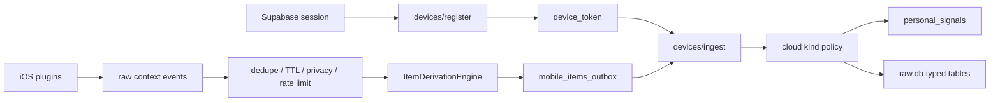
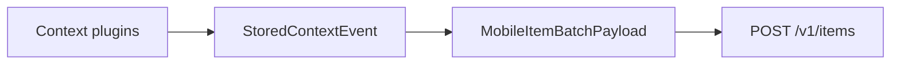
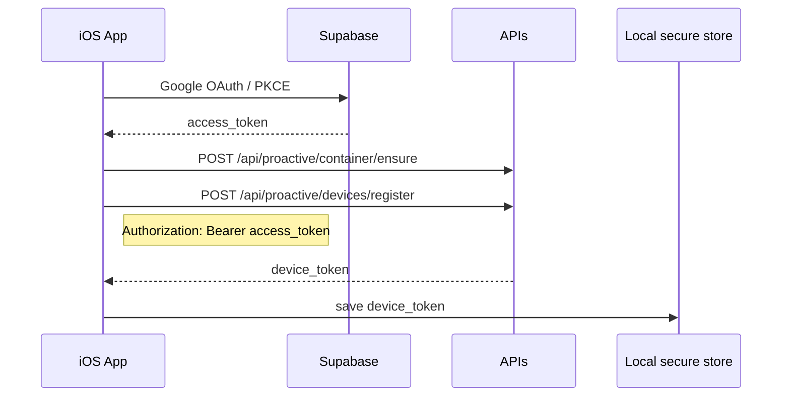

# iOS 端侧数据管线 Android 对齐方案

## 结论

`proactive-ai-mobile-ios` 的目标不是只换一个上报 URL，而是把端侧数据管线改造成和 Android 一样的分层模型：

1. 端侧采集先进入本地 raw 层。
2. rule-based derivation 从 raw 中挑出有价值的 `mobile_items`。
3. `mobile_items_outbox` 负责可重试同步。
4. Supabase 登录后注册 device，拿到 `device_token`。
5. 最终统一上报到 `/api/proactive/devices/ingest`，由服务端 policy 决定写入 `personal_signals`、typed raw 表或双写。

最终产出必须是可运行、可验证、可维护的 iOS 代码。设计文档只是第一步，不能作为完成条件。



## 目标

完成 iOS 端侧数据管线改造，使 iOS 在以下方面对齐当前 Android 端和服务端 device ingest 合约：

- 本地存储：raw events 和 syncable mobile items 分层。
- 信号筛选：用规则筛掉高频、重复、低价值数据。
- 设备认证：Supabase 登录后注册 device，并持久化 `device_token`。
- 上报协议：切到 `/api/proactive/devices/ingest`，携带 `X-Device-Id` / `X-Device-Token`。
- 后台同步：同步 outbox，不直接同步 raw events。
- 配置调试：能切 local/dev/prod/custom，能看 device、outbox、last sync、last error。
- 验证闭环：单元测试、构建检查、本地端到端 ingest 验证都通过。

## 当前差距

iOS 当前链路是：



主要问题：

1. 上报仍走旧 `/v1/items`，没有使用当前服务端唯一 mobile ingest 入口。
2. 请求头没有 `X-Device-Token`，无法按当前 device token 合约鉴权。
3. `AppPrefs` 只有 `deviceId / userId / baseURL` 等设置，没有 `device_token` 生命周期。
4. raw event 和 sync item 没有显式 outbox 分层，失败重试和调试能力弱。
5. 大量采集事件仍可能被直接转成待同步 item，缺少 Android 式的规则筛选。
6. Supabase 登录、device registration、环境配置、debug UI 没有形成完整闭环。

Android 已经具备的关键行为：

- `DeviceRegistration`：登录态下注册 device，缓存 `device_token`，401 后清理 token。
- `MobileSyncConfig`：统一 local/dev/prod/custom endpoint。
- `MobileItemsGateway`：发 `X-Device-Id` / `X-Device-Token` 到 `/api/proactive/devices/ingest`。
- `ContextEventStore` / `ItemDerivationEngine` / `mobile_items_outbox`：raw 到 sync item 的规则化数据流。

## 功能范围

### 1. 本地数据层

iOS 需要显式数据层，建议优先使用 SQLite 加薄 repository。SwiftData 可以保留给 UI 或迁移期兼容，但新的同步链路必须基于可调试、可迁移的表结构。

建议表：

| 表 | 作用 |
|---|---|
| `context_events` | 保存端侧采集 raw events。 |
| `mobile_items_outbox` | 保存经过规则筛选后准备上报的有效 item。 |
| `collector_state` | 保存 cursor、last seen、bootstrap 状态、窗口状态。 |
| `sync_attempts` | 可选，用于记录失败原因和最近同步响应。 |
| `contact_directory_snapshot` | 可选，联系人目录快照或摘要。 |
| `calendar_window_snapshot` | 可选，未来窗口日历摘要。 |
| `health_observation_cache` | 可选，HealthKit 窗口聚合缓存。 |

核心字段要求：

- raw event 要有 `id / occurred_at / source / category / summary / payload_json / sensitivity / ttl_seconds / content_hash`。
- outbox item 要有 `id / kind / title / summary / payload_json / dedupe_key / occurred_at / available_at / expires_at / sync_status / attempt_count / last_error / synced_at`。
- 所有写入都要支持稳定 dedupe key。
- TTL 到期的 raw event 可以清理，但已进入 outbox 的 item 不能因为 transient 网络错误丢失。

### 2. 采集层接入新存储

保留当前 iOS 已有采集能力：

- location / motion
- system device state
- altimeter / sensor summary
- audio transcript
- sound scene
- HealthKit
- contacts / calendar
- photo metadata
- focus / self notifications
- nearby Bluetooth summary
- assistant-generated session signals

采集层只负责生产 raw events，不负责决定是否上报。上报资格统一交给 `ItemDerivationEngine`。

### 3. Rule-based ItemDerivationEngine

新增 iOS 版 `ItemDerivationEngine`，输入 raw events，输出 `mobile_items_outbox`。

规则原则：

- raw 可以本地留，sync item 必须有明确用户价值。
- 高频数据必须聚合、限频或转成状态变化。
- 调试类、能力状态类事件默认不进入用户信号同步。
- 每条 item 必须有稳定 `dedupe_key`，避免重复上传。

初始规则建议：

| 数据类型 | 同步规则 |
|---|---|
| GPS | 不传每个 fix；只传显著位置变化、停留变化、通勤/地点摘要。 |
| Motion | 只传 activity 状态变化或窗口摘要。 |
| Audio | 过滤空转写、低置信度、重复片段；只传有效语音摘要或高价值声音场景。 |
| Sound scene | 聚合同类连续场景；低置信度和重复场景不入 outbox。 |
| HealthKit | 按窗口聚合步数、睡眠、心率；只传日摘要、睡眠结束、明显异常或有意义变化。 |
| Contacts | 不每 tick 传统计噪声；走 snapshot / delta / directory summary。 |
| Calendar | 传未来窗口摘要和关键事件；同一事件用 stable dedupe 避免重复。 |
| Device state | 只在电量、充电、低电量、thermal、low power 明显变化时同步。 |
| Notifications / Focus | 只传 Focus 状态变化或通知窗口摘要，不读其他 App 通知。 |
| Bluetooth | 只传环境摘要或明显变化，不上传 BLE 设备标识。 |
| `assistant_session` / `daily_focus` | 作为高价值派生信号进入 outbox。 |
| `model_io` / `context_log` / `audio_gate` / `capability_status` | 默认不同步，只保留本地调试。 |

### 4. Supabase 登录与设备注册

iOS 需要补齐登录和 device token 生命周期。

流程：



实现要求：

- `deviceId` 本地稳定生成，不能每次启动变化。
- register 请求包含 `deviceId / platform=ios / displayName / model / appVersion`。
- `device_token` 优先存 Keychain；如果短期先用 UserDefaults，必须在代码注释和 plan follow-up 中标为临时方案。
- 401 时清理 token，下次重新 register。
- 未登录生产态不允许静默上传；本地开发态可以显式允许 dev fallback。

### 5. 上报协议

iOS 不再使用 `/v1/items` 作为 mobile 数据上报路径。

目标接口：

```http
POST {API_BASE}/api/proactive/devices/ingest
X-Device-Id: <deviceId>
X-Device-Token: <device_token>
Content-Type: application/json
```

body 顶层是数组：

```json
[
  {
    "id": "uuid",
    "source": "device:<deviceId>",
    "kind": "calendar_event",
    "title": "Upcoming meeting",
    "summary": "Team sync at 10:00",
    "payload": {
      "schema_version": "1",
      "starts_at": "2026-05-01T10:00:00Z"
    },
    "salience": 0.6,
    "confidence": 0.8,
    "dedupe_key": "ios:calendar:event:<event-id>",
    "occurred_at": "2026-05-01T02:00:00Z",
    "available_at": "2026-05-01T02:00:01Z",
    "expires_at": "2026-05-04T02:00:00Z"
  }
]
```

约束：

- `kind` 只表达语义，不让端侧指定 raw/signal destination。
- 落点由服务端 `DeviceIngestPolicyRegistry` 决定。
- 端侧要读取 item-level `results[]`，据此标记 synced / ignored / retry。
- 网络失败、503、timeout 不丢 outbox item。

### 6. Outbox 同步

同步 worker 只 drain `mobile_items_outbox`，不直接 drain raw events。

行为要求：

- 每次取有限 batch，例如 50 条。
- 成功后标记 `synced_at` 和服务端结果。
- 失败保留 item，并记录 `attempt_count / last_error / next_retry_at`。
- 401 清 token，重新 register 后重试。
- 503 / container not ready / 网络不可用延后重试。
- global lock 开启时跳过同步。
- 未登录或未注册时跳过同步，并显示可理解的状态。

### 7. 后台同步

iOS 平台能力和 Android 不同，不追求常驻服务完全一致，但数据语义和上报合约必须一致。

实现要求：

- 前台 loop 继续触发采集。
- BGTask 继续可触发采集和 outbox sync。
- location wakeup 只用于机会性 tick，不直接绕过 derivation。
- BGTask 里执行的是 outbox sync，不是 raw event 直传。
- 所有跳过原因要落到 sync 状态里，便于 UI 调试。

### 8. 配置与调试界面

iOS 需要补一个类似 Android 的配置/调试面板。

至少支持：

- backend preset：local / dev / prod / custom。
- custom URL，支持 ngrok。
- health check。
- 当前 Supabase 登录状态。
- 当前 `deviceId`、注册状态、是否有 `device_token`。
- pending outbox count。
- last sync time / result / error。
- last ingest response 摘要。
- 手动触发：collect once、derive once、sync now、reset device token、re-register。
- 最近 raw events 和最近 mobile items 的调试列表。

### 9. 隐私和安全

硬性约束：

- 不上传原始音频文件，除非后续单独设计并加用户确认。
- 不上传完整联系人明细，除非服务端已支持 snapshot/delta policy 且用户明确授权。
- 不上传高频 GPS 原始轨迹。
- 不上传 BLE 设备标识。
- 不硬编码 Supabase token、OpenAI key、device token。
- `globalLock` 开启时停止上报。
- 未授权的数据源不能绕过系统权限读取。

### 10. 文档

实现完成后需要同步更新文档：

- iOS 数据流设计和实际代码入口。
- iOS 与 Android 对齐点。
- iOS 因平台限制不同的地方，例如后台调度和通知读取。
- 本地调试 runbook：如何登录、注册、触发同步、检查服务端落点。

## 建议实现阶段

### Phase 1：数据层和 outbox

新增 iOS 本地数据 repository，建立 `context_events`、`mobile_items_outbox`、`collector_state`。先让现有采集事件写入新 raw 层，并保留旧 UI 可读路径，避免一次性打断现有界面。

关键产出：

- raw event insert / fetch / dedupe / TTL。
- outbox insert / fetch pending / mark synced / mark failed。
- 基础单元测试。

### Phase 2：ItemDerivationEngine

实现第一版 rule-based derivation，把现有 iOS category 映射成稳定 `kind` 和 dedupe key。

关键产出：

- GPS、audio、health、calendar、contacts、device、notification、BLE 的初始规则。
- 调试类事件默认不进 outbox。
- 规则单元测试覆盖高频垃圾数据不会进入 outbox。

### Phase 3：Supabase + device registration

补 Supabase 登录态和 device registration。

关键产出：

- OAuth 登录。
- `/api/proactive/container/ensure` best-effort。
- `/api/proactive/devices/register`。
- token 持久化和 401 清理。
- 设备 reset / re-register 调试入口。

### Phase 4：device ingest 上报

替换旧 `/v1/items` 同步链路。

关键产出：

- 新 `DeviceIngestGateway`。
- `X-Device-Id` / `X-Device-Token` headers。
- PersonalSignal 数组 body。
- item-level result 处理。
- 503 / 网络失败 / 401 retry 语义。

### Phase 5：后台同步和 debug UI

把 BGTask 和手动 Sync Now 都接到 outbox sync。

关键产出：

- sync now。
- background outbox drain。
- pending / last sync / last error / device status 可视化。
- endpoint preset 和 custom URL。

### Phase 6：端到端验证和文档

用本地或 dev 后端跑一轮真实 ingest。

关键产出：

- iOS 构建通过。
- 单元测试通过。
- 本地端到端：raw event -> derived item -> outbox -> `/api/proactive/devices/ingest` -> 服务端落点。
- 文档更新。

## 验证标准

只有以下全部满足，才算完成：

1. iOS 不再依赖旧 `/v1/items` 作为 mobile 数据上报路径。
2. iOS 可以登录 Supabase，注册 device，拿到并持久化 `device_token`。
3. iOS ingest 请求携带 `X-Device-Id` 和 `X-Device-Token`。
4. raw events 和 mobile items 已经分层。
5. rule-based derivation 已经生效，高频 GPS、空音频、重复设备状态等不会持续进入 outbox。
6. outbox 支持成功标记、失败保留、重试、401 清 token。
7. 后台同步和手动同步都 drain outbox。
8. debug UI 能看到 endpoint、device、outbox、last sync、last error。
9. 单元测试覆盖数据层、derivation、device registration、gateway envelope、outbox retry。
10. iOS 构建检查通过。
11. 本地端到端 ingest 验证通过，并能在服务端看到对应 signal/raw 落点。
12. 必要文档已更新，且文档反映最终代码事实。

## 暂不做

- 不把 iOS 做成 Android 常驻后台服务。iOS 后台调度遵守 BGTask / location wakeup 约束。
- 不新增绕过系统权限的数据读取。
- 不上传原始音频、完整联系人、BLE 标识、高频 GPS 轨迹。
- 不让端侧决定服务端 raw/signal destination。
- 不把所有 raw events 都同步到云端。

## 2026-05-01 实施状态

已在 `proactive-ai-mobile-ios` 完成首版 Android parity 数据链路：

- `StoredContextEvent` 继续作为本地 raw 层；新增 `StoredMobileSyncItem` 作为 `mobile_items_outbox`，新增 `StoredCollectorState` 存规则 cursor / last-seen 状态。
- `ContextsStore` 在采集 raw events 后调用 `ItemDerivationEngine`，只把有用户价值的 item enqueue 到 outbox。
- `SyncScheduler` 不再上传 raw events；手动 sync 和 BGTask 都 drain outbox，经 `DeviceIngestGateway` 发到 `/api/proactive/devices/ingest`。
- `DeviceRegistrationClient` 负责 best-effort `/api/proactive/container/ensure` 和 `/api/proactive/devices/register`，`device_token` / Supabase session token 存 Keychain。
- `SupabaseAuthClient` 实现 Google OAuth + PKCE：`ASWebAuthenticationSession` 收 `ai.pin.proactive://auth/callback`，再用 `auth/v1/token?grant_type=pkce` 换 access/refresh token。
- `SyncConfigSheet` 支持 local/dev/prod/custom endpoint、Supabase URL / publishable key、Google sign-in、debug token fallback、device token reset、re-register、sync now、recent raw events 和 recent mobile items。
- iOS 源码中旧 `/v1/items`、`MobileItemBatchPayload`、`uploadDerivedItems` 已移除。

实际代码入口：

| 功能 | iOS 代码 |
|---|---|
| Endpoint preset | `proactive-ai-ios/Orchestrator/MobileSyncConfig.swift` |
| Supabase OAuth / PKCE | `proactive-ai-ios/Orchestrator/SupabaseAuthClient.swift`、`proactive-ai-ios/Orchestrator/OAuthCoordinator.swift` |
| Device register | `proactive-ai-ios/Orchestrator/DeviceRegistrationClient.swift` |
| Device ingest | `proactive-ai-ios/Orchestrator/DeviceIngestGateway.swift` |
| Token storage | `proactive-ai-ios/Orchestrator/DeviceCredentialStore.swift` |
| raw / outbox / collector state | `proactive-ai-ios/Storage/AppDatabase.swift`、`StoredMobileSyncItem.swift`、`StoredCollectorState.swift` |
| rule-based derivation | `proactive-ai-ios/Storage/ItemDerivationEngine.swift` |
| sync worker | `proactive-ai-ios/Sync/SyncScheduler.swift` |
| debug UI | `proactive-ai-ios/UI/Sheets/SyncConfigSheet.swift` |

已验证：

```bash
cd /Users/smile/Documents/01PINAI/01Code/12repo/proactive-ai-mobile-ios
swift test
xcodebuild -project proactive-ai-ios.xcodeproj -scheme proactive-ai-ios -destination 'generic/platform=iOS Simulator' build
```

结果：SwiftPM 15 个测试通过；iOS Simulator build 通过。

本地端到端已验证 device ingress 服务端落点：

- 注册一次性 iOS test device：`POST http://localhost:3000/api/proactive/devices/register`
- 携带 `X-Device-Id` / `X-Device-Token` 发 `moment` 到 `POST http://localhost:3000/api/proactive/devices/ingest`
- 响应：`accepted=1 / inserted=1 / ignored=0`
- 容器落点：`proactive-00000000:/app/data/proactive.db` 的 `personal_signals` 存在对应 `status='open'` row。

仍需真机人工确认的部分：

- Google OAuth 需要 Supabase 控制台允许 `ai.pin.proactive://auth/callback` redirect URL，并在 debug UI 填入对应环境的 Supabase URL / publishable key。
- 真实 iPhone 上的 `ASWebAuthenticationSession` 登录、后台 BGTask 触发时机、location wakeup 只能通过真机跑一轮确认；本次自动验证覆盖到编译、单测和本地服务端 ingest 落点。
