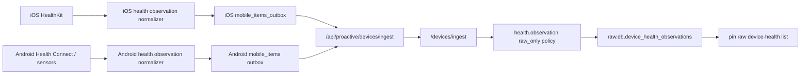

# Mobile Health Data Upload + Overnight Re-loop Goal

> **For agentic workers:** REQUIRED SUB-SKILL: Use superpowers:subagent-driven-development (recommended) or superpowers:executing-plans to implement this plan task-by-task. Steps use checkbox (`- [ ]`) syntax for tracking.

**Goal:** 让 iOS 和 Android 都能在用户显式授权后采集健康数据，统一转换成 `health.observation`，通过 `/api/proactive/devices/ingest` 上传，并可靠落到 `raw.db.device_health_observations`，最后用一套夜间 re-loop 验证证明采集、上传、存储、重试、去重和查询都稳定。

**Architecture:** 端侧只负责授权、采集、标准化和 outbox 重试；服务端继续用现有 `DeviceIngestPolicyRegistry` 决定 `health.observation` 的 raw-only 落点。iOS、Android、后端三处都必须改，不能只在某一端做兼容补丁。

**Tech Stack:** iOS Swift / HealthKit / SwiftData / BGTaskScheduler；Android Kotlin / Health Connect / SensorManager / WorkManager；OpenClaw proactive-ai TypeScript / SQLite raw.db / device ingest routes。

---

## 结论

当前后端已经支持 `health.observation -> raw.db.device_health_observations`，但两个移动端都还没有真正把健康数据按这个合约送上来。



本次目标不是“能手工发一条测试健康数据”，而是让真实手机在授权后自动持续上报，并在跑一晚后能用端侧日志、outbox 状态、APIs 日志、容器 raw.db、CLI 查询五层证据闭环验证。

## 当前断点

### iOS

- `proactive-ai-mobile-ios/proactive-ai-ios/proactive-ai-ios.entitlements` 只有 app group，没有 `com.apple.developer.healthkit`。
- `HealthConnectPlugin.swift` 已读 HealthKit 的 steps / sleep / heart rate，但 payload 是 `steps_today`、`duration_min`、`avg_bpm_6h` 等扁平字段。
- `ItemDerivationEngine.swift` 已把 `health_steps` / `health_sleep` / `health_heart` 派生成 `itemType = "health.observation"`，但没有把 payload 包成后端要求的 `payload.observations[]`。
- `PermissionStatusResolver.authorizationStatus(for:)` 对 HealthKit read permission 的展示可能不可靠：HealthKit 对 read 授权不会像写权限一样给出完整可验证状态，UI 只能作为提示，不能作为采集成功的唯一判断。

### Android

- `AndroidManifest.xml` 已声明 `BODY_SENSORS` / `BODY_SENSORS_BACKGROUND`，`ExtremeDefaults.kt` 也列了 Health Connect settings gate。
- `HealthConnectPlugin.kt` 实际只用 `Sensor.TYPE_STEP_COUNTER` 和 `BODY_SENSORS`，没有接入 AndroidX Health Connect client。
- Android `ItemDerivationEngine.kt` 当前没有处理 `category = "health"`，所以即便插件采到 step counter event，也不会进入 mobile sync outbox。
- `build.gradle.kts` 当前没有 `androidx.health.connect:connect-client` 依赖。

### 后端

- `pinai-openclaw/plugins/proactive-ai/device-ingest/health.ts` 只解析 `payload.observations[]`。
- 每条 observation 至少需要 `observation_type`；可选字段包括 `metric`、`value`、`unit`、`start_at`、`end_at`、`local_date`、`source_app`、`dedupe_key`。
- `health.observation` policy 是 raw-only；解析失败会 fallback 到 `personal_signals` 并写 `ingest_fallback_reason`，这对兼容有用，但目标状态必须是 raw 落库，不是 fallback。

## 标准 payload 合约

端侧必须统一发这种 envelope。`sync_mode` 保持 item 顶层字段，默认 `incremental`；日级汇总可以用 `sync_mode = "full"`，但必须带安全 scope：同一 item 里的所有 observation 都有同一个 `local_date`，或 payload 顶层带 `local_date`。

```json
{
  "id": "ios-health-2026-05-05-steps",
  "kind": "health.observation",
  "sync_mode": "full",
  "title": "Health steps 2026-05-05",
  "summary": "Steps today: 8120",
  "payload": {
    "schema_version": "health_observation.v1",
    "local_date": "2026-05-05",
    "observations": [
      {
        "id": "ios-health-2026-05-05-steps",
        "observation_type": "daily_summary",
        "metric": "steps",
        "value": 8120,
        "unit": "count",
        "start_at": "2026-05-05T00:00:00+08:00",
        "end_at": "2026-05-05T23:59:59+08:00",
        "local_date": "2026-05-05",
        "source_app": "healthkit",
        "dedupe_key": "ios:health:steps:2026-05-05"
      }
    ]
  },
  "dedupe_key": "ios:health:batch:2026-05-05:steps"
}
```

推荐 metric 初始集合：

| metric | observation_type | unit | iOS 来源 | Android 来源 |
|---|---|---|---|---|
| `steps` | `daily_summary` | `count` | `HKQuantityType.stepCount` | Health Connect `StepsRecord`，无 Health Connect 时可降级 `TYPE_STEP_COUNTER` |
| `heart_rate` | `sample` / `window_summary` | `bpm` | `HKQuantityType.heartRate` | Health Connect `HeartRateRecord` |
| `sleep` | `session` | `minute` | `HKCategoryType.sleepAnalysis` | Health Connect `SleepSessionRecord` |
| `active_energy` | `daily_summary` | `kcal` | 可选 Phase 2 | Health Connect `ActiveCaloriesBurnedRecord` 可选 Phase 2 |

## 改动范围

### iOS repo: `proactive-ai-mobile-ios`

需要改：

- `proactive-ai-ios/proactive-ai-ios.entitlements`
- `proactive-ai-ios.xcodeproj/project.pbxproj`
- `proactive-ai-ios/Core/Context/Plugins/HealthConnectPlugin.swift`
- `proactive-ai-ios/Storage/ItemDerivationEngine.swift`
- `proactive-ai-ios/Permissions/PermissionRequestCoordinator.swift`
- `proactive-ai-ios/Permissions/PermissionStatusResolver.swift`
- `proactive-ai-ios/UI/Cards/PluginCard.swift`
- `proactive-ai-ios/UI/Sheets/SyncConfigSheet.swift`
- `Tests/MobileDataCoreTests/ItemDerivationEngineTests.swift`
- `Tests/MobileDataCoreTests/DeviceIngestGatewayTests.swift`

iOS 最小可交付：

1. Xcode target 启用 HealthKit capability，entitlements 包含 `com.apple.developer.healthkit = true`。
2. HealthKit 授权请求只读 steps / sleep / heart rate，不申请写权限。
3. `HealthConnectPlugin` 输出结构化 health raw event，或者继续输出现有 category，但 `ItemDerivationEngine` 必须标准化为 `payload.observations[]`。
4. `health.observation` item 必须有稳定 dedupe key，避免每 15 分钟重复插入同一日 summary。
5. `SyncConfigSheet` 显示最近 health outbox item 的 `itemType`、`syncStatus`、`lastError`、`serverStatus`，便于夜间验证。

### Android repo: `proactive-ai-mobile`

需要改：

- `android/app/build.gradle.kts`
- `android/app/src/main/AndroidManifest.xml`
- `android/app/src/main/java/com/proactiveai/extreme/data/ExtremeDefaults.kt`
- `android/app/src/main/java/com/proactiveai/extreme/permission/PermissionStatusResolver.kt`
- `android/app/src/main/java/com/proactiveai/extreme/core/context/plugins/HealthConnectPlugin.kt`
- `android/app/src/main/java/com/proactiveai/extreme/storage/ItemDerivationEngine.kt`
- `android/app/src/main/java/com/proactiveai/extreme/orchestrator/MobileItemsGateway.kt`
- `android/app/src/test/java/com/proactiveai/extreme/storage/ItemDerivationEngineTest.kt`
- 新增 `android/app/src/test/java/com/proactiveai/extreme/core/context/plugins/HealthObservationPayloadTest.kt`

Android 最小可交付：

1. 接入 `androidx.health.connect:connect-client`。
2. Manifest 增加 Health Connect 查询和权限声明：steps / heart rate / sleep 的 read permission。
3. UI 权限页能打开 Health Connect grant 页面，并能显示 unavailable / not granted / granted 的近似状态。
4. `HealthConnectPlugin` 优先读 Health Connect；没有 Health Connect 或用户未授权时，只能降级上报 `source_app = "android_sensor"` 的 step counter，不得伪装成 Health Connect。
5. Android `ItemDerivationEngine` 必须把 `category = "health"` 或更细分的 `health_steps` / `health_sleep` / `health_heart` 派生成 `itemType = "health.observation"`。

### Backend repo: `PIN-AI-ASSISTANT`

需要改：

- `pinai-openclaw/plugins/proactive-ai/device-ingest/health.ts`
- `pinai-openclaw/plugins/proactive-ai/device-ingest/policies.ts`
- `pinai-openclaw/plugins/proactive-ai/routes/devices-http.test.ts`
- `pinai-openclaw/plugins/proactive-ai/routes/devices.test.ts`
- `pinai-openclaw/plugins/proactive-ai/raw-db.ts`
- `pinai-openclaw/plugins/proactive-ai/cli/raw.ts`
- `docs/modules/data-connectors.mdx`
- `docs/modules/memory.mdx`

后端最小可交付：

1. 继续支持现有 `payload.observations[]` 合约。
2. 增加对 `schema_version = "health_observation.v1"` 的显式测试。
3. 不把健康 raw 默认写入 `personal_signals`。
4. 对解析失败的 health item 保持 fallback signal，payload 必须带 `ingest_fallback_reason = "raw_parse_failed"`。
5. `pin raw device-health list` 能按 `--localDate`、`--metric`、`--hours` 查出 iOS / Android 上传的数据。

## 任务拆分

### Task 1: 后端合约锁定

**Files:**
- Modify: `pinai-openclaw/plugins/proactive-ai/routes/devices-http.test.ts`
- Modify: `pinai-openclaw/plugins/proactive-ai/device-ingest/health.ts`
- Modify: `pinai-openclaw/plugins/proactive-ai/cli/raw.ts`

- [ ] 写一个 `health_observation.v1` 成功落 raw 的测试，样本包含 `steps`、`heart_rate`、`sleep`。
- [ ] 写一个 iOS 当前扁平 payload 的失败测试，确认会 fallback signal，并把原因写为 `raw_parse_failed`。
- [ ] 写一个 `sync_mode = "full"` 且 `local_date` 安全 scope 的测试，确认只替换同 `device_id + local_date` 下未被引用的旧 rows。
- [ ] 跑：

```bash
npx tsx --test pinai-openclaw/plugins/proactive-ai/routes/devices-http.test.ts
bash pinai-openclaw/plugins/proactive-ai/scripts/test-memory.sh
```

Expected:

- `health.observation writes raw only` 仍通过。
- 新 `health_observation.v1` 用例通过。
- parse failure 用例不会写 `device_health_observations`。

### Task 2: iOS HealthKit capability + payload normalizer

**Files:**
- Modify: `proactive-ai-ios/proactive-ai-ios.entitlements`
- Modify: `proactive-ai-ios.xcodeproj/project.pbxproj`
- Modify: `proactive-ai-ios/Core/Context/Plugins/HealthConnectPlugin.swift`
- Modify: `proactive-ai-ios/Storage/ItemDerivationEngine.swift`
- Test: `Tests/MobileDataCoreTests/ItemDerivationEngineTests.swift`

- [ ] 在 entitlements 增加 HealthKit capability。
- [ ] 确认 Xcode target Debug / Release 都使用同一个 entitlements 文件。
- [ ] 把 iOS steps / sleep / heart rate 标准化成 `payload.observations[]`。
- [ ] iOS 每个 observation 生成稳定 `dedupe_key`：

```text
ios:health:steps:<local_date>
ios:health:sleep:<sleep_session_end_iso>
ios:health:heart_rate:<window_start_iso>:<window_end_iso>
```

- [ ] 写测试断言 `health_steps` 派生出的 item：

```text
itemType == "health.observation"
payload["schema_version"] == "health_observation.v1"
payload["observations"] 包含 observation_type / metric / value / unit / local_date / source_app
```

- [ ] 跑：

```bash
cd /Users/smile/Documents/01PINAI/01Code/12repo/proactive-ai-mobile-ios
swift test
xcodebuild -project proactive-ai-ios.xcodeproj -scheme proactive-ai-ios -configuration Debug -destination 'generic/platform=iOS' CODE_SIGNING_ALLOWED=NO build
```

Expected:

- SwiftPM tests 通过。
- app target build 通过。
- build log 不再缺 HealthKit entitlement。

### Task 3: Android Health Connect + fallback sensor payload

**Files:**
- Modify: `android/app/build.gradle.kts`
- Modify: `android/app/src/main/AndroidManifest.xml`
- Modify: `android/app/src/main/java/com/proactiveai/extreme/core/context/plugins/HealthConnectPlugin.kt`
- Modify: `android/app/src/main/java/com/proactiveai/extreme/storage/ItemDerivationEngine.kt`
- Test: `android/app/src/test/java/com/proactiveai/extreme/storage/ItemDerivationEngineTest.kt`

- [ ] 加 Health Connect client 依赖。
- [ ] Manifest 加 Health Connect read permissions 和 package visibility。
- [ ] `HealthConnectPlugin` 优先从 Health Connect 读 steps / sleep / heart rate。
- [ ] 没有 Health Connect 或无授权时，允许 step counter fallback，但 payload 必须写：

```json
{
  "source_app": "android_sensor",
  "capability": "TYPE_STEP_COUNTER",
  "health_connect_available": false
}
```

- [ ] Android 派生层把健康 event 转成 `health.observation`，payload 结构与 iOS 一致。
- [ ] 跑：

```bash
cd /Users/smile/Documents/01PINAI/01Code/12repo/proactive-ai-mobile/android
./gradlew testDebugUnitTest
./gradlew assembleDebug
```

Expected:

- unit tests 通过。
- debug APK 构建通过。
- Android health event 不再被 `ItemDerivationEngine` 丢弃。

### Task 4: 两端真实上报路径打通

**Files:**
- Modify: `proactive-ai-ios/UI/Sheets/SyncConfigSheet.swift`
- Modify: `android/app/src/main/java/com/proactiveai/extreme/ui/permission/PermissionCommandCenterScreen.kt`
- Modify: `android/app/src/main/java/com/proactiveai/extreme/sync/OrchestratorSyncWorker.kt` only if acknowledgement or retry behavior is still ambiguous.

- [ ] iOS Debug UI 显示最近 8 条 health outbox：`itemType`、`dedupeKey`、`syncStatus`、`lastError`、`serverStatus`。
- [ ] Android Command Center 显示 health sync 状态：last collected、pending count、last ingest response。
- [ ] 两端 `Sync Now` 后都必须依赖 item-level `results[]` 才 mark synced；没有 results 时 retry，不清队列。
- [ ] 真实手机登录同一 Supabase user，确保 device registration 成功。
- [ ] 在本地 / dev endpoint 对 iOS 和 Android 各发一批真实 health items。

Expected:

- iOS outbox item 从 `pending` 变 `synced`。
- Android mobile sync item 从 unsynced 变 synced。
- APIs 日志能看到 `/api/proactive/devices/ingest`。
- 容器 `raw.db.device_health_observations` 有两种不同 `device_id` 的 rows。

### Task 5: 文档同步

**Files:**
- Modify: `docs/modules/data-connectors.mdx`
- Modify: `docs/modules/memory.mdx`
- Modify: `docs/plans/README.mdx`
- Optional Modify: `docs/plans/2026-04-30-device-ingest-policy-and-health-raw.mdx`
- Optional Modify: `docs/plans/2026-05-01-ios-mobile-data-android-parity.mdx`

- [ ] `data-connectors.mdx` 补充移动健康数据来源、端侧权限、payload 合约。
- [ ] `memory.mdx` 补充 health raw 的查询和 nightly 验证命令。
- [ ] `README.mdx` 登记本 plan。
- [ ] 如果旧 plan 里还有“iOS 已完整健康上传”的暗示，改成当前事实。

## 夜间 re-loop 验证目标

### 目标

让 iOS 和 Android 各在真实手机上跑至少 8 小时，期间保持登录、device token 有效、后台/前台切换正常，最终证明：

1. 健康数据能被采集。
2. 健康数据能进入端侧 outbox。
3. outbox 能成功上传到 `/api/proactive/devices/ingest`。
4. 后端把 `health.observation` 写入 `raw.db.device_health_observations`。
5. 重启 app / 网络短断 / 重复 sync 不会导致数据丢失或重复爆炸。

### 前置条件

- iOS 连接的 iPhone 已在系统 Health App 里有当天步数数据；如果要测 sleep / heart rate，需要 Apple Watch 或已有 HealthKit 样本。
- Android 连接的手机有 Health Connect 或至少有 step counter sensor；若没有 Health Connect，只验证 fallback step counter，不宣称 Health Connect 全链路通过。
- 两台手机登录同一个可用 Supabase 账号。
- 本地或 dev APIs 可达，且对应用户 OpenClaw container running。
- `MOBILE_SYNC_PROXY_ENABLED` 没有被关闭。

### 运行方式

#### 0. 基线清点

```bash
cd /Users/smile/Documents/01PINAI/01Code/12repo/PIN-AI-ASSISTANT
pin raw device-health list --hours 24 --limit 20
```

记录当前 rows 数量、device_id、metric 分布。

#### 1. 安装两端最新包

iOS：

```bash
cd /Users/smile/Documents/01PINAI/01Code/12repo/proactive-ai-mobile-ios
swift test
xcodebuild -project proactive-ai-ios.xcodeproj -scheme proactive-ai-ios -configuration Debug -destination 'platform=iOS,id=00008130-000139511491001C' -derivedDataPath ./.derivedData/health-nightly DEVELOPMENT_TEAM=58AXBDC7K4 CODE_SIGN_STYLE=Automatic build
xcrun devicectl device install app --device 717EB54F-9ED8-586C-BA47-58747C68EA23 ./.derivedData/health-nightly/Build/Products/Debug-iphoneos/proactive-ai-ios.app
xcrun devicectl device process launch --device 717EB54F-9ED8-586C-BA47-58747C68EA23 ai.pin.proactive
```

Android：

```bash
cd /Users/smile/Documents/01PINAI/01Code/12repo/proactive-ai-mobile/android
./gradlew testDebugUnitTest assembleDebug
adb devices -l
adb install -r app/build/outputs/apk/debug/app-debug.apk
adb shell monkey -p com.proactiveai.extreme -c android.intent.category.LAUNCHER 1
```

实际 device id / bundle id 以当前机器输出为准；如果命令里的 iOS bundle id 与构建产物不一致，以 `codesign -dv <App.app>` 和 `xcrun devicectl device installedApps list` 为准。

#### 2. 授权

iOS：

- 打开 app permission/onboarding。
- 授权 HealthKit：steps、sleep、heart rate。
- 如果 HealthKit sheet 没出现，检查 entitlement 和 signing profile。

Android：

- 授权 BODY_SENSORS。
- 打开 Health Connect grant 页面，授权 steps、sleep、heart rate。
- 如果手机无 Health Connect，记录为 fallback sensor 模式。

#### 3. 启动夜间循环

两端都执行：

- 打开 collection/service。
- 点一次 Sync Now。
- 保持 app 至少前台 5 分钟，确认首批 health outbox 生成。
- 之后锁屏或后台放置过夜。

每 30 分钟采样一次服务端状态：

```bash
date
pin raw device-health list --hours 12 --limit 50
pin raw device-health list --metric steps --hours 12 --limit 20
pin raw device-health list --metric heart_rate --hours 12 --limit 20
pin raw device-health list --metric sleep --hours 36 --limit 20
```

如果要用 SQLite 精确计数：

```bash
sqlite3 data/proactive-285d35b0/data/raw.db "
select device_id, metric, local_date, count(*), max(occurred_at)
from device_health_observations
where occurred_at >= datetime('now', '-12 hours')
group by device_id, metric, local_date
order by max(occurred_at) desc;
"
```

#### 4. 结束验收

早上执行：

```bash
pin raw device-health list --hours 16 --limit 100
pin signals recent --kind health.observation --hours 16 --limit 20
```

验收标准：

| 检查项 | 通过标准 |
|---|---|
| iOS 授权 | HealthKit prompt 可出现；授权后 app 不再显示 unavailable。 |
| Android 授权 | Health Connect grant 可打开；无 Health Connect 时 fallback 模式明确标记。 |
| 端侧采集 | iOS / Android 各至少生成 1 条 `health.observation` outbox item。 |
| 上传 | 两端各至少一次 `Sync Now` 返回 OK，且 item-level `results[]` acknowledged。 |
| raw 存储 | `device_health_observations` 里至少有 iOS 和 Android 两个 device_id。 |
| schema | rows 包含 `observation_type`、`metric`、`value` 或 session duration、`unit`、`local_date/source_app`。 |
| 去重 | 同一端同一 `local_date + metric` 不因 15 分钟 tick 暴涨；重复 sync 只产生 duplicate ack 或保持 row 数稳定。 |
| fallback | `personal_signals.kind = health.observation` 在成功路径为 0；只有 parser 失败测试才允许出现 fallback signal。 |
| 重试 | 网络断开后 outbox 不被清空；恢复网络后能重试成功。 |
| 安全 | 没有把 HealthKit / Health Connect 原始超大 JSON 打进 signal；健康 raw 只落 typed raw 表。 |

## 限制

- 不要求 iOS 像 Android 常驻后台服务一样稳定每分钟运行；iOS 后台采集受 BGTask / location / audio lifecycle 限制。夜间验收看“最终能同步健康 summary”，不看固定分钟级频率。
- 不要求所有 Android 手机都有 Health Connect；没有 Health Connect 时只能通过 step counter fallback 验证基础 steps，不宣称 sleep / heart rate 全链路。
- 不引入万能 `device_raw_events` 表。健康数据继续走 `device_health_observations` typed table。
- 不把健康 raw 默认写入 `personal_signals`。异常提醒类健康 signal 是后续 evolution/generation 设计，不在本任务里端侧直写。
- 不把 HealthKit read permission 的 UI 状态当唯一事实。最终事实以端侧采集结果和服务端 raw rows 为准。
- 不做生产数据库手工 SQL 变更。dev/prod schema 仍随代码和部署迁移走。

## 最终交付定义

本 goal 完成时，必须同时满足：

1. iOS HealthKit capability、授权、采集、payload 标准化、outbox、device ingest 全链路可运行。
2. Android Health Connect / sensor fallback 授权、采集、payload 标准化、outbox、device ingest 全链路可运行。
3. 后端 `health.observation` 合约和 raw-only 存储有测试锁定。
4. 两端真实手机至少完成一轮上传，`pin raw device-health list` 能看到 rows。
5. 夜间 re-loop 结束后有一份简短报告：起止时间、设备、endpoint、rows 计数、失败/重试次数、最终结论。
