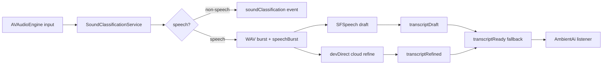
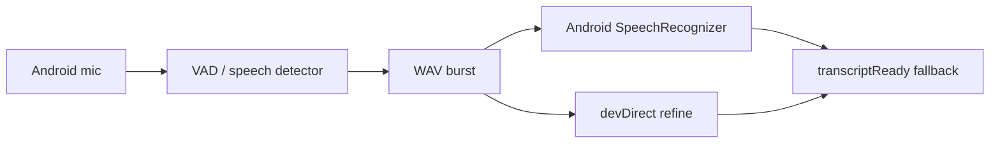

# Ambient AI Plugin

## 结论

`@pin/capacitor-ambient-ai` 已经从多个零散 Capacitor 插件收束为一个统一包。JS 侧只公开 `AmbientAi` facade 和 public types；iOS 侧把音频采集 / SoundAnalysis / SFSpeech / devDirect cloud refine / WAV / 播放收到 `AudioCapture` bridge，把 MapKit + CLGeocoder POI 反查收到 `Geocoder`，把端侧模型生命周期收到独立的 `AmbientModels`（背景下载 + 镜像 fallback + magic header + 真实推理 verify）。

前端 `proactive-ai-frontend/src/services/ambient/` 现在已经从「单 sound_classifier source」扩展为 5 个 ambient source（`sound_classifier` / `visit` / `activity` / `location` / `health`），并把短窗 `SignalBuffer` 与持久化 `Outbox`（native SQLite / web 内存）+ `AmbientSyncScheduler`（带退避和 5-state 重试分类）串成一条完整链路，最终走 `/api/proactive/devices/ingest`。

这篇文档不是一次性进度日志，而是 AmbientAi dev v1 的接力说明。后续改 `@pin/capacitor-ambient-ai`、Ambient Debug Panel、AmbientModels、前端 outbox / scheduler、Android 端插件实现时先读这里。

## 当前状态

| 区域 | 状态 | 说明 |
|---|---|---|
| JS facade | 已实现 | `capacitor-plugins/ambient-ai/src/index.ts` 只导出 `AmbientAi` 和 public types。 |
| iOS AudioCapture | 已实现 | `AudioCapturePlugin` 管理权限、配置、capture、classification、pending transcript、WAV list/playback。 |
| iOS Geocoder | 已实现 | `GeocoderPlugin` + `GeocodeService` 合成 `MKLocalSearch` POI + `CLGeocoder` 地址，输出统一 `PlaceInfo`。 |
| iOS AmbientModels | 已实现 | `AmbientModelsPlugin` + manifest 9 profile + 背景 URLSession 下载 + magic-header 校验 + `DispatchingVerifyEngine`。 |
| 前端 ambient runtime | 已实现 | 5 个 source、`SignalBuffer`、`Outbox`（SQLite/Memory）、`AmbientSyncScheduler`、`AmbientSourcesPanel` opt-in UI。 |
| Frontend ingest | 已实现 | source 产 PersonalSignal → buffer 5s/20 条 flush → outbox → scheduler 60s 调度 → `ingestBatch` → `/api/proactive/devices/ingest`。 |
| Debug UI | 已实现 | `AmbientSourcesPanel` 嵌入 `AmbientAudioDebugPanel` 和 `AmbientModelsPanel`，服务真机调试。 |
| Models namespace | 已实现 | `AmbientAi.models`：静态 manifest（4 ASR ggml + 5 LLM GGUF）、后台 URLSession 下载（hf-mirror → huggingface 自动 fallback）、magic-header 校验、ASR header-only / LLM 真实 llama.cpp 推理 verify。 |
| Package cleanup | 已完成 | standalone `proactive-engine`、`sound-classifier`、`visit-monitor` 不再作为前端依赖；旧 public plugin object 不再导出。 |
| Android native | 待实现 | `capacitor-plugins/ambient-ai/android/` 当前只有 `.gitkeep`，Android 端需要按本页接口补齐。 |
| Production transcribe proxy | 非 dev v1 范围 | cloud refine 仍走 `devDirect`；生产 `/api/proactive/mobile/transcribe` 后续另做。 |

## 包边界

### Public API

入口：`capacitor-plugins/ambient-ai/src/index.ts`

调用方只应该这样用：

```ts
import { AmbientAi, type TranscriptReadyEvent } from "@pin/capacitor-ambient-ai";
```

不要再直接 import 内部模块对象，例如 `AudioAmbient`、`SoundClassifier`、`VisitMonitor`。这些 native plugin 仍可作为 facade 内部实现存在，但不再是 public API。

### Facade 结构

核心文件：

- `capacitor-plugins/ambient-ai/src/facade/types.ts`：public 类型、namespace interface、event map。
- `capacitor-plugins/ambient-ai/src/facade/native.ts`：内部 `registerPlugin(...)` 和 adapter 实例。
- `capacitor-plugins/ambient-ai/src/facade/ambient-ai.ts`：`AmbientAi` facade，把 namespace 方法转发到内部插件。
- `capacitor-plugins/ambient-ai/src/facade/audio-capture.ts`：web fallback，保持 type-complete，但 native 能力为 no-op/unavailable。

当前 namespace：

```ts
AmbientAi.audio
AmbientAi.sound
AmbientAi.visit
AmbientAi.geocoder
AmbientAi.device
AmbientAi.calendar
AmbientAi.notifications
AmbientAi.media
AmbientAi.nearby
AmbientAi.sensor
AmbientAi.health
AmbientAi.battery
AmbientAi.contacts
AmbientAi.models
AmbientAi.addListener(eventName, callback)
AmbientAi.removeAllListeners()
```

`audio` 和 `sound` 在 iOS 上都路由到内部 native plugin `AudioCapture`。这是刻意设计：speech gate、音频流、WAV burst 和转录需要共享同一个音频 session，不能再拆成两个 native engine。

`visit` 提供 CLVisit / CMMotionActivity / `getCurrentPosition`，`geocoder` 提供独立的 `reverseGeocode(lat,lng) → PlaceInfo`；二者都需要 location 权限，但分两个 native plugin，对应 iOS 端的 `VisitMonitorPlugin` 和 `GeocoderPlugin`。

`models` 路由到独立 native plugin `AmbientModels`（详见后文 "AmbientModels 合约"）。它是端侧小模型生命周期管理入口：list manifest → download（背景 URLSession + 镜像 fallback）→ verify（llama.cpp 真实推理 / whisper.cpp 占位）→ delete。下载和音频 capture 在 iOS 上是独立 native target，不共享 session。

## AudioCapture 合约

### Methods

Android 端需要实现同名 Capacitor plugin `AudioCapture`，并至少支持这些 promise methods：

```ts
requestPermissions(): Promise<AudioPermissions>
checkPermissions(): Promise<AudioPermissions>
configure(config: AudioCaptureConfig): Promise<void>
startCapture(): Promise<void>
stopCapture(): Promise<void>
getState(): Promise<AudioState>
drainPendingTranscripts(): Promise<TranscriptReadyEvent[]>
listRecentCaptures(): Promise<{ captures: RecentAudioCapture[] }>
playCapture({ wavId }: { wavId: string }): Promise<void>
stopPlayback(): Promise<void>
startClassification(): Promise<void>
stopClassification(): Promise<void>
```

注意 facade 层的 `drainPendingTranscripts()` 返回 `TranscriptReadyEvent[]`，native bridge 原始返回值是 `{ transcripts }`。

### Config

`AudioCaptureConfig` 由 debug panel 或调用方传入：

```ts
interface AudioCaptureConfig {
  cloudMode?: "off" | "devDirect" | "proxy";
  recognitionLocale?: string;
  cloudApiKey?: string;
  cloudBaseURL?: string;
  modelName?: string;
  cloudRefineTimeoutMs?: number;
  preRollMs?: number;
  postRollMs?: number;
  maxBurstMs?: number;
  minBurstMs?: number;
  wavRetentionTtlMs?: number;
  wavMaxBytes?: number;
  wavMaxFiles?: number;
}
```

默认模型是 dev v1 的 `gpt-4o-transcribe`。`proxy` mode 目前只是协议预留，不代表生产 proxy 已实现。

### Events

`AmbientAi.addListener(...)` 当前会路由这些 audio 事件到 `AudioCapture`：

| Event | 用途 |
|---|---|
| `ambientLevel` | 音量/环境音 level。 |
| `audioState` | running / paused / capturing / suppressed 状态。 |
| `audioError` | capture、soundAnalysis、playback 等错误。 |
| `soundClassification` | top sound labels；speech 只触发录音 gate，不直接上报 sound signal。 |
| `speechBurst` | 检测到 speech burst。 |
| `transcriptDraft` | 本地 ASR 草稿。 |
| `transcriptRefined` | cloud refine 结果，用于 debug 观察。 |
| `transcriptReady` | 唯一进入前端 ingest 的 transcript 终态。 |

`TranscriptReadyEvent` 是跨平台关键契约：

```ts
interface TranscriptReadyEvent {
  platform: "ios" | "android" | "web";
  wavId: string;
  burstId: string;
  captureSessionId: string;
  text: string;
  capturedAt: string;
  durationMs: number;
  provider: "local_speech" | "cloud_whisper";
  fallback: boolean;
  localProvider?: "sfspeech" | "android_speech";
  segmentIndex?: number;
  transcriptLocale?: string;
}
```

## Geocoder 合约

`AmbientAi.geocoder.reverseGeocode({ latitude, longitude })` 把一对坐标变成一个 `PlaceInfo`：

```ts
interface PlaceInfo {
  label?: string;             // "poi_name | area_of_interest | address" 去重后最多 3 段
  place_name?: string;        // poi_name ?? area_of_interest ?? placemark.name
  address?: string;
  poi_name?: string;          // MKMapItem.name
  poi_category?: string;      // MKPointOfInterestCategory raw value
  poi_distance_m?: number;
  area_of_interest?: string;
  areas_of_interest?: string[];
  thoroughfare?: string;
  sub_thoroughfare?: string;
  locality?: string;
  sub_locality?: string;
  administrative_area?: string;
  postal_code?: string;
  country?: string;
  country_code?: string;
  source: string;             // "mapkit+clgeocoder" | "clgeocoder" | "mapkit" | "none"
  resolved_at: number;        // 服务端 native 解析时间 ms
}
```

iOS 实现见 `ios/Sources/AmbientAi/Geocoding/GeocodeService.swift`：

- `CLGeocoder.reverseGeocodeLocation`：街道地址 + 行政区 + 偶发 `areasOfInterest`。
- `MKLocalSearch` 以 `naturalLanguageQuery = "point of interest"`、180 m 半径、`.includingAll` POI 过滤：取到真实 POI / business name + 分类 + 距离。
- 两条 lookup 并发触发，结果合并到一个 `PlaceInfo`；`label` 用 " | " 连接 `poi_name | area_of_interest | address`，去重最多 3 段，与 `proactive-ai-ios` 的 `LocationMotionPlugin.resolvePOI` 语义对齐。
- 11 m 栅格 LRU（cap 200，TTL 24 h）抑制 CLGeocoder 限速。

前端 `LocationSource`（`proactive-ai-frontend/src/services/ambient/sources/location.ts`）按 `minGeocodeDeltaMeters`（默认 100 m）触发一次 `reverseGeocode`，结果写回 `payload.place`；`VisitSource` 同样会把 native plugin 已经填好的 `event.place` 透传到 ingest payload。

## AmbientModels 合约

### Methods

```ts
AmbientAi.models.list(): Promise<ModelListResult>
AmbientAi.models.startDownload(options: { id: string; preferredMirror?: "hf" | "hf-mirror" }): Promise<void>
AmbientAi.models.cancelDownload(options: { id: string }): Promise<void>
AmbientAi.models.deleteModel(options: { id: string }): Promise<void>
AmbientAi.models.verifyModel(options: { id: string }): Promise<ModelVerifyResult>
```

### Manifest（静态，编码在 `ModelManifest.swift`）

ASR — whisper.cpp ggml binary（4 个）：

| id | display | repo / file | approx |
|---|---|---|---|
| `whisper-tiny-q5_1` | Whisper tiny (Q5_1) | `ggerganov/whisper.cpp` / `ggml-tiny-q5_1.bin` | ~32 MB |
| `whisper-tiny` | Whisper tiny | `ggerganov/whisper.cpp` / `ggml-tiny.bin` | ~75 MB |
| `whisper-base` | Whisper base | `ggerganov/whisper.cpp` / `ggml-base.bin` | ~142 MB |
| `whisper-small-q5_1` | Whisper small (Q5_1) | `ggerganov/whisper.cpp` / `ggml-small-q5_1.bin` | ~188 MB |

LLM — GGUF for llama.cpp（5 个）：

| id | display | repo / file | approx |
|---|---|---|---|
| `smollm2-360m-q4` | SmolLM2 360M (Q4_K_M) | `HuggingFaceTB/SmolLM2-360M-Instruct-GGUF` | ~280 MB |
| `qwen3-0_6b-q8` | Qwen3 0.6B (Q8_0) | `Qwen/Qwen3-0.6B-GGUF` | ~640 MB |
| `qwen3-1_7b-q4` | Qwen3 1.7B (Q4_K_M) | `Qwen/Qwen3-1.7B-GGUF` | ~1.1 GB |
| `llama-3_2-1b-q4` | Llama 3.2 1B Instruct (Q4_K_M) | `bartowski/Llama-3.2-1B-Instruct-GGUF` | ~770 MB |
| `gemma-3-1b-q4` | Gemma 3 1B IT (Q4_K_M) | `unsloth/gemma-3-1b-it-GGUF` | ~720 MB |

### Events

- `modelDownloadProgress`：每次 `URLSessionDownloadDelegate.didWriteData` 触发，包含 `state="downloading"`、`bytesWritten/Total`、`mirrorInUse`。
- `modelDownloadDone`：终态（`present` / `failed` / `absent` 因 cancel）触发。

`ModelDownloadStatus` 字段：`state`（`absent` / `downloading` / `paused` / `present` / `verifying` / `failed`）、`bytesWritten`、`bytesTotal`、`errorMessage`、`mirrorInUse`、`sizeOnDisk`、`lastVerifiedAt`、`lastVerifyResult`、`lastVerifyOutput`、`lastVerifyError`。

### Verify 行为

`DispatchingVerifyEngine` 按 `ModelKind` 分流：

- **ASR（`HeaderOnlyVerifyEngine`）**：只读首 4 字节验证 `ggml` magic，不做真实推理；UI 提示 `"Magic 'ggml' matched (real ASR inference pending whisper.cpp integration)"`。
- **LLM（`LlamaVerifyEngine`）**：加载 GGUF、tokenize prompt `"Say hi in one word"`、greedy decode 最多 16 tokens、60 s deadline。simulator 强制 `n_gpu_layers=0`，真机走 99 层 Metal。成功时返回 `<displayName> replied: "<word>"`。依赖 SwiftPM `mattt/llama.swift @ 2.8934.0`（见 `capacitor-plugins/ambient-ai/Package.swift`）。

### Storage

`ModelStore` 把模型落到 `Documents/AmbientModels/<kind>/<id>.<ext>`；下载完成时 actor 内 atomic move + magic header 二次校验，失败立即删除，不留半成品。

## iOS 实现

### 音频实现

入口：`capacitor-plugins/ambient-ai/ios/Sources/AmbientAi/Plugins/AudioCapturePlugin.swift`

| 文件 | 职责 |
|---|---|
| `Plugins/AudioCapturePlugin.swift` | Capacitor bridge，暴露 12 个 method，发 JS event，处理 playback。 |
| `Audio/AudioStreamManager.swift` | 音频 capture session、AVAudioEngine、classification、ASR、cloud refine 的协调 actor。 |
| `Audio/SoundClassificationService.swift` | SoundAnalysis stream analyzer，产出 speech/non-speech 分类。 |
| `Audio/CloudTranscriptionWorker.swift` | devDirect Whisper multipart refine。 |
| `Audio/AudioFileStore.swift` | WAV 临时存储、TTL/LRU、list/play 查找。 |
| `Audio/TranscriptStitcher.swift` | transcript segment 拼接。 |
| `Support/AudioCaptureConfig.swift` | native config 默认值和解析后的配置。 |
| `Support/AudioCaptureModels.swift` | native payload/model。 |

### 模型实现

| 文件 | 职责 |
|---|---|
| `Plugins/AmbientModelsPlugin.swift` | `AmbientModels` Capacitor bridge，5 个 method + 2 个 event，注入 `DispatchingVerifyEngine`。 |
| `Models/ModelManifest.swift` | 9 个静态 profile + `ModelMirror`、`ModelMagic`、URL 解析、`jsObject()`。 |
| `Models/ModelStore.swift` | `Documents/AmbientModels/<kind>/<id>.<ext>` actor；install/remove/header check/磁盘容量探测。 |
| `Models/ModelDownloader.swift` | 后台 URLSession actor；镜像 fallback；status snapshot 缓存；verify 状态记录。 |
| `Models/ModelVerifier.swift` | `ModelVerifyEngine` 协议 + `HeaderOnlyVerifyEngine`（ASR 占位）+ `LlamaVerifyEngine`（真实 llama.cpp 推理）+ `DispatchingVerifyEngine` 分流。 |

### 反查实现

| 文件 | 职责 |
|---|---|
| `Plugins/GeocoderPlugin.swift` | Capacitor bridge，单一 method `reverseGeocode`。 |
| `Geocoding/GeocodeService.swift` | `MKLocalSearch` + `CLGeocoder` 并发查询，结果合并；11 m 栅格 LRU 缓存。 |

### 其他 ambient 子插件

`Plugins/CalendarPlugin.swift`、`DeviceStatePlugin.swift`、`MediaNotebookPlugin.swift`、`NearbyConnectivityPlugin.swift`、`NotificationUsagePlugin.swift`、`VisitMonitorPlugin.swift` 仍各自维护一小块 native 能力，由 facade 路由进对应的 namespace；Android 端 parity 详见下文。

### iOS 数据流



### 运行语义

- `startCapture()` 创建 capture session；每次 start/stop 周期有自己的 `captureSessionId`。
- speech burst 生成 `burstId` 和 `wavId`；长音频按 `maxBurstMs` 切分，并用 `segmentIndex` 标识。
- `cloudMode=devDirect` 时优先用 cloud refine；超时或失败后，满足长度条件的本地 SFSpeech 结果会作为 fallback。
- late refined 只用于 debug，不应该再发第二个 `transcriptReady`。
- `drainPendingTranscripts()` 读取 native 内存队列，服务 app resume 或 debug 手工 drain。
- `playCapture({ wavId })` 播放本地临时 WAV，播放期间 `audioState.suppressed=true` 且 reason 为 `playback`。

## 前端 ambient runtime

入口：`proactive-ai-frontend/src/services/ambient/index.ts`

```mermaid
flowchart LR
  N[AmbientAi native events] --> SRC[Sources]
  SRC -->|PersonalSignalInput| BUF[SignalBuffer]
  BUF -->|5s or 20 items| OB[(Outbox: SQLite native / Memory web)]
  OB <-->|drain every 60s| SCH[AmbientSyncScheduler]
  SCH --> BR[ingestBatch]
  BR --> API[/api/proactive/devices/ingest]
```

### Sources

5 个 source 全部在 runtime 启动时注册，单 `start/stop` 控制：

| key | label | native namespace | signal kind |
|---|---|---|---|
| `sound_classifier` | Sound Classifier | `AmbientAi.audio` + `AmbientAi.sound` | `device.sound_classification`、`session_summary`（音频转录） |
| `visit` | Place Visits | `AmbientAi.visit` (`startMonitoring`) | `device.visit`（payload.place 由 native plugin 直接附带） |
| `activity` | Motion Activity | `AmbientAi.visit` (`startActivityRecognition`) | `device.activity` |
| `location` | Geolocation | `@capacitor/geolocation` + `AmbientAi.geocoder` | `device.location`（payload.place 由前端 reverseGeocode 写入） |
| `health` | HealthKit | `AmbientAi.health` | `health.observation` |

`DEFAULT_AUTO_START_SOURCES` 是 `[sound_classifier, visit, activity, location]`，`health` 默认不自动开。所有 source 的 `enabled` 状态来自 `pai_user_settings.ambient_sources`（详见后文 opt-in）。

### `sound_classifier` source 行为

- non-speech top label（confidence ≥ 0.5，相同 label 4 s 内去重）生成 `device.sound_classification`。
- top label 为 `speech` 时不生成 sound classification signal，只交给 native 音频 capture/transcript 流。
- `transcriptReady.text.trim().length < 24` 时忽略。
- 达到长度后生成 `session_summary`，payload 含 `wavId`、`burstId`、`captureSessionId`、`durationMs`、`provider`、`fallback`、`localProvider`、`segmentIndex`，`dedupe_key=\`${platform}:audio:${burstId}\``。

### SignalBuffer

`buffer.ts`：默认 `maxItems=20`、`maxAgeMs=5_000`。push 触发 setTimeout；满 20 条立刻 flush；flush 失败时把整批 unshift 回头部，下次触发或外部 `flush()` 时再试。

### Outbox

`outbox.ts`：单一 `OutboxStore` 接口，两个实现。

- `MemoryOutboxStore`（web）：纯内存队列，dedupe-key 去重，pending / synced / failed 三态。
- `SqliteOutboxStore`（native）：`@capacitor-community/sqlite`，DB 名 `pin_ambient_outbox`，表 `ambient_outbox(id, item, dedupe_key UNIQUE, status, attempt_count, last_error, next_retry_at, inserted_at, synced_at)`，索引 `(status, next_retry_at)`。`INSERT OR IGNORE` 实现幂等；`prune()` 清掉 24 h 以上 synced + 7 d 以上 pending 行。

`enqueue/markSynced/markFailed/prune/count` 全部由 outbox 持久化，应用 kill / OS 挂起再恢复都不丢事件。

### AmbientSyncScheduler

`sync-scheduler.ts`：runtime 启动时 `setInterval(60s)` 调一次 `scheduler.drain()`，`AppState` 切回 active 时也额外 drain 一次。

`drain` 行为：
1. 先 `outbox.prune(now)`。
2. `outbox.pending(50)` 取一批；空批且无 retry 则把 `lastError` 清掉并记 `lastSuccessTs`。
3. 把 `record.item[]` 喂给 `ingestBatch(items)`。
4. 服务器返回 5-state（`inserted` / `duplicate` / `rejected` / `parse_failed` / `retryable_failed`）按规则 bucket：
   - settled：`inserted` / `duplicate` / `rejected` / `parse_failed` → `markSynced`（rejected 与 parse_failed 同时 log 一条 warn）。
   - retry：`retryable_failed` 或未被服务端 acknowledge → `markFailed`，`nextRetryAt = now + min(15min, 2^attempt * 5s)`。
5. 异常路径（`ingestBatch` throw）：整批 `markFailed`，统一退避。

### 上行 bridge

`ingest-bridge.ts`：`ensureDevice()` 拿到缓存的 device credentials，`ingestSignals(creds, items)` 调 `/api/proactive/devices/ingest`，返回 `IngestResult { ok, accepted, inserted, ignored, results: [{ id, status, reason? }] }`。

### opt-in 模型

ambient capture 不自动启动，进入 runtime 的源必须满足：

1. 服务端 `pai_user_settings.ambient_sources.<key>.enabled === true`（由 `AmbientSourcesPanel` 通过 `useUserSettings.patch` 写入）。
2. 本地 `optOutSources`（localStorage `pin.ambient.optOutSources`）不包含该 key。

`startAmbientUpload({ enabledSources })`（`lifecycle.ts`）在 app boot / 设置变更后被调用，按 enabled 列表 reconcile runtime；它不会替用户「自动 start」。`bindAmbientLifecycle()` 只挂 `appStateChange` → `runtime.drain()`，永不 start source。

## Debug Panel (开发阶段时打开)

入口：

- `proactive-ai-frontend/src/components/AmbientSourcesPanel.tsx`
- `proactive-ai-frontend/src/components/AmbientAudioDebugPanel.tsx`
- `proactive-ai-frontend/src/components/AmbientModelsPanel.tsx`
- `proactive-ai-frontend/src/components/DebugPanel.tsx`

当前 Debug Panel 支持：

- **Ambient Sources 卡片**：5 个 source 各自 ON / OFF 开关；点 toggle 时先 `patch({ ambientSources: { [key]: { enabled } } })` 写入 server，再 `runtime.start/stop`。卡片头部显示 `buf <N> · outbox <pending> (memory|sqlite) · ingested <total>` 状态。
- 查看 runtime buffer size、last event、ingest status、上次 drain / 上次成功 drain / 上次 flush 时间戳、`lastIngestError`。
- 嵌入 **AmbientAudioDebugPanel**：配置 audio cloud mode、recognition language、API key、model、timeout、pre/post roll、WAV TTL；查看 `audioState`、speech gate、recording session、recent audio events；`listRecentCaptures()` / `playCapture()` / `stopPlayback()` / `drainPendingTranscripts()`。
- 嵌入 **Ambient Models 卡片**：单 `<select>` + `<optgroup>` 分组（ASR · whisper.cpp / LLM · llama.cpp），选项前缀 `●`=已下载、`↓`=正在下载。三连按钮 **Download** / **Verify** / **Delete**（Download 按状态切到 Cancel / Re-download / Retry）。镜像下拉持久化到 `localStorage["pinai:ambient-models-preferred-mirror"]`，选中模型持久化到 `localStorage["pinai:ambient-models-selected-id"]`。事件订阅 `modelDownloadProgress` / `modelDownloadDone` 流式更新 UI。

API key 输入只服务 devDirect 真机调试，不要把 dev key 固化进代码、环境变量或文档。

## Android 接力清单

Android 当前没有 native 实现。为了让同一个 JS facade 在 Android 上可用，建议按下面顺序补齐。

### 1. 建 Capacitor plugin 壳

在 `capacitor-plugins/ambient-ai/android/` 下实现 `AudioCapture`、`Geocoder`、`VisitMonitor` 三个 plugin，保证 JS `registerPlugin<...>("AudioCapture" | "Geocoder" | "VisitMonitor")` 能命中 native，而不是落到 web noop。

最低验收：

- `requestPermissions()` / `checkPermissions()` 各自返回对应能力（mic / speech / location 等）。
- 所有 method 都存在；未实现的能力明确 reject，不要静默 no-op。
- 事件名和 payload 字段与 `src/facade/types.ts` 保持一致。

### 2. 先做 transcriptReady，再扩 non-speech classification

第一阶段可以先实现 speech capture/transcription：



只要能稳定发 `transcriptReady`，前端 `SoundClassifierSource` 就能生成 `session_summary` 并进入 ingest。

第二阶段再补 non-speech `soundClassification`，保证现有 sound classification signal 也能在 Android 上工作。

### 3. Android provider 字段

- `TranscriptReadyEvent.platform` 必须是 `android`。
- 本地转录 provider 用 `provider: "local_speech"` + `localProvider: "android_speech"`。
- cloud refine 成功用 `provider: "cloud_whisper"`，fallback=false。
- cloud 失败/超时走本地时 fallback=true。

### 4. Reverse geocode

`AmbientAi.geocoder.reverseGeocode` 在 Android 上至少要返回与 iOS 同形状的 `PlaceInfo`（`label`、`place_name`、`address`、`source`、`resolved_at` 必填）。可以先用 `android.location.Geocoder.getFromLocation`，POI / `area_of_interest` 暂时留空；前端 `LocationSource` 不依赖具体字段，但 server 会按 payload 字段名读取。

### 5. WAV 和 playback

Android 也要支持 `listRecentCaptures()` 和 `playCapture({ wavId })`，用于 Debug Panel 真机验证。WAV 存储可以先用 app cache dir，加 TTL / max files 清理，协议字段保持：`wavId`、`burstId`、`captureSessionId`、`capturedAt`、`durationMs`、`byteSize`。

### 6. AmbientModels

`AmbientAi.models` 在 Android 上至少要让 `list()` 返回 manifest（profile 静态化即可），`startDownload` 可以走 `DownloadManager` 或 `WorkManager`；verify 在第一阶段可以 stub 成 header-only。manifest 字段顺序与 iOS 完全一致以避免 UI 差异。

### 7. 其他非 audio namespace

iOS 已有 Calendar / VisitMonitor / NotificationUsage / MediaNotebook / NearbyConnectivity / DeviceState 等子插件；Android 端 parity 按数据价值排序补：

1. AudioCapture transcript。
2. Visit / location / activity（+ geocoder）。
3. Device state / battery / health（Health Connect）。
4. Calendar / notifications / media / nearby / contacts。

## 验证入口

### 文档和 TypeScript

```bash
npm --prefix "/Users/pis/workspace-intelligence/pinai-intelligence/repos/PIN-AI-ASSISTANT/capacitor-plugins/ambient-ai" run build
npm --prefix "/Users/pis/workspace-intelligence/pinai-intelligence/repos/PIN-AI-ASSISTANT/proactive-ai-frontend" run type-check
npm --prefix "/Users/pis/workspace-intelligence/pinai-intelligence/repos/PIN-AI-ASSISTANT/proactive-ai-frontend" run test -- \
  src/services/ambient/sources/sound-classifier.test.ts \
  src/services/ambient/sources/health.test.ts \
  src/services/ambient/outbox.test.ts \
  src/services/ambient/outbox.sqlite.test.ts \
  src/services/ambient/sync-scheduler.test.ts \
  src/components/AmbientAudioDebugPanel.test.tsx \
  src/components/AmbientModelsPanel.test.tsx
```

### iOS build

```bash
npm --prefix "/Users/pis/workspace-intelligence/pinai-intelligence/repos/PIN-AI-ASSISTANT/proactive-ai-frontend" run cap:sync
xcodebuild -workspace "/Users/pis/workspace-intelligence/pinai-intelligence/repos/PIN-AI-ASSISTANT/proactive-ai-frontend/ios/App/App.xcworkspace" \
  -scheme App -configuration Debug -destination 'generic/platform=iOS' build
```

如果直接跑 `swift build --package-path capacitor-plugins/ambient-ai`，会以 macOS target 编译，可能加载不到 iOS-only Capacitor module；验证 Swift package 时要用 iPhoneOS SDK/triple。验证 Models 子模块编译可用：

```bash
xcodebuild -scheme PinCapacitorAmbientAi \
  -destination "generic/platform=iOS Simulator" \
  -derivedDataPath /tmp/PinCapAmb-DD build
```

首次会下载 `mattt/llama.swift @ 2.8934.0` 预编译 xcframework（几十 MB）。

### 真机矩阵

音频矩阵（每次大改后回归）：

1. Foreground speech → draft → refined → `transcriptReady` → ingest success。
2. Bad key/offline → timeout 后本地 `local_speech` fallback。
3. Lock screen/background speech 仍能产生 `transcriptReady`。
4. Media playback 时 `suppressed=true`，不产生 transcript。
5. WAV list/play 正常；playback 期间 capture suppressed。
6. 超过 `maxBurstMs` 的 speech 拆成多个 segment。
7. Bluetooth route changes 后恢复。
8. Call/system interruption pause 后恢复。
9. Stop toggle 后不再 capture；已生成 transcript 仍可 drain。
10. App resume 能 drain pending transcripts。

Outbox / scheduler 子矩阵（每次改 outbox / scheduler / ingest 时回归）：

1. Airplane mode 下产 5 条以上事件，恢复网络后 60 s 内 `outboxPendingCount` 归零。
2. App kill 重启后 SQLite outbox 仍保留未 sync 行，下一次 drain 正常发出。
3. Server 返回 `retryable_failed` 时 `attempt_count` 递增、`nextRetryAt` 指数退避。
4. Server 返回 `rejected` / `parse_failed` 时单条被 settle，warn log 含 reason。
5. 同一 `dedupe_key` 重复 push 不会触发第二次 ingest（`INSERT OR IGNORE`）。

Geocoder 子矩阵：

1. 同一 100 m 内连续位置只触发一次 `reverseGeocode`，`payload.place_cached=true`。
2. POI 命中时 `place.source="mapkit+clgeocoder"` 且 `poi_name` 非空。
3. POI 未命中时 `place.source="clgeocoder"` 至少有 `address`。

Ambient Models 子矩阵（每次改 Models / 推理 / 镜像时回归）：

1. hf-mirror 默认；切到 hf 后 reload 仍保持 hf（`localStorage` 持久化）。
2. ASR profile 下载完成不再 magic mismatch；点 Verify 出 `Magic 'ggml' matched (real ASR inference pending whisper.cpp integration)`。
3. LLM profile（smollm2-360m-q4 推荐做冒烟）下载完成；Verify 在 60s 内返回 `… replied: "<word>"` 且 `ok=true`。
4. 下载中切走再回来 UI 状态正确（事件驱动，不依赖 reload）。
5. 镜像首发失败 → 自动 fallback 到另一个 mirror，`mirrorInUse` 字段透传到 UI 进度条副标题。
6. Delete 后 select 回退到 manifest 第一个 profile（或保留持久化的）。

## 已知风险和后续 TODO

1. **Android 当前为零实现**：JS facade 在 Android 上会落到 web fallback/noop，产品上等同不可用。Android 同事应优先补 `AudioCapture`、`Geocoder`、`VisitMonitor`、`AmbientModels`（Models 端 Android 至少要能 `listModels` 返回 manifest 和 `startModelDownload` 走系统 DownloadManager；verify 可先 stub）。
2. **devDirect key 管理**：Debug Panel 里输入的 cloud API key 仅用于开发真机验证，不要持久化到 repo。
3. **production proxy 缺失**：`cloudMode="proxy"` 是协议预留；生产 `/api/proactive/mobile/transcribe` 未实现前不要在产品路径启用。
4. **Outbox 内 ingest 错误码必须严格 5-state**：scheduler 依赖服务器返回 `inserted` / `duplicate` / `rejected` / `parse_failed` / `retryable_failed` 五选一，且 `results[].id` 与发送时的 item id 对齐。任何缺失或新增 status 都会被 scheduler 当作 `retryable_failed` 永久重试，需在 server 端同步加 contract test。
5. **audio 和 sound 共享 engine**：`SoundClassifierSource.start()` 会连续调用 `audio.startCapture()` 和 `sound.startClassification()`；native 层必须保证共享音频 session 幂等。
6. **统计口径**：`AmbientRuntime.recordIngestedItems()` 把 `device.sound_classification` 和 `session_summary` 都归到 `sound_classifier` 的 ingest count；其他 source 严格按 `SIGNAL_KINDS` 映射；`health` source kind 是 `health.observation`（不在 `SIGNAL_KINDS` 内）。改 kind 命名时要同步更新 `SOURCE_TO_KIND`。
7. **ASR verify 仅 magic 占位**：whisper.cpp 还没集成（whisper.spm 久未维护、ggml-org/whisper.cpp 上游 Package.swift 已撤）。Slice 3 计划用 ggml-org/whisper.cpp xcframework + 最小 Swift wrapper 实装 0.5 s 静音 decode 烟测。
8. **llama.cpp 模拟器路径 CPU-only**：`LlamaVerifyEngine` 在 simulator 强制 `n_gpu_layers=0`，真机才走 99 层 Metal。simulator 上跑 1B+ 模型可能要十几秒到几十秒，注意 60 s deadline。
9. **Models manifest 静态化**：当前 9 个 profile 完全编码在 `ModelManifest.swift`。新增 / 调整 URL 需要重新出包；后续可能改为从远端拉取清单。
10. **下载完整性只到 magic header**：URLSession 不校验 size 或 SHA。Verify 才会真正过推理；用户在 Verify 之前应理解 "Download 完成" 只代表字节落盘 + 首 4 字节匹配。
11. **Geocoder 限速**：`CLGeocoder` 有未公开速率限制，前端 `minGeocodeDeltaMeters=100` 以及 native 11 m 栅格 LRU 是当前防线；要批量回填历史轨迹时不要直接打 `AmbientAi.geocoder.reverseGeocode`。

## 历史 slice 对照

| Slice | 状态 | 当前对应实现 |
|---|---|---|
| A — Facade hard cut + package cleanup | Complete | `AmbientAi` facade + frontend imports 收敛；deprecated packages 清理。 |
| B — AudioCapture native skeleton | Complete | `AudioCapturePlugin` bridge 和 `AmbientAi.audio/sound` 路由。 |
| C — Migrate iOS audio core | Complete | iOS 音频核心、WAV、SFSpeech、devDirect refine、事件队列。 |
| D — Frontend source + ingest | Complete | `transcriptReady` → `session_summary` → existing ingest。 |
| E — Ambient Debug Panel + true-device path | Complete | Debug panel 已有配置、状态、WAV、drain 和 validation prep。 |
| F — Persistent outbox + scheduler | Complete | `SqliteOutboxStore` + `AmbientSyncScheduler` + 5-state contract，app kill 不丢事件。 |
| G — Multi-source ambient runtime + opt-in | Complete | 5 个 source、`AmbientSourcesPanel` toggle、`pai_user_settings.ambient_sources`、`startAmbientUpload`。 |
| H — Geocoder + visit/location POI enrichment | Complete | `GeocoderPlugin` + `GeocodeService`，`PlaceInfo` 进 visit / location payload。 |
| I — AmbientModels namespace + 端侧推理 verify | Complete | `AmbientModelsPlugin` + 9 profile manifest + 背景下载 + LLM 真实推理 verify。 |

## 非目标

- 不实现生产 `/api/proactive/mobile/transcribe`。
- 不上传原始 WAV 到后端。
- 不做 native persistent transcript outbox（前端 SQLite outbox 已经覆盖 ingest 端的持久化）。
- 不做端侧 LLM、Memory、ContentPlanning、AssistantPlanner、AutoRunner（AmbientModels 只负责模型生命周期，不在端侧编排推理 pipeline）。
- 不做最终用户 UI；当前 panel 是开发验证工具。
