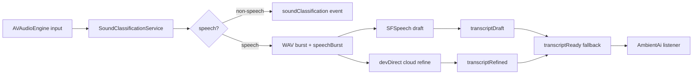
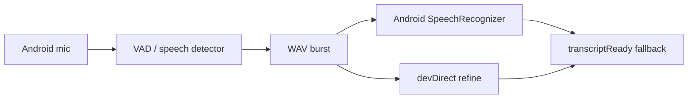

# Ambient AI Plugin

## 结论

`@pin/capacitor-ambient-ai` 已经从多个零散 Capacitor 插件收束为一个统一包。JS 侧只公开 `AmbientAi` facade 和新命名 types；iOS 侧已经把音频采集、SoundAnalysis 分类、SFSpeech 本地转录、devDirect cloud refine、WAV 临时存储和播放都合到内部 `AudioCapture` bridge；前端 `sound_classifier` source 已把 `transcriptReady` 转成 `session_summary`，继续走现有 `SignalBuffer → /api/proactive/devices/ingest`。

这篇文档不是一次性进度日志，而是 AmbientAi dev v1 的接力说明。后续改 `@pin/capacitor-ambient-ai`、Ambient Debug Panel、音频转录上报、Android 端插件实现时先读这里。

## 当前状态

| 区域 | 状态 | 说明 |
|---|---|---|
| JS facade | 已实现 | `capacitor-plugins/ambient-ai/src/index.ts` 只导出 `AmbientAi` 和 public types。 |
| iOS AudioCapture | 已实现 | `AudioCapturePlugin` 管理权限、配置、capture、classification、pending transcript、WAV list/playback。 |
| 前端 ingest | 已实现 | `SoundClassifierSource` 同时处理 non-speech sound labels 和 speech transcripts。 |
| Debug UI | 已实现 | `AmbientAudioDebugPanel` 嵌入 `AmbientSourcesPanel`，服务真机调试。 |
| Package cleanup | 已完成 | standalone `proactive-engine`、`sound-classifier`、`visit-monitor` 不再作为前端依赖；旧 public plugin object 不再导出。 |
| Android native | 待实现 | `capacitor-plugins/ambient-ai/android/` 当前只有 `.gitkeep`，Android 端需要按本页接口补齐。 |
| Production transcribe proxy | 非 dev v1 范围 | 目前 cloud refine 走 `devDirect`；生产 `/api/proactive/mobile/transcribe` 后续另做。 |

## 包边界

### Public API

入口：`capacitor-plugins/ambient-ai/src/index.ts`

调用方只应该这样用：

```ts
import { AmbientAi, type TranscriptReadyEvent } from "@pin/capacitor-ambient-ai";
```

不要再直接 import 内部模块对象，例如 `AudioAmbient`、`SoundClassifier`、`VisitMonitor`。这些 native plugin 仍可作为 facade 内部实现存在，但不再是 public API。

### Facade 结构

核心文件：

- `capacitor-plugins/ambient-ai/src/facade/types.ts`：public 类型、namespace interface、event map。
- `capacitor-plugins/ambient-ai/src/facade/native.ts`：内部 `registerPlugin(...)` 和 adapter 实例。
- `capacitor-plugins/ambient-ai/src/facade/ambient-ai.ts`：`AmbientAi` facade，把 namespace 方法转发到内部插件。
- `capacitor-plugins/ambient-ai/src/facade/audio-capture.ts`：web fallback，保持 type-complete，但 native 能力为 no-op/unavailable。

当前 namespace：

```ts
AmbientAi.audio
AmbientAi.sound
AmbientAi.visit
AmbientAi.device
AmbientAi.calendar
AmbientAi.notifications
AmbientAi.media
AmbientAi.nearby
AmbientAi.sensor
AmbientAi.health
AmbientAi.battery
AmbientAi.contacts
AmbientAi.addListener(eventName, callback)
AmbientAi.removeAllListeners()
```

`audio` 和 `sound` 在 iOS 上都路由到内部 native plugin `AudioCapture`。这是刻意设计：speech gate、音频流、WAV burst 和转录需要共享同一个音频 session，不能再拆成两个 native engine。

## AudioCapture 合约

### Methods

Android 端需要实现同名 Capacitor plugin `AudioCapture`，并至少支持这些 promise methods：

```ts
requestPermissions(): Promise<AudioPermissions>
checkPermissions(): Promise<AudioPermissions>
configure(config: AudioCaptureConfig): Promise<void>
startCapture(): Promise<void>
stopCapture(): Promise<void>
getState(): Promise<AudioState>
drainPendingTranscripts(): Promise<TranscriptReadyEvent[]>
listRecentCaptures(): Promise<{ captures: RecentAudioCapture[] }>
playCapture({ wavId }: { wavId: string }): Promise<void>
stopPlayback(): Promise<void>
startClassification(): Promise<void>
stopClassification(): Promise<void>
```

注意 facade 层的 `drainPendingTranscripts()` 返回 `TranscriptReadyEvent[]`，native bridge 原始返回值是 `{ transcripts }`。

### Config

`AudioCaptureConfig` 由 debug panel 或调用方传入：

```ts
interface AudioCaptureConfig {
  cloudMode?: "off" | "devDirect" | "proxy";
  recognitionLocale?: string;
  cloudApiKey?: string;
  cloudBaseURL?: string;
  modelName?: string;
  cloudRefineTimeoutMs?: number;
  preRollMs?: number;
  postRollMs?: number;
  maxBurstMs?: number;
  minBurstMs?: number;
  wavRetentionTtlMs?: number;
  wavMaxBytes?: number;
  wavMaxFiles?: number;
}
```

默认模型是 dev v1 的 `gpt-4o-transcribe`。`proxy` mode 目前只是协议预留，不代表生产 proxy 已实现。

### Events

`AmbientAi.addListener(...)` 当前会路由这些 audio 事件到 `AudioCapture`：

| Event | 用途 |
|---|---|
| `ambientLevel` | 音量/环境音 level。 |
| `audioState` | running / paused / capturing / suppressed 状态。 |
| `audioError` | capture、soundAnalysis、playback 等错误。 |
| `soundClassification` | top sound labels；speech 只触发录音 gate，不直接上报 sound signal。 |
| `speechBurst` | 检测到 speech burst。 |
| `transcriptDraft` | 本地 ASR 草稿。 |
| `transcriptRefined` | cloud refine 结果，用于 debug 观察。 |
| `transcriptReady` | 唯一进入前端 ingest 的 transcript 终态。 |

`TranscriptReadyEvent` 是跨平台关键契约：

```ts
interface TranscriptReadyEvent {
  platform: "ios" | "android" | "web";
  wavId: string;
  burstId: string;
  captureSessionId: string;
  text: string;
  capturedAt: string;
  durationMs: number;
  provider: "local_speech" | "cloud_whisper";
  fallback: boolean;
  localProvider?: "sfspeech" | "android_speech";
  segmentIndex?: number;
  transcriptLocale?: string;
}
```

## iOS 实现

入口：`capacitor-plugins/ambient-ai/ios/Sources/AmbientAi/Plugins/AudioCapturePlugin.swift`

核心文件：

| 文件 | 职责 |
|---|---|
| `AudioCapturePlugin.swift` | Capacitor bridge，暴露 methods，发 JS events，处理 playback。 |
| `Audio/AudioStreamManager.swift` | 音频 capture session、AVAudioEngine、classification、ASR、cloud refine 的协调 actor。 |
| `Audio/SoundClassificationService.swift` | SoundAnalysis stream analyzer，产出 speech/non-speech 分类。 |
| `Audio/CloudTranscriptionWorker.swift` | devDirect Whisper multipart refine。 |
| `Audio/AudioFileStore.swift` | WAV 临时存储、TTL/LRU、list/play 查找。 |
| `Audio/TranscriptStitcher.swift` | transcript segment 拼接。 |
| `Support/AudioCaptureConfig.swift` | native config 默认值和解析后的配置。 |
| `Support/AudioCaptureModels.swift` | native payload/model。 |

### iOS 数据流



### 运行语义

- `startCapture()` 创建 capture session；每次 start/stop 周期有自己的 `captureSessionId`。
- speech burst 生成 `burstId` 和 `wavId`；长音频按 `maxBurstMs` 切分，并用 `segmentIndex` 标识。
- `cloudMode=devDirect` 时优先用 cloud refine；超时或失败后，满足长度条件的本地 SFSpeech 结果会作为 fallback。
- late refined 只用于 debug，不应该再发第二个 `transcriptReady`。
- `drainPendingTranscripts()` 读取 native 内存队列，服务 app resume 或 debug 手工 drain。
- `playCapture({ wavId })` 播放本地临时 WAV，播放期间 `audioState.suppressed=true` 且 reason 为 `playback`。

## 前端 ingest 链路

入口：`proactive-ai-frontend/src/services/ambient/index.ts`

```mermaid
flowchart LR
  Native[AmbientAi events] --> Source[SoundClassifierSource]
  Source --> Buffer[SignalBuffer]
  Buffer --> Bridge[ingestBatch]
  Bridge --> API[/api/proactive/devices/ingest]
```

相关文件：

| 文件 | 职责 |
|---|---|
| `src/services/ambient/index.ts` | `AmbientRuntime` singleton；source start/stop；buffer flush；UI subscribe。 |
| `src/services/ambient/buffer.ts` | 5s 或 20 条触发 flush；失败 re-queue。 |
| `src/services/ambient/ingest-bridge.ts` | `ensureDevice` + `ingestSignals`。 |
| `src/services/ambient/lifecycle.ts` | app inactive 时 best-effort flush，不自动启动 source。 |
| `src/services/ambient/sources/sound-classifier.ts` | sound label 和 transcript 转 PersonalSignal。 |

### `sound_classifier` source 行为

- source key 仍是 `sound_classifier`。
- non-speech top label 继续生成 `device.sound_classification`，沿用 confidence 和 dedupe window。
- top label 为 `speech` 时不生成 sound classification signal，只交给 native 音频 capture/transcript 流。
- `transcriptReady.text.trim().length < 24` 时忽略。
- `transcriptReady` 达到长度后生成：

```ts
{
  kind: "session_summary",
  title: "Voice summary",
  summary: event.text.trim(),
  occurred_at: event.capturedAt,
  salience: 0.7,
  confidence: 0.75,
  dedupe_key: `${event.platform}:audio:${event.burstId}`,
  payload: {
    platform: event.platform,
    wavId: event.wavId,
    burstId: event.burstId,
    captureSessionId: event.captureSessionId,
    durationMs: event.durationMs,
    provider: event.provider,
    fallback: event.fallback,
    localProvider: event.localProvider,
    segmentIndex: event.segmentIndex
  }
}
```

一个小坑：`AmbientRuntime` 当前按 source key 统计 ingested count，`sound_classifier` 的统计 kind 仍映射到 `device.sound_classification`；`session_summary` 会被正常 ingest，但 UI 上 per-source ingested count 不一定能准确反映 transcript 条数。

## Debug Panel

入口：

- `proactive-ai-frontend/src/components/AmbientSourcesPanel.tsx`
- `proactive-ai-frontend/src/components/AmbientAudioDebugPanel.tsx`
- `proactive-ai-frontend/src/components/DebugPanel.tsx`

当前 Debug Panel 支持：

- 启停 ambient sources。
- 查看 runtime buffer size、last event、ingest status。
- 配置 audio cloud mode、recognition language、API key、model、timeout、pre/post roll、WAV TTL。
- 查看 `audioState`、speech gate、recording session、recent audio events。
- `listRecentCaptures()`、`playCapture()`、`stopPlayback()`。
- `drainPendingTranscripts()`。

API key 输入只服务 devDirect 真机调试，不要把 dev key 固化进代码、环境变量或文档。

## Android 接力清单

Android 当前没有 native 实现。为了让同一个 JS facade 在 Android 上可用，建议按下面顺序补齐。

### 1. 建 Capacitor plugin 壳

在 `capacitor-plugins/ambient-ai/android/` 下实现 `AudioCapture` plugin，保证 JS `registerPlugin<AudioCapturePlugin>("AudioCapture")` 能命中 native，而不是落到 web noop。

最低验收：

- `requestPermissions()` / `checkPermissions()` 返回 microphone + speechRecognition。
- 12 个 methods 都存在，未实现能力要明确 reject，不要静默 no-op。
- 事件名和 payload 字段与 `src/facade/types.ts` 保持一致。

### 2. 先做 transcriptReady，再扩 non-speech classification

第一阶段可以先实现 speech capture/transcription：



只要能稳定发 `transcriptReady`，前端 `SoundClassifierSource` 就能生成 `session_summary` 并进入 ingest。

第二阶段再补 non-speech `soundClassification`，保证现有 sound classification signal 也能在 Android 上工作。

### 3. Android provider 字段

- `TranscriptReadyEvent.platform` 必须是 `android`。
- 本地转录 provider 用 `provider: "local_speech"` + `localProvider: "android_speech"`。
- cloud refine 成功用 `provider: "cloud_whisper"`，fallback=false。
- cloud 失败/超时走本地时 fallback=true。

### 4. WAV 和 playback

Android 也要支持 `listRecentCaptures()` 和 `playCapture({ wavId })`，用于 Debug Panel 真机验证。WAV 存储可以先用 app cache dir，加 TTL / max files 清理，协议字段保持：`wavId`、`burstId`、`captureSessionId`、`capturedAt`、`durationMs`、`byteSize`。

### 5. 后续非 audio namespaces

当前 iOS 已有多个 Ambient 子插件；Android 端除 community adapter 能力外，Calendar、VisitMonitor、NotificationUsage、MediaNotebook、NearbyConnectivity、DeviceState 等 native parity 仍需逐项补。优先级建议按产品数据价值排序：

1. AudioCapture transcript。
2. Visit / location / activity。
3. Device state / battery / health。
4. Calendar / notifications / media / nearby / contacts。

## 验证入口

### 文档和 TypeScript

```bash
npm --prefix "/Users/pis/workspace-intelligence/pinai-intelligence/repos/PIN-AI-ASSISTANT/capacitor-plugins/ambient-ai" run build
npm --prefix "/Users/pis/workspace-intelligence/pinai-intelligence/repos/PIN-AI-ASSISTANT/proactive-ai-frontend" run type-check
npm --prefix "/Users/pis/workspace-intelligence/pinai-intelligence/repos/PIN-AI-ASSISTANT/proactive-ai-frontend" run test -- src/services/ambient/sources/sound-classifier.test.ts src/components/AmbientAudioDebugPanel.test.tsx
```

### iOS build

```bash
npm --prefix "/Users/pis/workspace-intelligence/pinai-intelligence/repos/PIN-AI-ASSISTANT/proactive-ai-frontend" run cap:sync
xcodebuild -workspace "/Users/pis/workspace-intelligence/pinai-intelligence/repos/PIN-AI-ASSISTANT/proactive-ai-frontend/ios/App/App.xcworkspace" -scheme App -configuration Debug -destination 'generic/platform=iOS' build
```

如果直接跑 `swift build --package-path capacitor-plugins/ambient-ai`，会以 macOS target 编译，可能加载不到 iOS-only Capacitor module；验证 Swift package 时要用 iPhoneOS SDK/triple。

### 真机矩阵

这 10 项用于每次大改后回归；结果应记录在 PR 或后续模块文档中：

1. Foreground speech → draft → refined → `transcriptReady` → ingest success。
2. Bad key/offline → timeout 后本地 `local_speech` fallback。
3. Lock screen/background speech 仍能产生 `transcriptReady`。
4. Media playback 时 `suppressed=true`，不产生 transcript。
5. WAV list/play 正常；playback 期间 capture suppressed。
6. 超过 `maxBurstMs` 的 speech 拆成多个 segment。
7. Bluetooth route changes 后恢复。
8. Call/system interruption pause 后恢复。
9. Stop toggle 后不再 capture；已生成 transcript 仍可 drain。
10. App resume 能 drain pending transcripts。

## 已知风险和后续 TODO

1. **Android 当前为零实现**：JS facade 在 Android 上会落到 web fallback/noop，产品上等同不可用。Android 同事应优先补 `AudioCapture`。
2. **devDirect key 管理**：Debug Panel 里输入的 cloud API key 仅用于开发真机验证，不要持久化到 repo。
3. **production proxy 缺失**：`cloudMode="proxy"` 是协议预留；生产 `/api/proactive/mobile/transcribe` 未实现前不要在产品路径启用。
4. **SignalBuffer 退避简单**：失败后 re-queue，下一次 timer/push 会重试；持续网络异常时可能频繁打 ingest。
5. **audio 和 sound 共享 engine**：`SoundClassifierSource.start()` 会连续调用 `audio.startCapture()` 和 `sound.startClassification()`；native 层必须保证共享音频 session 幂等。
6. **统计口径不完整**：`session_summary` 会 ingest，但 runtime per-source count 目前主要按 `device.sound_classification` 统计。

## 历史 slice 对照

| Slice | 状态 | 当前对应实现 |
|---|---|---|
| A — Facade hard cut + package cleanup | Complete | `AmbientAi` facade + frontend imports 收敛；deprecated packages 清理。 |
| B — AudioCapture native skeleton | Complete | `AudioCapturePlugin` bridge 和 `AmbientAi.audio/sound` 路由。 |
| C — Migrate iOS audio core | Complete | iOS 音频核心、WAV、SFSpeech、devDirect refine、事件队列。 |
| D — Frontend source + ingest | Complete | `transcriptReady` → `session_summary` → existing ingest。 |
| E — Ambient Debug Panel + true-device path | Complete | Debug panel 已有配置、状态、WAV、drain 和 validation prep。 |

## 非目标

- 不实现生产 `/api/proactive/mobile/transcribe`。
- 不上传原始 WAV 到后端。
- 不做 native persistent transcript outbox。
- 不做端侧 LLM、Memory、ContentPlanning、AssistantPlanner、AutoRunner。
- 不做最终用户 UI；当前 panel 是开发验证工具。
