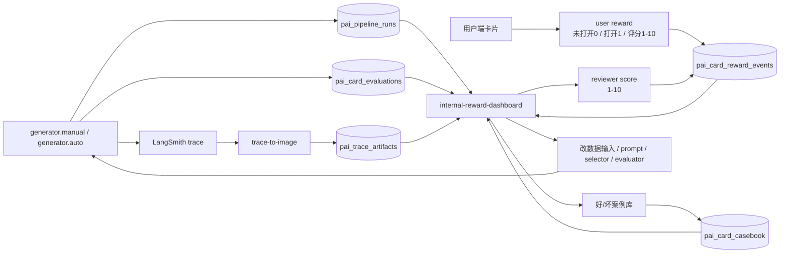
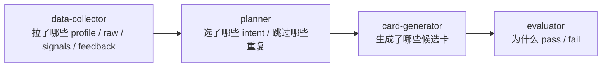

# Card Reward Infra + Internal Dashboard

## 结论

这套不是 demo dashboard,而是卡片生成的训练回路。第一版就要跑通:

1. 每批生成卡片能被内部 reviewer 逐张打 1-10 分。
2. 用户侧 reward 统一到同一套 0-10 语义:未打开 = 0,打开但未评分 = 1,主动评分 = 1-10。
3. 高分 / 低分卡能沉淀到案例库,带当时的卡片、source、evaluator 反馈、reward snapshot 和人工备注。
4. 每个 generation run 能看到 LangSmith / DeepAgents 过程图,帮助人判断问题出在 data-collector、planner、card-generator 还是 evaluator。
5. dashboard 能按 run / card / casebook / trace 组织内部迭代,服务"单位时间内修更多问题,更快提高 AHA moment 命中率"。

第一阶段只新增独立内部前端和 backend 后端 surface,不改 generation 主链路,不把内部 reviewer 分数直接喂回线上 planner。等 reward 数据稳定后,再决定哪些信号进入 prompt / selector / evaluator。



## 目标

### 产品目标

主动 AI 卡片要追的是用户的 AHA moment。第一版 reward 目标不要复杂化,先用统一分数:

| 场景 | 分数语义 |
|---|---|
| 用户未打开卡片 | `0` |
| 用户打开但未评分 | `1` |
| 用户主动评分 | `1-10` |
| 内部 reviewer 评分 | `1-10`,单独记录为 `source='reviewer'` |

核心指标:

| 指标 | 定义 | 用途 |
|---|---|---|
| Batch Reward | 一批卡片的平均 user score,无 user score 时可切到 reviewer score | 看每轮生成整体质量 |
| Dead Card Rate | `score = 0` 的比例 | 衡量有多少卡片完全没吸引用户 |
| AHA Rate | `score >= 8` 的比例 | 衡量直击人心的卡片占比 |
| Reviewer Avg | 内部 reviewer 分数均值 | 在真实用户样本不足时快速迭代 |
| Evaluator Gap | evaluator 高分但 reviewer / user 低分 | 找自评失真 |
| Casebook Growth | 每天新增的高分 / 低分案例数 | 衡量案例沉淀速度 |
| Review Latency | run 完成到评分完成的时间 | 衡量单位时间迭代效率 |

### 工程目标

- 新建独立 Vite React app:`internal-reward-dashboard/`。
- 后端改在 `backend/`,新增 migration、repository、route。
- 数据读取复用现有 `pai_pipeline_runs`、`pai_card_evaluations`、`pai_feedback_events`。
- 数据写入新增 reward / casebook / trace artifact 表。
- 不修改 `proactive-ai-frontend` 主产品 UI,用户侧 open event 后续单独接入。
- 不复用 `proactive-ai-frontend` 的复杂产品组件,只复用必要 auth / API 模式,保持内部工具轻。

## 非目标

- 不做多人标注系统。用户已经拍板:每个人最熟悉自己的卡片,第一版每个 user 只看和评自己的数据。
- 不做完整 A/B 实验平台。先把 reward ledger 和 casebook 建稳。
- 不让 reviewer 分数自动影响线上 planner。先人工读 dashboard,再手动改 prompt / selector / 数据输入。
- 不把 trace 图做成营销海报。第一版要可解释、可调试,优先 deterministic SVG / PNG。
- 不在第一阶段改 generation 主链路或现有卡片生成 prompt。

## 系统边界

### 新目录

```text
internal-reward-dashboard/
  package.json
  vite.config.ts
  src/
    app/
    api/
    auth/
    routes/
    components/
    styles/
```

独立 app 的默认开发端口建议用 `3004`,避免和 Docker bundle `3000`、Vite 主前端 `3003` 冲突。

### 后端新增模块

```text
backend/src/pinai_agents/web/routes/ui/reward_dashboard.py
backend/src/pinai_agents/web/db/repositories/reward.py
backend/src/pinai_agents/web/services/trace_artifacts.py
backend/db/migrations/0XX_pai_card_reward_infra.sql
```

路由仍使用 Supabase JWT `current_user`,默认只读写当前 user 的 runs / cards / rewards / casebook。这样每个人评自己的卡片,不需要第一版引入 admin 权限模型。

## 数据模型

### `pai_card_reward_events`

reward ledger 是追加日志,不做覆盖写。当前分数由查询时按规则折叠。

| 列 | 类型 | 说明 |
|---|---|---|
| `user_id` | BIGINT | RLS scope |
| `id` | TEXT | uuid |
| `run_id` | TEXT | 对应 `pai_pipeline_runs.run_id` |
| `card_id` | TEXT | 对应生成卡 id |
| `source` | TEXT | `user` / `reviewer` / `system` |
| `event_type` | TEXT | `card_open` / `user_score` / `reviewer_score` / `dismiss` / `imported_feedback` |
| `score` | REAL NULL | 0-10;open event 可写 1,未打开不写事件,查询时派生 0 |
| `reason` | TEXT NULL | 人工解释或系统原因 |
| `metadata` | JSONB | route、device、UI surface、trace id、app version 等扩展 |
| `created_at` | TIMESTAMPTZ | 事件时间 |

索引:

- `(user_id, run_id, created_at DESC)`
- `(user_id, card_id, created_at DESC)`
- `(user_id, source, event_type, created_at DESC)`

折叠规则:

```text
user_reward(card):
  latest user_score exists -> that score
  else card_open exists -> 1
  else -> 0

reviewer_reward(card):
  latest reviewer_score exists -> that score
  else -> null

display_reward(card):
  default user_reward
  dashboard 可切换 reviewer_reward / blended view
```

### `pai_card_casebook`

casebook 是人工沉淀的训练样本,不是普通 feedback。每张卡对同一 user 默认只有一条 casebook 记录,允许后续更新 label / note。

| 列 | 类型 | 说明 |
|---|---|---|
| `user_id` | BIGINT | RLS scope |
| `id` | TEXT | uuid |
| `run_id` | TEXT | 生成 run |
| `card_id` | TEXT | 卡片 id |
| `label` | TEXT | `great` / `bad` / `surprising` / `generic` / `hallucinated` / `duplicate` / `mistimed` / `weak_source` |
| `score_snapshot` | REAL NULL | 加入案例库时的显示分 |
| `reviewer_note` | TEXT NULL | 人工说明 |
| `snapshot` | JSONB | `{card, evaluation, rewards, sources, run}` 固化当时上下文 |
| `created_at` | TIMESTAMPTZ | 创建时间 |
| `updated_at` | TIMESTAMPTZ | 更新时间 |

约束:

- `UNIQUE (user_id, card_id)`
- `snapshot` 必须包含当时卡片正文和 evaluator feedback,避免后续 run / card shape 变化导致案例失真。

### `pai_trace_artifacts`

trace artifact 存的是"可解释结构",不是只存图片路径。图片可以重渲染。

| 列 | 类型 | 说明 |
|---|---|---|
| `user_id` | BIGINT | RLS scope |
| `run_id` | TEXT | generation run |
| `langsmith_trace_id` | TEXT NULL | 找到的 LangSmith root trace |
| `status` | TEXT | `pending` / `ready` / `missing` / `failed` |
| `trace_tree` | JSONB | 标准化后的 node tree |
| `summary` | JSONB | 每阶段摘要:data / plan / cards / eval |
| `image_format` | TEXT | `svg` / `png` |
| `image_path` | TEXT NULL | 本地或 storage path |
| `error` | TEXT NULL | 失败原因 |
| `generated_at` | TIMESTAMPTZ | 生成时间 |

主键:`(user_id, run_id)`。

## API 设计

所有接口挂在 Supabase JWT 后面,只处理当前 user。

| Method | Path | 作用 |
|---|---|---|
| `GET` | `/api/reward-dashboard/runs` | run 列表 + 聚合分数 |
| `GET` | `/api/reward-dashboard/runs/{run_id}` | run 详情 + cards + eval + reward summary |
| `GET` | `/api/reward-dashboard/cards/{card_id}` | 单卡详情 + reward history + casebook |
| `POST` | `/api/reward-dashboard/cards/{card_id}/score` | 写 reviewer score 或 user score event |
| `POST` | `/api/reward-dashboard/cards/{card_id}/casebook` | upsert casebook 记录 |
| `DELETE` | `/api/reward-dashboard/cards/{card_id}/casebook` | 移出 casebook |
| `GET` | `/api/reward-dashboard/casebook` | 案例库列表和筛选 |
| `POST` | `/api/reward-dashboard/runs/{run_id}/trace` | 拉取 / 重建 trace artifact |
| `GET` | `/api/reward-dashboard/runs/{run_id}/trace` | 读取 trace artifact |
| `GET` | `/api/reward-dashboard/metrics` | 时间序列指标 |

### 聚合查询

run 列表需要一次性返回:

- `runId`
- `completedAt`
- `trigger`
- `cardCount`
- `avgUserReward`
- `avgReviewerReward`
- `deadCardRate`
- `ahaRate`
- `reviewedCount`
- `casebookCount`
- `avgEvaluatorOverall`
- `traceStatus`

不要前端 N+1 拉每张卡再算。后端 repository 用 SQL 聚合 `pai_pipeline_runs.final_cards`、`pai_card_evaluations`、`pai_card_reward_events`、`pai_card_casebook`。

## Internal Dashboard 页面

### `/runs`

用于每天看整体迭代情况。

布局:

- 顶部 metrics strip:`Batch Reward`、`Dead Card Rate`、`AHA Rate`、`Review Latency`。
- run table:完成时间、trigger、卡片数、平均 evaluator、平均 reviewer、0 分率、8-10 分率、trace 状态、casebook 数。
- 筛选:时间范围、trigger、reviewed/unreviewed、AHA / dead-card。

### `/runs/:runId`

用于逐张评一批卡。

每张卡展示:

- 卡片 title / summary / why now / recommended action。
- evaluator 五维分和 feedback。
- source 列表。
- user reward、reviewer reward。
- 1-10 评分控件。
- 加入案例库按钮,可选 label + note。
- trace 阶段跳转。

### `/cards/:cardId`

用于深挖单卡。

展示:

- card snapshot。
- reward history。
- evaluator feedback。
- related feedback events。
- casebook note。
- 同 intent 历史卡片,帮助判断重复或进步。

### `/casebook`

用于沉淀 few-shot 和失败模式。

筛选:

- label。
- score range。
- basket / intent。
- evaluator gap。
- 时间范围。

列表默认按最近更新时间,支持导出 markdown 片段,给后续 prompt review 使用。

### `/traces/:runId`

用于看推理过程图。

第一版图分四段:



图上必须能看:

- 哪些数据源被用到。
- 哪些 intent 被跳过。
- 每张卡的 evaluator verdict。
- 最弱卡和原因。
- trace 缺失时显示明确原因,不假装成功。

## Trace-to-image 方案

### Phase 1: deterministic graph

优先做稳定 SVG:

1. 通过 `run_id` 找 LangSmith root trace。
2. 标准化 trace tree,只保留 stage、tool call、input/output 摘要、错误、token/latency。
3. 生成 SVG / Mermaid-like graph。
4. 存到 `pai_trace_artifacts.trace_tree` + `summary` + `image_path`。

这一版足够定位问题,也便于 CI / tests 验证。

### Phase 2: narrative image

等 deterministic graph 稳定后,可以让 Codex / GPT image 根据 trace summary 生成更适合人审的解释图。但 narrative image 只做辅助,不能替代结构化 trace tree。

### LangSmith 绑定规则

实现时要确保 generator root run 带 metadata:

```json
{
  "pinai_run_id": "<pai_pipeline_runs.run_id>",
  "pinai_user_id": "<user_id>",
  "pinai_agent": "generator"
}
```

如果当前 LangSmith trace 里没有这个 metadata,第一步先在 generator/chat invocation 加 tags / metadata,再做查询。否则只能靠时间窗口和 run_id 文本搜索,不够稳。

## 用户端 open event 接入

第一阶段可以不动 `proactive-ai-frontend`,但数据模型必须按最终用户 reward 设计。

第二阶段接入时:

- 卡片在用户端被打开时,写 `pai_card_reward_events(source='user', event_type='card_open', score=1)`。
- 用户主动 1-10 评分时,写 `event_type='user_score', score=<1-10>`。
- 未打开卡不写事件,在 query 时按"generated cards - open/score events"派生 0 分。
- dismiss / snooze / confirm 仍保留在 `pai_feedback_events`,dashboard 可以联表展示,但不要把所有 feedback 强行复制进 reward ledger。

## 实施顺序

### Step 1: Backend schema + repository

文件:

- `backend/db/migrations/0XX_pai_card_reward_infra.sql`
- `backend/src/pinai_agents/web/db/repositories/reward.py`
- `backend/tests/web/db/repositories/test_reward_repo.py`

验收:

- migration 创建三张表和索引。
- RLS 覆盖新表。
- repository 能写 score event、upsert casebook、读 run 聚合。
- 测试覆盖 user reward 折叠规则:score > open > 0。

### Step 2: Backend UI routes

文件:

- `backend/src/pinai_agents/web/routes/ui/reward_dashboard.py`
- `backend/src/pinai_agents/web/app.py`
- `backend/tests/web/routes/test_reward_dashboard.py`

验收:

- `GET /api/reward-dashboard/runs` 能返回真实 run 聚合。
- `POST /cards/{card_id}/score` 能写 reviewer score。
- `POST /cards/{card_id}/casebook` 能存 snapshot。
- 当前 user 不能读写别人的 card / run。

### Step 3: Internal Vite app skeleton

文件:

- `internal-reward-dashboard/package.json`
- `internal-reward-dashboard/vite.config.ts`
- `internal-reward-dashboard/src/**`

验收:

- `cd internal-reward-dashboard && npm install && npm run dev -- --host 127.0.0.1 --port 3004` 可启动。
- 能用 Supabase session 调 backend API。
- `/runs` 显示真实 run。
- `/runs/:runId` 显示真实 cards 和 evaluator score。

### Step 4: Reviewer scoring + casebook UI

验收:

- 在 `/runs/:runId` 对任意卡打 1-10 分,刷新后还在。
- 加入案例库后 `/casebook` 能看到。
- 修改 label / note 后 snapshot 不丢。
- dashboard 聚合指标随评分变化。

### Step 5: Trace artifact

文件:

- `backend/src/pinai_agents/web/services/trace_artifacts.py`
- `backend/tests/web/services/test_trace_artifacts.py`
- `internal-reward-dashboard/src/routes/TraceView.tsx`

验收:

- 给一个 `run_id`,能生成或读取 trace artifact。
- 找不到 LangSmith trace 时返回 `status='missing'` 和原因。
- 找到 trace 时 dashboard 能展示四阶段图。
- trace 图能落盘或存 storage path,刷新不重复生成。

### Step 6: User open event 接入

文件:

- `proactive-ai-frontend/src/components/NowFeed.tsx` 或 card detail 打开入口。
- `proactive-ai-frontend/src/lib/api.ts`

验收:

- 用户打开卡片时写 `card_open`。
- 未打开卡在 dashboard 聚合里自动算 0。
- 不影响现有 `POST /api/feedback` 和 card chat。

## 验证命令

后端:

```bash
cd backend && uv run ruff check .
cd backend && uv run pytest tests/web/db/repositories/test_reward_repo.py
cd backend && uv run pytest tests/web/routes/test_reward_dashboard.py
```

内部前端:

```bash
cd internal-reward-dashboard && npm run type-check
cd internal-reward-dashboard && npm test
cd internal-reward-dashboard && npm run build
```

本地手工:

```bash
make up
cd internal-reward-dashboard && npm run dev -- --host 127.0.0.1 --port 3004
```

用浏览器打开 `http://127.0.0.1:3004`,登录后验证:

- `/runs` 有真实 generation run。
- `/runs/:runId` 能打分。
- `/casebook` 能看到刚加入的卡。
- `/traces/:runId` 能显示 ready / missing / failed 之一,不能空白。

## 风险和处理

| 风险 | 处理 |
|---|---|
| LangSmith trace 没有稳定 run_id metadata | 先给 generator root invocation 加 metadata,没有 metadata 不做模糊绑定上线 |
| reviewer score 和 user score 混在一起 | schema 用 `source` + dashboard view 明确切换,默认看 user reward |
| 内部 dashboard 变成另一个产品前端 | 保持独立 folder,只做 dense internal tool,不引入主产品 UI 叙事 |
| casebook snapshot 太大 | snapshot 只存 card/eval/reward/source 摘要,raw 大内容只存 ids |
| RLS 漏数据 | 新表跟随 `023_pai_rls.sql` 风格加 policy,route 测试覆盖跨 user 访问 |
| 评分事件重复写导致分数跳动 | ledger 允许追加,查询只取每个 source/event_type 的 latest score |

## Definition of Done

这套计划第一轮实现完成的标准:

- 独立 Vite app 能跑起来。
- 能从真实 `pai_pipeline_runs` 和 `pai_card_evaluations` 读卡片。
- 能对每张卡打 reviewer score,并持久化。
- 能把卡加入好 / 坏案例库,并保留 snapshot 和备注。
- 能按 run / card / casebook 看历史。
- 能计算 Batch Reward、Dead Card Rate、AHA Rate。
- 能对 run 生成 trace artifact,或者明确显示 trace 缺失原因。
- 不影响现有 generation、feedback、NowFeed 主链路。
