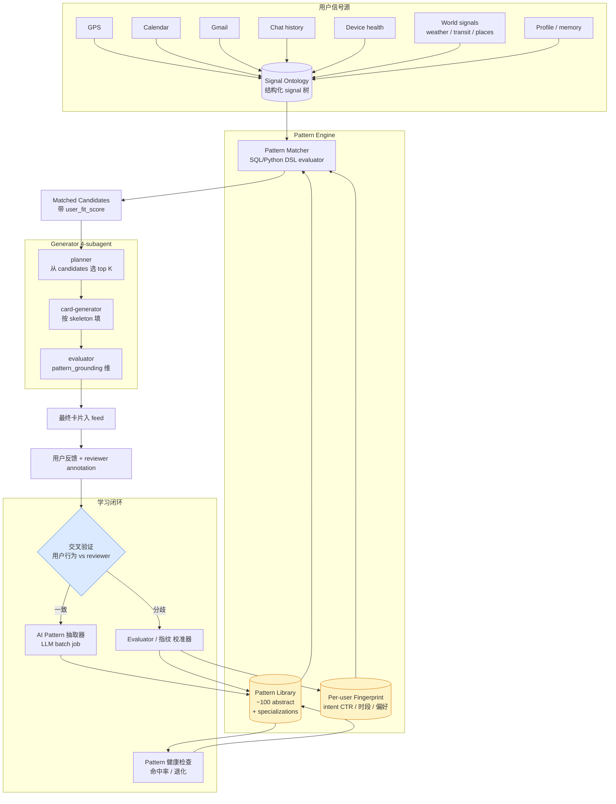
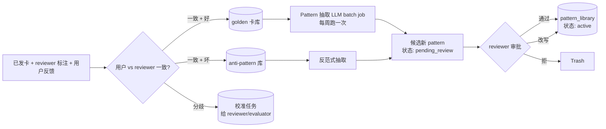
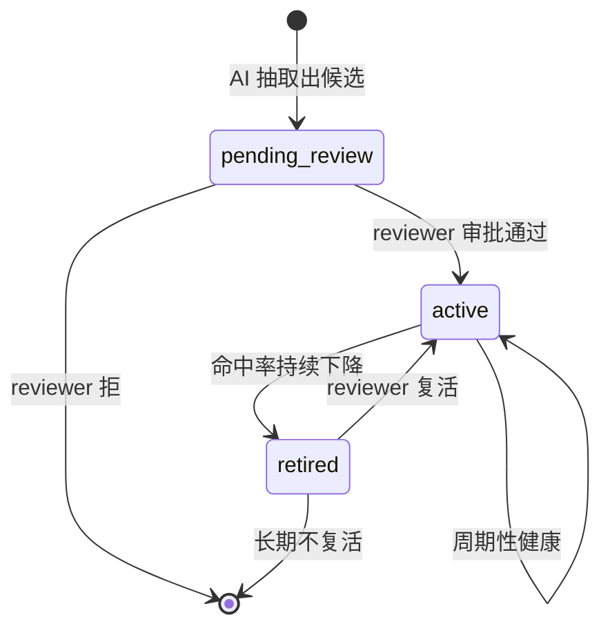

# Pattern-Driven Card Generation

## 结论(给 AI 看的目标)

把主动卡片生成系统改造成 **pattern-schema 驱动的学习平台**。共享层是抽象 pattern(人类认知/行为范式的工程化),个体层是 LLM 在 schema 约束内填充用户具体内容。

> **核心命题**: AI 时代和互联网时代最大的差别 — 不是"千人千面"程度,
> 而是"共享什么"。互联网共享个体偏好向量(协同过滤),
> personal AI 共享的是**认知 schema**,而用户的具体数据只在本地填充。

最终系统每一轮循环(一次 generate)产生 `(X, A, Y) = (用户 context, 生成决策, 用户/reviewer 反馈)` 这条样本,
样本同时被 5 种消费者吃:generator prompt 例子 / evaluator rubric / planner ranker / per-user 指纹表 / **pattern 库**。
1 万次循环后真正应该累积下来的是:

1. **Pattern 库**: 几十条 abstract pattern + 几百条 specialization,跨用户共享、跨用户复利。
2. **Per-user 指纹表**: 每用户一张行为指纹,planner 用它做 per-user 排序。
3. **Demo 案例库**: 每个 pattern 的脱敏 golden / anti-pattern 例子,进 generator few-shot。

reviewer 的工作从"标每一张卡"演化为**"校准 pattern 库 + 指纹表"**。
plan 当前文档作为 AI loop 的 SSOT,反复读它推进迭代。

## 设计哲学

| 互联网时代 | Personal AI 时代 |
|---|---|
| 千人千面,基于"相似人群" | 一人一面,基于"共享认知 schema × 个体 signal" |
| 共享 user preference vector(隐私脆弱) | 共享 abstract pattern(只共享结构,不共享数据) |
| 协同过滤 + 内容 embedding | Pattern schema 触发 + LLM 填充 |
| 冷启动差(需要邻居用户数据) | 冷启动好(一条 GPS + 一条共享 schema 即可) |
| 长尾用户效果差 | 长尾用户和 head 用户共享同一 pattern 库 |
| 解释性弱:"和你像的人也喜欢" | 解释性强:"你的日历 X + 邮件 Y 命中 schema Z" |

**Surprise 的两种来源**(plan 必须区分):

| 类型 | 触发逻辑 | 例子 | 频率 |
|---|---|---|---|
| **Combinatorial surprise** | 用户已知信号的 unexpected combination | "周五约会 × 信用卡积分 × 路过" | 低,但高 wow |
| **Recovered relevance** | 用户已知但已失焦的事 | "妈生日还 11 天,你上次电话她血压偏高" | 高频,稳定有用 |

两类都必须做。Plan 不要把"surprise"窄化成只有第一种。

## 整体架构



## 数据模型(三层)

### 第一层 · Signal Ontology

被 pattern trigger 引用的 signal 树,详见 [`docs/data/patterns.yaml`](../data/patterns.yaml) 的 `ontology` 段。

**关键工程决策**:
- Signal subtype(机票 / 看病 / 团队会议)在 **ingest 流水线** 阶段就要打好,不让 generator 边读边猜。
- 结构化 signal(receipt / reservation)用 schema.org 标记直接拿;非结构化(自由文本邮件)用一个轻量 LLM 分类器,**每天异步跑一次**,不在 generate hot path。
- 衍生 signal(commute_route / home_cluster / sleep_rhythm 等)作为 `ontology.inferences` 单独存储,**有自己的 TTL 和 invalidation 规则**。

### 第二层 · Pattern Library

**SSOT 在 [`docs/data/patterns.yaml`](../data/patterns.yaml)**,v0 共 105 条 abstract pattern,18 大类。每条:

```yaml
id: routine_anchor_detected
category: routine_observation
abstract: 一句话认知模式描述
signals: [需要的 signal source]
trigger: 结构化 DSL,Python evaluator 直接求值
intent: 产生的卡片意图
card_skeleton: 生成阶段的结构约束
specializations: 在不同 subtype 下的参数化
surprise: h/m/l
practical: h/m/l
tier: cold_start_friendly | warmup | mature
```

**Trigger DSL 必须可执行,不能是自然语言**。例如:

```yaml
# 错(给人读的)
trigger: "用户在过去 30 天没去过的地方停留超过 10 分钟"

# 对(给系统跑的)
trigger:
  - { op: not_in, field: gps.current.cluster_id, source: gps.history_30d.clusters }
  - { op: gte, field: gps.current.dwell_min, value: 10 }
```

**Abstract pattern + specialization 关系**:

> 一条 `preparation_gap` 抽象 pattern 服务 6+ 种 entity subtype(medical / meeting / flight / interview / presentation / social_dinner)。
> 新增 subtype 不需要新 pattern,只需要加一行 specialization。**这是 pattern 库不爆炸的核心机制。**

### 第三层 · Per-user Fingerprint

不是 LLM 参数,就是数据库里几张表:

| 表 | 内容 | 更新节奏 |
|---|---|---|
| `pai_user_intent_pref` | (user_id, intent, basket, ctr_30d, ctr_7d, last_open_at, last_dismiss_at) | 每次反馈事件 |
| `pai_user_pattern_pref` | (user_id, pattern_id, hit_rate, last_seen, suppress_until) | 每次反馈事件 |
| `pai_user_evidence_pref` | (user_id, evidence_type, hit_rate) | 周级聚合 |
| `pai_user_time_pref` | (user_id, hour_bucket, ctr) | 周级聚合 |
| `pai_user_evaluator_calib` | (user_id, mean_gap, std_gap) | 周级聚合 |

**candidate 排序最终得分**:

```
score = pattern.base_hit_rate            # 全用户上的命中率
      × user_fingerprint.pattern_pref    # 这个用户对该 pattern 的历史 CTR
      × user_fingerprint.intent_ctr      # 这个用户对该 intent 的 CTR
      × user_fingerprint.evidence_pref   # 偏好哪种证据类型
      × recency_decay(last_seen)         # 同类卡最近发过没
```

这是"一人一面"的物理实现。

## Demo 案例库

**SSOT 在 [`docs/data/demo_cards.yaml`](../data/demo_cards.yaml)**,v0 共 105 张 demo card,1:1 对应 patterns.yaml。

每张 demo:
- 完整用户视角的卡片文案(hook + body + action)
- 实际触发场景
- 用到的 signal source 清单
- 为什么 surprise + 为什么 practical
- 人工初评 wow_level(1-5)

用途:
1. **seed dashboard**: Phase 1 启动时直接灌进库,让团队看到"系统跑起来是什么样"
2. **generator few-shot 池**: 每个 pattern 配 1-3 张脱敏 demo 进 stable prefix(享 cache)
3. **人工基线**: wow_level 是后续 reward ledger 校准的起点

## Pattern 注入到 Generator 的方案

当前 generator 4-subagent(详见 [`docs/modules/generation.mdx`](../modules/generation.mdx)):
`data-collector → planner → card-generator → evaluator`

注入点不是 4 个全注入,有主有辅:

| Subagent | 是否注入 pattern | 形式 | 改动重 |
|---|---|---|---|
| data-collector | ❌ | 保持 wide-net,不让 pattern 限制信号收集 | 0 |
| **planner** | ✅ **主注入** | matched_patterns 候选列表 + per-user fingerprint | 中 |
| card-generator | ✅ 辅助 | 对应 pattern 的 card_skeleton + few-shot demo | 中 |
| evaluator | ✅ 校验 | 加 `pattern_grounding` 维度(6 维评分) | 小 |

### Pattern 匹配在 web 侧执行(不在 chat 进程内)

```python
# pinai-agents/src/pinai_agents/web/services/pattern_matcher.py(新建)
def match_patterns(user_id: int, phase1: Phase1Data) -> list[MatchedPattern]:
    """
    cheap DSL trigger evaluation,不调 LLM。
    遍历 pattern_library,Python 直接求值 trigger。
    跑完 100+ pattern × user 应在 <100ms。
    """
    candidates = []
    for p in pattern_library.list_active():
        if p.trigger_matches(phase1):
            candidates.append(MatchedPattern(
                pattern_id=p.id,
                intent=p.intent,
                evidence=p.collect_evidence(phase1),
                user_fit_score=fingerprint.score_for(user_id, p),
                base_hit_rate=p.hit_rate,
            ))
    return rank_by_combined_score(candidates)[:top_k]
```

**关键工程决策**:
- Pattern matching **不能用 LLM**(成本爆炸)— 用 SQL / Python DSL。
- Matching 在 **web 侧** 跑,不在 chat 进程(避免破 trust boundary,chat 不应直接读 pattern DB)。
- Match 结果通过 `GenerateRequest.matched_patterns` 字段传给 chat。

### planner prompt 改动

```
当前 planner 输入:
  /state/phase1.json + cards_recent

改成:
  /state/phase1.json + cards_recent + matched_patterns[] + user_fingerprint

当前 PlanOutput:
  { plan[], skipped_duplicates, cold_baskets }

改成:
  { plan[], skipped_duplicates, cold_baskets, selected_pattern_ids[] }
```

planner 的角色从"凭空想"变成"从 matched candidate 里挑 top K",**这就是"让 AI 可控"的工程实现**。

### card-generator prompt 改动

每张卡的 prompt 段加:

```
你被分配生成的卡片来自 pattern: {pattern_id}
- card_skeleton(必须遵循):
    hook: 一句话点出 ...
    why_now: 引用至少 2 条 signal ...
    evidence: verbatim cite 至少 N 条来源
    action: 提供具体可点动作
- 该 pattern 的 2-3 张脱敏 golden examples:
    [从 demo_cards.yaml 抽取]
```

`card_skeleton` 是骨架不是模板。LLM 仍然写文案,但**结构 / 必须包含的元素 / few-shot 风格**被约束住。

### evaluator 加第 6 维

```
当前 5 维: relevance / actionability / why_now_clarity / novelty / decision_compression
加: pattern_grounding

pattern_grounding 检查:
1. 卡声称属于 pattern X,要求引用 ≥ N 条 signal — sources[] 是否真有?
2. 这些 source 之间的连接是否在文案中显式说明?
3. 单看任一 source 是否都不足以触发这张卡?
不满足 → grounding violation,pass=false。

pass = (overall >= 5.0
        AND no grounding violation
        AND pattern_grounding_ok)
```

这一维关掉"形似而神不似"的 hallucination 漏洞。

### Cache boundary 保护

`ops/litellm/litellm_config.yaml` 当前用 `cache_control_injection_points` 让 stable prefix 进 cache。
Pattern 库注入会破坏 cache 如果不分层。

**正确分层**:

```
[stable prefix - cached]
  system prompt
  output schema
  全量 pattern 库 SCHEMA 描述(只有结构,不带运行时数据)
  对应 pattern 的 few-shot demos(脱敏 golden examples)

[volatile - 每次重算]
  phase1.json
  matched_patterns(命中的 pattern_id + 该用户的 evidence)
  user_fingerprint snapshot
```

实测 stable prefix 应保持 cache hit ≥ 90%。

## Pattern 抽取流水线

新 pattern 不能只靠人手写,需要从 reviewer / user feedback 中半自动生长。



### 交叉验证(防止 AI 评判者自我强化)

| 用户反馈 | reviewer 反馈 | 处理 |
|---|---|---|
| 高(open / 高 user_score) | 高(reviewer 标 great) | 强信号 — 进 golden 库 |
| 低(dismiss / negative chat) | 低(reviewer 标 bad) | 强信号 — 进 anti-pattern 库 |
| 高 | 低 | **校准任务**:reviewer 标准过严? |
| 低 | 高 | **校准任务**:reviewer 看不到用户真实状态? |

**只有对角线两类**进入 pattern 抽取。这是防止"AI 评 → AI 学 → AI 评"自我闭环的核心机制。

### LLM 批量抽取(weekly job)

```python
# pinai-agents/src/pinai_agents/web/jobs/pattern_extractor.py(新建)
def extract_new_patterns():
    """
    每周 sunday 23:00 跑一次。
    输入: 过去 7 天进 golden 库的新卡(取 cross-check 通过的)
    步骤:
      1. cluster golden cards by (intent, evidence_type signature)
      2. 对每个 cluster 找现有 pattern 库匹配
      3. 不匹配的 cluster → LLM 生成候选 pattern_id + abstract + trigger DSL
      4. 写入 pattern_library 状态 pending_review
    """
```

抽取后的 candidate pattern 进 dashboard `/patterns/pending` 等 reviewer 审批,审批通过状态切 `active`。

### 反范式抽取

进 anti-pattern 库的卡同样按 cluster 抽,但生成的是 "**negative pattern**":

```yaml
id: anti_generic_lifestyle_advice
type: negative
abstract: 卡片像通用生活建议,没有任何用户个人 hit
signals_used_pattern: [profile.preferences only]
fail_condition: 没有引用 user-specific signal
```

generator 看到候选卡命中 anti-pattern,直接 fail。这等价于"硬拦截"层的自动生长。

## Pattern 健康检查与生命周期管理

Pattern 不是抽出来就永远有效。需要持续监控并退役。

### 三个生命周期状态



### 健康指标

每条 pattern 周期性计算:

| 指标 | 计算 | 退役阈值 |
|---|---|---|
| `hit_rate_7d` | 近 7 天 hit / (hit + miss) | < 0.15 |
| `hit_rate_30d_trend` | 近 30 天 hit_rate 斜率 | < -0.5 且 30d_hit > 0.3 |
| `dismiss_rate` | dismiss / total | > 0.6 |
| `evaluator_human_gap_mean` | abs(evaluator - reviewer) 均值 | > 3 |

满足退役条件 → 状态切 `retired`,从 active list 移除,dashboard 显示在 `/patterns/retired` 等 reviewer 复盘。

### 防止"过期 pattern"污染

dashboard `/patterns/health` 页面默认按 hit_rate_30d_trend 升序排,reviewer 一眼看到哪些 pattern 在退化。

## Pattern Studio — 内部 dashboard 落地

在 `internal-reward-dashboard/` 新增 5 个页面 + 复用现有 review 页面。

### 页面清单

| 路由 | 页面 | 职责 |
|---|---|---|
| `/patterns` | Pattern Library | 列表所有 active pattern,按 category / hit_rate 筛排 |
| `/patterns/:patternId` | Pattern Detail | 单 pattern 详情、命中样本、specialization 编辑、健康曲线 |
| `/patterns/pending` | Pending Review | AI 抽取出的候选 pattern 等待审批 |
| `/patterns/retired` | Retired | 退役 pattern,可看为什么退役 + 是否复活 |
| `/patterns/health` | Health Monitor | hit_rate / dismiss / gap 监控曲线 |
| `/runs/:runId`(改) | Run Detail | 顶部新增"本批次命中 pattern 分布" |
| `/cards/:cardId`(改) | Card Detail | 顶部显示 pattern_id + 是否命中 skeleton + 是否进 golden/anti |
| `/casebook`(扩展) | Casebook | 改名 golden / anti / pending 三 tab |

### `/patterns/:patternId` 详情页内容

```
┌────────────────────────────────────────────────────────┐
│ Pattern: latent_opportunity_expiring_reward_on_route   │
│ Category: latent_opportunity                            │
│ Status: active                                          │
│ Tier: warmup                                            │
├────────────────────────────────────────────────────────┤
│ Abstract                                                │
│ 即将过期的优惠/积分 + 用户即将路过/到达可用地点          │
├────────────────────────────────────────────────────────┤
│ Trigger DSL                          [edit]            │
│   - reward_expiring_within_days(max=14)                │
│   - usable_location_on_route                            │
├────────────────────────────────────────────────────────┤
│ Signals required: gmail.transactional, gps, calendar    │
├────────────────────────────────────────────────────────┤
│ Specializations (4)                                     │
│   - dining_reward    hit_rate: 0.78   samples: 32       │
│   - hotel_reward     hit_rate: 0.55   samples: 11       │
│   - shopping_reward  hit_rate: 0.34   samples: 7        │
│   - travel_reward    hit_rate: 0.81   samples: 19       │
├────────────────────────────────────────────────────────┤
│ Card Skeleton                        [edit]            │
│   hook: ...                                             │
│   why_now: ...                                          │
│   action: ...                                           │
├────────────────────────────────────────────────────────┤
│ Demo Examples (3 stored, 2 golden + 1 borderline)       │
│   [#01 周五约会 + 信用卡积分 (golden)]                  │
│   [#02 hotel checkin + 积分 (golden)]                   │
│   [#03 shopping (borderline)]                           │
├────────────────────────────────────────────────────────┤
│ Health                                                  │
│   hit_rate_7d: 0.72  ━━━━━━━━━━━━━━━                   │
│   hit_rate_30d_trend: stable                            │
│   dismiss_rate: 0.18                                    │
│   evaluator-human gap: 1.2                              │
│   total runs in last 30d: 158                           │
├────────────────────────────────────────────────────────┤
│ Recent matched cards (table)                            │
│   user_id | card_id | hit? | open | reviewer | gap     │
└────────────────────────────────────────────────────────┘
```

### `/cards/:cardId` 顶部增量

```
┌────────────────────────────────────────────────────────┐
│ ✓ Matched pattern: latent_opportunity_*                │
│ ✓ Skeleton compliance: 4/4 fields present              │
│ ✓ Pattern grounding: 3 distinct sources, linked in copy│
│ Reward: card_open=1, dismissed=false                    │
│ Reviewer verdict: [great] [ok] [bad]  (cur: great)     │
│ → Add to golden? [Yes] [No]                            │
└────────────────────────────────────────────────────────┘
```

reviewer 一眼看到这张卡属于哪个 pattern、是否满足 skeleton、是否真做了 combination。

## DB Schema(migration)

**新建 migration**: `pinai-agents/db/migrations/043_pai_card_patterns.sql`

```sql
-- Pattern 库本体
CREATE TABLE pai_card_patterns (
  id TEXT PRIMARY KEY,                          -- slug,对应 patterns.yaml.id
  category TEXT NOT NULL,
  abstract TEXT NOT NULL,
  signals_required JSONB NOT NULL,              -- ["gps.history", "calendar.event"]
  trigger_dsl JSONB NOT NULL,                   -- structured trigger
  intent TEXT NOT NULL,
  card_skeleton JSONB NOT NULL,
  specializations JSONB NOT NULL DEFAULT '[]',
  surprise_init TEXT CHECK (surprise_init IN ('h','m','l')),
  practical_init TEXT CHECK (practical_init IN ('h','m','l')),
  tier TEXT NOT NULL CHECK (tier IN ('cold_start_friendly','warmup','mature')),
  status TEXT NOT NULL CHECK (status IN ('pending_review','active','retired')),
  source TEXT NOT NULL CHECK (source IN ('seed','ai_extracted','manual')),
  base_hit_rate REAL NOT NULL DEFAULT 0,
  created_at TIMESTAMPTZ NOT NULL DEFAULT NOW(),
  updated_at TIMESTAMPTZ NOT NULL DEFAULT NOW(),
  retired_at TIMESTAMPTZ
);

CREATE INDEX idx_pai_card_patterns_status ON pai_card_patterns(status);
CREATE INDEX idx_pai_card_patterns_category ON pai_card_patterns(category);

-- Demo / Golden 例子库
CREATE TABLE pai_card_pattern_demos (
  id TEXT PRIMARY KEY,                          -- demo slug
  pattern_id TEXT NOT NULL REFERENCES pai_card_patterns(id) ON DELETE CASCADE,
  subtype TEXT,
  scenario TEXT NOT NULL,
  card_json JSONB NOT NULL,                     -- { hook, body, action }
  signals_used JSONB NOT NULL,
  why_surprise TEXT,
  why_practical TEXT,
  wow_level INT CHECK (wow_level BETWEEN 1 AND 5),
  source TEXT NOT NULL CHECK (source IN ('seed','golden','anti')),
  redacted BOOLEAN NOT NULL DEFAULT false,      -- 用户具体内容是否已脱敏(进 prompt 前必须 true)
  source_card_id TEXT,                          -- 如果是从真实卡晋升,引用原 card_id
  created_at TIMESTAMPTZ NOT NULL DEFAULT NOW()
);

CREATE INDEX idx_pai_card_pattern_demos_pattern_id ON pai_card_pattern_demos(pattern_id);
CREATE INDEX idx_pai_card_pattern_demos_source ON pai_card_pattern_demos(source);

-- 每个 generation run 命中的 pattern 记录
CREATE TABLE pai_card_pattern_hits (
  user_id BIGINT NOT NULL REFERENCES users(id) ON DELETE CASCADE,
  run_id TEXT NOT NULL,
  card_id TEXT NOT NULL,
  pattern_id TEXT NOT NULL REFERENCES pai_card_patterns(id),
  subtype TEXT,
  evidence JSONB NOT NULL,                      -- 命中时的具体 signal evidence
  user_fit_score REAL,
  combined_score REAL,
  pattern_grounding_ok BOOLEAN,
  created_at TIMESTAMPTZ NOT NULL DEFAULT NOW(),
  PRIMARY KEY (user_id, card_id, pattern_id)
);

CREATE INDEX idx_pai_card_pattern_hits_pattern_id ON pai_card_pattern_hits(pattern_id);
CREATE INDEX idx_pai_card_pattern_hits_run_id ON pai_card_pattern_hits(run_id);

-- Per-user fingerprint(行为指纹)
CREATE TABLE pai_user_pattern_pref (
  user_id BIGINT NOT NULL REFERENCES users(id) ON DELETE CASCADE,
  pattern_id TEXT NOT NULL REFERENCES pai_card_patterns(id) ON DELETE CASCADE,
  hit_count INT NOT NULL DEFAULT 0,
  open_count INT NOT NULL DEFAULT 0,
  dismiss_count INT NOT NULL DEFAULT 0,
  last_hit_at TIMESTAMPTZ,
  suppress_until TIMESTAMPTZ,                   -- 用户多次 dismiss 时主动 cooldown
  hit_rate REAL,                                -- open/(open+dismiss)
  updated_at TIMESTAMPTZ NOT NULL DEFAULT NOW(),
  PRIMARY KEY (user_id, pattern_id)
);

CREATE TABLE pai_user_intent_pref (
  user_id BIGINT NOT NULL REFERENCES users(id) ON DELETE CASCADE,
  intent TEXT NOT NULL,
  basket TEXT,
  ctr_30d REAL,
  ctr_7d REAL,
  last_open_at TIMESTAMPTZ,
  last_dismiss_at TIMESTAMPTZ,
  updated_at TIMESTAMPTZ NOT NULL DEFAULT NOW(),
  PRIMARY KEY (user_id, intent, basket)
);

-- RLS policy 复用现有 user-scoped policy
ALTER TABLE pai_card_pattern_hits ENABLE ROW LEVEL SECURITY;
ALTER TABLE pai_user_pattern_pref ENABLE ROW LEVEL SECURITY;
ALTER TABLE pai_user_intent_pref ENABLE ROW LEVEL SECURITY;
-- (复用 023_pai_rls.sql 里的 user_scoped policy)
```

## API 设计

新增/扩展 `pinai-agents/src/pinai_agents/web/routes/ui/reward_dashboard.py`:

| Endpoint | 用途 |
|---|---|
| `GET /api/reward-dashboard/patterns` | 列 active pattern,可按 category / status / health 筛 |
| `GET /api/reward-dashboard/patterns/{pattern_id}` | 单 pattern 详情 + 健康指标 + 最近命中 |
| `POST /api/reward-dashboard/patterns/{pattern_id}` | upsert pattern(edit trigger / skeleton / specializations) |
| `POST /api/reward-dashboard/patterns/{pattern_id}/status` | 切 active / retired |
| `GET /api/reward-dashboard/patterns/pending` | 列 AI 抽取的候选 |
| `POST /api/reward-dashboard/patterns/pending/{pattern_id}/approve` | 审批通过 → active |
| `POST /api/reward-dashboard/patterns/pending/{pattern_id}/reject` | 审批拒绝 → 删除 |
| `GET /api/reward-dashboard/patterns/health` | 全库健康指标快照 |
| `GET /api/reward-dashboard/patterns/{pattern_id}/demos` | 单 pattern 的 demo 列表 |
| `POST /api/reward-dashboard/patterns/{pattern_id}/demos` | 添加 demo(从真实卡晋升) |

所有写操作必须在 `user_scoped_tx` 内执行,字段长度 / enum 白名单按现有 `internal-reward-dashboard.mdx` 规则。

## Generator 改动清单

| 层 | 文件 | 改动 |
|---|---|---|
| migration | `pinai-agents/db/migrations/043_pai_card_patterns.sql` | 上面 schema |
| repository | `pinai-agents/src/pinai_agents/web/db/repositories/patterns.py`(新) | pattern CRUD + hits 记录 |
| repository | `pinai-agents/src/pinai_agents/web/db/repositories/user_fingerprint.py`(新) | fingerprint 更新 / 查询 |
| service | `pinai-agents/src/pinai_agents/web/services/pattern_matcher.py`(新) | DSL evaluator + matching |
| dispatcher | `pinai-agents/src/pinai_agents/web/scheduler/dispatcher.py` | `_run_generator` 之前调 `match_patterns()`,把结果塞 payload |
| shared model | `pinai-agents/src/pinai_agents/shared/api_models.py` | `GenerateRequest` 加 `matched_patterns: list[MatchedPattern]` 字段 |
| generator | `pinai-agents/src/pinai_agents/chat/agents/generator.py` | planner / card-generator / evaluator prompt 各加段;`PlanOutput` 加 `selected_pattern_ids`;`EvalReport` 加 `pattern_grounding` |
| route | `pinai-agents/src/pinai_agents/chat/routes/generate.py` | 接收 matched_patterns 字段,持久化 hits 到 `pai_card_pattern_hits` |
| job | `pinai-agents/src/pinai_agents/web/jobs/pattern_extractor.py`(新) | weekly LLM 抽取候选 pattern |
| job | `pinai-agents/src/pinai_agents/web/jobs/pattern_health.py`(新) | daily 健康指标聚合 + 自动退役 |
| seed | `pinai-agents/scripts/seed_patterns.py`(新) | 从 `docs/data/patterns.yaml` + `demo_cards.yaml` 灌库 |
| ops | `ops/litellm/litellm_config.yaml` | 验证 pattern 库注入后 cache hit ≥ 90% |
| dashboard | `internal-reward-dashboard/src/routes/PatternsView.tsx` 等 | 上面 5 个新页面 |
| dashboard | `internal-reward-dashboard/src/api/reward.ts` | 加 pattern 相关 client 方法 |

## 实施阶段

每个 Phase 是一个独立 PR 单元,有验收点。AI loop 按 Phase 推进,每完成一个 Phase 来本文档勾掉。

### Phase 1 · Seed pattern 库 + dashboard 只读

**目标**: 团队能在 dashboard 上看到 105 条 seed pattern 和 105 张 demo card。系统还**不影响** generator。

交付:
- migration `043_pai_card_patterns.sql` 落地
- `scripts/seed_patterns.py` 把 `docs/data/patterns.yaml` + `demo_cards.yaml` 灌库
- repository `patterns.py` 只读方法
- 路由 `GET /api/reward-dashboard/patterns`、`GET /api/reward-dashboard/patterns/{id}`
- dashboard 路由 `/patterns`、`/patterns/:patternId`(只读,无编辑)
- 后端 + 前端单测

验收:
- [ ] `select count(*) from pai_card_patterns` = 105,demos = 105
- [ ] dashboard `/patterns` 能筛分类 / status / surprise / tier
- [ ] `/patterns/:patternId` 能看到完整 schema + demo list
- [ ] 类型检查 + ruff + pytest 通过

**这是 Phase 1 的硬要求**: pattern library 必须先"长出来",团队对范式有体感,才能进入真正的迭代 loop。

### Phase 2 · Pattern matcher + planner 注入(主回路)

**目标**: matched_patterns 进 planner,planner 输出 selected_pattern_ids,card-generator 接 skeleton,evaluator 加 pattern_grounding。

交付:
- `services/pattern_matcher.py` DSL evaluator(至少支持 patterns.yaml 里出现的所有 op)
- dispatcher `_run_generator` 之前 match
- `GenerateRequest` schema 扩展
- generator 4 subagent prompt 改动
- `chat/routes/generate.py` 持久化 `pai_card_pattern_hits`
- 单测 + 端到端: 触发一次 generate,验证至少 1 条 pattern 命中

验收:
- [ ] 任意 cold-start 用户(只有几条 mock signal),系统能 match 出 ≥ 1 条 pattern
- [ ] generate 后 `pai_card_pattern_hits` 有行
- [ ] card 的 `sources[]` 与 pattern 的 `signals_required` 对得上
- [ ] evaluator 6 维评分都出来
- [ ] cache hit rate 不掉 — 验证 `litellm_config.yaml` cache control 仍有效

### Phase 3 · Per-user fingerprint + 用户反馈回路

**目标**: 反馈事件能更新 fingerprint,planner 用 fingerprint 做 per-user 排序。

交付:
- migration: `pai_user_pattern_pref`、`pai_user_intent_pref` 表(已包含在 043)
- `repositories/user_fingerprint.py` 增量更新
- `pai_card_reward_events` / `pai_feedback_events` 写入时同步更新 fingerprint
- `pattern_matcher.py` 排序公式接 fingerprint
- 测试: dismiss 同 pattern 多次后,该 pattern 在该 user 上 suppress

验收:
- [ ] user A 连续 dismiss 同 pattern 3 次,该 pattern 在 user A 的下次 generate 中被 suppress(或 score 显著降)
- [ ] user B 不受影响
- [ ] dashboard `/patterns/:patternId` 能看到 per-user breakdown

### Phase 4 · Dashboard 编辑 + golden 晋升

**目标**: reviewer 能在 dashboard 上:编辑 pattern、把好卡晋升 golden、给坏卡打 anti。

交付:
- pattern 编辑 API + UI(trigger / skeleton / specializations)
- card detail 加"晋升 golden / anti"按钮
- casebook 改名,分 golden / anti / pending 三 tab
- pattern_grounding_ok 等 hit 字段在 card detail 顶部展示

验收:
- [ ] reviewer 能编辑一条 pattern 的 card_skeleton,刷新后保留
- [ ] reviewer 把某真实卡晋升 golden → `pai_card_pattern_demos` 有新行,redacted=true
- [ ] redacted demo 在 generator few-shot prompt 中出现

### Phase 5 · 健康检查 + 自动退役

**目标**: 系统能自动盯 pattern 退化,reviewer 能 review 退役 pattern。

交付:
- job `pattern_health.py` daily 跑
- `/patterns/health` 页面 + `/patterns/retired` 页面
- 退役阈值可配置(不写死)

验收:
- [ ] mock 一条 hit_rate 长期低的 pattern → 自动切 retired
- [ ] retired pattern 在 active list 不出现,但 dashboard `/patterns/retired` 显示
- [ ] reviewer 能复活一条 retired pattern

### Phase 6 · LLM 半自动抽取候选 pattern

**目标**: 系统能从 golden 库自动生成候选 pattern,reviewer 审批。

交付:
- job `pattern_extractor.py` weekly 跑
- `/patterns/pending` 页面 + 审批 API
- LLM prompt: 输入 N 条 golden card cluster,输出候选 pattern_id + abstract + trigger DSL(草稿)

验收:
- [ ] 用一批 mock golden card 跑抽取,LLM 能产出至少 1 条候选 pattern
- [ ] reviewer 能审批 / 改写 / 拒绝
- [ ] 通过的候选 pattern 状态切 active,下次 generate 即生效

## 验收 — 第一版完成定义

第一版做完后,系统应该能:

1. ✅ Day-1 用户(只有 GPS + 几条 calendar 事件)能产出至少 1 张命中 pattern 的卡
2. ✅ Reviewer 能在 dashboard 一眼看到"这张卡属于哪个 pattern,是否真满足 skeleton"
3. ✅ User A 在某 pattern 上的偏好不影响 User B(per-user fingerprint 隔离)
4. ✅ Pattern 命中率退化 → 自动退役 → reviewer 复盘
5. ✅ 一周 100+ 张 golden 卡 → 自动产出 ≥ 1 条候选新 pattern
6. ✅ 整套系统不破 trust boundary(chat 不读 pattern DB)
7. ✅ Generator cache hit ≥ 90%

## 这份文档怎么作为 loop 跑

**这份文档是 AI 迭代的 SSOT。**

每次 AI agent 进来,按以下顺序读:
1. 这份 plan(本文件)→ 知道整体目标和当前阶段
2. `docs/data/patterns.yaml` → 知道 pattern 库的当前内容
3. `docs/data/demo_cards.yaml` → 知道 demo 例子
4. `docs/modules/generation.mdx` → 当前 generator 实现事实
5. `docs/modules/internal-reward-dashboard.mdx` → 当前 dashboard 实现事实

判断当前进度:
- 看 `pinai-agents/db/migrations/` 有没有 `043_pai_card_patterns.sql` → 没有 = Phase 1 未开始
- 看 `services/pattern_matcher.py` 是否存在 → 没有 = Phase 2 未开始
- 看 `pai_user_pattern_pref` 表是否被写入 → 否 = Phase 3 未开始
- ...

每次 loop 推进一个最小可验收的子步骤,**完成后回来勾掉本文档的 checkbox**。

**禁止**:
- 直接跳到 Phase 6,前面 Phase 必须按顺序完成
- 自己发明新 pattern,所有 pattern 必须从 `patterns.yaml` 来 / AI 抽取后走 pending_review
- 修改 patterns.yaml / demo_cards.yaml 而不更新本文档的 Phase 1 验收点
- 让 chat 进程直接读 pattern DB(必须走 web → payload)

## 非目标

- ❌ 不训练自有神经网络模型(只用现成 LLM + 统计组件)
- ❌ 不走协同过滤路径(personal AI 不基于"相似人")
- ❌ 不把内部 dashboard 功能放进 `proactive-ai-frontend`(主产品前端无关)
- ❌ 第一版不做 A/B 测试框架(等 pattern 库稳定后再说)
- ❌ 不把 pattern 抽取放在 generate hot path(必须是 weekly job)
- ❌ 不让 LLM 跑 trigger 评估(必须用结构化 DSL + Python)

## 风险与约束

| 风险 | 缓解 |
|---|---|
| Pattern 库定义不一致(reviewer 对同一卡命中不同 pattern) | 第一版 105 条都是 seed,固定不动 3 个月,先观察一致性 |
| Trigger DSL 表达力不够 | DSL 第一版只覆盖 patterns.yaml 用到的 op,遇到表达不出来的 pattern 直接 fail 早 |
| LLM 抽取的候选 pattern 质量差 | 必须走 reviewer pending_review,不允许直接 active |
| Cache 被 pattern 注入破坏 | 强制分层 stable / volatile,CI 加 cache hit 监控 |
| Trust boundary 破坏 | chat 进程禁止读 pattern DB,所有 match 在 web 侧,通过 payload 传 |
| user 数据混入跨用户 pattern 库 | `pai_card_pattern_demos.redacted` 字段强制 + 进 few-shot 前再过一次脱敏 |
| Reviewer 工作量爆炸(105 pattern × 多用户审查) | reviewer 不再标每张卡,只 review pattern 库本身和 weekly 抽取候选 |
| Pattern 长期退化无法被发现 | daily health job + 自动退役 |

## 相关模块

- [Generation](../modules/generation):卡片生成链路、4 subagent、`pai_pipeline_runs`、`pai_card_evaluations`。
- [Internal Reward Dashboard](../modules/internal-reward-dashboard):dashboard 当前事实、reward ledger、casebook、trace artifact。
- [Memory](../modules/memory):signal ontology 中 profile / memory / skill / signals / raw 的来源。
- [Feedback](../modules/feedback):用户 feedback、intent_state、和 reward ledger 的边界。
- [Background Tasks](../modules/background-tasks):scheduler 怎么跑 pattern extractor / health job。

## 相关 AI Plans

- [Card Reward Infra + Internal Dashboard](./2026-05-13-card-reward-infra):本 plan 的基础设施(reward ledger / casebook / trace artifact)。
