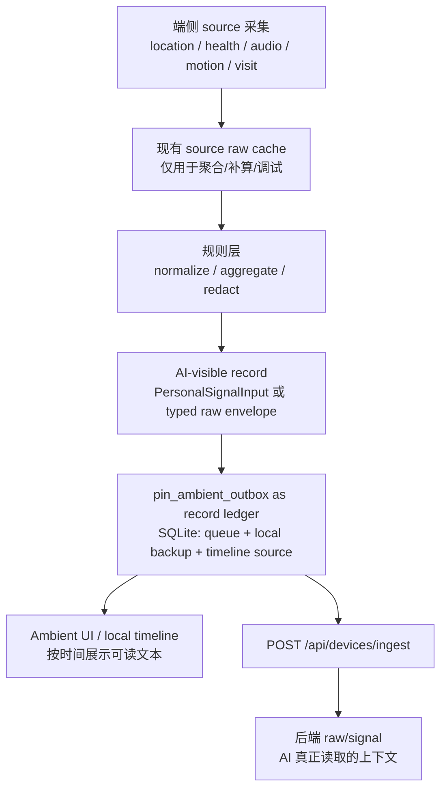
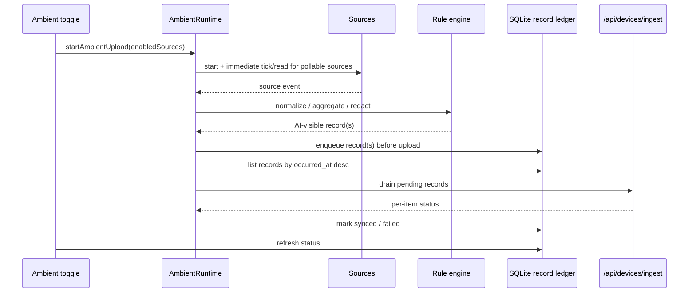

# Ambient AI-visible Records SSOT 重构

> 日期：2026-05-17
> 状态：实施计划
> 读者：改 `proactive-ai-frontend/src/services/ambient/`、Ambient 页面、端侧采集 cadence、device ingest 上报链路的开发者。

## 结论

Ambient 的唯一产品事实源必须是 **AI-visible records**：也就是规则生成后准备上传、正在上传、或已经上传到 `/api/devices/ingest` 的 `raw/signal` 记录。

Ambient 页面显示的不是另一套 local timeline，也不是 JSON 调试 dump，而是这些 AI-visible records 的人类可读 `title / summary / source / time / upload status`。用户看到什么，AI 就应该看到什么；最多差一个 `pending / synced / failed` 状态。

本 plan 只有一条实施路径：**扩展现有 `pin_ambient_outbox` 为 record ledger**。UI 概念可以继续叫 "local timeline"，但实现上 timeline list 必须读这个 ledger。`pin_ambient_timeline` 可以保留为历史兼容/调试数据，不再作为当前产品 timeline 的数据源，也不再单独生产 `ambient_timeline_events`。



## 设计准则

1. **一套实现**：Ambient UI/local timeline 和上传链路必须读写 `pin_ambient_outbox` 扩展后的同一批 AI-visible records，不能各算各的。
2. **上报即展示**：每条准备给 AI 的记录都必须可以被 UI 展示；展示默认用可读文本，不展示 payload JSON。
3. **原始采集可缓存，但不是产品事实源**：source raw cache 只服务跨 source 聚合、离线补算、调试，不直接驱动 UI。
4. **上传队列也是本地备份**：上传队列不能只是短期 retry buffer；synced 记录要保留一段时间，供 UI 和问题排查读取。
5. **不伪造数据**：权限拒绝、HealthKit 无数据、位置获取失败时显示状态/错误，不生成假的健康或位置 signal。
6. **隐私边界不变**：Ambient 仍然只在用户打开后采集。登录本身不启动 source。
7. **首次开启必须可见**：用户打开 Ambient ON 并完成权限授权后，pollable source 的第一批真实记录必须先落本地 ledger、立刻显示 pending，再进入上传；不能等 5 分钟定时器，也不能等后端成功后才显示。

## 当前问题

### 两套记录实现

当前链路里同时存在：

- `pin_ambient_timeline`：本地 SQLite，包含 `ambient_raw_events / ambient_candidate_windows / ambient_timeline_events`。
- `pin_ambient_outbox`：本地 SQLite，包含待上传的 `PersonalSignalInput`。
- 后端 raw/signal：`/api/devices/ingest` 落到 `pai_raw_device_health_observations` 或 `pai_personal_signals`。

这导致三类不一致：

- 本地 timeline 有 event，但后端/AI 没有对应 raw/signal。
- outbox/后端有 raw/signal，但 Ambient 页面为空。
- UI 展示的是本地窗口化结果，而 AI 看到的是另一套上报摘要。

问题不在于 "local timeline" 这个 UI 概念，而在于 timeline 和 outbox 是两套 row、两套规则、两套 formatter。新实现保留 "local timeline" 这个产品视图，但它的数据源改为 `pin_ambient_outbox` record ledger；旧 `pin_ambient_timeline` 只作为历史兼容/调试存储，不继续生产当前产品事实。

### UI 文案不等于 AI-visible record

旧 local timeline event 有自己的 `title / summary`，但它不一定等于上传 record 的 `title / summary`。这违反"AI 看到什么，用户看到什么"的产品语义。

### 采集 cadence 不统一

当前事实：

| Source | 当前行为 |
|---|---|
| location | start 后立刻 `tick()` 一次；之后每 5 分钟一次。 |
| health | start 后立刻 `readAndEmit()` 一次；之后每 15 分钟一次。 |
| activity / sound / visit | 事件流；不是固定 5 分钟 polling。 |
| upload drain | outbox 每 60 秒 drain；start / resume 时也会主动 drain。 |

目标 cadence：

- pollable source 统一支持 "start 后立刻采一次"。
- location 保持 5 分钟。
- health 改为 5 分钟，以匹配 Ambient 页面实时感知预期。
- event-stream source 只启动监听，不因为"每 5 分钟"伪造 signal。

## 目标数据模型

### AI-visible record

前端规则层输出的正式记录必须满足：

```ts
type AmbientAiVisibleRecord = PersonalSignalInput & {
  occurred_at: string;
  title: string;
  summary: string;
  kind: string;
  payload: Record<string, unknown>;
  dedupe_key: string;
};
```

要求：

- `title`：短标题，适合卡片列表展示，例如 `Current location`、`Health updated`、`Voice summary`。
- `summary`：一句人话，不是 JSON，例如 `Near WeWork, accuracy about 18m`、`8120 steps today, 63 bpm average over 6h`。
- `payload`：机器读的结构化字段，默认 UI 不直接展示。
- `occurred_at`：时间线排序唯一依据。
- `kind`：后端 policy 路由依据。
- `dedupe_key`：本地 ledger 和后端幂等依据。

### Record ledger

扩展现有 `pin_ambient_outbox` 为 **record ledger**：

| 字段 | 作用 |
|---|---|
| `id` | 本地 record id。 |
| `item` | JSON 编码的 AI-visible record。 |
| `dedupe_key` | 幂等 key。 |
| `status` | `pending / synced / failed`。 |
| `attempt_count` | retry 次数。 |
| `last_error` | 最近上传错误。 |
| `next_retry_at` | 下次 retry 时间。 |
| `inserted_at` | 本地入队时间。 |
| `synced_at` | 上传成功时间。 |

当前 `ambient_outbox` 已有上传状态字段，所以直接扩展它，不再迁移或改造 `pin_ambient_timeline`。需要补的是：

- 增加 list API：UI/local timeline 能按 `occurred_at DESC` 读取 pending/synced/failed records。
- 延长 synced retention：不能只当 24h retry buffer；至少保留 7 天，后续根据端侧存储压力调。
- UI formatter：把 `item.kind + item.title + item.summary + status` 转成卡片，不直接展示 `item.payload`。
- 首次开启路径：第一条 location/health 等真实 record 必须在 drain 前写入 ledger；上传失败不影响本地可见性。

### Source raw cache

本轮不新建新的 source raw cache。若现有 source pipeline 已经为了 transcript 合并、sound/motion aggregation 使用原始事件缓存，可以继续保留，但它不叫产品 timeline，也不直接给 UI 用。

若后续单独需要做离线补算，再另开 plan 评审类似结构：

```text
ambient_source_events
- id
- source_key
- event_type
- occurred_at
- payload_json
- dedupe_key
- created_at
```

使用边界：

- transcript 多段合并。
- sound / motion run aggregation。
- location + motion + visit 组合成 transition。
- 离线时先存原始采集，稍后补跑规则。

不做：

- 不再维护独立语义的 `ambient_timeline_events`；若保留这个名字，它必须是 record ledger 的兼容表/view。
- 不再让 `ambient_candidate_windows` 作为 UI 数据源。
- 不再用本地-only event 代表 AI 已看到的数据。

## UI 展示规则

Ambient 页面展示 record ledger 中的 AI-visible records。页面概念可以继续叫 "local timeline"，但数据必须来自这同一批 AI-visible rows。

默认卡片字段：

| UI 字段 | 来源 |
|---|---|
| 时间 | `item.occurred_at` |
| 标题 | `item.title` |
| 正文 | `item.summary` |
| 来源 | `kind` 映射出来的 display label，例如 Location / Health / Audio / Motion |
| 状态 | ledger `status`: pending / synced / retrying / failed |
| 隐私标签 | formatter 根据 `kind` 推断：health=sensitive, location/private, sound/normal |

默认不展示：

- 原始 payload JSON。
- rawRefs。
- 经纬度完整精度。
- transcript 全文调试字段。

Debug 模式可以展开 payload，但必须显式操作，不能作为普通用户默认视图。

## 目标链路



## 实施步骤

### Step 1：冻结当前事实，补回归测试

目标：先用测试锁住新准则。

- 新增 record ledger list 测试：
  - enqueue `device.location` 后，UI selector 能读到 `Current location`。
  - enqueue `health.observation` 后，UI selector 能读到 `Health updated`。
  - synced records 不会立刻从 UI 消失。
- 新增 UI formatter 测试：
  - location 不展示裸 JSON。
  - health 不展示 raw payload JSON。
  - failed/pending/synced 状态有可读文案。
- 新增 negative 测试：
  - `AmbientView` 不再依赖一套和上传 records 分离的 `ambient_timeline_events`。
- 新增 first-on 测试：
  - Ambient ON 后立即触发 location tick / health read。
  - mock source 返回后，record 在上传 drain 前已经进入 ledger。
  - UI selector 能在后端返回前读到 pending record。

### Step 2：把 `pin_ambient_outbox` 扩展为 record ledger

目标：让一套 SQLite row 同时承担 queue + local backup + timeline source。

实施路径固定为扩展现有 `SqliteOutboxStore`。不迁移 `pin_ambient_timeline`，不新增第二套 timeline SQLite 表。

- 扩展 `OutboxStore`：
  - `list(limit, filter?)`
  - `get(id)`
  - `countByStatus()`
- SQLite store 实现对应 query。
- synced retention 从 24h 改成至少 7 天。
- 保留现有 `pending()` / `markSynced()` / `markFailed()` 语义，避免上传链路重写过大。
- 明确插入顺序：`enqueue(record)` 成功后再 `drain()`；任何网络错误只改变 status，不删除 UI 可见记录。

### Step 3：引入 AI-visible record formatter

目标：UI 展示人话，不展示 JSON。

新增 `services/ambient/records/format.ts`：

- `formatAmbientRecord(item, status): AmbientDisplayRecord`
- `sourceLabelForKind(kind)`
- `privacyForKind(kind)`

示例输出：

```ts
{
  id: "local-row-id",
  occurredAt: "2026-05-17T10:20:00.000Z",
  title: "Current location",
  body: "Near WeWork, accuracy about 18m",
  sourceLabel: "Location",
  privacy: "private",
  uploadStatus: "pending"
}
```

要求：

- formatter 可以从 `title / summary` 直接展示时优先用它们。
- payload 只用于补充 label，例如 place label、accuracy、metric。
- payload 字段缺失时降级为 `title / summary`，不能降级成 JSON。

### Step 4：Ambient 页面改读 record ledger

目标：UI 显示 AI-visible records。

- `useAmbientTimeline()` 替换为 `useAmbientRecords()`。
- `AmbientView` 的 timeline 列表从 record ledger selector 取数据。
- hook 名字可以继续叫 `useAmbientTimeline()`，但内部必须读 record ledger；若新增 `useAmbientRecords()`，旧 hook 要成为薄 wrapper，不能保留另一套数据路径。
- 首页 Live Session 如果要展示 Ambient 状态，也读同一批 display records，而不是 candidate windows。
- 空态改成真实状态：
  - 无权限：显示哪个 source permission denied。
  - 刚开启但未采到：显示 "Waiting for first Location / Health sample"。
  - 有 pending：显示 pending records。
  - 上传失败：显示 retrying/failed 状态。

### Step 5：消除分离的 timeline 产物

目标：去掉 split-brain，但不强制删除 local timeline SQLite。

- `AmbientRuntime.ingestLocalSignal()` 只能产生并写入 AI-visible records，不能再额外维护一套 UI-only event。
- 停止写当前产品路径上的 `ambient_timeline_events`。
- UI 可以继续叫 timeline，但 timeline list 不能再读 `pin_ambient_timeline` 或 candidate windows 的二次结果；它必须读 `pin_ambient_outbox` record ledger。
- 保留旧 DB 不主动删除，避免升级时破坏用户本地数据；新代码不再依赖旧的 split-brain 语义。
- 若后续确认完全无用，再单独做清理 migration / drop 逻辑。

### Step 6：重整规则层

目标：规则直接产出 AI-visible raw/signal。

优先规则：

| 输入 | 输出 kind | 显示 |
|---|---|---|
| location fix | `device.location` | `Current location` / `Near <place>` |
| health steps/sleep/heart | `health.observation` | `Health updated` / summary 合并指标 |
| transcript ready | `session_summary` | `Voice summary` |
| sound run | `device.sound_scene_run` | `Sound context` |
| motion segment | `device.motion_segment` | `Motion activity` |
| visit arrival/departure | `device.visit` | `Place arrival/departure` |

health 保持后端 raw-only：`health.observation` 仍写 `pai_raw_device_health_observations`，不写 `pai_personal_signals`。

### Step 7：采集 cadence 和 immediate tick

目标：打开 Ambient 后立刻产生第一批真实 record。

- location：保持 start 后立即 tick + 每 5 分钟。
- health：改成 start 后立即 read + 每 5 分钟。
- upload drain：start 后立即 drain 一次；之后保持 60 秒周期。
- app resume：refresh active sources + pollable sources tick once + drain。
- event-stream sources 不伪造记录，只报告 runtime status。
- 首次 ON bootstrap：
  - toggle ON 后立即 reconcile enabled sources，不等下一次 app resume / watchdog。
  - pollable sources 并发执行 first tick/read。
  - 任一 source 返回真实数据后，先 `enqueue` ledger 并通知 UI refresh。
  - drain 只负责把已可见的 pending records 上传，不参与决定 UI 是否显示。
  - 若 30 秒内没有任何真实 record，UI 必须显示具体 source 状态，例如 `Waiting for location sample`、`Health permission granted, no recent data` 或错误原因，不能空白。

## 验收标准

1. 新用户打开 Ambient 并给 location/health 权限后，不依赖后端返回，Ambient 页面能在本地看到至少一条 pending AI-visible record；如果真实 source 没有返回数据，页面必须显示具体等待/无数据/错误状态，不能空白。
2. location mock 返回后，ledger 有 `device.location`，UI 显示 `Current location` 或 `Near <place>`，不展示 JSON。
3. health mock 返回 steps/sleep/heart 任一有效 observation 后，ledger 有 `health.observation`，UI 显示 `Health updated`，不展示 JSON。
4. 网络断开时，records 留在 SQLite，UI 显示 pending/retrying。
5. kill app 再打开，未上传 records 仍在；已上传 records 在 retention 窗口内仍可见。
6. 上传成功后，同一条 record 状态从 pending 变 synced，UI 记录不消失。
7. `AmbientView` 的 timeline list 不再读取 `pin_ambient_timeline` / `ambient_timeline_events` / `ambient_candidate_windows`；它必须读取 `pin_ambient_outbox` record ledger。
8. `npm run type-check` 通过。
9. ambient 相关 vitest 覆盖 formatter、ledger list、scheduler retry、UI selector。
10. web build 主 chunk 仍不能静态包含 `@pin/capacitor-ambient-ai` 等 native bare specifier。

## 文件落点

| 范围 | 文件 |
|---|---|
| record ledger | `proactive-ai-frontend/src/services/ambient/outbox.ts` |
| scheduler | `proactive-ai-frontend/src/services/ambient/sync-scheduler.ts` |
| runtime | `proactive-ai-frontend/src/services/ambient/index.ts` |
| records formatter | `proactive-ai-frontend/src/services/ambient/records/*` |
| UI hook | `proactive-ai-frontend/src/hooks/useAmbientRecords.ts` |
| Ambient 页面 | `proactive-ai-frontend/src/components/constellation/AmbientView.tsx` |
| Home Live Session | `proactive-ai-frontend/src/hooks/useAmbientLiveSession.ts` / `services/ambient/live-session.ts` |
| health cadence | `capacitor-plugins/ambient-ai/src/modules/health-connect/adapter.ts` |
| docs | `docs/modules/data-connectors.mdx`、本 plan |

## 旧设计替代关系

本 plan 替代以下旧假设：

- 旧 Ambient Timeline 设计中 "Ambient Timeline 的事实主源在本地"。
- `ambient_timeline_events` 作为一套和上传 records 分离的 Timeline UI 事实主源。
- "only visible ambient.timeline_event sync"。

新的判断：

- Ambient UI/local timeline 事实主源 = `pin_ambient_outbox` record ledger 中的 AI-visible records。
- 本地 timeline SQLite 可以作为历史兼容/调试存储保留，但不是当前产品事实源，也不是本 plan 的实施目标。
- 本地 source raw cache 只是规则输入/调试缓存，不是 UI 数据源。

## 暂不做

- 不在本 plan 里新增后端 typed location raw 表；`device.location` 先继续走 `pai_personal_signals` fallback。是否需要 `pai_raw_device_location_observations` 单独评审。
- 不把 health 写入 `pai_personal_signals`；health 仍 raw-only。
- 不自动上传 transcript 全文以外的新敏感 raw dump；音频/transcript 仍按现有 privacy 策略处理。
- 不做后台 HealthKit observer；本 plan 仍是 foreground / resume / explicit enable 触发。
