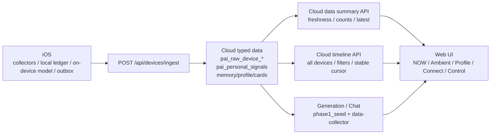

# Web 端 Cloud 数据自强实施计划

> 日期：2026-05-17
> 状态：实施计划
> 读者：改 `proactive-ai-frontend` 主页面、`/api/devices/*`、raw/device 数据展示、generation data-collector 或 `phase1_seed` 的开发者。

## 结论

Web 端的正确定位是 **Cloud 数据 cockpit**，不是第二套本地采集端。

iOS 端负责本地采集、on-device model、本地 outbox 和上传；Cloud 负责保存 raw/signal/memory/card context；Web 端负责把已经上传的数据看清楚、解释清楚、用于 Cloud 卡片生成。

这份 plan 在前一版方案基础上补齐几个缺口：

- 不只改 UI，还要做统一的 cloud data summary contract，供 NOW / Ambient / Profile / Connect / Card source chips 共用。
- Web 不能声称知道 iOS 本地 pending outbox；Cloud 只能确定“已经收到什么”和“最后收到时间”。如果要显示 pending，必须由 iOS 显式上传 sync status。
- 现有 `GET /api/devices/{deviceId}/timeline` 只有单设备、`before` timestamp 游标；all-device cloud timeline 和稳定复合游标需要补。
- 卡片生成链路必须读取 uploaded device data；只让 Web 页面看见数据不够。
- Ambient 本地 SSOT plan 继续负责 iOS local ledger；本 plan 只负责上传后在 Web/Cloud 的可见性和 generation 可用性。



## 自我 Review：前一版方案缺了什么

| 缺口 | 为什么重要 | 本 plan 怎么补 |
|---|---|---|
| 只讲页面，没有统一数据 contract | 多个页面各自查 raw/signals 会产生口径差异 | 新增 `CloudDataSummary` 和 `CloudTimelineItem` 两个前后端共用概念 |
| 没区分 Cloud 已收到 vs iOS 本地 pending | Cloud 不知道本地 outbox 里还有多少没传，不能假装知道 | Summary 只显示 confirmed cloud state；pending 只有 iOS 上报 sync status 后才显示 |
| 没处理 timeline cursor 稳定性 | 仅用 `occurred_at < before`，同 timestamp 被截断时可能漏行 | 新增复合 cursor：`occurred_at + type + row_id`，all-device 和单-device 共用 |
| 没把 date/type filter 下沉到 server | 前端分页后再过滤会漏掉深页数据 | Timeline API 支持 `since/until/kind/deviceId/limit/cursor` |
| 没把卡片生成列为硬验收 | 用户能看见数据，但 generator 不使用，产品仍然不自洽 | 扩 `phase1_seed` 和 generator data-collector，明确拉 device raw/context |
| 没处理隐私展示 | Device raw 里可能有健康、联系人、位置、会话摘要 | Web 默认展示 summary / counts / redacted rows，raw detail 只在明确展开时显示 |
| 没跟 Ambient 本地 SSOT plan 对齐 | iOS local timeline 和 Web cloud timeline 是两个不同事实层 | iOS 用 local ledger；Web 用 cloud uploaded timeline，不再读 native/local runtime |
| 没给空状态和 stale 状态规范 | 用户会分不清“没权限”“没上传”“上传过期” | 统一 `available / stale / empty / unsupported / unknown` 状态 |

## 范围

### 做

- Web 端展示已经上传到 Cloud 的 device/mobile 数据。
- Web 端所有页面共享同一套 freshness / source count / latest timestamp 口径。
- Web Ambient 页面改成 Cloud Timeline，不再显示 mock/demo/local sensing。
- Connect / Profile 把 Uploaded Device Data 提升成一等入口。
- 卡片生成和 pattern matcher 能读取最近 device health / device raw / ambient signals。
- 增加 route 和 frontend tests，证明没有上传数据时不会展示假数据。

### 不做

- 不在浏览器里补 HealthKit、activity、sound classifier、on-device model。
- 不把 health 改成 dual signal；`health.observation` 继续 raw-only。
- 不新增万能 `device_raw_events` 表；继续使用 typed raw 表和 `pai_personal_signals`。
- 不承诺 Web 能看到 iOS 本地 pending outbox，除非 iOS 主动上传 sync status。
- 不把 DebugPanel 当普通用户的数据入口。

## 核心数据 contract

### `CloudDataSummary`

新增 UI route：

```http
GET /api/devices/summary
```

返回按设备聚合的 confirmed cloud state：

```ts
type CloudSourceState =
  | "available"
  | "stale"
  | "empty"
  | "unsupported"
  | "unknown";

type CloudDeviceSourceSummary = {
  sourceKey: "health" | "ambient" | "apps" | "contacts" | "signals";
  label: string;
  state: CloudSourceState;
  count: number;
  latestOccurredAt: string | null;
  latestIngestedAt: string | null;
};

type CloudDeviceSummary = {
  deviceId: string;
  displayName: string;
  platform: string;
  status: "active" | "revoked" | "stale";
  lastSeenAt: string | null;
  lastUploadAt: string | null;
  sources: CloudDeviceSourceSummary[];
};
```

状态规则：

- `available`：Cloud 至少有一条对应数据，且未超过 stale threshold。
- `stale`：Cloud 有历史数据，但最新 `ingested_at` 或 `occurred_at` 已过期。
- `empty`：设备存在，但 Cloud 没收到该 source 数据。
- `unsupported`：该平台/source 本身不支持。
- `unknown`：Cloud 无法判断，例如设备 metadata 不完整。

默认 stale threshold：

| Source | threshold |
|---|---|
| device heartbeat / last seen | 24h |
| health | 24h |
| ambient / location / activity signals | 24h |
| apps / contacts snapshots | 7d |

如果后续要显示 pending / failed upload，需要 iOS 上传一条轻量 `device.sync_status` signal 或新增 sync status endpoint。本 plan 第一版不依赖它。

### `CloudTimelineItem`

新增 all-device timeline route：

```http
GET /api/devices/timeline?deviceId=&since=&until=&kind=&limit=&cursor=
```

要求：

- `deviceId` 可选；不传时看所有 active devices 的 uploaded timeline。
- `kind` 支持 `signal` / `health` / 后续可扩展 `apps` / `contacts`。
- `since/until` 在 server 端过滤。
- `cursor` 使用复合游标，不能只用 timestamp。
- route 要放在 `/{device_id}/timeline` 之前，避免 FastAPI path 捕获冲突。

返回：

```ts
type CloudTimelineItem =
  | {
      type: "signal";
      deviceId: string | null;
      occurredAt: string;
      ingestedAt: string | null;
      rowId: string;
      row: PersonalSignal;
    }
  | {
      type: "health";
      deviceId: string;
      occurredAt: string;
      ingestedAt: string | null;
      rowId: string;
      row: DeviceHealthObservation;
    };
```

现有 `GET /api/devices/{deviceId}/timeline` 也要补同样的 `since/until/kind/cursor` 语义。为了兼容前端旧调用，可以暂时保留 `before`，但新调用只用 `cursor`。

## API 实施步骤

### Phase 1：Cloud summary + timeline

- [ ] 在 `pinai-agents/src/pinai_agents/web/routes/ui/devices.py` 新增 `GET /summary`。
- [ ] 统计 active devices：来自 `pai_user_devices`。
- [ ] 统计 device signals：`pai_personal_signals` 按 `device_id/source/kind` 聚合，排除 `archived`。
- [ ] 统计 health：`pai_raw_device_health_observations` 按 `device_id` 聚合 count、max occurred、max ingested。
- [ ] 统计 apps / contacts：`pai_raw_device_apps_snapshot`、`pai_raw_device_contacts_snapshot` 按 `device_id` 聚合。
- [ ] 新增 `GET /api/devices/timeline` all-device route。
- [ ] 强化现有 `GET /api/devices/{deviceId}/timeline`，支持 `since/until/kind/cursor`。
- [ ] 复合 cursor 使用 `occurred_at DESC, type ASC, row_id ASC` 的完整位置，避免同 timestamp 漏行。
- [ ] 如果真实数据 EXPLAIN 出现 seq scan，再加 migration 补索引；不要先拍脑袋加索引。

测试：

```bash
cd pinai-agents && uv run pytest tests/web/devices/test_timeline.py
cd pinai-agents && uv run pytest tests/web/routes/test_device_summary.py
```

如果测试文件还不存在，新建到对应目录。

### Phase 2：Frontend API + hooks

- [ ] 在 `proactive-ai-frontend/src/lib/api.ts` 增加 `fetchCloudDeviceSummary`。
- [ ] 在 `api.ts` 增加 `fetchCloudDeviceTimeline`，使用新 `cursor` contract。
- [ ] 新增 `useCloudDataSummary` hook，供 NOW / Profile / Connect 共用。
- [ ] 新增 `useCloudTimeline` hook，供 Web Ambient 和 DeviceTimeline 共用。
- [ ] 旧 `fetchDeviceTimeline` 保留，但内部可以转到新 route 或补 `cursor` 参数。
- [ ] 所有 hooks 都要支持 abort signal，避免 view 切换时 setState race。

测试：

```bash
cd proactive-ai-frontend && npm test -- api
cd proactive-ai-frontend && npm run type-check
```

### Phase 3：Web 页面调整

#### NOW

- [ ] 增加 `Cloud Data Status` 小区域，展示最近上传设备、stale source、empty source。
- [ ] 卡片 source chips 区分 `Cloud synced` / `stale` / `missing`。
- [ ] 如果移动端数据 stale，Generate 前提示“会用 Cloud 已收到的数据，不会读取 iPhone 本地未上传内容”。

#### Ambient

- [ ] Web 模式只渲染 Cloud Timeline。
- [ ] 移除 web mock devices / mock timeline / web demo live session。
- [ ] 移除或改写 “Listening / sensing / local timeline” 文案。
- [ ] native-only source toggles 在 Web 上显示为 iOS 状态，不表现成浏览器采集开关。
- [ ] 空状态明确区分：无设备、设备未上传、source 未授权、source stale。

#### Profile

- [ ] 把 `Uploaded Device Data` 提到 Profile 一等区域。
- [ ] 每台设备显示 source counts、latest occurred、latest ingested。
- [ ] Raw detail 默认折叠，展开后才显示具体 rows。

#### Connect

- [ ] Hardware Devices 从设备列表升级为 sync health 面板。
- [ ] 每台设备显示 last seen、last upload、stale source、Open Cloud Timeline。
- [ ] 明确文案：Web 不采集本机环境，只查看和管理 Cloud 收到的数据。

#### Control

- [ ] Ambient / source controls 拆成 `Cloud visibility` 和 `Native collection` 两层。
- [ ] Web 上 native-only model / source 只显示状态和说明，不显示可运行的本机控制。
- [ ] 保留 iOS 上的本地控制路径。

#### Account

- [ ] 增加 `Uploaded mobile data` 入口，跳 Profile 或 Connect 的对应 section。
- [ ] 数据导出/删除说明包含 uploaded device raw。

测试：

```bash
cd proactive-ai-frontend && npm test -- AmbientView DeviceTimeline GoalsView
cd proactive-ai-frontend && npm run type-check
```

手工验收：

- 桌面 Web 有上传数据时，Ambient 显示真实 Cloud Timeline。
- 桌面 Web 无上传数据时，Ambient 不显示 mock 数据。
- Web 上没有“本机正在 sensing / listening / on-device model running”的文案。

### Phase 4：Generation / AI context

必须让卡片生成实际使用 uploaded mobile/device context。

- [ ] 在 `pinai-agents/src/pinai_agents/web/services/phase1_seed.py` 增加 `device` section：
  - recent health summary
  - recent ambient/device signals summary
  - apps / contacts snapshot freshness
  - device stale flags
- [ ] 在 `pinai-agents/src/pinai_agents/chat/agents/generator.py` 的 data-collector canonical script 中加入 device raw：
  - `client.raw.list("device", "health", hours=24, limit=50)`
  - `client.raw.list("device", "apps", hours=168, limit=20)`
  - `client.raw.list("device", "contacts", hours=168, limit=20)`
- [ ] `phase1.json` 的 summary print 不能输出 raw body，保持只输出 counts。
- [ ] Planner prompt 明确：如果 device source stale，要把 stale 当作输入事实，而不是编造今天状态。
- [ ] Card `sources[]` 里允许引用 device raw/source，例如 `device.health:<row_id>` 或现有 raw row id。
- [ ] 相关 evaluator 规则继续要求 sources 可验证。

测试：

```bash
cd pinai-agents && uv run pytest tests/web/services/test_phase1_seed.py
cd pinai-agents && uv run pytest tests/chat/
cd pinai-agents/packages/pinai_sdk && uv run pytest
```

手工验收：

- 插入一条 `pai_raw_device_health_observations`。
- `build_phase1_seed()` 返回 `device.health` 摘要。
- 跑一次 generate，LangSmith / `/state/phase1.json` 能看到 device source count，但不泄露完整 raw body 到日志。

## 验收标准

1. Web 登录后，能在 Ambient / Profile / Connect 看到已上传的 iOS device 数据。
2. Web 没有本地采集能力时，不展示假 timeline、不显示本机 sensing 文案。
3. `GET /api/devices/summary` 能准确区分 available / stale / empty。
4. all-device cloud timeline 支持 server-side filter 和稳定 cursor。
5. 同 timestamp 多行不会因为分页漏数据。
6. 卡片生成能读取 uploaded device health / ambient signals，并在 sources 中体现。
7. Health 继续 raw-only，不写入 `pai_personal_signals`。
8. iOS 本地 Ambient ledger 仍按 `Ambient AI-visible Records SSOT 重构` 执行，不被 Web cloud timeline 改动打断。

## 代码入口

| 区域 | 文件 |
|---|---|
| 当前 Constellation 主布局 | `proactive-ai-frontend/src/components/constellation/ConstellationLayout.tsx` |
| Web Ambient 页面 | `proactive-ai-frontend/src/components/constellation/AmbientView.tsx` |
| 设备列表 / timeline | `proactive-ai-frontend/src/components/DeviceConnections.tsx`、`DeviceTimeline.tsx` |
| Profile raw/device 展示 | `proactive-ai-frontend/src/components/GoalsView.tsx` |
| 前端 API client | `proactive-ai-frontend/src/lib/api.ts` |
| 设备 routes | `pinai-agents/src/pinai_agents/web/routes/ui/devices.py` |
| raw device repo | `pinai-agents/src/pinai_agents/web/db/repositories/raw_device.py` |
| Web-side phase1 seed | `pinai-agents/src/pinai_agents/web/services/phase1_seed.py` |
| Chat generator data-collector | `pinai-agents/src/pinai_agents/chat/agents/generator.py` |
| Agent raw route / SDK | `pinai-agents/src/pinai_agents/web/routes/agent/raw.py`、`pinai-agents/packages/pinai_sdk/src/pinai_sdk/_client.py` |

## 与现有 plans 的关系

- [Ambient AI-visible Records SSOT 重构](./2026-05-17-ambient-ai-visible-records-ssot)：负责 iOS/native 本地 ledger、首次 ON 可见、上传队列和 AI-visible records。本 plan 负责上传后的 Web/Cloud 可见性。
- [V2 → V3 功能迁移计划](./2026-05-12-v2-to-v3-migration)：已经把 device ingest、health raw-only、统一 device timeline 的基础链路落到 V3。本 plan 在这个基础上补 all-device timeline、summary contract 和 Web 页面自洽。
- [Constellation 前端整体迁移](./2026-05-14-constellation-frontend-port)：指出 Ambient / Account / Connect 曾是 hardcode 视觉。本 plan 是把这些页面接到真实 Cloud 数据的后续实施计划。
